# Polyglot Codebase Knowledge Graph

> Generated offline by **readmenator**. 289 files, 7449 symbols, 1674 imports. Supports C, C++, Python, Go, Rust, JS/TS, Java, C#, Shell, PHP, Dart, GDScript, Nim, ASM, Ruby, Swift, Kotlin, Scala, Lua, Elixir.
> No LLMs. No tokens. Pure static analysis. See more [here](https://github.com/grisuno/ReadMenator)

**Start here:** Statistics Dashboard for scope, God Nodes for blast radius, Architecture Reference for per-file API. Agents: prefer `readmenator-agent/INDEX.md` + `SYMBOLS.md`.

**Wiki:** prefer `readmenator-wiki/index.md` for progressive disclosure: one synthesis page per community, `connections.json` with EXTRACTED vs INFERRED confidence, `queries.md` log, `REPORT.md` audit.

**Confidence:** EXTRACTED = parsed from source, INFERRED = heuristic bridge, AMBIGUOUS = reported, never hidden. See `readmenator-wiki/REPORT.md`.

**Total Files Parsed:** 289 | **Total Symbols Extracted:** 7449 | **Total Imports:** 1674
 | **Resolved Imports:** 543

<!-- ranking_model: v1.0 | weights: {ppr:0.45,auth:0.2,test:0.15,doc:0.1,fresh:0.1} | alpha:0.85 | commit:8936453 | date:2026-07-18 -->


## Table of Contents

1. [Statistics Dashboard](#statistics-dashboard)
2. [Architectural Layers](#architectural-layers)
3. [Architecture Overview](#architecture-overview)
4. [Execution Flows](#execution-flows)
5. [Ranked Context](#ranked-context)
6. [God Nodes](#god-nodes)
7. [Community Analysis](#community-analysis)
8. [Surprising Connections](#surprising-connections)
9. [Suggested Questions](#suggested-questions)
10. [Force-Graph Explorer](#force-graph-explorer)
11. [Corpus Analytics](#corpus-analytics)
12. [Taint Propagation Map](#taint-propagation-map)
13. [Hotspot Analysis](#hotspot-analysis)
14. [Dependency Cycles](#dependency-cycles)
15. [Change Impact Analysis](#change-impact-analysis)
16. [Architecture Violations](#architecture-violations)
17. [Suggested Linting Rules](#suggested-linting-rules)
18. [Dataflow Analysis](#dataflow-analysis)
19. [Concept Graph](#concept-graph)
20. [Orphans](#orphans)
21. [Query Recipes](#query-recipes)
22. [Structural Knowledge Map](#structural-knowledge-map)
23. [UML Class Diagram](#uml-class-diagram)
24. [Code Property Graph](#code-property-graph)
25. [Architecture Reference](#architecture-reference)
    - [C (179 files)](#c-179-files)
    - [H (94 files)](#h-94-files)
    - [PY (12 files)](#py-12-files)
    - [SH (4 files)](#sh-4-files)

---

## Statistics Dashboard

| Metric | Value |
|--------|-------|
| Total Files | 289 |
| Total Symbols | 7449 |
| Total Imports | 1674 |
| Call Edges | 649 |
| Inheritance Edges | 0 |
| Languages | 4 |
| Avg Symbols/File | 25.8 |
| Avg Imports/File | 5.8 |
| Resolved Imports | 543 |

### Top Files by Import Count (Fan-Out)

| File | Imports | Symbols | Language |
|------|---------|---------|----------|
| `browser_ui.c` | 82 | 633 | c |
| `tab.c` | 40 | 145 | c |
| `freedom.c` | 34 | 48 | c |
| `page_view.c` | 24 | 253 | c |
| `css.c` | 22 | 247 | c |
| `test_os_sandbox.c` | 22 | 19 | c |
| `test_tab.c` | 18 | 148 | c |
| `http_cache.c` | 17 | 38 | c |
| `test_js_dom.c` | 17 | 228 | c |
| `os_sandbox.c` | 16 | 31 | c |

---

## Architectural Layers

Auto-detected from path patterns, naming conventions, and imported frameworks.

| Layer | Files |
|-------|-------|
| utility | 167 |
| testing | 83 |
| presentation | 20 |
| data_access | 9 |
| infrastructure | 6 |
| business_logic | 4 |

### utility

- `app.py` (py, 3 symbols)
- `docker-entrypoint.sh` (sh, 0 symbols)
- `docker_run.sh` (sh, 0 symbols)
- `bui_theme.c` (c, 6 symbols)
- `svg_paint.c` (c, 5 symbols)
- `anti_fp.h` (h, 35 symbols)
- `block_flow.h` (h, 4 symbols)
- `box_blur.h` (h, 5 symbols)
- `box_style.h` (h, 31 symbols)
- `box_tree.h` (h, 34 symbols)
- `browser.h` (h, 19 symbols)
- `compositor.h` (h, 9 symbols)
- `css.h` (h, 140 symbols)
- `css_atrule.h` (h, 10 symbols)
- `css_box.h` (h, 27 symbols)
- *... and 152 more*

### presentation

- `browser_ui.c` (c, 633 symbols)
- `browser_ui_internal.h` (h, 10 symbols)
- `freedom_view.c` (c, 2 symbols)
- `ui_render.c` (c, 29 symbols)
- `flex_layout.h` (h, 43 symbols)
- `http_cache.h` (h, 19 symbols)
- `page_view.h` (h, 91 symbols)
- `render_doc.h` (h, 27 symbols)
- `render_policy.h` (h, 9 symbols)
- `renderer.h` (h, 7 symbols)
- `svg_render.h` (h, 19 symbols)
- `ui.h` (h, 18 symbols)
- `flex_layout.c` (c, 35 symbols)
- `http_cache.c` (c, 38 symbols)
- `page_view.c` (c, 253 symbols)
- *... and 5 more*

### infrastructure

- `cached_fetch.h` (h, 4 symbols)
- `freedom_config.h` (h, 15 symbols)
- `js_env.h` (h, 3 symbols)
- `cached_fetch.c` (c, 14 symbols)
- `js_env.c` (c, 30 symbols)
- `js_events.c` (c, 10 symbols)

### data_access

- `data_url.h` (h, 6 symbols)
- `disk_store.h` (h, 3 symbols)
- `local_store.h` (h, 11 symbols)
- `psl_data.h` (h, 7 symbols)
- `web_storage.h` (h, 13 symbols)
- `data_url.c` (c, 10 symbols)
- `disk_store.c` (c, 6 symbols)
- `local_store.c` (c, 323 symbols)
- `web_storage.c` (c, 17 symbols)

### business_logic

- `js_policy.h` (h, 7 symbols)
- `request_policy.h` (h, 5 symbols)
- `js_policy.c` (c, 6 symbols)
- `request_policy.c` (c, 11 symbols)

### testing

- `itest_secure_fetch.c` (c, 2 symbols)
- `test_anti_fp.c` (c, 15 symbols)
- `test_block_flow.c` (c, 8 symbols)
- `test_box_blur.c` (c, 11 symbols)
- `test_box_style.c` (c, 49 symbols)
- `test_box_tree.c` (c, 69 symbols)
- `test_browser.c` (c, 17 symbols)
- `test_cached_fetch.c` (c, 14 symbols)
- `test_compositor.c` (c, 21 symbols)
- `test_css.c` (c, 354 symbols)
- `test_css_atrule.c` (c, 10 symbols)
- `test_css_box.c` (c, 13 symbols)
- `test_css_color.c` (c, 36 symbols)
- `test_css_computed.c` (c, 9 symbols)
- `test_css_drops.c` (c, 25 symbols)
- *... and 68 more*

---

## Architecture Overview

12 components stacked in 7 dependency tiers (weighted Eades-Lin-Smyth ordering: arrows point from dependent to dependency, top to bottom). Labels are import counts, thick arrows the top quartile; 18 transitively implied edges are omitted. Dashed red arrows are upward dependencies: the smallest set of imports that closes every cycle and breaks the layering. Cyan components hold entry points. Interactive version: `readmenator-apidocs/index.html#/flows`.

Upward dependencies to fix first: `src: tab` -> `include: page_view` (4 imports); `src: css` -> `src: tab` (3 imports); `src: css` -> `include: page_view` (3 imports); `src: tab` -> `src: text_shape` (2 imports); `src: css` -> `src: text_shape` (1 imports); `src: tab` -> `include: browser_ui` (1 imports); `include: page_view` -> `src: text_shape` (1 imports); `include: browser` -> `src: tab` (1 imports); `src: local_store` -> `include: browser_ui` (1 imports); `gui` -> `include: browser_ui` (1 imports); `gui` -> `src: tab` (1 imports); `include: secure_fetch` -> `src: tab` (1 imports); `include: prefetch` -> `src: tab` (1 imports)

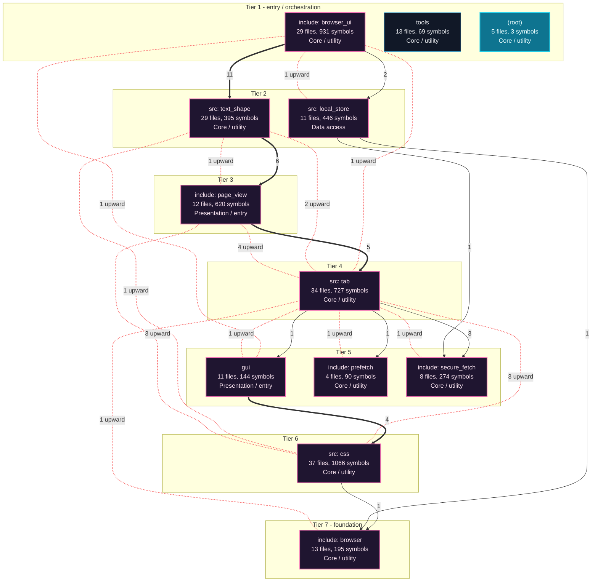

---

## Execution Flows

Entry points are scored from `__main__` guards, `main` functions, entry-style names and files, and call-graph sources. Each flow walks resolved calls in call-site order (depth <= 4, <= 40 steps); numbers give the call order, dashed arrows revisit an already expanded callee, red arrows are recursion. Interactive version with zoom and per-node docs: `readmenator-apidocs/index.html#/flows`.

### `freedom_view.main`

`gui/freedom_view.c:37`, score 11: `main` in a compiled-language file; entry-style name `main`.

Call tree:

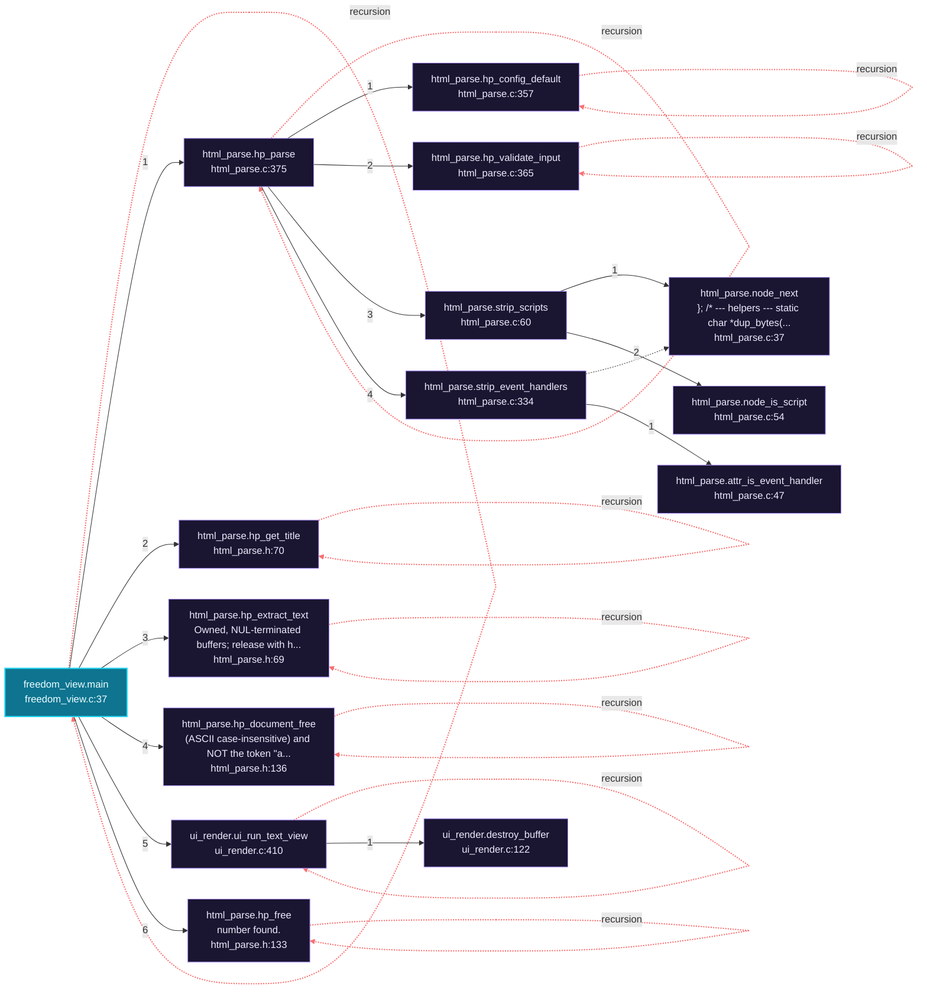

Cross-file sequence:

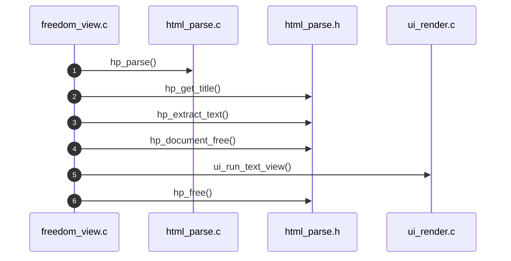

### `freedom.main`

`src/freedom.c:1255`, score 11: `main` in a compiled-language file; entry-style name `main`.

Call tree:

```mermaid
flowchart LR
    classDef entry fill:#0e7490,stroke:#22d3ee,color:#ecfeff,stroke-width:2px;
    classDef external fill:#1a1530,stroke:#a78bfa,color:#ede9fe;
    n_src_freedom_c__main["freedom.main<br/>freedom.c:1255"]:::entry
    n_gui_browser_ui_c__strcmp["browser_ui.strcmp<br/>browser_ui.c:2742"]:::external
    n_include_prefs_h__free["prefs.free<br/>prefs.h:72"]:::external
    n_src_prefs_c__prefs_format["prefs.prefs_format<br/>prefs.c:183"]:::external
    n_src_prefs_c__prefs_parse["prefs.prefs_parse<br/>prefs.c:247"]:::external
    n_src_prefs_c__prefs_free["prefs.prefs_free<br/>prefs.c:74"]:::external
    n_src_prefs_c__prefs_init["prefs.prefs_init<br/>prefs.c:66"]:::external
    n_src_prefs_c__url_valid["prefs.url_valid<br/>A representable URL: 1..PREFS_MAX_URL-1 bytes...<br/>prefs.c:26"]:::external
    n_src_prefs_c__bookmark_push["prefs.bookmark_push<br/>Appends a cleaned bookmark.<br/>prefs.c:91"]:::external
    n_src_prefs_c__history_push_back["prefs.history_push_back<br/>Appends a history entry at the BACK preservin...<br/>prefs.c:109"]:::external
    n_src_prefs_c__apply_kv["prefs.apply_kv<br/>} for (size_t i = 0#59; i #lt; p-#gt;history_len#59; ++i)...<br/>prefs.c:231"]:::external
    n_gui_browser_ui_c__prepare_fetch["browser_ui.prepare_fetch<br/>Builds cfg for url and applies the pre-fetch...<br/>browser_ui.c:1773"]:::external
    n_gui_browser_ui_c__host_from_url["browser_ui.host_from_url<br/>A plain-http URL whose realm self-authenticat...<br/>browser_ui.c:1055"]:::external
    n_gui_browser_ui_c__is_https_url["browser_ui.is_https_url<br/>browser_ui.c:1040"]:::external
    n_src_hostblock_c__hb_check["hostblock.hb_check<br/>hostblock.c:193"]:::external
    n_src_hostblock_c__lower["hostblock.lower<br/>hostblock.c:107"]:::external
    n_src_hostblock_c__table_contains["hostblock.table_contains<br/>hostblock.c:92"]:::external
    n_include_anti_fp_h__domain["anti_fp.domain<br/>anti_fp.h:91"]:::external
    n_include_browser_h__browser_is_exception["browser.browser_is_exception<br/>Index of the current entry within its documen...<br/>browser.h:99"]:::external
    n_src_browser_c__browser_add_exception["browser.browser_add_exception<br/>browser.c:472"]:::external
    n_src_browser_c__browser_set_url_bar["browser.browser_set_url_bar<br/>browser.c:178"]:::external
    n_src_browser_c__browser_commit_url_bar["browser.browser_commit_url_bar<br/>browser.c:190"]:::external
    n_src_browser_c__browser_url_bar_insert["browser.browser_url_bar_insert<br/>browser.c:326"]:::external
    n_src_browser_c__browser_url_bar_backspace["browser.browser_url_bar_backspace<br/>browser.c:341"]:::external
    n_src_browser_c__browser_url_bar_delete["browser.browser_url_bar_delete<br/>browser.c:355"]:::external
    n_src_browser_c__browser_url_bar_move_cursor["browser.browser_url_bar_move_cursor<br/>browser.c:366"]:::external
    n_src_browser_c__browser_url_bar_clear["browser.browser_url_bar_clear<br/>browser.c:400"]:::external
    n_src_browser_c__browser_url_bar_extend_cursor["browser.browser_url_bar_extend_cursor<br/>browser.c:376"]:::external
    n_src_browser_c__browser_url_bar_set_cursor["browser.browser_url_bar_set_cursor<br/>browser.c:385"]:::external
    n_src_browser_c__browser_url_bar_select_all["browser.browser_url_bar_select_all<br/>browser.c:393"]:::external
    n_gui_browser_ui_c__hb_is_allowlisted["browser_ui.hb_is_allowlisted<br/>browser_ui.c:1724"]:::external
    n_include_request_policy_h__rp_host_of["request_policy.rp_host_of<br/>Lowercased host of an absolute URL into out.<br/>request_policy.h:30"]:::external
    n_include_tls_impersonate_h__ti_should_impersonate["tls_impersonate.ti_should_impersonate<br/>The double opt-in + user-flag gate (pure).<br/>tls_impersonate.h:56"]:::external
    n_src_freedom_c__main -.->|"recursion"| n_src_freedom_c__main
    n_src_freedom_c__main -->|"1"| n_gui_browser_ui_c__strcmp
    n_gui_browser_ui_c__strcmp -.->|"recursion"| n_gui_browser_ui_c__strcmp
    n_gui_browser_ui_c__strcmp -->|"1"| n_include_prefs_h__free
    n_include_prefs_h__free -->|"1"| n_src_prefs_c__prefs_format
    n_src_prefs_c__prefs_format -.->|"recursion"| n_src_prefs_c__prefs_format
    n_src_prefs_c__prefs_format -.->|"recursion"| n_include_prefs_h__free
    n_include_prefs_h__free -->|"2"| n_src_prefs_c__prefs_parse
    n_src_prefs_c__prefs_parse -.->|"recursion"| n_src_prefs_c__prefs_parse
    n_src_prefs_c__prefs_parse -->|"1"| n_src_prefs_c__prefs_free
    n_src_prefs_c__prefs_parse -->|"2"| n_src_prefs_c__prefs_init
    n_src_prefs_c__prefs_parse -->|"3"| n_src_prefs_c__url_valid
    n_src_prefs_c__prefs_parse -->|"4"| n_src_prefs_c__bookmark_push
    n_src_prefs_c__prefs_parse -->|"5"| n_src_prefs_c__history_push_back
    n_src_prefs_c__prefs_parse -->|"6"| n_src_prefs_c__apply_kv
    n_gui_browser_ui_c__strcmp -->|"2"| n_gui_browser_ui_c__prepare_fetch
    n_gui_browser_ui_c__prepare_fetch -->|"1"| n_gui_browser_ui_c__host_from_url
    n_gui_browser_ui_c__host_from_url -->|"1"| n_gui_browser_ui_c__is_https_url
    n_gui_browser_ui_c__prepare_fetch -->|"2"| n_src_hostblock_c__hb_check
    n_src_hostblock_c__hb_check -.->|"recursion"| n_src_hostblock_c__hb_check
    n_src_hostblock_c__hb_check -->|"1"| n_src_hostblock_c__lower
    n_src_hostblock_c__hb_check -->|"2"| n_src_hostblock_c__table_contains
    n_gui_browser_ui_c__prepare_fetch -->|"3"| n_include_anti_fp_h__domain
    n_gui_browser_ui_c__prepare_fetch -->|"4"| n_include_browser_h__browser_is_exception
    n_include_browser_h__browser_is_exception -.->|"recursion"| n_include_browser_h__browser_is_exception
    n_include_browser_h__browser_is_exception -->|"1"| n_src_browser_c__browser_add_exception
    n_include_browser_h__browser_is_exception -->|"2"| n_src_browser_c__browser_set_url_bar
    n_include_browser_h__browser_is_exception -->|"3"| n_src_browser_c__browser_commit_url_bar
    n_include_browser_h__browser_is_exception -->|"4"| n_src_browser_c__browser_url_bar_insert
    n_include_browser_h__browser_is_exception -->|"5"| n_src_browser_c__browser_url_bar_backspace
    n_include_browser_h__browser_is_exception -->|"6"| n_src_browser_c__browser_url_bar_delete
    n_include_browser_h__browser_is_exception -->|"7"| n_src_browser_c__browser_url_bar_move_cursor
    n_include_browser_h__browser_is_exception -->|"8"| n_src_browser_c__browser_url_bar_clear
    n_include_browser_h__browser_is_exception -->|"9"| n_src_browser_c__browser_url_bar_extend_cursor
    n_include_browser_h__browser_is_exception -->|"10"| n_src_browser_c__browser_url_bar_set_cursor
    n_include_browser_h__browser_is_exception -->|"11"| n_src_browser_c__browser_url_bar_select_all
    n_gui_browser_ui_c__prepare_fetch -->|"5"| n_gui_browser_ui_c__hb_is_allowlisted
    n_gui_browser_ui_c__hb_is_allowlisted -.->|"recursion"| n_gui_browser_ui_c__hb_is_allowlisted
    n_gui_browser_ui_c__hb_is_allowlisted -->|"1"| n_include_request_policy_h__rp_host_of
    n_gui_browser_ui_c__hb_is_allowlisted -->|"2"| n_include_tls_impersonate_h__ti_should_impersonate
    linkStyle 0,2,5,6,8,19,24,37 stroke:#f87171,stroke-width:2px;
```

Cross-file sequence:

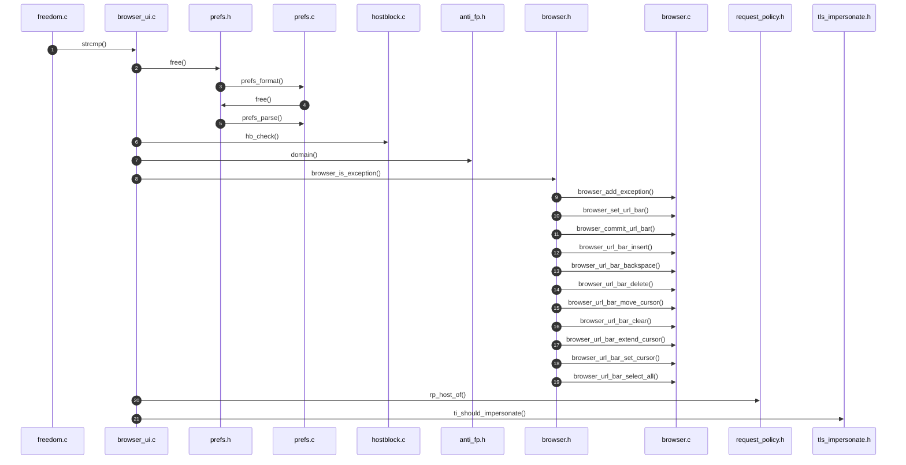

### `gen_psl.main`

`tools/gen_psl.c:67`, score 11: `main` in a compiled-language file; entry-style name `main`.

Call tree:

```mermaid
flowchart LR
    classDef default fill:#111827,stroke:#38bdf8,color:#e5e7eb;
    classDef entry fill:#0e7490,stroke:#22d3ee,color:#ecfeff,stroke-width:2px;
    classDef external fill:#1a1530,stroke:#a78bfa,color:#ede9fe;
    n_tools_gen_psl_c__main["gen_psl.main<br/>gen_psl.c:67"]:::entry
    n_tools_gen_psl_c__ascii_lower["gen_psl.ascii_lower<br/>/* Sorts then drops adjacent duplicates in pl...<br/>gen_psl.c:55"]:::default
    n_tools_gen_psl_c__vec_push["gen_psl.vec_push<br/>gen_psl.c:27"]:::default
    n_tools_gen_psl_c__sort_unique["gen_psl.sort_unique<br/>v-#gt;cap = v-#gt;cap ?<br/>gen_psl.c:43"]:::default
    n_gui_browser_ui_c__strcmp["browser_ui.strcmp<br/>browser_ui.c:2742"]:::external
    n_include_prefs_h__free["prefs.free<br/>prefs.h:72"]:::external
    n_src_prefs_c__prefs_format["prefs.prefs_format<br/>prefs.c:183"]:::external
    n_src_prefs_c__prefs_parse["prefs.prefs_parse<br/>prefs.c:247"]:::external
    n_gui_browser_ui_c__prepare_fetch["browser_ui.prepare_fetch<br/>Builds cfg for url and applies the pre-fetch...<br/>browser_ui.c:1773"]:::external
    n_gui_browser_ui_c__host_from_url["browser_ui.host_from_url<br/>A plain-http URL whose realm self-authenticat...<br/>browser_ui.c:1055"]:::external
    n_src_hostblock_c__hb_check["hostblock.hb_check<br/>hostblock.c:193"]:::external
    n_include_anti_fp_h__domain["anti_fp.domain<br/>anti_fp.h:91"]:::external
    n_include_browser_h__browser_is_exception["browser.browser_is_exception<br/>Index of the current entry within its documen...<br/>browser.h:99"]:::external
    n_gui_browser_ui_c__hb_is_allowlisted["browser_ui.hb_is_allowlisted<br/>browser_ui.c:1724"]:::external
    n_include_tls_impersonate_h__ti_should_impersonate["tls_impersonate.ti_should_impersonate<br/>The double opt-in + user-flag gate (pure).<br/>tls_impersonate.h:56"]:::external
    n_src_net_realm_c__nr_classify_url["net_realm.nr_classify_url<br/>net_realm.c:68"]:::external
    n_include_net_realm_h__nr_realm_name["net_realm.nr_realm_name<br/>1 iff plain http:// is acceptable for this re...<br/>net_realm.h:69"]:::external
    n_gui_browser_ui_c__clear_doc["browser_ui.clear_doc<br/>Releases the structured render of the previou...<br/>browser_ui.c:1369"]:::external
    n_gui_browser_ui_c__free_inputs["browser_ui.free_inputs<br/>are not text-editable -- they are tracked via...<br/>browser_ui.c:1114"]:::external
    n_gui_browser_ui_c__free_images["browser_ui.free_images<br/>static int input_is_editable(int input_type)...<br/>browser_ui.c:1122"]:::external
    n_include_render_doc_h__rd_free["render_doc.rd_free<br/>Builds the paint-ready document from an inert...<br/>render_doc.h:315"]:::external
    n_gui_browser_ui_c__set_cache["browser_ui.set_cache<br/>Releases the structured render of the previou...<br/>browser_ui.c:1379"]:::external
    n_gui_browser_ui_c__gui_quiesce["browser_ui.gui_quiesce<br/>browser_ui.c:15423"]:::external
    n_include_browser_h__browser_set_page["browser.browser_set_page<br/>browser.h:71"]:::external
    n_src_browser_c__browser_navigate["browser.browser_navigate<br/>browser.c:224"]:::external
    n_src_browser_c__browser_back["browser.browser_back<br/>browser.c:268"]:::external
    n_src_browser_c__browser_forward["browser.browser_forward<br/>browser.c:280"]:::external
    n_src_browser_c__browser_push_state["browser.browser_push_state<br/>browser.c:236"]:::external
    n_src_browser_c__browser_replace_state["browser.browser_replace_state<br/>browser.c:243"]:::external
    n_gui_browser_ui_c__fetch_launch["browser_ui.fetch_launch<br/>Spawns a detached worker to fetch url under c...<br/>browser_ui.c:1968"]:::external
    n_gui_browser_ui_c__fetch_job_free["browser_ui.fetch_job_free<br/>browser_ui.c:1876"]:::external
    n_gui_browser_ui_c__remember_visit["browser_ui.remember_visit<br/>Records a committed navigation in the persist...<br/>browser_ui.c:984"]:::external
    n_src_css_color_c__strncmp["css_color.strncmp<br/>css_color.c:598"]:::external
    n_src_prefs_c__prefs_history_add["prefs.prefs_history_add<br/>prefs.c:152"]:::external
    n_src_profile_c__profile_save["profile.profile_save<br/>profile.c:133"]:::external
    n_gui_browser_ui_c__show_busy["browser_ui.show_busy<br/>Marks a request in flight and paints a frame...<br/>browser_ui.c:2554"]:::external
    n_gui_browser_ui_c__redraw["browser_ui.redraw<br/>browser_ui.c:16502"]:::external
    n_tools_gen_psl_c__emit["gen_psl.emit<br/>gen_psl.c:61"]:::default
    n_tools_gen_psl_c__main -.->|"recursion"| n_tools_gen_psl_c__main
    n_tools_gen_psl_c__main -->|"1"| n_tools_gen_psl_c__ascii_lower
    n_tools_gen_psl_c__main -->|"2"| n_tools_gen_psl_c__vec_push
    n_tools_gen_psl_c__main -->|"3"| n_tools_gen_psl_c__sort_unique
    n_tools_gen_psl_c__sort_unique -->|"1"| n_gui_browser_ui_c__strcmp
    n_gui_browser_ui_c__strcmp -.->|"recursion"| n_gui_browser_ui_c__strcmp
    n_gui_browser_ui_c__strcmp -->|"1"| n_include_prefs_h__free
    n_include_prefs_h__free -->|"1"| n_src_prefs_c__prefs_format
    n_include_prefs_h__free -->|"2"| n_src_prefs_c__prefs_parse
    n_gui_browser_ui_c__strcmp -->|"2"| n_gui_browser_ui_c__prepare_fetch
    n_gui_browser_ui_c__prepare_fetch -->|"1"| n_gui_browser_ui_c__host_from_url
    n_gui_browser_ui_c__prepare_fetch -->|"2"| n_src_hostblock_c__hb_check
    n_gui_browser_ui_c__prepare_fetch -->|"3"| n_include_anti_fp_h__domain
    n_gui_browser_ui_c__prepare_fetch -->|"4"| n_include_browser_h__browser_is_exception
    n_gui_browser_ui_c__prepare_fetch -->|"5"| n_gui_browser_ui_c__hb_is_allowlisted
    n_gui_browser_ui_c__prepare_fetch -->|"6"| n_include_tls_impersonate_h__ti_should_impersonate
    n_gui_browser_ui_c__prepare_fetch -->|"7"| n_src_net_realm_c__nr_classify_url
    n_gui_browser_ui_c__prepare_fetch -->|"8"| n_include_net_realm_h__nr_realm_name
    n_gui_browser_ui_c__strcmp -->|"3"| n_gui_browser_ui_c__clear_doc
    n_gui_browser_ui_c__clear_doc -->|"1"| n_gui_browser_ui_c__free_inputs
    n_gui_browser_ui_c__clear_doc -->|"2"| n_gui_browser_ui_c__free_images
    n_gui_browser_ui_c__clear_doc -->|"3"| n_include_render_doc_h__rd_free
    n_gui_browser_ui_c__strcmp -->|"4"| n_gui_browser_ui_c__set_cache
    n_gui_browser_ui_c__set_cache -->|"1"| n_gui_browser_ui_c__gui_quiesce
    n_gui_browser_ui_c__set_cache -.-> n_include_prefs_h__free
    n_gui_browser_ui_c__strcmp -->|"5"| n_include_browser_h__browser_set_page
    n_include_browser_h__browser_set_page -->|"1"| n_src_browser_c__browser_navigate
    n_include_browser_h__browser_set_page -->|"2"| n_src_browser_c__browser_back
    n_include_browser_h__browser_set_page -->|"3"| n_src_browser_c__browser_forward
    n_include_browser_h__browser_set_page -->|"4"| n_src_browser_c__browser_push_state
    n_include_browser_h__browser_set_page -->|"5"| n_src_browser_c__browser_replace_state
    n_gui_browser_ui_c__strcmp -->|"6"| n_gui_browser_ui_c__fetch_launch
    n_gui_browser_ui_c__fetch_launch -->|"1"| n_gui_browser_ui_c__fetch_job_free
    n_gui_browser_ui_c__strcmp -->|"7"| n_gui_browser_ui_c__remember_visit
    n_gui_browser_ui_c__remember_visit -->|"1"| n_src_css_color_c__strncmp
    n_gui_browser_ui_c__remember_visit -->|"2"| n_src_prefs_c__prefs_history_add
    n_gui_browser_ui_c__remember_visit -->|"3"| n_src_profile_c__profile_save
    n_gui_browser_ui_c__strcmp -->|"8"| n_gui_browser_ui_c__show_busy
    n_gui_browser_ui_c__show_busy -->|"1"| n_gui_browser_ui_c__redraw
    n_tools_gen_psl_c__main -->|"4"| n_tools_gen_psl_c__emit
    linkStyle 0,5 stroke:#f87171,stroke-width:2px;
```

Cross-file sequence:

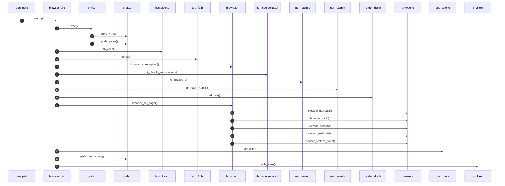

---

## Ranked Context

Files ranked by composite score for the current query context. The ranking combines Personalized PageRank (query relevance), global authority, test coverage, documentation coverage, and code freshness. Model: v1.0.

| Rank | File | Composite | PPR | Authority | Test | Doc |
|------|------|-----------|-----|-----------|------|-----|
| 1 | `app.py` | 0.1333 | 0.0000 | 0.0000 | 0.00 | 1.33 |
| 2 | `docker_run.sh` | 0.1000 | 0.0000 | 0.0000 | 0.00 | 1.00 |
| 3 | `install.sh` | 0.1000 | 0.0000 | 0.0000 | 0.00 | 1.00 |
| 4 | `run_freedom.sh` | 0.1000 | 0.0000 | 0.0000 | 0.00 | 1.00 |
| 5 | `ffq.py` | 0.1000 | 0.0000 | 0.0000 | 0.00 | 1.00 |
| 6 | `ffshot.py` | 0.1000 | 0.0000 | 0.0000 | 0.00 | 1.00 |
| 7 | `fftime.py` | 0.1000 | 0.0000 | 0.0000 | 0.00 | 1.00 |
| 8 | `prune.py` | 0.1000 | 0.0000 | 0.0000 | 0.00 | 1.00 |
| 9 | `snapshot_age.py` | 0.1000 | 0.0000 | 0.0000 | 0.00 | 1.00 |
| 10 | `test_css_drops.c` | 0.0972 | 0.0019 | 0.0019 | 0.00 | 0.96 |

---

## God Nodes

Most architecturally central files ranked by combined import/export degree and symbol richness.

| File | Score | Connections | PageRank |
|------|-------|-------------|----------|
| `browser_ui.c` | 173.3 | | 0.0000 |
| `css.h` | 88.0 | | 0.0000 |
| `tab.c` | 66.5 | | 0.0000 |
| `freedom.c` | 60.8 | | 0.0000 |
| `css.c` | 56.7 | | 0.0000 |
| `page_view.c` | 55.3 | | 0.0000 |
| `test_css.c` | 45.4 | | 0.0000 |
| `test_js_dom.c` | 40.8 | | 0.0000 |
| `html_parse.h` | 38.4 | | 0.0000 |
| `page_view.h` | 37.1 | | 0.0000 |

---

## Community Analysis

Files grouped by import-based community detection. Cohesion measures how tightly connected each community is internally.

### src: css (Cohesion: 0.72)

**53 files** in this community:

- `compositor.h` (h, 9 symbols)
- `css.h` (h, 140 symbols)
- `css_atrule.h` (h, 10 symbols)
- `css_box.h` (h, 27 symbols)
- `css_chain.h` (h, 9 symbols)
- `css_color.h` (h, 7 symbols)
- `css_computed.h` (h, 6 symbols)
- `css_decl.h` (h, 14 symbols)
- `css_gradient.h` (h, 13 symbols)
- `css_index.h` (h, 7 symbols)
- `css_length.h` (h, 20 symbols)
- `css_mask.h` (h, 10 symbols)
- `css_mq.h` (h, 6 symbols)
- `css_select.h` (h, 37 symbols)
- `css_text.h` (h, 17 symbols)
- `css_values.h` (h, 9 symbols)
- `css_vars.h` (h, 19 symbols)
- `text_case.h` (h, 8 symbols)
- `box_tree.c` (c, 25 symbols)
- `compositor.c` (c, 5 symbols)
- ... and 33 more files

### include: browser_ui (Cohesion: 0.52)

**45 files** in this community:

- `browser_ui.c` (c, 633 symbols)
- `block_flow.h` (h, 4 symbols)
- `box_blur.h` (h, 5 symbols)
- `download.h` (h, 9 symbols)
- `form.h` (h, 12 symbols)
- `frame_clock.h` (h, 7 symbols)
- `hostedit.h` (h, 5 symbols)
- `image_decode.h` (h, 13 symbols)
- `interp.h` (h, 22 symbols)
- `pdf_export.h` (h, 10 symbols)
- `prefs.h` (h, 18 symbols)
- `profile.h` (h, 9 symbols)
- `shm_slots.h` (h, 7 symbols)
- `textfield.h` (h, 15 symbols)
- `wl_guard.h` (h, 5 symbols)
- `zoom.h` (h, 10 symbols)
- `block_flow.c` (c, 4 symbols)
- `box_blur.c` (c, 5 symbols)
- `download.c` (c, 12 symbols)
- `form.c` (c, 8 symbols)
- ... and 25 more files

### src: tab (Cohesion: 0.69)

**45 files** in this community:

- `dom.h` (h, 29 symbols)
- `freebug.h` (h, 18 symbols)
- `html_parse.h` (h, 24 symbols)
- `js_dom.h` (h, 23 symbols)
- `js_env.h` (h, 3 symbols)
- `js_geom.h` (h, 19 symbols)
- `js_location.h` (h, 6 symbols)
- `js_sandbox.h` (h, 33 symbols)
- `js_trusted.h` (h, 16 symbols)
- `link_nav.h` (h, 11 symbols)
- `tab.h` (h, 46 symbols)
- `url.h` (h, 14 symbols)
- `web_storage.h` (h, 13 symbols)
- `freebug.c` (c, 9 symbols)
- `html_parse.c` (c, 29 symbols)
- `js_custom_elements.c` (c, 1 symbols)
- `js_custom_elements.h` (h, 2 symbols)
- `js_dom.c` (c, 63 symbols)
- `js_dom_ext.c` (c, 8 symbols)
- `js_dom_ext.h` (h, 2 symbols)
- ... and 25 more files

### src: text_shape (Cohesion: 0.56)

**42 files** in this community:

- `data_url.h` (h, 6 symbols)
- `fb_panes.h` (h, 12 symbols)
- `hls.h` (h, 8 symbols)
- `js_policy.h` (h, 7 symbols)
- `net_realm.h` (h, 10 symbols)
- `perf_trace.h` (h, 17 symbols)
- `psl_data.h` (h, 7 symbols)
- `request_policy.h` (h, 5 symbols)
- `text_shape.h` (h, 24 symbols)
- `tls_impersonate.h` (h, 23 symbols)
- `webcaps.h` (h, 5 symbols)
- `webfont.h` (h, 17 symbols)
- `webfont_load.h` (h, 7 symbols)
- `wl_display.h` (h, 6 symbols)
- `data_url.c` (c, 10 symbols)
- `fb_panes.c` (c, 10 symbols)
- `freedom.c` (c, 48 symbols)
- `hls.c` (c, 10 symbols)
- `js_policy.c` (c, 6 symbols)
- `net_realm.c` (c, 10 symbols)
- ... and 22 more files

### include: page_view (Cohesion: 0.45)

**19 files** in this community:

- `box_style.h` (h, 31 symbols)
- `box_tree.h` (h, 34 symbols)
- `dom_debug.h` (h, 4 symbols)
- `flex_layout.h` (h, 43 symbols)
- `page_view.h` (h, 91 symbols)
- `render_doc.h` (h, 27 symbols)
- `render_policy.h` (h, 9 symbols)
- `box_style.c` (c, 48 symbols)
- `dom_debug.c` (c, 24 symbols)
- `flex_layout.c` (c, 35 symbols)
- `page_view.c` (c, 253 symbols)
- `render_doc.c` (c, 21 symbols)
- `test_box_style.c` (c, 49 symbols)
- `test_box_tree.c` (c, 69 symbols)
- `test_dom_debug.c` (c, 11 symbols)
- `test_flex_layout.c` (c, 71 symbols)
- `test_page_view.c` (c, 212 symbols)
- `test_render_doc.c` (c, 37 symbols)
- `test_render_policy.c` (c, 21 symbols)

### include: browser (Cohesion: 0.55)

**19 files** in this community:

- `browser.h` (h, 19 symbols)
- `host_conf.h` (h, 9 symbols)
- `hostblock.h` (h, 10 symbols)
- `media_decoder.h` (h, 12 symbols)
- `os_sandbox.h` (h, 12 symbols)
- `renderer.h` (h, 7 symbols)
- `util.h` (h, 6 symbols)
- `browser.c` (c, 41 symbols)
- `host_conf.c` (c, 9 symbols)
- `hostblock.c` (c, 18 symbols)
- `media_decoder.c` (c, 15 symbols)
- `os_sandbox.c` (c, 31 symbols)
- `renderer.c` (c, 6 symbols)
- `test_browser.c` (c, 17 symbols)
- `test_host_conf.c` (c, 8 symbols)
- `test_hostblock.c` (c, 23 symbols)
- `test_media_decoder.c` (c, 6 symbols)
- `test_os_sandbox.c` (c, 19 symbols)
- `test_renderer.c` (c, 8 symbols)

### src: local_store (Cohesion: 0.79)

**16 files** in this community:

- `cached_fetch.h` (h, 4 symbols)
- `disk_store.h` (h, 3 symbols)
- `http_cache.h` (h, 19 symbols)
- `local_store.h` (h, 11 symbols)
- `pq_seal.h` (h, 8 symbols)
- `cached_fetch.c` (c, 14 symbols)
- `disk_store.c` (c, 6 symbols)
- `http_cache.c` (c, 38 symbols)
- `local_store.c` (c, 323 symbols)
- `pq_seal.c` (c, 11 symbols)
- `profile.c` (c, 9 symbols)
- `test_cached_fetch.c` (c, 14 symbols)
- `test_disk_store.c` (c, 16 symbols)
- `test_http_cache.c` (c, 17 symbols)
- `test_local_store.c` (c, 18 symbols)
- `test_pq_seal.c` (c, 7 symbols)

### gui (Cohesion: 0.46)

**13 files** in this community:

- `browser_ui_internal.h` (h, 10 symbols)
- `bui_theme.c` (c, 6 symbols)
- `freedom_view.c` (c, 2 symbols)
- `svg_paint.c` (c, 5 symbols)
- `ui_render.c` (c, 29 symbols)
- `freedom_config.h` (h, 15 symbols)
- `svg_paint.h` (h, 2 symbols)
- `svg_render.h` (h, 19 symbols)
- `ui.h` (h, 18 symbols)
- `svg_render.c` (c, 34 symbols)
- `ui_layout.c` (c, 4 symbols)
- `test_svg_render.c` (c, 17 symbols)
- `test_ui.c` (c, 12 symbols)

### include: secure_fetch (Cohesion: 0.58)

**13 files** in this community:

- `anti_fp.h` (h, 35 symbols)
- `identity.h` (h, 24 symbols)
- `secure_fetch.h` (h, 46 symbols)
- `ws_hub.h` (h, 15 symbols)
- `anti_fp.c` (c, 23 symbols)
- `identity.c` (c, 25 symbols)
- `secure_fetch.c` (c, 79 symbols)
- `ws_hub.c` (c, 27 symbols)
- `itest_secure_fetch.c` (c, 2 symbols)
- `test_anti_fp.c` (c, 15 symbols)
- `test_identity.c` (c, 9 symbols)
- `test_secure_fetch.c` (c, 58 symbols)
- `test_ws_hub.c` (c, 13 symbols)

### include: prefetch (Cohesion: 0.56)

**6 files** in this community:

- `import_map.h` (h, 10 symbols)
- `prefetch.h` (h, 28 symbols)
- `import_map.c` (c, 22 symbols)
- `prefetch.c` (c, 30 symbols)
- `test_import_map.c` (c, 8 symbols)
- `test_prefetch.c` (c, 18 symbols)

---

## Surprising Connections

Files in different communities connected through 3+ indirect hops.

- `block_flow.c` <-> `test_renderer.c` (8 hops, across 4 communities)
- `box_blur.c` <-> `test_renderer.c` (8 hops, across 4 communities)
- `css_index.c` <-> `pq_seal.c` (8 hops, across 3 communities)
- `css_index.c` <-> `test_pq_seal.c` (8 hops, across 3 communities)
- `download.c` <-> `test_renderer.c` (8 hops, across 4 communities)

---

## Suggested Questions

Auto-generated exploration prompts based on graph structure:

- What does browser_ui.c depend on, and what depends on it? (55 connections)
- What does css.h depend on, and what depends on it? (37 connections)
- What does tab.c depend on, and what depends on it? (26 connections)
- How are the 53 files in 'src: css' related to each other?
- Why are block_flow.c and test_renderer.c connected through 8 hops across 4 communities?

---

## Force-Graph Explorer

Heterogeneous explorer payload (files, communities, layers, externals) rendered with force-graph physics, stable family colors, log2 node sizing, and convex-hull community overlays. Open `readmenator-maps/graph-force.html` (linked from the maps gallery) or run `explorer`.

- Nodes: 403 (community: 10, external: 98, file: 289, layer: 6)
- Edges: 2234

---

## Corpus Analytics

Attribution funnel and distributions for the explorer dashboard.

- Files: 289 | With symbols: 285 | Attributed: 271 | God nodes: 10 | Symbols: 7449

- Layer `utility`: 167 files
- Layer `testing`: 83 files
- Layer `presentation`: 20 files
- Layer `data_access`: 9 files
- Layer `infrastructure`: 6 files
- Layer `business_logic`: 4 files

- Language `c`: 179 files
- Language `h`: 94 files
- Language `py`: 12 files
- Language `sh`: 4 files

---

## Taint Propagation Map

Taint analysis traces how dangerous imports propagate through the codebase via transitive dependencies. Source files import dangerous modules directly; sink files receive the danger indirectly.

**Taint Sources:** 6 | **Taint Sinks:** 6 | **Propagation Paths:** 6

- `app.py` imports `subprocess` (0 hop to `app.py`) [high]
  Path: app.py
- `fbench.py` imports `subprocess` (0 hop to `fbench.py`) [high]
  Path: fbench.py
- `ffgeom.py` imports `subprocess` (0 hop to `ffgeom.py`) [high]
  Path: ffgeom.py
- `guitime.py` imports `subprocess` (0 hop to `guitime.py`) [high]
  Path: guitime.py
- `mutate.py` imports `subprocess` (0 hop to `mutate.py`) [high]
  Path: mutate.py
- `snapshot.py` imports `urllib.request` (0 hop to `snapshot.py`) [medium]
  Path: snapshot.py

---

## Hotspot Analysis

Files ranked by combined complexity (symbol count) and centrality (connection count). High-scoring files are architecturally critical and may need refactoring attention.

| File | Complexity | Centrality | Combined | Symbols | Connections |
|------|-----------|------------|----------|---------|-------------|
| `app.py` | 0.005 | 0.036 | 0.024 | 3 | 5 |
| `docker_run.sh` | 0.000 | 0.000 | 0.000 | 0 | 0 |
| `install.sh` | 0.000 | 0.000 | 0.000 | 0 | 0 |
| `run_freedom.sh` | 0.000 | 0.000 | 0.000 | 0 | 0 |
| `ffq.py` | 0.002 | 0.044 | 0.027 | 1 | 6 |
| `ffshot.py` | 0.002 | 0.044 | 0.027 | 1 | 6 |
| `fftime.py` | 0.002 | 0.058 | 0.036 | 1 | 8 |
| `prune.py` | 0.002 | 0.015 | 0.009 | 1 | 2 |
| `snapshot_age.py` | 0.002 | 0.029 | 0.018 | 1 | 4 |
| `test_css_drops.c` | 0.040 | 0.066 | 0.055 | 25 | 9 |
| `browser_ui.c` | 1.000 | 1.000 | 1.000 | 633 | 137 |
| `tab.c` | 0.229 | 0.482 | 0.381 | 145 | 66 |
| `page_view.c` | 0.400 | 0.285 | 0.331 | 253 | 39 |
| `css.c` | 0.390 | 0.277 | 0.323 | 247 | 38 |
| `test_css.c` | 0.559 | 0.139 | 0.307 | 354 | 19 |

---

## Dataflow Analysis

Procedural intra-function dataflow findings (zero tokens, regex-based heuristics, all INFERRED). Each lead is grounded at file:line for manual review.

**50 findings** (DEAD_STORE: 42, UNCHECKED_ALLOC: 5, UNINIT_USE: 3).

| File | Function | Line | Kind | Variable | Description |
|------|----------|------|------|----------|-------------|
| `gui/browser_ui.c` | `gui_subresource_fetch` | 1557 | `UNCHECKED_ALLOC` | `out_ctype` | Result of allocator stored in `out_ctype` is never checked against NULL. |
| `gui/browser_ui.c` | `first` | 1721 | `DEAD_STORE` | `dg` | `dg` assigned at line 1721 but never read afterwards. |
| `gui/browser_ui.c` | `flow_text` | 4424 | `DEAD_STORE` | `space_w` | `space_w` assigned at line 4424 but never read afterwards. |
| `gui/browser_ui.c` | `flow_text` | 4426 | `DEAD_STORE` | `i` | `i` assigned at line 4426 but never read afterwards. |
| `gui/browser_ui.c` | `table` | 5460 | `DEAD_STORE` | `parent` | `parent` assigned at line 5460 but never read afterwards. |
| `gui/browser_ui.c` | `table` | 5461 | `DEAD_STORE` | `seen` | `seen` assigned at line 5461 but never read afterwards. |
| `gui/browser_ui.c` | `table` | 5463 | `DEAD_STORE` | `j` | `j` assigned at line 5463 but never read afterwards. |
| `gui/browser_ui.c` | `nested_cont_basis` | 5763 | `DEAD_STORE` | `total` | `total` assigned at line 5763 but never read afterwards. |
| `gui/browser_ui.c` | `nested_cont_basis` | 5764 | `DEAD_STORE` | `n_items` | `n_items` assigned at line 5764 but never read afterwards. |
| `gui/browser_ui.c` | `builds` | 6836 | `DEAD_STORE` | `sl` | `sl` assigned at line 6836 but never read afterwards. |
| `gui/browser_ui.c` | `defer_flush` | 8508 | `DEAD_STORE` | `fw` | `fw` assigned at line 8508 but never read afterwards. |
| `gui/browser_ui.c` | `defer_flush` | 8509 | `DEAD_STORE` | `ngroups` | `ngroups` assigned at line 8509 but never read afterwards. |
| `gui/browser_ui.c` | `button_box_width` | 10621 | `DEAD_STORE` | `cx` | `cx` assigned at line 10621 but never read afterwards. |
| `gui/browser_ui.c` | `paint_box_decoration` | 11841 | `DEAD_STORE` | `bt` | `bt` assigned at line 11841 but never read afterwards. |
| `gui/browser_ui.c` | `paint_box_decoration` | 11842 | `DEAD_STORE` | `bb` | `bb` assigned at line 11842 but never read afterwards. |
| `gui/browser_ui.c` | `widths` | 11995 | `DEAD_STORE` | `on` | `on` assigned at line 11995 but never read afterwards. |
| `gui/browser_ui.c` | `cairo_set_dash` | 12044 | `DEAD_STORE` | `on` | `on` assigned at line 12044 but never read afterwards. |
| `gui/browser_ui.c` | `convention` | 12079 | `DEAD_STORE` | `nr` | `nr` assigned at line 12079 but never read afterwards. |
| `gui/browser_ui.c` | `convention` | 12080 | `DEAD_STORE` | `ng` | `ng` assigned at line 12080 but never read afterwards. |
| `gui/browser_ui.c` | `convention` | 12081 | `DEAD_STORE` | `nb` | `nb` assigned at line 12081 but never read afterwards. |
| `gui/browser_ui.c` | `set_rgb` | 12105 | `DEAD_STORE` | `on` | `on` assigned at line 12105 but never read afterwards. |
| `gui/browser_ui.c` | `paint_deco_line` | 12200 | `DEAD_STORE` | `on` | `on` assigned at line 12200 but never read afterwards. |
| `gui/browser_ui.c` | `bui_pop_group_composite` | 13127 | `DEAD_STORE` | `gs_factor` | `gs_factor` assigned at line 13127 but never read afterwards. |
| `gui/browser_ui.c` | `bui_pop_group_composite` | 13128 | `DEAD_STORE` | `br_factor` | `br_factor` assigned at line 13128 but never read afterwards. |
| `gui/browser_ui.c` | `bui_pop_group_composite` | 13129 | `DEAD_STORE` | `ct_factor` | `ct_factor` assigned at line 13129 but never read afterwards. |
| `gui/browser_ui.c` | `bui_pop_group_composite` | 13134 | `DEAD_STORE` | `sa_factor` | `sa_factor` assigned at line 13134 but never read afterwards. |
| `gui/browser_ui.c` | `bui_pop_group_composite` | 13135 | `DEAD_STORE` | `h_rot` | `h_rot` assigned at line 13135 but never read afterwards. |
| `gui/browser_ui.c` | `bui_pop_group_composite` | 13139 | `DEAD_STORE` | `px` | `px` assigned at line 13139 but never read afterwards. |
| `gui/browser_ui.c` | `paint_box_and_direct_rows` | 13472 | `DEAD_STORE` | `cull_ty` | `cull_ty` assigned at line 13472 but never read afterwards. |
| `gui/browser_ui.c` | `paint_box_and_direct_rows` | 13478 | `DEAD_STORE` | `ov_stack` | `ov_stack` assigned at line 13478 but never read afterwards. |
| `gui/browser_ui.c` | `paint_box_and_direct_rows` | 13479 | `DEAD_STORE` | `ov_depth` | `ov_depth` assigned at line 13479 but never read afterwards. |
| `gui/browser_ui.c` | `paint_screen_inflow` | 14072 | `DEAD_STORE` | `ov_stack` | `ov_stack` assigned at line 14072 but never read afterwards. |
| `gui/browser_ui.c` | `paint_screen_inflow` | 14073 | `DEAD_STORE` | `ov_depth` | `ov_depth` assigned at line 14073 but never read afterwards. |
| `gui/browser_ui.c` | `paint_screen_inflow` | 14080 | `UNCHECKED_ALLOC` | `row_done` | Result of allocator stored in `row_done` is never checked against NULL. |
| `src/box_tree.c` | `layout_grid` | 286 | `DEAD_STORE` | `rgap` | `rgap` assigned at line 286 but never read afterwards. |
| `src/box_tree.c` | `layout_grid` | 291 | `UNINIT_USE` | `col_x` | `col_x` may be read before initialization (declared line 288). |
| `src/box_tree.c` | `layout_grid` | 291 | `UNINIT_USE` | `col_w` | `col_w` may be read before initialization (declared line 289). |
| `src/box_tree.c` | `layout_grid` | 331 | `DEAD_STORE` | `tracked` | `tracked` assigned at line 331 but never read afterwards. |
| `src/box_tree.c` | `layout_grid` | 334 | `DEAD_STORE` | `jx` | `jx` assigned at line 334 but never read afterwards. |
| `src/box_tree.c` | `bt_containing_block` | 562 | `DEAD_STORE` | `ancestor` | `ancestor` assigned at line 562 but never read afterwards. |
| `src/box_tree.c` | `bt_resolve_positioning_ex` | 716 | `DEAD_STORE` | `z_auto` | `z_auto` assigned at line 716 but never read afterwards. |
| `src/box_tree.c` | `bt_defer_roots` | 865 | `UNINIT_USE` | `by_order` | `by_order` may be read before initialization (declared line 864). |
| `src/css.c` | `page_view` | 5481 | `DEAD_STORE` | `had_winner` | `had_winner` assigned at line 5481 but never read afterwards. |
| `src/css_color.c` | `parse_hex` | 155 | `DEAD_STORE` | `r` | `r` assigned at line 155 but never read afterwards. |
| `src/css_color.c` | `parse_hex` | 156 | `DEAD_STORE` | `g` | `g` assigned at line 156 but never read afterwards. |
| `src/freedom.c` | `headless_fetch` | 535 | `UNCHECKED_ALLOC` | `oct` | Result of allocator stored in `oct` is never checked against NULL. |
| `src/hostblock.c` | `hb_new` | 145 | `UNCHECKED_ALLOC` | `s` | Result of allocator stored in `s` is never checked against NULL. |
| `src/image_decode.c` | `img_decode_jpeg` | 224 | `DEAD_STORE` | `dst` | `dst` assigned at line 224 but never read afterwards. |
| `src/js_events.c` | `jd_click_state_new` | 30 | `UNCHECKED_ALLOC` | `s` | Result of allocator stored in `s` is never checked against NULL. |
| `src/js_geom.c` | `unite` | 71 | `DEAD_STORE` | `w` | `w` assigned at line 71 but never read afterwards. |

---

## Concept Graph

Semantic second-brain layer: nouns are concept nodes, verbs are edges. Each noun maps atomically to a file set (EXTRACTED); each verb aggregates structural imports, calls, and inherits into consumes, invokes, extends, depends_on, or bridges (INFERRED).

**50 concepts, 100 relations.**

| Concept | Files | Mentions |
|---------|-------|----------|
| `null` | 154 | 1097 |
| `max` | 128 | 652 |
| `size` | 120 | 629 |
| `not` | 120 | 610 |
| `out` | 119 | 644 |
| `include` | 119 | 221 |
| `one` | 118 | 553 |
| `freedom` | 114 | 172 |
| `when` | 112 | 415 |
| `int` | 108 | 1070 |
| `char` | 106 | 573 |
| `returns` | 105 | 297 |
| `free` | 104 | 429 |
| `const` | 103 | 595 |
| `only` | 103 | 380 |
| `css` | 97 | 2047 |
| `never` | 97 | 313 |
| `its` | 94 | 568 |
| `void` | 92 | 585 |
| `empty` | 92 | 260 |
| `name` | 91 | 356 |
| `static` | 90 | 391 |
| `text` | 88 | 673 |
| `url` | 85 | 515 |
| `every` | 82 | 274 |
| `spec` | 82 | 200 |
| `return` | 79 | 819 |
| `value` | 79 | 318 |
| `per` | 79 | 219 |
| `len` | 78 | 361 |

### Verb Edges

| Source | Verb | Target | Strength | Evidence |
|--------|------|--------|----------|----------|
| `null` | `depends_on` | `freedom` | 1.00 | 10 |
| `null` | `depends_on` | `include` | 1.00 | 10 |
| `not` | `depends_on` | `include` | 0.92 | 10 |
| `not` | `depends_on` | `freedom` | 0.91 | 10 |
| `css` | `depends_on` | `freedom` | 0.90 | 10 |
| `css` | `depends_on` | `include` | 0.90 | 10 |
| `out` | `depends_on` | `freedom` | 0.90 | 10 |
| `out` | `depends_on` | `include` | 0.90 | 10 |
| `char` | `depends_on` | `freedom` | 0.88 | 10 |
| `char` | `depends_on` | `include` | 0.88 | 10 |
| `int` | `depends_on` | `freedom` | 0.88 | 10 |
| `int` | `depends_on` | `include` | 0.88 | 10 |
| `one` | `depends_on` | `include` | 0.88 | 10 |
| `static` | `depends_on` | `include` | 0.88 | 10 |
| `free` | `depends_on` | `include` | 0.87 | 10 |
| `one` | `depends_on` | `freedom` | 0.87 | 10 |
| `only` | `depends_on` | `include` | 0.87 | 10 |
| `static` | `depends_on` | `freedom` | 0.87 | 10 |
| `free` | `depends_on` | `freedom` | 0.86 | 10 |
| `only` | `depends_on` | `freedom` | 0.86 | 10 |
| `return` | `depends_on` | `freedom` | 0.86 | 10 |
| `return` | `depends_on` | `include` | 0.86 | 10 |
| `when` | `depends_on` | `freedom` | 0.85 | 10 |
| `when` | `depends_on` | `include` | 0.85 | 10 |
| `max` | `depends_on` | `freedom` | 0.84 | 10 |
| `max` | `depends_on` | `include` | 0.84 | 10 |
| `never` | `depends_on` | `freedom` | 0.83 | 10 |
| `never` | `depends_on` | `include` | 0.83 | 10 |
| `size` | `depends_on` | `freedom` | 0.83 | 10 |
| `size` | `depends_on` | `include` | 0.83 | 10 |

### Dialectic Prompts

- Thesis: `any` centralizes 61 files; Antithesis: `caller` pulls 63 files with 29 shared (Jaccard 0.31); Synthesis: should they merge, split by layer, or keep `bridges` explicit?
- Thesis: `any` centralizes 61 files; Antithesis: `every` pulls 82 files with 33 shared (Jaccard 0.30); Synthesis: should they merge, split by layer, or keep `bridges` explicit?
- Thesis: `any` centralizes 61 files; Antithesis: `first` pulls 73 files with 33 shared (Jaccard 0.33); Synthesis: should they merge, split by layer, or keep `bridges` explicit?
- Thesis: `any` centralizes 61 files; Antithesis: `its` pulls 94 files with 42 shared (Jaccard 0.37); Synthesis: should they merge, split by layer, or keep `bridges` explicit?
- Thesis: `any` centralizes 61 files; Antithesis: `line` pulls 65 files with 30 shared (Jaccard 0.31); Synthesis: should they merge, split by layer, or keep `bridges` explicit?
- Thesis: `any` centralizes 61 files; Antithesis: `max` pulls 128 files with 46 shared (Jaccard 0.32); Synthesis: should they merge, split by layer, or keep `bridges` explicit?
- Thesis: `any` centralizes 61 files; Antithesis: `never` pulls 97 files with 38 shared (Jaccard 0.32); Synthesis: should they merge, split by layer, or keep `bridges` explicit?
- Thesis: `any` centralizes 61 files; Antithesis: `not` pulls 120 files with 47 shared (Jaccard 0.35); Synthesis: should they merge, split by layer, or keep `bridges` explicit?
- Thesis: `any` centralizes 61 files; Antithesis: `only` pulls 103 files with 43 shared (Jaccard 0.36); Synthesis: should they merge, split by layer, or keep `bridges` explicit?
- Thesis: `any` centralizes 61 files; Antithesis: `page` pulls 74 files with 32 shared (Jaccard 0.31); Synthesis: should they merge, split by layer, or keep `bridges` explicit?

---

## Dependency Cycles

Circular dependencies detected in the resolved import graph. Cycles increase coupling and make refactoring harder.

| Cycle | Length | Files |
|-------|--------|-------|
| `js_dom.h -> js_location.h -> js_dom.h` | 2 | 2 |

---

## Change Impact Analysis

Files sorted by how many other files would be affected if they changed. High-impact files should be changed with caution.

| File | Direct Dependents | Transitive Dependents | Total Impact |
|------|------------------|----------------------|--------------|
| `css_color.h` | 13 | 39 | 52 |
| `css.h` | 36 | 15 | 51 |
| `html_parse.h` | 18 | 22 | 40 |
| `dom.h` | 16 | 20 | 36 |
| `css_select.h` | 14 | 14 | 28 |
| `url.h` | 16 | 11 | 27 |
| `freebug.h` | 11 | 9 | 20 |
| `js_geom.h` | 6 | 14 | 20 |
| `anti_fp.h` | 8 | 10 | 18 |
| `js_sandbox.h` | 15 | 3 | 18 |
| `local_store.h` | 8 | 10 | 18 |
| `css_decl.h` | 12 | 5 | 17 |
| `page_view.h` | 11 | 5 | 16 |
| `flex_layout.h` | 11 | 3 | 14 |
| `box_style.h` | 11 | 2 | 13 |

---

## Architecture Violations

Violations of architectural layer rules detected in the import graph. **24 strict violations, 0 warnings.**

| Source | Source Layer | Target | Target Layer | Description | Severity |
|--------|-------------|--------|-------------|-------------|----------|
| `browser_ui.c` | presentation | `data_url.h` | data_access | presentation must not import data_access | strict |
| `browser_ui.c` | presentation | `web_storage.h` | data_access | presentation must not import data_access | strict |
| `http_cache.h` | presentation | `local_store.h` | data_access | presentation must not import data_access | strict |
| `http_cache.c` | presentation | `disk_store.h` | data_access | presentation must not import data_access | strict |
| `render_doc.c` | presentation | `data_url.h` | data_access | presentation must not import data_access | strict |
| `render_policy.c` | presentation | `data_url.h` | data_access | presentation must not import data_access | strict |
| `test_box_tree.c` | testing | `page_view.h` | presentation | testing must not import presentation | strict |
| `test_css.c` | testing | `flex_layout.h` | presentation | testing must not import presentation | strict |
| `test_dom_debug.c` | testing | `flex_layout.h` | presentation | testing must not import presentation | strict |
| `test_dom_debug.c` | testing | `page_view.h` | presentation | testing must not import presentation | strict |
| `test_dom_debug.c` | testing | `render_doc.h` | presentation | testing must not import presentation | strict |
| `test_dom_debug.c` | testing | `render_policy.h` | presentation | testing must not import presentation | strict |
| `test_flex_layout.c` | testing | `flex_layout.h` | presentation | testing must not import presentation | strict |
| `test_http_cache.c` | testing | `http_cache.h` | presentation | testing must not import presentation | strict |
| `test_page_view.c` | testing | `flex_layout.h` | presentation | testing must not import presentation | strict |
| `test_page_view.c` | testing | `page_view.h` | presentation | testing must not import presentation | strict |
| `test_render_doc.c` | testing | `flex_layout.h` | presentation | testing must not import presentation | strict |
| `test_render_doc.c` | testing | `page_view.h` | presentation | testing must not import presentation | strict |
| `test_render_doc.c` | testing | `render_doc.h` | presentation | testing must not import presentation | strict |
| `test_render_doc.c` | testing | `render_policy.h` | presentation | testing must not import presentation | strict |

---

## Suggested Linting Rules

Automatically suggested linting and security rules based on patterns detected in the codebase. These can be exported as Semgrep rules using the `--export-rules` flag.

| Rule ID | Severity | Description | Language | Matches |
|---------|----------|-------------|----------|---------|
| `RM001` | info | Large number of functions in py: 50 total | py | 50 |
| `RM002` | info | Large number of functions in c: 5046 total | c | 5046 |
| `RM003` | info | Large number of functions in h: 703 total | h | 703 |
| `RM004` | info | Print statement found (consider logging instead) | python | 59 |

---

## Orphans

Files with no documentation or low connectivity. These are candidates for documentation investment or cleanup.

- `docker-entrypoint.sh` (0 symbols, no doc)
- `freedom_view.c` (2 symbols, no doc)
- `css_box.h` (27 symbols, no doc)
- `css_text.h` (17 symbols, no doc)
- `freedom_config.h` (15 symbols, no doc)
- `js_env.h` (3 symbols, no doc)
- `psl_data.h` (7 symbols, no doc)
- `anti_fp.c` (23 symbols, no doc)
- `css_values.c` (9 symbols, no doc)
- `fb_panes.c` (10 symbols, no doc)
- `frame_clock.c` (4 symbols, no doc)
- `freebug.c` (9 symbols, no doc)
- `js_custom_elements.c` (1 symbols, no doc)
- `js_dom_ext.c` (8 symbols, no doc)
- `local_store.c` (323 symbols, no doc)
- `pdf_export.c` (4 symbols, no doc)
- `perf_trace.c` (12 symbols, no doc)
- `render_policy.c` (5 symbols, no doc)
- `renderer.c` (6 symbols, no doc)
- `textfield.c` (12 symbols, no doc)
- *... and 36 more*

---

## Query Recipes

Example queries you can run against this knowledge base using the ranking engine:

```
# Find files most relevant to a concept
readmenator query "Where is the import resolver implemented?"

# Rank files by relevance to a topic
readmenator query "How does documentation generation work?"

# Explain why a file ranks highly
readmenator query "explain readmenator/_documentation.py"

# Trace dependency paths with ranked context
readmenator query "path from CLI to exporter"
```

The ranking model uses the following signals:

- **Personalized PageRank** (45% weight): query-specific relevance via seed propagation
- **Global Authority** (20% weight): structural importance via standard PageRank
- **Test Coverage** (15% weight): fraction of symbols referenced in test files
- **Doc Coverage** (10% weight): presence of docstrings and file-level docs
- **Freshness** (10% weight): recent modification activity

Results include score decomposition and justification paths for each ranked item.

---

## Structural Knowledge Map

> **Note:** The visual graph below has been intelligently pruned to the top 300 most relevant nodes to prevent rendering crashes. Full details of all files are documented in the Architecture Reference.

```mermaid
graph LR
    classDef mod fill:#1e1e1e,stroke:#ff6666,stroke-width:2px,color:#fff;
    classDef cls fill:#2d2d2d,stroke:#4ec9b0,stroke-width:2px,color:#fff;
    classDef fn fill:#333,stroke:#dcdcaa,stroke-width:1px,color:#dcdcaa;
    classDef ext fill:#111,stroke:#666,stroke-dasharray:5 5,color:#aaa;
    subgraph community_1 ["include: browser_ui"]
    gui_browser_ui_c["browser_ui.c (c)"]
    class gui_browser_ui_c mod;
    gui_browser_ui_c_ui_menu_item["ui_menu_item"]
    class gui_browser_ui_c_ui_menu_item cls;
    gui_browser_ui_c --> gui_browser_ui_c_ui_menu_item
    gui_browser_ui_c_ui_input_state["ui_input_state"]
    class gui_browser_ui_c_ui_input_state cls;
    gui_browser_ui_c --> gui_browser_ui_c_ui_input_state
    gui_browser_ui_c_ui_image["ui_image"]
    class gui_browser_ui_c_ui_image cls;
    gui_browser_ui_c --> gui_browser_ui_c_ui_image
    gui_browser_ui_c_ui_bg_image["ui_bg_image"]
    class gui_browser_ui_c_ui_bg_image cls;
    gui_browser_ui_c --> gui_browser_ui_c_ui_bg_image
    gui_browser_ui_c_tab_ctx["tab_ctx"]
    class gui_browser_ui_c_tab_ctx cls;
    gui_browser_ui_c --> gui_browser_ui_c_tab_ctx
    end
    subgraph community_2 ["src: tab"]
    src_tab_c["tab.c (c)"]
    class src_tab_c mod;
    end
    subgraph community_3 ["src: text_shape"]
    src_freedom_c["freedom.c (c)"]
    class src_freedom_c mod;
    end
    subgraph community_4 ["include: page_view"]
    src_page_view_c["page_view.c (c)"]
    class src_page_view_c mod;
    end
    subgraph community_0 ["src: css"]
    src_css_c["css.c (c)"]
    class src_css_c mod;
    tests_test_js_dom_c["test_js_dom.c (c)"]
    class tests_test_js_dom_c mod;
    src_js_dom_c["js_dom.c (c)"]
    class src_js_dom_c mod;
    tests_test_tab_c["test_tab.c (c)"]
    class tests_test_tab_c mod;
    end
    subgraph community_5 ["include: browser"]
    tests_test_os_sandbox_c["test_os_sandbox.c (c)"]
    class tests_test_os_sandbox_c mod;
    tests_test_page_view_c["test_page_view.c (c)"]
    class tests_test_page_view_c mod;
    tests_test_dom_debug_c["test_dom_debug.c (c)"]
    class tests_test_dom_debug_c mod;
    end
    subgraph community_6 ["src: local_store"]
    src_http_cache_c["http_cache.c (c)"]
    class src_http_cache_c mod;
    tests_test_css_c["test_css.c (c)"]
    class tests_test_css_c mod;
    tests_test_render_doc_c["test_render_doc.c (c)"]
    class tests_test_render_doc_c mod;
    tests_test_js_env_c["test_js_env.c (c)"]
    class tests_test_js_env_c mod;
    src_css_text_c["css_text.c (c)"]
    class src_css_text_c mod;
    end
    subgraph community_8 ["include: secure_fetch"]
    src_secure_fetch_c["secure_fetch.c (c)"]
    class src_secure_fetch_c mod;
    src_css_box_c["css_box.c (c)"]
    class src_css_box_c mod;
    src_os_sandbox_c["os_sandbox.c (c)"]
    class src_os_sandbox_c mod;
    src_js_events_c["js_events.c (c)"]
    class src_js_events_c mod;
    src_js_fetch_c["js_fetch.c (c)"]
    class src_js_fetch_c mod;
    src_js_embed_c["js_embed.c (c)"]
    class src_js_embed_c mod;
    src_dom_c["dom.c (c)"]
    class src_dom_c mod;
    src_css_gradient_c["css_gradient.c (c)"]
    class src_css_gradient_c mod;
    tests_test_profile_c["test_profile.c (c)"]
    class tests_test_profile_c mod;
    tests_test_disk_store_c["test_disk_store.c (c)"]
    class tests_test_disk_store_c mod;
    tests_test_webfont_load_c["test_webfont_load.c (c)"]
    class tests_test_webfont_load_c mod;
    src_media_decoder_c["media_decoder.c (c)"]
    class src_media_decoder_c mod;
    tests_test_text_shape_c["test_text_shape.c (c)"]
    class tests_test_text_shape_c mod;
    src_render_doc_c["render_doc.c (c)"]
    class src_render_doc_c mod;
    src_css_values_c["css_values.c (c)"]
    class src_css_values_c mod;
    src_disk_store_c["disk_store.c (c)"]
    class src_disk_store_c mod;
    src_renderer_c["renderer.c (c)"]
    class src_renderer_c mod;
    src_text_shape_c["text_shape.c (c)"]
    class src_text_shape_c mod;
    tests_test_dom_c["test_dom.c (c)"]
    class tests_test_dom_c mod;
    src_js_env_c["js_env.c (c)"]
    class src_js_env_c mod;
    end
    subgraph community_7 ["gui"]
    gui_ui_render_c["ui_render.c (c)"]
    class gui_ui_render_c mod;
    src_dom_debug_c["dom_debug.c (c)"]
    class src_dom_debug_c mod;
    src_profile_c["profile.c (c)"]
    class src_profile_c mod;
    tests_test_freedom_c["test_freedom.c (c)"]
    class tests_test_freedom_c mod;
    tests_test_box_tree_c["test_box_tree.c (c)"]
    class tests_test_box_tree_c mod;
    include_js_dom_h["js_dom.h (h)"]
    class include_js_dom_h mod;
    tests_test_http_cache_c["test_http_cache.c (c)"]
    class tests_test_http_cache_c mod;
    tests_test_prefs_c["test_prefs.c (c)"]
    class tests_test_prefs_c mod;
    src_webfont_load_c["webfont_load.c (c)"]
    class src_webfont_load_c mod;
    src_ws_hub_c["ws_hub.c (c)"]
    class src_ws_hub_c mod;
    end
    subgraph community_9 ["include: prefetch"]
    tests_test_prefetch_c["test_prefetch.c (c)"]
    class tests_test_prefetch_c mod;
    tests_test_svg_render_c["test_svg_render.c (c)"]
    class tests_test_svg_render_c mod;
    tests_test_host_conf_c["test_host_conf.c (c)"]
    class tests_test_host_conf_c mod;
    src_js_location_c["js_location.c (c)"]
    class src_js_location_c mod;
    src_local_store_c["local_store.c (c)"]
    class src_local_store_c mod;
    tests_test_secure_fetch_c["test_secure_fetch.c (c)"]
    class tests_test_secure_fetch_c mod;
    tests_test_js_sandbox_c["test_js_sandbox.c (c)"]
    class tests_test_js_sandbox_c mod;
    src_html_parse_c["html_parse.c (c)"]
    class src_html_parse_c mod;
    tests_test_css_length_c["test_css_length.c (c)"]
    class tests_test_css_length_c mod;
    tests_test_html_parse_c["test_html_parse.c (c)"]
    class tests_test_html_parse_c mod;
    tests_test_css_index_c["test_css_index.c (c)"]
    class tests_test_css_index_c mod;
    tests_test_css_vars_c["test_css_vars.c (c)"]
    class tests_test_css_vars_c mod;
    tests_test_webfont_c["test_webfont.c (c)"]
    class tests_test_webfont_c mod;
    tests_test_ws_hub_c["test_ws_hub.c (c)"]
    class tests_test_ws_hub_c mod;
    tests_test_js_geom_c["test_js_geom.c (c)"]
    class tests_test_js_geom_c mod;
    tests_test_css_atrule_c["test_css_atrule.c (c)"]
    class tests_test_css_atrule_c mod;
    tests_test_identity_c["test_identity.c (c)"]
    class tests_test_identity_c mod;
    tests_test_web_storage_c["test_web_storage.c (c)"]
    class tests_test_web_storage_c mod;
    tests_test_css_text_c["test_css_text.c (c)"]
    class tests_test_css_text_c mod;
    tests_test_wl_guard_c["test_wl_guard.c (c)"]
    class tests_test_wl_guard_c mod;
    tests_test_flex_layout_c["test_flex_layout.c (c)"]
    class tests_test_flex_layout_c mod;
    tests_test_box_style_c["test_box_style.c (c)"]
    class tests_test_box_style_c mod;
    tests_test_url_c["test_url.c (c)"]
    class tests_test_url_c mod;
    include_tab_h["tab.h (h)"]
    class include_tab_h mod;
    src_prefetch_c["prefetch.c (c)"]
    class src_prefetch_c mod;
    tests_test_data_url_c["test_data_url.c (c)"]
    class tests_test_data_url_c mod;
    src_box_tree_c["box_tree.c (c)"]
    class src_box_tree_c mod;
    src_identity_c["identity.c (c)"]
    class src_identity_c mod;
    tests_test_css_drops_c["test_css_drops.c (c)"]
    class tests_test_css_drops_c mod;
    tests_test_compositor_c["test_compositor.c (c)"]
    class tests_test_compositor_c mod;
    tests_test_local_store_c["test_local_store.c (c)"]
    class tests_test_local_store_c mod;
    tests_test_browser_c["test_browser.c (c)"]
    class tests_test_browser_c mod;
    tests_test_cached_fetch_c["test_cached_fetch.c (c)"]
    class tests_test_cached_fetch_c mod;
    tests_test_freebug_c["test_freebug.c (c)"]
    class tests_test_freebug_c mod;
    src_pq_seal_c["pq_seal.c (c)"]
    class src_pq_seal_c mod;
    tests_test_box_blur_c["test_box_blur.c (c)"]
    class tests_test_box_blur_c mod;
    tests_test_tls_impersonate_c["test_tls_impersonate.c (c)"]
    class tests_test_tls_impersonate_c mod;
    tests_test_import_map_c["test_import_map.c (c)"]
    class tests_test_import_map_c mod;
    tests_test_renderer_c["test_renderer.c (c)"]
    class tests_test_renderer_c mod;
    tests_test_text_case_c["test_text_case.c (c)"]
    class tests_test_text_case_c mod;
    include_page_view_h["page_view.h (h)"]
    class include_page_view_h mod;
    src_js_sandbox_c["js_sandbox.c (c)"]
    class src_js_sandbox_c mod;
    tests_test_image_decode_c["test_image_decode.c (c)"]
    class tests_test_image_decode_c mod;
    tests_test_interp_c["test_interp.c (c)"]
    class tests_test_interp_c mod;
    tests_test_css_color_c["test_css_color.c (c)"]
    class tests_test_css_color_c mod;
    tests_test_pdf_export_c["test_pdf_export.c (c)"]
    class tests_test_pdf_export_c mod;
    src_image_decode_c["image_decode.c (c)"]
    class src_image_decode_c mod;
    tests_test_hostblock_c["test_hostblock.c (c)"]
    class tests_test_hostblock_c mod;
    tests_test_link_nav_c["test_link_nav.c (c)"]
    class tests_test_link_nav_c mod;
    tests_test_download_c["test_download.c (c)"]
    class tests_test_download_c mod;
    tests_test_render_policy_c["test_render_policy.c (c)"]
    class tests_test_render_policy_c mod;
    tests_test_form_c["test_form.c (c)"]
    class tests_test_form_c mod;
    src_js_trusted_c["js_trusted.c (c)"]
    class src_js_trusted_c mod;
    tests_test_anti_fp_c["test_anti_fp.c (c)"]
    class tests_test_anti_fp_c mod;
    tests_test_css_box_c["test_css_box.c (c)"]
    class tests_test_css_box_c mod;
    tests_test_css_gradient_c["test_css_gradient.c (c)"]
    class tests_test_css_gradient_c mod;
    tests_test_net_realm_c["test_net_realm.c (c)"]
    class tests_test_net_realm_c mod;
    tests_test_perf_trace_c["test_perf_trace.c (c)"]
    class tests_test_perf_trace_c mod;
    tests_test_request_policy_c["test_request_policy.c (c)"]
    class tests_test_request_policy_c mod;
    tests_test_ui_c["test_ui.c (c)"]
    class tests_test_ui_c mod;
    tests_test_hostedit_c["test_hostedit.c (c)"]
    class tests_test_hostedit_c mod;
    tests_test_webcaps_c["test_webcaps.c (c)"]
    class tests_test_webcaps_c mod;
    tests_test_css_computed_c["test_css_computed.c (c)"]
    class tests_test_css_computed_c mod;
    src_js_dom_ext_c["js_dom_ext.c (c)"]
    class src_js_dom_ext_c mod;
    tests_test_block_flow_c["test_block_flow.c (c)"]
    class tests_test_block_flow_c mod;
    tests_test_css_values_c["test_css_values.c (c)"]
    class tests_test_css_values_c mod;
    tests_test_textfield_c["test_textfield.c (c)"]
    class tests_test_textfield_c mod;
    tests_test_css_mq_c["test_css_mq.c (c)"]
    class tests_test_css_mq_c mod;
    src_wl_guard_c["wl_guard.c (c)"]
    class src_wl_guard_c mod;
    gui_svg_paint_c["svg_paint.c (c)"]
    class gui_svg_paint_c mod;
    tests_test_js_policy_c["test_js_policy.c (c)"]
    class tests_test_js_policy_c mod;
    tools_guitime_py["guitime.py (py)"]
    class tools_guitime_py mod;
    tools_fftime_py["fftime.py (py)"]
    class tools_fftime_py mod;
    include_box_tree_h["box_tree.h (h)"]
    class include_box_tree_h mod;
    src_svg_render_c["svg_render.c (c)"]
    class src_svg_render_c mod;
    src_prefs_c["prefs.c (c)"]
    class src_prefs_c mod;
    src_hostblock_c["hostblock.c (c)"]
    class src_hostblock_c mod;
    src_css_vars_c["css_vars.c (c)"]
    class src_css_vars_c mod;
    tests_test_hls_c["test_hls.c (c)"]
    class tests_test_hls_c mod;
    src_webfont_c["webfont.c (c)"]
    class src_webfont_c mod;
    tests_test_css_mask_c["test_css_mask.c (c)"]
    class tests_test_css_mask_c mod;
    tests_test_zoom_c["test_zoom.c (c)"]
    class tests_test_zoom_c mod;
    tests_test_fb_panes_c["test_fb_panes.c (c)"]
    class tests_test_fb_panes_c mod;
    tests_test_pq_seal_c["test_pq_seal.c (c)"]
    class tests_test_pq_seal_c mod;
    include_js_location_h["js_location.h (h)"]
    class include_js_location_h mod;
    tests_test_media_decoder_c["test_media_decoder.c (c)"]
    class tests_test_media_decoder_c mod;
    tests_test_wl_display_c["test_wl_display.c (c)"]
    class tests_test_wl_display_c mod;
    tests_test_frame_clock_c["test_frame_clock.c (c)"]
    class tests_test_frame_clock_c mod;
    gui_freedom_view_c["freedom_view.c (c)"]
    class gui_freedom_view_c mod;
    src_box_style_c["box_style.c (c)"]
    class src_box_style_c mod;
    src_browser_c["browser.c (c)"]
    class src_browser_c mod;
    src_css_chain_c["css_chain.c (c)"]
    class src_css_chain_c mod;
    src_css_length_c["css_length.c (c)"]
    class src_css_length_c mod;
    tools_pngdiff_c["pngdiff.c (c)"]
    class tools_pngdiff_c mod;
    src_css_mask_c["css_mask.c (c)"]
    class src_css_mask_c mod;
    src_download_c["download.c (c)"]
    class src_download_c mod;
    tools_ffgeom_py["ffgeom.py (py)"]
    class tools_ffgeom_py mod;
    src_request_policy_c["request_policy.c (c)"]
    class src_request_policy_c mod;
    tools_fbench_py["fbench.py (py)"]
    class tools_fbench_py mod;
    include_profile_h["profile.h (h)"]
    class include_profile_h mod;
    gui_bui_theme_c["bui_theme.c (c)"]
    class gui_bui_theme_c mod;
    src_render_policy_c["render_policy.c (c)"]
    class src_render_policy_c mod;
    tests_test_shm_slots_c["test_shm_slots.c (c)"]
    class tests_test_shm_slots_c mod;
    tools_ffq_py["ffq.py (py)"]
    class tools_ffq_py mod;
    tools_ffshot_py["ffshot.py (py)"]
    class tools_ffshot_py mod;
    include_secure_fetch_h["secure_fetch.h (h)"]
    class include_secure_fetch_h mod;
    src_css_computed_c["css_computed.c (c)"]
    class src_css_computed_c mod;
    src_css_mq_c["css_mq.c (c)"]
    class src_css_mq_c mod;
    src_url_c["url.c (c)"]
    class src_url_c mod;
    include_render_doc_h["render_doc.h (h)"]
    class include_render_doc_h mod;
    src_css_color_c["css_color.c (c)"]
    class src_css_color_c mod;
    src_import_map_c["import_map.c (c)"]
    class src_import_map_c mod;
    src_js_geom_c["js_geom.c (c)"]
    class src_js_geom_c mod;
    include_http_cache_h["http_cache.h (h)"]
    class include_http_cache_h mod;
    src_web_storage_c["web_storage.c (c)"]
    class src_web_storage_c mod;
    include_js_trusted_h["js_trusted.h (h)"]
    class include_js_trusted_h mod;
    src_cached_fetch_c["cached_fetch.c (c)"]
    class src_cached_fetch_c mod;
    src_perf_trace_c["perf_trace.c (c)"]
    class src_perf_trace_c mod;
    src_css_atrule_c["css_atrule.c (c)"]
    class src_css_atrule_c mod;
    src_link_nav_c["link_nav.c (c)"]
    class src_link_nav_c mod;
    include_css_chain_h["css_chain.h (h)"]
    class include_css_chain_h mod;
    src_host_conf_c["host_conf.c (c)"]
    class src_host_conf_c mod;
    src_wl_display_c["wl_display.c (c)"]
    class src_wl_display_c mod;
    include_util_h["util.h (h)"]
    class include_util_h mod;
    tools_mutate_py["mutate.py (py)"]
    class tools_mutate_py mod;
    tools_snapshot_py["snapshot.py (py)"]
    class tools_snapshot_py mod;
    include_webcaps_h["webcaps.h (h)"]
    class include_webcaps_h mod;
    src_box_blur_c["box_blur.c (c)"]
    class src_box_blur_c mod;
    include_cached_fetch_h["cached_fetch.h (h)"]
    class include_cached_fetch_h mod;
    src_js_dom_internal_h["js_dom_internal.h (h)"]
    class src_js_dom_internal_h mod;
    app_py["app.py (py)"]
    class app_py mod;
    include_css_select_h["css_select.h (h)"]
    class include_css_select_h mod;
    src_css_select_c["css_select.c (c)"]
    class src_css_select_c mod;
    src_flex_layout_c["flex_layout.c (c)"]
    class src_flex_layout_c mod;
    include_dom_h["dom.h (h)"]
    class include_dom_h mod;
    src_tls_impersonate_c["tls_impersonate.c (c)"]
    class src_tls_impersonate_c mod;
    include_js_geom_h["js_geom.h (h)"]
    class include_js_geom_h mod;
    src_interp_c["interp.c (c)"]
    class src_interp_c mod;
    include_ws_hub_h["ws_hub.h (h)"]
    class include_ws_hub_h mod;
    include_css_decl_h["css_decl.h (h)"]
    class include_css_decl_h mod;
    src_css_index_c["css_index.c (c)"]
    class src_css_index_c mod;
    src_data_url_c["data_url.c (c)"]
    class src_data_url_c mod;
    src_fb_panes_c["fb_panes.c (c)"]
    class src_fb_panes_c mod;
    src_hls_c["hls.c (c)"]
    class src_hls_c mod;
    src_net_realm_c["net_realm.c (c)"]
    class src_net_realm_c mod;
    src_freebug_c["freebug.c (c)"]
    class src_freebug_c mod;
    src_text_case_c["text_case.c (c)"]
    class src_text_case_c mod;
    include_pq_seal_h["pq_seal.h (h)"]
    class include_pq_seal_h mod;
    include_css_index_h["css_index.h (h)"]
    class include_css_index_h mod;
    src_compositor_c["compositor.c (c)"]
    class src_compositor_c mod;
    include_disk_store_h["disk_store.h (h)"]
    class include_disk_store_h mod;
    tests_itest_secure_fetch_c["itest_secure_fetch.c (c)"]
    class tests_itest_secure_fetch_c mod;
    tools_snapshot_age_py["snapshot_age.py (py)"]
    class tools_snapshot_age_py mod;
    include_css_h["css.h (h)"]
    class include_css_h mod;
    include_ui_h["ui.h (h)"]
    class include_ui_h mod;
    include_css_gradient_h["css_gradient.h (h)"]
    class include_css_gradient_h mod;
    src_hostedit_c["hostedit.c (c)"]
    class src_hostedit_c mod;
    include_form_h["form.h (h)"]
    class include_form_h mod;
    include_media_decoder_h["media_decoder.h (h)"]
    class include_media_decoder_h mod;
    src_textfield_c["textfield.c (c)"]
    class src_textfield_c mod;
    gui_browser_ui_internal_h["browser_ui_internal.h (h)"]
    class gui_browser_ui_internal_h mod;
    include_host_conf_h["host_conf.h (h)"]
    class include_host_conf_h mod;
    src_form_c["form.c (c)"]
    class src_form_c mod;
    tools_gen_psl_c["gen_psl.c (c)"]
    class tools_gen_psl_c mod;
    include_css_computed_h["css_computed.h (h)"]
    class include_css_computed_h mod;
    src_js_policy_c["js_policy.c (c)"]
    class src_js_policy_c mod;
    include_dom_debug_h["dom_debug.h (h)"]
    class include_dom_debug_h mod;
    src_block_flow_c["block_flow.c (c)"]
    class src_block_flow_c mod;
    src_pdf_export_c["pdf_export.c (c)"]
    class src_pdf_export_c mod;
    src_ui_layout_c["ui_layout.c (c)"]
    class src_ui_layout_c mod;
    tools_pngprof_py["pngprof.py (py)"]
    class tools_pngprof_py mod;
    include_svg_paint_h["svg_paint.h (h)"]
    class include_svg_paint_h mod;
    include_anti_fp_h["anti_fp.h (h)"]
    class include_anti_fp_h mod;
    include_js_sandbox_h["js_sandbox.h (h)"]
    class include_js_sandbox_h mod;
    include_box_style_h["box_style.h (h)"]
    class include_box_style_h mod;
    include_prefetch_h["prefetch.h (h)"]
    class include_prefetch_h mod;
    include_css_box_h["css_box.h (h)"]
    class include_css_box_h mod;
    include_html_parse_h["html_parse.h (h)"]
    class include_html_parse_h mod;
    include_text_shape_h["text_shape.h (h)"]
    class include_text_shape_h mod;
    include_tls_impersonate_h["tls_impersonate.h (h)"]
    class include_tls_impersonate_h mod;
    src_anti_fp_c["anti_fp.c (c)"]
    class src_anti_fp_c mod;
    include_browser_h["browser.h (h)"]
    class include_browser_h mod;
    include_css_text_h["css_text.h (h)"]
    class include_css_text_h mod;
    include_perf_trace_h["perf_trace.h (h)"]
    class include_perf_trace_h mod;
    include_image_decode_h["image_decode.h (h)"]
    class include_image_decode_h mod;
    include_local_store_h["local_store.h (h)"]
    class include_local_store_h mod;
    include_css_mask_h["css_mask.h (h)"]
    class include_css_mask_h mod;
    include_text_case_h["text_case.h (h)"]
    class include_text_case_h mod;
    src_zoom_c["zoom.c (c)"]
    class src_zoom_c mod;
    include_data_url_h["data_url.h (h)"]
    class include_data_url_h mod;
    src_frame_clock_c["frame_clock.c (c)"]
    class src_frame_clock_c mod;
    src_webcaps_c["webcaps.c (c)"]
    class src_webcaps_c mod;
    include_js_env_h["js_env.h (h)"]
    class include_js_env_h mod;
    src_js_custom_elements_c["js_custom_elements.c (c)"]
    class src_js_custom_elements_c mod;
    tools_prune_py["prune.py (py)"]
    class tools_prune_py mod;
    include_flex_layout_h["flex_layout.h (h)"]
    class include_flex_layout_h mod;
    include_identity_h["identity.h (h)"]
    class include_identity_h mod;
    include_interp_h["interp.h (h)"]
    class include_interp_h mod;
    include_css_length_h["css_length.h (h)"]
    class include_css_length_h mod;
    include_css_vars_h["css_vars.h (h)"]
    class include_css_vars_h mod;
    include_svg_render_h["svg_render.h (h)"]
    class include_svg_render_h mod;
    include_freebug_h["freebug.h (h)"]
    class include_freebug_h mod;
    include_prefs_h["prefs.h (h)"]
    class include_prefs_h mod;
    include_webfont_h["webfont.h (h)"]
    class include_webfont_h mod;
    include_textfield_h["textfield.h (h)"]
    class include_textfield_h mod;
    include_url_h["url.h (h)"]
    class include_url_h mod;
    include_web_storage_h["web_storage.h (h)"]
    class include_web_storage_h mod;
    include_fb_panes_h["fb_panes.h (h)"]
    class include_fb_panes_h mod;
    include_os_sandbox_h["os_sandbox.h (h)"]
    class include_os_sandbox_h mod;
    include_link_nav_h["link_nav.h (h)"]
    class include_link_nav_h mod;
    include_css_atrule_h["css_atrule.h (h)"]
    class include_css_atrule_h mod;
    include_hostblock_h["hostblock.h (h)"]
    class include_hostblock_h mod;
    include_import_map_h["import_map.h (h)"]
    class include_import_map_h mod;
    include_pdf_export_h["pdf_export.h (h)"]
    class include_pdf_export_h mod;
    include_compositor_h["compositor.h (h)"]
    class include_compositor_h mod;
    include_download_h["download.h (h)"]
    class include_download_h mod;
    include_render_policy_h["render_policy.h (h)"]
    class include_render_policy_h mod;
    include_hls_h["hls.h (h)"]
    class include_hls_h mod;
    include_js_policy_h["js_policy.h (h)"]
    class include_js_policy_h mod;
    include_psl_data_h["psl_data.h (h)"]
    class include_psl_data_h mod;
    include_renderer_h["renderer.h (h)"]
    class include_renderer_h mod;
    include_webfont_load_h["webfont_load.h (h)"]
    class include_webfont_load_h mod;
    include_css_mq_h["css_mq.h (h)"]
    class include_css_mq_h mod;
    include_wl_display_h["wl_display.h (h)"]
    class include_wl_display_h mod;
    include_hostedit_h["hostedit.h (h)"]
    class include_hostedit_h mod;
    include_request_policy_h["request_policy.h (h)"]
    class include_request_policy_h mod;
    include_block_flow_h["block_flow.h (h)"]
    class include_block_flow_h mod;
    src_js_custom_elements_h["js_custom_elements.h (h)"]
    class src_js_custom_elements_h mod;
    src_js_dom_ext_h["js_dom_ext.h (h)"]
    class src_js_dom_ext_h mod;
    src_js_location_internal_h["js_location_internal.h (h)"]
    class src_js_location_internal_h mod;
    include_freedom_config_h["freedom_config.h (h)"]
    class include_freedom_config_h mod;
    include_net_realm_h["net_realm.h (h)"]
    class include_net_realm_h mod;
    include_zoom_h["zoom.h (h)"]
    class include_zoom_h mod;
    include_css_values_h["css_values.h (h)"]
    class include_css_values_h mod;
    include_css_color_h["css_color.h (h)"]
    class include_css_color_h mod;
    include_frame_clock_h["frame_clock.h (h)"]
    class include_frame_clock_h mod;
    include_shm_slots_h["shm_slots.h (h)"]
    class include_shm_slots_h mod;
    include_box_blur_h["box_blur.h (h)"]
    class include_box_blur_h mod;
    include_wl_guard_h["wl_guard.h (h)"]
    class include_wl_guard_h mod;
    docker_entrypoint_sh["docker-entrypoint.sh (sh)"]
    class docker_entrypoint_sh mod;
    docker_run_sh["docker_run.sh (sh)"]
    class docker_run_sh mod;
    install_sh["install.sh (sh)"]
    class install_sh mod;
    run_freedom_sh["run_freedom.sh (sh)"]
    class run_freedom_sh mod;
    end
    gui_browser_ui_c ~~~ tests_test_image_decode_c
    tests_test_profile_c ~~~ tests_test_interp_c
    tests_test_freedom_c ~~~ tests_test_pdf_export_c
    tests_test_prefs_c ~~~ src_image_decode_c
    tests_test_wl_guard_c ~~~ tests_test_download_c
    tests_test_box_blur_c ~~~ tests_test_form_c
    tests_test_image_decode_c ~~~ tests_test_hostedit_c
    tests_test_interp_c ~~~ tests_test_block_flow_c
    tests_test_pdf_export_c ~~~ tests_test_textfield_c
    src_image_decode_c ~~~ src_wl_guard_c
    tests_test_download_c ~~~ src_prefs_c
    tests_test_form_c ~~~ tests_test_zoom_c
    tests_test_hostedit_c ~~~ tests_test_frame_clock_c
    tests_test_block_flow_c ~~~ src_download_c
    tests_test_textfield_c ~~~ include_profile_h
    src_wl_guard_c ~~~ tests_test_shm_slots_c
    src_prefs_c ~~~ src_box_blur_c
    tests_test_zoom_c ~~~ src_interp_c
    tests_test_frame_clock_c ~~~ src_hostedit_c
    src_download_c ~~~ include_form_h
    include_profile_h ~~~ src_textfield_c
    tests_test_shm_slots_c ~~~ src_form_c
    src_box_blur_c ~~~ src_block_flow_c
    src_interp_c ~~~ src_pdf_export_c
    src_hostedit_c ~~~ include_image_decode_h
    include_form_h ~~~ src_zoom_c
    src_textfield_c ~~~ src_frame_clock_c
    src_form_c ~~~ include_interp_h
    src_block_flow_c ~~~ include_prefs_h
    src_pdf_export_c ~~~ include_textfield_h
    include_image_decode_h ~~~ include_pdf_export_h
    src_zoom_c ~~~ include_download_h
    src_frame_clock_c ~~~ include_hostedit_h
    include_interp_h ~~~ include_block_flow_h
    include_prefs_h ~~~ include_zoom_h
    include_textfield_h ~~~ include_frame_clock_h
    include_pdf_export_h ~~~ include_shm_slots_h
    include_download_h ~~~ include_box_blur_h
    include_hostedit_h ~~~ include_wl_guard_h
    src_tab_c ~~~ src_js_fetch_c
    tests_test_js_dom_c ~~~ src_js_embed_c
    src_js_dom_c ~~~ tests_test_dom_c
    tests_test_tab_c ~~~ src_js_env_c
    tests_test_js_env_c ~~~ include_js_dom_h
    src_js_events_c ~~~ src_js_location_c
    src_js_fetch_c ~~~ tests_test_js_sandbox_c
    src_js_embed_c ~~~ src_html_parse_c
    tests_test_dom_c ~~~ tests_test_html_parse_c
    src_js_env_c ~~~ tests_test_js_geom_c
    include_js_dom_h ~~~ tests_test_web_storage_c
    src_js_location_c ~~~ tests_test_url_c
    tests_test_js_sandbox_c ~~~ include_tab_h
    src_html_parse_c ~~~ tests_test_freebug_c
    tests_test_html_parse_c ~~~ src_js_sandbox_c
    tests_test_js_geom_c ~~~ tests_test_link_nav_c
    tests_test_web_storage_c ~~~ src_js_trusted_c
    tests_test_url_c ~~~ src_js_dom_ext_c
    include_tab_h ~~~ include_js_location_h
    tests_test_freebug_c ~~~ src_url_c
    src_js_sandbox_c ~~~ src_js_geom_c
    tests_test_link_nav_c ~~~ src_web_storage_c
    src_js_trusted_c ~~~ include_js_trusted_h
    src_js_dom_ext_c ~~~ src_link_nav_c
    include_js_location_h ~~~ src_js_dom_internal_h
    src_url_c ~~~ include_dom_h
    src_js_geom_c ~~~ include_js_geom_h
    src_web_storage_c ~~~ src_freebug_c
    include_js_trusted_h ~~~ include_js_sandbox_h
    src_link_nav_c ~~~ include_html_parse_h
    src_js_dom_internal_h ~~~ include_js_env_h
    include_dom_h ~~~ src_js_custom_elements_c
    include_js_geom_h ~~~ include_freebug_h
    src_freebug_c ~~~ include_url_h
    include_js_sandbox_h ~~~ include_web_storage_h
    include_html_parse_h ~~~ include_link_nav_h
    include_js_env_h ~~~ src_js_custom_elements_h
    src_js_custom_elements_c ~~~ src_js_dom_ext_h
    include_freebug_h ~~~ src_js_location_internal_h
    src_freedom_c ~~~ tests_test_data_url_c
    tests_test_webfont_load_c ~~~ tests_test_tls_impersonate_c
    tests_test_text_shape_c ~~~ tests_test_net_realm_c
    src_text_shape_c ~~~ tests_test_perf_trace_c
    src_webfont_load_c ~~~ tests_test_request_policy_c
    tests_test_webfont_c ~~~ tests_test_webcaps_c
    tests_test_data_url_c ~~~ tests_test_js_policy_c
    tests_test_tls_impersonate_c ~~~ tests_test_hls_c
    tests_test_net_realm_c ~~~ src_webfont_c
    tests_test_perf_trace_c ~~~ tests_test_fb_panes_c
    tests_test_request_policy_c ~~~ tests_test_wl_display_c
    tests_test_webcaps_c ~~~ src_request_policy_c
    tests_test_js_policy_c ~~~ src_render_policy_c
    tests_test_hls_c ~~~ src_perf_trace_c
    src_webfont_c ~~~ src_wl_display_c
    tests_test_fb_panes_c ~~~ include_webcaps_h
    tests_test_wl_display_c ~~~ src_tls_impersonate_c
    src_request_policy_c ~~~ src_data_url_c
    src_render_policy_c ~~~ src_fb_panes_c
    src_perf_trace_c ~~~ src_hls_c
    src_wl_display_c ~~~ src_net_realm_c
    include_webcaps_h ~~~ src_js_policy_c
    src_tls_impersonate_c ~~~ include_text_shape_h
    src_data_url_c ~~~ include_tls_impersonate_h
    src_fb_panes_c ~~~ include_perf_trace_h
    src_hls_c ~~~ include_data_url_h
    src_net_realm_c ~~~ src_webcaps_c
    src_js_policy_c ~~~ include_webfont_h
    include_text_shape_h ~~~ include_fb_panes_h
    include_tls_impersonate_h ~~~ include_hls_h
    include_perf_trace_h ~~~ include_js_policy_h
    include_data_url_h ~~~ include_psl_data_h
    src_webcaps_c ~~~ include_webfont_load_h
    include_webfont_h ~~~ include_wl_display_h
    include_fb_panes_h ~~~ include_request_policy_h
    include_hls_h ~~~ include_net_realm_h
    src_page_view_c ~~~ tests_test_box_tree_c
    tests_test_page_view_c ~~~ tests_test_flex_layout_c
    tests_test_dom_debug_c ~~~ tests_test_box_style_c
    tests_test_render_doc_c ~~~ include_page_view_h
    src_render_doc_c ~~~ tests_test_render_policy_c
    src_dom_debug_c ~~~ include_box_tree_h
    tests_test_box_tree_c ~~~ src_box_style_c
    tests_test_flex_layout_c ~~~ include_render_doc_h
    tests_test_box_style_c ~~~ src_flex_layout_c
    include_page_view_h ~~~ include_dom_debug_h
    tests_test_render_policy_c ~~~ include_box_style_h
    include_box_tree_h ~~~ include_flex_layout_h
    src_box_style_c ~~~ include_render_policy_h
    src_css_c ~~~ src_css_values_c
    tests_test_css_c ~~~ tests_test_css_length_c
    src_css_text_c ~~~ tests_test_css_index_c
    src_css_box_c ~~~ tests_test_css_vars_c
    src_dom_c ~~~ tests_test_css_atrule_c
    src_css_gradient_c ~~~ tests_test_css_text_c
    src_css_values_c ~~~ src_box_tree_c
    tests_test_css_length_c ~~~ tests_test_css_drops_c
    tests_test_css_index_c ~~~ tests_test_compositor_c
    tests_test_css_vars_c ~~~ tests_test_text_case_c
    tests_test_css_atrule_c ~~~ tests_test_css_color_c
    tests_test_css_text_c ~~~ tests_test_css_box_c
    src_box_tree_c ~~~ tests_test_css_gradient_c
    tests_test_css_drops_c ~~~ tests_test_css_computed_c
    tests_test_compositor_c ~~~ tests_test_css_values_c
    tests_test_text_case_c ~~~ tests_test_css_mq_c
    tests_test_css_color_c ~~~ src_css_vars_c
    tests_test_css_box_c ~~~ tests_test_css_mask_c
    tests_test_css_gradient_c ~~~ src_css_chain_c
    tests_test_css_computed_c ~~~ src_css_length_c
    tests_test_css_values_c ~~~ src_css_mask_c
    tests_test_css_mq_c ~~~ src_css_computed_c
    src_css_vars_c ~~~ src_css_mq_c
    tests_test_css_mask_c ~~~ src_css_color_c
    src_css_chain_c ~~~ src_css_atrule_c
    src_css_length_c ~~~ include_css_chain_h
    src_css_mask_c ~~~ include_css_select_h
    src_css_computed_c ~~~ src_css_select_c
    src_css_mq_c ~~~ include_css_decl_h
    src_css_color_c ~~~ src_css_index_c
    src_css_atrule_c ~~~ src_text_case_c
    include_css_chain_h ~~~ include_css_index_h
    include_css_select_h ~~~ src_compositor_c
    src_css_select_c ~~~ include_css_h
    include_css_decl_h ~~~ include_css_gradient_h
    src_css_index_c ~~~ include_css_computed_h
    src_text_case_c ~~~ include_css_box_h
    include_css_index_h ~~~ include_css_text_h
    src_compositor_c ~~~ include_css_mask_h
    include_css_h ~~~ include_text_case_h
    include_css_gradient_h ~~~ include_css_length_h
    include_css_computed_h ~~~ include_css_vars_h
    include_css_box_h ~~~ include_css_atrule_h
    include_css_text_h ~~~ include_compositor_h
    include_css_mask_h ~~~ include_css_mq_h
    include_text_case_h ~~~ include_css_values_h
    include_css_length_h ~~~ include_css_color_h
    tests_test_os_sandbox_c ~~~ tests_test_renderer_c
    src_os_sandbox_c ~~~ tests_test_hostblock_c
    src_media_decoder_c ~~~ src_hostblock_c
    src_renderer_c ~~~ tests_test_media_decoder_c
    tests_test_host_conf_c ~~~ src_browser_c
    tests_test_browser_c ~~~ src_host_conf_c
    tests_test_renderer_c ~~~ include_util_h
    tests_test_hostblock_c ~~~ include_media_decoder_h
    src_hostblock_c ~~~ include_host_conf_h
    tests_test_media_decoder_c ~~~ include_browser_h
    src_browser_c ~~~ include_os_sandbox_h
    src_host_conf_c ~~~ include_hostblock_h
    include_util_h ~~~ include_renderer_h
    src_http_cache_c ~~~ tests_test_local_store_c
    tests_test_disk_store_c ~~~ tests_test_cached_fetch_c
    src_disk_store_c ~~~ src_pq_seal_c
    src_profile_c ~~~ tests_test_pq_seal_c
    tests_test_http_cache_c ~~~ include_http_cache_h
    src_local_store_c ~~~ src_cached_fetch_c
    tests_test_local_store_c ~~~ include_cached_fetch_h
    tests_test_cached_fetch_c ~~~ include_pq_seal_h
    src_pq_seal_c ~~~ include_disk_store_h
    tests_test_pq_seal_c ~~~ include_local_store_h
    src_secure_fetch_c ~~~ tests_test_anti_fp_c
    src_ws_hub_c ~~~ include_secure_fetch_h
    tests_test_secure_fetch_c ~~~ include_ws_hub_h
    tests_test_ws_hub_c ~~~ tests_itest_secure_fetch_c
    tests_test_identity_c ~~~ include_anti_fp_h
    src_identity_c ~~~ src_anti_fp_c
    tests_test_anti_fp_c ~~~ include_identity_h
    gui_ui_render_c ~~~ gui_bui_theme_c
    tests_test_svg_render_c ~~~ include_ui_h
    tests_test_ui_c ~~~ gui_browser_ui_internal_h
    gui_svg_paint_c ~~~ src_ui_layout_c
    src_svg_render_c ~~~ include_svg_paint_h
    gui_freedom_view_c ~~~ include_svg_render_h
    gui_bui_theme_c ~~~ include_freedom_config_h
    tools_guitime_py ~~~ tools_ffshot_py
    tools_fftime_py ~~~ tools_mutate_py
    tools_pngdiff_c ~~~ tools_snapshot_py
    tools_ffgeom_py ~~~ app_py
    tools_fbench_py ~~~ tools_snapshot_age_py
    tools_ffq_py ~~~ tools_gen_psl_c
    tools_ffshot_py ~~~ tools_pngprof_py
    tools_mutate_py ~~~ tools_prune_py
    tools_snapshot_py ~~~ docker_entrypoint_sh
    app_py ~~~ docker_run_sh
    tools_snapshot_age_py ~~~ install_sh
    tools_gen_psl_c ~~~ run_freedom_sh
    gui_browser_ui_c -- resolved_imports --> include_browser_h
    gui_browser_ui_c -- resolved_imports --> include_block_flow_h
    gui_browser_ui_c -- resolved_imports --> include_box_style_h
    gui_browser_ui_c -- resolved_imports --> include_box_tree_h
    gui_browser_ui_c -- resolved_imports --> include_compositor_h
    gui_browser_ui_c -- resolved_imports --> include_box_blur_h
    gui_browser_ui_c -- resolved_imports --> include_text_case_h
    gui_browser_ui_c -- resolved_imports --> include_css_h
    gui_browser_ui_c -- resolved_imports --> include_svg_paint_h
    gui_browser_ui_c -- resolved_imports --> include_svg_render_h
    gui_browser_ui_c -- resolved_imports --> include_css_color_h
    gui_browser_ui_c -- resolved_imports --> include_data_url_h
    gui_browser_ui_c -- resolved_imports --> include_download_h
    gui_browser_ui_c -- resolved_imports --> include_frame_clock_h
    gui_browser_ui_c -- resolved_imports --> include_freebug_h
    gui_browser_ui_c -- resolved_imports --> include_fb_panes_h
    gui_browser_ui_c -- resolved_imports --> include_identity_h
    gui_browser_ui_c -- resolved_imports --> include_hostblock_h
    gui_browser_ui_c -- resolved_imports --> include_hostedit_h
    gui_browser_ui_c -- resolved_imports --> include_image_decode_h
    gui_browser_ui_c -- resolved_imports --> include_interp_h
    gui_browser_ui_c -- resolved_imports --> include_js_policy_h
    gui_browser_ui_c -- resolved_imports --> include_link_nav_h
    gui_browser_ui_c -- resolved_imports --> include_media_decoder_h
    gui_browser_ui_c -- resolved_imports --> include_net_realm_h
    gui_browser_ui_c -- resolved_imports --> include_pdf_export_h
    gui_browser_ui_c -- resolved_imports --> include_prefetch_h
    gui_browser_ui_c -- resolved_imports --> include_prefs_h
    gui_browser_ui_c -- resolved_imports --> include_profile_h
    gui_browser_ui_c -- resolved_imports --> include_cached_fetch_h
    gui_browser_ui_c -- resolved_imports --> include_wl_guard_h
    gui_browser_ui_c -- resolved_imports --> include_shm_slots_h
    gui_browser_ui_c -- resolved_imports --> include_render_doc_h
    gui_browser_ui_c -- resolved_imports --> include_render_policy_h
    gui_browser_ui_c -- resolved_imports --> include_request_policy_h
    gui_browser_ui_c -- resolved_imports --> include_text_shape_h
    gui_browser_ui_c -- resolved_imports --> include_webfont_h
    gui_browser_ui_c -- resolved_imports --> include_webfont_load_h
    gui_browser_ui_c -- resolved_imports --> include_textfield_h
    gui_browser_ui_c -- resolved_imports --> include_webcaps_h
    gui_browser_ui_c -- resolved_imports --> include_host_conf_h
    gui_browser_ui_c -- resolved_imports --> include_css_gradient_h
    gui_browser_ui_c -- resolved_imports --> include_css_mask_h
    gui_browser_ui_c -- resolved_imports --> include_css_values_h
    gui_browser_ui_c -- resolved_imports --> include_ui_h
    gui_browser_ui_c -- resolved_imports --> include_url_h
    gui_browser_ui_c -- resolved_imports --> include_zoom_h
    gui_browser_ui_c -- resolved_imports --> gui_browser_ui_internal_h
    gui_browser_ui_c -- resolved_imports --> include_hls_h
    gui_browser_ui_c -- resolved_imports --> include_form_h
    gui_browser_ui_c -- resolved_imports --> include_secure_fetch_h
    gui_browser_ui_c -- resolved_imports --> include_tab_h
    gui_browser_ui_c -- resolved_imports --> include_ws_hub_h
    gui_browser_ui_c -- resolved_imports --> include_web_storage_h
    gui_browser_ui_c -- resolved_imports --> include_tls_impersonate_h
    gui_browser_ui_internal_h -- resolved_imports --> include_freedom_config_h
    gui_bui_theme_c -- resolved_imports --> include_css_h
    gui_bui_theme_c -- resolved_imports --> gui_browser_ui_internal_h
    gui_bui_theme_c -- resolved_imports --> include_css_color_h
    gui_freedom_view_c -- resolved_imports --> include_html_parse_h
    gui_freedom_view_c -- resolved_imports --> include_ui_h
    gui_svg_paint_c -- resolved_imports --> include_svg_paint_h
    gui_svg_paint_c -- resolved_imports --> include_css_color_h
    gui_svg_paint_c -- resolved_imports --> include_freedom_config_h
    gui_ui_render_c -- resolved_imports --> include_ui_h
    gui_ui_render_c -- resolved_imports --> include_freedom_config_h
    include_box_style_h -- resolved_imports --> include_css_h
    include_box_tree_h -- resolved_imports --> include_box_style_h
    include_box_tree_h -- resolved_imports --> include_flex_layout_h
    include_box_tree_h -- resolved_imports --> include_page_view_h
    include_cached_fetch_h -- resolved_imports --> include_http_cache_h
    include_cached_fetch_h -- resolved_imports --> include_secure_fetch_h
    include_css_h -- resolved_imports --> include_css_color_h
    include_css_box_h -- resolved_imports --> include_css_decl_h
    include_css_chain_h -- resolved_imports --> include_css_h
    include_css_chain_h -- resolved_imports --> include_css_select_h
    include_css_computed_h -- resolved_imports --> include_css_h
    include_css_decl_h -- resolved_imports --> include_css_h
    include_css_decl_h -- resolved_imports --> include_css_select_h
    include_css_gradient_h -- resolved_imports --> include_css_decl_h
    include_css_index_h -- resolved_imports --> include_css_select_h
    include_css_mask_h -- resolved_imports --> include_css_decl_h
    include_css_select_h -- resolved_imports --> include_css_h
    include_css_text_h -- resolved_imports --> include_css_decl_h
    include_disk_store_h -- resolved_imports --> include_local_store_h
    include_dom_h -- resolved_imports --> include_html_parse_h
    include_dom_debug_h -- resolved_imports --> include_render_doc_h
    include_form_h -- resolved_imports --> include_url_h
    include_host_conf_h -- resolved_imports --> include_hostblock_h
    include_http_cache_h -- resolved_imports --> include_local_store_h
    include_js_dom_h -- resolved_imports --> include_dom_h
    include_js_dom_h -- resolved_imports --> include_freebug_h
    include_js_dom_h -- resolved_imports --> include_js_geom_h
    include_js_dom_h -- resolved_imports --> include_js_sandbox_h
    include_js_dom_h -- resolved_imports --> include_url_h
    include_js_dom_h -- resolved_imports --> include_js_location_h
    include_js_env_h -- resolved_imports --> include_js_sandbox_h
    include_js_geom_h -- resolved_imports --> include_dom_h
    include_js_location_h -- resolved_imports --> include_js_dom_h
    include_js_location_h -- resolved_imports --> include_js_sandbox_h
    ext_os["os"]
    class ext_os ext;
    app_py -.->|imports| ext_os
    ext_subprocess["subprocess"]
    class ext_subprocess ext;
    app_py -.->|imports| ext_subprocess
    ext_logging["logging"]
    class ext_logging ext;
    app_py -.->|imports| ext_logging
    ext_sys["sys"]
    class ext_sys ext;
    app_py -.->|imports| ext_sys
    ext_mcp_server_fastmcp["mcp.server.fastmcp"]
    class ext_mcp_server_fastmcp ext;
    app_py -.->|imports| ext_mcp_server_fastmcp
    ext_browser_h["browser.h"]
    class ext_browser_h ext;
    gui_browser_ui_c -.->|imports| ext_browser_h
    ext_block_flow_h["block_flow.h"]
    class ext_block_flow_h ext;
    gui_browser_ui_c -.->|imports| ext_block_flow_h
    ext_box_style_h["box_style.h"]
    class ext_box_style_h ext;
    gui_browser_ui_c -.->|imports| ext_box_style_h
    ext_box_tree_h["box_tree.h"]
    class ext_box_tree_h ext;
    gui_browser_ui_c -.->|imports| ext_box_tree_h
    ext_compositor_h["compositor.h"]
    class ext_compositor_h ext;
    gui_browser_ui_c -.->|imports| ext_compositor_h
    ext_box_blur_h["box_blur.h"]
    class ext_box_blur_h ext;
    gui_browser_ui_c -.->|imports| ext_box_blur_h
    ext_text_case_h["text_case.h"]
    class ext_text_case_h ext;
    gui_browser_ui_c -.->|imports| ext_text_case_h
    ext_css_h["css.h"]
    class ext_css_h ext;
    gui_browser_ui_c -.->|imports| ext_css_h
    ext_svg_paint_h["svg_paint.h"]
    class ext_svg_paint_h ext;
    gui_browser_ui_c -.->|imports| ext_svg_paint_h
    ext_svg_render_h["svg_render.h"]
    class ext_svg_render_h ext;
    gui_browser_ui_c -.->|imports| ext_svg_render_h
    ext_css_color_h["css_color.h"]
    class ext_css_color_h ext;
    gui_browser_ui_c -.->|imports| ext_css_color_h
    ext_data_url_h["data_url.h"]
    class ext_data_url_h ext;
    gui_browser_ui_c -.->|imports| ext_data_url_h
    ext_download_h["download.h"]
    class ext_download_h ext;
    gui_browser_ui_c -.->|imports| ext_download_h
    ext_frame_clock_h["frame_clock.h"]
    class ext_frame_clock_h ext;
    gui_browser_ui_c -.->|imports| ext_frame_clock_h
    ext_freebug_h["freebug.h"]
    class ext_freebug_h ext;
    gui_browser_ui_c -.->|imports| ext_freebug_h
    ext_fb_panes_h["fb_panes.h"]
    class ext_fb_panes_h ext;
    gui_browser_ui_c -.->|imports| ext_fb_panes_h
    ext_identity_h["identity.h"]
    class ext_identity_h ext;
    gui_browser_ui_c -.->|imports| ext_identity_h
    ext_hostblock_h["hostblock.h"]
    class ext_hostblock_h ext;
    gui_browser_ui_c -.->|imports| ext_hostblock_h
    ext_hostedit_h["hostedit.h"]
    class ext_hostedit_h ext;
    gui_browser_ui_c -.->|imports| ext_hostedit_h
```

---

## UML Class Diagram

Auto-generated Mermaid class diagrams from parsed class-level symbols, split into groups of at most 6 classes so each diagram stays readable. Per-module class diagrams with exact members live in `readmenator-apidocs/modules/`.

#### `gui/browser_ui.c`

```mermaid
classDiagram
  direction LR
  class browser_ui_c_ui_menu_item {
    <<struct>>
    +now_ms(void)
    +gutter(content_margin) is intentionally left unzoomed, like a browser's text
 * zoom. The PDF ...
    +apply_zoom(browser_window *w)
    +buffer_release(void *data, struct wl_buffer *wl_buffer)
    +fb_buffer_release(void *data, struct wl_buffer *wl_buffer)
    +destroy_buffer(browser_window *w)
    +make_slot(browser_window *w, int i, size_t size, int stride)
    +ensure_buffer(browser_window *w)
    +read_file(const char *path, size_t *out_len)
    +build_file_origin(const char *path_or_url, char *out, size_t outsz)
  }
  class browser_ui_c_ui_input_state {
    <<struct>>
    +now_ms(void)
    +gutter(content_margin) is intentionally left unzoomed, like a browser's text
 * zoom. The PDF ...
    +apply_zoom(browser_window *w)
    +buffer_release(void *data, struct wl_buffer *wl_buffer)
    +fb_buffer_release(void *data, struct wl_buffer *wl_buffer)
    +destroy_buffer(browser_window *w)
    +make_slot(browser_window *w, int i, size_t size, int stride)
    +ensure_buffer(browser_window *w)
    +read_file(const char *path, size_t *out_len)
    +build_file_origin(const char *path_or_url, char *out, size_t outsz)
  }
  class browser_ui_c_ui_image {
    <<struct>>
    +now_ms(void)
    +gutter(content_margin) is intentionally left unzoomed, like a browser's text
 * zoom. The PDF ...
    +apply_zoom(browser_window *w)
    +buffer_release(void *data, struct wl_buffer *wl_buffer)
    +fb_buffer_release(void *data, struct wl_buffer *wl_buffer)
    +destroy_buffer(browser_window *w)
    +make_slot(browser_window *w, int i, size_t size, int stride)
    +ensure_buffer(browser_window *w)
    +read_file(const char *path, size_t *out_len)
    +build_file_origin(const char *path_or_url, char *out, size_t outsz)
  }
  class browser_ui_c_ui_bg_image {
    <<struct>>
    +now_ms(void)
    +gutter(content_margin) is intentionally left unzoomed, like a browser's text
 * zoom. The PDF ...
    +apply_zoom(browser_window *w)
    +buffer_release(void *data, struct wl_buffer *wl_buffer)
    +fb_buffer_release(void *data, struct wl_buffer *wl_buffer)
    +destroy_buffer(browser_window *w)
    +make_slot(browser_window *w, int i, size_t size, int stride)
    +ensure_buffer(browser_window *w)
    +read_file(const char *path, size_t *out_len)
    +build_file_origin(const char *path_or_url, char *out, size_t outsz)
  }
  class browser_ui_c_tab_ctx {
    <<struct>>
    +now_ms(void)
    +gutter(content_margin) is intentionally left unzoomed, like a browser's text
 * zoom. The PDF ...
    +apply_zoom(browser_window *w)
    +buffer_release(void *data, struct wl_buffer *wl_buffer)
    +fb_buffer_release(void *data, struct wl_buffer *wl_buffer)
    +destroy_buffer(browser_window *w)
    +make_slot(browser_window *w, int i, size_t size, int stride)
    +ensure_buffer(browser_window *w)
    +read_file(const char *path, size_t *out_len)
    +build_file_origin(const char *path_or_url, char *out, size_t outsz)
  }
  class browser_ui_c_browser_window {
    <<struct>>
    +now_ms(void)
    +gutter(content_margin) is intentionally left unzoomed, like a browser's text
 * zoom. The PDF ...
    +apply_zoom(browser_window *w)
    +buffer_release(void *data, struct wl_buffer *wl_buffer)
    +fb_buffer_release(void *data, struct wl_buffer *wl_buffer)
    +destroy_buffer(browser_window *w)
    +make_slot(browser_window *w, int i, size_t size, int stride)
    +ensure_buffer(browser_window *w)
    +read_file(const char *path, size_t *out_len)
    +build_file_origin(const char *path_or_url, char *out, size_t outsz)
  }
  class browser_ui_c_repl_edges {
    <<struct>>
    +now_ms(void)
    +gutter(content_margin) is intentionally left unzoomed, like a browser's text
 * zoom. The PDF ...
    +apply_zoom(browser_window *w)
    +buffer_release(void *data, struct wl_buffer *wl_buffer)
    +fb_buffer_release(void *data, struct wl_buffer *wl_buffer)
    +destroy_buffer(browser_window *w)
    +make_slot(browser_window *w, int i, size_t size, int stride)
    +ensure_buffer(browser_window *w)
    +read_file(const char *path, size_t *out_len)
    +build_file_origin(const char *path_or_url, char *out, size_t outsz)
  }
  class browser_ui_c_fetch_prep {
    <<struct>>
    +now_ms(void)
    +gutter(content_margin) is intentionally left unzoomed, like a browser's text
 * zoom. The PDF ...
    +apply_zoom(browser_window *w)
    +buffer_release(void *data, struct wl_buffer *wl_buffer)
    +fb_buffer_release(void *data, struct wl_buffer *wl_buffer)
    +destroy_buffer(browser_window *w)
    +make_slot(browser_window *w, int i, size_t size, int stride)
    +ensure_buffer(browser_window *w)
    +read_file(const char *path, size_t *out_len)
    +build_file_origin(const char *path_or_url, char *out, size_t outsz)
  }
  class browser_ui_c_fetch_job {
    <<struct>>
    +now_ms(void)
    +gutter(content_margin) is intentionally left unzoomed, like a browser's text
 * zoom. The PDF ...
    +apply_zoom(browser_window *w)
    +buffer_release(void *data, struct wl_buffer *wl_buffer)
    +fb_buffer_release(void *data, struct wl_buffer *wl_buffer)
    +destroy_buffer(browser_window *w)
    +make_slot(browser_window *w, int i, size_t size, int stride)
    +ensure_buffer(browser_window *w)
    +read_file(const char *path, size_t *out_len)
    +build_file_origin(const char *path_or_url, char *out, size_t outsz)
  }
  class browser_ui_c_rc_frag {
    <<struct>>
    +now_ms(void)
    +gutter(content_margin) is intentionally left unzoomed, like a browser's text
 * zoom. The PDF ...
    +apply_zoom(browser_window *w)
    +buffer_release(void *data, struct wl_buffer *wl_buffer)
    +fb_buffer_release(void *data, struct wl_buffer *wl_buffer)
    +destroy_buffer(browser_window *w)
    +make_slot(browser_window *w, int i, size_t size, int stride)
    +ensure_buffer(browser_window *w)
    +read_file(const char *path, size_t *out_len)
    +build_file_origin(const char *path_or_url, char *out, size_t outsz)
  }
  class browser_ui_c_rc_row {
    <<struct>>
    +now_ms(void)
    +gutter(content_margin) is intentionally left unzoomed, like a browser's text
 * zoom. The PDF ...
    +apply_zoom(browser_window *w)
    +buffer_release(void *data, struct wl_buffer *wl_buffer)
    +fb_buffer_release(void *data, struct wl_buffer *wl_buffer)
    +destroy_buffer(browser_window *w)
    +make_slot(browser_window *w, int i, size_t size, int stride)
    +ensure_buffer(browser_window *w)
    +read_file(const char *path, size_t *out_len)
    +build_file_origin(const char *path_or_url, char *out, size_t outsz)
  }
  class browser_ui_c_rc_box {
    <<struct>>
    +now_ms(void)
    +gutter(content_margin) is intentionally left unzoomed, like a browser's text
 * zoom. The PDF ...
    +apply_zoom(browser_window *w)
    +buffer_release(void *data, struct wl_buffer *wl_buffer)
    +fb_buffer_release(void *data, struct wl_buffer *wl_buffer)
    +destroy_buffer(browser_window *w)
    +make_slot(browser_window *w, int i, size_t size, int stride)
    +ensure_buffer(browser_window *w)
    +read_file(const char *path, size_t *out_len)
    +build_file_origin(const char *path_or_url, char *out, size_t outsz)
  }
  class browser_ui_c_rc_oof_sub {
    <<struct>>
    +now_ms(void)
    +gutter(content_margin) is intentionally left unzoomed, like a browser's text
 * zoom. The PDF ...
    +apply_zoom(browser_window *w)
    +buffer_release(void *data, struct wl_buffer *wl_buffer)
    +fb_buffer_release(void *data, struct wl_buffer *wl_buffer)
    +destroy_buffer(browser_window *w)
    +make_slot(browser_window *w, int i, size_t size, int stride)
    +ensure_buffer(browser_window *w)
    +read_file(const char *path, size_t *out_len)
    +build_file_origin(const char *path_or_url, char *out, size_t outsz)
  }
  class browser_ui_c_rc_layout {
    <<struct>>
    +now_ms(void)
    +gutter(content_margin) is intentionally left unzoomed, like a browser's text
 * zoom. The PDF ...
    +apply_zoom(browser_window *w)
    +buffer_release(void *data, struct wl_buffer *wl_buffer)
    +fb_buffer_release(void *data, struct wl_buffer *wl_buffer)
    +destroy_buffer(browser_window *w)
    +make_slot(browser_window *w, int i, size_t size, int stride)
    +ensure_buffer(browser_window *w)
    +read_file(const char *path, size_t *out_len)
    +build_file_origin(const char *path_or_url, char *out, size_t outsz)
  }
  class browser_ui_c_rc_oof_sub {
    <<struct>>
    +now_ms(void)
    +gutter(content_margin) is intentionally left unzoomed, like a browser's text
 * zoom. The PDF ...
    +apply_zoom(browser_window *w)
    +buffer_release(void *data, struct wl_buffer *wl_buffer)
    +fb_buffer_release(void *data, struct wl_buffer *wl_buffer)
    +destroy_buffer(browser_window *w)
    +make_slot(browser_window *w, int i, size_t size, int stride)
    +ensure_buffer(browser_window *w)
    +read_file(const char *path, size_t *out_len)
    +build_file_origin(const char *path_or_url, char *out, size_t outsz)
  }
  class browser_ui_c_rc_open_box {
    <<struct>>
    +now_ms(void)
    +gutter(content_margin) is intentionally left unzoomed, like a browser's text
 * zoom. The PDF ...
    +apply_zoom(browser_window *w)
    +buffer_release(void *data, struct wl_buffer *wl_buffer)
    +fb_buffer_release(void *data, struct wl_buffer *wl_buffer)
    +destroy_buffer(browser_window *w)
    +make_slot(browser_window *w, int i, size_t size, int stride)
    +ensure_buffer(browser_window *w)
    +read_file(const char *path, size_t *out_len)
    +build_file_origin(const char *path_or_url, char *out, size_t outsz)
  }
  class browser_ui_c_rc_ibox {
    <<struct>>
    +now_ms(void)
    +gutter(content_margin) is intentionally left unzoomed, like a browser's text
 * zoom. The PDF ...
    +apply_zoom(browser_window *w)
    +buffer_release(void *data, struct wl_buffer *wl_buffer)
    +fb_buffer_release(void *data, struct wl_buffer *wl_buffer)
    +destroy_buffer(browser_window *w)
    +make_slot(browser_window *w, int i, size_t size, int stride)
    +ensure_buffer(browser_window *w)
    +read_file(const char *path, size_t *out_len)
    +build_file_origin(const char *path_or_url, char *out, size_t outsz)
  }
  class browser_ui_c_rc_state {
    <<struct>>
    +now_ms(void)
    +gutter(content_margin) is intentionally left unzoomed, like a browser's text
 * zoom. The PDF ...
    +apply_zoom(browser_window *w)
    +buffer_release(void *data, struct wl_buffer *wl_buffer)
    +fb_buffer_release(void *data, struct wl_buffer *wl_buffer)
    +destroy_buffer(browser_window *w)
    +make_slot(browser_window *w, int i, size_t size, int stride)
    +ensure_buffer(browser_window *w)
    +read_file(const char *path, size_t *out_len)
    +build_file_origin(const char *path_or_url, char *out, size_t outsz)
  }
  class browser_ui_c_rc_ext {
    <<struct>>
    +now_ms(void)
    +gutter(content_margin) is intentionally left unzoomed, like a browser's text
 * zoom. The PDF ...
    +apply_zoom(browser_window *w)
    +buffer_release(void *data, struct wl_buffer *wl_buffer)
    +fb_buffer_release(void *data, struct wl_buffer *wl_buffer)
    +destroy_buffer(browser_window *w)
    +make_slot(browser_window *w, int i, size_t size, int stride)
    +ensure_buffer(browser_window *w)
    +read_file(const char *path, size_t *out_len)
    +build_file_origin(const char *path_or_url, char *out, size_t outsz)
  }
  class browser_ui_c_item_sides {
    <<struct>>
    +now_ms(void)
    +gutter(content_margin) is intentionally left unzoomed, like a browser's text
 * zoom. The PDF ...
    +apply_zoom(browser_window *w)
    +buffer_release(void *data, struct wl_buffer *wl_buffer)
    +fb_buffer_release(void *data, struct wl_buffer *wl_buffer)
    +destroy_buffer(browser_window *w)
    +make_slot(browser_window *w, int i, size_t size, int stride)
    +ensure_buffer(browser_window *w)
    +read_file(const char *path, size_t *out_len)
    +build_file_origin(const char *path_or_url, char *out, size_t outsz)
  }
  class browser_ui_c_rc_defer_col {
    <<struct>>
    +now_ms(void)
    +gutter(content_margin) is intentionally left unzoomed, like a browser's text
 * zoom. The PDF ...
    +apply_zoom(browser_window *w)
    +buffer_release(void *data, struct wl_buffer *wl_buffer)
    +fb_buffer_release(void *data, struct wl_buffer *wl_buffer)
    +destroy_buffer(browser_window *w)
    +make_slot(browser_window *w, int i, size_t size, int stride)
    +ensure_buffer(browser_window *w)
    +read_file(const char *path, size_t *out_len)
    +build_file_origin(const char *path_or_url, char *out, size_t outsz)
  }
  class browser_ui_c_rc_defer {
    <<struct>>
    +now_ms(void)
    +gutter(content_margin) is intentionally left unzoomed, like a browser's text
 * zoom. The PDF ...
    +apply_zoom(browser_window *w)
    +buffer_release(void *data, struct wl_buffer *wl_buffer)
    +fb_buffer_release(void *data, struct wl_buffer *wl_buffer)
    +destroy_buffer(browser_window *w)
    +make_slot(browser_window *w, int i, size_t size, int stride)
    +ensure_buffer(browser_window *w)
    +read_file(const char *path, size_t *out_len)
    +build_file_origin(const char *path_or_url, char *out, size_t outsz)
  }
  class browser_ui_c_bui_mask_ctx {
    <<struct>>
    +now_ms(void)
    +gutter(content_margin) is intentionally left unzoomed, like a browser's text
 * zoom. The PDF ...
    +apply_zoom(browser_window *w)
    +buffer_release(void *data, struct wl_buffer *wl_buffer)
    +fb_buffer_release(void *data, struct wl_buffer *wl_buffer)
    +destroy_buffer(browser_window *w)
    +make_slot(browser_window *w, int i, size_t size, int stride)
    +ensure_buffer(browser_window *w)
    +read_file(const char *path, size_t *out_len)
    +build_file_origin(const char *path_or_url, char *out, size_t outsz)
  }
  class browser_ui_c_screen_flow_ctx {
    <<struct>>
    +now_ms(void)
    +gutter(content_margin) is intentionally left unzoomed, like a browser's text
 * zoom. The PDF ...
    +apply_zoom(browser_window *w)
    +buffer_release(void *data, struct wl_buffer *wl_buffer)
    +fb_buffer_release(void *data, struct wl_buffer *wl_buffer)
    +destroy_buffer(browser_window *w)
    +make_slot(browser_window *w, int i, size_t size, int stride)
    +ensure_buffer(browser_window *w)
    +read_file(const char *path, size_t *out_len)
    +build_file_origin(const char *path_or_url, char *out, size_t outsz)
  }
  class browser_ui_c_png_flow_ctx {
    <<struct>>
    +now_ms(void)
    +gutter(content_margin) is intentionally left unzoomed, like a browser's text
 * zoom. The PDF ...
    +apply_zoom(browser_window *w)
    +buffer_release(void *data, struct wl_buffer *wl_buffer)
    +fb_buffer_release(void *data, struct wl_buffer *wl_buffer)
    +destroy_buffer(browser_window *w)
    +make_slot(browser_window *w, int i, size_t size, int stride)
    +ensure_buffer(browser_window *w)
    +read_file(const char *path, size_t *out_len)
    +build_file_origin(const char *path_or_url, char *out, size_t outsz)
  }
  class browser_ui_c_freebug_window {
    <<struct>>
    +now_ms(void)
    +gutter(content_margin) is intentionally left unzoomed, like a browser's text
 * zoom. The PDF ...
    +apply_zoom(browser_window *w)
    +buffer_release(void *data, struct wl_buffer *wl_buffer)
    +fb_buffer_release(void *data, struct wl_buffer *wl_buffer)
    +destroy_buffer(browser_window *w)
    +make_slot(browser_window *w, int i, size_t size, int stride)
    +ensure_buffer(browser_window *w)
    +read_file(const char *path, size_t *out_len)
    +build_file_origin(const char *path_or_url, char *out, size_t outsz)
  }
  class browser_ui_c_ui_menu_action {
    <<enum>>
    +now_ms(void)
    +gutter(content_margin) is intentionally left unzoomed, like a browser's text
 * zoom. The PDF ...
    +apply_zoom(browser_window *w)
    +buffer_release(void *data, struct wl_buffer *wl_buffer)
    +fb_buffer_release(void *data, struct wl_buffer *wl_buffer)
    +destroy_buffer(browser_window *w)
    +make_slot(browser_window *w, int i, size_t size, int stride)
    +ensure_buffer(browser_window *w)
    +read_file(const char *path, size_t *out_len)
    +build_file_origin(const char *path_or_url, char *out, size_t outsz)
  }
  class browser_ui_c_ui_hot {
    <<enum>>
    +now_ms(void)
    +gutter(content_margin) is intentionally left unzoomed, like a browser's text
 * zoom. The PDF ...
    +apply_zoom(browser_window *w)
    +buffer_release(void *data, struct wl_buffer *wl_buffer)
    +fb_buffer_release(void *data, struct wl_buffer *wl_buffer)
    +destroy_buffer(browser_window *w)
    +make_slot(browser_window *w, int i, size_t size, int stride)
    +ensure_buffer(browser_window *w)
    +read_file(const char *path, size_t *out_len)
    +build_file_origin(const char *path_or_url, char *out, size_t outsz)
  }
  class browser_ui_c_rc_rowkind {
    <<enum>>
    +now_ms(void)
    +gutter(content_margin) is intentionally left unzoomed, like a browser's text
 * zoom. The PDF ...
    +apply_zoom(browser_window *w)
    +buffer_release(void *data, struct wl_buffer *wl_buffer)
    +fb_buffer_release(void *data, struct wl_buffer *wl_buffer)
    +destroy_buffer(browser_window *w)
    +make_slot(browser_window *w, int i, size_t size, int stride)
    +ensure_buffer(browser_window *w)
    +read_file(const char *path, size_t *out_len)
    +build_file_origin(const char *path_or_url, char *out, size_t outsz)
  }
```

#### `gui/browser_ui_internal.h`, `gui/ui_render.c`

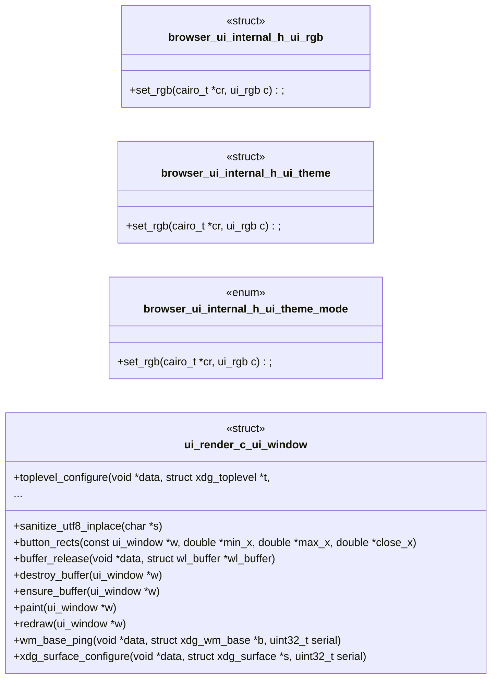

#### `include/box_style.h`

```mermaid
classDiagram
  direction LR
  class box_style_h_bx_edges {
    <<struct>>
    +box(zero margin), keeping items tight. A heading * escapes this, per 4d. * ua identity of the nearest BLOCK-LEVEL an
    +BX_TROLE_NONE(an unrecognised element joins no table -- fail closed). */ bx_table_role bx_table_role_of(const char *tag, css_display display);
    +bx_display_name(bx_display d);
    +bx_width_cap(int w_px, int w_pct, double avail_w);
    +bx_width_cap2(int w_px, int w_pct, int mw_px, int mw_pct, double avail_w);
    +bx_replaced_box(int w_px, int w_pct, int aspect_num, int aspect_den, double avail_w, double *out_w, double *out_h);
    +bx_border_box_h(double declared_h, int border_box, double pad_t, double pad_b, double bord_t, double bord_b);
    +block(cb_h < 0) the value behaves as auto: -1. * Without a percentage it is px_val, whatever cb_h is. Pure. */ double bx_pct_block_size(int px_val, int pct_pm, double cb_h);
    +bx_line_height_px(int line_scale, double font_px);
    +bx_definite_content_h(double h, double min_h, double max_h, int border_box, double v_edges);
  }
  class box_style_h_bx_box {
    <<struct>>
    +box(zero margin), keeping items tight. A heading * escapes this, per 4d. * ua identity of the nearest BLOCK-LEVEL an
    +BX_TROLE_NONE(an unrecognised element joins no table -- fail closed). */ bx_table_role bx_table_role_of(const char *tag, css_display display);
    +bx_display_name(bx_display d);
    +bx_width_cap(int w_px, int w_pct, double avail_w);
    +bx_width_cap2(int w_px, int w_pct, int mw_px, int mw_pct, double avail_w);
    +bx_replaced_box(int w_px, int w_pct, int aspect_num, int aspect_den, double avail_w, double *out_w, double *out_h);
    +bx_border_box_h(double declared_h, int border_box, double pad_t, double pad_b, double bord_t, double bord_b);
    +block(cb_h < 0) the value behaves as auto: -1. * Without a percentage it is px_val, whatever cb_h is. Pure. */ double bx_pct_block_size(int px_val, int pct_pm, double cb_h);
    +bx_line_height_px(int line_scale, double font_px);
    +bx_definite_content_h(double h, double min_h, double max_h, int border_box, double v_edges);
  }
  class box_style_h_bx_hplace {
    <<struct>>
    +box(zero margin), keeping items tight. A heading * escapes this, per 4d. * ua identity of the nearest BLOCK-LEVEL an
    +BX_TROLE_NONE(an unrecognised element joins no table -- fail closed). */ bx_table_role bx_table_role_of(const char *tag, css_display display);
    +bx_display_name(bx_display d);
    +bx_width_cap(int w_px, int w_pct, double avail_w);
    +bx_width_cap2(int w_px, int w_pct, int mw_px, int mw_pct, double avail_w);
    +bx_replaced_box(int w_px, int w_pct, int aspect_num, int aspect_den, double avail_w, double *out_w, double *out_h);
    +bx_border_box_h(double declared_h, int border_box, double pad_t, double pad_b, double bord_t, double bord_b);
    +block(cb_h < 0) the value behaves as auto: -1. * Without a percentage it is px_val, whatever cb_h is. Pure. */ double bx_pct_block_size(int px_val, int pct_pm, double cb_h);
    +bx_line_height_px(int line_scale, double font_px);
    +bx_definite_content_h(double h, double min_h, double max_h, int border_box, double v_edges);
  }
  class box_style_h_bx_bg_layer {
    <<struct>>
    +box(zero margin), keeping items tight. A heading * escapes this, per 4d. * ua identity of the nearest BLOCK-LEVEL an
    +BX_TROLE_NONE(an unrecognised element joins no table -- fail closed). */ bx_table_role bx_table_role_of(const char *tag, css_display display);
    +bx_display_name(bx_display d);
    +bx_width_cap(int w_px, int w_pct, double avail_w);
    +bx_width_cap2(int w_px, int w_pct, int mw_px, int mw_pct, double avail_w);
    +bx_replaced_box(int w_px, int w_pct, int aspect_num, int aspect_den, double avail_w, double *out_w, double *out_h);
    +bx_border_box_h(double declared_h, int border_box, double pad_t, double pad_b, double bord_t, double bord_b);
    +block(cb_h < 0) the value behaves as auto: -1. * Without a percentage it is px_val, whatever cb_h is. Pure. */ double bx_pct_block_size(int px_val, int pct_pm, double cb_h);
    +bx_line_height_px(int line_scale, double font_px);
    +bx_definite_content_h(double h, double min_h, double max_h, int border_box, double v_edges);
  }
  class box_style_h_bx_display {
    <<enum>>
    +box(zero margin), keeping items tight. A heading * escapes this, per 4d. * ua identity of the nearest BLOCK-LEVEL an
    +BX_TROLE_NONE(an unrecognised element joins no table -- fail closed). */ bx_table_role bx_table_role_of(const char *tag, css_display display);
    +bx_display_name(bx_display d);
    +bx_width_cap(int w_px, int w_pct, double avail_w);
    +bx_width_cap2(int w_px, int w_pct, int mw_px, int mw_pct, double avail_w);
    +bx_replaced_box(int w_px, int w_pct, int aspect_num, int aspect_den, double avail_w, double *out_w, double *out_h);
    +bx_border_box_h(double declared_h, int border_box, double pad_t, double pad_b, double bord_t, double bord_b);
    +block(cb_h < 0) the value behaves as auto: -1. * Without a percentage it is px_val, whatever cb_h is. Pure. */ double bx_pct_block_size(int px_val, int pct_pm, double cb_h);
    +bx_line_height_px(int line_scale, double font_px);
    +bx_definite_content_h(double h, double min_h, double max_h, int border_box, double v_edges);
  }
  class box_style_h_bx_status {
    <<enum>>
    +box(zero margin), keeping items tight. A heading * escapes this, per 4d. * ua identity of the nearest BLOCK-LEVEL an
    +BX_TROLE_NONE(an unrecognised element joins no table -- fail closed). */ bx_table_role bx_table_role_of(const char *tag, css_display display);
    +bx_display_name(bx_display d);
    +bx_width_cap(int w_px, int w_pct, double avail_w);
    +bx_width_cap2(int w_px, int w_pct, int mw_px, int mw_pct, double avail_w);
    +bx_replaced_box(int w_px, int w_pct, int aspect_num, int aspect_den, double avail_w, double *out_w, double *out_h);
    +bx_border_box_h(double declared_h, int border_box, double pad_t, double pad_b, double bord_t, double bord_b);
    +block(cb_h < 0) the value behaves as auto: -1. * Without a percentage it is px_val, whatever cb_h is. Pure. */ double bx_pct_block_size(int px_val, int pct_pm, double cb_h);
    +bx_line_height_px(int line_scale, double font_px);
    +bx_definite_content_h(double h, double min_h, double max_h, int border_box, double v_edges);
  }
  class box_style_h_bx_ua_tag {
    <<enum>>
    +box(zero margin), keeping items tight. A heading * escapes this, per 4d. * ua identity of the nearest BLOCK-LEVEL an
    +BX_TROLE_NONE(an unrecognised element joins no table -- fail closed). */ bx_table_role bx_table_role_of(const char *tag, css_display display);
    +bx_display_name(bx_display d);
    +bx_width_cap(int w_px, int w_pct, double avail_w);
    +bx_width_cap2(int w_px, int w_pct, int mw_px, int mw_pct, double avail_w);
    +bx_replaced_box(int w_px, int w_pct, int aspect_num, int aspect_den, double avail_w, double *out_w, double *out_h);
    +bx_border_box_h(double declared_h, int border_box, double pad_t, double pad_b, double bord_t, double bord_b);
    +block(cb_h < 0) the value behaves as auto: -1. * Without a percentage it is px_val, whatever cb_h is. Pure. */ double bx_pct_block_size(int px_val, int pct_pm, double cb_h);
    +bx_line_height_px(int line_scale, double font_px);
    +bx_definite_content_h(double h, double min_h, double max_h, int border_box, double v_edges);
  }
  class box_style_h_bx_table_role {
    <<enum>>
    +box(zero margin), keeping items tight. A heading * escapes this, per 4d. * ua identity of the nearest BLOCK-LEVEL an
    +BX_TROLE_NONE(an unrecognised element joins no table -- fail closed). */ bx_table_role bx_table_role_of(const char *tag, css_display display);
    +bx_display_name(bx_display d);
    +bx_width_cap(int w_px, int w_pct, double avail_w);
    +bx_width_cap2(int w_px, int w_pct, int mw_px, int mw_pct, double avail_w);
    +bx_replaced_box(int w_px, int w_pct, int aspect_num, int aspect_den, double avail_w, double *out_w, double *out_h);
    +bx_border_box_h(double declared_h, int border_box, double pad_t, double pad_b, double bord_t, double bord_b);
    +block(cb_h < 0) the value behaves as auto: -1. * Without a percentage it is px_val, whatever cb_h is. Pure. */ double bx_pct_block_size(int px_val, int pct_pm, double cb_h);
    +bx_line_height_px(int line_scale, double font_px);
    +bx_definite_content_h(double h, double min_h, double max_h, int border_box, double v_edges);
  }
```

#### `include/box_tree.h`, `include/browser.h`

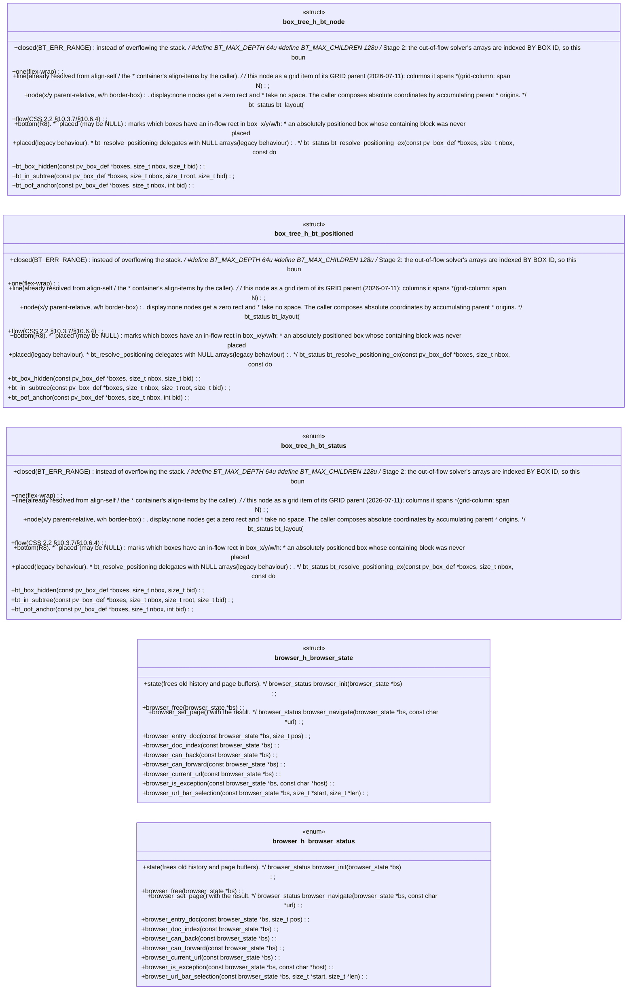

#### `include/compositor.h`

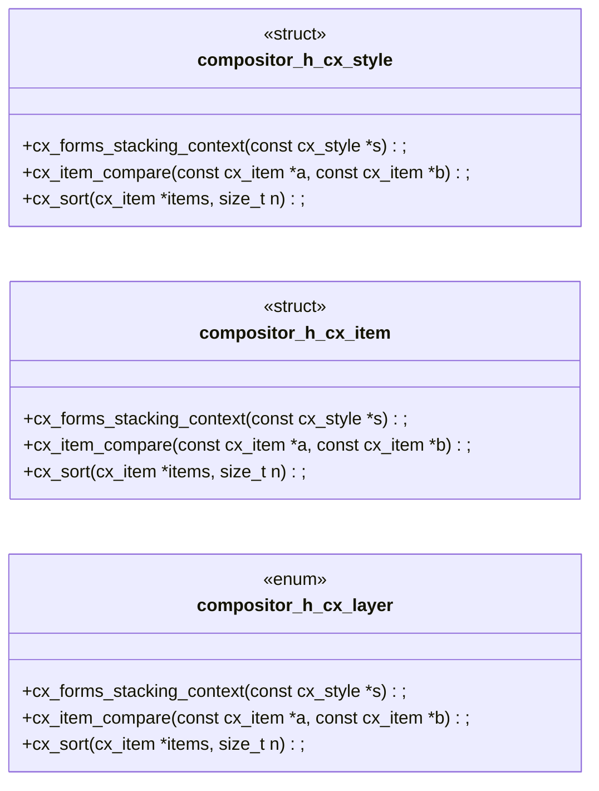

#### `include/css.h`

```mermaid
classDiagram
  direction LR
  class css_h_css_style {
    <<struct>>
    +verbatim(flex_layout parses them);
    +POINTER(shows the hand cursor already used for links) from every other value * (shows the default arrow);
    +family(spec/text_shape.md section 7);
    +translate()/translateX()/translateY();
    +scaleY() as a PERCENT of identity (100 = scale(1), matching font_scale's * convention);
    +declared(identity: 0 offset / 100% scale / 0deg). * Percentage translate arguments are not supported (the whole declaration * fails closed to unset -- see expand_transform in css.c
    +element(e.g. one setting * translate, a more specific one setting rotate) can still combine -- see * expand_transform's comment. A box with any field set (e
    +slots(singular matrices fail closed);
    +palette(a dark palette in a light render) can never clobber the active one. * css_parse/css_parse_media delegate here with root_scope == NULL. */ css_status css_parse_scoped(
    +css_free(css_sheet *s);
  }
  class css_h_css_sel {
    <<struct>>
    +verbatim(flex_layout parses them);
    +POINTER(shows the hand cursor already used for links) from every other value * (shows the default arrow);
    +family(spec/text_shape.md section 7);
    +translate()/translateX()/translateY();
    +scaleY() as a PERCENT of identity (100 = scale(1), matching font_scale's * convention);
    +declared(identity: 0 offset / 100% scale / 0deg). * Percentage translate arguments are not supported (the whole declaration * fails closed to unset -- see expand_transform in css.c
    +element(e.g. one setting * translate, a more specific one setting rotate) can still combine -- see * expand_transform's comment. A box with any field set (e
    +slots(singular matrices fail closed);
    +palette(a dark palette in a light render) can never clobber the active one. * css_parse/css_parse_media delegate here with root_scope == NULL. */ css_status css_parse_scoped(
    +css_free(css_sheet *s);
  }
  class css_h_css_media {
    <<struct>>
    +verbatim(flex_layout parses them);
    +POINTER(shows the hand cursor already used for links) from every other value * (shows the default arrow);
    +family(spec/text_shape.md section 7);
    +translate()/translateX()/translateY();
    +scaleY() as a PERCENT of identity (100 = scale(1), matching font_scale's * convention);
    +declared(identity: 0 offset / 100% scale / 0deg). * Percentage translate arguments are not supported (the whole declaration * fails closed to unset -- see expand_transform in css.c
    +element(e.g. one setting * translate, a more specific one setting rotate) can still combine -- see * expand_transform's comment. A box with any field set (e
    +slots(singular matrices fail closed);
    +palette(a dark palette in a light render) can never clobber the active one. * css_parse/css_parse_media delegate here with root_scope == NULL. */ css_status css_parse_scoped(
    +css_free(css_sheet *s);
  }
  class css_h_css_drop {
    <<struct>>
    +verbatim(flex_layout parses them);
    +POINTER(shows the hand cursor already used for links) from every other value * (shows the default arrow);
    +family(spec/text_shape.md section 7);
    +translate()/translateX()/translateY();
    +scaleY() as a PERCENT of identity (100 = scale(1), matching font_scale's * convention);
    +declared(identity: 0 offset / 100% scale / 0deg). * Percentage translate arguments are not supported (the whole declaration * fails closed to unset -- see expand_transform in css.c
    +element(e.g. one setting * translate, a more specific one setting rotate) can still combine -- see * expand_transform's comment. A box with any field set (e
    +slots(singular matrices fail closed);
    +palette(a dark palette in a light render) can never clobber the active one. * css_parse/css_parse_media delegate here with root_scope == NULL. */ css_status css_parse_scoped(
    +css_free(css_sheet *s);
  }
  class css_h_css_drop_log {
    <<struct>>
    +verbatim(flex_layout parses them);
    +POINTER(shows the hand cursor already used for links) from every other value * (shows the default arrow);
    +family(spec/text_shape.md section 7);
    +translate()/translateX()/translateY();
    +scaleY() as a PERCENT of identity (100 = scale(1), matching font_scale's * convention);
    +declared(identity: 0 offset / 100% scale / 0deg). * Percentage translate arguments are not supported (the whole declaration * fails closed to unset -- see expand_transform in css.c
    +element(e.g. one setting * translate, a more specific one setting rotate) can still combine -- see * expand_transform's comment. A box with any field set (e
    +slots(singular matrices fail closed);
    +palette(a dark palette in a light render) can never clobber the active one. * css_parse/css_parse_media delegate here with root_scope == NULL. */ css_status css_parse_scoped(
    +css_free(css_sheet *s);
  }
  class css_h_css_attr {
    <<struct>>
    +verbatim(flex_layout parses them);
    +POINTER(shows the hand cursor already used for links) from every other value * (shows the default arrow);
    +family(spec/text_shape.md section 7);
    +translate()/translateX()/translateY();
    +scaleY() as a PERCENT of identity (100 = scale(1), matching font_scale's * convention);
    +declared(identity: 0 offset / 100% scale / 0deg). * Percentage translate arguments are not supported (the whole declaration * fails closed to unset -- see expand_transform in css.c
    +element(e.g. one setting * translate, a more specific one setting rotate) can still combine -- see * expand_transform's comment. A box with any field set (e
    +slots(singular matrices fail closed);
    +palette(a dark palette in a light render) can never clobber the active one. * css_parse/css_parse_media delegate here with root_scope == NULL. */ css_status css_parse_scoped(
    +css_free(css_sheet *s);
  }
  class css_h_css_element {
    <<struct>>
    +verbatim(flex_layout parses them);
    +POINTER(shows the hand cursor already used for links) from every other value * (shows the default arrow);
    +family(spec/text_shape.md section 7);
    +translate()/translateX()/translateY();
    +scaleY() as a PERCENT of identity (100 = scale(1), matching font_scale's * convention);
    +declared(identity: 0 offset / 100% scale / 0deg). * Percentage translate arguments are not supported (the whole declaration * fails closed to unset -- see expand_transform in css.c
    +element(e.g. one setting * translate, a more specific one setting rotate) can still combine -- see * expand_transform's comment. A box with any field set (e
    +slots(singular matrices fail closed);
    +palette(a dark palette in a light render) can never clobber the active one. * css_parse/css_parse_media delegate here with root_scope == NULL. */ css_status css_parse_scoped(
    +css_free(css_sheet *s);
  }
  class css_h_cvr_table {
    <<struct>>
    +verbatim(flex_layout parses them);
    +POINTER(shows the hand cursor already used for links) from every other value * (shows the default arrow);
    +family(spec/text_shape.md section 7);
    +translate()/translateX()/translateY();
    +scaleY() as a PERCENT of identity (100 = scale(1), matching font_scale's * convention);
    +declared(identity: 0 offset / 100% scale / 0deg). * Percentage translate arguments are not supported (the whole declaration * fails closed to unset -- see expand_transform in css.c
    +element(e.g. one setting * translate, a more specific one setting rotate) can still combine -- see * expand_transform's comment. A box with any field set (e
    +slots(singular matrices fail closed);
    +palette(a dark palette in a light render) can never clobber the active one. * css_parse/css_parse_media delegate here with root_scope == NULL. */ css_status css_parse_scoped(
    +css_free(css_sheet *s);
  }
  class css_h_css_status {
    <<enum>>
    +verbatim(flex_layout parses them);
    +POINTER(shows the hand cursor already used for links) from every other value * (shows the default arrow);
    +family(spec/text_shape.md section 7);
    +translate()/translateX()/translateY();
    +scaleY() as a PERCENT of identity (100 = scale(1), matching font_scale's * convention);
    +declared(identity: 0 offset / 100% scale / 0deg). * Percentage translate arguments are not supported (the whole declaration * fails closed to unset -- see expand_transform in css.c
    +element(e.g. one setting * translate, a more specific one setting rotate) can still combine -- see * expand_transform's comment. A box with any field set (e
    +slots(singular matrices fail closed);
    +palette(a dark palette in a light render) can never clobber the active one. * css_parse/css_parse_media delegate here with root_scope == NULL. */ css_status css_parse_scoped(
    +css_free(css_sheet *s);
  }
  class css_h_css_align {
    <<enum>>
    +verbatim(flex_layout parses them);
    +POINTER(shows the hand cursor already used for links) from every other value * (shows the default arrow);
    +family(spec/text_shape.md section 7);
    +translate()/translateX()/translateY();
    +scaleY() as a PERCENT of identity (100 = scale(1), matching font_scale's * convention);
    +declared(identity: 0 offset / 100% scale / 0deg). * Percentage translate arguments are not supported (the whole declaration * fails closed to unset -- see expand_transform in css.c
    +element(e.g. one setting * translate, a more specific one setting rotate) can still combine -- see * expand_transform's comment. A box with any field set (e
    +slots(singular matrices fail closed);
    +palette(a dark palette in a light render) can never clobber the active one. * css_parse/css_parse_media delegate here with root_scope == NULL. */ css_status css_parse_scoped(
    +css_free(css_sheet *s);
  }
  class css_h_css_display {
    <<enum>>
    +verbatim(flex_layout parses them);
    +POINTER(shows the hand cursor already used for links) from every other value * (shows the default arrow);
    +family(spec/text_shape.md section 7);
    +translate()/translateX()/translateY();
    +scaleY() as a PERCENT of identity (100 = scale(1), matching font_scale's * convention);
    +declared(identity: 0 offset / 100% scale / 0deg). * Percentage translate arguments are not supported (the whole declaration * fails closed to unset -- see expand_transform in css.c
    +element(e.g. one setting * translate, a more specific one setting rotate) can still combine -- see * expand_transform's comment. A box with any field set (e
    +slots(singular matrices fail closed);
    +palette(a dark palette in a light render) can never clobber the active one. * css_parse/css_parse_media delegate here with root_scope == NULL. */ css_status css_parse_scoped(
    +css_free(css_sheet *s);
  }
  class css_h_css_justify {
    <<enum>>
    +verbatim(flex_layout parses them);
    +POINTER(shows the hand cursor already used for links) from every other value * (shows the default arrow);
    +family(spec/text_shape.md section 7);
    +translate()/translateX()/translateY();
    +scaleY() as a PERCENT of identity (100 = scale(1), matching font_scale's * convention);
    +declared(identity: 0 offset / 100% scale / 0deg). * Percentage translate arguments are not supported (the whole declaration * fails closed to unset -- see expand_transform in css.c
    +element(e.g. one setting * translate, a more specific one setting rotate) can still combine -- see * expand_transform's comment. A box with any field set (e
    +slots(singular matrices fail closed);
    +palette(a dark palette in a light render) can never clobber the active one. * css_parse/css_parse_media delegate here with root_scope == NULL. */ css_status css_parse_scoped(
    +css_free(css_sheet *s);
  }
  class css_h_css_font_family {
    <<enum>>
    +verbatim(flex_layout parses them);
    +POINTER(shows the hand cursor already used for links) from every other value * (shows the default arrow);
    +family(spec/text_shape.md section 7);
    +translate()/translateX()/translateY();
    +scaleY() as a PERCENT of identity (100 = scale(1), matching font_scale's * convention);
    +declared(identity: 0 offset / 100% scale / 0deg). * Percentage translate arguments are not supported (the whole declaration * fails closed to unset -- see expand_transform in css.c
    +element(e.g. one setting * translate, a more specific one setting rotate) can still combine -- see * expand_transform's comment. A box with any field set (e
    +slots(singular matrices fail closed);
    +palette(a dark palette in a light render) can never clobber the active one. * css_parse/css_parse_media delegate here with root_scope == NULL. */ css_status css_parse_scoped(
    +css_free(css_sheet *s);
  }
  class css_h_css_text_transform {
    <<enum>>
    +verbatim(flex_layout parses them);
    +POINTER(shows the hand cursor already used for links) from every other value * (shows the default arrow);
    +family(spec/text_shape.md section 7);
    +translate()/translateX()/translateY();
    +scaleY() as a PERCENT of identity (100 = scale(1), matching font_scale's * convention);
    +declared(identity: 0 offset / 100% scale / 0deg). * Percentage translate arguments are not supported (the whole declaration * fails closed to unset -- see expand_transform in css.c
    +element(e.g. one setting * translate, a more specific one setting rotate) can still combine -- see * expand_transform's comment. A box with any field set (e
    +slots(singular matrices fail closed);
    +palette(a dark palette in a light render) can never clobber the active one. * css_parse/css_parse_media delegate here with root_scope == NULL. */ css_status css_parse_scoped(
    +css_free(css_sheet *s);
  }
  class css_h_css_valign {
    <<enum>>
    +verbatim(flex_layout parses them);
    +POINTER(shows the hand cursor already used for links) from every other value * (shows the default arrow);
    +family(spec/text_shape.md section 7);
    +translate()/translateX()/translateY();
    +scaleY() as a PERCENT of identity (100 = scale(1), matching font_scale's * convention);
    +declared(identity: 0 offset / 100% scale / 0deg). * Percentage translate arguments are not supported (the whole declaration * fails closed to unset -- see expand_transform in css.c
    +element(e.g. one setting * translate, a more specific one setting rotate) can still combine -- see * expand_transform's comment. A box with any field set (e
    +slots(singular matrices fail closed);
    +palette(a dark palette in a light render) can never clobber the active one. * css_parse/css_parse_media delegate here with root_scope == NULL. */ css_status css_parse_scoped(
    +css_free(css_sheet *s);
  }
  class css_h_css_white_space {
    <<enum>>
    +verbatim(flex_layout parses them);
    +POINTER(shows the hand cursor already used for links) from every other value * (shows the default arrow);
    +family(spec/text_shape.md section 7);
    +translate()/translateX()/translateY();
    +scaleY() as a PERCENT of identity (100 = scale(1), matching font_scale's * convention);
    +declared(identity: 0 offset / 100% scale / 0deg). * Percentage translate arguments are not supported (the whole declaration * fails closed to unset -- see expand_transform in css.c
    +element(e.g. one setting * translate, a more specific one setting rotate) can still combine -- see * expand_transform's comment. A box with any field set (e
    +slots(singular matrices fail closed);
    +palette(a dark palette in a light render) can never clobber the active one. * css_parse/css_parse_media delegate here with root_scope == NULL. */ css_status css_parse_scoped(
    +css_free(css_sheet *s);
  }
  class css_h_css_list_style {
    <<enum>>
    +verbatim(flex_layout parses them);
    +POINTER(shows the hand cursor already used for links) from every other value * (shows the default arrow);
    +family(spec/text_shape.md section 7);
    +translate()/translateX()/translateY();
    +scaleY() as a PERCENT of identity (100 = scale(1), matching font_scale's * convention);
    +declared(identity: 0 offset / 100% scale / 0deg). * Percentage translate arguments are not supported (the whole declaration * fails closed to unset -- see expand_transform in css.c
    +element(e.g. one setting * translate, a more specific one setting rotate) can still combine -- see * expand_transform's comment. A box with any field set (e
    +slots(singular matrices fail closed);
    +palette(a dark palette in a light render) can never clobber the active one. * css_parse/css_parse_media delegate here with root_scope == NULL. */ css_status css_parse_scoped(
    +css_free(css_sheet *s);
  }
  class css_h_css_position {
    <<enum>>
    +verbatim(flex_layout parses them);
    +POINTER(shows the hand cursor already used for links) from every other value * (shows the default arrow);
    +family(spec/text_shape.md section 7);
    +translate()/translateX()/translateY();
    +scaleY() as a PERCENT of identity (100 = scale(1), matching font_scale's * convention);
    +declared(identity: 0 offset / 100% scale / 0deg). * Percentage translate arguments are not supported (the whole declaration * fails closed to unset -- see expand_transform in css.c
    +element(e.g. one setting * translate, a more specific one setting rotate) can still combine -- see * expand_transform's comment. A box with any field set (e
    +slots(singular matrices fail closed);
    +palette(a dark palette in a light render) can never clobber the active one. * css_parse/css_parse_media delegate here with root_scope == NULL. */ css_status css_parse_scoped(
    +css_free(css_sheet *s);
  }
  class css_h_css_box_sizing {
    <<enum>>
    +verbatim(flex_layout parses them);
    +POINTER(shows the hand cursor already used for links) from every other value * (shows the default arrow);
    +family(spec/text_shape.md section 7);
    +translate()/translateX()/translateY();
    +scaleY() as a PERCENT of identity (100 = scale(1), matching font_scale's * convention);
    +declared(identity: 0 offset / 100% scale / 0deg). * Percentage translate arguments are not supported (the whole declaration * fails closed to unset -- see expand_transform in css.c
    +element(e.g. one setting * translate, a more specific one setting rotate) can still combine -- see * expand_transform's comment. A box with any field set (e
    +slots(singular matrices fail closed);
    +palette(a dark palette in a light render) can never clobber the active one. * css_parse/css_parse_media delegate here with root_scope == NULL. */ css_status css_parse_scoped(
    +css_free(css_sheet *s);
  }
  class css_h_css_border_style {
    <<enum>>
    +verbatim(flex_layout parses them);
    +POINTER(shows the hand cursor already used for links) from every other value * (shows the default arrow);
    +family(spec/text_shape.md section 7);
    +translate()/translateX()/translateY();
    +scaleY() as a PERCENT of identity (100 = scale(1), matching font_scale's * convention);
    +declared(identity: 0 offset / 100% scale / 0deg). * Percentage translate arguments are not supported (the whole declaration * fails closed to unset -- see expand_transform in css.c
    +element(e.g. one setting * translate, a more specific one setting rotate) can still combine -- see * expand_transform's comment. A box with any field set (e
    +slots(singular matrices fail closed);
    +palette(a dark palette in a light render) can never clobber the active one. * css_parse/css_parse_media delegate here with root_scope == NULL. */ css_status css_parse_scoped(
    +css_free(css_sheet *s);
  }
  class css_h_css_flex_direction {
    <<enum>>
    +verbatim(flex_layout parses them);
    +POINTER(shows the hand cursor already used for links) from every other value * (shows the default arrow);
    +family(spec/text_shape.md section 7);
    +translate()/translateX()/translateY();
    +scaleY() as a PERCENT of identity (100 = scale(1), matching font_scale's * convention);
    +declared(identity: 0 offset / 100% scale / 0deg). * Percentage translate arguments are not supported (the whole declaration * fails closed to unset -- see expand_transform in css.c
    +element(e.g. one setting * translate, a more specific one setting rotate) can still combine -- see * expand_transform's comment. A box with any field set (e
    +slots(singular matrices fail closed);
    +palette(a dark palette in a light render) can never clobber the active one. * css_parse/css_parse_media delegate here with root_scope == NULL. */ css_status css_parse_scoped(
    +css_free(css_sheet *s);
  }
  class css_h_css_flex_wrap {
    <<enum>>
    +verbatim(flex_layout parses them);
    +POINTER(shows the hand cursor already used for links) from every other value * (shows the default arrow);
    +family(spec/text_shape.md section 7);
    +translate()/translateX()/translateY();
    +scaleY() as a PERCENT of identity (100 = scale(1), matching font_scale's * convention);
    +declared(identity: 0 offset / 100% scale / 0deg). * Percentage translate arguments are not supported (the whole declaration * fails closed to unset -- see expand_transform in css.c
    +element(e.g. one setting * translate, a more specific one setting rotate) can still combine -- see * expand_transform's comment. A box with any field set (e
    +slots(singular matrices fail closed);
    +palette(a dark palette in a light render) can never clobber the active one. * css_parse/css_parse_media delegate here with root_scope == NULL. */ css_status css_parse_scoped(
    +css_free(css_sheet *s);
  }
  class css_h_css_align_kw {
    <<enum>>
    +verbatim(flex_layout parses them);
    +POINTER(shows the hand cursor already used for links) from every other value * (shows the default arrow);
    +family(spec/text_shape.md section 7);
    +translate()/translateX()/translateY();
    +scaleY() as a PERCENT of identity (100 = scale(1), matching font_scale's * convention);
    +declared(identity: 0 offset / 100% scale / 0deg). * Percentage translate arguments are not supported (the whole declaration * fails closed to unset -- see expand_transform in css.c
    +element(e.g. one setting * translate, a more specific one setting rotate) can still combine -- see * expand_transform's comment. A box with any field set (e
    +slots(singular matrices fail closed);
    +palette(a dark palette in a light render) can never clobber the active one. * css_parse/css_parse_media delegate here with root_scope == NULL. */ css_status css_parse_scoped(
    +css_free(css_sheet *s);
  }
  class css_h_css_grid_flow {
    <<enum>>
    +verbatim(flex_layout parses them);
    +POINTER(shows the hand cursor already used for links) from every other value * (shows the default arrow);
    +family(spec/text_shape.md section 7);
    +translate()/translateX()/translateY();
    +scaleY() as a PERCENT of identity (100 = scale(1), matching font_scale's * convention);
    +declared(identity: 0 offset / 100% scale / 0deg). * Percentage translate arguments are not supported (the whole declaration * fails closed to unset -- see expand_transform in css.c
    +element(e.g. one setting * translate, a more specific one setting rotate) can still combine -- see * expand_transform's comment. A box with any field set (e
    +slots(singular matrices fail closed);
    +palette(a dark palette in a light render) can never clobber the active one. * css_parse/css_parse_media delegate here with root_scope == NULL. */ css_status css_parse_scoped(
    +css_free(css_sheet *s);
  }
  class css_h_css_float {
    <<enum>>
    +verbatim(flex_layout parses them);
    +POINTER(shows the hand cursor already used for links) from every other value * (shows the default arrow);
    +family(spec/text_shape.md section 7);
    +translate()/translateX()/translateY();
    +scaleY() as a PERCENT of identity (100 = scale(1), matching font_scale's * convention);
    +declared(identity: 0 offset / 100% scale / 0deg). * Percentage translate arguments are not supported (the whole declaration * fails closed to unset -- see expand_transform in css.c
    +element(e.g. one setting * translate, a more specific one setting rotate) can still combine -- see * expand_transform's comment. A box with any field set (e
    +slots(singular matrices fail closed);
    +palette(a dark palette in a light render) can never clobber the active one. * css_parse/css_parse_media delegate here with root_scope == NULL. */ css_status css_parse_scoped(
    +css_free(css_sheet *s);
  }
  class css_h_css_clear {
    <<enum>>
    +verbatim(flex_layout parses them);
    +POINTER(shows the hand cursor already used for links) from every other value * (shows the default arrow);
    +family(spec/text_shape.md section 7);
    +translate()/translateX()/translateY();
    +scaleY() as a PERCENT of identity (100 = scale(1), matching font_scale's * convention);
    +declared(identity: 0 offset / 100% scale / 0deg). * Percentage translate arguments are not supported (the whole declaration * fails closed to unset -- see expand_transform in css.c
    +element(e.g. one setting * translate, a more specific one setting rotate) can still combine -- see * expand_transform's comment. A box with any field set (e
    +slots(singular matrices fail closed);
    +palette(a dark palette in a light render) can never clobber the active one. * css_parse/css_parse_media delegate here with root_scope == NULL. */ css_status css_parse_scoped(
    +css_free(css_sheet *s);
  }
  class css_h_css_visibility {
    <<enum>>
    +verbatim(flex_layout parses them);
    +POINTER(shows the hand cursor already used for links) from every other value * (shows the default arrow);
    +family(spec/text_shape.md section 7);
    +translate()/translateX()/translateY();
    +scaleY() as a PERCENT of identity (100 = scale(1), matching font_scale's * convention);
    +declared(identity: 0 offset / 100% scale / 0deg). * Percentage translate arguments are not supported (the whole declaration * fails closed to unset -- see expand_transform in css.c
    +element(e.g. one setting * translate, a more specific one setting rotate) can still combine -- see * expand_transform's comment. A box with any field set (e
    +slots(singular matrices fail closed);
    +palette(a dark palette in a light render) can never clobber the active one. * css_parse/css_parse_media delegate here with root_scope == NULL. */ css_status css_parse_scoped(
    +css_free(css_sheet *s);
  }
  class css_h_css_overflow {
    <<enum>>
    +verbatim(flex_layout parses them);
    +POINTER(shows the hand cursor already used for links) from every other value * (shows the default arrow);
    +family(spec/text_shape.md section 7);
    +translate()/translateX()/translateY();
    +scaleY() as a PERCENT of identity (100 = scale(1), matching font_scale's * convention);
    +declared(identity: 0 offset / 100% scale / 0deg). * Percentage translate arguments are not supported (the whole declaration * fails closed to unset -- see expand_transform in css.c
    +element(e.g. one setting * translate, a more specific one setting rotate) can still combine -- see * expand_transform's comment. A box with any field set (e
    +slots(singular matrices fail closed);
    +palette(a dark palette in a light render) can never clobber the active one. * css_parse/css_parse_media delegate here with root_scope == NULL. */ css_status css_parse_scoped(
    +css_free(css_sheet *s);
  }
  class css_h_css_cursor {
    <<enum>>
    +verbatim(flex_layout parses them);
    +POINTER(shows the hand cursor already used for links) from every other value * (shows the default arrow);
    +family(spec/text_shape.md section 7);
    +translate()/translateX()/translateY();
    +scaleY() as a PERCENT of identity (100 = scale(1), matching font_scale's * convention);
    +declared(identity: 0 offset / 100% scale / 0deg). * Percentage translate arguments are not supported (the whole declaration * fails closed to unset -- see expand_transform in css.c
    +element(e.g. one setting * translate, a more specific one setting rotate) can still combine -- see * expand_transform's comment. A box with any field set (e
    +slots(singular matrices fail closed);
    +palette(a dark palette in a light render) can never clobber the active one. * css_parse/css_parse_media delegate here with root_scope == NULL. */ css_status css_parse_scoped(
    +css_free(css_sheet *s);
  }
  class css_h_css_text_overflow {
    <<enum>>
    +verbatim(flex_layout parses them);
    +POINTER(shows the hand cursor already used for links) from every other value * (shows the default arrow);
    +family(spec/text_shape.md section 7);
    +translate()/translateX()/translateY();
    +scaleY() as a PERCENT of identity (100 = scale(1), matching font_scale's * convention);
    +declared(identity: 0 offset / 100% scale / 0deg). * Percentage translate arguments are not supported (the whole declaration * fails closed to unset -- see expand_transform in css.c
    +element(e.g. one setting * translate, a more specific one setting rotate) can still combine -- see * expand_transform's comment. A box with any field set (e
    +slots(singular matrices fail closed);
    +palette(a dark palette in a light render) can never clobber the active one. * css_parse/css_parse_media delegate here with root_scope == NULL. */ css_status css_parse_scoped(
    +css_free(css_sheet *s);
  }
  class css_h_css_word_break {
    <<enum>>
    +verbatim(flex_layout parses them);
    +POINTER(shows the hand cursor already used for links) from every other value * (shows the default arrow);
    +family(spec/text_shape.md section 7);
    +translate()/translateX()/translateY();
    +scaleY() as a PERCENT of identity (100 = scale(1), matching font_scale's * convention);
    +declared(identity: 0 offset / 100% scale / 0deg). * Percentage translate arguments are not supported (the whole declaration * fails closed to unset -- see expand_transform in css.c
    +element(e.g. one setting * translate, a more specific one setting rotate) can still combine -- see * expand_transform's comment. A box with any field set (e
    +slots(singular matrices fail closed);
    +palette(a dark palette in a light render) can never clobber the active one. * css_parse/css_parse_media delegate here with root_scope == NULL. */ css_status css_parse_scoped(
    +css_free(css_sheet *s);
  }
  class css_h_css_text_decoration_style {
    <<enum>>
    +verbatim(flex_layout parses them);
    +POINTER(shows the hand cursor already used for links) from every other value * (shows the default arrow);
    +family(spec/text_shape.md section 7);
    +translate()/translateX()/translateY();
    +scaleY() as a PERCENT of identity (100 = scale(1), matching font_scale's * convention);
    +declared(identity: 0 offset / 100% scale / 0deg). * Percentage translate arguments are not supported (the whole declaration * fails closed to unset -- see expand_transform in css.c
    +element(e.g. one setting * translate, a more specific one setting rotate) can still combine -- see * expand_transform's comment. A box with any field set (e
    +slots(singular matrices fail closed);
    +palette(a dark palette in a light render) can never clobber the active one. * css_parse/css_parse_media delegate here with root_scope == NULL. */ css_status css_parse_scoped(
    +css_free(css_sheet *s);
  }
  class css_h_css_direction {
    <<enum>>
    +verbatim(flex_layout parses them);
    +POINTER(shows the hand cursor already used for links) from every other value * (shows the default arrow);
    +family(spec/text_shape.md section 7);
    +translate()/translateX()/translateY();
    +scaleY() as a PERCENT of identity (100 = scale(1), matching font_scale's * convention);
    +declared(identity: 0 offset / 100% scale / 0deg). * Percentage translate arguments are not supported (the whole declaration * fails closed to unset -- see expand_transform in css.c
    +element(e.g. one setting * translate, a more specific one setting rotate) can still combine -- see * expand_transform's comment. A box with any field set (e
    +slots(singular matrices fail closed);
    +palette(a dark palette in a light render) can never clobber the active one. * css_parse/css_parse_media delegate here with root_scope == NULL. */ css_status css_parse_scoped(
    +css_free(css_sheet *s);
  }
  class css_h_css_border_collapse {
    <<enum>>
    +verbatim(flex_layout parses them);
    +POINTER(shows the hand cursor already used for links) from every other value * (shows the default arrow);
    +family(spec/text_shape.md section 7);
    +translate()/translateX()/translateY();
    +scaleY() as a PERCENT of identity (100 = scale(1), matching font_scale's * convention);
    +declared(identity: 0 offset / 100% scale / 0deg). * Percentage translate arguments are not supported (the whole declaration * fails closed to unset -- see expand_transform in css.c
    +element(e.g. one setting * translate, a more specific one setting rotate) can still combine -- see * expand_transform's comment. A box with any field set (e
    +slots(singular matrices fail closed);
    +palette(a dark palette in a light render) can never clobber the active one. * css_parse/css_parse_media delegate here with root_scope == NULL. */ css_status css_parse_scoped(
    +css_free(css_sheet *s);
  }
  class css_h_css_empty_cells {
    <<enum>>
    +verbatim(flex_layout parses them);
    +POINTER(shows the hand cursor already used for links) from every other value * (shows the default arrow);
    +family(spec/text_shape.md section 7);
    +translate()/translateX()/translateY();
    +scaleY() as a PERCENT of identity (100 = scale(1), matching font_scale's * convention);
    +declared(identity: 0 offset / 100% scale / 0deg). * Percentage translate arguments are not supported (the whole declaration * fails closed to unset -- see expand_transform in css.c
    +element(e.g. one setting * translate, a more specific one setting rotate) can still combine -- see * expand_transform's comment. A box with any field set (e
    +slots(singular matrices fail closed);
    +palette(a dark palette in a light render) can never clobber the active one. * css_parse/css_parse_media delegate here with root_scope == NULL. */ css_status css_parse_scoped(
    +css_free(css_sheet *s);
  }
  class css_h_css_caption_side {
    <<enum>>
    +verbatim(flex_layout parses them);
    +POINTER(shows the hand cursor already used for links) from every other value * (shows the default arrow);
    +family(spec/text_shape.md section 7);
    +translate()/translateX()/translateY();
    +scaleY() as a PERCENT of identity (100 = scale(1), matching font_scale's * convention);
    +declared(identity: 0 offset / 100% scale / 0deg). * Percentage translate arguments are not supported (the whole declaration * fails closed to unset -- see expand_transform in css.c
    +element(e.g. one setting * translate, a more specific one setting rotate) can still combine -- see * expand_transform's comment. A box with any field set (e
    +slots(singular matrices fail closed);
    +palette(a dark palette in a light render) can never clobber the active one. * css_parse/css_parse_media delegate here with root_scope == NULL. */ css_status css_parse_scoped(
    +css_free(css_sheet *s);
  }
  class css_h_css_table_layout {
    <<enum>>
    +verbatim(flex_layout parses them);
    +POINTER(shows the hand cursor already used for links) from every other value * (shows the default arrow);
    +family(spec/text_shape.md section 7);
    +translate()/translateX()/translateY();
    +scaleY() as a PERCENT of identity (100 = scale(1), matching font_scale's * convention);
    +declared(identity: 0 offset / 100% scale / 0deg). * Percentage translate arguments are not supported (the whole declaration * fails closed to unset -- see expand_transform in css.c
    +element(e.g. one setting * translate, a more specific one setting rotate) can still combine -- see * expand_transform's comment. A box with any field set (e
    +slots(singular matrices fail closed);
    +palette(a dark palette in a light render) can never clobber the active one. * css_parse/css_parse_media delegate here with root_scope == NULL. */ css_status css_parse_scoped(
    +css_free(css_sheet *s);
  }
  class css_h_css_font_variant {
    <<enum>>
    +verbatim(flex_layout parses them);
    +POINTER(shows the hand cursor already used for links) from every other value * (shows the default arrow);
    +family(spec/text_shape.md section 7);
    +translate()/translateX()/translateY();
    +scaleY() as a PERCENT of identity (100 = scale(1), matching font_scale's * convention);
    +declared(identity: 0 offset / 100% scale / 0deg). * Percentage translate arguments are not supported (the whole declaration * fails closed to unset -- see expand_transform in css.c
    +element(e.g. one setting * translate, a more specific one setting rotate) can still combine -- see * expand_transform's comment. A box with any field set (e
    +slots(singular matrices fail closed);
    +palette(a dark palette in a light render) can never clobber the active one. * css_parse/css_parse_media delegate here with root_scope == NULL. */ css_status css_parse_scoped(
    +css_free(css_sheet *s);
  }
  class css_h_css_hyphens {
    <<enum>>
    +verbatim(flex_layout parses them);
    +POINTER(shows the hand cursor already used for links) from every other value * (shows the default arrow);
    +family(spec/text_shape.md section 7);
    +translate()/translateX()/translateY();
    +scaleY() as a PERCENT of identity (100 = scale(1), matching font_scale's * convention);
    +declared(identity: 0 offset / 100% scale / 0deg). * Percentage translate arguments are not supported (the whole declaration * fails closed to unset -- see expand_transform in css.c
    +element(e.g. one setting * translate, a more specific one setting rotate) can still combine -- see * expand_transform's comment. A box with any field set (e
    +slots(singular matrices fail closed);
    +palette(a dark palette in a light render) can never clobber the active one. * css_parse/css_parse_media delegate here with root_scope == NULL. */ css_status css_parse_scoped(
    +css_free(css_sheet *s);
  }
  class css_h_css_user_select {
    <<enum>>
    +verbatim(flex_layout parses them);
    +POINTER(shows the hand cursor already used for links) from every other value * (shows the default arrow);
    +family(spec/text_shape.md section 7);
    +translate()/translateX()/translateY();
    +scaleY() as a PERCENT of identity (100 = scale(1), matching font_scale's * convention);
    +declared(identity: 0 offset / 100% scale / 0deg). * Percentage translate arguments are not supported (the whole declaration * fails closed to unset -- see expand_transform in css.c
    +element(e.g. one setting * translate, a more specific one setting rotate) can still combine -- see * expand_transform's comment. A box with any field set (e
    +slots(singular matrices fail closed);
    +palette(a dark palette in a light render) can never clobber the active one. * css_parse/css_parse_media delegate here with root_scope == NULL. */ css_status css_parse_scoped(
    +css_free(css_sheet *s);
  }
  class css_h_css_appearance {
    <<enum>>
    +verbatim(flex_layout parses them);
    +POINTER(shows the hand cursor already used for links) from every other value * (shows the default arrow);
    +family(spec/text_shape.md section 7);
    +translate()/translateX()/translateY();
    +scaleY() as a PERCENT of identity (100 = scale(1), matching font_scale's * convention);
    +declared(identity: 0 offset / 100% scale / 0deg). * Percentage translate arguments are not supported (the whole declaration * fails closed to unset -- see expand_transform in css.c
    +element(e.g. one setting * translate, a more specific one setting rotate) can still combine -- see * expand_transform's comment. A box with any field set (e
    +slots(singular matrices fail closed);
    +palette(a dark palette in a light render) can never clobber the active one. * css_parse/css_parse_media delegate here with root_scope == NULL. */ css_status css_parse_scoped(
    +css_free(css_sheet *s);
  }
  class css_h_css_pointer_events {
    <<enum>>
    +verbatim(flex_layout parses them);
    +POINTER(shows the hand cursor already used for links) from every other value * (shows the default arrow);
    +family(spec/text_shape.md section 7);
    +translate()/translateX()/translateY();
    +scaleY() as a PERCENT of identity (100 = scale(1), matching font_scale's * convention);
    +declared(identity: 0 offset / 100% scale / 0deg). * Percentage translate arguments are not supported (the whole declaration * fails closed to unset -- see expand_transform in css.c
    +element(e.g. one setting * translate, a more specific one setting rotate) can still combine -- see * expand_transform's comment. A box with any field set (e
    +slots(singular matrices fail closed);
    +palette(a dark palette in a light render) can never clobber the active one. * css_parse/css_parse_media delegate here with root_scope == NULL. */ css_status css_parse_scoped(
    +css_free(css_sheet *s);
  }
  class css_h_css_bg_repeat {
    <<enum>>
    +verbatim(flex_layout parses them);
    +POINTER(shows the hand cursor already used for links) from every other value * (shows the default arrow);
    +family(spec/text_shape.md section 7);
    +translate()/translateX()/translateY();
    +scaleY() as a PERCENT of identity (100 = scale(1), matching font_scale's * convention);
    +declared(identity: 0 offset / 100% scale / 0deg). * Percentage translate arguments are not supported (the whole declaration * fails closed to unset -- see expand_transform in css.c
    +element(e.g. one setting * translate, a more specific one setting rotate) can still combine -- see * expand_transform's comment. A box with any field set (e
    +slots(singular matrices fail closed);
    +palette(a dark palette in a light render) can never clobber the active one. * css_parse/css_parse_media delegate here with root_scope == NULL. */ css_status css_parse_scoped(
    +css_free(css_sheet *s);
  }
  class css_h_css_bg_size {
    <<enum>>
    +verbatim(flex_layout parses them);
    +POINTER(shows the hand cursor already used for links) from every other value * (shows the default arrow);
    +family(spec/text_shape.md section 7);
    +translate()/translateX()/translateY();
    +scaleY() as a PERCENT of identity (100 = scale(1), matching font_scale's * convention);
    +declared(identity: 0 offset / 100% scale / 0deg). * Percentage translate arguments are not supported (the whole declaration * fails closed to unset -- see expand_transform in css.c
    +element(e.g. one setting * translate, a more specific one setting rotate) can still combine -- see * expand_transform's comment. A box with any field set (e
    +slots(singular matrices fail closed);
    +palette(a dark palette in a light render) can never clobber the active one. * css_parse/css_parse_media delegate here with root_scope == NULL. */ css_status css_parse_scoped(
    +css_free(css_sheet *s);
  }
  class css_h_css_bg_clip {
    <<enum>>
    +verbatim(flex_layout parses them);
    +POINTER(shows the hand cursor already used for links) from every other value * (shows the default arrow);
    +family(spec/text_shape.md section 7);
    +translate()/translateX()/translateY();
    +scaleY() as a PERCENT of identity (100 = scale(1), matching font_scale's * convention);
    +declared(identity: 0 offset / 100% scale / 0deg). * Percentage translate arguments are not supported (the whole declaration * fails closed to unset -- see expand_transform in css.c
    +element(e.g. one setting * translate, a more specific one setting rotate) can still combine -- see * expand_transform's comment. A box with any field set (e
    +slots(singular matrices fail closed);
    +palette(a dark palette in a light render) can never clobber the active one. * css_parse/css_parse_media delegate here with root_scope == NULL. */ css_status css_parse_scoped(
    +css_free(css_sheet *s);
  }
  class css_h_css_bg_origin {
    <<enum>>
    +verbatim(flex_layout parses them);
    +POINTER(shows the hand cursor already used for links) from every other value * (shows the default arrow);
    +family(spec/text_shape.md section 7);
    +translate()/translateX()/translateY();
    +scaleY() as a PERCENT of identity (100 = scale(1), matching font_scale's * convention);
    +declared(identity: 0 offset / 100% scale / 0deg). * Percentage translate arguments are not supported (the whole declaration * fails closed to unset -- see expand_transform in css.c
    +element(e.g. one setting * translate, a more specific one setting rotate) can still combine -- see * expand_transform's comment. A box with any field set (e
    +slots(singular matrices fail closed);
    +palette(a dark palette in a light render) can never clobber the active one. * css_parse/css_parse_media delegate here with root_scope == NULL. */ css_status css_parse_scoped(
    +css_free(css_sheet *s);
  }
  class css_h_css_bg_attachment {
    <<enum>>
    +verbatim(flex_layout parses them);
    +POINTER(shows the hand cursor already used for links) from every other value * (shows the default arrow);
    +family(spec/text_shape.md section 7);
    +translate()/translateX()/translateY();
    +scaleY() as a PERCENT of identity (100 = scale(1), matching font_scale's * convention);
    +declared(identity: 0 offset / 100% scale / 0deg). * Percentage translate arguments are not supported (the whole declaration * fails closed to unset -- see expand_transform in css.c
    +element(e.g. one setting * translate, a more specific one setting rotate) can still combine -- see * expand_transform's comment. A box with any field set (e
    +slots(singular matrices fail closed);
    +palette(a dark palette in a light render) can never clobber the active one. * css_parse/css_parse_media delegate here with root_scope == NULL. */ css_status css_parse_scoped(
    +css_free(css_sheet *s);
  }
  class css_h_css_isolation {
    <<enum>>
    +verbatim(flex_layout parses them);
    +POINTER(shows the hand cursor already used for links) from every other value * (shows the default arrow);
    +family(spec/text_shape.md section 7);
    +translate()/translateX()/translateY();
    +scaleY() as a PERCENT of identity (100 = scale(1), matching font_scale's * convention);
    +declared(identity: 0 offset / 100% scale / 0deg). * Percentage translate arguments are not supported (the whole declaration * fails closed to unset -- see expand_transform in css.c
    +element(e.g. one setting * translate, a more specific one setting rotate) can still combine -- see * expand_transform's comment. A box with any field set (e
    +slots(singular matrices fail closed);
    +palette(a dark palette in a light render) can never clobber the active one. * css_parse/css_parse_media delegate here with root_scope == NULL. */ css_status css_parse_scoped(
    +css_free(css_sheet *s);
  }
  class css_h_css_content_visibility {
    <<enum>>
    +verbatim(flex_layout parses them);
    +POINTER(shows the hand cursor already used for links) from every other value * (shows the default arrow);
    +family(spec/text_shape.md section 7);
    +translate()/translateX()/translateY();
    +scaleY() as a PERCENT of identity (100 = scale(1), matching font_scale's * convention);
    +declared(identity: 0 offset / 100% scale / 0deg). * Percentage translate arguments are not supported (the whole declaration * fails closed to unset -- see expand_transform in css.c
    +element(e.g. one setting * translate, a more specific one setting rotate) can still combine -- see * expand_transform's comment. A box with any field set (e
    +slots(singular matrices fail closed);
    +palette(a dark palette in a light render) can never clobber the active one. * css_parse/css_parse_media delegate here with root_scope == NULL. */ css_status css_parse_scoped(
    +css_free(css_sheet *s);
  }
  class css_h_css_image_rendering {
    <<enum>>
    +verbatim(flex_layout parses them);
    +POINTER(shows the hand cursor already used for links) from every other value * (shows the default arrow);
    +family(spec/text_shape.md section 7);
    +translate()/translateX()/translateY();
    +scaleY() as a PERCENT of identity (100 = scale(1), matching font_scale's * convention);
    +declared(identity: 0 offset / 100% scale / 0deg). * Percentage translate arguments are not supported (the whole declaration * fails closed to unset -- see expand_transform in css.c
    +element(e.g. one setting * translate, a more specific one setting rotate) can still combine -- see * expand_transform's comment. A box with any field set (e
    +slots(singular matrices fail closed);
    +palette(a dark palette in a light render) can never clobber the active one. * css_parse/css_parse_media delegate here with root_scope == NULL. */ css_status css_parse_scoped(
    +css_free(css_sheet *s);
  }
```

---

## Code Property Graph

Machine-readable Code Property Graph (CPG) in JSON-LD format. This block allows AI agents to parse the full structural graph without additional file reads. Compatible with GraphRAG pipelines.

```json
{"@context": "https://schema.org", "analysis": {"communities": [{"cohesion": 0.715, "id": 0, "label": "src: css", "size": 53}, {"cohesion": 0.521, "id": 1, "label": "include: browser_ui", "size": 45}, {"cohesion": 0.694, "id": 2, "label": "src: tab", "size": 45}, {"cohesion": 0.556, "id": 3, "label": "src: text_shape", "size": 42}, {"cohesion": 0.451, "id": 4, "label": "include: page_view", "size": 19}, {"cohesion": 0.545, "id": 5, "label": "include: browser", "size": 19}, {"cohesion": 0.792, "id": 6, "label": "src: local_store", "size": 16}, {"cohesion": 0.462, "id": 7, "label": "gui", "size": 13}, {"cohesion": 0.583, "id": 8, "label": "include: secure_fetch", "size": 13}, {"cohesion": 0.556, "id": 9, "label": "include: prefetch", "size": 6}], "god_nodes": [{"node_id": "gui/browser_ui.c", "score": 173.3}, {"node_id": "include/css.h", "score": 88.0}, {"node_id": "src/tab.c", "score": 66.5}, {"node_id": "src/freedom.c", "score": 60.8}, {"node_id": "src/css.c", "score": 56.7}, {"node_id": "src/page_view.c", "score": 55.3}, {"node_id": "tests/test_css.c", "score": 45.4}, {"node_id": "tests/test_js_dom.c", "score": 40.8}, {"node_id": "include/html_parse.h", "score": 38.4}, {"node_id": "include/page_view.h", "score": 37.1}], "surprising_connections": [{"hops": 8, "source": "src/block_flow.c", "target": "tests/test_renderer.c"}, {"hops": 8, "source": "src/box_blur.c", "target": "tests/test_renderer.c"}, {"hops": 8, "source": "src/css_index.c", "target": "src/pq_seal.c"}, {"hops": 8, "source": "src/css_index.c", "target": "tests/test_pq_seal.c"}, {"hops": 8, "source": "src/download.c", "target": "tests/test_renderer.c"}]}, "edges": [{"confidence": "EXTRACTED", "relation": "imports", "source": "app.py", "target": "os"}, {"confidence": "EXTRACTED", "relation": "imports", "source": "app.py", "target": "subprocess"}, {"confidence": "EXTRACTED", "relation": "imports", "source": "app.py", "target": "logging"}, {"confidence": "EXTRACTED", "relation": "imports", "source": "app.py", "target": "sys"}, {"confidence": "EXTRACTED", "relation": "imports", "source": "app.py", "target": "mcp.server.fastmcp"}, {"confidence": "EXTRACTED", "relation": "imports", "source": "gui/browser_ui.c", "target": "browser.h"}, {"confidence": "EXTRACTED", "relation": "imports", "source": "gui/browser_ui.c", "target": "block_flow.h"}, {"confidence": "EXTRACTED", "relation": "imports", "source": "gui/browser_ui.c", "target": "box_style.h"}, {"confidence": "EXTRACTED", "relation": "imports", "source": "gui/browser_ui.c", "target": "box_tree.h"}, {"confidence": "EXTRACTED", "relation": "imports", "source": "gui/browser_ui.c", "target": "compositor.h"}, {"confidence": "EXTRACTED", "relation": "imports", "source": "gui/browser_ui.c", "target": "box_blur.h"}, {"confidence": "EXTRACTED", "relation": "imports", "source": "gui/browser_ui.c", "target": "text_case.h"}, {"confidence": "EXTRACTED", "relation": "imports", "source": "gui/browser_ui.c", "target": "css.h"}, {"confidence": "EXTRACTED", "relation": "imports", "source": "gui/browser_ui.c", "target": "svg_paint.h"}, {"confidence": "EXTRACTED", "relation": "imports", "source": "gui/browser_ui.c", "target": "svg_render.h"}, {"confidence": "EXTRACTED", "relation": "imports", "source": "gui/browser_ui.c", "target": "css_color.h"}, {"confidence": "EXTRACTED", "relation": "imports", "source": "gui/browser_ui.c", "target": "data_url.h"}, {"confidence": "EXTRACTED", "relation": "imports", "source": "gui/browser_ui.c", "target": "download.h"}, {"confidence": "EXTRACTED", "relation": "imports", "source": "gui/browser_ui.c", "target": "frame_clock.h"}, {"confidence": "EXTRACTED", "relation": "imports", "source": "gui/browser_ui.c", "target": "freebug.h"}, {"confidence": "EXTRACTED", "relation": "imports", "source": "gui/browser_ui.c", "target": "fb_panes.h"}, {"confidence": "EXTRACTED", "relation": "imports", "source": "gui/browser_ui.c", "target": "identity.h"}, {"confidence": "EXTRACTED", "relation": "imports", "source": "gui/browser_ui.c", "target": "hostblock.h"}, {"confidence": "EXTRACTED", "relation": "imports", "source": "gui/browser_ui.c", "target": "hostedit.h"}, {"confidence": "EXTRACTED", "relation": "imports", "source": "gui/browser_ui.c", "target": "image_decode.h"}, {"confidence": "EXTRACTED", "relation": "imports", "source": "gui/browser_ui.c", "target": "interp.h"}, {"confidence": "EXTRACTED", "relation": "imports", "source": "gui/browser_ui.c", "target": "js_policy.h"}, {"confidence": "EXTRACTED", "relation": "imports", "source": "gui/browser_ui.c", "target": "link_nav.h"}, {"confidence": "EXTRACTED", "relation": "imports", "source": "gui/browser_ui.c", "target": "media_decoder.h"}, {"confidence": "EXTRACTED", "relation": "imports", "source": "gui/browser_ui.c", "target": "net_realm.h"}, {"confidence": "EXTRACTED", "relation": "imports", "source": "gui/browser_ui.c", "target": "pdf_export.h"}, {"confidence": "EXTRACTED", "relation": "imports", "source": "gui/browser_ui.c", "target": "prefetch.h"}, {"confidence": "EXTRACTED", "relation": "imports", "source": "gui/browser_ui.c", "target": "prefs.h"}, {"confidence": "EXTRACTED", "relation": "imports", "source": "gui/browser_ui.c", "target": "profile.h"}, {"confidence": "EXTRACTED", "relation": "imports", "source": "gui/browser_ui.c", "target": "cached_fetch.h"}, {"confidence": "EXTRACTED", "relation": "imports", "source": "gui/browser_ui.c", "target": "wl_guard.h"}, {"confidence": "EXTRACTED", "relation": "imports", "source": "gui/browser_ui.c", "target": "shm_slots.h"}, {"confidence": "EXTRACTED", "relation": "imports", "source": "gui/browser_ui.c", "target": "render_doc.h"}, {"confidence": "EXTRACTED", "relation": "imports", "source": "gui/browser_ui.c", "target": "render_policy.h"}, {"confidence": "EXTRACTED", "relation": "imports", "source": "gui/browser_ui.c", "target": "request_policy.h"}, {"confidence": "EXTRACTED", "relation": "imports", "source": "gui/browser_ui.c", "target": "text_shape.h"}, {"confidence": "EXTRACTED", "relation": "imports", "source": "gui/browser_ui.c", "target": "webfont.h"}, {"confidence": "EXTRACTED", "relation": "imports", "source": "gui/browser_ui.c", "target": "webfont_load.h"}, {"confidence": "EXTRACTED", "relation": "imports", "source": "gui/browser_ui.c", "target": "textfield.h"}, {"confidence": "EXTRACTED", "relation": "imports", "source": "gui/browser_ui.c", "target": "webcaps.h"}, {"confidence": "EXTRACTED", "relation": "imports", "source": "gui/browser_ui.c", "target": "host_conf.h"}, {"confidence": "EXTRACTED", "relation": "imports", "source": "gui/browser_ui.c", "target": "css_gradient.h"}, {"confidence": "EXTRACTED", "relation": "imports", "source": "gui/browser_ui.c", "target": "css_mask.h"}, {"confidence": "EXTRACTED", "relation": "imports", "source": "gui/browser_ui.c", "target": "css_values.h"}, {"confidence": "EXTRACTED", "relation": "imports", "source": "gui/browser_ui.c", "target": "ui.h"}, {"confidence": "EXTRACTED", "relation": "imports", "source": "gui/browser_ui.c", "target": "url.h"}, {"confidence": "EXTRACTED", "relation": "imports", "source": "gui/browser_ui.c", "target": "zoom.h"}, {"confidence": "EXTRACTED", "relation": "imports", "source": "gui/browser_ui.c", "target": "math.h"}, {"confidence": "EXTRACTED", "relation": "imports", "source": "gui/browser_ui.c", "target": "stddef.h"}, {"confidence": "EXTRACTED", "relation": "imports", "source": "gui/browser_ui.c", "target": "stdint.h"}, {"confidence": "EXTRACTED", "relation": "imports", "source": "gui/browser_ui.c", "target": "stdio.h"}, {"confidence": "EXTRACTED", "relation": "imports", "source": "gui/browser_ui.c", "target": "stdlib.h"}, {"confidence": "EXTRACTED", "relation": "imports", "source": "gui/browser_ui.c", "target": "string.h"}, {"confidence": "EXTRACTED", "relation": "imports", "source": "gui/browser_ui.c", "target": "time.h"}, {"confidence": "EXTRACTED", "relation": "imports", "source": "gui/browser_ui.c", "target": "unistd.h"}, {"confidence": "EXTRACTED", "relation": "imports", "source": "gui/browser_ui.c", "target": "poll.h"}, {"confidence": "EXTRACTED", "relation": "imports", "source": "gui/browser_ui.c", "target": "sys/mman.h"}, {"confidence": "EXTRACTED", "relation": "imports", "source": "gui/browser_ui.c", "target": "sys/wait.h"}, {"confidence": "EXTRACTED", "relation": "imports", "source": "gui/browser_ui.c", "target": "sys/stat.h"}, {"confidence": "EXTRACTED", "relation": "imports", "source": "gui/browser_ui.c", "target": "sys/eventfd.h"}, {"confidence": "EXTRACTED", "relation": "imports", "source": "gui/browser_ui.c", "target": "sys/timerfd.h"}, {"confidence": "EXTRACTED", "relation": "imports", "source": "gui/browser_ui.c", "target": "errno.h"}, {"confidence": "EXTRACTED", "relation": "imports", "source": "gui/browser_ui.c", "target": "signal.h"}, {"confidence": "EXTRACTED", "relation": "imports", "source": "gui/browser_ui.c", "target": "fcntl.h"}, {"confidence": "EXTRACTED", "relation": "imports", "source": "gui/browser_ui.c", "target": "limits.h"}, {"confidence": "EXTRACTED", "relation": "imports", "source": "gui/browser_ui.c", "target": "pthread.h"}, {"confidence": "EXTRACTED", "relation": "imports", "source": "gui/browser_ui.c", "target": "wayland-client.h"}, {"confidence": "EXTRACTED", "relation": "imports", "source": "gui/browser_ui.c", "target": "wayland-cursor.h"}, {"confidence": "EXTRACTED", "relation": "imports", "source": "gui/browser_ui.c", "target": "cairo/cairo.h"}, {"confidence": "EXTRACTED", "relation": "imports", "source": "gui/browser_ui.c", "target": "cairo/cairo-pdf.h"}, {"confidence": "EXTRACTED", "relation": "imports", "source": "gui/browser_ui.c", "target": "fontconfig/fontconfig.h"}, {"confidence": "EXTRACTED", "relation": "imports", "source": "gui/browser_ui.c", "target": "xkbcommon/xkbcommon.h"}, {"confidence": "EXTRACTED", "relation": "imports", "source": "gui/browser_ui.c", "target": "xdg-shell-client-protocol.h"}, {"confidence": "EXTRACTED", "relation": "imports", "source": "gui/browser_ui.c", "target": "xdg-decoration-client-protocol.h"}, {"confidence": "EXTRACTED", "relation": "imports", "source": "gui/browser_ui.c", "target": "browser_ui_internal.h"}, {"confidence": "EXTRACTED", "relation": "imports", "source": "gui/browser_ui.c", "target": "hls.h"}, {"confidence": "EXTRACTED", "relation": "imports", "source": "gui/browser_ui.c", "target": "form.h"}, {"confidence": "EXTRACTED", "relation": "imports", "source": "gui/browser_ui.c", "target": "secure_fetch.h"}, {"confidence": "EXTRACTED", "relation": "imports", "source": "gui/browser_ui.c", "target": "tab.h"}, {"confidence": "EXTRACTED", "relation": "imports", "source": "gui/browser_ui.c", "target": "ws_hub.h"}, {"confidence": "EXTRACTED", "relation": "imports", "source": "gui/browser_ui.c", "target": "web_storage.h"}, {"confidence": "EXTRACTED", "relation": "imports", "source": "gui/browser_ui.c", "target": "tls_impersonate.h"}, {"confidence": "EXTRACTED", "relation": "imports", "source": "gui/browser_ui_internal.h", "target": "cairo/cairo.h"}, {"confidence": "EXTRACTED", "relation": "imports", "source": "gui/browser_ui_internal.h", "target": "freedom_config.h"}, {"confidence": "EXTRACTED", "relation": "imports", "source": "gui/bui_theme.c", "target": "css.h"}, {"confidence": "EXTRACTED", "relation": "imports", "source": "gui/bui_theme.c", "target": "browser_ui_internal.h"}, {"confidence": "EXTRACTED", "relation": "imports", "source": "gui/bui_theme.c", "target": "css_color.h"}, {"confidence": "EXTRACTED", "relation": "imports", "source": "gui/freedom_view.c", "target": "html_parse.h"}, {"confidence": "EXTRACTED", "relation": "imports", "source": "gui/freedom_view.c", "target": "ui.h"}, {"confidence": "EXTRACTED", "relation": "imports", "source": "gui/freedom_view.c", "target": "stdio.h"}, {"confidence": "EXTRACTED", "relation": "imports", "source": "gui/freedom_view.c", "target": "stdlib.h"}, {"confidence": "EXTRACTED", "relation": "imports", "source": "gui/freedom_view.c", "target": "string.h"}, {"confidence": "EXTRACTED", "relation": "imports", "source": "gui/svg_paint.c", "target": "svg_paint.h"}, {"confidence": "EXTRACTED", "relation": "imports", "source": "gui/svg_paint.c", "target": "math.h"}, {"confidence": "EXTRACTED", "relation": "imports", "source": "gui/svg_paint.c", "target": "string.h"}, {"confidence": "EXTRACTED", "relation": "imports", "source": "gui/svg_paint.c", "target": "css_color.h"}, {"confidence": "EXTRACTED", "relation": "imports", "source": "gui/svg_paint.c", "target": "freedom_config.h"}, {"confidence": "EXTRACTED", "relation": "imports", "source": "gui/ui_render.c", "target": "ui.h"}, {"confidence": "EXTRACTED", "relation": "imports", "source": "gui/ui_render.c", "target": "stdio.h"}, {"confidence": "EXTRACTED", "relation": "imports", "source": "gui/ui_render.c", "target": "stdlib.h"}, {"confidence": "EXTRACTED", "relation": "imports", "source": "gui/ui_render.c", "target": "string.h"}, {"confidence": "EXTRACTED", "relation": "imports", "source": "gui/ui_render.c", "target": "unistd.h"}, {"confidence": "EXTRACTED", "relation": "imports", "source": "gui/ui_render.c", "target": "sys/mman.h"}, {"confidence": "EXTRACTED", "relation": "imports", "source": "gui/ui_render.c", "target": "wayland-client.h"}, {"confidence": "EXTRACTED", "relation": "imports", "source": "gui/ui_render.c", "target": "cairo/cairo.h"}, {"confidence": "EXTRACTED", "relation": "imports", "source": "gui/ui_render.c", "target": "xdg-shell-client-protocol.h"}, {"confidence": "EXTRACTED", "relation": "imports", "source": "gui/ui_render.c", "target": "xdg-decoration-client-protocol.h"}, {"confidence": "EXTRACTED", "relation": "imports", "source": "gui/ui_render.c", "target": "freedom_config.h"}, {"confidence": "EXTRACTED", "relation": "imports", "source": "include/anti_fp.h", "target": "stddef.h"}, {"confidence": "EXTRACTED", "relation": "imports", "source": "include/anti_fp.h", "target": "stdint.h"}, {"confidence": "EXTRACTED", "relation": "imports", "source": "include/block_flow.h", "target": "stddef.h"}, {"confidence": "EXTRACTED", "relation": "imports", "source": "include/box_style.h", "target": "css.h"}, {"confidence": "EXTRACTED", "relation": "imports", "source": "include/box_tree.h", "target": "stddef.h"}, {"confidence": "EXTRACTED", "relation": "imports", "source": "include/box_tree.h", "target": "box_style.h"}, {"confidence": "EXTRACTED", "relation": "imports", "source": "include/box_tree.h", "target": "flex_layout.h"}, {"confidence": "EXTRACTED", "relation": "imports", "source": "include/box_tree.h", "target": "page_view.h"}, {"confidence": "EXTRACTED", "relation": "imports", "source": "include/browser.h", "target": "stddef.h"}, {"confidence": "EXTRACTED", "relation": "imports", "source": "include/browser.h", "target": "stdint.h"}, {"confidence": "EXTRACTED", "relation": "imports", "source": "include/cached_fetch.h", "target": "time.h"}, {"confidence": "EXTRACTED", "relation": "imports", "source": "include/cached_fetch.h", "target": "http_cache.h"}, {"confidence": "EXTRACTED", "relation": "imports", "source": "include/cached_fetch.h", "target": "secure_fetch.h"}, {"confidence": "EXTRACTED", "relation": "imports", "source": "include/compositor.h", "target": "stddef.h"}, {"confidence": "EXTRACTED", "relation": "imports", "source": "include/css.h", "target": "stddef.h"}, {"confidence": "EXTRACTED", "relation": "imports", "source": "include/css.h", "target": "css_color.h"}, {"confidence": "EXTRACTED", "relation": "imports", "source": "include/css_atrule.h", "target": "stddef.h"}, {"confidence": "EXTRACTED", "relation": "imports", "source": "include/css_box.h", "target": "css_decl.h"}, {"confidence": "EXTRACTED", "relation": "imports", "source": "include/css_chain.h", "target": "lexbor/html/html.h"}, {"confidence": "EXTRACTED", "relation": "imports", "source": "include/css_chain.h", "target": "css.h"}, {"confidence": "EXTRACTED", "relation": "imports", "source": "include/css_chain.h", "target": "css_select.h"}, {"confidence": "EXTRACTED", "relation": "imports", "source": "include/css_computed.h", "target": "stddef.h"}, {"confidence": "EXTRACTED", "relation": "imports", "source": "include/css_computed.h", "target": "css.h"}, {"confidence": "EXTRACTED", "relation": "imports", "source": "include/css_decl.h", "target": "css.h"}, {"confidence": "EXTRACTED", "relation": "imports", "source": "include/css_decl.h", "target": "css_select.h"}, {"confidence": "EXTRACTED", "relation": "imports", "source": "include/css_gradient.h", "target": "stddef.h"}, {"confidence": "EXTRACTED", "relation": "imports", "source": "include/css_gradient.h", "target": "css_decl.h"}, {"confidence": "EXTRACTED", "relation": "imports", "source": "include/css_index.h", "target": "css_select.h"}, {"confidence": "EXTRACTED", "relation": "imports", "source": "include/css_index.h", "target": "stddef.h"}, {"confidence": "EXTRACTED", "relation": "imports", "source": "include/css_index.h", "target": "stdint.h"}, {"confidence": "EXTRACTED", "relation": "imports", "source": "include/css_length.h", "target": "stddef.h"}, {"confidence": "EXTRACTED", "relation": "imports", "source": "include/css_mask.h", "target": "css_decl.h"}, {"confidence": "EXTRACTED", "relation": "imports", "source": "include/css_mq.h", "target": "stddef.h"}, {"confidence": "EXTRACTED", "relation": "imports", "source": "include/css_select.h", "target": "stddef.h"}, {"confidence": "EXTRACTED", "relation": "imports", "source": "include/css_select.h", "target": "string.h"}, {"confidence": "EXTRACTED", "relation": "imports", "source": "include/css_select.h", "target": "css.h"}, {"confidence": "EXTRACTED", "relation": "imports", "source": "include/css_text.h", "target": "css_decl.h"}, {"confidence": "EXTRACTED", "relation": "imports", "source": "include/css_vars.h", "target": "stddef.h"}, {"confidence": "EXTRACTED", "relation": "imports", "source": "include/data_url.h", "target": "stddef.h"}, {"confidence": "EXTRACTED", "relation": "imports", "source": "include/data_url.h", "target": "stdint.h"}, {"confidence": "EXTRACTED", "relation": "imports", "source": "include/disk_store.h", "target": "stddef.h"}, {"confidence": "EXTRACTED", "relation": "imports", "source": "include/disk_store.h", "target": "stdint.h"}, {"confidence": "EXTRACTED", "relation": "imports", "source": "include/disk_store.h", "target": "local_store.h"}, {"confidence": "EXTRACTED", "relation": "imports", "source": "include/dom.h", "target": "stddef.h"}, {"confidence": "EXTRACTED", "relation": "imports", "source": "include/dom.h", "target": "stdint.h"}, {"confidence": "EXTRACTED", "relation": "imports", "source": "include/dom.h", "target": "html_parse.h"}, {"confidence": "EXTRACTED", "relation": "imports", "source": "include/dom_debug.h", "target": "stddef.h"}, {"confidence": "EXTRACTED", "relation": "imports", "source": "include/dom_debug.h", "target": "render_doc.h"}, {"confidence": "EXTRACTED", "relation": "imports", "source": "include/download.h", "target": "stddef.h"}, {"confidence": "EXTRACTED", "relation": "imports", "source": "include/fb_panes.h", "target": "stddef.h"}, {"confidence": "EXTRACTED", "relation": "imports", "source": "include/flex_layout.h", "target": "stddef.h"}, {"confidence": "EXTRACTED", "relation": "imports", "source": "include/form.h", "target": "stddef.h"}, {"confidence": "EXTRACTED", "relation": "imports", "source": "include/form.h", "target": "url.h"}, {"confidence": "EXTRACTED", "relation": "imports", "source": "include/freebug.h", "target": "stddef.h"}, {"confidence": "EXTRACTED", "relation": "imports", "source": "include/hls.h", "target": "stddef.h"}, {"confidence": "EXTRACTED", "relation": "imports", "source": "include/host_conf.h", "target": "stddef.h"}, {"confidence": "EXTRACTED", "relation": "imports", "source": "include/host_conf.h", "target": "hostblock.h"}, {"confidence": "EXTRACTED", "relation": "imports", "source": "include/hostblock.h", "target": "stddef.h"}, {"confidence": "EXTRACTED", "relation": "imports", "source": "include/hostedit.h", "target": "stddef.h"}, {"confidence": "EXTRACTED", "relation": "imports", "source": "include/html_parse.h", "target": "stddef.h"}, {"confidence": "EXTRACTED", "relation": "imports", "source": "include/html_parse.h", "target": "stdint.h"}, {"confidence": "EXTRACTED", "relation": "imports", "source": "include/http_cache.h", "target": "stddef.h"}, {"confidence": "EXTRACTED", "relation": "imports", "source": "include/http_cache.h", "target": "stdint.h"}, {"confidence": "EXTRACTED", "relation": "imports", "source": "include/http_cache.h", "target": "time.h"}, {"confidence": "EXTRACTED", "relation": "imports", "source": "include/http_cache.h", "target": "local_store.h"}, {"confidence": "EXTRACTED", "relation": "imports", "source": "include/identity.h", "target": "stddef.h"}, {"confidence": "EXTRACTED", "relation": "imports", "source": "include/image_decode.h", "target": "stddef.h"}, {"confidence": "EXTRACTED", "relation": "imports", "source": "include/image_decode.h", "target": "stdint.h"}, {"confidence": "EXTRACTED", "relation": "imports", "source": "include/import_map.h", "target": "stddef.h"}, {"confidence": "EXTRACTED", "relation": "imports", "source": "include/interp.h", "target": "stdint.h"}, {"confidence": "EXTRACTED", "relation": "imports", "source": "include/js_dom.h", "target": "dom.h"}, {"confidence": "EXTRACTED", "relation": "imports", "source": "include/js_dom.h", "target": "freebug.h"}, {"confidence": "EXTRACTED", "relation": "imports", "source": "include/js_dom.h", "target": "js_geom.h"}, {"confidence": "EXTRACTED", "relation": "imports", "source": "include/js_dom.h", "target": "js_sandbox.h"}, {"confidence": "EXTRACTED", "relation": "imports", "source": "include/js_dom.h", "target": "url.h"}, {"confidence": "EXTRACTED", "relation": "imports", "source": "include/js_dom.h", "target": "js_location.h"}, {"confidence": "EXTRACTED", "relation": "imports", "source": "include/js_env.h", "target": "js_sandbox.h"}, {"confidence": "EXTRACTED", "relation": "imports", "source": "include/js_geom.h", "target": "stddef.h"}, {"confidence": "EXTRACTED", "relation": "imports", "source": "include/js_geom.h", "target": "stdint.h"}, {"confidence": "EXTRACTED", "relation": "imports", "source": "include/js_geom.h", "target": "dom.h"}, {"confidence": "EXTRACTED", "relation": "imports", "source": "include/js_location.h", "target": "stddef.h"}, {"confidence": "EXTRACTED", "relation": "imports", "source": "include/js_location.h", "target": "js_dom.h"}, {"confidence": "EXTRACTED", "relation": "imports", "source": "include/js_location.h", "target": "js_sandbox.h"}, {"confidence": "EXTRACTED", "relation": "imports", "source": "include/js_location.h", "target": "url.h"}, {"confidence": "EXTRACTED", "relation": "imports", "source": "include/js_policy.h", "target": "stdbool.h"}, {"confidence": "EXTRACTED", "relation": "imports", "source": "include/js_sandbox.h", "target": "stddef.h"}, {"confidence": "EXTRACTED", "relation": "imports", "source": "include/js_sandbox.h", "target": "stdint.h"}, {"confidence": "EXTRACTED", "relation": "imports", "source": "include/js_trusted.h", "target": "stddef.h"}, {"confidence": "EXTRACTED", "relation": "imports", "source": "include/js_trusted.h", "target": "js_dom.h"}, {"confidence": "EXTRACTED", "relation": "imports", "source": "include/js_trusted.h", "target": "js_sandbox.h"}, {"confidence": "EXTRACTED", "relation": "imports", "source": "include/link_nav.h", "target": "stddef.h"}, {"confidence": "EXTRACTED", "relation": "imports", "source": "include/local_store.h", "target": "stddef.h"}, {"confidence": "EXTRACTED", "relation": "imports", "source": "include/local_store.h", "target": "stdint.h"}, {"confidence": "EXTRACTED", "relation": "imports", "source": "include/media_decoder.h", "target": "stddef.h"}, {"confidence": "EXTRACTED", "relation": "imports", "source": "include/media_decoder.h", "target": "stdint.h"}, {"confidence": "EXTRACTED", "relation": "imports", "source": "include/media_decoder.h", "target": "sys/types.h"}, {"confidence": "EXTRACTED", "relation": "imports", "source": "include/os_sandbox.h", "target": "stddef.h"}, {"confidence": "EXTRACTED", "relation": "imports", "source": "include/page_view.h", "target": "stddef.h"}, {"confidence": "EXTRACTED", "relation": "imports", "source": "include/page_view.h", "target": "stdint.h"}, {"confidence": "EXTRACTED", "relation": "imports", "source": "include/page_view.h", "target": "dom.h"}, {"confidence": "EXTRACTED", "relation": "imports", "source": "include/page_view.h", "target": "html_parse.h"}, {"confidence": "EXTRACTED", "relation": "imports", "source": "include/page_view.h", "target": "css.h"}, {"confidence": "EXTRACTED", "relation": "imports", "source": "include/pdf_export.h", "target": "stddef.h"}, {"confidence": "EXTRACTED", "relation": "imports", "source": "include/perf_trace.h", "target": "stddef.h"}, {"confidence": "EXTRACTED", "relation": "imports", "source": "include/perf_trace.h", "target": "stdint.h"}, {"confidence": "EXTRACTED", "relation": "imports", "source": "include/pq_seal.h", "target": "stddef.h"}, {"confidence": "EXTRACTED", "relation": "imports", "source": "include/pq_seal.h", "target": "stdint.h"}, {"confidence": "EXTRACTED", "relation": "imports", "source": "include/pq_seal.h", "target": "local_store.h"}, {"confidence": "EXTRACTED", "relation": "imports", "source": "include/prefetch.h", "target": "stddef.h"}, {"confidence": "EXTRACTED", "relation": "imports", "source": "include/prefetch.h", "target": "pthread.h"}, {"confidence": "EXTRACTED", "relation": "imports", "source": "include/prefs.h", "target": "stddef.h"}, {"confidence": "EXTRACTED", "relation": "imports", "source": "include/profile.h", "target": "stddef.h"}, {"confidence": "EXTRACTED", "relation": "imports", "source": "include/profile.h", "target": "stdint.h"}, {"confidence": "EXTRACTED", "relation": "imports", "source": "include/profile.h", "target": "local_store.h"}, {"confidence": "EXTRACTED", "relation": "imports", "source": "include/profile.h", "target": "prefs.h"}, {"confidence": "EXTRACTED", "relation": "imports", "source": "include/psl_data.h", "target": "stddef.h"}, {"confidence": "EXTRACTED", "relation": "imports", "source": "include/render_doc.h", "target": "stddef.h"}, {"confidence": "EXTRACTED", "relation": "imports", "source": "include/render_doc.h", "target": "page_view.h"}, {"confidence": "EXTRACTED", "relation": "imports", "source": "include/render_doc.h", "target": "render_policy.h"}, {"confidence": "EXTRACTED", "relation": "imports", "source": "include/render_policy.h", "target": "stdbool.h"}, {"confidence": "EXTRACTED", "relation": "imports", "source": "include/renderer.h", "target": "stddef.h"}, {"confidence": "EXTRACTED", "relation": "imports", "source": "include/request_policy.h", "target": "stddef.h"}, {"confidence": "EXTRACTED", "relation": "imports", "source": "include/secure_fetch.h", "target": "stddef.h"}, {"confidence": "EXTRACTED", "relation": "imports", "source": "include/secure_fetch.h", "target": "time.h"}, {"confidence": "EXTRACTED", "relation": "imports", "source": "include/secure_fetch.h", "target": "stdint.h"}, {"confidence": "EXTRACTED", "relation": "imports", "source": "include/secure_fetch.h", "target": "anti_fp.h"}, {"confidence": "EXTRACTED", "relation": "imports", "source": "include/svg_paint.h", "target": "cairo.h"}, {"confidence": "EXTRACTED", "relation": "imports", "source": "include/svg_paint.h", "target": "svg_render.h"}, {"confidence": "EXTRACTED", "relation": "imports", "source": "include/svg_render.h", "target": "stddef.h"}, {"confidence": "EXTRACTED", "relation": "imports", "source": "include/tab.h", "target": "stddef.h"}, {"confidence": "EXTRACTED", "relation": "imports", "source": "include/tab.h", "target": "stdint.h"}, {"confidence": "EXTRACTED", "relation": "imports", "source": "include/tab.h", "target": "sys/types.h"}, {"confidence": "EXTRACTED", "relation": "imports", "source": "include/tab.h", "target": "freebug.h"}, {"confidence": "EXTRACTED", "relation": "imports", "source": "include/tab.h", "target": "js_geom.h"}, {"confidence": "EXTRACTED", "relation": "imports", "source": "include/tab.h", "target": "page_view.h"}, {"confidence": "EXTRACTED", "relation": "imports", "source": "include/text_case.h", "target": "stddef.h"}, {"confidence": "EXTRACTED", "relation": "imports", "source": "include/text_case.h", "target": "stdint.h"}, {"confidence": "EXTRACTED", "relation": "imports", "source": "include/text_shape.h", "target": "cairo/cairo.h"}, {"confidence": "EXTRACTED", "relation": "imports", "source": "include/text_shape.h", "target": "stddef.h"}, {"confidence": "EXTRACTED", "relation": "imports", "source": "include/textfield.h", "target": "stddef.h"}, {"confidence": "EXTRACTED", "relation": "imports", "source": "include/tls_impersonate.h", "target": "stddef.h"}, {"confidence": "EXTRACTED", "relation": "imports", "source": "include/tls_impersonate.h", "target": "stdint.h"}, {"confidence": "EXTRACTED", "relation": "imports", "source": "include/ui.h", "target": "prefs.h"}, {"confidence": "EXTRACTED", "relation": "imports", "source": "include/ui.h", "target": "stddef.h"}, {"confidence": "EXTRACTED", "relation": "imports", "source": "include/url.h", "target": "stddef.h"}, {"confidence": "EXTRACTED", "relation": "imports", "source": "include/util.h", "target": "stddef.h"}, {"confidence": "EXTRACTED", "relation": "imports", "source": "include/util.h", "target": "stdint.h"}, {"confidence": "EXTRACTED", "relation": "imports", "source": "include/util.h", "target": "string.h"}, {"confidence": "EXTRACTED", "relation": "imports", "source": "include/util.h", "target": "unistd.h"}, {"confidence": "EXTRACTED", "relation": "imports", "source": "include/util.h", "target": "errno.h"}, {"confidence": "EXTRACTED", "relation": "imports", "source": "include/web_storage.h", "target": "stddef.h"}, {"confidence": "EXTRACTED", "relation": "imports", "source": "include/webcaps.h", "target": "stdbool.h"}, {"confidence": "EXTRACTED", "relation": "imports", "source": "include/webcaps.h", "target": "js_policy.h"}, {"confidence": "EXTRACTED", "relation": "imports", "source": "include/webcaps.h", "target": "render_policy.h"}, {"confidence": "EXTRACTED", "relation": "imports", "source": "include/webfont.h", "target": "stddef.h"}, {"confidence": "EXTRACTED", "relation": "imports", "source": "include/webfont_load.h", "target": "stddef.h"}, {"confidence": "EXTRACTED", "relation": "imports", "source": "include/wl_display.h", "target": "stddef.h"}, {"confidence": "EXTRACTED", "relation": "imports", "source": "include/ws_hub.h", "target": "poll.h"}, {"confidence": "EXTRACTED", "relation": "imports", "source": "include/ws_hub.h", "target": "stddef.h"}, {"confidence": "EXTRACTED", "relation": "imports", "source": "include/ws_hub.h", "target": "secure_fetch.h"}, {"confidence": "EXTRACTED", "relation": "imports", "source": "src/anti_fp.c", "target": "anti_fp.h"}, {"confidence": "EXTRACTED", "relation": "imports", "source": "src/block_flow.c", "target": "block_flow.h"}, {"confidence": "EXTRACTED", "relation": "imports", "source": "src/block_flow.c", "target": "math.h"}, {"confidence": "EXTRACTED", "relation": "imports", "source": "src/box_blur.c", "target": "box_blur.h"}, {"confidence": "EXTRACTED", "relation": "imports", "source": "src/box_blur.c", "target": "math.h"}, {"confidence": "EXTRACTED", "relation": "imports", "source": "src/box_blur.c", "target": "stdlib.h"}, {"confidence": "EXTRACTED", "relation": "imports", "source": "src/box_blur.c", "target": "string.h"}, {"confidence": "EXTRACTED", "relation": "imports", "source": "src/box_style.c", "target": "box_style.h"}, {"confidence": "EXTRACTED", "relation": "imports", "source": "src/box_style.c", "target": "math.h"}, {"confidence": "EXTRACTED", "relation": "imports", "source": "src/box_style.c", "target": "stddef.h"}, {"confidence": "EXTRACTED", "relation": "imports", "source": "src/box_style.c", "target": "stdlib.h"}, {"confidence": "EXTRACTED", "relation": "imports", "source": "src/box_style.c", "target": "string.h"}, {"confidence": "EXTRACTED", "relation": "imports", "source": "src/box_tree.c", "target": "box_tree.h"}, {"confidence": "EXTRACTED", "relation": "imports", "source": "src/box_tree.c", "target": "compositor.h"}, {"confidence": "EXTRACTED", "relation": "imports", "source": "src/box_tree.c", "target": "css.h"}, {"confidence": "EXTRACTED", "relation": "imports", "source": "src/box_tree.c", "target": "box_style.h"}, {"confidence": "EXTRACTED", "relation": "imports", "source": "src/box_tree.c", "target": "stddef.h"}, {"confidence": "EXTRACTED", "relation": "imports", "source": "src/browser.c", "target": "browser.h"}, {"confidence": "EXTRACTED", "relation": "imports", "source": "src/browser.c", "target": "util.h"}, {"confidence": "EXTRACTED", "relation": "imports", "source": "src/browser.c", "target": "stdlib.h"}, {"confidence": "EXTRACTED", "relation": "imports", "source": "src/browser.c", "target": "string.h"}, {"confidence": "EXTRACTED", "relation": "imports", "source": "src/cached_fetch.c", "target": "cached_fetch.h"}, {"confidence": "EXTRACTED", "relation": "imports", "source": "src/cached_fetch.c", "target": "stdio.h"}, {"confidence": "EXTRACTED", "relation": "imports", "source": "src/cached_fetch.c", "target": "stdlib.h"}, {"confidence": "EXTRACTED", "relation": "imports", "source": "src/cached_fetch.c", "target": "string.h"}, {"confidence": "EXTRACTED", "relation": "imports", "source": "src/compositor.c", "target": "compositor.h"}, {"confidence": "EXTRACTED", "relation": "imports", "source": "src/compositor.c", "target": "css.h"}, {"confidence": "EXTRACTED", "relation": "imports", "source": "src/css.c", "target": "css.h"}, {"confidence": "EXTRACTED", "relation": "imports", "source": "src/css.c", "target": "css_color.h"}, {"confidence": "EXTRACTED", "relation": "imports", "source": "src/css.c", "target": "css_length.h"}, {"confidence": "EXTRACTED", "relation": "imports", "source": "src/css.c", "target": "css_values.h"}, {"confidence": "EXTRACTED", "relation": "imports", "source": "src/css.c", "target": "css_gradient.h"}, {"confidence": "EXTRACTED", "relation": "imports", "source": "src/css.c", "target": "css_mask.h"}, {"confidence": "EXTRACTED", "relation": "imports", "source": "src/css.c", "target": "css_box.h"}, {"confidence": "EXTRACTED", "relation": "imports", "source": "src/css.c", "target": "css_text.h"}, {"confidence": "EXTRACTED", "relation": "imports", "source": "src/css.c", "target": "webfont.h"}, {"confidence": "EXTRACTED", "relation": "imports", "source": "src/css.c", "target": "flex_layout.h"}, {"confidence": "EXTRACTED", "relation": "imports", "source": "src/css.c", "target": "css_select.h"}, {"confidence": "EXTRACTED", "relation": "imports", "source": "src/css.c", "target": "css_index.h"}, {"confidence": "EXTRACTED", "relation": "imports", "source": "src/css.c", "target": "limits.h"}, {"confidence": "EXTRACTED", "relation": "imports", "source": "src/css.c", "target": "math.h"}, {"confidence": "EXTRACTED", "relation": "imports", "source": "src/css.c", "target": "stdint.h"}, {"confidence": "EXTRACTED", "relation": "imports", "source": "src/css.c", "target": "stdio.h"}, {"confidence": "EXTRACTED", "relation": "imports", "source": "src/css.c", "target": "stdlib.h"}, {"confidence": "EXTRACTED", "relation": "imports", "source": "src/css.c", "target": "string.h"}, {"confidence": "EXTRACTED", "relation": "imports", "source": "src/css.c", "target": "css_vars.h"}, {"confidence": "EXTRACTED", "relation": "imports", "source": "src/css.c", "target": "css_atrule.h"}, {"confidence": "EXTRACTED", "relation": "imports", "source": "src/css.c", "target": "css_mq.h"}, {"confidence": "EXTRACTED", "relation": "imports", "source": "src/css.c", "target": "css_decl.h"}, {"confidence": "EXTRACTED", "relation": "imports", "source": "src/css_atrule.c", "target": "css_atrule.h"}, {"confidence": "EXTRACTED", "relation": "imports", "source": "src/css_atrule.c", "target": "css_select.h"}, {"confidence": "EXTRACTED", "relation": "imports", "source": "src/css_atrule.c", "target": "string.h"}, {"confidence": "EXTRACTED", "relation": "imports", "source": "src/css_box.c", "target": "css_box.h"}, {"confidence": "EXTRACTED", "relation": "imports", "source": "src/css_box.c", "target": "css_decl.h"}, {"confidence": "EXTRACTED", "relation": "imports", "source": "src/css_box.c", "target": "css.h"}, {"confidence": "EXTRACTED", "relation": "imports", "source": "src/css_box.c", "target": "css_color.h"}, {"confidence": "EXTRACTED", "relation": "imports", "source": "src/css_box.c", "target": "css_length.h"}, {"confidence": "EXTRACTED", "relation": "imports", "source": "src/css_box.c", "target": "css_select.h"}, {"confidence": "EXTRACTED", "relation": "imports", "source": "src/css_box.c", "target": "css_values.h"}, {"confidence": "EXTRACTED", "relation": "imports", "source": "src/css_box.c", "target": "string.h"}, {"confidence": "EXTRACTED", "relation": "imports", "source": "src/css_box.c", "target": "stdlib.h"}, {"confidence": "EXTRACTED", "relation": "imports", "source": "src/css_box.c", "target": "math.h"}, {"confidence": "EXTRACTED", "relation": "imports", "source": "src/css_chain.c", "target": "css_chain.h"}, {"confidence": "EXTRACTED", "relation": "imports", "source": "src/css_chain.c", "target": "css_select.h"}, {"confidence": "EXTRACTED", "relation": "imports", "source": "src/css_chain.c", "target": "stdlib.h"}, {"confidence": "EXTRACTED", "relation": "imports", "source": "src/css_chain.c", "target": "string.h"}, {"confidence": "EXTRACTED", "relation": "imports", "source": "src/css_color.c", "target": "css_color.h"}, {"confidence": "EXTRACTED", "relation": "imports", "source": "src/css_color.c", "target": "math.h"}, {"confidence": "EXTRACTED", "relation": "imports", "source": "src/css_color.c", "target": "stdlib.h"}, {"confidence": "EXTRACTED", "relation": "imports", "source": "src/css_color.c", "target": "string.h"}, {"confidence": "EXTRACTED", "relation": "imports", "source": "src/css_computed.c", "target": "css_computed.h"}, {"confidence": "EXTRACTED", "relation": "imports", "source": "src/css_computed.c", "target": "stdarg.h"}, {"confidence": "EXTRACTED", "relation": "imports", "source": "src/css_computed.c", "target": "stdio.h"}, {"confidence": "EXTRACTED", "relation": "imports", "source": "src/css_computed.c", "target": "string.h"}, {"confidence": "EXTRACTED", "relation": "imports", "source": "src/css_gradient.c", "target": "css_gradient.h"}, {"confidence": "EXTRACTED", "relation": "imports", "source": "src/css_gradient.c", "target": "css_decl.h"}, {"confidence": "EXTRACTED", "relation": "imports", "source": "src/css_gradient.c", "target": "css_color.h"}, {"confidence": "EXTRACTED", "relation": "imports", "source": "src/css_gradient.c", "target": "css_length.h"}, {"confidence": "EXTRACTED", "relation": "imports", "source": "src/css_gradient.c", "target": "css_select.h"}, {"confidence": "EXTRACTED", "relation": "imports", "source": "src/css_gradient.c", "target": "css_values.h"}, {"confidence": "EXTRACTED", "relation": "imports", "source": "src/css_gradient.c", "target": "ctype.h"}, {"confidence": "EXTRACTED", "relation": "imports", "source": "src/css_gradient.c", "target": "math.h"}, {"confidence": "EXTRACTED", "relation": "imports", "source": "src/css_gradient.c", "target": "string.h"}, {"confidence": "EXTRACTED", "relation": "imports", "source": "src/css_gradient.c", "target": "stdlib.h"}, {"confidence": "EXTRACTED", "relation": "imports", "source": "src/css_index.c", "target": "css_index.h"}, {"confidence": "EXTRACTED", "relation": "imports", "source": "src/css_index.c", "target": "stdlib.h"}, {"confidence": "EXTRACTED", "relation": "imports", "source": "src/css_index.c", "target": "string.h"}, {"confidence": "EXTRACTED", "relation": "imports", "source": "src/css_length.c", "target": "css_length.h"}, {"confidence": "EXTRACTED", "relation": "imports", "source": "src/css_length.c", "target": "math.h"}, {"confidence": "EXTRACTED", "relation": "imports", "source": "src/css_length.c", "target": "string.h"}, {"confidence": "EXTRACTED", "relation": "imports", "source": "src/css_length.c", "target": "css.h"}, {"confidence": "EXTRACTED", "relation": "imports", "source": "src/css_mask.c", "target": "css_mask.h"}, {"confidence": "EXTRACTED", "relation": "imports", "source": "src/css_mask.c", "target": "ctype.h"}, {"confidence": "EXTRACTED", "relation": "imports", "source": "src/css_mask.c", "target": "string.h"}, {"confidence": "EXTRACTED", "relation": "imports", "source": "src/css_mask.c", "target": "css_gradient.h"}, {"confidence": "EXTRACTED", "relation": "imports", "source": "src/css_mq.c", "target": "css_mq.h"}, {"confidence": "EXTRACTED", "relation": "imports", "source": "src/css_mq.c", "target": "css_length.h"}, {"confidence": "EXTRACTED", "relation": "imports", "source": "src/css_mq.c", "target": "string.h"}, {"confidence": "EXTRACTED", "relation": "imports", "source": "src/css_select.c", "target": "css_select.h"}, {"confidence": "EXTRACTED", "relation": "imports", "source": "src/css_select.c", "target": "lexbor/html/html.h"}, {"confidence": "EXTRACTED", "relation": "imports", "source": "src/css_select.c", "target": "string.h"}, {"confidence": "EXTRACTED", "relation": "imports", "source": "src/css_text.c", "target": "css_text.h"}, {"confidence": "EXTRACTED", "relation": "imports", "source": "src/css_text.c", "target": "css_decl.h"}, {"confidence": "EXTRACTED", "relation": "imports", "source": "src/css_text.c", "target": "css.h"}, {"confidence": "EXTRACTED", "relation": "imports", "source": "src/css_text.c", "target": "css_box.h"}, {"confidence": "EXTRACTED", "relation": "imports", "source": "src/css_text.c", "target": "css_color.h"}, {"confidence": "EXTRACTED", "relation": "imports", "source": "src/css_text.c", "target": "css_length.h"}, {"confidence": "EXTRACTED", "relation": "imports", "source": "src/css_text.c", "target": "css_select.h"}, {"confidence": "EXTRACTED", "relation": "imports", "source": "src/css_text.c", "target": "css_values.h"}, {"confidence": "EXTRACTED", "relation": "imports", "source": "src/css_text.c", "target": "string.h"}, {"confidence": "EXTRACTED", "relation": "imports", "source": "src/css_text.c", "target": "stdlib.h"}, {"confidence": "EXTRACTED", "relation": "imports", "source": "src/css_values.c", "target": "css_values.h"}, {"confidence": "EXTRACTED", "relation": "imports", "source": "src/css_values.c", "target": "css.h"}, {"confidence": "EXTRACTED", "relation": "imports", "source": "src/css_values.c", "target": "css_decl.h"}, {"confidence": "EXTRACTED", "relation": "imports", "source": "src/css_values.c", "target": "css_color.h"}, {"confidence": "EXTRACTED", "relation": "imports", "source": "src/css_values.c", "target": "css_length.h"}, {"confidence": "EXTRACTED", "relation": "imports", "source": "src/css_values.c", "target": "css_select.h"}, {"confidence": "EXTRACTED", "relation": "imports", "source": "src/css_values.c", "target": "ctype.h"}, {"confidence": "EXTRACTED", "relation": "imports", "source": "src/css_values.c", "target": "string.h"}, {"confidence": "EXTRACTED", "relation": "imports", "source": "src/css_vars.c", "target": "css_vars.h"}, {"confidence": "EXTRACTED", "relation": "imports", "source": "src/css_vars.c", "target": "css_select.h"}, {"confidence": "EXTRACTED", "relation": "imports", "source": "src/css_vars.c", "target": "stdint.h"}, {"confidence": "EXTRACTED", "relation": "imports", "source": "src/css_vars.c", "target": "stdlib.h"}, {"confidence": "EXTRACTED", "relation": "imports", "source": "src/css_vars.c", "target": "string.h"}, {"confidence": "EXTRACTED", "relation": "imports", "source": "src/data_url.c", "target": "data_url.h"}, {"confidence": "EXTRACTED", "relation": "imports", "source": "src/data_url.c", "target": "stdlib.h"}, {"confidence": "EXTRACTED", "relation": "imports", "source": "src/data_url.c", "target": "string.h"}, {"confidence": "EXTRACTED", "relation": "imports", "source": "src/disk_store.c", "target": "disk_store.h"}, {"confidence": "EXTRACTED", "relation": "imports", "source": "src/disk_store.c", "target": "local_store.h"}, {"confidence": "EXTRACTED", "relation": "imports", "source": "src/disk_store.c", "target": "errno.h"}, {"confidence": "EXTRACTED", "relation": "imports", "source": "src/disk_store.c", "target": "fcntl.h"}, {"confidence": "EXTRACTED", "relation": "imports", "source": "src/disk_store.c", "target": "stdint.h"}, {"confidence": "EXTRACTED", "relation": "imports", "source": "src/disk_store.c", "target": "stdio.h"}, {"confidence": "EXTRACTED", "relation": "imports", "source": "src/disk_store.c", "target": "stdlib.h"}, {"confidence": "EXTRACTED", "relation": "imports", "source": "src/disk_store.c", "target": "string.h"}, {"confidence": "EXTRACTED", "relation": "imports", "source": "src/disk_store.c", "target": "unistd.h"}, {"confidence": "EXTRACTED", "relation": "imports", "source": "src/disk_store.c", "target": "sys/stat.h"}, {"confidence": "EXTRACTED", "relation": "imports", "source": "src/disk_store.c", "target": "util.h"}, {"confidence": "EXTRACTED", "relation": "imports", "source": "src/dom.c", "target": "dom.h"}, {"confidence": "EXTRACTED", "relation": "imports", "source": "src/dom.c", "target": "html_parse.h"}, {"confidence": "EXTRACTED", "relation": "imports", "source": "src/dom.c", "target": "css_chain.h"}, {"confidence": "EXTRACTED", "relation": "imports", "source": "src/dom.c", "target": "css_select.h"}, {"confidence": "EXTRACTED", "relation": "imports", "source": "src/dom.c", "target": "util.h"}, {"confidence": "EXTRACTED", "relation": "imports", "source": "src/dom.c", "target": "stdint.h"}, {"confidence": "EXTRACTED", "relation": "imports", "source": "src/dom.c", "target": "stdlib.h"}, {"confidence": "EXTRACTED", "relation": "imports", "source": "src/dom.c", "target": "string.h"}, {"confidence": "EXTRACTED", "relation": "imports", "source": "src/dom.c", "target": "lexbor/dom/dom.h"}, {"confidence": "EXTRACTED", "relation": "imports", "source": "src/dom.c", "target": "lexbor/html/html.h"}, {"confidence": "EXTRACTED", "relation": "imports", "source": "src/dom_debug.c", "target": "dom_debug.h"}, {"confidence": "EXTRACTED", "relation": "imports", "source": "src/dom_debug.c", "target": "stdarg.h"}, {"confidence": "EXTRACTED", "relation": "imports", "source": "src/dom_debug.c", "target": "stddef.h"}, {"confidence": "EXTRACTED", "relation": "imports", "source": "src/dom_debug.c", "target": "stdio.h"}, {"confidence": "EXTRACTED", "relation": "imports", "source": "src/dom_debug.c", "target": "box_style.h"}, {"confidence": "EXTRACTED", "relation": "imports", "source": "src/dom_debug.c", "target": "css.h"}, {"confidence": "EXTRACTED", "relation": "imports", "source": "src/dom_debug.c", "target": "flex_layout.h"}, {"confidence": "EXTRACTED", "relation": "imports", "source": "src/dom_debug.c", "target": "page_view.h"}, {"confidence": "EXTRACTED", "relation": "imports", "source": "src/download.c", "target": "download.h"}, {"confidence": "EXTRACTED", "relation": "imports", "source": "src/download.c", "target": "pdf_export.h"}, {"confidence": "EXTRACTED", "relation": "imports", "source": "src/download.c", "target": "ctype.h"}, {"confidence": "EXTRACTED", "relation": "imports", "source": "src/download.c", "target": "string.h"}, {"confidence": "EXTRACTED", "relation": "imports", "source": "src/fb_panes.c", "target": "fb_panes.h"}, {"confidence": "EXTRACTED", "relation": "imports", "source": "src/fb_panes.c", "target": "stdio.h"}, {"confidence": "EXTRACTED", "relation": "imports", "source": "src/fb_panes.c", "target": "string.h"}, {"confidence": "EXTRACTED", "relation": "imports", "source": "src/flex_layout.c", "target": "flex_layout.h"}, {"confidence": "EXTRACTED", "relation": "imports", "source": "src/flex_layout.c", "target": "stddef.h"}, {"confidence": "EXTRACTED", "relation": "imports", "source": "src/flex_layout.c", "target": "string.h"}, {"confidence": "EXTRACTED", "relation": "imports", "source": "src/form.c", "target": "form.h"}, {"confidence": "EXTRACTED", "relation": "imports", "source": "src/form.c", "target": "string.h"}, {"confidence": "EXTRACTED", "relation": "imports", "source": "src/frame_clock.c", "target": "frame_clock.h"}, {"confidence": "EXTRACTED", "relation": "imports", "source": "src/freebug.c", "target": "freebug.h"}, {"confidence": "EXTRACTED", "relation": "imports", "source": "src/freebug.c", "target": "stdlib.h"}, {"confidence": "EXTRACTED", "relation": "imports", "source": "src/freebug.c", "target": "string.h"}, {"confidence": "EXTRACTED", "relation": "imports", "source": "src/freedom.c", "target": "stdlib.h"}, {"confidence": "EXTRACTED", "relation": "imports", "source": "src/freedom.c", "target": "unistd.h"}, {"confidence": "EXTRACTED", "relation": "imports", "source": "src/freedom.c", "target": "dom_debug.h"}, {"confidence": "EXTRACTED", "relation": "imports", "source": "src/freedom.c", "target": "html_parse.h"}, {"confidence": "EXTRACTED", "relation": "imports", "source": "src/freedom.c", "target": "freebug.h"}, {"confidence": "EXTRACTED", "relation": "imports", "source": "src/freedom.c", "target": "fb_panes.h"}, {"confidence": "EXTRACTED", "relation": "imports", "source": "src/freedom.c", "target": "hostblock.h"}, {"confidence": "EXTRACTED", "relation": "imports", "source": "src/freedom.c", "target": "host_conf.h"}, {"confidence": "EXTRACTED", "relation": "imports", "source": "src/freedom.c", "target": "identity.h"}, {"confidence": "EXTRACTED", "relation": "imports", "source": "src/freedom.c", "target": "js_policy.h"}, {"confidence": "EXTRACTED", "relation": "imports", "source": "src/freedom.c", "target": "link_nav.h"}, {"confidence": "EXTRACTED", "relation": "imports", "source": "src/freedom.c", "target": "net_realm.h"}, {"confidence": "EXTRACTED", "relation": "imports", "source": "src/freedom.c", "target": "perf_trace.h"}, {"confidence": "EXTRACTED", "relation": "imports", "source": "src/freedom.c", "target": "prefetch.h"}, {"confidence": "EXTRACTED", "relation": "imports", "source": "src/freedom.c", "target": "render_doc.h"}, {"confidence": "EXTRACTED", "relation": "imports", "source": "src/freedom.c", "target": "render_policy.h"}, {"confidence": "EXTRACTED", "relation": "imports", "source": "src/freedom.c", "target": "request_policy.h"}, {"confidence": "EXTRACTED", "relation": "imports", "source": "src/freedom.c", "target": "secure_fetch.h"}, {"confidence": "EXTRACTED", "relation": "imports", "source": "src/freedom.c", "target": "tab.h"}, {"confidence": "EXTRACTED", "relation": "imports", "source": "src/freedom.c", "target": "webcaps.h"}, {"confidence": "EXTRACTED", "relation": "imports", "source": "src/freedom.c", "target": "page_view.h"}, {"confidence": "EXTRACTED", "relation": "imports", "source": "src/freedom.c", "target": "media_decoder.h"}, {"confidence": "EXTRACTED", "relation": "imports", "source": "src/freedom.c", "target": "tls_impersonate.h"}, {"confidence": "EXTRACTED", "relation": "imports", "source": "src/freedom.c", "target": "hls.h"}, {"confidence": "EXTRACTED", "relation": "imports", "source": "src/freedom.c", "target": "ui.h"}, {"confidence": "EXTRACTED", "relation": "imports", "source": "src/freedom.c", "target": "wl_display.h"}, {"confidence": "EXTRACTED", "relation": "imports", "source": "src/freedom.c", "target": "url.h"}, {"confidence": "EXTRACTED", "relation": "imports", "source": "src/freedom.c", "target": "webfont.h"}, {"confidence": "EXTRACTED", "relation": "imports", "source": "src/freedom.c", "target": "webfont_load.h"}, {"confidence": "EXTRACTED", "relation": "imports", "source": "src/freedom.c", "target": "text_shape.h"}, {"confidence": "EXTRACTED", "relation": "imports", "source": "src/freedom.c", "target": "stdio.h"}, {"confidence": "EXTRACTED", "relation": "imports", "source": "src/freedom.c", "target": "string.h"}, {"confidence": "EXTRACTED", "relation": "imports", "source": "src/freedom.c", "target": "limits.h"}, {"confidence": "EXTRACTED", "relation": "imports", "source": "src/freedom.c", "target": "time.h"}, {"confidence": "EXTRACTED", "relation": "imports", "source": "src/hls.c", "target": "hls.h"}, {"confidence": "EXTRACTED", "relation": "imports", "source": "src/hls.c", "target": "stdlib.h"}, {"confidence": "EXTRACTED", "relation": "imports", "source": "src/hls.c", "target": "string.h"}, {"confidence": "EXTRACTED", "relation": "imports", "source": "src/host_conf.c", "target": "host_conf.h"}, {"confidence": "EXTRACTED", "relation": "imports", "source": "src/host_conf.c", "target": "stdio.h"}, {"confidence": "EXTRACTED", "relation": "imports", "source": "src/host_conf.c", "target": "stdlib.h"}, {"confidence": "EXTRACTED", "relation": "imports", "source": "src/host_conf.c", "target": "string.h"}, {"confidence": "EXTRACTED", "relation": "imports", "source": "src/hostblock.c", "target": "hostblock.h"}, {"confidence": "EXTRACTED", "relation": "imports", "source": "src/hostblock.c", "target": "util.h"}, {"confidence": "EXTRACTED", "relation": "imports", "source": "src/hostblock.c", "target": "stdint.h"}, {"confidence": "EXTRACTED", "relation": "imports", "source": "src/hostblock.c", "target": "stdlib.h"}, {"confidence": "EXTRACTED", "relation": "imports", "source": "src/hostblock.c", "target": "string.h"}, {"confidence": "EXTRACTED", "relation": "imports", "source": "src/hostedit.c", "target": "hostedit.h"}, {"confidence": "EXTRACTED", "relation": "imports", "source": "src/hostedit.c", "target": "string.h"}, {"confidence": "EXTRACTED", "relation": "imports", "source": "src/html_parse.c", "target": "html_parse.h"}, {"confidence": "EXTRACTED", "relation": "imports", "source": "src/html_parse.c", "target": "util.h"}, {"confidence": "EXTRACTED", "relation": "imports", "source": "src/html_parse.c", "target": "stdlib.h"}, {"confidence": "EXTRACTED", "relation": "imports", "source": "src/html_parse.c", "target": "string.h"}, {"confidence": "EXTRACTED", "relation": "imports", "source": "src/html_parse.c", "target": "lexbor/html/html.h"}, {"confidence": "EXTRACTED", "relation": "imports", "source": "src/html_parse.c", "target": "lexbor/dom/dom.h"}, {"confidence": "EXTRACTED", "relation": "imports", "source": "src/html_parse.c", "target": "lexbor/tag/const.h"}, {"confidence": "EXTRACTED", "relation": "imports", "source": "src/http_cache.c", "target": "http_cache.h"}, {"confidence": "EXTRACTED", "relation": "imports", "source": "src/http_cache.c", "target": "ctype.h"}, {"confidence": "EXTRACTED", "relation": "imports", "source": "src/http_cache.c", "target": "dirent.h"}, {"confidence": "EXTRACTED", "relation": "imports", "source": "src/http_cache.c", "target": "errno.h"}, {"confidence": "EXTRACTED", "relation": "imports", "source": "src/http_cache.c", "target": "fcntl.h"}, {"confidence": "EXTRACTED", "relation": "imports", "source": "src/http_cache.c", "target": "stdio.h"}, {"confidence": "EXTRACTED", "relation": "imports", "source": "src/http_cache.c", "target": "stdlib.h"}, {"confidence": "EXTRACTED", "relation": "imports", "source": "src/http_cache.c", "target": "string.h"}, {"confidence": "EXTRACTED", "relation": "imports", "source": "src/http_cache.c", "target": "strings.h"}, {"confidence": "EXTRACTED", "relation": "imports", "source": "src/http_cache.c", "target": "sys/stat.h"}, {"confidence": "EXTRACTED", "relation": "imports", "source": "src/http_cache.c", "target": "unistd.h"}, {"confidence": "EXTRACTED", "relation": "imports", "source": "src/http_cache.c", "target": "pthread.h"}, {"confidence": "EXTRACTED", "relation": "imports", "source": "src/http_cache.c", "target": "openssl/crypto.h"}, {"confidence": "EXTRACTED", "relation": "imports", "source": "src/http_cache.c", "target": "openssl/evp.h"}, {"confidence": "EXTRACTED", "relation": "imports", "source": "src/http_cache.c", "target": "openssl/hmac.h"}, {"confidence": "EXTRACTED", "relation": "imports", "source": "src/http_cache.c", "target": "disk_store.h"}, {"confidence": "EXTRACTED", "relation": "imports", "source": "src/http_cache.c", "target": "pq_seal.h"}, {"confidence": "EXTRACTED", "relation": "imports", "source": "src/identity.c", "target": "identity.h"}, {"confidence": "EXTRACTED", "relation": "imports", "source": "src/identity.c", "target": "math.h"}, {"confidence": "EXTRACTED", "relation": "imports", "source": "src/identity.c", "target": "stdarg.h"}, {"confidence": "EXTRACTED", "relation": "imports", "source": "src/identity.c", "target": "stdio.h"}, {"confidence": "EXTRACTED", "relation": "imports", "source": "src/identity.c", "target": "stdlib.h"}, {"confidence": "EXTRACTED", "relation": "imports", "source": "src/identity.c", "target": "string.h"}, {"confidence": "EXTRACTED", "relation": "imports", "source": "src/identity.c", "target": "anti_fp.h"}, {"confidence": "EXTRACTED", "relation": "imports", "source": "src/image_decode.c", "target": "image_decode.h"}, {"confidence": "EXTRACTED", "relation": "imports", "source": "src/image_decode.c", "target": "setjmp.h"}, {"confidence": "EXTRACTED", "relation": "imports", "source": "src/image_decode.c", "target": "stdlib.h"}, {"confidence": "EXTRACTED", "relation": "imports", "source": "src/image_decode.c", "target": "string.h"}, {"confidence": "EXTRACTED", "relation": "imports", "source": "src/image_decode.c", "target": "png.h"}, {"confidence": "EXTRACTED", "relation": "imports", "source": "src/image_decode.c", "target": "jpeglib.h"}, {"confidence": "EXTRACTED", "relation": "imports", "source": "src/image_decode.c", "target": "webp/decode.h"}, {"confidence": "EXTRACTED", "relation": "imports", "source": "src/import_map.c", "target": "import_map.h"}, {"confidence": "EXTRACTED", "relation": "imports", "source": "src/import_map.c", "target": "stdint.h"}, {"confidence": "EXTRACTED", "relation": "imports", "source": "src/import_map.c", "target": "stdlib.h"}, {"confidence": "EXTRACTED", "relation": "imports", "source": "src/import_map.c", "target": "string.h"}, {"confidence": "EXTRACTED", "relation": "imports", "source": "src/interp.c", "target": "interp.h"}, {"confidence": "EXTRACTED", "relation": "imports", "source": "src/interp.c", "target": "math.h"}, {"confidence": "EXTRACTED", "relation": "imports", "source": "src/interp.c", "target": "float.h"}, {"confidence": "EXTRACTED", "relation": "imports", "source": "src/js_custom_elements.c", "target": "js_custom_elements.h"}, {"confidence": "EXTRACTED", "relation": "imports", "source": "src/js_custom_elements.h", "target": "quickjs.h"}, {"confidence": "EXTRACTED", "relation": "imports", "source": "src/js_dom.c", "target": "js_dom.h"}, {"confidence": "EXTRACTED", "relation": "imports", "source": "src/js_dom.c", "target": "dom.h"}, {"confidence": "EXTRACTED", "relation": "imports", "source": "src/js_dom.c", "target": "freebug.h"}, {"confidence": "EXTRACTED", "relation": "imports", "source": "src/js_dom.c", "target": "html_parse.h"}, {"confidence": "EXTRACTED", "relation": "imports", "source": "src/js_dom.c", "target": "js_sandbox.h"}, {"confidence": "EXTRACTED", "relation": "imports", "source": "src/js_dom.c", "target": "stdint.h"}, {"confidence": "EXTRACTED", "relation": "imports", "source": "src/js_dom.c", "target": "stdlib.h"}, {"confidence": "EXTRACTED", "relation": "imports", "source": "src/js_dom.c", "target": "string.h"}, {"confidence": "EXTRACTED", "relation": "imports", "source": "src/js_dom.c", "target": "quickjs.h"}, {"confidence": "EXTRACTED", "relation": "imports", "source": "src/js_dom.c", "target": "web_storage.h"}, {"confidence": "EXTRACTED", "relation": "imports", "source": "src/js_dom.c", "target": "js_dom_internal.h"}, {"confidence": "EXTRACTED", "relation": "imports", "source": "src/js_dom.c", "target": "js_location_internal.h"}, {"confidence": "EXTRACTED", "relation": "imports", "source": "src/js_dom.c", "target": "js_dom_ext.h"}, {"confidence": "EXTRACTED", "relation": "imports", "source": "src/js_dom.c", "target": "js_custom_elements.h"}, {"confidence": "EXTRACTED", "relation": "imports", "source": "src/js_dom_ext.c", "target": "js_dom_ext.h"}, {"confidence": "EXTRACTED", "relation": "imports", "source": "src/js_dom_ext.c", "target": "stdlib.h"}, {"confidence": "EXTRACTED", "relation": "imports", "source": "src/js_dom_ext.c", "target": "js_dom.h"}, {"confidence": "EXTRACTED", "relation": "imports", "source": "src/js_dom_ext.c", "target": "math.h"}, {"confidence": "EXTRACTED", "relation": "imports", "source": "src/js_dom_ext.c", "target": "js_sandbox.h"}, {"confidence": "EXTRACTED", "relation": "imports", "source": "src/js_dom_ext.h", "target": "quickjs.h"}, {"confidence": "EXTRACTED", "relation": "imports", "source": "src/js_dom_internal.h", "target": "dom.h"}, {"confidence": "EXTRACTED", "relation": "imports", "source": "src/js_dom_internal.h", "target": "js_dom.h"}, {"confidence": "EXTRACTED", "relation": "imports", "source": "src/js_dom_internal.h", "target": "quickjs.h"}, {"confidence": "EXTRACTED", "relation": "imports", "source": "src/js_embed.c", "target": "js_dom.h"}, {"confidence": "EXTRACTED", "relation": "imports", "source": "src/js_embed.c", "target": "dom.h"}, {"confidence": "EXTRACTED", "relation": "imports", "source": "src/js_embed.c", "target": "freebug.h"}, {"confidence": "EXTRACTED", "relation": "imports", "source": "src/js_embed.c", "target": "html_parse.h"}, {"confidence": "EXTRACTED", "relation": "imports", "source": "src/js_embed.c", "target": "js_sandbox.h"}, {"confidence": "EXTRACTED", "relation": "imports", "source": "src/js_embed.c", "target": "stdint.h"}, {"confidence": "EXTRACTED", "relation": "imports", "source": "src/js_embed.c", "target": "stdio.h"}, {"confidence": "EXTRACTED", "relation": "imports", "source": "src/js_embed.c", "target": "stdlib.h"}, {"confidence": "EXTRACTED", "relation": "imports", "source": "src/js_embed.c", "target": "string.h"}, {"confidence": "EXTRACTED", "relation": "imports", "source": "src/js_embed.c", "target": "quickjs.h"}, {"confidence": "EXTRACTED", "relation": "imports", "source": "src/js_embed.c", "target": "js_dom_internal.h"}, {"confidence": "EXTRACTED", "relation": "imports", "source": "src/js_env.c", "target": "js_env.h"}, {"confidence": "EXTRACTED", "relation": "imports", "source": "src/js_env.c", "target": "anti_fp.h"}, {"confidence": "EXTRACTED", "relation": "imports", "source": "src/js_env.c", "target": "js_sandbox.h"}, {"confidence": "EXTRACTED", "relation": "imports", "source": "src/js_env.c", "target": "stdint.h"}, {"confidence": "EXTRACTED", "relation": "imports", "source": "src/js_env.c", "target": "stdio.h"}, {"confidence": "EXTRACTED", "relation": "imports", "source": "src/js_env.c", "target": "stdlib.h"}, {"confidence": "EXTRACTED", "relation": "imports", "source": "src/js_env.c", "target": "string.h"}, {"confidence": "EXTRACTED", "relation": "imports", "source": "src/js_env.c", "target": "sys/random.h"}, {"confidence": "EXTRACTED", "relation": "imports", "source": "src/js_env.c", "target": "time.h"}, {"confidence": "EXTRACTED", "relation": "imports", "source": "src/js_env.c", "target": "quickjs.h"}, {"confidence": "EXTRACTED", "relation": "imports", "source": "src/js_events.c", "target": "js_dom.h"}, {"confidence": "EXTRACTED", "relation": "imports", "source": "src/js_events.c", "target": "dom.h"}, {"confidence": "EXTRACTED", "relation": "imports", "source": "src/js_events.c", "target": "freebug.h"}, {"confidence": "EXTRACTED", "relation": "imports", "source": "src/js_events.c", "target": "html_parse.h"}, {"confidence": "EXTRACTED", "relation": "imports", "source": "src/js_events.c", "target": "js_sandbox.h"}, {"confidence": "EXTRACTED", "relation": "imports", "source": "src/js_events.c", "target": "stdint.h"}, {"confidence": "EXTRACTED", "relation": "imports", "source": "src/js_events.c", "target": "stdio.h"}, {"confidence": "EXTRACTED", "relation": "imports", "source": "src/js_events.c", "target": "stdlib.h"}, {"confidence": "EXTRACTED", "relation": "imports", "source": "src/js_events.c", "target": "string.h"}, {"confidence": "EXTRACTED", "relation": "imports", "source": "src/js_events.c", "target": "quickjs.h"}, {"confidence": "EXTRACTED", "relation": "imports", "source": "src/js_events.c", "target": "js_dom_internal.h"}, {"confidence": "EXTRACTED", "relation": "imports", "source": "src/js_fetch.c", "target": "js_dom.h"}, {"confidence": "EXTRACTED", "relation": "imports", "source": "src/js_fetch.c", "target": "dom.h"}, {"confidence": "EXTRACTED", "relation": "imports", "source": "src/js_fetch.c", "target": "freebug.h"}, {"confidence": "EXTRACTED", "relation": "imports", "source": "src/js_fetch.c", "target": "html_parse.h"}, {"confidence": "EXTRACTED", "relation": "imports", "source": "src/js_fetch.c", "target": "js_sandbox.h"}, {"confidence": "EXTRACTED", "relation": "imports", "source": "src/js_fetch.c", "target": "stdint.h"}, {"confidence": "EXTRACTED", "relation": "imports", "source": "src/js_fetch.c", "target": "stdio.h"}, {"confidence": "EXTRACTED", "relation": "imports", "source": "src/js_fetch.c", "target": "stdlib.h"}, {"confidence": "EXTRACTED", "relation": "imports", "source": "src/js_fetch.c", "target": "string.h"}, {"confidence": "EXTRACTED", "relation": "imports", "source": "src/js_fetch.c", "target": "quickjs.h"}, {"confidence": "EXTRACTED", "relation": "imports", "source": "src/js_fetch.c", "target": "js_dom_internal.h"}, {"confidence": "EXTRACTED", "relation": "imports", "source": "src/js_geom.c", "target": "js_geom.h"}, {"confidence": "EXTRACTED", "relation": "imports", "source": "src/js_geom.c", "target": "math.h"}, {"confidence": "EXTRACTED", "relation": "imports", "source": "src/js_geom.c", "target": "stdlib.h"}, {"confidence": "EXTRACTED", "relation": "imports", "source": "src/js_geom.c", "target": "string.h"}, {"confidence": "EXTRACTED", "relation": "imports", "source": "src/js_location.c", "target": "js_dom.h"}, {"confidence": "EXTRACTED", "relation": "imports", "source": "src/js_location.c", "target": "js_location_internal.h"}, {"confidence": "EXTRACTED", "relation": "imports", "source": "src/js_location.c", "target": "stdint.h"}, {"confidence": "EXTRACTED", "relation": "imports", "source": "src/js_location.c", "target": "stdio.h"}, {"confidence": "EXTRACTED", "relation": "imports", "source": "src/js_location.c", "target": "stdlib.h"}, {"confidence": "EXTRACTED", "relation": "imports", "source": "src/js_location.c", "target": "string.h"}, {"confidence": "EXTRACTED", "relation": "imports", "source": "src/js_location.c", "target": "quickjs.h"}, {"confidence": "EXTRACTED", "relation": "imports", "source": "src/js_location.c", "target": "url.h"}, {"confidence": "EXTRACTED", "relation": "imports", "source": "src/js_location_internal.h", "target": "quickjs.h"}, {"confidence": "EXTRACTED", "relation": "imports", "source": "src/js_policy.c", "target": "js_policy.h"}, {"confidence": "EXTRACTED", "relation": "imports", "source": "src/js_policy.c", "target": "string.h"}, {"confidence": "EXTRACTED", "relation": "imports", "source": "src/js_sandbox.c", "target": "js_sandbox.h"}, {"confidence": "EXTRACTED", "relation": "imports", "source": "src/js_sandbox.c", "target": "sys/resource.h"}, {"confidence": "EXTRACTED", "relation": "imports", "source": "src/js_sandbox.c", "target": "malloc.h"}, {"confidence": "EXTRACTED", "relation": "imports", "source": "src/js_sandbox.c", "target": "stdlib.h"}, {"confidence": "EXTRACTED", "relation": "imports", "source": "src/js_sandbox.c", "target": "string.h"}, {"confidence": "EXTRACTED", "relation": "imports", "source": "src/js_sandbox.c", "target": "time.h"}, {"confidence": "EXTRACTED", "relation": "imports", "source": "src/js_sandbox.c", "target": "quickjs.h"}, {"confidence": "EXTRACTED", "relation": "imports", "source": "src/js_trusted.c", "target": "js_trusted.h"}, {"confidence": "EXTRACTED", "relation": "imports", "source": "src/js_trusted.c", "target": "stdint.h"}, {"confidence": "EXTRACTED", "relation": "imports", "source": "src/js_trusted.c", "target": "stdlib.h"}, {"confidence": "EXTRACTED", "relation": "imports", "source": "src/js_trusted.c", "target": "string.h"}, {"confidence": "EXTRACTED", "relation": "imports", "source": "src/js_trusted.c", "target": "quickjs.h"}, {"confidence": "EXTRACTED", "relation": "imports", "source": "src/js_trusted.c", "target": "web_storage.h"}, {"confidence": "EXTRACTED", "relation": "imports", "source": "src/link_nav.c", "target": "link_nav.h"}, {"confidence": "EXTRACTED", "relation": "imports", "source": "src/link_nav.c", "target": "url.h"}, {"confidence": "EXTRACTED", "relation": "imports", "source": "src/link_nav.c", "target": "string.h"}, {"confidence": "EXTRACTED", "relation": "imports", "source": "src/local_store.c", "target": "openssl/kdf.h"}, {"confidence": "EXTRACTED", "relation": "imports", "source": "src/local_store.c", "target": "local_store.h"}, {"confidence": "EXTRACTED", "relation": "imports", "source": "src/local_store.c", "target": "stdlib.h"}, {"confidence": "EXTRACTED", "relation": "imports", "source": "src/local_store.c", "target": "string.h"}, {"confidence": "EXTRACTED", "relation": "imports", "source": "src/local_store.c", "target": "openssl/core_names.h"}, {"confidence": "EXTRACTED", "relation": "imports", "source": "src/local_store.c", "target": "openssl/crypto.h"}, {"confidence": "EXTRACTED", "relation": "imports", "source": "src/local_store.c", "target": "openssl/evp.h"}, {"confidence": "EXTRACTED", "relation": "imports", "source": "src/local_store.c", "target": "openssl/params.h"}, {"confidence": "EXTRACTED", "relation": "imports", "source": "src/local_store.c", "target": "openssl/rand.h"}, {"confidence": "EXTRACTED", "relation": "imports", "source": "src/media_decoder.c", "target": "media_decoder.h"}, {"confidence": "EXTRACTED", "relation": "imports", "source": "src/media_decoder.c", "target": "util.h"}, {"confidence": "EXTRACTED", "relation": "imports", "source": "src/media_decoder.c", "target": "errno.h"}, {"confidence": "EXTRACTED", "relation": "imports", "source": "src/media_decoder.c", "target": "signal.h"}, {"confidence": "EXTRACTED", "relation": "imports", "source": "src/media_decoder.c", "target": "stdint.h"}, {"confidence": "EXTRACTED", "relation": "imports", "source": "src/media_decoder.c", "target": "stdio.h"}, {"confidence": "EXTRACTED", "relation": "imports", "source": "src/media_decoder.c", "target": "stdlib.h"}, {"confidence": "EXTRACTED", "relation": "imports", "source": "src/media_decoder.c", "target": "string.h"}, {"confidence": "EXTRACTED", "relation": "imports", "source": "src/media_decoder.c", "target": "unistd.h"}, {"confidence": "EXTRACTED", "relation": "imports", "source": "src/media_decoder.c", "target": "libavcodec/avcodec.h"}, {"confidence": "EXTRACTED", "relation": "imports", "source": "src/media_decoder.c", "target": "libavformat/avformat.h"}, {"confidence": "EXTRACTED", "relation": "imports", "source": "src/media_decoder.c", "target": "libavutil/avutil.h"}, {"confidence": "EXTRACTED", "relation": "imports", "source": "src/media_decoder.c", "target": "libavutil/imgutils.h"}, {"confidence": "EXTRACTED", "relation": "imports", "source": "src/media_decoder.c", "target": "libswscale/swscale.h"}, {"confidence": "EXTRACTED", "relation": "imports", "source": "src/net_realm.c", "target": "net_realm.h"}, {"confidence": "EXTRACTED", "relation": "imports", "source": "src/net_realm.c", "target": "stddef.h"}, {"confidence": "EXTRACTED", "relation": "imports", "source": "src/net_realm.c", "target": "string.h"}, {"confidence": "EXTRACTED", "relation": "imports", "source": "src/os_sandbox.c", "target": "os_sandbox.h"}, {"confidence": "EXTRACTED", "relation": "imports", "source": "src/os_sandbox.c", "target": "errno.h"}, {"confidence": "EXTRACTED", "relation": "imports", "source": "src/os_sandbox.c", "target": "sched.h"}, {"confidence": "EXTRACTED", "relation": "imports", "source": "src/os_sandbox.c", "target": "sys/mman.h"}, {"confidence": "EXTRACTED", "relation": "imports", "source": "src/os_sandbox.c", "target": "sys/prctl.h"}, {"confidence": "EXTRACTED", "relation": "imports", "source": "src/os_sandbox.c", "target": "sys/resource.h"}, {"confidence": "EXTRACTED", "relation": "imports", "source": "src/os_sandbox.c", "target": "sys/syscall.h"}, {"confidence": "EXTRACTED", "relation": "imports", "source": "src/os_sandbox.c", "target": "stddef.h"}, {"confidence": "EXTRACTED", "relation": "imports", "source": "src/os_sandbox.c", "target": "linux/audit.h"}, {"confidence": "EXTRACTED", "relation": "imports", "source": "src/os_sandbox.c", "target": "linux/filter.h"}, {"confidence": "EXTRACTED", "relation": "imports", "source": "src/os_sandbox.c", "target": "linux/seccomp.h"}, {"confidence": "EXTRACTED", "relation": "imports", "source": "src/os_sandbox.c", "target": "fcntl.h"}, {"confidence": "EXTRACTED", "relation": "imports", "source": "src/os_sandbox.c", "target": "stdint.h"}, {"confidence": "EXTRACTED", "relation": "imports", "source": "src/os_sandbox.c", "target": "string.h"}, {"confidence": "EXTRACTED", "relation": "imports", "source": "src/os_sandbox.c", "target": "unistd.h"}, {"confidence": "EXTRACTED", "relation": "imports", "source": "src/os_sandbox.c", "target": "linux/landlock.h"}, {"confidence": "EXTRACTED", "relation": "imports", "source": "src/page_view.c", "target": "page_view.h"}, {"confidence": "EXTRACTED", "relation": "imports", "source": "src/page_view.c", "target": "freedom_config.h"}, {"confidence": "EXTRACTED", "relation": "imports", "source": "src/page_view.c", "target": "box_tree.h"}, {"confidence": "EXTRACTED", "relation": "imports", "source": "src/page_view.c", "target": "box_style.h"}, {"confidence": "EXTRACTED", "relation": "imports", "source": "src/page_view.c", "target": "css.h"}, {"confidence": "EXTRACTED", "relation": "imports", "source": "src/page_view.c", "target": "css_chain.h"}, {"confidence": "EXTRACTED", "relation": "imports", "source": "src/page_view.c", "target": "css_vars.h"}, {"confidence": "EXTRACTED", "relation": "imports", "source": "src/page_view.c", "target": "css_decl.h"}, {"confidence": "EXTRACTED", "relation": "imports", "source": "src/page_view.c", "target": "css_length.h"}, {"confidence": "EXTRACTED", "relation": "imports", "source": "src/page_view.c", "target": "css_color.h"}, {"confidence": "EXTRACTED", "relation": "imports", "source": "src/page_view.c", "target": "flex_layout.h"}, {"confidence": "EXTRACTED", "relation": "imports", "source": "src/page_view.c", "target": "html_parse.h"}, {"confidence": "EXTRACTED", "relation": "imports", "source": "src/page_view.c", "target": "svg_render.h"}, {"confidence": "EXTRACTED", "relation": "imports", "source": "src/page_view.c", "target": "util.h"}, {"confidence": "EXTRACTED", "relation": "imports", "source": "src/page_view.c", "target": "stdint.h"}, {"confidence": "EXTRACTED", "relation": "imports", "source": "src/page_view.c", "target": "stdio.h"}, {"confidence": "EXTRACTED", "relation": "imports", "source": "src/page_view.c", "target": "stdlib.h"}, {"confidence": "EXTRACTED", "relation": "imports", "source": "src/page_view.c", "target": "string.h"}, {"confidence": "EXTRACTED", "relation": "imports", "source": "src/page_view.c", "target": "strings.h"}, {"confidence": "EXTRACTED", "relation": "imports", "source": "src/page_view.c", "target": "limits.h"}, {"confidence": "EXTRACTED", "relation": "imports", "source": "src/page_view.c", "target": "ctype.h"}, {"confidence": "EXTRACTED", "relation": "imports", "source": "src/page_view.c", "target": "lexbor/dom/dom.h"}, {"confidence": "EXTRACTED", "relation": "imports", "source": "src/page_view.c", "target": "lexbor/html/html.h"}, {"confidence": "EXTRACTED", "relation": "imports", "source": "src/page_view.c", "target": "lexbor/tag/const.h"}, {"confidence": "EXTRACTED", "relation": "imports", "source": "src/pdf_export.c", "target": "pdf_export.h"}, {"confidence": "EXTRACTED", "relation": "imports", "source": "src/pdf_export.c", "target": "string.h"}, {"confidence": "EXTRACTED", "relation": "imports", "source": "src/perf_trace.c", "target": "perf_trace.h"}, {"confidence": "EXTRACTED", "relation": "imports", "source": "src/perf_trace.c", "target": "stdio.h"}, {"confidence": "EXTRACTED", "relation": "imports", "source": "src/perf_trace.c", "target": "stdlib.h"}, {"confidence": "EXTRACTED", "relation": "imports", "source": "src/perf_trace.c", "target": "string.h"}, {"confidence": "EXTRACTED", "relation": "imports", "source": "src/pq_seal.c", "target": "pq_seal.h"}, {"confidence": "EXTRACTED", "relation": "imports", "source": "src/pq_seal.c", "target": "stdlib.h"}, {"confidence": "EXTRACTED", "relation": "imports", "source": "src/pq_seal.c", "target": "string.h"}, {"confidence": "EXTRACTED", "relation": "imports", "source": "src/pq_seal.c", "target": "openssl/core_names.h"}, {"confidence": "EXTRACTED", "relation": "imports", "source": "src/pq_seal.c", "target": "openssl/crypto.h"}, {"confidence": "EXTRACTED", "relation": "imports", "source": "src/pq_seal.c", "target": "openssl/evp.h"}, {"confidence": "EXTRACTED", "relation": "imports", "source": "src/pq_seal.c", "target": "openssl/kdf.h"}, {"confidence": "EXTRACTED", "relation": "imports", "source": "src/pq_seal.c", "target": "openssl/x509.h"}, {"confidence": "EXTRACTED", "relation": "imports", "source": "src/prefetch.c", "target": "prefetch.h"}, {"confidence": "EXTRACTED", "relation": "imports", "source": "src/prefetch.c", "target": "url.h"}, {"confidence": "EXTRACTED", "relation": "imports", "source": "src/prefetch.c", "target": "import_map.h"}, {"confidence": "EXTRACTED", "relation": "imports", "source": "src/prefetch.c", "target": "stdlib.h"}, {"confidence": "EXTRACTED", "relation": "imports", "source": "src/prefetch.c", "target": "string.h"}, {"confidence": "EXTRACTED", "relation": "imports", "source": "src/prefetch.c", "target": "strings.h"}, {"confidence": "EXTRACTED", "relation": "imports", "source": "src/prefs.c", "target": "prefs.h"}, {"confidence": "EXTRACTED", "relation": "imports", "source": "src/prefs.c", "target": "zoom.h"}, {"confidence": "EXTRACTED", "relation": "imports", "source": "src/prefs.c", "target": "stdio.h"}, {"confidence": "EXTRACTED", "relation": "imports", "source": "src/prefs.c", "target": "stdlib.h"}, {"confidence": "EXTRACTED", "relation": "imports", "source": "src/prefs.c", "target": "string.h"}, {"confidence": "EXTRACTED", "relation": "imports", "source": "src/profile.c", "target": "profile.h"}, {"confidence": "EXTRACTED", "relation": "imports", "source": "src/profile.c", "target": "disk_store.h"}, {"confidence": "EXTRACTED", "relation": "imports", "source": "src/profile.c", "target": "errno.h"}, {"confidence": "EXTRACTED", "relation": "imports", "source": "src/profile.c", "target": "fcntl.h"}, {"confidence": "EXTRACTED", "relation": "imports", "source": "src/profile.c", "target": "stdio.h"}, {"confidence": "EXTRACTED", "relation": "imports", "source": "src/profile.c", "target": "stdlib.h"}, {"confidence": "EXTRACTED", "relation": "imports", "source": "src/profile.c", "target": "string.h"}, {"confidence": "EXTRACTED", "relation": "imports", "source": "src/profile.c", "target": "sys/stat.h"}, {"confidence": "EXTRACTED", "relation": "imports", "source": "src/profile.c", "target": "unistd.h"}, {"confidence": "EXTRACTED", "relation": "imports", "source": "src/profile.c", "target": "openssl/crypto.h"}, {"confidence": "EXTRACTED", "relation": "imports", "source": "src/profile.c", "target": "openssl/rand.h"}, {"confidence": "EXTRACTED", "relation": "imports", "source": "src/render_doc.c", "target": "render_doc.h"}, {"confidence": "EXTRACTED", "relation": "imports", "source": "src/render_doc.c", "target": "box_style.h"}, {"confidence": "EXTRACTED", "relation": "imports", "source": "src/render_doc.c", "target": "css.h"}, {"confidence": "EXTRACTED", "relation": "imports", "source": "src/render_doc.c", "target": "data_url.h"}, {"confidence": "EXTRACTED", "relation": "imports", "source": "src/render_doc.c", "target": "url.h"}, {"confidence": "EXTRACTED", "relation": "imports", "source": "src/render_doc.c", "target": "util.h"}, {"confidence": "EXTRACTED", "relation": "imports", "source": "src/render_doc.c", "target": "stdlib.h"}, {"confidence": "EXTRACTED", "relation": "imports", "source": "src/render_doc.c", "target": "string.h"}, {"confidence": "EXTRACTED", "relation": "imports", "source": "src/render_policy.c", "target": "render_policy.h"}, {"confidence": "EXTRACTED", "relation": "imports", "source": "src/render_policy.c", "target": "data_url.h"}, {"confidence": "EXTRACTED", "relation": "imports", "source": "src/render_policy.c", "target": "request_policy.h"}, {"confidence": "EXTRACTED", "relation": "imports", "source": "src/renderer.c", "target": "renderer.h"}, {"confidence": "EXTRACTED", "relation": "imports", "source": "src/renderer.c", "target": "html_parse.h"}, {"confidence": "EXTRACTED", "relation": "imports", "source": "src/renderer.c", "target": "os_sandbox.h"}, {"confidence": "EXTRACTED", "relation": "imports", "source": "src/renderer.c", "target": "util.h"}, {"confidence": "EXTRACTED", "relation": "imports", "source": "src/renderer.c", "target": "errno.h"}, {"confidence": "EXTRACTED", "relation": "imports", "source": "src/renderer.c", "target": "stdint.h"}, {"confidence": "EXTRACTED", "relation": "imports", "source": "src/renderer.c", "target": "stdlib.h"}, {"confidence": "EXTRACTED", "relation": "imports", "source": "src/renderer.c", "target": "string.h"}, {"confidence": "EXTRACTED", "relation": "imports", "source": "src/renderer.c", "target": "unistd.h"}, {"confidence": "EXTRACTED", "relation": "imports", "source": "src/renderer.c", "target": "sys/wait.h"}, {"confidence": "EXTRACTED", "relation": "imports", "source": "src/request_policy.c", "target": "request_policy.h"}, {"confidence": "EXTRACTED", "relation": "imports", "source": "src/request_policy.c", "target": "psl_data.h"}, {"confidence": "EXTRACTED", "relation": "imports", "source": "src/request_policy.c", "target": "stdlib.h"}, {"confidence": "EXTRACTED", "relation": "imports", "source": "src/request_policy.c", "target": "string.h"}, {"confidence": "EXTRACTED", "relation": "imports", "source": "src/secure_fetch.c", "target": "stdio.h"}, {"confidence": "EXTRACTED", "relation": "imports", "source": "src/secure_fetch.c", "target": "secure_fetch.h"}, {"confidence": "EXTRACTED", "relation": "imports", "source": "src/secure_fetch.c", "target": "anti_fp.h"}, {"confidence": "EXTRACTED", "relation": "imports", "source": "src/secure_fetch.c", "target": "url.h"}, {"confidence": "EXTRACTED", "relation": "imports", "source": "src/secure_fetch.c", "target": "stdlib.h"}, {"confidence": "EXTRACTED", "relation": "imports", "source": "src/secure_fetch.c", "target": "string.h"}, {"confidence": "EXTRACTED", "relation": "imports", "source": "src/secure_fetch.c", "target": "strings.h"}, {"confidence": "EXTRACTED", "relation": "imports", "source": "src/secure_fetch.c", "target": "pthread.h"}, {"confidence": "EXTRACTED", "relation": "imports", "source": "src/secure_fetch.c", "target": "time.h"}, {"confidence": "EXTRACTED", "relation": "imports", "source": "src/secure_fetch.c", "target": "inttypes.h"}, {"confidence": "EXTRACTED", "relation": "imports", "source": "src/secure_fetch.c", "target": "curl/curl.h"}, {"confidence": "EXTRACTED", "relation": "imports", "source": "src/secure_fetch.c", "target": "openssl/ssl.h"}, {"confidence": "EXTRACTED", "relation": "imports", "source": "src/secure_fetch.c", "target": "openssl/x509.h"}, {"confidence": "EXTRACTED", "relation": "imports", "source": "src/secure_fetch.c", "target": "openssl/objects.h"}, {"confidence": "EXTRACTED", "relation": "imports", "source": "src/svg_render.c", "target": "svg_render.h"}, {"confidence": "EXTRACTED", "relation": "imports", "source": "src/svg_render.c", "target": "math.h"}, {"confidence": "EXTRACTED", "relation": "imports", "source": "src/svg_render.c", "target": "stddef.h"}, {"confidence": "EXTRACTED", "relation": "imports", "source": "src/svg_render.c", "target": "string.h"}, {"confidence": "EXTRACTED", "relation": "imports", "source": "src/svg_render.c", "target": "css_color.h"}, {"confidence": "EXTRACTED", "relation": "imports", "source": "src/tab.c", "target": "tab.h"}, {"confidence": "EXTRACTED", "relation": "imports", "source": "src/tab.c", "target": "css_gradient.h"}, {"confidence": "EXTRACTED", "relation": "imports", "source": "src/tab.c", "target": "flex_layout.h"}, {"confidence": "EXTRACTED", "relation": "imports", "source": "src/tab.c", "target": "anti_fp.h"}, {"confidence": "EXTRACTED", "relation": "imports", "source": "src/tab.c", "target": "box_tree.h"}, {"confidence": "EXTRACTED", "relation": "imports", "source": "src/tab.c", "target": "css.h"}, {"confidence": "EXTRACTED", "relation": "imports", "source": "src/tab.c", "target": "css_computed.h"}, {"confidence": "EXTRACTED", "relation": "imports", "source": "src/tab.c", "target": "data_url.h"}, {"confidence": "EXTRACTED", "relation": "imports", "source": "src/tab.c", "target": "dom.h"}, {"confidence": "EXTRACTED", "relation": "imports", "source": "src/tab.c", "target": "freebug.h"}, {"confidence": "EXTRACTED", "relation": "imports", "source": "src/tab.c", "target": "freedom_config.h"}, {"confidence": "EXTRACTED", "relation": "imports", "source": "src/tab.c", "target": "html_parse.h"}, {"confidence": "EXTRACTED", "relation": "imports", "source": "src/tab.c", "target": "image_decode.h"}, {"confidence": "EXTRACTED", "relation": "imports", "source": "src/tab.c", "target": "js_dom.h"}, {"confidence": "EXTRACTED", "relation": "imports", "source": "src/tab.c", "target": "js_trusted.h"}, {"confidence": "EXTRACTED", "relation": "imports", "source": "src/tab.c", "target": "identity.h"}, {"confidence": "EXTRACTED", "relation": "imports", "source": "src/tab.c", "target": "js_env.h"}, {"confidence": "EXTRACTED", "relation": "imports", "source": "src/tab.c", "target": "js_sandbox.h"}, {"confidence": "EXTRACTED", "relation": "imports", "source": "src/tab.c", "target": "link_nav.h"}, {"confidence": "EXTRACTED", "relation": "imports", "source": "src/tab.c", "target": "os_sandbox.h"}, {"confidence": "EXTRACTED", "relation": "imports", "source": "src/tab.c", "target": "page_view.h"}, {"confidence": "EXTRACTED", "relation": "imports", "source": "src/tab.c", "target": "request_policy.h"}, {"confidence": "EXTRACTED", "relation": "imports", "source": "src/tab.c", "target": "url.h"}, {"confidence": "EXTRACTED", "relation": "imports", "source": "src/tab.c", "target": "web_storage.h"}, {"confidence": "EXTRACTED", "relation": "imports", "source": "src/tab.c", "target": "import_map.h"}, {"confidence": "EXTRACTED", "relation": "imports", "source": "src/tab.c", "target": "util.h"}, {"confidence": "EXTRACTED", "relation": "imports", "source": "src/tab.c", "target": "errno.h"}, {"confidence": "EXTRACTED", "relation": "imports", "source": "src/tab.c", "target": "fcntl.h"}, {"confidence": "EXTRACTED", "relation": "imports", "source": "src/tab.c", "target": "signal.h"}, {"confidence": "EXTRACTED", "relation": "imports", "source": "src/tab.c", "target": "stdint.h"}, {"confidence": "EXTRACTED", "relation": "imports", "source": "src/tab.c", "target": "stdio.h"}, {"confidence": "EXTRACTED", "relation": "imports", "source": "src/tab.c", "target": "stdlib.h"}, {"confidence": "EXTRACTED", "relation": "imports", "source": "src/tab.c", "target": "string.h"}, {"confidence": "EXTRACTED", "relation": "imports", "source": "src/tab.c", "target": "time.h"}, {"confidence": "EXTRACTED", "relation": "imports", "source": "src/tab.c", "target": "pthread.h"}, {"confidence": "EXTRACTED", "relation": "imports", "source": "src/tab.c", "target": "sys/eventfd.h"}, {"confidence": "EXTRACTED", "relation": "imports", "source": "src/tab.c", "target": "unistd.h"}, {"confidence": "EXTRACTED", "relation": "imports", "source": "src/tab.c", "target": "linux/close_range.h"}, {"confidence": "EXTRACTED", "relation": "imports", "source": "src/tab.c", "target": "sys/random.h"}, {"confidence": "EXTRACTED", "relation": "imports", "source": "src/tab.c", "target": "sys/wait.h"}, {"confidence": "EXTRACTED", "relation": "imports", "source": "src/text_case.c", "target": "text_case.h"}, {"confidence": "EXTRACTED", "relation": "imports", "source": "src/text_case.c", "target": "css.h"}, {"confidence": "EXTRACTED", "relation": "imports", "source": "src/text_shape.c", "target": "text_shape.h"}, {"confidence": "EXTRACTED", "relation": "imports", "source": "src/text_shape.c", "target": "css.h"}, {"confidence": "EXTRACTED", "relation": "imports", "source": "src/text_shape.c", "target": "webfont.h"}, {"confidence": "EXTRACTED", "relation": "imports", "source": "src/text_shape.c", "target": "stdio.h"}, {"confidence": "EXTRACTED", "relation": "imports", "source": "src/text_shape.c", "target": "stdlib.h"}, {"confidence": "EXTRACTED", "relation": "imports", "source": "src/text_shape.c", "target": "string.h"}, {"confidence": "EXTRACTED", "relation": "imports", "source": "src/text_shape.c", "target": "cairo/cairo-ft.h"}, {"confidence": "EXTRACTED", "relation": "imports", "source": "src/text_shape.c", "target": "ft2build.h"}, {"confidence": "EXTRACTED", "relation": "imports", "source": "src/text_shape.c", "target": "harfbuzz/hb.h"}, {"confidence": "EXTRACTED", "relation": "imports", "source": "src/text_shape.c", "target": "fontconfig/fontconfig.h"}, {"confidence": "EXTRACTED", "relation": "imports", "source": "src/textfield.c", "target": "textfield.h"}, {"confidence": "EXTRACTED", "relation": "imports", "source": "src/textfield.c", "target": "string.h"}, {"confidence": "EXTRACTED", "relation": "imports", "source": "src/tls_impersonate.c", "target": "tls_impersonate.h"}, {"confidence": "EXTRACTED", "relation": "imports", "source": "src/tls_impersonate.c", "target": "stdlib.h"}, {"confidence": "EXTRACTED", "relation": "imports", "source": "src/tls_impersonate.c", "target": "string.h"}, {"confidence": "EXTRACTED", "relation": "imports", "source": "src/ui_layout.c", "target": "ui.h"}, {"confidence": "EXTRACTED", "relation": "imports", "source": "src/ui_layout.c", "target": "stdlib.h"}, {"confidence": "EXTRACTED", "relation": "imports", "source": "src/url.c", "target": "url.h"}, {"confidence": "EXTRACTED", "relation": "imports", "source": "src/url.c", "target": "stdlib.h"}, {"confidence": "EXTRACTED", "relation": "imports", "source": "src/url.c", "target": "string.h"}, {"confidence": "EXTRACTED", "relation": "imports", "source": "src/url.c", "target": "strings.h"}, {"confidence": "EXTRACTED", "relation": "imports", "source": "src/web_storage.c", "target": "web_storage.h"}, {"confidence": "EXTRACTED", "relation": "imports", "source": "src/web_storage.c", "target": "stdint.h"}, {"confidence": "EXTRACTED", "relation": "imports", "source": "src/web_storage.c", "target": "stdlib.h"}, {"confidence": "EXTRACTED", "relation": "imports", "source": "src/web_storage.c", "target": "string.h"}, {"confidence": "EXTRACTED", "relation": "imports", "source": "src/webcaps.c", "target": "webcaps.h"}, {"confidence": "EXTRACTED", "relation": "imports", "source": "src/webfont.c", "target": "webfont.h"}, {"confidence": "EXTRACTED", "relation": "imports", "source": "src/webfont.c", "target": "data_url.h"}, {"confidence": "EXTRACTED", "relation": "imports", "source": "src/webfont.c", "target": "stdint.h"}, {"confidence": "EXTRACTED", "relation": "imports", "source": "src/webfont.c", "target": "stdlib.h"}, {"confidence": "EXTRACTED", "relation": "imports", "source": "src/webfont.c", "target": "string.h"}, {"confidence": "EXTRACTED", "relation": "imports", "source": "src/webfont_load.c", "target": "webfont_load.h"}, {"confidence": "EXTRACTED", "relation": "imports", "source": "src/webfont_load.c", "target": "webfont.h"}, {"confidence": "EXTRACTED", "relation": "imports", "source": "src/webfont_load.c", "target": "text_shape.h"}, {"confidence": "EXTRACTED", "relation": "imports", "source": "src/webfont_load.c", "target": "url.h"}, {"confidence": "EXTRACTED", "relation": "imports", "source": "src/webfont_load.c", "target": "data_url.h"}, {"confidence": "EXTRACTED", "relation": "imports", "source": "src/webfont_load.c", "target": "stdlib.h"}, {"confidence": "EXTRACTED", "relation": "imports", "source": "src/webfont_load.c", "target": "string.h"}, {"confidence": "EXTRACTED", "relation": "imports", "source": "src/wl_display.c", "target": "wl_display.h"}, {"confidence": "EXTRACTED", "relation": "imports", "source": "src/wl_display.c", "target": "dirent.h"}, {"confidence": "EXTRACTED", "relation": "imports", "source": "src/wl_display.c", "target": "stdlib.h"}, {"confidence": "EXTRACTED", "relation": "imports", "source": "src/wl_display.c", "target": "string.h"}, {"confidence": "EXTRACTED", "relation": "imports", "source": "src/wl_guard.c", "target": "wl_guard.h"}, {"confidence": "EXTRACTED", "relation": "imports", "source": "src/wl_guard.c", "target": "poll.h"}, {"confidence": "EXTRACTED", "relation": "imports", "source": "src/wl_guard.c", "target": "pthread.h"}, {"confidence": "EXTRACTED", "relation": "imports", "source": "src/wl_guard.c", "target": "stdatomic.h"}, {"confidence": "EXTRACTED", "relation": "imports", "source": "src/wl_guard.c", "target": "stdlib.h"}, {"confidence": "EXTRACTED", "relation": "imports", "source": "src/wl_guard.c", "target": "unistd.h"}, {"confidence": "EXTRACTED", "relation": "imports", "source": "src/wl_guard.c", "target": "wayland-client.h"}, {"confidence": "EXTRACTED", "relation": "imports", "source": "src/ws_hub.c", "target": "ws_hub.h"}, {"confidence": "EXTRACTED", "relation": "imports", "source": "src/ws_hub.c", "target": "curl/curl.h"}, {"confidence": "EXTRACTED", "relation": "imports", "source": "src/ws_hub.c", "target": "errno.h"}, {"confidence": "EXTRACTED", "relation": "imports", "source": "src/ws_hub.c", "target": "fcntl.h"}, {"confidence": "EXTRACTED", "relation": "imports", "source": "src/ws_hub.c", "target": "pthread.h"}, {"confidence": "EXTRACTED", "relation": "imports", "source": "src/ws_hub.c", "target": "sys/socket.h"}, {"confidence": "EXTRACTED", "relation": "imports", "source": "src/ws_hub.c", "target": "stdint.h"}, {"confidence": "EXTRACTED", "relation": "imports", "source": "src/ws_hub.c", "target": "stdlib.h"}, {"confidence": "EXTRACTED", "relation": "imports", "source": "src/ws_hub.c", "target": "string.h"}, {"confidence": "EXTRACTED", "relation": "imports", "source": "src/ws_hub.c", "target": "unistd.h"}, {"confidence": "EXTRACTED", "relation": "imports", "source": "src/zoom.c", "target": "zoom.h"}, {"confidence": "EXTRACTED", "relation": "imports", "source": "tests/itest_secure_fetch.c", "target": "secure_fetch.h"}, {"confidence": "EXTRACTED", "relation": "imports", "source": "tests/itest_secure_fetch.c", "target": "stdio.h"}, {"confidence": "EXTRACTED", "relation": "imports", "source": "tests/itest_secure_fetch.c", "target": "string.h"}, {"confidence": "EXTRACTED", "relation": "imports", "source": "tests/test_anti_fp.c", "target": "stdarg.h"}, {"confidence": "EXTRACTED", "relation": "imports", "source": "tests/test_anti_fp.c", "target": "stddef.h"}, {"confidence": "EXTRACTED", "relation": "imports", "source": "tests/test_anti_fp.c", "target": "stdint.h"}, {"confidence": "EXTRACTED", "relation": "imports", "source": "tests/test_anti_fp.c", "target": "setjmp.h"}, {"confidence": "EXTRACTED", "relation": "imports", "source": "tests/test_anti_fp.c", "target": "string.h"}, {"confidence": "EXTRACTED", "relation": "imports", "source": "tests/test_anti_fp.c", "target": "cmocka.h"}, {"confidence": "EXTRACTED", "relation": "imports", "source": "tests/test_anti_fp.c", "target": "anti_fp.h"}, {"confidence": "EXTRACTED", "relation": "imports", "source": "tests/test_block_flow.c", "target": "math.h"}, {"confidence": "EXTRACTED", "relation": "imports", "source": "tests/test_block_flow.c", "target": "setjmp.h"}, {"confidence": "EXTRACTED", "relation": "imports", "source": "tests/test_block_flow.c", "target": "stdarg.h"}, {"confidence": "EXTRACTED", "relation": "imports", "source": "tests/test_block_flow.c", "target": "stddef.h"}, {"confidence": "EXTRACTED", "relation": "imports", "source": "tests/test_block_flow.c", "target": "stdint.h"}, {"confidence": "EXTRACTED", "relation": "imports", "source": "tests/test_block_flow.c", "target": "cmocka.h"}, {"confidence": "EXTRACTED", "relation": "imports", "source": "tests/test_block_flow.c", "target": "block_flow.h"}, {"confidence": "EXTRACTED", "relation": "imports", "source": "tests/test_box_blur.c", "target": "stdarg.h"}, {"confidence": "EXTRACTED", "relation": "imports", "source": "tests/test_box_blur.c", "target": "stddef.h"}, {"confidence": "EXTRACTED", "relation": "imports", "source": "tests/test_box_blur.c", "target": "setjmp.h"}, {"confidence": "EXTRACTED", "relation": "imports", "source": "tests/test_box_blur.c", "target": "stdint.h"}, {"confidence": "EXTRACTED", "relation": "imports", "source": "tests/test_box_blur.c", "target": "stdlib.h"}, {"confidence": "EXTRACTED", "relation": "imports", "source": "tests/test_box_blur.c", "target": "string.h"}, {"confidence": "EXTRACTED", "relation": "imports", "source": "tests/test_box_blur.c", "target": "cmocka.h"}, {"confidence": "EXTRACTED", "relation": "imports", "source": "tests/test_box_blur.c", "target": "box_blur.h"}, {"confidence": "EXTRACTED", "relation": "imports", "source": "tests/test_box_style.c", "target": "setjmp.h"}, {"confidence": "EXTRACTED", "relation": "imports", "source": "tests/test_box_style.c", "target": "stdarg.h"}, {"confidence": "EXTRACTED", "relation": "imports", "source": "tests/test_box_style.c", "target": "stddef.h"}, {"confidence": "EXTRACTED", "relation": "imports", "source": "tests/test_box_style.c", "target": "stdint.h"}, {"confidence": "EXTRACTED", "relation": "imports", "source": "tests/test_box_style.c", "target": "string.h"}, {"confidence": "EXTRACTED", "relation": "imports", "source": "tests/test_box_style.c", "target": "cmocka.h"}, {"confidence": "EXTRACTED", "relation": "imports", "source": "tests/test_box_style.c", "target": "math.h"}, {"confidence": "EXTRACTED", "relation": "imports", "source": "tests/test_box_style.c", "target": "box_style.h"}, {"confidence": "EXTRACTED", "relation": "imports", "source": "tests/test_box_tree.c", "target": "setjmp.h"}, {"confidence": "EXTRACTED", "relation": "imports", "source": "tests/test_box_tree.c", "target": "stdarg.h"}, {"confidence": "EXTRACTED", "relation": "imports", "source": "tests/test_box_tree.c", "target": "stddef.h"}, {"confidence": "EXTRACTED", "relation": "imports", "source": "tests/test_box_tree.c", "target": "stdint.h"}, {"confidence": "EXTRACTED", "relation": "imports", "source": "tests/test_box_tree.c", "target": "string.h"}, {"confidence": "EXTRACTED", "relation": "imports", "source": "tests/test_box_tree.c", "target": "cmocka.h"}, {"confidence": "EXTRACTED", "relation": "imports", "source": "tests/test_box_tree.c", "target": "box_tree.h"}, {"confidence": "EXTRACTED", "relation": "imports", "source": "tests/test_box_tree.c", "target": "page_view.h"}, {"confidence": "EXTRACTED", "relation": "imports", "source": "tests/test_box_tree.c", "target": "css.h"}, {"confidence": "EXTRACTED", "relation": "imports", "source": "tests/test_browser.c", "target": "stdarg.h"}, {"confidence": "EXTRACTED", "relation": "imports", "source": "tests/test_browser.c", "target": "stddef.h"}, {"confidence": "EXTRACTED", "relation": "imports", "source": "tests/test_browser.c", "target": "stdint.h"}, {"confidence": "EXTRACTED", "relation": "imports", "source": "tests/test_browser.c", "target": "stdlib.h"}, {"confidence": "EXTRACTED", "relation": "imports", "source": "tests/test_browser.c", "target": "setjmp.h"}, {"confidence": "EXTRACTED", "relation": "imports", "source": "tests/test_browser.c", "target": "string.h"}, {"confidence": "EXTRACTED", "relation": "imports", "source": "tests/test_browser.c", "target": "cmocka.h"}, {"confidence": "EXTRACTED", "relation": "imports", "source": "tests/test_browser.c", "target": "browser.h"}, {"confidence": "EXTRACTED", "relation": "imports", "source": "tests/test_cached_fetch.c", "target": "stdarg.h"}, {"confidence": "EXTRACTED", "relation": "imports", "source": "tests/test_cached_fetch.c", "target": "stddef.h"}, {"confidence": "EXTRACTED", "relation": "imports", "source": "tests/test_cached_fetch.c", "target": "setjmp.h"}, {"confidence": "EXTRACTED", "relation": "imports", "source": "tests/test_cached_fetch.c", "target": "stdio.h"}, {"confidence": "EXTRACTED", "relation": "imports", "source": "tests/test_cached_fetch.c", "target": "stdlib.h"}, {"confidence": "EXTRACTED", "relation": "imports", "source": "tests/test_cached_fetch.c", "target": "string.h"}, {"confidence": "EXTRACTED", "relation": "imports", "source": "tests/test_cached_fetch.c", "target": "cmocka.h"}, {"confidence": "EXTRACTED", "relation": "imports", "source": "tests/test_cached_fetch.c", "target": "cached_fetch.h"}, {"confidence": "EXTRACTED", "relation": "imports", "source": "tests/test_compositor.c", "target": "stdarg.h"}, {"confidence": "EXTRACTED", "relation": "imports", "source": "tests/test_compositor.c", "target": "stddef.h"}, {"confidence": "EXTRACTED", "relation": "imports", "source": "tests/test_compositor.c", "target": "setjmp.h"}, {"confidence": "EXTRACTED", "relation": "imports", "source": "tests/test_compositor.c", "target": "stdint.h"}, {"confidence": "EXTRACTED", "relation": "imports", "source": "tests/test_compositor.c", "target": "cmocka.h"}, {"confidence": "EXTRACTED", "relation": "imports", "source": "tests/test_compositor.c", "target": "compositor.h"}, {"confidence": "EXTRACTED", "relation": "imports", "source": "tests/test_compositor.c", "target": "css.h"}, {"confidence": "EXTRACTED", "relation": "imports", "source": "tests/test_css.c", "target": "setjmp.h"}, {"confidence": "EXTRACTED", "relation": "imports", "source": "tests/test_css.c", "target": "stdarg.h"}, {"confidence": "EXTRACTED", "relation": "imports", "source": "tests/test_css.c", "target": "stddef.h"}, {"confidence": "EXTRACTED", "relation": "imports", "source": "tests/test_css.c", "target": "stdint.h"}, {"confidence": "EXTRACTED", "relation": "imports", "source": "tests/test_css.c", "target": "math.h"}, {"confidence": "EXTRACTED", "relation": "imports", "source": "tests/test_css.c", "target": "stdio.h"}, {"confidence": "EXTRACTED", "relation": "imports", "source": "tests/test_css.c", "target": "stdlib.h"}, {"confidence": "EXTRACTED", "relation": "imports", "source": "tests/test_css.c", "target": "string.h"}, {"confidence": "EXTRACTED", "relation": "imports", "source": "tests/test_css.c", "target": "cmocka.h"}, {"confidence": "EXTRACTED", "relation": "imports", "source": "tests/test_css.c", "target": "css.h"}, {"confidence": "EXTRACTED", "relation": "imports", "source": "tests/test_css.c", "target": "flex_layout.h"}, {"confidence": "EXTRACTED", "relation": "imports", "source": "tests/test_css.c", "target": "css_select.h"}, {"confidence": "EXTRACTED", "relation": "imports", "source": "tests/test_css.c", "target": "css_vars.h"}, {"confidence": "EXTRACTED", "relation": "imports", "source": "tests/test_css.c", "target": "webfont.h"}, {"confidence": "EXTRACTED", "relation": "imports", "source": "tests/test_css_atrule.c", "target": "setjmp.h"}, {"confidence": "EXTRACTED", "relation": "imports", "source": "tests/test_css_atrule.c", "target": "stdarg.h"}, {"confidence": "EXTRACTED", "relation": "imports", "source": "tests/test_css_atrule.c", "target": "stddef.h"}, {"confidence": "EXTRACTED", "relation": "imports", "source": "tests/test_css_atrule.c", "target": "stdint.h"}, {"confidence": "EXTRACTED", "relation": "imports", "source": "tests/test_css_atrule.c", "target": "stdio.h"}, {"confidence": "EXTRACTED", "relation": "imports", "source": "tests/test_css_atrule.c", "target": "stdlib.h"}, {"confidence": "EXTRACTED", "relation": "imports", "source": "tests/test_css_atrule.c", "target": "string.h"}, {"confidence": "EXTRACTED", "relation": "imports", "source": "tests/test_css_atrule.c", "target": "cmocka.h"}, {"confidence": "EXTRACTED", "relation": "imports", "source": "tests/test_css_atrule.c", "target": "css_atrule.h"}, {"confidence": "EXTRACTED", "relation": "imports", "source": "tests/test_css_box.c", "target": "stdarg.h"}, {"confidence": "EXTRACTED", "relation": "imports", "source": "tests/test_css_box.c", "target": "stddef.h"}, {"confidence": "EXTRACTED", "relation": "imports", "source": "tests/test_css_box.c", "target": "setjmp.h"}, {"confidence": "EXTRACTED", "relation": "imports", "source": "tests/test_css_box.c", "target": "cmocka.h"}, {"confidence": "EXTRACTED", "relation": "imports", "source": "tests/test_css_box.c", "target": "css_box.h"}, {"confidence": "EXTRACTED", "relation": "imports", "source": "tests/test_css_box.c", "target": "css_decl.h"}, {"confidence": "EXTRACTED", "relation": "imports", "source": "tests/test_css_color.c", "target": "setjmp.h"}, {"confidence": "EXTRACTED", "relation": "imports", "source": "tests/test_css_color.c", "target": "stdarg.h"}, {"confidence": "EXTRACTED", "relation": "imports", "source": "tests/test_css_color.c", "target": "stddef.h"}, {"confidence": "EXTRACTED", "relation": "imports", "source": "tests/test_css_color.c", "target": "stdint.h"}, {"confidence": "EXTRACTED", "relation": "imports", "source": "tests/test_css_color.c", "target": "string.h"}, {"confidence": "EXTRACTED", "relation": "imports", "source": "tests/test_css_color.c", "target": "cmocka.h"}, {"confidence": "EXTRACTED", "relation": "imports", "source": "tests/test_css_color.c", "target": "css_color.h"}, {"confidence": "EXTRACTED", "relation": "imports", "source": "tests/test_css_computed.c", "target": "setjmp.h"}, {"confidence": "EXTRACTED", "relation": "imports", "source": "tests/test_css_computed.c", "target": "stdarg.h"}, {"confidence": "EXTRACTED", "relation": "imports", "source": "tests/test_css_computed.c", "target": "stddef.h"}, {"confidence": "EXTRACTED", "relation": "imports", "source": "tests/test_css_computed.c", "target": "stdint.h"}, {"confidence": "EXTRACTED", "relation": "imports", "source": "tests/test_css_computed.c", "target": "string.h"}, {"confidence": "EXTRACTED", "relation": "imports", "source": "tests/test_css_computed.c", "target": "cmocka.h"}, {"confidence": "EXTRACTED", "relation": "imports", "source": "tests/test_css_computed.c", "target": "css_computed.h"}, {"confidence": "EXTRACTED", "relation": "imports", "source": "tests/test_css_drops.c", "target": "stdarg.h"}, {"confidence": "EXTRACTED", "relation": "imports", "source": "tests/test_css_drops.c", "target": "stddef.h"}, {"confidence": "EXTRACTED", "relation": "imports", "source": "tests/test_css_drops.c", "target": "setjmp.h"}, {"confidence": "EXTRACTED", "relation": "imports", "source": "tests/test_css_drops.c", "target": "cmocka.h"}, {"confidence": "EXTRACTED", "relation": "imports", "source": "tests/test_css_drops.c", "target": "string.h"}, {"confidence": "EXTRACTED", "relation": "imports", "source": "tests/test_css_drops.c", "target": "stdlib.h"}, {"confidence": "EXTRACTED", "relation": "imports", "source": "tests/test_css_drops.c", "target": "stdio.h"}, {"confidence": "EXTRACTED", "relation": "imports", "source": "tests/test_css_drops.c", "target": "css.h"}, {"confidence": "EXTRACTED", "relation": "imports", "source": "tests/test_css_gradient.c", "target": "stdarg.h"}, {"confidence": "EXTRACTED", "relation": "imports", "source": "tests/test_css_gradient.c", "target": "stddef.h"}, {"confidence": "EXTRACTED", "relation": "imports", "source": "tests/test_css_gradient.c", "target": "setjmp.h"}, {"confidence": "EXTRACTED", "relation": "imports", "source": "tests/test_css_gradient.c", "target": "cmocka.h"}, {"confidence": "EXTRACTED", "relation": "imports", "source": "tests/test_css_gradient.c", "target": "css_gradient.h"}, {"confidence": "EXTRACTED", "relation": "imports", "source": "tests/test_css_gradient.c", "target": "css.h"}, {"confidence": "EXTRACTED", "relation": "imports", "source": "tests/test_css_index.c", "target": "setjmp.h"}, {"confidence": "EXTRACTED", "relation": "imports", "source": "tests/test_css_index.c", "target": "stdarg.h"}, {"confidence": "EXTRACTED", "relation": "imports", "source": "tests/test_css_index.c", "target": "stddef.h"}, {"confidence": "EXTRACTED", "relation": "imports", "source": "tests/test_css_index.c", "target": "stdint.h"}, {"confidence": "EXTRACTED", "relation": "imports", "source": "tests/test_css_index.c", "target": "stdio.h"}, {"confidence": "EXTRACTED", "relation": "imports", "source": "tests/test_css_index.c", "target": "stdlib.h"}, {"confidence": "EXTRACTED", "relation": "imports", "source": "tests/test_css_index.c", "target": "string.h"}, {"confidence": "EXTRACTED", "relation": "imports", "source": "tests/test_css_index.c", "target": "cmocka.h"}, {"confidence": "EXTRACTED", "relation": "imports", "source": "tests/test_css_index.c", "target": "css_index.h"}, {"confidence": "EXTRACTED", "relation": "imports", "source": "tests/test_css_length.c", "target": "setjmp.h"}, {"confidence": "EXTRACTED", "relation": "imports", "source": "tests/test_css_length.c", "target": "stdarg.h"}, {"confidence": "EXTRACTED", "relation": "imports", "source": "tests/test_css_length.c", "target": "stddef.h"}, {"confidence": "EXTRACTED", "relation": "imports", "source": "tests/test_css_length.c", "target": "stdint.h"}, {"confidence": "EXTRACTED", "relation": "imports", "source": "tests/test_css_length.c", "target": "math.h"}, {"confidence": "EXTRACTED", "relation": "imports", "source": "tests/test_css_length.c", "target": "cmocka.h"}, {"confidence": "EXTRACTED", "relation": "imports", "source": "tests/test_css_length.c", "target": "css_length.h"}, {"confidence": "EXTRACTED", "relation": "imports", "source": "tests/test_css_length.c", "target": "css.h"}, {"confidence": "EXTRACTED", "relation": "imports", "source": "tests/test_css_mask.c", "target": "stdarg.h"}, {"confidence": "EXTRACTED", "relation": "imports", "source": "tests/test_css_mask.c", "target": "stddef.h"}, {"confidence": "EXTRACTED", "relation": "imports", "source": "tests/test_css_mask.c", "target": "setjmp.h"}, {"confidence": "EXTRACTED", "relation": "imports", "source": "tests/test_css_mask.c", "target": "string.h"}, {"confidence": "EXTRACTED", "relation": "imports", "source": "tests/test_css_mask.c", "target": "cmocka.h"}, {"confidence": "EXTRACTED", "relation": "imports", "source": "tests/test_css_mask.c", "target": "css_mask.h"}, {"confidence": "EXTRACTED", "relation": "imports", "source": "tests/test_css_mq.c", "target": "setjmp.h"}, {"confidence": "EXTRACTED", "relation": "imports", "source": "tests/test_css_mq.c", "target": "stdarg.h"}, {"confidence": "EXTRACTED", "relation": "imports", "source": "tests/test_css_mq.c", "target": "stddef.h"}, {"confidence": "EXTRACTED", "relation": "imports", "source": "tests/test_css_mq.c", "target": "stdint.h"}, {"confidence": "EXTRACTED", "relation": "imports", "source": "tests/test_css_mq.c", "target": "string.h"}, {"confidence": "EXTRACTED", "relation": "imports", "source": "tests/test_css_mq.c", "target": "cmocka.h"}, {"confidence": "EXTRACTED", "relation": "imports", "source": "tests/test_css_mq.c", "target": "css_mq.h"}, {"confidence": "EXTRACTED", "relation": "imports", "source": "tests/test_css_text.c", "target": "stdarg.h"}, {"confidence": "EXTRACTED", "relation": "imports", "source": "tests/test_css_text.c", "target": "stddef.h"}, {"confidence": "EXTRACTED", "relation": "imports", "source": "tests/test_css_text.c", "target": "setjmp.h"}, {"confidence": "EXTRACTED", "relation": "imports", "source": "tests/test_css_text.c", "target": "cmocka.h"}, {"confidence": "EXTRACTED", "relation": "imports", "source": "tests/test_css_text.c", "target": "css_text.h"}, {"confidence": "EXTRACTED", "relation": "imports", "source": "tests/test_css_text.c", "target": "css_decl.h"}, {"confidence": "EXTRACTED", "relation": "imports", "source": "tests/test_css_text.c", "target": "css.h"}, {"confidence": "EXTRACTED", "relation": "imports", "source": "tests/test_css_values.c", "target": "stdarg.h"}, {"confidence": "EXTRACTED", "relation": "imports", "source": "tests/test_css_values.c", "target": "stddef.h"}, {"confidence": "EXTRACTED", "relation": "imports", "source": "tests/test_css_values.c", "target": "setjmp.h"}, {"confidence": "EXTRACTED", "relation": "imports", "source": "tests/test_css_values.c", "target": "cmocka.h"}, {"confidence": "EXTRACTED", "relation": "imports", "source": "tests/test_css_values.c", "target": "css_values.h"}, {"confidence": "EXTRACTED", "relation": "imports", "source": "tests/test_css_values.c", "target": "css.h"}, {"confidence": "EXTRACTED", "relation": "imports", "source": "tests/test_css_vars.c", "target": "setjmp.h"}, {"confidence": "EXTRACTED", "relation": "imports", "source": "tests/test_css_vars.c", "target": "stdarg.h"}, {"confidence": "EXTRACTED", "relation": "imports", "source": "tests/test_css_vars.c", "target": "stddef.h"}, {"confidence": "EXTRACTED", "relation": "imports", "source": "tests/test_css_vars.c", "target": "stdint.h"}, {"confidence": "EXTRACTED", "relation": "imports", "source": "tests/test_css_vars.c", "target": "stdio.h"}, {"confidence": "EXTRACTED", "relation": "imports", "source": "tests/test_css_vars.c", "target": "stdlib.h"}, {"confidence": "EXTRACTED", "relation": "imports", "source": "tests/test_css_vars.c", "target": "string.h"}, {"confidence": "EXTRACTED", "relation": "imports", "source": "tests/test_css_vars.c", "target": "cmocka.h"}, {"confidence": "EXTRACTED", "relation": "imports", "source": "tests/test_css_vars.c", "target": "css_vars.h"}, {"confidence": "EXTRACTED", "relation": "imports", "source": "tests/test_data_url.c", "target": "setjmp.h"}, {"confidence": "EXTRACTED", "relation": "imports", "source": "tests/test_data_url.c", "target": "stdarg.h"}, {"confidence": "EXTRACTED", "relation": "imports", "source": "tests/test_data_url.c", "target": "stddef.h"}, {"confidence": "EXTRACTED", "relation": "imports", "source": "tests/test_data_url.c", "target": "stdint.h"}, {"confidence": "EXTRACTED", "relation": "imports", "source": "tests/test_data_url.c", "target": "stdlib.h"}, {"confidence": "EXTRACTED", "relation": "imports", "source": "tests/test_data_url.c", "target": "string.h"}, {"confidence": "EXTRACTED", "relation": "imports", "source": "tests/test_data_url.c", "target": "cmocka.h"}, {"confidence": "EXTRACTED", "relation": "imports", "source": "tests/test_data_url.c", "target": "data_url.h"}, {"confidence": "EXTRACTED", "relation": "imports", "source": "tests/test_disk_store.c", "target": "stdarg.h"}, {"confidence": "EXTRACTED", "relation": "imports", "source": "tests/test_disk_store.c", "target": "stddef.h"}, {"confidence": "EXTRACTED", "relation": "imports", "source": "tests/test_disk_store.c", "target": "stdint.h"}, {"confidence": "EXTRACTED", "relation": "imports", "source": "tests/test_disk_store.c", "target": "stdio.h"}, {"confidence": "EXTRACTED", "relation": "imports", "source": "tests/test_disk_store.c", "target": "stdlib.h"}, {"confidence": "EXTRACTED", "relation": "imports", "source": "tests/test_disk_store.c", "target": "setjmp.h"}, {"confidence": "EXTRACTED", "relation": "imports", "source": "tests/test_disk_store.c", "target": "string.h"}, {"confidence": "EXTRACTED", "relation": "imports", "source": "tests/test_disk_store.c", "target": "cmocka.h"}, {"confidence": "EXTRACTED", "relation": "imports", "source": "tests/test_disk_store.c", "target": "dirent.h"}, {"confidence": "EXTRACTED", "relation": "imports", "source": "tests/test_disk_store.c", "target": "fcntl.h"}, {"confidence": "EXTRACTED", "relation": "imports", "source": "tests/test_disk_store.c", "target": "sys/stat.h"}, {"confidence": "EXTRACTED", "relation": "imports", "source": "tests/test_disk_store.c", "target": "unistd.h"}, {"confidence": "EXTRACTED", "relation": "imports", "source": "tests/test_disk_store.c", "target": "disk_store.h"}, {"confidence": "EXTRACTED", "relation": "imports", "source": "tests/test_disk_store.c", "target": "local_store.h"}, {"confidence": "EXTRACTED", "relation": "imports", "source": "tests/test_dom.c", "target": "stdarg.h"}, {"confidence": "EXTRACTED", "relation": "imports", "source": "tests/test_dom.c", "target": "stddef.h"}, {"confidence": "EXTRACTED", "relation": "imports", "source": "tests/test_dom.c", "target": "stdint.h"}, {"confidence": "EXTRACTED", "relation": "imports", "source": "tests/test_dom.c", "target": "stdlib.h"}, {"confidence": "EXTRACTED", "relation": "imports", "source": "tests/test_dom.c", "target": "setjmp.h"}, {"confidence": "EXTRACTED", "relation": "imports", "source": "tests/test_dom.c", "target": "string.h"}, {"confidence": "EXTRACTED", "relation": "imports", "source": "tests/test_dom.c", "target": "stdio.h"}, {"confidence": "EXTRACTED", "relation": "imports", "source": "tests/test_dom.c", "target": "time.h"}, {"confidence": "EXTRACTED", "relation": "imports", "source": "tests/test_dom.c", "target": "cmocka.h"}, {"confidence": "EXTRACTED", "relation": "imports", "source": "tests/test_dom.c", "target": "dom.h"}, {"confidence": "EXTRACTED", "relation": "imports", "source": "tests/test_dom.c", "target": "html_parse.h"}, {"confidence": "EXTRACTED", "relation": "imports", "source": "tests/test_dom_debug.c", "target": "stdarg.h"}, {"confidence": "EXTRACTED", "relation": "imports", "source": "tests/test_dom_debug.c", "target": "stddef.h"}, {"confidence": "EXTRACTED", "relation": "imports", "source": "tests/test_dom_debug.c", "target": "stdint.h"}, {"confidence": "EXTRACTED", "relation": "imports", "source": "tests/test_dom_debug.c", "target": "stdlib.h"}, {"confidence": "EXTRACTED", "relation": "imports", "source": "tests/test_dom_debug.c", "target": "setjmp.h"}, {"confidence": "EXTRACTED", "relation": "imports", "source": "tests/test_dom_debug.c", "target": "string.h"}, {"confidence": "EXTRACTED", "relation": "imports", "source": "tests/test_dom_debug.c", "target": "cmocka.h"}, {"confidence": "EXTRACTED", "relation": "imports", "source": "tests/test_dom_debug.c", "target": "box_style.h"}, {"confidence": "EXTRACTED", "relation": "imports", "source": "tests/test_dom_debug.c", "target": "flex_layout.h"}, {"confidence": "EXTRACTED", "relation": "imports", "source": "tests/test_dom_debug.c", "target": "css.h"}, {"confidence": "EXTRACTED", "relation": "imports", "source": "tests/test_dom_debug.c", "target": "dom_debug.h"}, {"confidence": "EXTRACTED", "relation": "imports", "source": "tests/test_dom_debug.c", "target": "page_view.h"}, {"confidence": "EXTRACTED", "relation": "imports", "source": "tests/test_dom_debug.c", "target": "render_doc.h"}, {"confidence": "EXTRACTED", "relation": "imports", "source": "tests/test_dom_debug.c", "target": "render_policy.h"}, {"confidence": "EXTRACTED", "relation": "imports", "source": "tests/test_download.c", "target": "setjmp.h"}, {"confidence": "EXTRACTED", "relation": "imports", "source": "tests/test_download.c", "target": "stdarg.h"}, {"confidence": "EXTRACTED", "relation": "imports", "source": "tests/test_download.c", "target": "stddef.h"}, {"confidence": "EXTRACTED", "relation": "imports", "source": "tests/test_download.c", "target": "stdint.h"}, {"confidence": "EXTRACTED", "relation": "imports", "source": "tests/test_download.c", "target": "string.h"}, {"confidence": "EXTRACTED", "relation": "imports", "source": "tests/test_download.c", "target": "cmocka.h"}, {"confidence": "EXTRACTED", "relation": "imports", "source": "tests/test_download.c", "target": "download.h"}, {"confidence": "EXTRACTED", "relation": "imports", "source": "tests/test_fb_panes.c", "target": "setjmp.h"}, {"confidence": "EXTRACTED", "relation": "imports", "source": "tests/test_fb_panes.c", "target": "stdarg.h"}, {"confidence": "EXTRACTED", "relation": "imports", "source": "tests/test_fb_panes.c", "target": "stddef.h"}, {"confidence": "EXTRACTED", "relation": "imports", "source": "tests/test_fb_panes.c", "target": "string.h"}, {"confidence": "EXTRACTED", "relation": "imports", "source": "tests/test_fb_panes.c", "target": "cmocka.h"}, {"confidence": "EXTRACTED", "relation": "imports", "source": "tests/test_fb_panes.c", "target": "fb_panes.h"}, {"confidence": "EXTRACTED", "relation": "imports", "source": "tests/test_flex_layout.c", "target": "setjmp.h"}, {"confidence": "EXTRACTED", "relation": "imports", "source": "tests/test_flex_layout.c", "target": "stdarg.h"}, {"confidence": "EXTRACTED", "relation": "imports", "source": "tests/test_flex_layout.c", "target": "stddef.h"}, {"confidence": "EXTRACTED", "relation": "imports", "source": "tests/test_flex_layout.c", "target": "stdint.h"}, {"confidence": "EXTRACTED", "relation": "imports", "source": "tests/test_flex_layout.c", "target": "stdio.h"}, {"confidence": "EXTRACTED", "relation": "imports", "source": "tests/test_flex_layout.c", "target": "string.h"}, {"confidence": "EXTRACTED", "relation": "imports", "source": "tests/test_flex_layout.c", "target": "cmocka.h"}, {"confidence": "EXTRACTED", "relation": "imports", "source": "tests/test_flex_layout.c", "target": "flex_layout.h"}, {"confidence": "EXTRACTED", "relation": "imports", "source": "tests/test_form.c", "target": "setjmp.h"}, {"confidence": "EXTRACTED", "relation": "imports", "source": "tests/test_form.c", "target": "stdarg.h"}, {"confidence": "EXTRACTED", "relation": "imports", "source": "tests/test_form.c", "target": "stddef.h"}, {"confidence": "EXTRACTED", "relation": "imports", "source": "tests/test_form.c", "target": "stdint.h"}, {"confidence": "EXTRACTED", "relation": "imports", "source": "tests/test_form.c", "target": "string.h"}, {"confidence": "EXTRACTED", "relation": "imports", "source": "tests/test_form.c", "target": "cmocka.h"}, {"confidence": "EXTRACTED", "relation": "imports", "source": "tests/test_form.c", "target": "form.h"}, {"confidence": "EXTRACTED", "relation": "imports", "source": "tests/test_frame_clock.c", "target": "stdarg.h"}, {"confidence": "EXTRACTED", "relation": "imports", "source": "tests/test_frame_clock.c", "target": "stddef.h"}, {"confidence": "EXTRACTED", "relation": "imports", "source": "tests/test_frame_clock.c", "target": "setjmp.h"}, {"confidence": "EXTRACTED", "relation": "imports", "source": "tests/test_frame_clock.c", "target": "stdint.h"}, {"confidence": "EXTRACTED", "relation": "imports", "source": "tests/test_frame_clock.c", "target": "cmocka.h"}, {"confidence": "EXTRACTED", "relation": "imports", "source": "tests/test_frame_clock.c", "target": "frame_clock.h"}, {"confidence": "EXTRACTED", "relation": "imports", "source": "tests/test_freebug.c", "target": "setjmp.h"}, {"confidence": "EXTRACTED", "relation": "imports", "source": "tests/test_freebug.c", "target": "stdarg.h"}, {"confidence": "EXTRACTED", "relation": "imports", "source": "tests/test_freebug.c", "target": "stddef.h"}, {"confidence": "EXTRACTED", "relation": "imports", "source": "tests/test_freebug.c", "target": "stdint.h"}, {"confidence": "EXTRACTED", "relation": "imports", "source": "tests/test_freebug.c", "target": "string.h"}, {"confidence": "EXTRACTED", "relation": "imports", "source": "tests/test_freebug.c", "target": "stdlib.h"}, {"confidence": "EXTRACTED", "relation": "imports", "source": "tests/test_freebug.c", "target": "cmocka.h"}, {"confidence": "EXTRACTED", "relation": "imports", "source": "tests/test_freebug.c", "target": "freebug.h"}, {"confidence": "EXTRACTED", "relation": "imports", "source": "tests/test_freedom.c", "target": "stdarg.h"}, {"confidence": "EXTRACTED", "relation": "imports", "source": "tests/test_freedom.c", "target": "stddef.h"}, {"confidence": "EXTRACTED", "relation": "imports", "source": "tests/test_freedom.c", "target": "stdint.h"}, {"confidence": "EXTRACTED", "relation": "imports", "source": "tests/test_freedom.c", "target": "stdlib.h"}, {"confidence": "EXTRACTED", "relation": "imports", "source": "tests/test_freedom.c", "target": "setjmp.h"}, {"confidence": "EXTRACTED", "relation": "imports", "source": "tests/test_freedom.c", "target": "string.h"}, {"confidence": "EXTRACTED", "relation": "imports", "source": "tests/test_freedom.c", "target": "stdio.h"}, {"confidence": "EXTRACTED", "relation": "imports", "source": "tests/test_freedom.c", "target": "sys/wait.h"}, {"confidence": "EXTRACTED", "relation": "imports", "source": "tests/test_freedom.c", "target": "unistd.h"}, {"confidence": "EXTRACTED", "relation": "imports", "source": "tests/test_freedom.c", "target": "cmocka.h"}, {"confidence": "EXTRACTED", "relation": "imports", "source": "tests/test_freedom.c", "target": "image_decode.h"}, {"confidence": "EXTRACTED", "relation": "imports", "source": "tests/test_hls.c", "target": "stddef.h"}, {"confidence": "EXTRACTED", "relation": "imports", "source": "tests/test_hls.c", "target": "stdlib.h"}, {"confidence": "EXTRACTED", "relation": "imports", "source": "tests/test_hls.c", "target": "string.h"}, {"confidence": "EXTRACTED", "relation": "imports", "source": "tests/test_hls.c", "target": "setjmp.h"}, {"confidence": "EXTRACTED", "relation": "imports", "source": "tests/test_hls.c", "target": "cmocka.h"}, {"confidence": "EXTRACTED", "relation": "imports", "source": "tests/test_hls.c", "target": "hls.h"}, {"confidence": "EXTRACTED", "relation": "imports", "source": "tests/test_host_conf.c", "target": "setjmp.h"}, {"confidence": "EXTRACTED", "relation": "imports", "source": "tests/test_host_conf.c", "target": "stdarg.h"}, {"confidence": "EXTRACTED", "relation": "imports", "source": "tests/test_host_conf.c", "target": "stddef.h"}, {"confidence": "EXTRACTED", "relation": "imports", "source": "tests/test_host_conf.c", "target": "stdint.h"}, {"confidence": "EXTRACTED", "relation": "imports", "source": "tests/test_host_conf.c", "target": "stdio.h"}, {"confidence": "EXTRACTED", "relation": "imports", "source": "tests/test_host_conf.c", "target": "stdlib.h"}, {"confidence": "EXTRACTED", "relation": "imports", "source": "tests/test_host_conf.c", "target": "string.h"}, {"confidence": "EXTRACTED", "relation": "imports", "source": "tests/test_host_conf.c", "target": "unistd.h"}, {"confidence": "EXTRACTED", "relation": "imports", "source": "tests/test_host_conf.c", "target": "cmocka.h"}, {"confidence": "EXTRACTED", "relation": "imports", "source": "tests/test_host_conf.c", "target": "host_conf.h"}, {"confidence": "EXTRACTED", "relation": "imports", "source": "tests/test_hostblock.c", "target": "setjmp.h"}, {"confidence": "EXTRACTED", "relation": "imports", "source": "tests/test_hostblock.c", "target": "stdarg.h"}, {"confidence": "EXTRACTED", "relation": "imports", "source": "tests/test_hostblock.c", "target": "stddef.h"}, {"confidence": "EXTRACTED", "relation": "imports", "source": "tests/test_hostblock.c", "target": "stdint.h"}, {"confidence": "EXTRACTED", "relation": "imports", "source": "tests/test_hostblock.c", "target": "string.h"}, {"confidence": "EXTRACTED", "relation": "imports", "source": "tests/test_hostblock.c", "target": "cmocka.h"}, {"confidence": "EXTRACTED", "relation": "imports", "source": "tests/test_hostblock.c", "target": "hostblock.h"}, {"confidence": "EXTRACTED", "relation": "imports", "source": "tests/test_hostedit.c", "target": "setjmp.h"}, {"confidence": "EXTRACTED", "relation": "imports", "source": "tests/test_hostedit.c", "target": "stdarg.h"}, {"confidence": "EXTRACTED", "relation": "imports", "source": "tests/test_hostedit.c", "target": "stddef.h"}, {"confidence": "EXTRACTED", "relation": "imports", "source": "tests/test_hostedit.c", "target": "stdint.h"}, {"confidence": "EXTRACTED", "relation": "imports", "source": "tests/test_hostedit.c", "target": "string.h"}, {"confidence": "EXTRACTED", "relation": "imports", "source": "tests/test_hostedit.c", "target": "cmocka.h"}, {"confidence": "EXTRACTED", "relation": "imports", "source": "tests/test_hostedit.c", "target": "hostedit.h"}, {"confidence": "EXTRACTED", "relation": "imports", "source": "tests/test_html_parse.c", "target": "stdarg.h"}, {"confidence": "EXTRACTED", "relation": "imports", "source": "tests/test_html_parse.c", "target": "stddef.h"}, {"confidence": "EXTRACTED", "relation": "imports", "source": "tests/test_html_parse.c", "target": "stdint.h"}, {"confidence": "EXTRACTED", "relation": "imports", "source": "tests/test_html_parse.c", "target": "stdio.h"}, {"confidence": "EXTRACTED", "relation": "imports", "source": "tests/test_html_parse.c", "target": "stdlib.h"}, {"confidence": "EXTRACTED", "relation": "imports", "source": "tests/test_html_parse.c", "target": "setjmp.h"}, {"confidence": "EXTRACTED", "relation": "imports", "source": "tests/test_html_parse.c", "target": "string.h"}, {"confidence": "EXTRACTED", "relation": "imports", "source": "tests/test_html_parse.c", "target": "cmocka.h"}, {"confidence": "EXTRACTED", "relation": "imports", "source": "tests/test_html_parse.c", "target": "html_parse.h"}, {"confidence": "EXTRACTED", "relation": "imports", "source": "tests/test_http_cache.c", "target": "stdarg.h"}, {"confidence": "EXTRACTED", "relation": "imports", "source": "tests/test_http_cache.c", "target": "stddef.h"}, {"confidence": "EXTRACTED", "relation": "imports", "source": "tests/test_http_cache.c", "target": "setjmp.h"}, {"confidence": "EXTRACTED", "relation": "imports", "source": "tests/test_http_cache.c", "target": "dirent.h"}, {"confidence": "EXTRACTED", "relation": "imports", "source": "tests/test_http_cache.c", "target": "stdio.h"}, {"confidence": "EXTRACTED", "relation": "imports", "source": "tests/test_http_cache.c", "target": "stdlib.h"}, {"confidence": "EXTRACTED", "relation": "imports", "source": "tests/test_http_cache.c", "target": "string.h"}, {"confidence": "EXTRACTED", "relation": "imports", "source": "tests/test_http_cache.c", "target": "sys/stat.h"}, {"confidence": "EXTRACTED", "relation": "imports", "source": "tests/test_http_cache.c", "target": "unistd.h"}, {"confidence": "EXTRACTED", "relation": "imports", "source": "tests/test_http_cache.c", "target": "cmocka.h"}, {"confidence": "EXTRACTED", "relation": "imports", "source": "tests/test_http_cache.c", "target": "http_cache.h"}, {"confidence": "EXTRACTED", "relation": "imports", "source": "tests/test_identity.c", "target": "setjmp.h"}, {"confidence": "EXTRACTED", "relation": "imports", "source": "tests/test_identity.c", "target": "stdarg.h"}, {"confidence": "EXTRACTED", "relation": "imports", "source": "tests/test_identity.c", "target": "stddef.h"}, {"confidence": "EXTRACTED", "relation": "imports", "source": "tests/test_identity.c", "target": "stdint.h"}, {"confidence": "EXTRACTED", "relation": "imports", "source": "tests/test_identity.c", "target": "string.h"}, {"confidence": "EXTRACTED", "relation": "imports", "source": "tests/test_identity.c", "target": "cmocka.h"}, {"confidence": "EXTRACTED", "relation": "imports", "source": "tests/test_identity.c", "target": "anti_fp.h"}, {"confidence": "EXTRACTED", "relation": "imports", "source": "tests/test_identity.c", "target": "identity.h"}, {"confidence": "EXTRACTED", "relation": "imports", "source": "tests/test_image_decode.c", "target": "stdarg.h"}, {"confidence": "EXTRACTED", "relation": "imports", "source": "tests/test_image_decode.c", "target": "stddef.h"}, {"confidence": "EXTRACTED", "relation": "imports", "source": "tests/test_image_decode.c", "target": "stdint.h"}, {"confidence": "EXTRACTED", "relation": "imports", "source": "tests/test_image_decode.c", "target": "setjmp.h"}, {"confidence": "EXTRACTED", "relation": "imports", "source": "tests/test_image_decode.c", "target": "string.h"}, {"confidence": "EXTRACTED", "relation": "imports", "source": "tests/test_image_decode.c", "target": "cmocka.h"}, {"confidence": "EXTRACTED", "relation": "imports", "source": "tests/test_image_decode.c", "target": "image_decode.h"}, {"confidence": "EXTRACTED", "relation": "imports", "source": "tests/test_import_map.c", "target": "stdarg.h"}, {"confidence": "EXTRACTED", "relation": "imports", "source": "tests/test_import_map.c", "target": "stddef.h"}, {"confidence": "EXTRACTED", "relation": "imports", "source": "tests/test_import_map.c", "target": "stdint.h"}, {"confidence": "EXTRACTED", "relation": "imports", "source": "tests/test_import_map.c", "target": "setjmp.h"}, {"confidence": "EXTRACTED", "relation": "imports", "source": "tests/test_import_map.c", "target": "stdio.h"}, {"confidence": "EXTRACTED", "relation": "imports", "source": "tests/test_import_map.c", "target": "string.h"}, {"confidence": "EXTRACTED", "relation": "imports", "source": "tests/test_import_map.c", "target": "cmocka.h"}, {"confidence": "EXTRACTED", "relation": "imports", "source": "tests/test_import_map.c", "target": "import_map.h"}, {"confidence": "EXTRACTED", "relation": "imports", "source": "tests/test_interp.c", "target": "stdarg.h"}, {"confidence": "EXTRACTED", "relation": "imports", "source": "tests/test_interp.c", "target": "stddef.h"}, {"confidence": "EXTRACTED", "relation": "imports", "source": "tests/test_interp.c", "target": "setjmp.h"}, {"confidence": "EXTRACTED", "relation": "imports", "source": "tests/test_interp.c", "target": "stdint.h"}, {"confidence": "EXTRACTED", "relation": "imports", "source": "tests/test_interp.c", "target": "cmocka.h"}, {"confidence": "EXTRACTED", "relation": "imports", "source": "tests/test_interp.c", "target": "math.h"}, {"confidence": "EXTRACTED", "relation": "imports", "source": "tests/test_interp.c", "target": "interp.h"}, {"confidence": "EXTRACTED", "relation": "imports", "source": "tests/test_js_dom.c", "target": "stdarg.h"}, {"confidence": "EXTRACTED", "relation": "imports", "source": "tests/test_js_dom.c", "target": "stddef.h"}, {"confidence": "EXTRACTED", "relation": "imports", "source": "tests/test_js_dom.c", "target": "stdint.h"}, {"confidence": "EXTRACTED", "relation": "imports", "source": "tests/test_js_dom.c", "target": "stdio.h"}, {"confidence": "EXTRACTED", "relation": "imports", "source": "tests/test_js_dom.c", "target": "stdlib.h"}, {"confidence": "EXTRACTED", "relation": "imports", "source": "tests/test_js_dom.c", "target": "setjmp.h"}, {"confidence": "EXTRACTED", "relation": "imports", "source": "tests/test_js_dom.c", "target": "string.h"}, {"confidence": "EXTRACTED", "relation": "imports", "source": "tests/test_js_dom.c", "target": "cmocka.h"}, {"confidence": "EXTRACTED", "relation": "imports", "source": "tests/test_js_dom.c", "target": "dom.h"}, {"confidence": "EXTRACTED", "relation": "imports", "source": "tests/test_js_dom.c", "target": "html_parse.h"}, {"confidence": "EXTRACTED", "relation": "imports", "source": "tests/test_js_dom.c", "target": "js_dom.h"}, {"confidence": "EXTRACTED", "relation": "imports", "source": "tests/test_js_dom.c", "target": "js_trusted.h"}, {"confidence": "EXTRACTED", "relation": "imports", "source": "tests/test_js_dom.c", "target": "js_geom.h"}, {"confidence": "EXTRACTED", "relation": "imports", "source": "tests/test_js_dom.c", "target": "web_storage.h"}, {"confidence": "EXTRACTED", "relation": "imports", "source": "tests/test_js_dom.c", "target": "js_sandbox.h"}, {"confidence": "EXTRACTED", "relation": "imports", "source": "tests/test_js_dom.c", "target": "fb_panes.h"}, {"confidence": "EXTRACTED", "relation": "imports", "source": "tests/test_js_dom.c", "target": "url.h"}, {"confidence": "EXTRACTED", "relation": "imports", "source": "tests/test_js_env.c", "target": "stdarg.h"}, {"confidence": "EXTRACTED", "relation": "imports", "source": "tests/test_js_env.c", "target": "stddef.h"}, {"confidence": "EXTRACTED", "relation": "imports", "source": "tests/test_js_env.c", "target": "stdint.h"}, {"confidence": "EXTRACTED", "relation": "imports", "source": "tests/test_js_env.c", "target": "stdio.h"}, {"confidence": "EXTRACTED", "relation": "imports", "source": "tests/test_js_env.c", "target": "stdlib.h"}, {"confidence": "EXTRACTED", "relation": "imports", "source": "tests/test_js_env.c", "target": "setjmp.h"}, {"confidence": "EXTRACTED", "relation": "imports", "source": "tests/test_js_env.c", "target": "string.h"}, {"confidence": "EXTRACTED", "relation": "imports", "source": "tests/test_js_env.c", "target": "cmocka.h"}, {"confidence": "EXTRACTED", "relation": "imports", "source": "tests/test_js_env.c", "target": "dom.h"}, {"confidence": "EXTRACTED", "relation": "imports", "source": "tests/test_js_env.c", "target": "html_parse.h"}, {"confidence": "EXTRACTED", "relation": "imports", "source": "tests/test_js_env.c", "target": "js_dom.h"}, {"confidence": "EXTRACTED", "relation": "imports", "source": "tests/test_js_env.c", "target": "js_env.h"}, {"confidence": "EXTRACTED", "relation": "imports", "source": "tests/test_js_env.c", "target": "js_sandbox.h"}, {"confidence": "EXTRACTED", "relation": "imports", "source": "tests/test_js_geom.c", "target": "stdarg.h"}, {"confidence": "EXTRACTED", "relation": "imports", "source": "tests/test_js_geom.c", "target": "stddef.h"}, {"confidence": "EXTRACTED", "relation": "imports", "source": "tests/test_js_geom.c", "target": "stdint.h"}, {"confidence": "EXTRACTED", "relation": "imports", "source": "tests/test_js_geom.c", "target": "setjmp.h"}, {"confidence": "EXTRACTED", "relation": "imports", "source": "tests/test_js_geom.c", "target": "math.h"}, {"confidence": "EXTRACTED", "relation": "imports", "source": "tests/test_js_geom.c", "target": "stdlib.h"}, {"confidence": "EXTRACTED", "relation": "imports", "source": "tests/test_js_geom.c", "target": "string.h"}, {"confidence": "EXTRACTED", "relation": "imports", "source": "tests/test_js_geom.c", "target": "cmocka.h"}, {"confidence": "EXTRACTED", "relation": "imports", "source": "tests/test_js_geom.c", "target": "js_geom.h"}, {"confidence": "EXTRACTED", "relation": "imports", "source": "tests/test_js_policy.c", "target": "setjmp.h"}, {"confidence": "EXTRACTED", "relation": "imports", "source": "tests/test_js_policy.c", "target": "stdarg.h"}, {"confidence": "EXTRACTED", "relation": "imports", "source": "tests/test_js_policy.c", "target": "stddef.h"}, {"confidence": "EXTRACTED", "relation": "imports", "source": "tests/test_js_policy.c", "target": "stdint.h"}, {"confidence": "EXTRACTED", "relation": "imports", "source": "tests/test_js_policy.c", "target": "string.h"}, {"confidence": "EXTRACTED", "relation": "imports", "source": "tests/test_js_policy.c", "target": "cmocka.h"}, {"confidence": "EXTRACTED", "relation": "imports", "source": "tests/test_js_policy.c", "target": "js_policy.h"}, {"confidence": "EXTRACTED", "relation": "imports", "source": "tests/test_js_sandbox.c", "target": "stdarg.h"}, {"confidence": "EXTRACTED", "relation": "imports", "source": "tests/test_js_sandbox.c", "target": "stddef.h"}, {"confidence": "EXTRACTED", "relation": "imports", "source": "tests/test_js_sandbox.c", "target": "stdint.h"}, {"confidence": "EXTRACTED", "relation": "imports", "source": "tests/test_js_sandbox.c", "target": "setjmp.h"}, {"confidence": "EXTRACTED", "relation": "imports", "source": "tests/test_js_sandbox.c", "target": "string.h"}, {"confidence": "EXTRACTED", "relation": "imports", "source": "tests/test_js_sandbox.c", "target": "cmocka.h"}, {"confidence": "EXTRACTED", "relation": "imports", "source": "tests/test_js_sandbox.c", "target": "stdio.h"}, {"confidence": "EXTRACTED", "relation": "imports", "source": "tests/test_js_sandbox.c", "target": "stdlib.h"}, {"confidence": "EXTRACTED", "relation": "imports", "source": "tests/test_js_sandbox.c", "target": "js_sandbox.h"}, {"confidence": "EXTRACTED", "relation": "imports", "source": "tests/test_link_nav.c", "target": "setjmp.h"}, {"confidence": "EXTRACTED", "relation": "imports", "source": "tests/test_link_nav.c", "target": "stdarg.h"}, {"confidence": "EXTRACTED", "relation": "imports", "source": "tests/test_link_nav.c", "target": "stddef.h"}, {"confidence": "EXTRACTED", "relation": "imports", "source": "tests/test_link_nav.c", "target": "stdint.h"}, {"confidence": "EXTRACTED", "relation": "imports", "source": "tests/test_link_nav.c", "target": "string.h"}, {"confidence": "EXTRACTED", "relation": "imports", "source": "tests/test_link_nav.c", "target": "cmocka.h"}, {"confidence": "EXTRACTED", "relation": "imports", "source": "tests/test_link_nav.c", "target": "link_nav.h"}, {"confidence": "EXTRACTED", "relation": "imports", "source": "tests/test_local_store.c", "target": "stdarg.h"}, {"confidence": "EXTRACTED", "relation": "imports", "source": "tests/test_local_store.c", "target": "stddef.h"}, {"confidence": "EXTRACTED", "relation": "imports", "source": "tests/test_local_store.c", "target": "stdint.h"}, {"confidence": "EXTRACTED", "relation": "imports", "source": "tests/test_local_store.c", "target": "stdlib.h"}, {"confidence": "EXTRACTED", "relation": "imports", "source": "tests/test_local_store.c", "target": "setjmp.h"}, {"confidence": "EXTRACTED", "relation": "imports", "source": "tests/test_local_store.c", "target": "string.h"}, {"confidence": "EXTRACTED", "relation": "imports", "source": "tests/test_local_store.c", "target": "cmocka.h"}, {"confidence": "EXTRACTED", "relation": "imports", "source": "tests/test_local_store.c", "target": "local_store.h"}, {"confidence": "EXTRACTED", "relation": "imports", "source": "tests/test_media_decoder.c", "target": "stdarg.h"}, {"confidence": "EXTRACTED", "relation": "imports", "source": "tests/test_media_decoder.c", "target": "stddef.h"}, {"confidence": "EXTRACTED", "relation": "imports", "source": "tests/test_media_decoder.c", "target": "setjmp.h"}, {"confidence": "EXTRACTED", "relation": "imports", "source": "tests/test_media_decoder.c", "target": "stdint.h"}, {"confidence": "EXTRACTED", "relation": "imports", "source": "tests/test_media_decoder.c", "target": "cmocka.h"}, {"confidence": "EXTRACTED", "relation": "imports", "source": "tests/test_media_decoder.c", "target": "media_decoder.h"}, {"confidence": "EXTRACTED", "relation": "imports", "source": "tests/test_net_realm.c", "target": "setjmp.h"}, {"confidence": "EXTRACTED", "relation": "imports", "source": "tests/test_net_realm.c", "target": "stdarg.h"}, {"confidence": "EXTRACTED", "relation": "imports", "source": "tests/test_net_realm.c", "target": "stddef.h"}, {"confidence": "EXTRACTED", "relation": "imports", "source": "tests/test_net_realm.c", "target": "stdint.h"}, {"confidence": "EXTRACTED", "relation": "imports", "source": "tests/test_net_realm.c", "target": "string.h"}, {"confidence": "EXTRACTED", "relation": "imports", "source": "tests/test_net_realm.c", "target": "cmocka.h"}, {"confidence": "EXTRACTED", "relation": "imports", "source": "tests/test_net_realm.c", "target": "net_realm.h"}, {"confidence": "EXTRACTED", "relation": "imports", "source": "tests/test_os_sandbox.c", "target": "stdarg.h"}, {"confidence": "EXTRACTED", "relation": "imports", "source": "tests/test_os_sandbox.c", "target": "stddef.h"}, {"confidence": "EXTRACTED", "relation": "imports", "source": "tests/test_os_sandbox.c", "target": "stdint.h"}, {"confidence": "EXTRACTED", "relation": "imports", "source": "tests/test_os_sandbox.c", "target": "setjmp.h"}, {"confidence": "EXTRACTED", "relation": "imports", "source": "tests/test_os_sandbox.c", "target": "string.h"}, {"confidence": "EXTRACTED", "relation": "imports", "source": "tests/test_os_sandbox.c", "target": "cmocka.h"}, {"confidence": "EXTRACTED", "relation": "imports", "source": "tests/test_os_sandbox.c", "target": "errno.h"}, {"confidence": "EXTRACTED", "relation": "imports", "source": "tests/test_os_sandbox.c", "target": "fcntl.h"}, {"confidence": "EXTRACTED", "relation": "imports", "source": "tests/test_os_sandbox.c", "target": "sched.h"}, {"confidence": "EXTRACTED", "relation": "imports", "source": "tests/test_os_sandbox.c", "target": "signal.h"}, {"confidence": "EXTRACTED", "relation": "imports", "source": "tests/test_os_sandbox.c", "target": "stdio.h"}, {"confidence": "EXTRACTED", "relation": "imports", "source": "tests/test_os_sandbox.c", "target": "stdlib.h"}, {"confidence": "EXTRACTED", "relation": "imports", "source": "tests/test_os_sandbox.c", "target": "linux/audit.h"}, {"confidence": "EXTRACTED", "relation": "imports", "source": "tests/test_os_sandbox.c", "target": "sys/mman.h"}, {"confidence": "EXTRACTED", "relation": "imports", "source": "tests/test_os_sandbox.c", "target": "sys/prctl.h"}, {"confidence": "EXTRACTED", "relation": "imports", "source": "tests/test_os_sandbox.c", "target": "sys/resource.h"}, {"confidence": "EXTRACTED", "relation": "imports", "source": "tests/test_os_sandbox.c", "target": "sys/socket.h"}, {"confidence": "EXTRACTED", "relation": "imports", "source": "tests/test_os_sandbox.c", "target": "sys/stat.h"}, {"confidence": "EXTRACTED", "relation": "imports", "source": "tests/test_os_sandbox.c", "target": "sys/syscall.h"}, {"confidence": "EXTRACTED", "relation": "imports", "source": "tests/test_os_sandbox.c", "target": "sys/wait.h"}, {"confidence": "EXTRACTED", "relation": "imports", "source": "tests/test_os_sandbox.c", "target": "unistd.h"}, {"confidence": "EXTRACTED", "relation": "imports", "source": "tests/test_os_sandbox.c", "target": "os_sandbox.h"}, {"confidence": "EXTRACTED", "relation": "imports", "source": "tests/test_page_view.c", "target": "stdarg.h"}, {"confidence": "EXTRACTED", "relation": "imports", "source": "tests/test_page_view.c", "target": "stddef.h"}, {"confidence": "EXTRACTED", "relation": "imports", "source": "tests/test_page_view.c", "target": "stdint.h"}, {"confidence": "EXTRACTED", "relation": "imports", "source": "tests/test_page_view.c", "target": "stdlib.h"}, {"confidence": "EXTRACTED", "relation": "imports", "source": "tests/test_page_view.c", "target": "setjmp.h"}, {"confidence": "EXTRACTED", "relation": "imports", "source": "tests/test_page_view.c", "target": "stdio.h"}, {"confidence": "EXTRACTED", "relation": "imports", "source": "tests/test_page_view.c", "target": "string.h"}, {"confidence": "EXTRACTED", "relation": "imports", "source": "tests/test_page_view.c", "target": "cmocka.h"}, {"confidence": "EXTRACTED", "relation": "imports", "source": "tests/test_page_view.c", "target": "box_style.h"}, {"confidence": "EXTRACTED", "relation": "imports", "source": "tests/test_page_view.c", "target": "css.h"}, {"confidence": "EXTRACTED", "relation": "imports", "source": "tests/test_page_view.c", "target": "dom.h"}, {"confidence": "EXTRACTED", "relation": "imports", "source": "tests/test_page_view.c", "target": "flex_layout.h"}, {"confidence": "EXTRACTED", "relation": "imports", "source": "tests/test_page_view.c", "target": "html_parse.h"}, {"confidence": "EXTRACTED", "relation": "imports", "source": "tests/test_page_view.c", "target": "page_view.h"}, {"confidence": "EXTRACTED", "relation": "imports", "source": "tests/test_page_view.c", "target": "webfont.h"}, {"confidence": "EXTRACTED", "relation": "imports", "source": "tests/test_pdf_export.c", "target": "setjmp.h"}, {"confidence": "EXTRACTED", "relation": "imports", "source": "tests/test_pdf_export.c", "target": "stdarg.h"}, {"confidence": "EXTRACTED", "relation": "imports", "source": "tests/test_pdf_export.c", "target": "stddef.h"}, {"confidence": "EXTRACTED", "relation": "imports", "source": "tests/test_pdf_export.c", "target": "stdint.h"}, {"confidence": "EXTRACTED", "relation": "imports", "source": "tests/test_pdf_export.c", "target": "string.h"}, {"confidence": "EXTRACTED", "relation": "imports", "source": "tests/test_pdf_export.c", "target": "cmocka.h"}, {"confidence": "EXTRACTED", "relation": "imports", "source": "tests/test_pdf_export.c", "target": "pdf_export.h"}, {"confidence": "EXTRACTED", "relation": "imports", "source": "tests/test_perf_trace.c", "target": "stdarg.h"}, {"confidence": "EXTRACTED", "relation": "imports", "source": "tests/test_perf_trace.c", "target": "stddef.h"}, {"confidence": "EXTRACTED", "relation": "imports", "source": "tests/test_perf_trace.c", "target": "setjmp.h"}, {"confidence": "EXTRACTED", "relation": "imports", "source": "tests/test_perf_trace.c", "target": "stdint.h"}, {"confidence": "EXTRACTED", "relation": "imports", "source": "tests/test_perf_trace.c", "target": "string.h"}, {"confidence": "EXTRACTED", "relation": "imports", "source": "tests/test_perf_trace.c", "target": "cmocka.h"}, {"confidence": "EXTRACTED", "relation": "imports", "source": "tests/test_perf_trace.c", "target": "perf_trace.h"}, {"confidence": "EXTRACTED", "relation": "imports", "source": "tests/test_pq_seal.c", "target": "stdarg.h"}, {"confidence": "EXTRACTED", "relation": "imports", "source": "tests/test_pq_seal.c", "target": "stddef.h"}, {"confidence": "EXTRACTED", "relation": "imports", "source": "tests/test_pq_seal.c", "target": "setjmp.h"}, {"confidence": "EXTRACTED", "relation": "imports", "source": "tests/test_pq_seal.c", "target": "string.h"}, {"confidence": "EXTRACTED", "relation": "imports", "source": "tests/test_pq_seal.c", "target": "cmocka.h"}, {"confidence": "EXTRACTED", "relation": "imports", "source": "tests/test_pq_seal.c", "target": "pq_seal.h"}, {"confidence": "EXTRACTED", "relation": "imports", "source": "tests/test_prefetch.c", "target": "stdarg.h"}, {"confidence": "EXTRACTED", "relation": "imports", "source": "tests/test_prefetch.c", "target": "stddef.h"}, {"confidence": "EXTRACTED", "relation": "imports", "source": "tests/test_prefetch.c", "target": "setjmp.h"}, {"confidence": "EXTRACTED", "relation": "imports", "source": "tests/test_prefetch.c", "target": "stdint.h"}, {"confidence": "EXTRACTED", "relation": "imports", "source": "tests/test_prefetch.c", "target": "cmocka.h"}, {"confidence": "EXTRACTED", "relation": "imports", "source": "tests/test_prefetch.c", "target": "pthread.h"}, {"confidence": "EXTRACTED", "relation": "imports", "source": "tests/test_prefetch.c", "target": "stdlib.h"}, {"confidence": "EXTRACTED", "relation": "imports", "source": "tests/test_prefetch.c", "target": "string.h"}, {"confidence": "EXTRACTED", "relation": "imports", "source": "tests/test_prefetch.c", "target": "stdio.h"}, {"confidence": "EXTRACTED", "relation": "imports", "source": "tests/test_prefetch.c", "target": "prefetch.h"}, {"confidence": "EXTRACTED", "relation": "imports", "source": "tests/test_prefs.c", "target": "stdarg.h"}, {"confidence": "EXTRACTED", "relation": "imports", "source": "tests/test_prefs.c", "target": "stddef.h"}, {"confidence": "EXTRACTED", "relation": "imports", "source": "tests/test_prefs.c", "target": "stdint.h"}, {"confidence": "EXTRACTED", "relation": "imports", "source": "tests/test_prefs.c", "target": "stdio.h"}, {"confidence": "EXTRACTED", "relation": "imports", "source": "tests/test_prefs.c", "target": "stdlib.h"}, {"confidence": "EXTRACTED", "relation": "imports", "source": "tests/test_prefs.c", "target": "setjmp.h"}, {"confidence": "EXTRACTED", "relation": "imports", "source": "tests/test_prefs.c", "target": "string.h"}, {"confidence": "EXTRACTED", "relation": "imports", "source": "tests/test_prefs.c", "target": "cmocka.h"}, {"confidence": "EXTRACTED", "relation": "imports", "source": "tests/test_prefs.c", "target": "prefs.h"}, {"confidence": "EXTRACTED", "relation": "imports", "source": "tests/test_prefs.c", "target": "zoom.h"}, {"confidence": "EXTRACTED", "relation": "imports", "source": "tests/test_profile.c", "target": "stdarg.h"}, {"confidence": "EXTRACTED", "relation": "imports", "source": "tests/test_profile.c", "target": "stddef.h"}, {"confidence": "EXTRACTED", "relation": "imports", "source": "tests/test_profile.c", "target": "stdint.h"}, {"confidence": "EXTRACTED", "relation": "imports", "source": "tests/test_profile.c", "target": "stdio.h"}, {"confidence": "EXTRACTED", "relation": "imports", "source": "tests/test_profile.c", "target": "stdlib.h"}, {"confidence": "EXTRACTED", "relation": "imports", "source": "tests/test_profile.c", "target": "setjmp.h"}, {"confidence": "EXTRACTED", "relation": "imports", "source": "tests/test_profile.c", "target": "string.h"}, {"confidence": "EXTRACTED", "relation": "imports", "source": "tests/test_profile.c", "target": "cmocka.h"}, {"confidence": "EXTRACTED", "relation": "imports", "source": "tests/test_profile.c", "target": "dirent.h"}, {"confidence": "EXTRACTED", "relation": "imports", "source": "tests/test_profile.c", "target": "fcntl.h"}, {"confidence": "EXTRACTED", "relation": "imports", "source": "tests/test_profile.c", "target": "sys/stat.h"}, {"confidence": "EXTRACTED", "relation": "imports", "source": "tests/test_profile.c", "target": "unistd.h"}, {"confidence": "EXTRACTED", "relation": "imports", "source": "tests/test_profile.c", "target": "prefs.h"}, {"confidence": "EXTRACTED", "relation": "imports", "source": "tests/test_profile.c", "target": "profile.h"}, {"confidence": "EXTRACTED", "relation": "imports", "source": "tests/test_render_doc.c", "target": "stdarg.h"}, {"confidence": "EXTRACTED", "relation": "imports", "source": "tests/test_render_doc.c", "target": "stddef.h"}, {"confidence": "EXTRACTED", "relation": "imports", "source": "tests/test_render_doc.c", "target": "stdint.h"}, {"confidence": "EXTRACTED", "relation": "imports", "source": "tests/test_render_doc.c", "target": "stdlib.h"}, {"confidence": "EXTRACTED", "relation": "imports", "source": "tests/test_render_doc.c", "target": "setjmp.h"}, {"confidence": "EXTRACTED", "relation": "imports", "source": "tests/test_render_doc.c", "target": "string.h"}, {"confidence": "EXTRACTED", "relation": "imports", "source": "tests/test_render_doc.c", "target": "cmocka.h"}, {"confidence": "EXTRACTED", "relation": "imports", "source": "tests/test_render_doc.c", "target": "box_style.h"}, {"confidence": "EXTRACTED", "relation": "imports", "source": "tests/test_render_doc.c", "target": "css.h"}, {"confidence": "EXTRACTED", "relation": "imports", "source": "tests/test_render_doc.c", "target": "flex_layout.h"}, {"confidence": "EXTRACTED", "relation": "imports", "source": "tests/test_render_doc.c", "target": "page_view.h"}, {"confidence": "EXTRACTED", "relation": "imports", "source": "tests/test_render_doc.c", "target": "render_doc.h"}, {"confidence": "EXTRACTED", "relation": "imports", "source": "tests/test_render_doc.c", "target": "render_policy.h"}, {"confidence": "EXTRACTED", "relation": "imports", "source": "tests/test_render_policy.c", "target": "stdarg.h"}, {"confidence": "EXTRACTED", "relation": "imports", "source": "tests/test_render_policy.c", "target": "stddef.h"}, {"confidence": "EXTRACTED", "relation": "imports", "source": "tests/test_render_policy.c", "target": "stdint.h"}, {"confidence": "EXTRACTED", "relation": "imports", "source": "tests/test_render_policy.c", "target": "setjmp.h"}, {"confidence": "EXTRACTED", "relation": "imports", "source": "tests/test_render_policy.c", "target": "string.h"}, {"confidence": "EXTRACTED", "relation": "imports", "source": "tests/test_render_policy.c", "target": "cmocka.h"}, {"confidence": "EXTRACTED", "relation": "imports", "source": "tests/test_render_policy.c", "target": "render_policy.h"}, {"confidence": "EXTRACTED", "relation": "imports", "source": "tests/test_renderer.c", "target": "stdarg.h"}, {"confidence": "EXTRACTED", "relation": "imports", "source": "tests/test_renderer.c", "target": "stddef.h"}, {"confidence": "EXTRACTED", "relation": "imports", "source": "tests/test_renderer.c", "target": "stdint.h"}, {"confidence": "EXTRACTED", "relation": "imports", "source": "tests/test_renderer.c", "target": "stdlib.h"}, {"confidence": "EXTRACTED", "relation": "imports", "source": "tests/test_renderer.c", "target": "setjmp.h"}, {"confidence": "EXTRACTED", "relation": "imports", "source": "tests/test_renderer.c", "target": "string.h"}, {"confidence": "EXTRACTED", "relation": "imports", "source": "tests/test_renderer.c", "target": "cmocka.h"}, {"confidence": "EXTRACTED", "relation": "imports", "source": "tests/test_renderer.c", "target": "renderer.h"}, {"confidence": "EXTRACTED", "relation": "imports", "source": "tests/test_request_policy.c", "target": "stdarg.h"}, {"confidence": "EXTRACTED", "relation": "imports", "source": "tests/test_request_policy.c", "target": "stddef.h"}, {"confidence": "EXTRACTED", "relation": "imports", "source": "tests/test_request_policy.c", "target": "stdint.h"}, {"confidence": "EXTRACTED", "relation": "imports", "source": "tests/test_request_policy.c", "target": "setjmp.h"}, {"confidence": "EXTRACTED", "relation": "imports", "source": "tests/test_request_policy.c", "target": "string.h"}, {"confidence": "EXTRACTED", "relation": "imports", "source": "tests/test_request_policy.c", "target": "cmocka.h"}, {"confidence": "EXTRACTED", "relation": "imports", "source": "tests/test_request_policy.c", "target": "request_policy.h"}, {"confidence": "EXTRACTED", "relation": "imports", "source": "tests/test_secure_fetch.c", "target": "stdarg.h"}, {"confidence": "EXTRACTED", "relation": "imports", "source": "tests/test_secure_fetch.c", "target": "stddef.h"}, {"confidence": "EXTRACTED", "relation": "imports", "source": "tests/test_secure_fetch.c", "target": "stdint.h"}, {"confidence": "EXTRACTED", "relation": "imports", "source": "tests/test_secure_fetch.c", "target": "setjmp.h"}, {"confidence": "EXTRACTED", "relation": "imports", "source": "tests/test_secure_fetch.c", "target": "stdlib.h"}, {"confidence": "EXTRACTED", "relation": "imports", "source": "tests/test_secure_fetch.c", "target": "stdio.h"}, {"confidence": "EXTRACTED", "relation": "imports", "source": "tests/test_secure_fetch.c", "target": "string.h"}, {"confidence": "EXTRACTED", "relation": "imports", "source": "tests/test_secure_fetch.c", "target": "cmocka.h"}, {"confidence": "EXTRACTED", "relation": "imports", "source": "tests/test_secure_fetch.c", "target": "secure_fetch.h"}, {"confidence": "EXTRACTED", "relation": "imports", "source": "tests/test_shm_slots.c", "target": "stdarg.h"}, {"confidence": "EXTRACTED", "relation": "imports", "source": "tests/test_shm_slots.c", "target": "stddef.h"}, {"confidence": "EXTRACTED", "relation": "imports", "source": "tests/test_shm_slots.c", "target": "setjmp.h"}, {"confidence": "EXTRACTED", "relation": "imports", "source": "tests/test_shm_slots.c", "target": "cmocka.h"}, {"confidence": "EXTRACTED", "relation": "imports", "source": "tests/test_shm_slots.c", "target": "shm_slots.h"}, {"confidence": "EXTRACTED", "relation": "imports", "source": "tests/test_svg_render.c", "target": "setjmp.h"}, {"confidence": "EXTRACTED", "relation": "imports", "source": "tests/test_svg_render.c", "target": "stdarg.h"}, {"confidence": "EXTRACTED", "relation": "imports", "source": "tests/test_svg_render.c", "target": "stddef.h"}, {"confidence": "EXTRACTED", "relation": "imports", "source": "tests/test_svg_render.c", "target": "stdint.h"}, {"confidence": "EXTRACTED", "relation": "imports", "source": "tests/test_svg_render.c", "target": "stdio.h"}, {"confidence": "EXTRACTED", "relation": "imports", "source": "tests/test_svg_render.c", "target": "stdlib.h"}, {"confidence": "EXTRACTED", "relation": "imports", "source": "tests/test_svg_render.c", "target": "string.h"}, {"confidence": "EXTRACTED", "relation": "imports", "source": "tests/test_svg_render.c", "target": "math.h"}, {"confidence": "EXTRACTED", "relation": "imports", "source": "tests/test_svg_render.c", "target": "cmocka.h"}, {"confidence": "EXTRACTED", "relation": "imports", "source": "tests/test_svg_render.c", "target": "svg_render.h"}, {"confidence": "EXTRACTED", "relation": "imports", "source": "tests/test_tab.c", "target": "stdarg.h"}, {"confidence": "EXTRACTED", "relation": "imports", "source": "tests/test_tab.c", "target": "stddef.h"}, {"confidence": "EXTRACTED", "relation": "imports", "source": "tests/test_tab.c", "target": "stdint.h"}, {"confidence": "EXTRACTED", "relation": "imports", "source": "tests/test_tab.c", "target": "stdio.h"}, {"confidence": "EXTRACTED", "relation": "imports", "source": "tests/test_tab.c", "target": "stdlib.h"}, {"confidence": "EXTRACTED", "relation": "imports", "source": "tests/test_tab.c", "target": "setjmp.h"}, {"confidence": "EXTRACTED", "relation": "imports", "source": "tests/test_tab.c", "target": "signal.h"}, {"confidence": "EXTRACTED", "relation": "imports", "source": "tests/test_tab.c", "target": "string.h"}, {"confidence": "EXTRACTED", "relation": "imports", "source": "tests/test_tab.c", "target": "time.h"}, {"confidence": "EXTRACTED", "relation": "imports", "source": "tests/test_tab.c", "target": "poll.h"}, {"confidence": "EXTRACTED", "relation": "imports", "source": "tests/test_tab.c", "target": "unistd.h"}, {"confidence": "EXTRACTED", "relation": "imports", "source": "tests/test_tab.c", "target": "sys/types.h"}, {"confidence": "EXTRACTED", "relation": "imports", "source": "tests/test_tab.c", "target": "cmocka.h"}, {"confidence": "EXTRACTED", "relation": "imports", "source": "tests/test_tab.c", "target": "css.h"}, {"confidence": "EXTRACTED", "relation": "imports", "source": "tests/test_tab.c", "target": "tab.h"}, {"confidence": "EXTRACTED", "relation": "imports", "source": "tests/test_tab.c", "target": "url.h"}, {"confidence": "EXTRACTED", "relation": "imports", "source": "tests/test_tab.c", "target": "js_geom.h"}, {"confidence": "EXTRACTED", "relation": "imports", "source": "tests/test_tab.c", "target": "web_storage.h"}, {"confidence": "EXTRACTED", "relation": "imports", "source": "tests/test_text_case.c", "target": "stdarg.h"}, {"confidence": "EXTRACTED", "relation": "imports", "source": "tests/test_text_case.c", "target": "stddef.h"}, {"confidence": "EXTRACTED", "relation": "imports", "source": "tests/test_text_case.c", "target": "setjmp.h"}, {"confidence": "EXTRACTED", "relation": "imports", "source": "tests/test_text_case.c", "target": "string.h"}, {"confidence": "EXTRACTED", "relation": "imports", "source": "tests/test_text_case.c", "target": "cmocka.h"}, {"confidence": "EXTRACTED", "relation": "imports", "source": "tests/test_text_case.c", "target": "text_case.h"}, {"confidence": "EXTRACTED", "relation": "imports", "source": "tests/test_text_case.c", "target": "css.h"}, {"confidence": "EXTRACTED", "relation": "imports", "source": "tests/test_text_shape.c", "target": "setjmp.h"}, {"confidence": "EXTRACTED", "relation": "imports", "source": "tests/test_text_shape.c", "target": "stdarg.h"}, {"confidence": "EXTRACTED", "relation": "imports", "source": "tests/test_text_shape.c", "target": "stddef.h"}, {"confidence": "EXTRACTED", "relation": "imports", "source": "tests/test_text_shape.c", "target": "stdint.h"}, {"confidence": "EXTRACTED", "relation": "imports", "source": "tests/test_text_shape.c", "target": "stdio.h"}, {"confidence": "EXTRACTED", "relation": "imports", "source": "tests/test_text_shape.c", "target": "stdlib.h"}, {"confidence": "EXTRACTED", "relation": "imports", "source": "tests/test_text_shape.c", "target": "math.h"}, {"confidence": "EXTRACTED", "relation": "imports", "source": "tests/test_text_shape.c", "target": "string.h"}, {"confidence": "EXTRACTED", "relation": "imports", "source": "tests/test_text_shape.c", "target": "cmocka.h"}, {"confidence": "EXTRACTED", "relation": "imports", "source": "tests/test_text_shape.c", "target": "text_shape.h"}, {"confidence": "EXTRACTED", "relation": "imports", "source": "tests/test_text_shape.c", "target": "css.h"}, {"confidence": "EXTRACTED", "relation": "imports", "source": "tests/test_text_shape.c", "target": "webfont.h"}, {"confidence": "EXTRACTED", "relation": "imports", "source": "tests/test_textfield.c", "target": "setjmp.h"}, {"confidence": "EXTRACTED", "relation": "imports", "source": "tests/test_textfield.c", "target": "stdarg.h"}, {"confidence": "EXTRACTED", "relation": "imports", "source": "tests/test_textfield.c", "target": "stddef.h"}, {"confidence": "EXTRACTED", "relation": "imports", "source": "tests/test_textfield.c", "target": "stdint.h"}, {"confidence": "EXTRACTED", "relation": "imports", "source": "tests/test_textfield.c", "target": "string.h"}, {"confidence": "EXTRACTED", "relation": "imports", "source": "tests/test_textfield.c", "target": "cmocka.h"}, {"confidence": "EXTRACTED", "relation": "imports", "source": "tests/test_textfield.c", "target": "textfield.h"}, {"confidence": "EXTRACTED", "relation": "imports", "source": "tests/test_tls_impersonate.c", "target": "setjmp.h"}, {"confidence": "EXTRACTED", "relation": "imports", "source": "tests/test_tls_impersonate.c", "target": "stdarg.h"}, {"confidence": "EXTRACTED", "relation": "imports", "source": "tests/test_tls_impersonate.c", "target": "stddef.h"}, {"confidence": "EXTRACTED", "relation": "imports", "source": "tests/test_tls_impersonate.c", "target": "stdint.h"}, {"confidence": "EXTRACTED", "relation": "imports", "source": "tests/test_tls_impersonate.c", "target": "string.h"}, {"confidence": "EXTRACTED", "relation": "imports", "source": "tests/test_tls_impersonate.c", "target": "stdlib.h"}, {"confidence": "EXTRACTED", "relation": "imports", "source": "tests/test_tls_impersonate.c", "target": "cmocka.h"}, {"confidence": "EXTRACTED", "relation": "imports", "source": "tests/test_tls_impersonate.c", "target": "tls_impersonate.h"}, {"confidence": "EXTRACTED", "relation": "imports", "source": "tests/test_ui.c", "target": "stdarg.h"}, {"confidence": "EXTRACTED", "relation": "imports", "source": "tests/test_ui.c", "target": "stddef.h"}, {"confidence": "EXTRACTED", "relation": "imports", "source": "tests/test_ui.c", "target": "stdint.h"}, {"confidence": "EXTRACTED", "relation": "imports", "source": "tests/test_ui.c", "target": "setjmp.h"}, {"confidence": "EXTRACTED", "relation": "imports", "source": "tests/test_ui.c", "target": "string.h"}, {"confidence": "EXTRACTED", "relation": "imports", "source": "tests/test_ui.c", "target": "cmocka.h"}, {"confidence": "EXTRACTED", "relation": "imports", "source": "tests/test_ui.c", "target": "ui.h"}, {"confidence": "EXTRACTED", "relation": "imports", "source": "tests/test_url.c", "target": "setjmp.h"}, {"confidence": "EXTRACTED", "relation": "imports", "source": "tests/test_url.c", "target": "stdarg.h"}, {"confidence": "EXTRACTED", "relation": "imports", "source": "tests/test_url.c", "target": "stddef.h"}, {"confidence": "EXTRACTED", "relation": "imports", "source": "tests/test_url.c", "target": "stdint.h"}, {"confidence": "EXTRACTED", "relation": "imports", "source": "tests/test_url.c", "target": "stdlib.h"}, {"confidence": "EXTRACTED", "relation": "imports", "source": "tests/test_url.c", "target": "string.h"}, {"confidence": "EXTRACTED", "relation": "imports", "source": "tests/test_url.c", "target": "cmocka.h"}, {"confidence": "EXTRACTED", "relation": "imports", "source": "tests/test_url.c", "target": "url.h"}, {"confidence": "EXTRACTED", "relation": "imports", "source": "tests/test_web_storage.c", "target": "stdarg.h"}, {"confidence": "EXTRACTED", "relation": "imports", "source": "tests/test_web_storage.c", "target": "stddef.h"}, {"confidence": "EXTRACTED", "relation": "imports", "source": "tests/test_web_storage.c", "target": "stdint.h"}, {"confidence": "EXTRACTED", "relation": "imports", "source": "tests/test_web_storage.c", "target": "setjmp.h"}, {"confidence": "EXTRACTED", "relation": "imports", "source": "tests/test_web_storage.c", "target": "stdio.h"}, {"confidence": "EXTRACTED", "relation": "imports", "source": "tests/test_web_storage.c", "target": "stdlib.h"}, {"confidence": "EXTRACTED", "relation": "imports", "source": "tests/test_web_storage.c", "target": "string.h"}, {"confidence": "EXTRACTED", "relation": "imports", "source": "tests/test_web_storage.c", "target": "cmocka.h"}, {"confidence": "EXTRACTED", "relation": "imports", "source": "tests/test_web_storage.c", "target": "web_storage.h"}, {"confidence": "EXTRACTED", "relation": "imports", "source": "tests/test_webcaps.c", "target": "setjmp.h"}, {"confidence": "EXTRACTED", "relation": "imports", "source": "tests/test_webcaps.c", "target": "stdarg.h"}, {"confidence": "EXTRACTED", "relation": "imports", "source": "tests/test_webcaps.c", "target": "stddef.h"}, {"confidence": "EXTRACTED", "relation": "imports", "source": "tests/test_webcaps.c", "target": "stdint.h"}, {"confidence": "EXTRACTED", "relation": "imports", "source": "tests/test_webcaps.c", "target": "string.h"}, {"confidence": "EXTRACTED", "relation": "imports", "source": "tests/test_webcaps.c", "target": "cmocka.h"}, {"confidence": "EXTRACTED", "relation": "imports", "source": "tests/test_webcaps.c", "target": "webcaps.h"}, {"confidence": "EXTRACTED", "relation": "imports", "source": "tests/test_webfont.c", "target": "stdarg.h"}, {"confidence": "EXTRACTED", "relation": "imports", "source": "tests/test_webfont.c", "target": "stddef.h"}, {"confidence": "EXTRACTED", "relation": "imports", "source": "tests/test_webfont.c", "target": "setjmp.h"}, {"confidence": "EXTRACTED", "relation": "imports", "source": "tests/test_webfont.c", "target": "stdint.h"}, {"confidence": "EXTRACTED", "relation": "imports", "source": "tests/test_webfont.c", "target": "stdlib.h"}, {"confidence": "EXTRACTED", "relation": "imports", "source": "tests/test_webfont.c", "target": "string.h"}, {"confidence": "EXTRACTED", "relation": "imports", "source": "tests/test_webfont.c", "target": "cmocka.h"}, {"confidence": "EXTRACTED", "relation": "imports", "source": "tests/test_webfont.c", "target": "stdio.h"}, {"confidence": "EXTRACTED", "relation": "imports", "source": "tests/test_webfont.c", "target": "webfont.h"}, {"confidence": "EXTRACTED", "relation": "imports", "source": "tests/test_webfont_load.c", "target": "setjmp.h"}, {"confidence": "EXTRACTED", "relation": "imports", "source": "tests/test_webfont_load.c", "target": "stdarg.h"}, {"confidence": "EXTRACTED", "relation": "imports", "source": "tests/test_webfont_load.c", "target": "stddef.h"}, {"confidence": "EXTRACTED", "relation": "imports", "source": "tests/test_webfont_load.c", "target": "stdint.h"}, {"confidence": "EXTRACTED", "relation": "imports", "source": "tests/test_webfont_load.c", "target": "stdio.h"}, {"confidence": "EXTRACTED", "relation": "imports", "source": "tests/test_webfont_load.c", "target": "stdlib.h"}, {"confidence": "EXTRACTED", "relation": "imports", "source": "tests/test_webfont_load.c", "target": "string.h"}, {"confidence": "EXTRACTED", "relation": "imports", "source": "tests/test_webfont_load.c", "target": "cmocka.h"}, {"confidence": "EXTRACTED", "relation": "imports", "source": "tests/test_webfont_load.c", "target": "webfont_load.h"}, {"confidence": "EXTRACTED", "relation": "imports", "source": "tests/test_webfont_load.c", "target": "webfont.h"}, {"confidence": "EXTRACTED", "relation": "imports", "source": "tests/test_webfont_load.c", "target": "text_shape.h"}, {"confidence": "EXTRACTED", "relation": "imports", "source": "tests/test_webfont_load.c", "target": "css.h"}, {"confidence": "EXTRACTED", "relation": "imports", "source": "tests/test_wl_display.c", "target": "setjmp.h"}, {"confidence": "EXTRACTED", "relation": "imports", "source": "tests/test_wl_display.c", "target": "stdarg.h"}, {"confidence": "EXTRACTED", "relation": "imports", "source": "tests/test_wl_display.c", "target": "stddef.h"}, {"confidence": "EXTRACTED", "relation": "imports", "source": "tests/test_wl_display.c", "target": "stdint.h"}, {"confidence": "EXTRACTED", "relation": "imports", "source": "tests/test_wl_display.c", "target": "cmocka.h"}, {"confidence": "EXTRACTED", "relation": "imports", "source": "tests/test_wl_display.c", "target": "wl_display.h"}, {"confidence": "EXTRACTED", "relation": "imports", "source": "tests/test_wl_guard.c", "target": "stdarg.h"}, {"confidence": "EXTRACTED", "relation": "imports", "source": "tests/test_wl_guard.c", "target": "stddef.h"}, {"confidence": "EXTRACTED", "relation": "imports", "source": "tests/test_wl_guard.c", "target": "setjmp.h"}, {"confidence": "EXTRACTED", "relation": "imports", "source": "tests/test_wl_guard.c", "target": "sys/socket.h"}, {"confidence": "EXTRACTED", "relation": "imports", "source": "tests/test_wl_guard.c", "target": "time.h"}, {"confidence": "EXTRACTED", "relation": "imports", "source": "tests/test_wl_guard.c", "target": "unistd.h"}, {"confidence": "EXTRACTED", "relation": "imports", "source": "tests/test_wl_guard.c", "target": "cmocka.h"}, {"confidence": "EXTRACTED", "relation": "imports", "source": "tests/test_wl_guard.c", "target": "wayland-client.h"}, {"confidence": "EXTRACTED", "relation": "imports", "source": "tests/test_wl_guard.c", "target": "wl_guard.h"}, {"confidence": "EXTRACTED", "relation": "imports", "source": "tests/test_ws_hub.c", "target": "stdarg.h"}, {"confidence": "EXTRACTED", "relation": "imports", "source": "tests/test_ws_hub.c", "target": "stddef.h"}, {"confidence": "EXTRACTED", "relation": "imports", "source": "tests/test_ws_hub.c", "target": "stdint.h"}, {"confidence": "EXTRACTED", "relation": "imports", "source": "tests/test_ws_hub.c", "target": "setjmp.h"}, {"confidence": "EXTRACTED", "relation": "imports", "source": "tests/test_ws_hub.c", "target": "poll.h"}, {"confidence": "EXTRACTED", "relation": "imports", "source": "tests/test_ws_hub.c", "target": "time.h"}, {"confidence": "EXTRACTED", "relation": "imports", "source": "tests/test_ws_hub.c", "target": "string.h"}, {"confidence": "EXTRACTED", "relation": "imports", "source": "tests/test_ws_hub.c", "target": "cmocka.h"}, {"confidence": "EXTRACTED", "relation": "imports", "source": "tests/test_ws_hub.c", "target": "ws_hub.h"}, {"confidence": "EXTRACTED", "relation": "imports", "source": "tests/test_zoom.c", "target": "setjmp.h"}, {"confidence": "EXTRACTED", "relation": "imports", "source": "tests/test_zoom.c", "target": "stdarg.h"}, {"confidence": "EXTRACTED", "relation": "imports", "source": "tests/test_zoom.c", "target": "stddef.h"}, {"confidence": "EXTRACTED", "relation": "imports", "source": "tests/test_zoom.c", "target": "stdint.h"}, {"confidence": "EXTRACTED", "relation": "imports", "source": "tests/test_zoom.c", "target": "cmocka.h"}, {"confidence": "EXTRACTED", "relation": "imports", "source": "tests/test_zoom.c", "target": "zoom.h"}, {"confidence": "EXTRACTED", "relation": "imports", "source": "tools/fbench.py", "target": "os"}, {"confidence": "EXTRACTED", "relation": "imports", "source": "tools/fbench.py", "target": "sys"}, {"confidence": "EXTRACTED", "relation": "imports", "source": "tools/fbench.py", "target": "numpy"}, {"confidence": "EXTRACTED", "relation": "imports", "source": "tools/fbench.py", "target": "PIL"}, {"confidence": "EXTRACTED", "relation": "imports", "source": "tools/fbench.py", "target": "re"}, {"confidence": "EXTRACTED", "relation": "imports", "source": "tools/fbench.py", "target": "subprocess"}, {"confidence": "EXTRACTED", "relation": "imports", "source": "tools/ffgeom.py", "target": "subprocess"}, {"confidence": "EXTRACTED", "relation": "imports", "source": "tools/ffgeom.py", "target": "sys"}, {"confidence": "EXTRACTED", "relation": "imports", "source": "tools/ffgeom.py", "target": "struct"}, {"confidence": "EXTRACTED", "relation": "imports", "source": "tools/ffgeom.py", "target": "zlib"}, {"confidence": "EXTRACTED", "relation": "imports", "source": "tools/ffgeom.py", "target": "re"}, {"confidence": "EXTRACTED", "relation": "imports", "source": "tools/ffgeom.py", "target": "re"}, {"confidence": "EXTRACTED", "relation": "imports", "source": "tools/ffq.py", "target": "os"}, {"confidence": "EXTRACTED", "relation": "imports", "source": "tools/ffq.py", "target": "shutil"}, {"confidence": "EXTRACTED", "relation": "imports", "source": "tools/ffq.py", "target": "sys"}, {"confidence": "EXTRACTED", "relation": "imports", "source": "tools/ffq.py", "target": "selenium"}, {"confidence": "EXTRACTED", "relation": "imports", "source": "tools/ffq.py", "target": "selenium.webdriver.firefox.options"}, {"confidence": "EXTRACTED", "relation": "imports", "source": "tools/ffq.py", "target": "selenium.webdriver.firefox.service"}, {"confidence": "EXTRACTED", "relation": "imports", "source": "tools/ffshot.py", "target": "os"}, {"confidence": "EXTRACTED", "relation": "imports", "source": "tools/ffshot.py", "target": "shutil"}, {"confidence": "EXTRACTED", "relation": "imports", "source": "tools/ffshot.py", "target": "sys"}, {"confidence": "EXTRACTED", "relation": "imports", "source": "tools/ffshot.py", "target": "selenium"}, {"confidence": "EXTRACTED", "relation": "imports", "source": "tools/ffshot.py", "target": "selenium.webdriver.firefox.options"}, {"confidence": "EXTRACTED", "relation": "imports", "source": "tools/ffshot.py", "target": "selenium.webdriver.firefox.service"}, {"confidence": "EXTRACTED", "relation": "imports", "source": "tools/fftime.py", "target": "os"}, {"confidence": "EXTRACTED", "relation": "imports", "source": "tools/fftime.py", "target": "shutil"}, {"confidence": "EXTRACTED", "relation": "imports", "source": "tools/fftime.py", "target": "statistics"}, {"confidence": "EXTRACTED", "relation": "imports", "source": "tools/fftime.py", "target": "sys"}, {"confidence": "EXTRACTED", "relation": "imports", "source": "tools/fftime.py", "target": "time"}, {"confidence": "EXTRACTED", "relation": "imports", "source": "tools/fftime.py", "target": "selenium"}, {"confidence": "EXTRACTED", "relation": "imports", "source": "tools/fftime.py", "target": "selenium.webdriver.firefox.options"}, {"confidence": "EXTRACTED", "relation": "imports", "source": "tools/fftime.py", "target": "selenium.webdriver.firefox.service"}, {"confidence": "EXTRACTED", "relation": "imports", "source": "tools/gen_psl.c", "target": "stdio.h"}, {"confidence": "EXTRACTED", "relation": "imports", "source": "tools/gen_psl.c", "target": "stdlib.h"}, {"confidence": "EXTRACTED", "relation": "imports", "source": "tools/gen_psl.c", "target": "string.h"}, {"confidence": "EXTRACTED", "relation": "imports", "source": "tools/guitime.py", "target": "json"}, {"confidence": "EXTRACTED", "relation": "imports", "source": "tools/guitime.py", "target": "os"}, {"confidence": "EXTRACTED", "relation": "imports", "source": "tools/guitime.py", "target": "shutil"}, {"confidence": "EXTRACTED", "relation": "imports", "source": "tools/guitime.py", "target": "statistics"}, {"confidence": "EXTRACTED", "relation": "imports", "source": "tools/guitime.py", "target": "subprocess"}, {"confidence": "EXTRACTED", "relation": "imports", "source": "tools/guitime.py", "target": "sys"}, {"confidence": "EXTRACTED", "relation": "imports", "source": "tools/guitime.py", "target": "tempfile"}, {"confidence": "EXTRACTED", "relation": "imports", "source": "tools/guitime.py", "target": "time"}, {"confidence": "EXTRACTED", "relation": "imports", "source": "tools/mutate.py", "target": "os"}, {"confidence": "EXTRACTED", "relation": "imports", "source": "tools/mutate.py", "target": "re"}, {"confidence": "EXTRACTED", "relation": "imports", "source": "tools/mutate.py", "target": "shutil"}, {"confidence": "EXTRACTED", "relation": "imports", "source": "tools/mutate.py", "target": "subprocess"}, {"confidence": "EXTRACTED", "relation": "imports", "source": "tools/mutate.py", "target": "sys"}, {"confidence": "EXTRACTED", "relation": "imports", "source": "tools/pngdiff.c", "target": "math.h"}, {"confidence": "EXTRACTED", "relation": "imports", "source": "tools/pngdiff.c", "target": "stdint.h"}, {"confidence": "EXTRACTED", "relation": "imports", "source": "tools/pngdiff.c", "target": "stdio.h"}, {"confidence": "EXTRACTED", "relation": "imports", "source": "tools/pngdiff.c", "target": "stdlib.h"}, {"confidence": "EXTRACTED", "relation": "imports", "source": "tools/pngdiff.c", "target": "string.h"}, {"confidence": "EXTRACTED", "relation": "imports", "source": "tools/pngdiff.c", "target": "png.h"}, {"confidence": "EXTRACTED", "relation": "imports", "source": "tools/pngprof.py", "target": "sys"}, {"confidence": "EXTRACTED", "relation": "imports", "source": "tools/pngprof.py", "target": "zlib"}, {"confidence": "EXTRACTED", "relation": "imports", "source": "tools/pngprof.py", "target": "struct"}, {"confidence": "EXTRACTED", "relation": "imports", "source": "tools/prune.py", "target": "sys"}, {"confidence": "EXTRACTED", "relation": "imports", "source": "tools/prune.py", "target": "lxml"}, {"confidence": "EXTRACTED", "relation": "imports", "source": "tools/snapshot.py", "target": "datetime"}, {"confidence": "EXTRACTED", "relation": "imports", "source": "tools/snapshot.py", "target": "re"}, {"confidence": "EXTRACTED", "relation": "imports", "source": "tools/snapshot.py", "target": "sys"}, {"confidence": "EXTRACTED", "relation": "imports", "source": "tools/snapshot.py", "target": "urllib.parse"}, {"confidence": "EXTRACTED", "relation": "imports", "source": "tools/snapshot.py", "target": "urllib.request"}, {"confidence": "EXTRACTED", "relation": "imports", "source": "tools/snapshot_age.py", "target": "datetime"}, {"confidence": "EXTRACTED", "relation": "imports", "source": "tools/snapshot_age.py", "target": "os"}, {"confidence": "EXTRACTED", "relation": "imports", "source": "tools/snapshot_age.py", "target": "re"}, {"confidence": "EXTRACTED", "relation": "imports", "source": "tools/snapshot_age.py", "target": "sys"}, {"confidence": "EXTRACTED", "relation": "resolved_imports", "source": "gui/browser_ui.c", "target": "include/browser.h"}, {"confidence": "EXTRACTED", "relation": "resolved_imports", "source": "gui/browser_ui.c", "target": "include/block_flow.h"}, {"confidence": "EXTRACTED", "relation": "resolved_imports", "source": "gui/browser_ui.c", "target": "include/box_style.h"}, {"confidence": "EXTRACTED", "relation": "resolved_imports", "source": "gui/browser_ui.c", "target": "include/box_tree.h"}, {"confidence": "EXTRACTED", "relation": "resolved_imports", "source": "gui/browser_ui.c", "target": "include/compositor.h"}, {"confidence": "EXTRACTED", "relation": "resolved_imports", "source": "gui/browser_ui.c", "target": "include/box_blur.h"}, {"confidence": "EXTRACTED", "relation": "resolved_imports", "source": "gui/browser_ui.c", "target": "include/text_case.h"}, {"confidence": "EXTRACTED", "relation": "resolved_imports", "source": "gui/browser_ui.c", "target": "include/css.h"}, {"confidence": "EXTRACTED", "relation": "resolved_imports", "source": "gui/browser_ui.c", "target": "include/svg_paint.h"}, {"confidence": "EXTRACTED", "relation": "resolved_imports", "source": "gui/browser_ui.c", "target": "include/svg_render.h"}, {"confidence": "EXTRACTED", "relation": "resolved_imports", "source": "gui/browser_ui.c", "target": "include/css_color.h"}, {"confidence": "EXTRACTED", "relation": "resolved_imports", "source": "gui/browser_ui.c", "target": "include/data_url.h"}, {"confidence": "EXTRACTED", "relation": "resolved_imports", "source": "gui/browser_ui.c", "target": "include/download.h"}, {"confidence": "EXTRACTED", "relation": "resolved_imports", "source": "gui/browser_ui.c", "target": "include/frame_clock.h"}, {"confidence": "EXTRACTED", "relation": "resolved_imports", "source": "gui/browser_ui.c", "target": "include/freebug.h"}, {"confidence": "EXTRACTED", "relation": "resolved_imports", "source": "gui/browser_ui.c", "target": "include/fb_panes.h"}, {"confidence": "EXTRACTED", "relation": "resolved_imports", "source": "gui/browser_ui.c", "target": "include/identity.h"}, {"confidence": "EXTRACTED", "relation": "resolved_imports", "source": "gui/browser_ui.c", "target": "include/hostblock.h"}, {"confidence": "EXTRACTED", "relation": "resolved_imports", "source": "gui/browser_ui.c", "target": "include/hostedit.h"}, {"confidence": "EXTRACTED", "relation": "resolved_imports", "source": "gui/browser_ui.c", "target": "include/image_decode.h"}, {"confidence": "EXTRACTED", "relation": "resolved_imports", "source": "gui/browser_ui.c", "target": "include/interp.h"}, {"confidence": "EXTRACTED", "relation": "resolved_imports", "source": "gui/browser_ui.c", "target": "include/js_policy.h"}, {"confidence": "EXTRACTED", "relation": "resolved_imports", "source": "gui/browser_ui.c", "target": "include/link_nav.h"}, {"confidence": "EXTRACTED", "relation": "resolved_imports", "source": "gui/browser_ui.c", "target": "include/media_decoder.h"}, {"confidence": "EXTRACTED", "relation": "resolved_imports", "source": "gui/browser_ui.c", "target": "include/net_realm.h"}, {"confidence": "EXTRACTED", "relation": "resolved_imports", "source": "gui/browser_ui.c", "target": "include/pdf_export.h"}, {"confidence": "EXTRACTED", "relation": "resolved_imports", "source": "gui/browser_ui.c", "target": "include/prefetch.h"}, {"confidence": "EXTRACTED", "relation": "resolved_imports", "source": "gui/browser_ui.c", "target": "include/prefs.h"}, {"confidence": "EXTRACTED", "relation": "resolved_imports", "source": "gui/browser_ui.c", "target": "include/profile.h"}, {"confidence": "EXTRACTED", "relation": "resolved_imports", "source": "gui/browser_ui.c", "target": "include/cached_fetch.h"}, {"confidence": "EXTRACTED", "relation": "resolved_imports", "source": "gui/browser_ui.c", "target": "include/wl_guard.h"}, {"confidence": "EXTRACTED", "relation": "resolved_imports", "source": "gui/browser_ui.c", "target": "include/shm_slots.h"}, {"confidence": "EXTRACTED", "relation": "resolved_imports", "source": "gui/browser_ui.c", "target": "include/render_doc.h"}, {"confidence": "EXTRACTED", "relation": "resolved_imports", "source": "gui/browser_ui.c", "target": "include/render_policy.h"}, {"confidence": "EXTRACTED", "relation": "resolved_imports", "source": "gui/browser_ui.c", "target": "include/request_policy.h"}, {"confidence": "EXTRACTED", "relation": "resolved_imports", "source": "gui/browser_ui.c", "target": "include/text_shape.h"}, {"confidence": "EXTRACTED", "relation": "resolved_imports", "source": "gui/browser_ui.c", "target": "include/webfont.h"}, {"confidence": "EXTRACTED", "relation": "resolved_imports", "source": "gui/browser_ui.c", "target": "include/webfont_load.h"}, {"confidence": "EXTRACTED", "relation": "resolved_imports", "source": "gui/browser_ui.c", "target": "include/textfield.h"}, {"confidence": "EXTRACTED", "relation": "resolved_imports", "source": "gui/browser_ui.c", "target": "include/webcaps.h"}, {"confidence": "EXTRACTED", "relation": "resolved_imports", "source": "gui/browser_ui.c", "target": "include/host_conf.h"}, {"confidence": "EXTRACTED", "relation": "resolved_imports", "source": "gui/browser_ui.c", "target": "include/css_gradient.h"}, {"confidence": "EXTRACTED", "relation": "resolved_imports", "source": "gui/browser_ui.c", "target": "include/css_mask.h"}, {"confidence": "EXTRACTED", "relation": "resolved_imports", "source": "gui/browser_ui.c", "target": "include/css_values.h"}, {"confidence": "EXTRACTED", "relation": "resolved_imports", "source": "gui/browser_ui.c", "target": "include/ui.h"}, {"confidence": "EXTRACTED", "relation": "resolved_imports", "source": "gui/browser_ui.c", "target": "include/url.h"}, {"confidence": "EXTRACTED", "relation": "resolved_imports", "source": "gui/browser_ui.c", "target": "include/zoom.h"}, {"confidence": "EXTRACTED", "relation": "resolved_imports", "source": "gui/browser_ui.c", "target": "gui/browser_ui_internal.h"}, {"confidence": "EXTRACTED", "relation": "resolved_imports", "source": "gui/browser_ui.c", "target": "include/hls.h"}, {"confidence": "EXTRACTED", "relation": "resolved_imports", "source": "gui/browser_ui.c", "target": "include/form.h"}, {"confidence": "EXTRACTED", "relation": "resolved_imports", "source": "gui/browser_ui.c", "target": "include/secure_fetch.h"}, {"confidence": "EXTRACTED", "relation": "resolved_imports", "source": "gui/browser_ui.c", "target": "include/tab.h"}, {"confidence": "EXTRACTED", "relation": "resolved_imports", "source": "gui/browser_ui.c", "target": "include/ws_hub.h"}, {"confidence": "EXTRACTED", "relation": "resolved_imports", "source": "gui/browser_ui.c", "target": "include/web_storage.h"}, {"confidence": "EXTRACTED", "relation": "resolved_imports", "source": "gui/browser_ui.c", "target": "include/tls_impersonate.h"}, {"confidence": "EXTRACTED", "relation": "resolved_imports", "source": "gui/browser_ui_internal.h", "target": "include/freedom_config.h"}, {"confidence": "EXTRACTED", "relation": "resolved_imports", "source": "gui/bui_theme.c", "target": "include/css.h"}, {"confidence": "EXTRACTED", "relation": "resolved_imports", "source": "gui/bui_theme.c", "target": "gui/browser_ui_internal.h"}, {"confidence": "EXTRACTED", "relation": "resolved_imports", "source": "gui/bui_theme.c", "target": "include/css_color.h"}, {"confidence": "EXTRACTED", "relation": "resolved_imports", "source": "gui/freedom_view.c", "target": "include/html_parse.h"}, {"confidence": "EXTRACTED", "relation": "resolved_imports", "source": "gui/freedom_view.c", "target": "include/ui.h"}, {"confidence": "EXTRACTED", "relation": "resolved_imports", "source": "gui/svg_paint.c", "target": "include/svg_paint.h"}, {"confidence": "EXTRACTED", "relation": "resolved_imports", "source": "gui/svg_paint.c", "target": "include/css_color.h"}, {"confidence": "EXTRACTED", "relation": "resolved_imports", "source": "gui/svg_paint.c", "target": "include/freedom_config.h"}, {"confidence": "EXTRACTED", "relation": "resolved_imports", "source": "gui/ui_render.c", "target": "include/ui.h"}, {"confidence": "EXTRACTED", "relation": "resolved_imports", "source": "gui/ui_render.c", "target": "include/freedom_config.h"}, {"confidence": "EXTRACTED", "relation": "resolved_imports", "source": "include/box_style.h", "target": "include/css.h"}, {"confidence": "EXTRACTED", "relation": "resolved_imports", "source": "include/box_tree.h", "target": "include/box_style.h"}, {"confidence": "EXTRACTED", "relation": "resolved_imports", "source": "include/box_tree.h", "target": "include/flex_layout.h"}, {"confidence": "EXTRACTED", "relation": "resolved_imports", "source": "include/box_tree.h", "target": "include/page_view.h"}, {"confidence": "EXTRACTED", "relation": "resolved_imports", "source": "include/cached_fetch.h", "target": "include/http_cache.h"}, {"confidence": "EXTRACTED", "relation": "resolved_imports", "source": "include/cached_fetch.h", "target": "include/secure_fetch.h"}, {"confidence": "EXTRACTED", "relation": "resolved_imports", "source": "include/css.h", "target": "include/css_color.h"}, {"confidence": "EXTRACTED", "relation": "resolved_imports", "source": "include/css_box.h", "target": "include/css_decl.h"}, {"confidence": "EXTRACTED", "relation": "resolved_imports", "source": "include/css_chain.h", "target": "include/css.h"}, {"confidence": "EXTRACTED", "relation": "resolved_imports", "source": "include/css_chain.h", "target": "include/css_select.h"}, {"confidence": "EXTRACTED", "relation": "resolved_imports", "source": "include/css_computed.h", "target": "include/css.h"}, {"confidence": "EXTRACTED", "relation": "resolved_imports", "source": "include/css_decl.h", "target": "include/css.h"}, {"confidence": "EXTRACTED", "relation": "resolved_imports", "source": "include/css_decl.h", "target": "include/css_select.h"}, {"confidence": "EXTRACTED", "relation": "resolved_imports", "source": "include/css_gradient.h", "target": "include/css_decl.h"}, {"confidence": "EXTRACTED", "relation": "resolved_imports", "source": "include/css_index.h", "target": "include/css_select.h"}, {"confidence": "EXTRACTED", "relation": "resolved_imports", "source": "include/css_mask.h", "target": "include/css_decl.h"}, {"confidence": "EXTRACTED", "relation": "resolved_imports", "source": "include/css_select.h", "target": "include/css.h"}, {"confidence": "EXTRACTED", "relation": "resolved_imports", "source": "include/css_text.h", "target": "include/css_decl.h"}, {"confidence": "EXTRACTED", "relation": "resolved_imports", "source": "include/disk_store.h", "target": "include/local_store.h"}, {"confidence": "EXTRACTED", "relation": "resolved_imports", "source": "include/dom.h", "target": "include/html_parse.h"}, {"confidence": "EXTRACTED", "relation": "resolved_imports", "source": "include/dom_debug.h", "target": "include/render_doc.h"}, {"confidence": "EXTRACTED", "relation": "resolved_imports", "source": "include/form.h", "target": "include/url.h"}, {"confidence": "EXTRACTED", "relation": "resolved_imports", "source": "include/host_conf.h", "target": "include/hostblock.h"}, {"confidence": "EXTRACTED", "relation": "resolved_imports", "source": "include/http_cache.h", "target": "include/local_store.h"}, {"confidence": "EXTRACTED", "relation": "resolved_imports", "source": "include/js_dom.h", "target": "include/dom.h"}, {"confidence": "EXTRACTED", "relation": "resolved_imports", "source": "include/js_dom.h", "target": "include/freebug.h"}, {"confidence": "EXTRACTED", "relation": "resolved_imports", "source": "include/js_dom.h", "target": "include/js_geom.h"}, {"confidence": "EXTRACTED", "relation": "resolved_imports", "source": "include/js_dom.h", "target": "include/js_sandbox.h"}, {"confidence": "EXTRACTED", "relation": "resolved_imports", "source": "include/js_dom.h", "target": "include/url.h"}, {"confidence": "EXTRACTED", "relation": "resolved_imports", "source": "include/js_dom.h", "target": "include/js_location.h"}, {"confidence": "EXTRACTED", "relation": "resolved_imports", "source": "include/js_env.h", "target": "include/js_sandbox.h"}, {"confidence": "EXTRACTED", "relation": "resolved_imports", "source": "include/js_geom.h", "target": "include/dom.h"}, {"confidence": "EXTRACTED", "relation": "resolved_imports", "source": "include/js_location.h", "target": "include/js_dom.h"}, {"confidence": "EXTRACTED", "relation": "resolved_imports", "source": "include/js_location.h", "target": "include/js_sandbox.h"}, {"confidence": "EXTRACTED", "relation": "resolved_imports", "source": "include/js_location.h", "target": "include/url.h"}, {"confidence": "EXTRACTED", "relation": "resolved_imports", "source": "include/js_trusted.h", "target": "include/js_dom.h"}, {"confidence": "EXTRACTED", "relation": "resolved_imports", "source": "include/js_trusted.h", "target": "include/js_sandbox.h"}, {"confidence": "EXTRACTED", "relation": "resolved_imports", "source": "include/page_view.h", "target": "include/dom.h"}, {"confidence": "EXTRACTED", "relation": "resolved_imports", "source": "include/page_view.h", "target": "include/html_parse.h"}, {"confidence": "EXTRACTED", "relation": "resolved_imports", "source": "include/page_view.h", "target": "include/css.h"}, {"confidence": "EXTRACTED", "relation": "resolved_imports", "source": "include/pq_seal.h", "target": "include/local_store.h"}, {"confidence": "EXTRACTED", "relation": "resolved_imports", "source": "include/profile.h", "target": "include/local_store.h"}, {"confidence": "EXTRACTED", "relation": "resolved_imports", "source": "include/profile.h", "target": "include/prefs.h"}, {"confidence": "EXTRACTED", "relation": "resolved_imports", "source": "include/render_doc.h", "target": "include/page_view.h"}, {"confidence": "EXTRACTED", "relation": "resolved_imports", "source": "include/render_doc.h", "target": "include/render_policy.h"}, {"confidence": "EXTRACTED", "relation": "resolved_imports", "source": "include/secure_fetch.h", "target": "include/anti_fp.h"}, {"confidence": "EXTRACTED", "relation": "resolved_imports", "source": "include/svg_paint.h", "target": "include/svg_render.h"}, {"confidence": "EXTRACTED", "relation": "resolved_imports", "source": "include/tab.h", "target": "include/freebug.h"}, {"confidence": "EXTRACTED", "relation": "resolved_imports", "source": "include/tab.h", "target": "include/js_geom.h"}, {"confidence": "EXTRACTED", "relation": "resolved_imports", "source": "include/tab.h", "target": "include/page_view.h"}, {"confidence": "EXTRACTED", "relation": "resolved_imports", "source": "include/ui.h", "target": "include/prefs.h"}, {"confidence": "EXTRACTED", "relation": "resolved_imports", "source": "include/webcaps.h", "target": "include/js_policy.h"}, {"confidence": "EXTRACTED", "relation": "resolved_imports", "source": "include/webcaps.h", "target": "include/render_policy.h"}, {"confidence": "EXTRACTED", "relation": "resolved_imports", "source": "include/ws_hub.h", "target": "include/secure_fetch.h"}, {"confidence": "EXTRACTED", "relation": "resolved_imports", "source": "src/anti_fp.c", "target": "include/anti_fp.h"}, {"confidence": "EXTRACTED", "relation": "resolved_imports", "source": "src/block_flow.c", "target": "include/block_flow.h"}, {"confidence": "EXTRACTED", "relation": "resolved_imports", "source": "src/box_blur.c", "target": "include/box_blur.h"}, {"confidence": "EXTRACTED", "relation": "resolved_imports", "source": "src/box_style.c", "target": "include/box_style.h"}, {"confidence": "EXTRACTED", "relation": "resolved_imports", "source": "src/box_tree.c", "target": "include/box_tree.h"}, {"confidence": "EXTRACTED", "relation": "resolved_imports", "source": "src/box_tree.c", "target": "include/compositor.h"}, {"confidence": "EXTRACTED", "relation": "resolved_imports", "source": "src/box_tree.c", "target": "include/css.h"}, {"confidence": "EXTRACTED", "relation": "resolved_imports", "source": "src/box_tree.c", "target": "include/box_style.h"}, {"confidence": "EXTRACTED", "relation": "resolved_imports", "source": "src/browser.c", "target": "include/browser.h"}, {"confidence": "EXTRACTED", "relation": "resolved_imports", "source": "src/browser.c", "target": "include/util.h"}, {"confidence": "EXTRACTED", "relation": "resolved_imports", "source": "src/cached_fetch.c", "target": "include/cached_fetch.h"}, {"confidence": "EXTRACTED", "relation": "resolved_imports", "source": "src/compositor.c", "target": "include/compositor.h"}, {"confidence": "EXTRACTED", "relation": "resolved_imports", "source": "src/compositor.c", "target": "include/css.h"}, {"confidence": "EXTRACTED", "relation": "resolved_imports", "source": "src/css.c", "target": "include/css.h"}, {"confidence": "EXTRACTED", "relation": "resolved_imports", "source": "src/css.c", "target": "include/css_color.h"}, {"confidence": "EXTRACTED", "relation": "resolved_imports", "source": "src/css.c", "target": "include/css_length.h"}, {"confidence": "EXTRACTED", "relation": "resolved_imports", "source": "src/css.c", "target": "include/css_values.h"}, {"confidence": "EXTRACTED", "relation": "resolved_imports", "source": "src/css.c", "target": "include/css_gradient.h"}, {"confidence": "EXTRACTED", "relation": "resolved_imports", "source": "src/css.c", "target": "include/css_mask.h"}, {"confidence": "EXTRACTED", "relation": "resolved_imports", "source": "src/css.c", "target": "include/css_box.h"}, {"confidence": "EXTRACTED", "relation": "resolved_imports", "source": "src/css.c", "target": "include/css_text.h"}, {"confidence": "EXTRACTED", "relation": "resolved_imports", "source": "src/css.c", "target": "include/webfont.h"}, {"confidence": "EXTRACTED", "relation": "resolved_imports", "source": "src/css.c", "target": "include/flex_layout.h"}, {"confidence": "EXTRACTED", "relation": "resolved_imports", "source": "src/css.c", "target": "include/css_select.h"}, {"confidence": "EXTRACTED", "relation": "resolved_imports", "source": "src/css.c", "target": "include/css_index.h"}, {"confidence": "EXTRACTED", "relation": "resolved_imports", "source": "src/css.c", "target": "include/css_vars.h"}, {"confidence": "EXTRACTED", "relation": "resolved_imports", "source": "src/css.c", "target": "include/css_atrule.h"}, {"confidence": "EXTRACTED", "relation": "resolved_imports", "source": "src/css.c", "target": "include/css_mq.h"}, {"confidence": "EXTRACTED", "relation": "resolved_imports", "source": "src/css.c", "target": "include/css_decl.h"}, {"confidence": "EXTRACTED", "relation": "resolved_imports", "source": "src/css_atrule.c", "target": "include/css_atrule.h"}, {"confidence": "EXTRACTED", "relation": "resolved_imports", "source": "src/css_atrule.c", "target": "include/css_select.h"}, {"confidence": "EXTRACTED", "relation": "resolved_imports", "source": "src/css_box.c", "target": "include/css_box.h"}, {"confidence": "EXTRACTED", "relation": "resolved_imports", "source": "src/css_box.c", "target": "include/css_decl.h"}, {"confidence": "EXTRACTED", "relation": "resolved_imports", "source": "src/css_box.c", "target": "include/css.h"}, {"confidence": "EXTRACTED", "relation": "resolved_imports", "source": "src/css_box.c", "target": "include/css_color.h"}, {"confidence": "EXTRACTED", "relation": "resolved_imports", "source": "src/css_box.c", "target": "include/css_length.h"}, {"confidence": "EXTRACTED", "relation": "resolved_imports", "source": "src/css_box.c", "target": "include/css_select.h"}, {"confidence": "EXTRACTED", "relation": "resolved_imports", "source": "src/css_box.c", "target": "include/css_values.h"}, {"confidence": "EXTRACTED", "relation": "resolved_imports", "source": "src/css_chain.c", "target": "include/css_chain.h"}, {"confidence": "EXTRACTED", "relation": "resolved_imports", "source": "src/css_chain.c", "target": "include/css_select.h"}, {"confidence": "EXTRACTED", "relation": "resolved_imports", "source": "src/css_color.c", "target": "include/css_color.h"}, {"confidence": "EXTRACTED", "relation": "resolved_imports", "source": "src/css_computed.c", "target": "include/css_computed.h"}, {"confidence": "EXTRACTED", "relation": "resolved_imports", "source": "src/css_gradient.c", "target": "include/css_gradient.h"}, {"confidence": "EXTRACTED", "relation": "resolved_imports", "source": "src/css_gradient.c", "target": "include/css_decl.h"}, {"confidence": "EXTRACTED", "relation": "resolved_imports", "source": "src/css_gradient.c", "target": "include/css_color.h"}, {"confidence": "EXTRACTED", "relation": "resolved_imports", "source": "src/css_gradient.c", "target": "include/css_length.h"}, {"confidence": "EXTRACTED", "relation": "resolved_imports", "source": "src/css_gradient.c", "target": "include/css_select.h"}, {"confidence": "EXTRACTED", "relation": "resolved_imports", "source": "src/css_gradient.c", "target": "include/css_values.h"}, {"confidence": "EXTRACTED", "relation": "resolved_imports", "source": "src/css_index.c", "target": "include/css_index.h"}, {"confidence": "EXTRACTED", "relation": "resolved_imports", "source": "src/css_length.c", "target": "include/css_length.h"}, {"confidence": "EXTRACTED", "relation": "resolved_imports", "source": "src/css_length.c", "target": "include/css.h"}, {"confidence": "EXTRACTED", "relation": "resolved_imports", "source": "src/css_mask.c", "target": "include/css_mask.h"}, {"confidence": "EXTRACTED", "relation": "resolved_imports", "source": "src/css_mask.c", "target": "include/css_gradient.h"}, {"confidence": "EXTRACTED", "relation": "resolved_imports", "source": "src/css_mq.c", "target": "include/css_mq.h"}, {"confidence": "EXTRACTED", "relation": "resolved_imports", "source": "src/css_mq.c", "target": "include/css_length.h"}, {"confidence": "EXTRACTED", "relation": "resolved_imports", "source": "src/css_select.c", "target": "include/css_select.h"}, {"confidence": "EXTRACTED", "relation": "resolved_imports", "source": "src/css_text.c", "target": "include/css_text.h"}, {"confidence": "EXTRACTED", "relation": "resolved_imports", "source": "src/css_text.c", "target": "include/css_decl.h"}, {"confidence": "EXTRACTED", "relation": "resolved_imports", "source": "src/css_text.c", "target": "include/css.h"}, {"confidence": "EXTRACTED", "relation": "resolved_imports", "source": "src/css_text.c", "target": "include/css_box.h"}, {"confidence": "EXTRACTED", "relation": "resolved_imports", "source": "src/css_text.c", "target": "include/css_color.h"}, {"confidence": "EXTRACTED", "relation": "resolved_imports", "source": "src/css_text.c", "target": "include/css_length.h"}, {"confidence": "EXTRACTED", "relation": "resolved_imports", "source": "src/css_text.c", "target": "include/css_select.h"}, {"confidence": "EXTRACTED", "relation": "resolved_imports", "source": "src/css_text.c", "target": "include/css_values.h"}, {"confidence": "EXTRACTED", "relation": "resolved_imports", "source": "src/css_values.c", "target": "include/css_values.h"}, {"confidence": "EXTRACTED", "relation": "resolved_imports", "source": "src/css_values.c", "target": "include/css.h"}, {"confidence": "EXTRACTED", "relation": "resolved_imports", "source": "src/css_values.c", "target": "include/css_decl.h"}, {"confidence": "EXTRACTED", "relation": "resolved_imports", "source": "src/css_values.c", "target": "include/css_color.h"}, {"confidence": "EXTRACTED", "relation": "resolved_imports", "source": "src/css_values.c", "target": "include/css_length.h"}, {"confidence": "EXTRACTED", "relation": "resolved_imports", "source": "src/css_values.c", "target": "include/css_select.h"}, {"confidence": "EXTRACTED", "relation": "resolved_imports", "source": "src/css_vars.c", "target": "include/css_vars.h"}, {"confidence": "EXTRACTED", "relation": "resolved_imports", "source": "src/css_vars.c", "target": "include/css_select.h"}, {"confidence": "EXTRACTED", "relation": "resolved_imports", "source": "src/data_url.c", "target": "include/data_url.h"}, {"confidence": "EXTRACTED", "relation": "resolved_imports", "source": "src/disk_store.c", "target": "include/disk_store.h"}, {"confidence": "EXTRACTED", "relation": "resolved_imports", "source": "src/disk_store.c", "target": "include/local_store.h"}, {"confidence": "EXTRACTED", "relation": "resolved_imports", "source": "src/disk_store.c", "target": "include/util.h"}, {"confidence": "EXTRACTED", "relation": "resolved_imports", "source": "src/dom.c", "target": "include/dom.h"}, {"confidence": "EXTRACTED", "relation": "resolved_imports", "source": "src/dom.c", "target": "include/html_parse.h"}, {"confidence": "EXTRACTED", "relation": "resolved_imports", "source": "src/dom.c", "target": "include/css_chain.h"}, {"confidence": "EXTRACTED", "relation": "resolved_imports", "source": "src/dom.c", "target": "include/css_select.h"}, {"confidence": "EXTRACTED", "relation": "resolved_imports", "source": "src/dom.c", "target": "include/util.h"}, {"confidence": "EXTRACTED", "relation": "resolved_imports", "source": "src/dom.c", "target": "include/dom.h"}, {"confidence": "EXTRACTED", "relation": "resolved_imports", "source": "src/dom_debug.c", "target": "include/dom_debug.h"}, {"confidence": "EXTRACTED", "relation": "resolved_imports", "source": "src/dom_debug.c", "target": "include/box_style.h"}, {"confidence": "EXTRACTED", "relation": "resolved_imports", "source": "src/dom_debug.c", "target": "include/css.h"}, {"confidence": "EXTRACTED", "relation": "resolved_imports", "source": "src/dom_debug.c", "target": "include/flex_layout.h"}, {"confidence": "EXTRACTED", "relation": "resolved_imports", "source": "src/dom_debug.c", "target": "include/page_view.h"}, {"confidence": "EXTRACTED", "relation": "resolved_imports", "source": "src/download.c", "target": "include/download.h"}, {"confidence": "EXTRACTED", "relation": "resolved_imports", "source": "src/download.c", "target": "include/pdf_export.h"}, {"confidence": "EXTRACTED", "relation": "resolved_imports", "source": "src/fb_panes.c", "target": "include/fb_panes.h"}, {"confidence": "EXTRACTED", "relation": "resolved_imports", "source": "src/flex_layout.c", "target": "include/flex_layout.h"}, {"confidence": "EXTRACTED", "relation": "resolved_imports", "source": "src/form.c", "target": "include/form.h"}, {"confidence": "EXTRACTED", "relation": "resolved_imports", "source": "src/frame_clock.c", "target": "include/frame_clock.h"}, {"confidence": "EXTRACTED", "relation": "resolved_imports", "source": "src/freebug.c", "target": "include/freebug.h"}, {"confidence": "EXTRACTED", "relation": "resolved_imports", "source": "src/freedom.c", "target": "include/dom_debug.h"}, {"confidence": "EXTRACTED", "relation": "resolved_imports", "source": "src/freedom.c", "target": "include/html_parse.h"}, {"confidence": "EXTRACTED", "relation": "resolved_imports", "source": "src/freedom.c", "target": "include/freebug.h"}, {"confidence": "EXTRACTED", "relation": "resolved_imports", "source": "src/freedom.c", "target": "include/fb_panes.h"}, {"confidence": "EXTRACTED", "relation": "resolved_imports", "source": "src/freedom.c", "target": "include/hostblock.h"}, {"confidence": "EXTRACTED", "relation": "resolved_imports", "source": "src/freedom.c", "target": "include/host_conf.h"}, {"confidence": "EXTRACTED", "relation": "resolved_imports", "source": "src/freedom.c", "target": "include/identity.h"}, {"confidence": "EXTRACTED", "relation": "resolved_imports", "source": "src/freedom.c", "target": "include/js_policy.h"}, {"confidence": "EXTRACTED", "relation": "resolved_imports", "source": "src/freedom.c", "target": "include/link_nav.h"}, {"confidence": "EXTRACTED", "relation": "resolved_imports", "source": "src/freedom.c", "target": "include/net_realm.h"}, {"confidence": "EXTRACTED", "relation": "resolved_imports", "source": "src/freedom.c", "target": "include/perf_trace.h"}, {"confidence": "EXTRACTED", "relation": "resolved_imports", "source": "src/freedom.c", "target": "include/prefetch.h"}, {"confidence": "EXTRACTED", "relation": "resolved_imports", "source": "src/freedom.c", "target": "include/render_doc.h"}, {"confidence": "EXTRACTED", "relation": "resolved_imports", "source": "src/freedom.c", "target": "include/render_policy.h"}, {"confidence": "EXTRACTED", "relation": "resolved_imports", "source": "src/freedom.c", "target": "include/request_policy.h"}, {"confidence": "EXTRACTED", "relation": "resolved_imports", "source": "src/freedom.c", "target": "include/secure_fetch.h"}, {"confidence": "EXTRACTED", "relation": "resolved_imports", "source": "src/freedom.c", "target": "include/tab.h"}, {"confidence": "EXTRACTED", "relation": "resolved_imports", "source": "src/freedom.c", "target": "include/webcaps.h"}, {"confidence": "EXTRACTED", "relation": "resolved_imports", "source": "src/freedom.c", "target": "include/page_view.h"}, {"confidence": "EXTRACTED", "relation": "resolved_imports", "source": "src/freedom.c", "target": "include/media_decoder.h"}, {"confidence": "EXTRACTED", "relation": "resolved_imports", "source": "src/freedom.c", "target": "include/tls_impersonate.h"}, {"confidence": "EXTRACTED", "relation": "resolved_imports", "source": "src/freedom.c", "target": "include/hls.h"}, {"confidence": "EXTRACTED", "relation": "resolved_imports", "source": "src/freedom.c", "target": "include/ui.h"}, {"confidence": "EXTRACTED", "relation": "resolved_imports", "source": "src/freedom.c", "target": "include/wl_display.h"}, {"confidence": "EXTRACTED", "relation": "resolved_imports", "source": "src/freedom.c", "target": "include/url.h"}, {"confidence": "EXTRACTED", "relation": "resolved_imports", "source": "src/freedom.c", "target": "include/webfont.h"}, {"confidence": "EXTRACTED", "relation": "resolved_imports", "source": "src/freedom.c", "target": "include/webfont_load.h"}, {"confidence": "EXTRACTED", "relation": "resolved_imports", "source": "src/freedom.c", "target": "include/text_shape.h"}, {"confidence": "EXTRACTED", "relation": "resolved_imports", "source": "src/hls.c", "target": "include/hls.h"}, {"confidence": "EXTRACTED", "relation": "resolved_imports", "source": "src/host_conf.c", "target": "include/host_conf.h"}, {"confidence": "EXTRACTED", "relation": "resolved_imports", "source": "src/hostblock.c", "target": "include/hostblock.h"}, {"confidence": "EXTRACTED", "relation": "resolved_imports", "source": "src/hostblock.c", "target": "include/util.h"}, {"confidence": "EXTRACTED", "relation": "resolved_imports", "source": "src/hostedit.c", "target": "include/hostedit.h"}, {"confidence": "EXTRACTED", "relation": "resolved_imports", "source": "src/html_parse.c", "target": "include/html_parse.h"}, {"confidence": "EXTRACTED", "relation": "resolved_imports", "source": "src/html_parse.c", "target": "include/util.h"}, {"confidence": "EXTRACTED", "relation": "resolved_imports", "source": "src/html_parse.c", "target": "include/dom.h"}, {"confidence": "EXTRACTED", "relation": "resolved_imports", "source": "src/http_cache.c", "target": "include/http_cache.h"}, {"confidence": "EXTRACTED", "relation": "resolved_imports", "source": "src/http_cache.c", "target": "include/disk_store.h"}, {"confidence": "EXTRACTED", "relation": "resolved_imports", "source": "src/http_cache.c", "target": "include/pq_seal.h"}, {"confidence": "EXTRACTED", "relation": "resolved_imports", "source": "src/identity.c", "target": "include/identity.h"}, {"confidence": "EXTRACTED", "relation": "resolved_imports", "source": "src/identity.c", "target": "include/anti_fp.h"}, {"confidence": "EXTRACTED", "relation": "resolved_imports", "source": "src/image_decode.c", "target": "include/image_decode.h"}, {"confidence": "EXTRACTED", "relation": "resolved_imports", "source": "src/import_map.c", "target": "include/import_map.h"}, {"confidence": "EXTRACTED", "relation": "resolved_imports", "source": "src/interp.c", "target": "include/interp.h"}, {"confidence": "EXTRACTED", "relation": "resolved_imports", "source": "src/js_custom_elements.c", "target": "src/js_custom_elements.h"}, {"confidence": "EXTRACTED", "relation": "resolved_imports", "source": "src/js_dom.c", "target": "include/js_dom.h"}, {"confidence": "EXTRACTED", "relation": "resolved_imports", "source": "src/js_dom.c", "target": "include/dom.h"}, {"confidence": "EXTRACTED", "relation": "resolved_imports", "source": "src/js_dom.c", "target": "include/freebug.h"}, {"confidence": "EXTRACTED", "relation": "resolved_imports", "source": "src/js_dom.c", "target": "include/html_parse.h"}, {"confidence": "EXTRACTED", "relation": "resolved_imports", "source": "src/js_dom.c", "target": "include/js_sandbox.h"}, {"confidence": "EXTRACTED", "relation": "resolved_imports", "source": "src/js_dom.c", "target": "include/web_storage.h"}, {"confidence": "EXTRACTED", "relation": "resolved_imports", "source": "src/js_dom.c", "target": "src/js_dom_internal.h"}, {"confidence": "EXTRACTED", "relation": "resolved_imports", "source": "src/js_dom.c", "target": "src/js_location_internal.h"}, {"confidence": "EXTRACTED", "relation": "resolved_imports", "source": "src/js_dom.c", "target": "src/js_dom_ext.h"}, {"confidence": "EXTRACTED", "relation": "resolved_imports", "source": "src/js_dom.c", "target": "src/js_custom_elements.h"}, {"confidence": "EXTRACTED", "relation": "resolved_imports", "source": "src/js_dom_ext.c", "target": "src/js_dom_ext.h"}, {"confidence": "EXTRACTED", "relation": "resolved_imports", "source": "src/js_dom_ext.c", "target": "include/js_dom.h"}, {"confidence": "EXTRACTED", "relation": "resolved_imports", "source": "src/js_dom_ext.c", "target": "include/js_sandbox.h"}, {"confidence": "EXTRACTED", "relation": "resolved_imports", "source": "src/js_dom_internal.h", "target": "include/dom.h"}, {"confidence": "EXTRACTED", "relation": "resolved_imports", "source": "src/js_dom_internal.h", "target": "include/js_dom.h"}, {"confidence": "EXTRACTED", "relation": "resolved_imports", "source": "src/js_embed.c", "target": "include/js_dom.h"}, {"confidence": "EXTRACTED", "relation": "resolved_imports", "source": "src/js_embed.c", "target": "include/dom.h"}, {"confidence": "EXTRACTED", "relation": "resolved_imports", "source": "src/js_embed.c", "target": "include/freebug.h"}, {"confidence": "EXTRACTED", "relation": "resolved_imports", "source": "src/js_embed.c", "target": "include/html_parse.h"}, {"confidence": "EXTRACTED", "relation": "resolved_imports", "source": "src/js_embed.c", "target": "include/js_sandbox.h"}, {"confidence": "EXTRACTED", "relation": "resolved_imports", "source": "src/js_embed.c", "target": "src/js_dom_internal.h"}, {"confidence": "EXTRACTED", "relation": "resolved_imports", "source": "src/js_env.c", "target": "include/js_env.h"}, {"confidence": "EXTRACTED", "relation": "resolved_imports", "source": "src/js_env.c", "target": "include/anti_fp.h"}, {"confidence": "EXTRACTED", "relation": "resolved_imports", "source": "src/js_env.c", "target": "include/js_sandbox.h"}, {"confidence": "EXTRACTED", "relation": "resolved_imports", "source": "src/js_events.c", "target": "include/js_dom.h"}, {"confidence": "EXTRACTED", "relation": "resolved_imports", "source": "src/js_events.c", "target": "include/dom.h"}, {"confidence": "EXTRACTED", "relation": "resolved_imports", "source": "src/js_events.c", "target": "include/freebug.h"}, {"confidence": "EXTRACTED", "relation": "resolved_imports", "source": "src/js_events.c", "target": "include/html_parse.h"}, {"confidence": "EXTRACTED", "relation": "resolved_imports", "source": "src/js_events.c", "target": "include/js_sandbox.h"}, {"confidence": "EXTRACTED", "relation": "resolved_imports", "source": "src/js_events.c", "target": "src/js_dom_internal.h"}, {"confidence": "EXTRACTED", "relation": "resolved_imports", "source": "src/js_fetch.c", "target": "include/js_dom.h"}, {"confidence": "EXTRACTED", "relation": "resolved_imports", "source": "src/js_fetch.c", "target": "include/dom.h"}, {"confidence": "EXTRACTED", "relation": "resolved_imports", "source": "src/js_fetch.c", "target": "include/freebug.h"}, {"confidence": "EXTRACTED", "relation": "resolved_imports", "source": "src/js_fetch.c", "target": "include/html_parse.h"}, {"confidence": "EXTRACTED", "relation": "resolved_imports", "source": "src/js_fetch.c", "target": "include/js_sandbox.h"}, {"confidence": "EXTRACTED", "relation": "resolved_imports", "source": "src/js_fetch.c", "target": "src/js_dom_internal.h"}, {"confidence": "EXTRACTED", "relation": "resolved_imports", "source": "src/js_geom.c", "target": "include/js_geom.h"}, {"confidence": "EXTRACTED", "relation": "resolved_imports", "source": "src/js_location.c", "target": "include/js_dom.h"}, {"confidence": "EXTRACTED", "relation": "resolved_imports", "source": "src/js_location.c", "target": "src/js_location_internal.h"}, {"confidence": "EXTRACTED", "relation": "resolved_imports", "source": "src/js_location.c", "target": "include/url.h"}, {"confidence": "EXTRACTED", "relation": "resolved_imports", "source": "src/js_policy.c", "target": "include/js_policy.h"}, {"confidence": "EXTRACTED", "relation": "resolved_imports", "source": "src/js_sandbox.c", "target": "include/js_sandbox.h"}, {"confidence": "EXTRACTED", "relation": "resolved_imports", "source": "src/js_trusted.c", "target": "include/js_trusted.h"}, {"confidence": "EXTRACTED", "relation": "resolved_imports", "source": "src/js_trusted.c", "target": "include/web_storage.h"}, {"confidence": "EXTRACTED", "relation": "resolved_imports", "source": "src/link_nav.c", "target": "include/link_nav.h"}, {"confidence": "EXTRACTED", "relation": "resolved_imports", "source": "src/link_nav.c", "target": "include/url.h"}, {"confidence": "EXTRACTED", "relation": "resolved_imports", "source": "src/local_store.c", "target": "include/local_store.h"}, {"confidence": "EXTRACTED", "relation": "resolved_imports", "source": "src/media_decoder.c", "target": "include/media_decoder.h"}, {"confidence": "EXTRACTED", "relation": "resolved_imports", "source": "src/media_decoder.c", "target": "include/util.h"}, {"confidence": "EXTRACTED", "relation": "resolved_imports", "source": "src/net_realm.c", "target": "include/net_realm.h"}, {"confidence": "EXTRACTED", "relation": "resolved_imports", "source": "src/os_sandbox.c", "target": "include/os_sandbox.h"}, {"confidence": "EXTRACTED", "relation": "resolved_imports", "source": "src/page_view.c", "target": "include/page_view.h"}, {"confidence": "EXTRACTED", "relation": "resolved_imports", "source": "src/page_view.c", "target": "include/freedom_config.h"}, {"confidence": "EXTRACTED", "relation": "resolved_imports", "source": "src/page_view.c", "target": "include/box_tree.h"}, {"confidence": "EXTRACTED", "relation": "resolved_imports", "source": "src/page_view.c", "target": "include/box_style.h"}, {"confidence": "EXTRACTED", "relation": "resolved_imports", "source": "src/page_view.c", "target": "include/css.h"}, {"confidence": "EXTRACTED", "relation": "resolved_imports", "source": "src/page_view.c", "target": "include/css_chain.h"}, {"confidence": "EXTRACTED", "relation": "resolved_imports", "source": "src/page_view.c", "target": "include/css_vars.h"}, {"confidence": "EXTRACTED", "relation": "resolved_imports", "source": "src/page_view.c", "target": "include/css_decl.h"}, {"confidence": "EXTRACTED", "relation": "resolved_imports", "source": "src/page_view.c", "target": "include/css_length.h"}, {"confidence": "EXTRACTED", "relation": "resolved_imports", "source": "src/page_view.c", "target": "include/css_color.h"}, {"confidence": "EXTRACTED", "relation": "resolved_imports", "source": "src/page_view.c", "target": "include/flex_layout.h"}, {"confidence": "EXTRACTED", "relation": "resolved_imports", "source": "src/page_view.c", "target": "include/html_parse.h"}, {"confidence": "EXTRACTED", "relation": "resolved_imports", "source": "src/page_view.c", "target": "include/svg_render.h"}, {"confidence": "EXTRACTED", "relation": "resolved_imports", "source": "src/page_view.c", "target": "include/util.h"}, {"confidence": "EXTRACTED", "relation": "resolved_imports", "source": "src/page_view.c", "target": "include/dom.h"}, {"confidence": "EXTRACTED", "relation": "resolved_imports", "source": "src/pdf_export.c", "target": "include/pdf_export.h"}, {"confidence": "EXTRACTED", "relation": "resolved_imports", "source": "src/perf_trace.c", "target": "include/perf_trace.h"}, {"confidence": "EXTRACTED", "relation": "resolved_imports", "source": "src/pq_seal.c", "target": "include/pq_seal.h"}, {"confidence": "EXTRACTED", "relation": "resolved_imports", "source": "src/prefetch.c", "target": "include/prefetch.h"}, {"confidence": "EXTRACTED", "relation": "resolved_imports", "source": "src/prefetch.c", "target": "include/url.h"}, {"confidence": "EXTRACTED", "relation": "resolved_imports", "source": "src/prefetch.c", "target": "include/import_map.h"}, {"confidence": "EXTRACTED", "relation": "resolved_imports", "source": "src/prefs.c", "target": "include/prefs.h"}, {"confidence": "EXTRACTED", "relation": "resolved_imports", "source": "src/prefs.c", "target": "include/zoom.h"}, {"confidence": "EXTRACTED", "relation": "resolved_imports", "source": "src/profile.c", "target": "include/profile.h"}, {"confidence": "EXTRACTED", "relation": "resolved_imports", "source": "src/profile.c", "target": "include/disk_store.h"}, {"confidence": "EXTRACTED", "relation": "resolved_imports", "source": "src/render_doc.c", "target": "include/render_doc.h"}, {"confidence": "EXTRACTED", "relation": "resolved_imports", "source": "src/render_doc.c", "target": "include/box_style.h"}, {"confidence": "EXTRACTED", "relation": "resolved_imports", "source": "src/render_doc.c", "target": "include/css.h"}, {"confidence": "EXTRACTED", "relation": "resolved_imports", "source": "src/render_doc.c", "target": "include/data_url.h"}, {"confidence": "EXTRACTED", "relation": "resolved_imports", "source": "src/render_doc.c", "target": "include/url.h"}, {"confidence": "EXTRACTED", "relation": "resolved_imports", "source": "src/render_doc.c", "target": "include/util.h"}, {"confidence": "EXTRACTED", "relation": "resolved_imports", "source": "src/render_policy.c", "target": "include/render_policy.h"}, {"confidence": "EXTRACTED", "relation": "resolved_imports", "source": "src/render_policy.c", "target": "include/data_url.h"}, {"confidence": "EXTRACTED", "relation": "resolved_imports", "source": "src/render_policy.c", "target": "include/request_policy.h"}, {"confidence": "EXTRACTED", "relation": "resolved_imports", "source": "src/renderer.c", "target": "include/renderer.h"}, {"confidence": "EXTRACTED", "relation": "resolved_imports", "source": "src/renderer.c", "target": "include/html_parse.h"}, {"confidence": "EXTRACTED", "relation": "resolved_imports", "source": "src/renderer.c", "target": "include/os_sandbox.h"}, {"confidence": "EXTRACTED", "relation": "resolved_imports", "source": "src/renderer.c", "target": "include/util.h"}, {"confidence": "EXTRACTED", "relation": "resolved_imports", "source": "src/request_policy.c", "target": "include/request_policy.h"}, {"confidence": "EXTRACTED", "relation": "resolved_imports", "source": "src/request_policy.c", "target": "include/psl_data.h"}, {"confidence": "EXTRACTED", "relation": "resolved_imports", "source": "src/secure_fetch.c", "target": "include/secure_fetch.h"}, {"confidence": "EXTRACTED", "relation": "resolved_imports", "source": "src/secure_fetch.c", "target": "include/anti_fp.h"}, {"confidence": "EXTRACTED", "relation": "resolved_imports", "source": "src/secure_fetch.c", "target": "include/url.h"}, {"confidence": "EXTRACTED", "relation": "resolved_imports", "source": "src/svg_render.c", "target": "include/svg_render.h"}, {"confidence": "EXTRACTED", "relation": "resolved_imports", "source": "src/svg_render.c", "target": "include/css_color.h"}, {"confidence": "EXTRACTED", "relation": "resolved_imports", "source": "src/tab.c", "target": "include/tab.h"}, {"confidence": "EXTRACTED", "relation": "resolved_imports", "source": "src/tab.c", "target": "include/css_gradient.h"}, {"confidence": "EXTRACTED", "relation": "resolved_imports", "source": "src/tab.c", "target": "include/flex_layout.h"}, {"confidence": "EXTRACTED", "relation": "resolved_imports", "source": "src/tab.c", "target": "include/anti_fp.h"}, {"confidence": "EXTRACTED", "relation": "resolved_imports", "source": "src/tab.c", "target": "include/box_tree.h"}, {"confidence": "EXTRACTED", "relation": "resolved_imports", "source": "src/tab.c", "target": "include/css.h"}, {"confidence": "EXTRACTED", "relation": "resolved_imports", "source": "src/tab.c", "target": "include/css_computed.h"}, {"confidence": "EXTRACTED", "relation": "resolved_imports", "source": "src/tab.c", "target": "include/data_url.h"}, {"confidence": "EXTRACTED", "relation": "resolved_imports", "source": "src/tab.c", "target": "include/dom.h"}, {"confidence": "EXTRACTED", "relation": "resolved_imports", "source": "src/tab.c", "target": "include/freebug.h"}, {"confidence": "EXTRACTED", "relation": "resolved_imports", "source": "src/tab.c", "target": "include/freedom_config.h"}, {"confidence": "EXTRACTED", "relation": "resolved_imports", "source": "src/tab.c", "target": "include/html_parse.h"}, {"confidence": "EXTRACTED", "relation": "resolved_imports", "source": "src/tab.c", "target": "include/image_decode.h"}, {"confidence": "EXTRACTED", "relation": "resolved_imports", "source": "src/tab.c", "target": "include/js_dom.h"}, {"confidence": "EXTRACTED", "relation": "resolved_imports", "source": "src/tab.c", "target": "include/js_trusted.h"}, {"confidence": "EXTRACTED", "relation": "resolved_imports", "source": "src/tab.c", "target": "include/identity.h"}, {"confidence": "EXTRACTED", "relation": "resolved_imports", "source": "src/tab.c", "target": "include/js_env.h"}, {"confidence": "EXTRACTED", "relation": "resolved_imports", "source": "src/tab.c", "target": "include/js_sandbox.h"}, {"confidence": "EXTRACTED", "relation": "resolved_imports", "source": "src/tab.c", "target": "include/link_nav.h"}, {"confidence": "EXTRACTED", "relation": "resolved_imports", "source": "src/tab.c", "target": "include/os_sandbox.h"}, {"confidence": "EXTRACTED", "relation": "resolved_imports", "source": "src/tab.c", "target": "include/page_view.h"}, {"confidence": "EXTRACTED", "relation": "resolved_imports", "source": "src/tab.c", "target": "include/request_policy.h"}, {"confidence": "EXTRACTED", "relation": "resolved_imports", "source": "src/tab.c", "target": "include/url.h"}, {"confidence": "EXTRACTED", "relation": "resolved_imports", "source": "src/tab.c", "target": "include/web_storage.h"}, {"confidence": "EXTRACTED", "relation": "resolved_imports", "source": "src/tab.c", "target": "include/import_map.h"}, {"confidence": "EXTRACTED", "relation": "resolved_imports", "source": "src/tab.c", "target": "include/util.h"}, {"confidence": "EXTRACTED", "relation": "resolved_imports", "source": "src/text_case.c", "target": "include/text_case.h"}, {"confidence": "EXTRACTED", "relation": "resolved_imports", "source": "src/text_case.c", "target": "include/css.h"}, {"confidence": "EXTRACTED", "relation": "resolved_imports", "source": "src/text_shape.c", "target": "include/text_shape.h"}, {"confidence": "EXTRACTED", "relation": "resolved_imports", "source": "src/text_shape.c", "target": "include/css.h"}, {"confidence": "EXTRACTED", "relation": "resolved_imports", "source": "src/text_shape.c", "target": "include/webfont.h"}, {"confidence": "EXTRACTED", "relation": "resolved_imports", "source": "src/textfield.c", "target": "include/textfield.h"}, {"confidence": "EXTRACTED", "relation": "resolved_imports", "source": "src/tls_impersonate.c", "target": "include/tls_impersonate.h"}, {"confidence": "EXTRACTED", "relation": "resolved_imports", "source": "src/ui_layout.c", "target": "include/ui.h"}, {"confidence": "EXTRACTED", "relation": "resolved_imports", "source": "src/url.c", "target": "include/url.h"}, {"confidence": "EXTRACTED", "relation": "resolved_imports", "source": "src/web_storage.c", "target": "include/web_storage.h"}, {"confidence": "EXTRACTED", "relation": "resolved_imports", "source": "src/webcaps.c", "target": "include/webcaps.h"}, {"confidence": "EXTRACTED", "relation": "resolved_imports", "source": "src/webfont.c", "target": "include/webfont.h"}, {"confidence": "EXTRACTED", "relation": "resolved_imports", "source": "src/webfont.c", "target": "include/data_url.h"}, {"confidence": "EXTRACTED", "relation": "resolved_imports", "source": "src/webfont_load.c", "target": "include/webfont_load.h"}, {"confidence": "EXTRACTED", "relation": "resolved_imports", "source": "src/webfont_load.c", "target": "include/webfont.h"}, {"confidence": "EXTRACTED", "relation": "resolved_imports", "source": "src/webfont_load.c", "target": "include/text_shape.h"}, {"confidence": "EXTRACTED", "relation": "resolved_imports", "source": "src/webfont_load.c", "target": "include/url.h"}, {"confidence": "EXTRACTED", "relation": "resolved_imports", "source": "src/webfont_load.c", "target": "include/data_url.h"}, {"confidence": "EXTRACTED", "relation": "resolved_imports", "source": "src/wl_display.c", "target": "include/wl_display.h"}, {"confidence": "EXTRACTED", "relation": "resolved_imports", "source": "src/wl_guard.c", "target": "include/wl_guard.h"}, {"confidence": "EXTRACTED", "relation": "resolved_imports", "source": "src/ws_hub.c", "target": "include/ws_hub.h"}, {"confidence": "EXTRACTED", "relation": "resolved_imports", "source": "src/zoom.c", "target": "include/zoom.h"}, {"confidence": "EXTRACTED", "relation": "resolved_imports", "source": "tests/itest_secure_fetch.c", "target": "include/secure_fetch.h"}, {"confidence": "EXTRACTED", "relation": "resolved_imports", "source": "tests/test_anti_fp.c", "target": "include/anti_fp.h"}, {"confidence": "EXTRACTED", "relation": "resolved_imports", "source": "tests/test_block_flow.c", "target": "include/block_flow.h"}, {"confidence": "EXTRACTED", "relation": "resolved_imports", "source": "tests/test_box_blur.c", "target": "include/box_blur.h"}, {"confidence": "EXTRACTED", "relation": "resolved_imports", "source": "tests/test_box_style.c", "target": "include/box_style.h"}, {"confidence": "EXTRACTED", "relation": "resolved_imports", "source": "tests/test_box_tree.c", "target": "include/box_tree.h"}, {"confidence": "EXTRACTED", "relation": "resolved_imports", "source": "tests/test_box_tree.c", "target": "include/page_view.h"}, {"confidence": "EXTRACTED", "relation": "resolved_imports", "source": "tests/test_box_tree.c", "target": "include/css.h"}, {"confidence": "EXTRACTED", "relation": "resolved_imports", "source": "tests/test_browser.c", "target": "include/browser.h"}, {"confidence": "EXTRACTED", "relation": "resolved_imports", "source": "tests/test_cached_fetch.c", "target": "include/cached_fetch.h"}, {"confidence": "EXTRACTED", "relation": "resolved_imports", "source": "tests/test_compositor.c", "target": "include/compositor.h"}, {"confidence": "EXTRACTED", "relation": "resolved_imports", "source": "tests/test_compositor.c", "target": "include/css.h"}, {"confidence": "EXTRACTED", "relation": "resolved_imports", "source": "tests/test_css.c", "target": "include/css.h"}, {"confidence": "EXTRACTED", "relation": "resolved_imports", "source": "tests/test_css.c", "target": "include/flex_layout.h"}, {"confidence": "EXTRACTED", "relation": "resolved_imports", "source": "tests/test_css.c", "target": "include/css_select.h"}, {"confidence": "EXTRACTED", "relation": "resolved_imports", "source": "tests/test_css.c", "target": "include/css_vars.h"}, {"confidence": "EXTRACTED", "relation": "resolved_imports", "source": "tests/test_css.c", "target": "include/webfont.h"}, {"confidence": "EXTRACTED", "relation": "resolved_imports", "source": "tests/test_css_atrule.c", "target": "include/css_atrule.h"}, {"confidence": "EXTRACTED", "relation": "resolved_imports", "source": "tests/test_css_box.c", "target": "include/css_box.h"}, {"confidence": "EXTRACTED", "relation": "resolved_imports", "source": "tests/test_css_box.c", "target": "include/css_decl.h"}, {"confidence": "EXTRACTED", "relation": "resolved_imports", "source": "tests/test_css_color.c", "target": "include/css_color.h"}, {"confidence": "EXTRACTED", "relation": "resolved_imports", "source": "tests/test_css_computed.c", "target": "include/css_computed.h"}, {"confidence": "EXTRACTED", "relation": "resolved_imports", "source": "tests/test_css_drops.c", "target": "include/css.h"}, {"confidence": "EXTRACTED", "relation": "resolved_imports", "source": "tests/test_css_gradient.c", "target": "include/css_gradient.h"}, {"confidence": "EXTRACTED", "relation": "resolved_imports", "source": "tests/test_css_gradient.c", "target": "include/css.h"}, {"confidence": "EXTRACTED", "relation": "resolved_imports", "source": "tests/test_css_index.c", "target": "include/css_index.h"}, {"confidence": "EXTRACTED", "relation": "resolved_imports", "source": "tests/test_css_length.c", "target": "include/css_length.h"}, {"confidence": "EXTRACTED", "relation": "resolved_imports", "source": "tests/test_css_length.c", "target": "include/css.h"}, {"confidence": "EXTRACTED", "relation": "resolved_imports", "source": "tests/test_css_mask.c", "target": "include/css_mask.h"}, {"confidence": "EXTRACTED", "relation": "resolved_imports", "source": "tests/test_css_mq.c", "target": "include/css_mq.h"}, {"confidence": "EXTRACTED", "relation": "resolved_imports", "source": "tests/test_css_text.c", "target": "include/css_text.h"}, {"confidence": "EXTRACTED", "relation": "resolved_imports", "source": "tests/test_css_text.c", "target": "include/css_decl.h"}, {"confidence": "EXTRACTED", "relation": "resolved_imports", "source": "tests/test_css_text.c", "target": "include/css.h"}, {"confidence": "EXTRACTED", "relation": "resolved_imports", "source": "tests/test_css_values.c", "target": "include/css_values.h"}, {"confidence": "EXTRACTED", "relation": "resolved_imports", "source": "tests/test_css_values.c", "target": "include/css.h"}, {"confidence": "EXTRACTED", "relation": "resolved_imports", "source": "tests/test_css_vars.c", "target": "include/css_vars.h"}, {"confidence": "EXTRACTED", "relation": "resolved_imports", "source": "tests/test_data_url.c", "target": "include/data_url.h"}, {"confidence": "EXTRACTED", "relation": "resolved_imports", "source": "tests/test_disk_store.c", "target": "include/disk_store.h"}, {"confidence": "EXTRACTED", "relation": "resolved_imports", "source": "tests/test_disk_store.c", "target": "include/local_store.h"}, {"confidence": "EXTRACTED", "relation": "resolved_imports", "source": "tests/test_dom.c", "target": "include/dom.h"}, {"confidence": "EXTRACTED", "relation": "resolved_imports", "source": "tests/test_dom.c", "target": "include/html_parse.h"}, {"confidence": "EXTRACTED", "relation": "resolved_imports", "source": "tests/test_dom_debug.c", "target": "include/box_style.h"}, {"confidence": "EXTRACTED", "relation": "resolved_imports", "source": "tests/test_dom_debug.c", "target": "include/flex_layout.h"}, {"confidence": "EXTRACTED", "relation": "resolved_imports", "source": "tests/test_dom_debug.c", "target": "include/css.h"}, {"confidence": "EXTRACTED", "relation": "resolved_imports", "source": "tests/test_dom_debug.c", "target": "include/dom_debug.h"}, {"confidence": "EXTRACTED", "relation": "resolved_imports", "source": "tests/test_dom_debug.c", "target": "include/page_view.h"}, {"confidence": "EXTRACTED", "relation": "resolved_imports", "source": "tests/test_dom_debug.c", "target": "include/render_doc.h"}, {"confidence": "EXTRACTED", "relation": "resolved_imports", "source": "tests/test_dom_debug.c", "target": "include/render_policy.h"}, {"confidence": "EXTRACTED", "relation": "resolved_imports", "source": "tests/test_download.c", "target": "include/download.h"}, {"confidence": "EXTRACTED", "relation": "resolved_imports", "source": "tests/test_fb_panes.c", "target": "include/fb_panes.h"}, {"confidence": "EXTRACTED", "relation": "resolved_imports", "source": "tests/test_flex_layout.c", "target": "include/flex_layout.h"}, {"confidence": "EXTRACTED", "relation": "resolved_imports", "source": "tests/test_form.c", "target": "include/form.h"}, {"confidence": "EXTRACTED", "relation": "resolved_imports", "source": "tests/test_frame_clock.c", "target": "include/frame_clock.h"}, {"confidence": "EXTRACTED", "relation": "resolved_imports", "source": "tests/test_freebug.c", "target": "include/freebug.h"}, {"confidence": "EXTRACTED", "relation": "resolved_imports", "source": "tests/test_freedom.c", "target": "include/image_decode.h"}, {"confidence": "EXTRACTED", "relation": "resolved_imports", "source": "tests/test_hls.c", "target": "include/hls.h"}, {"confidence": "EXTRACTED", "relation": "resolved_imports", "source": "tests/test_host_conf.c", "target": "include/host_conf.h"}, {"confidence": "EXTRACTED", "relation": "resolved_imports", "source": "tests/test_hostblock.c", "target": "include/hostblock.h"}, {"confidence": "EXTRACTED", "relation": "resolved_imports", "source": "tests/test_hostedit.c", "target": "include/hostedit.h"}, {"confidence": "EXTRACTED", "relation": "resolved_imports", "source": "tests/test_html_parse.c", "target": "include/html_parse.h"}, {"confidence": "EXTRACTED", "relation": "resolved_imports", "source": "tests/test_http_cache.c", "target": "include/http_cache.h"}, {"confidence": "EXTRACTED", "relation": "resolved_imports", "source": "tests/test_identity.c", "target": "include/anti_fp.h"}, {"confidence": "EXTRACTED", "relation": "resolved_imports", "source": "tests/test_identity.c", "target": "include/identity.h"}, {"confidence": "EXTRACTED", "relation": "resolved_imports", "source": "tests/test_image_decode.c", "target": "include/image_decode.h"}, {"confidence": "EXTRACTED", "relation": "resolved_imports", "source": "tests/test_import_map.c", "target": "include/import_map.h"}, {"confidence": "EXTRACTED", "relation": "resolved_imports", "source": "tests/test_interp.c", "target": "include/interp.h"}, {"confidence": "EXTRACTED", "relation": "resolved_imports", "source": "tests/test_js_dom.c", "target": "include/dom.h"}, {"confidence": "EXTRACTED", "relation": "resolved_imports", "source": "tests/test_js_dom.c", "target": "include/html_parse.h"}, {"confidence": "EXTRACTED", "relation": "resolved_imports", "source": "tests/test_js_dom.c", "target": "include/js_dom.h"}, {"confidence": "EXTRACTED", "relation": "resolved_imports", "source": "tests/test_js_dom.c", "target": "include/js_trusted.h"}, {"confidence": "EXTRACTED", "relation": "resolved_imports", "source": "tests/test_js_dom.c", "target": "include/js_geom.h"}, {"confidence": "EXTRACTED", "relation": "resolved_imports", "source": "tests/test_js_dom.c", "target": "include/web_storage.h"}, {"confidence": "EXTRACTED", "relation": "resolved_imports", "source": "tests/test_js_dom.c", "target": "include/js_sandbox.h"}, {"confidence": "EXTRACTED", "relation": "resolved_imports", "source": "tests/test_js_dom.c", "target": "include/fb_panes.h"}, {"confidence": "EXTRACTED", "relation": "resolved_imports", "source": "tests/test_js_dom.c", "target": "include/url.h"}, {"confidence": "EXTRACTED", "relation": "resolved_imports", "source": "tests/test_js_env.c", "target": "include/dom.h"}, {"confidence": "EXTRACTED", "relation": "resolved_imports", "source": "tests/test_js_env.c", "target": "include/html_parse.h"}, {"confidence": "EXTRACTED", "relation": "resolved_imports", "source": "tests/test_js_env.c", "target": "include/js_dom.h"}, {"confidence": "EXTRACTED", "relation": "resolved_imports", "source": "tests/test_js_env.c", "target": "include/js_env.h"}, {"confidence": "EXTRACTED", "relation": "resolved_imports", "source": "tests/test_js_env.c", "target": "include/js_sandbox.h"}, {"confidence": "EXTRACTED", "relation": "resolved_imports", "source": "tests/test_js_geom.c", "target": "include/js_geom.h"}, {"confidence": "EXTRACTED", "relation": "resolved_imports", "source": "tests/test_js_policy.c", "target": "include/js_policy.h"}, {"confidence": "EXTRACTED", "relation": "resolved_imports", "source": "tests/test_js_sandbox.c", "target": "include/js_sandbox.h"}, {"confidence": "EXTRACTED", "relation": "resolved_imports", "source": "tests/test_link_nav.c", "target": "include/link_nav.h"}, {"confidence": "EXTRACTED", "relation": "resolved_imports", "source": "tests/test_local_store.c", "target": "include/local_store.h"}, {"confidence": "EXTRACTED", "relation": "resolved_imports", "source": "tests/test_media_decoder.c", "target": "include/media_decoder.h"}, {"confidence": "EXTRACTED", "relation": "resolved_imports", "source": "tests/test_net_realm.c", "target": "include/net_realm.h"}, {"confidence": "EXTRACTED", "relation": "resolved_imports", "source": "tests/test_os_sandbox.c", "target": "include/os_sandbox.h"}, {"confidence": "EXTRACTED", "relation": "resolved_imports", "source": "tests/test_page_view.c", "target": "include/box_style.h"}, {"confidence": "EXTRACTED", "relation": "resolved_imports", "source": "tests/test_page_view.c", "target": "include/css.h"}, {"confidence": "EXTRACTED", "relation": "resolved_imports", "source": "tests/test_page_view.c", "target": "include/dom.h"}, {"confidence": "EXTRACTED", "relation": "resolved_imports", "source": "tests/test_page_view.c", "target": "include/flex_layout.h"}, {"confidence": "EXTRACTED", "relation": "resolved_imports", "source": "tests/test_page_view.c", "target": "include/html_parse.h"}, {"confidence": "EXTRACTED", "relation": "resolved_imports", "source": "tests/test_page_view.c", "target": "include/page_view.h"}, {"confidence": "EXTRACTED", "relation": "resolved_imports", "source": "tests/test_page_view.c", "target": "include/webfont.h"}, {"confidence": "EXTRACTED", "relation": "resolved_imports", "source": "tests/test_pdf_export.c", "target": "include/pdf_export.h"}, {"confidence": "EXTRACTED", "relation": "resolved_imports", "source": "tests/test_perf_trace.c", "target": "include/perf_trace.h"}, {"confidence": "EXTRACTED", "relation": "resolved_imports", "source": "tests/test_pq_seal.c", "target": "include/pq_seal.h"}, {"confidence": "EXTRACTED", "relation": "resolved_imports", "source": "tests/test_prefetch.c", "target": "include/prefetch.h"}, {"confidence": "EXTRACTED", "relation": "resolved_imports", "source": "tests/test_prefs.c", "target": "include/prefs.h"}, {"confidence": "EXTRACTED", "relation": "resolved_imports", "source": "tests/test_prefs.c", "target": "include/zoom.h"}, {"confidence": "EXTRACTED", "relation": "resolved_imports", "source": "tests/test_profile.c", "target": "include/prefs.h"}, {"confidence": "EXTRACTED", "relation": "resolved_imports", "source": "tests/test_profile.c", "target": "include/profile.h"}, {"confidence": "EXTRACTED", "relation": "resolved_imports", "source": "tests/test_render_doc.c", "target": "include/box_style.h"}, {"confidence": "EXTRACTED", "relation": "resolved_imports", "source": "tests/test_render_doc.c", "target": "include/css.h"}, {"confidence": "EXTRACTED", "relation": "resolved_imports", "source": "tests/test_render_doc.c", "target": "include/flex_layout.h"}, {"confidence": "EXTRACTED", "relation": "resolved_imports", "source": "tests/test_render_doc.c", "target": "include/page_view.h"}, {"confidence": "EXTRACTED", "relation": "resolved_imports", "source": "tests/test_render_doc.c", "target": "include/render_doc.h"}, {"confidence": "EXTRACTED", "relation": "resolved_imports", "source": "tests/test_render_doc.c", "target": "include/render_policy.h"}, {"confidence": "EXTRACTED", "relation": "resolved_imports", "source": "tests/test_render_policy.c", "target": "include/render_policy.h"}, {"confidence": "EXTRACTED", "relation": "resolved_imports", "source": "tests/test_renderer.c", "target": "include/renderer.h"}, {"confidence": "EXTRACTED", "relation": "resolved_imports", "source": "tests/test_request_policy.c", "target": "include/request_policy.h"}, {"confidence": "EXTRACTED", "relation": "resolved_imports", "source": "tests/test_secure_fetch.c", "target": "include/secure_fetch.h"}, {"confidence": "EXTRACTED", "relation": "resolved_imports", "source": "tests/test_shm_slots.c", "target": "include/shm_slots.h"}, {"confidence": "EXTRACTED", "relation": "resolved_imports", "source": "tests/test_svg_render.c", "target": "include/svg_render.h"}, {"confidence": "EXTRACTED", "relation": "resolved_imports", "source": "tests/test_tab.c", "target": "include/css.h"}, {"confidence": "EXTRACTED", "relation": "resolved_imports", "source": "tests/test_tab.c", "target": "include/tab.h"}, {"confidence": "EXTRACTED", "relation": "resolved_imports", "source": "tests/test_tab.c", "target": "include/url.h"}, {"confidence": "EXTRACTED", "relation": "resolved_imports", "source": "tests/test_tab.c", "target": "include/js_geom.h"}, {"confidence": "EXTRACTED", "relation": "resolved_imports", "source": "tests/test_tab.c", "target": "include/web_storage.h"}, {"confidence": "EXTRACTED", "relation": "resolved_imports", "source": "tests/test_text_case.c", "target": "include/text_case.h"}, {"confidence": "EXTRACTED", "relation": "resolved_imports", "source": "tests/test_text_case.c", "target": "include/css.h"}, {"confidence": "EXTRACTED", "relation": "resolved_imports", "source": "tests/test_text_shape.c", "target": "include/text_shape.h"}, {"confidence": "EXTRACTED", "relation": "resolved_imports", "source": "tests/test_text_shape.c", "target": "include/css.h"}, {"confidence": "EXTRACTED", "relation": "resolved_imports", "source": "tests/test_text_shape.c", "target": "include/webfont.h"}, {"confidence": "EXTRACTED", "relation": "resolved_imports", "source": "tests/test_textfield.c", "target": "include/textfield.h"}, {"confidence": "EXTRACTED", "relation": "resolved_imports", "source": "tests/test_tls_impersonate.c", "target": "include/tls_impersonate.h"}, {"confidence": "EXTRACTED", "relation": "resolved_imports", "source": "tests/test_ui.c", "target": "include/ui.h"}, {"confidence": "EXTRACTED", "relation": "resolved_imports", "source": "tests/test_url.c", "target": "include/url.h"}, {"confidence": "EXTRACTED", "relation": "resolved_imports", "source": "tests/test_web_storage.c", "target": "include/web_storage.h"}, {"confidence": "EXTRACTED", "relation": "resolved_imports", "source": "tests/test_webcaps.c", "target": "include/webcaps.h"}, {"confidence": "EXTRACTED", "relation": "resolved_imports", "source": "tests/test_webfont.c", "target": "include/webfont.h"}, {"confidence": "EXTRACTED", "relation": "resolved_imports", "source": "tests/test_webfont_load.c", "target": "include/webfont_load.h"}, {"confidence": "EXTRACTED", "relation": "resolved_imports", "source": "tests/test_webfont_load.c", "target": "include/webfont.h"}, {"confidence": "EXTRACTED", "relation": "resolved_imports", "source": "tests/test_webfont_load.c", "target": "include/text_shape.h"}, {"confidence": "EXTRACTED", "relation": "resolved_imports", "source": "tests/test_webfont_load.c", "target": "include/css.h"}, {"confidence": "EXTRACTED", "relation": "resolved_imports", "source": "tests/test_wl_display.c", "target": "include/wl_display.h"}, {"confidence": "EXTRACTED", "relation": "resolved_imports", "source": "tests/test_wl_guard.c", "target": "include/wl_guard.h"}, {"confidence": "EXTRACTED", "relation": "resolved_imports", "source": "tests/test_ws_hub.c", "target": "include/ws_hub.h"}, {"confidence": "EXTRACTED", "relation": "resolved_imports", "source": "tests/test_zoom.c", "target": "include/zoom.h"}], "generator": "readmenator", "metadata": {"edge_count": 2866, "file_count": 289, "language_count": 4, "symbol_count": 7449}, "nodes": [{"doc": "app.py  Author: Gris Iscomeback Email: grisun0[at]proton[dot]me Creation Date: 06/18/2026 License: GPL v3  Description: MCP server to monitor AFL++ fuzzing sessions and execute FreeDom in headless mode.", "id": "app.py", "kind": "module", "label": "app.py", "language": "py", "sha256": "c92d9b3dcdfd968b", "symbol_count": 3, "symbols": [{"doc": "Reads the current status of the active AFL++ fuzzing session.", "kind": "function", "line": 30, "name": "read_fuzz_stats", "signature": "def read_fuzz_stats()"}, {"doc": "Lists all unique crash files generated by the fuzzer that broke the browser.", "kind": "function", "line": 39, "name": "list_unique_crashes", "signature": "def list_unique_crashes()"}, {"doc": "Executes the FreeDom browser in headless mode against a specific file input or mutated seed.\n\nArgs:\n    payload_path: The relative or absolute path to the HTML/JS file to process (e.g., 'fuzz/in/seed.html').", "kind": "function", "line": 47, "name": "run_freedom_headless", "signature": "def run_freedom_headless(payload_path)"}]}, {"id": "docker-entrypoint.sh", "kind": "module", "label": "docker-entrypoint.sh", "language": "sh", "sha256": "515d2398e211de33", "symbol_count": 0, "symbols": []}, {"doc": "Thin wrapper. The docker build/run lives in the Makefile (single source of truth).", "id": "docker_run.sh", "kind": "module", "label": "docker_run.sh", "language": "sh", "sha256": "eeed82e8e09a601a", "symbol_count": 0, "symbols": []}, {"id": "gui/browser_ui.c", "kind": "module", "label": "browser_ui.c", "language": "c", "sha256": "95823dbc2cbf9d3f", "symbol_count": 633, "symbols": [{"kind": "struct", "line": 197, "name": "ui_menu_item"}, {"doc": "Live editable state for one form text control, aliasing a block of the current rd_doc (not owned; valid until the doc is replaced). The field carries the value * the user is editing; submission reads it back.", "kind": "struct", "line": 236, "name": "ui_input_state"}, {"doc": "href is an OWNED copy of the image's URL, not a pointer into w->doc (fixed 2026-07-16): a worker result applied outside a fresh navigation (a click, or a JS timer firing via OP_TICK -- see apply_click_result) rebuilds w->doc WHOLESALE from scratch without re-running load_images, so any rd_block* recorded here would immediately dangle and, worse, silently stop matching ANY block in the new doc (find_image compared pointer identity) -- every already-decoded image would revert to its placeholder on the very next repaint even though nothing about the image actually changed. Matching by URL content instead is stable across a doc rebuild with no re-fetch needed (the decoded surface is reused as-is): a JS timer firing seconds into a page like an ad-heavy anime-streaming * site is exactly the case this fixes.", "kind": "struct", "line": 260, "name": "ui_image"}, {"doc": "A decoded CSS background-image for one box of the current doc (2026-07-16). Same shape as ui_image and the same reasoning applies: url is an OWNED copy (not a pv_box_def* into w->doc), so it survives a doc rebuild that does not re-run load_bg_images. surface NULL means blocked/unset/failed (paint as if there were no background-image at all, no placeholder: it is decoration, not content with alt text, matching real-browser behaviour for a failed * background).", "kind": "struct", "line": 274, "name": "ui_bg_image"}, {"doc": "One tab's complete per-page state: everything that must persist when the tab is not the foreground one. The browser_window keeps the ACTIVE tab's copy in its own fields (so the 200+ render/event call sites stay unchanged); tab_save/tab_restore move this set in and out of the slot array on a switch. All owned pointers are transferred by value (no deep copy, no free): exactly one of {live window field, * inactive slot} owns each allocation at any time.", "kind": "struct", "line": 291, "name": "tab_ctx"}, {"kind": "struct", "line": 307, "name": "browser_window"}, {"doc": "A replaced element's own box edges, px per side (spec/box_engine.md \"Bordes del reemplazado\"): its margin, border and padding from own_box_id -- what `img{border:1px solid;margin:3px}` adds around the picture in every browser * (the wikipedia thumbnail frame). All zero without an own box.", "kind": "struct", "line": 1178, "name": "repl_edges"}, {"doc": "Outcome of the pre-fetch gates shared by GET (do_load) and POST (do_submit_post). Both MUST pass through the SAME host filter, per-host exception, allowlist override and Tor/I2P realm route before any socket opens -- otherwise a POST could reach the * network under laxer rules than a GET, or leak a .onion lookup over clearnet.", "kind": "struct", "line": 1764, "name": "fetch_prep"}, {"doc": "A network request handed to the fetch thread. It owns deep copies of every input string (the window's buffers may change while the fetch runs), and is filled with the result before being posted back to the main thread, which owns it from then on. The thread ONLY accesses the browser_window's stream_* fields (under stream_lock) * and the fetch_pipe/stream_evfd for I/O -- never any other field.", "kind": "struct", "line": 1844, "name": "fetch_job"}, {"kind": "struct", "line": 3265, "name": "rc_frag"}, {"kind": "struct", "line": 3330, "name": "rc_row"}, {"doc": "One painted block box (Hito 23b-8 Step C): a border-box rectangle in layout space with its author decoration, painted behind the rows it encloses. Built from a maximal run of rd_blocks sharing one block_id. block_id is stamped at open_box time so position_doc can map an in-flow rc_box back to its pv_box_def (and the * resolved out-of-flow rect to the right ancestor).", "kind": "struct", "line": 3353, "name": "rc_box"}, {"kind": "struct", "line": 3414, "name": "rc_oof_sub"}, {"kind": "struct", "line": 3416, "name": "rc_layout"}, {"doc": "Stage 2f (spec/box_engine.md): the out-of-flow subtrees laid out by the real engine, indexed by the anchor's box id (noof_sub entries, NULL = none built: * that anchor keeps the Stage 2d approximation). Owned; rc_free releases it. struct rc_oof_sub *oof_sub; size_t             noof_sub; size_t             defer_placed;   /* deferred float columns placed so far } rc_layout; /* One out-of-flow subtree's own layout and where it lands on the page.", "kind": "struct", "line": 3462, "name": "rc_oof_sub"}, {"doc": "Box engine (Hito 23b-8 Step D): one entry of the open-box stack. A box's content rect (inner_left/inner_w) is the coordinate context its children (text or nested boxes) are placed in; bl/br/pb/bb are its borders/bottom-padding reserved geometry; * box_idx points at the rc_box rect being measured.", "kind": "struct", "line": 3472, "name": "rc_open_box"}, {"doc": "Max box-nesting depth the painter composes (anti-DoS; deeper boxes are clamped to * the innermost open box, so a pathological tree never overflows the stack). /* One inline-level box of the open line (see rc_state.ibx).", "kind": "struct", "line": 3525, "name": "rc_ibox"}, {"kind": "struct", "line": 3561, "name": "rc_state"}, {"doc": "Author text-presentation extensions for a block, derived from its rd_block (already * gated by caps.css upstream) and handed to flow_text.", "kind": "struct", "line": 4204, "name": "rc_ext"}, {"doc": "Padding + border edges (px) of a flex/grid item's ROOT box, plus that box's index (-1 when the item carries none: table cells, author CSS off). Extracted so the auto-basis measuring pre-pass and the flow loop below cannot drift on * what an item's content inset is.", "kind": "struct", "line": 5314, "name": "item_sides"}, {"kind": "struct", "line": 8203, "name": "rc_defer_col"}, {"kind": "struct", "line": 8210, "name": "rc_defer"}, {"doc": "What the mask builder may need besides the box itself: the layout (to find the box that * DECLARED an inherited mask) and the document (its box defs). Either may be NULL.", "kind": "struct", "line": 12950, "name": "bui_mask_ctx"}, {"doc": "The interactive painter's in-flow context: everything paint_structured has resolved that the in-flow pass needs, so the normal pass and each deferred * subtree pass (see paint_positioned_layer) run the SAME code.", "kind": "struct", "line": 14048, "name": "screen_flow_ctx"}, {"doc": "The headless PNG painter's in-flow context, shared by the normal pass and the * deferred-subtree passes.", "kind": "struct", "line": 14571, "name": "png_flow_ctx"}, {"kind": "struct", "line": 16670, "name": "freebug_window"}, {"doc": "The options-menu items. A capability item toggles a bool in rdp_caps by field offset (labels and the flag live in one place, no magic indices); a theme item * selects a palette; the force item ignores author colours.", "kind": "enum", "line": 179, "name": "ui_menu_action"}, {"doc": "Toolbar control under the pointer, for the hover highlight (the same affordance * links already get).", "kind": "enum", "line": 229, "name": "ui_hot"}, {"kind": "enum", "line": 3328, "name": "rc_rowkind"}, {"doc": "One tab's complete per-page state: everything that must persist when the tab is not the foreground one. The browser_window keeps the ACTIVE tab's copy in its own fields (so the 200+ render/event call sites stay unchanged); tab_save/tab_restore move this set in and out of the slot array on a switch. All owned pointers are transferred by value (no deep copy, no free): exactly one of {live window field, * inactive slot} owns each allocation at any time.", "kind": "type_alias", "line": 291, "name": "bs", "signature": "typedef struct tab_ctx { browser_state bs;"}, {"doc": "Freebug second-window forward declarations (defined further down, but referenced * by render_current_ex, the menu and the input listeners above their definition).", "kind": "type_alias", "line": 604, "name": "freebug_window", "signature": "typedef struct freebug_window freebug_window;"}, {"doc": "A replaced element's own box edges, px per side (spec/box_engine.md \"Bordes del reemplazado\"): its margin, border and padding from own_box_id -- what `img{border:1px solid;margin:3px}` adds around the picture in every browser * (the wikipedia thumbnail frame). All zero without an own box.", "kind": "type_alias", "line": 1178, "name": "pl", "signature": "typedef struct repl_edges { double mt, mr, mb, ml, bt, br, bb, bl, pt, pr, pb, pl;"}, {"doc": "Outcome of the pre-fetch gates shared by GET (do_load) and POST (do_submit_post). Both MUST pass through the SAME host filter, per-host exception, allowlist override and Tor/I2P realm route before any socket opens -- otherwise a POST could reach the * network under laxer rules than a GET, or leak a .onion lookup over clearnet.", "kind": "type_alias", "line": 1764, "name": "allowlisted", "signature": "typedef struct fetch_prep { int allowlisted;"}, {"doc": "The content area paints an rd_doc (the same structured document the headless mode prints): headings, paragraphs and inline links flow word-by-word into lines, the image-tracking warning is a banner, and each image is a bordered placeholder showing its render_policy decision. Layout runs once per frame into transient arrays so vertical scrolling can be a smooth pixel offset over the real total height. This is visual-only (no headless test) but compiles under the same hardened flags.", "kind": "type_alias", "line": 3264, "name": "font_size", "signature": "typedef struct rc_frag { double x, width, font_size;"}, {"kind": "type_alias", "line": 3329, "name": "kind", "signature": "typedef struct rc_row { rc_rowkind kind;"}, {"doc": "One painted block box (Hito 23b-8 Step C): a border-box rectangle in layout space with its author decoration, painted behind the rows it encloses. Built from a maximal run of rd_blocks sharing one block_id. block_id is stamped at open_box time so position_doc can map an in-flow rc_box back to its pv_box_def (and the * resolved out-of-flow rect to the right ancestor).", "kind": "type_alias", "line": 3353, "name": "h", "signature": "typedef struct rc_box { double x, top, w, h;"}, {"doc": "Box engine (Hito 23b-8 Step D): one entry of the open-box stack. A box's content rect (inner_left/inner_w) is the coordinate context its children (text or nested boxes) are placed in; bl/br/pb/bb are its borders/bottom-padding reserved geometry; * box_idx points at the rc_box rect being measured.", "kind": "type_alias", "line": 3472, "name": "block_id", "signature": "typedef struct rc_open_box { int block_id;"}, {"doc": "Narrowest strip beside a float that still counts as room for a line box. Below it the line is shifted under the float instead (CSS 2.1 9.5). It is a width in px, not a heuristic about content: a strip narrower than one average word cannot hold a line box, and pretending it can is what makes text paint * on top of the float. define RC_FLOAT_FIT_MIN 32.0", "kind": "type_alias", "line": 3560, "name": "col_founder_box", "signature": "typedef struct rc_state { /* Inside a float band column whose width was SHRUNK TO FIT: the float * founder's own box (col_founder_set). The column already IS that box's * border box, so open_box must not apply the box's width/max-width again * -- against the column they resolve to a fraction of themselves. */ int col_founder_set, col_founder_box;"}, {"doc": "Author text-presentation extensions for a block, derived from its rd_block (already * gated by caps.css upstream) and handed to flow_text.", "kind": "type_alias", "line": 4204, "name": "family", "signature": "typedef struct rc_ext { int family;"}, {"doc": "Padding + border edges (px) of a flex/grid item's ROOT box, plus that box's index (-1 when the item carries none: table cells, author CSS off). Extracted so the auto-basis measuring pre-pass and the flow loop below cannot drift on * what an item's content inset is.", "kind": "type_alias", "line": 5314, "name": "mr", "signature": "typedef struct item_sides { double ml, mr;"}, {"kind": "type_alias", "line": 8203, "name": "key", "signature": "typedef struct rc_defer_col { int key;"}, {"kind": "type_alias", "line": 8210, "name": "col", "signature": "typedef struct rc_defer { rc_defer_col col[RC_DEFER_COLS];"}, {"doc": "Largest text slice measured/drawn at once (one word, or one clipped label). * Words longer than this are still placed, just measured up to the cap. #define UI_SLICE_MAX 512 /* Monotonic millisecond clock for toast timing (caller of the pure browser API).", "kind": "function", "line": 167, "name": "now_ms", "signature": "static uint64_t now_ms(void)"}, {"kind": "function", "line": 625, "name": "gutter", "signature": "* gutter (content_margin) is intentionally left unzoomed, like a browser's text\n * zoom. The PDF ..."}, {"doc": "Applies a new zoom level: rebuild the theme and repaint. The page is laid out fresh from w->theme on every paint, so no re-fetch and no worker round-trip are * needed -- the text simply reflows at the new size.", "kind": "function", "line": 645, "name": "apply_zoom", "signature": "static void apply_zoom(browser_window *w)"}, {"kind": "function", "line": 656, "name": "buffer_release", "signature": "static void buffer_release(void *data, struct wl_buffer *wl_buffer)"}, {"doc": "Freebug's window keeps its single buffer: its user data is the freebug window, not a * browser_window, so it must not share the browser's release handler.", "kind": "function", "line": 667, "name": "fb_buffer_release", "signature": "static void fb_buffer_release(void *data, struct wl_buffer *wl_buffer)"}, {"kind": "function", "line": 670, "name": "destroy_buffer", "signature": "static void destroy_buffer(browser_window *w)"}, {"kind": "function", "line": 680, "name": "make_slot", "signature": "static int make_slot(browser_window *w, int i, size_t size, int stride)"}, {"doc": "Selects the slot to paint into and points the legacy aliases (buffer/shm_data/cairo_surface) * at it. Returns -1 when the buffers could not be made, -2 when the compositor holds both.", "kind": "function", "line": 705, "name": "ensure_buffer", "signature": "static int ensure_buffer(browser_window *w)"}, {"kind": "function", "line": 724, "name": "read_file", "signature": "static char *read_file(const char *path, size_t *out_len)"}, {"doc": "Builds a \"file:///<canonical absolute path>\" origin from a local path (or passes through a file:// URL's path). realpath canonicalizes; on failure (file gone, too long) returns 0 and the caller proceeds with no origin (local images then simply do not resolve). This origin makes a local page \"act like https\": relative * references and images resolve against it, confined to its own directory.", "kind": "function", "line": 763, "name": "build_file_origin", "signature": "static int build_file_origin(const char *path_or_url, char *out, size_t outsz)"}, {"doc": "Builds the host filter from the user's .conf lists. Privacy by Default: block.conf (a /etc/hosts-format blocklist) blocks trackers/ads and their subdomains; allow.conf re-enables specific (sub)domains and wins over the blocklist. Directories are tried in order -- $FREEDOM_HOSTS_DIR, then ~/.config/freedom, then ./config (repo-local) -- and each that exists is loaded cumulatively. Returns NULL only on OOM (hb_check * then treats every host as allowed).", "kind": "function", "line": 777, "name": "build_host_filter", "signature": "static hb_set *build_host_filter(void)"}, {"kind": "function", "line": 793, "name": "build_js_filter", "signature": "static hb_set *build_js_filter(void)"}, {"doc": "No impersonate.conf: third signal is the user flag (FREEDOM_IMPERSONATE=1). * allow.conf AND js.conf AND this flag => TLS blend. Default 0 = hardened fallback.", "kind": "function", "line": 796, "name": "build_impersonate_optin", "signature": "static int build_impersonate_optin(void)"}, {"doc": "The writable Freedom config dir: $FREEDOM_HOSTS_DIR if set, else ~/.config/freedom (created if absent). Returns 0 on success. Mirrors the read search path so an edit * lands where build_host_filter/build_js_filter will read it back.", "kind": "function", "line": 805, "name": "freedom_write_dir", "signature": "static int freedom_write_dir(char *out, size_t cap)"}, {"doc": "Appends the current page's host to one of the user's .conf lists (block/allow/js), then reloads the in-memory filter so it applies. The host is hostile data with provenance: the pure hostedit validates it fail-closed and builds the line; a * duplicate is skipped. Feedback goes through the status toast.", "kind": "function", "line": 830, "name": "add_current_host_to_list", "signature": "static void add_current_host_to_list(browser_window *w, int sel)"}, {"doc": "Concatenates the allow.conf bodies along the same search path build_host_filter uses into one string: the omnibox \"favorites\". Frees any previous value. Best-effort * (a missing/oversized file is skipped); on OOM favorites stays NULL (no suggestions).", "kind": "function", "line": 899, "name": "load_favorites", "signature": "static void load_favorites(browser_window *w)"}, {"doc": "Recomputes the omnibox autocomplete suggestions for the current URL-bar text. Shown only while the URL bar is focused and something is typed; otherwise cleared. Pure matching: the user's own bookmarks/history first (prefs_suggest), then the * allow.conf favorites (he_suggest), deduplicated; no I/O.", "kind": "function", "line": 936, "name": "omni_refresh", "signature": "static void omni_refresh(browser_window *w)"}, {"doc": "Mirrors the session's persistable choices into w->prefs and seals them to disk. Called after any preference change; with a read-only profile (absent config dir, * foreign/corrupt prefs.bin) it is memory-only, so the session still works.", "kind": "function", "line": 967, "name": "profile_sync", "signature": "static void profile_sync(browser_window *w)"}, {"doc": "Records a committed navigation in the persistent history (dedup + cap live in prefs). Opt-out via the \"Remember history\" toggle; internal pages are never * recorded. Only URLs that already passed the pre-fetch gates reach this.", "kind": "function", "line": 984, "name": "remember_visit", "signature": "static void remember_visit(browser_window *w, const char *url)"}, {"doc": "Records a committed navigation in the persistent history (dedup + cap live in prefs). Opt-out via the \"Remember history\" toggle; internal pages are never * recorded. Only URLs that already passed the pre-fetch gates reach this. static void remember_visit(browser_window *w, const char *url) { if (!w->prefs.remember_history || url == NULL) return; if (strncmp(url, \"about:\", 6) == 0) return; if (prefs_history_add(&w->prefs, url) == PREFS_OK && w->profile_rw) profile_save(&w->profile, &w->prefs); } /* Ctrl+B / menu: toggles a bookmark for the current page (title from the page).", "kind": "function", "line": 992, "name": "bookmark_toggle_current", "signature": "static void bookmark_toggle_current(browser_window *w)"}, {"doc": "Copies a proxy \"host:port\" into dst: if the env value is unset/empty the default is used; the literal \"1\" also means \"use the default\" (a convenient on-switch). Returns * 1 if the env var was set non-empty (the proxy should be enabled), else 0.", "kind": "function", "line": 1016, "name": "proxy_addr_from_env", "signature": "static int proxy_addr_from_env(const char *envname, const char *deflt,\n                          ..."}, {"doc": "Builds the Tor/I2P routing config from the environment (Privacy by Default: opt-in, everything off unless explicitly enabled). FREEDOM_TOR_PROXY / FREEDOM_I2P_PROXY set and enable each proxy (\"1\" => the default port); FREEDOM_TORIFY_CLEARNET=1 routes ordinary clearnet through Tor too. The addresses are always seeded with the defaults * so the menu toggles work even when the env vars are absent.", "kind": "function", "line": 1030, "name": "init_net_config", "signature": "static void init_net_config(browser_window *w)"}, {"kind": "function", "line": 1040, "name": "is_https_url", "signature": "static int is_https_url(const char *s)"}, {"kind": "function", "line": 1044, "name": "is_http_url", "signature": "static int is_http_url(const char *s)"}, {"doc": "A plain-http URL whose realm self-authenticates (an i2p eepsite today): it is * fetched over the network (through the overlay proxy), not read as a local file. static int is_overlay_http_url(const char *s) { return is_http_url(s) && nr_realm_allows_http(nr_classify_url(s)); } /* Extract hostname from https://host[:port][/path]. Returns 0 on parse failure.", "kind": "function", "line": 1055, "name": "host_from_url", "signature": "static int host_from_url(const char *url, char *out, size_t outsz)"}, {"doc": "Fullscreen toggle: ALT+ENTER switches the window between windowed and * compositor-managed fullscreen. ESC exits fullscreen.", "kind": "function", "line": 1087, "name": "toggle_fullscreen", "signature": "static void toggle_fullscreen(browser_window *w)"}, {"doc": "An editable control gets a live text field; submit/button/hidden do not. Checkboxes, radios, and selects are interactive (click toggles/opens) but are not text-editable -- they are tracked via rebuild_inputs so clicks * dispatch to them, but they have no tf_field.", "kind": "function", "line": 1102, "name": "input_is_interactive", "signature": "static int input_is_interactive(int input_type)"}, {"kind": "function", "line": 1108, "name": "input_is_editable", "signature": "static int input_is_editable(int input_type)"}, {"doc": "are not text-editable -- they are tracked via rebuild_inputs so clicks * dispatch to them, but they have no tf_field. static int input_is_interactive(int input_type) { return input_type == PV_IN_TEXT || input_type == PV_IN_PASSWORD || input_type == PV_IN_TEXTAREA || input_type == PV_IN_CHECKBOX || input_type == PV_IN_RADIO || input_type == PV_IN_SELECT; } static int input_is_editable(int input_type) { return input_type == PV_IN_TEXT || input_type == PV_IN_PASSWORD || input_type == PV_IN_TEXTAREA; } /* Releases the live form-control states (the array; fields are inline).", "kind": "function", "line": 1114, "name": "free_inputs", "signature": "static void free_inputs(browser_window *w)"}, {"doc": "static int input_is_editable(int input_type) { return input_type == PV_IN_TEXT || input_type == PV_IN_PASSWORD || input_type == PV_IN_TEXTAREA; } /* Releases the live form-control states (the array; fields are inline). static void free_inputs(browser_window *w) { free(w->inputs); w->inputs = NULL; w->input_count = 0; w->focused_input = -1; } /* Releases the decoded image surfaces of the current page and the array.", "kind": "function", "line": 1122, "name": "free_images", "signature": "static void free_images(browser_window *w)"}, {"doc": "The decoded background-image for url (a box's bg_image_url), or NULL when it has none (unset / blocked / failed -- the caller paints as if there were no * background-image). Matches by URL content, not box identity; see find_image.", "kind": "function", "line": 1161, "name": "find_bg_image", "signature": "static const ui_bg_image *find_bg_image(const browser_window *w, const char *url)"}, {"kind": "function", "line": 1185, "name": "replaced_edges", "signature": "static repl_edges replaced_edges(const rd_doc *doc, const rd_block *b, double cb_w)"}, {"kind": "function", "line": 1209, "name": "repl_edges_x", "signature": "static double repl_edges_x(const repl_edges *e)"}, {"kind": "function", "line": 1213, "name": "repl_edges_y", "signature": "static double repl_edges_y(const repl_edges *e)"}, {"kind": "function", "line": 1247, "name": "image_display_size", "signature": "static int image_display_size(const browser_window *w, const rd_block *blk,\n                     ..."}, {"kind": "function", "line": 1313, "name": "placeholder_display_size", "signature": "static int placeholder_display_size(const rd_block *blk, double box_w,\n                          ..."}, {"doc": "Builds the live editable state for the current doc: one entry per editable * control, seeded with its declared value. Aliases the doc blocks (not owned).", "kind": "function", "line": 1336, "name": "rebuild_inputs", "signature": "static void rebuild_inputs(browser_window *w)"}, {"doc": "if (w->inputs == NULL) return; /* fail closed: no editable fields, page still shows size_t k = 0; for (size_t i = 0; i < n; ++i) { const rd_block *b = rd_at(w->doc, i); if (b->kind != RD_INPUT || !input_is_interactive(b->input_type)) continue; ui_input_state *st = &w->inputs[k++]; st->blk = b; tf_init(&st->field); if (b->value != NULL) tf_set(&st->field, b->value); } w->input_count = k; } /* The live state for a given doc block, or NULL when it has none.", "kind": "function", "line": 1361, "name": "find_input_state", "signature": "static ui_input_state *find_input_state(browser_window *w, const rd_block *blk)"}, {"doc": "Releases the structured render of the previous page (text mode resumes). The * hovered link and the live form controls alias the doc, so they are cleared too.", "kind": "function", "line": 1369, "name": "clear_doc", "signature": "static void clear_doc(browser_window *w)"}, {"doc": "Releases the structured render of the previous page (text mode resumes). The * hovered link and the live form controls alias the doc, so they are cleared too. static void clear_doc(browser_window *w) { free_inputs(w); free_images(w); free_bg_images(w); if (w->doc != NULL) { rd_free(w->doc); w->doc = NULL; } w->hover_href = NULL; w->hover_cursor = CSS_CUR_UNSET; } /* Replaces the cached page source. Takes ownership of html; copies top.", "kind": "function", "line": 1379, "name": "set_cache", "signature": "static void set_cache(browser_window *w, char *html, size_t len, const char *top)"}, {"doc": "Wraps decoded ARGB32 pixels in a Cairo surface the painter can blit. Copies row by row because Cairo may use a wider stride than the tightly packed worker buffer. * Returns NULL on failure.", "kind": "function", "line": 1391, "name": "surface_from_pixels", "signature": "static cairo_surface_t *surface_from_pixels(const tab_image *img)"}, {"kind": "function", "line": 1451, "name": "fetch_follow_navigable", "signature": "static sf_status fetch_follow_navigable(const char *url, sf_config *cfg,\n                        ..."}, {"doc": "GET through the sealed HTTP cache (spec/http_cache.md), partitioned by the top-level * site. With no store open this is exactly fetch_follow_navigable.", "kind": "function", "line": 1459, "name": "fetch_get_cached", "signature": "static sf_status fetch_get_cached(const browser_window *w, const char *url, sf_config *cfg,\n     ..."}, {"kind": "function", "line": 1467, "name": "fetch_post_navigable", "signature": "static sf_status fetch_post_navigable(const char *url, sf_config *cfg,\n                          ..."}, {"kind": "function", "line": 1491, "name": "page_host_allowlisted", "signature": "static int page_host_allowlisted(const browser_window *w)"}, {"kind": "function", "line": 1504, "name": "gui_subresource_fetch", "signature": "static int gui_subresource_fetch(void *vctx, const char *method, const char *url,\n               ..."}, {"doc": "tab_css_sink_fn: retains each served 2xx CSS body for the @font-face pass. Trusted pages only (untrusted CSS is still applied by the worker, but its fonts never reach the parent registry). The raw worker URL is resolved to an absolute https sheet URL here (the loader's resolution base); unresolvable keeps \"\" (only absolute/data: font URLs stay usable). Bounded: over the caps * the sheet is dropped, the pass still runs on the rest.", "kind": "function", "line": 1593, "name": "gui_css_sink", "signature": "static void gui_css_sink(void *vctx, const char *url,\n                         const char *body, ..."}, {"kind": "function", "line": 1661, "name": "first", "signature": "* Navigation: clear the registry first (faces are per document). Untrusted:\n * no-op (fetch NULL)..."}, {"doc": "Builds cfg for url and applies the pre-fetch gates. Returns nonzero when the fetch may proceed (cfg and pr->allowlisted are then set); returns 0 when the request is blocked, with pr->err holding the user-facing reason (host filter or realm fail- * closed). Pure orchestration over already-tested validators (hostblock, net_realm).", "kind": "function", "line": 1773, "name": "prepare_fetch", "signature": "static int prepare_fetch(browser_window *w, const char *url, sf_config *cfg,\n                    ..."}, {"kind": "function", "line": 1876, "name": "fetch_job_free", "signature": "static void fetch_job_free(fetch_job *j)"}, {"doc": "Called by the fetch thread (~1/sec) with the downloaded body so far. Copies the data to the window's thread-safe streaming buffer and signals the main loop via eventfd, which triggers a progressive re-render. Runs under the * curl transfer thread, not the main thread: only touches stream_* fields.", "kind": "function", "line": 1896, "name": "stream_progress_cb", "signature": "static void stream_progress_cb(const uint8_t *body, size_t body_len, void *userdata)"}, {"doc": "Worker body: runs the (blocking) policy-enforcing fetch, then posts the job pointer back to the event loop. Pure with respect to the window: it reads/writes only the * job and writes one pointer to the pipe.", "kind": "function", "line": 1920, "name": "fetch_thread", "signature": "static void *fetch_thread(void *arg)"}, {"doc": "Spawns a detached worker to fetch url under cfg (already gated by prepare_fetch). The caller has bumped w->net_gen for this navigation; the job snapshots it. Returns * nonzero on success. On failure nothing is launched and the caller shows an error.", "kind": "function", "line": 1968, "name": "fetch_launch", "signature": "static int fetch_launch(browser_window *w, const char *url, const sf_config *cfg,\n               ..."}, {"kind": "function", "line": 2097, "name": "load_images", "signature": "static void load_images(browser_window *w, tab *t, tab_fetch_fn img_fetch, void *fetch_ctx,\n     ..."}, {"doc": "Fetches and decodes every box's resolved CSS background-image into w->bg_images (2026-07-16, mirrors load_images -- see fetch_decode_image). rd_build already resolved+gated bg_image_url: a box here either has an ALLOW'd absolute/data URL or an empty string (unset, blocked, or off by caps.images), so there is no decision to re-check, unlike load_images which still reads b->img_decision (a box def carries no decision field, only the already-cleared-or-not URL). Not prefetch-pooled in v1 (see fetch_decode_image); a page with many distinct * background-images fetches them serially, same as it would without a pool.", "kind": "function", "line": 2184, "name": "load_bg_images", "signature": "static void load_bg_images(browser_window *w, tab *t, tab_fetch_fn img_fetch, void *fetch_ctx)"}, {"doc": "Resolves the JS policy for the current page's host (Secure by Default: off unless the global mode is ON or the host is on the js.conf allowlist). Pure read of the * window state; reused by render_current_ex and the Freebug REPL's lazy worker.", "kind": "function", "line": 2247, "name": "page_js_host_allowlisted", "signature": "static int page_js_host_allowlisted(const browser_window *w)"}, {"kind": "function", "line": 2253, "name": "compute_page_js", "signature": "static int compute_page_js(const browser_window *w)"}, {"doc": "Seeds document.cookie for the next load from the ephemeral network jar (trusted host * only); reset to none otherwise so a persistent worker never leaks stale cookies.", "kind": "function", "line": 2267, "name": "seed_session_cookies", "signature": "static void seed_session_cookies(tab *t, int trusted, const char *url)"}, {"doc": "Seeds the next load's localStorage from the window's in-memory store (trusted host * only; cleared otherwise so a reused worker never carries another page's store).", "kind": "function", "line": 2291, "name": "seed_local_storage", "signature": "static void seed_local_storage(browser_window *w, tab *t, int trusted)"}, {"doc": "Takes the page's changed localStorage (already validated by the tab reader) into * the window's store.", "kind": "function", "line": 2306, "name": "collect_local_storage", "signature": "static void collect_local_storage(browser_window *w, const tab_page *page)"}, {"doc": "Folds a page's document.cookie jar (\"a=1; b=2\") back into the ephemeral network jar * one pair at a time, so JS-set session cookies reach the next request.", "kind": "function", "line": 2316, "name": "foldback_session_cookies", "signature": "static void foldback_session_cookies(const char *url, const char *jar)"}, {"kind": "function", "line": 2342, "name": "drop_repl_worker", "signature": "static void drop_repl_worker(browser_window *w)"}, {"doc": "Schedules the next JS timer tick from the worker's reported smallest pending delay (tab_page.next_timer_ms; < 0 = nothing pending). The event loop fires it * through the poll timeout; a 16 ms floor keeps a 0 ms chain from busy-spinning.", "kind": "function", "line": 2357, "name": "schedule_js_tick", "signature": "static void schedule_js_tick(browser_window *w, int next_ms)"}, {"kind": "function", "line": 2367, "name": "render_current_ex", "signature": "static void render_current_ex(browser_window *w, int allow_js_nav)"}, {"doc": "Real async timers: a fresh load resets the per-page tick budget and schedules * the first OP_TICK from the worker's reported smallest pending delay. w->js_ticks_left = JS_TICKS_PER_LOAD; schedule_js_tick(w, page.next_timer_ms); w->tab_worker = t; collect_local_storage(w, &page); ws_apply_ops(w, &page);   /* sockets the load scripts opened (needs the live worker) tab_page_free(&page); freebug_panes_invalidate(w);               /* the HTML/CSS/Script/Net panels describe the old page if (w->freebug != NULL) freebug_redraw(w); /* refresh the console pane if open } /* Re-render from cache without honoring JS navigation (capability/theme toggles).", "kind": "function", "line": 2547, "name": "render_current", "signature": "static void render_current(browser_window *w)"}, {"doc": "Marks a request in flight and paints a frame so the spinner appears at once. The fetch now runs on a worker thread, so the event loop keeps animating the spinner * and stays responsive until deliver_fetch_result lands the page.", "kind": "function", "line": 2554, "name": "show_busy", "signature": "static void show_busy(browser_window *w)"}, {"doc": "Replaces the page with the standard \"Failed to load\" diagnostic for status ss on url. allowlisted tailors the hint (already retried vs. how to override). Shared by * the GET and POST async-result handlers so the message stays in one place.", "kind": "function", "line": 2563, "name": "show_fetch_error", "signature": "static void show_fetch_error(browser_window *w, const char *url, sf_status ss,\n                  ..."}, {"doc": "static void identity_commit(browser_window *w) { (void)idn_accept_language(&w->identity, w->accept_lang, sizeof w->accept_lang); if (idn_is_default(&w->identity)) { w->prefs.identity[0] = '\\0'; } else if (idn_serialize(&w->identity, w->prefs.identity, sizeof w->prefs.identity) == 0) { w->prefs.identity[0] = '\\0';           /* does not fit: no override rather than a cut one } tf_clear(&w->ua_field); for (const char *c = w->identity.user_agent; *c != '\\0'; ++c) tf_insert(&w->ua_field, *c); if (w->tab_worker != NULL) tab_set_identity(w->tab_worker, w->prefs.identity); profile_sync(w); } /* Loads the persisted identity into the window (startup). An unreadable line is the default.", "kind": "function", "line": 2629, "name": "identity_load", "signature": "static void identity_load(browser_window *w)"}, {"kind": "function", "line": 2639, "name": "arrives", "signature": "* on screen until the result arrives (deliver_fetch_result renders it). about:blank\n * and local ..."}, {"kind": "function", "line": 2742, "name": "strcmp", "signature": "&& strcmp(auth_host_buf, w->auth_host) != 0)"}, {"doc": "Parks the active tab's live state into its slot (a shallow move: the slot and the live fields briefly alias the same allocations; the live fields are overwritten * by tab_restore before anything is freed).", "kind": "function", "line": 2803, "name": "tab_save", "signature": "static void tab_save(browser_window *w)"}, {"doc": "c->doc = w->doc; c->caps = w->caps; c->scroll = w->scroll; c->content_total_h = w->content_total_h; c->inputs = w->inputs; c->input_count = w->input_count; c->focused_input = w->focused_input; c->images = w->images; c->image_count = w->image_count; c->bg_images = w->bg_images; c->bg_image_count = w->bg_image_count; c->cur_html = w->cur_html; c->cur_html_len = w->cur_html_len; c->cur_top = w->cur_top; c->loading = w->loading; c->hover_href = w->hover_href; c->hover_cursor = w->hover_cursor; } /* Loads the active tab's slot into the live fields (the inverse move).", "kind": "function", "line": 2821, "name": "tab_restore", "signature": "static void tab_restore(browser_window *w)"}, {"doc": "w->doc = c->doc; w->caps = c->caps; w->scroll = c->scroll; w->content_total_h = c->content_total_h; w->inputs = c->inputs; w->input_count = c->input_count; w->focused_input = c->focused_input; w->images = c->images; w->image_count = c->image_count; w->bg_images = c->bg_images; w->bg_image_count = c->bg_image_count; w->cur_html = c->cur_html; w->cur_html_len = c->cur_html_len; w->cur_top = c->cur_top; w->loading = c->loading; w->hover_href = c->hover_href; w->hover_cursor = c->hover_cursor; } /* Frees the LIVE page's owned state (used when closing the foreground tab).", "kind": "function", "line": 2839, "name": "free_live_page", "signature": "static void free_live_page(browser_window *w)"}, {"doc": "/* Frees the LIVE page's owned state (used when closing the foreground tab). static void free_live_page(browser_window *w) { gui_quiesce(w);   /* a background tick reads what this changes clear_doc(w);                 /* inputs, images, doc, hover_href font_stash_reset(w);          /* served-CSS stash never outlives its load free(w->font_done_for); w->font_done_for = NULL; free(w->cur_html); w->cur_html = NULL; free(w->cur_top);  w->cur_top = NULL; browser_free(&w->bs); memset(&w->bs, 0, sizeof w->bs); } /* Frees a parked (inactive) tab's owned state.", "kind": "function", "line": 2851, "name": "tab_ctx_release", "signature": "static void tab_ctx_release(tab_ctx *c)"}, {"doc": "if (c->bg_images[i].surface != NULL) cairo_surface_destroy(c->bg_images[i].surface); free(c->bg_images[i].url); } free(c->bg_images); } free(c->inputs); if (c->doc != NULL) rd_free(c->doc); free(c->cur_html); free(c->cur_top); browser_free(&c->bs); memset(c, 0, sizeof *c); } /* Brings tab idx to the foreground (no network: the cached doc is restored).", "kind": "function", "line": 2875, "name": "tab_switch", "signature": "static void tab_switch(browser_window *w, int idx)"}, {"doc": "if (browser_init(&w->bs) != BROWSER_OK) { browser_set_page(&w->bs, \"Freedom\", \"\", 0); } if (url != NULL) { w->url_bar_focused = 0; if (browser_navigate(&w->bs, url) == BROWSER_OK) do_load(w, url); redraw(w); return; } w->url_bar_focused = 1; do_load(w, \"docs/index.html\"); browser_url_bar_clear(&w->bs); redraw(w); } /* Closes tab idx. Never closes the last tab (always keeps one).", "kind": "function", "line": 2937, "name": "uitab_close", "signature": "static void uitab_close(browser_window *w, int idx)"}, {"doc": "X of the \"new tab\" (+) button: right after the last tab, clamped to the reserved * slot at the right edge.", "kind": "function", "line": 2979, "name": "newtab_x", "signature": "static double newtab_x(const browser_window *w)"}, {"doc": "X of the \"new tab\" (+) button: right after the last tab, clamped to the reserved * slot at the right edge. static double newtab_x(const browser_window *w) { double after = (double)w->tab_count * tab_width(w); double maxx = (double)w->width - UI_TAB_NEW_W; return (after < maxx) ? after : maxx; } /* Title shown on a tab: the page title, else the URL, else a placeholder.", "kind": "function", "line": 2986, "name": "tab_title", "signature": "static const char *tab_title(const browser_window *w, int i)"}, {"doc": "Top of the tab strip: directly under the client-side titlebar (or at the surface * top under server-side decorations).", "kind": "function", "line": 3002, "name": "tabbar_top", "signature": "static double tabbar_top(const browser_window *w)"}, {"doc": "Top of the toolbar: under the tab strip, which is always reserved. The whole * content area derives from this, so adding the strip reflows everything below it.", "kind": "function", "line": 3008, "name": "toolbar_top", "signature": "static double toolbar_top(const browser_window *w)"}, {"doc": "The content area rectangle below the toolbar, in surface coordinates. The single source of truth for both painting and click hit-testing so they cannot * drift apart.", "kind": "function", "line": 3015, "name": "content_geometry", "signature": "static void content_geometry(const browser_window *w, double *top, double *height)"}, {"kind": "function", "line": 3041, "name": "page_side", "signature": "static double page_side(const browser_window *w, int side)"}, {"kind": "function", "line": 3045, "name": "content_margin_x", "signature": "static double content_margin_x(const browser_window *w)"}, {"doc": "return (w->doc != NULL) ? (double)w->doc->root_m[side] : w->theme.content_margin; } static double content_margin_x(const browser_window *w) { double m = page_side(w, 3); if (w->reader) { double avail = (double)w->width - UI_SCROLLBAR_W; double margin = (avail - UI_READER_COLUMN_W) / 2.0; if (margin > m) m = margin; } return m; } /* Left + right page margins (reader centering is symmetric).", "kind": "function", "line": 3056, "name": "content_margins_x", "signature": "static double content_margins_x(const browser_window *w)"}, {"kind": "function", "line": 3061, "name": "content_width", "signature": "static double content_width(const browser_window *w)"}, {"kind": "function", "line": 3071, "name": "html_center_offset", "signature": "static double html_center_offset(const browser_window *w)"}, {"doc": "Geometry of the vertical scrollbar in surface coordinates, plus the current thumb position. Returns 0 (and leaves outputs untouched) when the content fits and no scrollbar is needed. content_total_h is the height cached by the last * paint; the track spans the content area down to the bottom edge.", "kind": "function", "line": 3085, "name": "scrollbar_metrics", "signature": "static int scrollbar_metrics(const browser_window *w, double *track_x, double *track_y,\n         ..."}, {"doc": "Maps the current pointer Y (less the grab offset) to a scroll offset while the * thumb is being dragged, then repaints. No-op when there is no scrollbar.", "kind": "function", "line": 3113, "name": "scrollbar_drag_to", "signature": "static void scrollbar_drag_to(browser_window *w)"}, {"doc": "Paints the scrollbar track and thumb. The thumb highlights while hovered or * dragged, the same affordance the toolbar buttons and links get.", "kind": "function", "line": 3130, "name": "draw_scrollbar", "signature": "static void draw_scrollbar(cairo_t *cr, const browser_window *w)"}, {"kind": "function", "line": 3167, "name": "window_button_rects", "signature": "static void window_button_rects(const browser_window *w, double *min_x, double *max_x, double *cl..."}, {"kind": "function", "line": 3177, "name": "toolbar_rects", "signature": "static void toolbar_rects(const browser_window *w,\n                          double *back_x, doub..."}, {"doc": "Which toolbar button (if any) is at (px, py). Shared by the hover highlight and * the cursor shape so they cannot drift from the click hit-test.", "kind": "function", "line": 3192, "name": "toolbar_button_at", "signature": "static ui_hot toolbar_button_at(const browser_window *w, double px, double py)"}, {"doc": "A hovered button is \"actionable\" (gets the hand cursor) when clicking it would * do something: Go/menu always, Back/Forward only when there is history.", "kind": "function", "line": 3208, "name": "hot_actionable", "signature": "static int hot_actionable(const browser_window *w, ui_hot hot)"}, {"doc": "The options-menu panel rectangle (below the gear button), and its per-item row * height. The single source of truth for drawing and hit-testing the panel.", "kind": "function", "line": 3219, "name": "menu_panel_rect", "signature": "static void menu_panel_rect(const browser_window *w, double *x, double *y,\n                      ..."}, {"doc": "The editable User-Agent box rectangle inside the options panel. The single * source of truth for drawing and hit-testing the field.", "kind": "function", "line": 3235, "name": "ua_box_rect", "signature": "static void ua_box_rect(const browser_window *w, double *x, double *y,\n                        do..."}, {"kind": "function", "line": 3245, "name": "draw_text", "signature": "static void draw_text(cairo_t *cr, const char *s, double x, double y, int centered)"}, {"doc": "Width left for the line after both insets, in the CURRENT box context. rc_float_fit_line uses it to decide whether the line fits beside the * float at all or has to be pushed below it. double      float_line_avail; } rc_state; /* Bottom of the lowest live float exclusion, or 0.0 when there is none.", "kind": "function", "line": 3657, "name": "rc_float_bottom", "signature": "static double rc_float_bottom(const rc_state *s)"}, {"doc": "Ends the float context: drops every exclusion and moves cur_top below the tallest one. This is what puts a `clear:both` footer under the columns, and what keeps the * page tall enough when a float outlives the text beside it.", "kind": "function", "line": 3666, "name": "rc_float_clear", "signature": "static void rc_float_clear(rc_state *s)"}, {"doc": "Recomputes the open line's float insets for its own cur_top, discarding exclusions the flow has already passed. Called once per line by open_line, so a paragraph * narrows beside a float and widens again below it.", "kind": "function", "line": 3679, "name": "rc_float_refresh", "signature": "static void rc_float_refresh(rc_state *s, double line_h)"}, {"doc": "CSS 2.1 9.5: \"if there is not enough horizontal room for the line box beside the float, it is shifted downward until either it fits or there are no more floats present\". Without this a line beside a float that spans the whole context still painted -- clamped to a sliver by line_limit -- ON TOP of the float, which is how a full-width figure ended up with the next paragraph written across its caption.  Bounded by the number of live floats: each step drops past at least one of * them, so the loop cannot spin.", "kind": "function", "line": 3725, "name": "rc_float_fit_line", "signature": "static void rc_float_fit_line(rc_state *s, double line_h)"}, {"doc": "The right edge available to the open line: the block's content width minus what a float steals from the right at this line's y. Never below FX_FLOAT_MIN_LINE, so a * float wider than its container still leaves a line to wrap into.", "kind": "function", "line": 3744, "name": "line_limit", "signature": "static double line_limit(const rc_state *s, double content_w)"}, {"kind": "function", "line": 3752, "name": "rc_free", "signature": "static void rc_free(rc_layout *L)"}, {"kind": "function", "line": 3772, "name": "rc_add_box", "signature": "static rc_box *rc_add_box(rc_layout *L)"}, {"kind": "function", "line": 3784, "name": "rc_add_frag", "signature": "static rc_frag *rc_add_frag(rc_layout *L)"}, {"kind": "function", "line": 3799, "name": "rc_add_row", "signature": "static rc_row *rc_add_row(rc_layout *L)"}, {"doc": "Maps an author font-family bucket (css_font_family) to a Cairo toy-font family. * The engine matches no exact families, only the generic groups.", "kind": "function", "line": 3811, "name": "family_face", "signature": "static const char *family_face(int family)"}, {"doc": "Selects the slice font: the toy face (for the fallback path and chrome) plus the HarfBuzz descriptor the shapers measure/draw with. wfh names a registered @font-face (spec/webfont.md b3b), 0 = local bucket stack. Author call sites * pass their frag/block hash; every chrome call site passes 0.", "kind": "function", "line": 3833, "name": "content_font_ex", "signature": "static void content_font_ex(cairo_t *cr, double size, int bold, int italic, int family,\n         ..."}, {"kind": "function", "line": 3846, "name": "sites", "signature": "* sites (wfh 0, local 0) get the bucket face, which is the toy face's twin. */\n    if (wfh != 0u ..."}, {"kind": "function", "line": 3855, "name": "content_font", "signature": "static void content_font(cairo_t *cr, double size, int bold, int italic, int family,\n            ..."}, {"doc": "Sets the source color, applying an author opacity (0..100) as an alpha when set * (-1 = fully opaque). Used for author text and its shadow.", "kind": "function", "line": 3862, "name": "set_rgb_alpha", "signature": "static void set_rgb_alpha(cairo_t *cr, ui_rgb c, int opacity)"}, {"doc": "Bytes in the UTF-8 cluster starting at s[0] (1 for a stray/continuation byte), * clamped to n.", "kind": "function", "line": 3871, "name": "utf8_clen", "signature": "static size_t utf8_clen(const char *s, size_t n)"}, {"doc": "Draws a text slice at (x, baseline) in the current content font/source. Shapes with HarfBuzz when available; otherwise the Cairo toy API. Mirrors measure_slice * so layout and paint stay consistent for the same slice.", "kind": "function", "line": 3904, "name": "draw_slice", "signature": "static void draw_slice(cairo_t *cr, double x, double baseline, const char *s, size_t n)"}, {"doc": "True if a fragment needs the per-cluster path (text-transform other than none/unset, or a non-zero letter-spacing). Otherwise the fast whole-slice path is * byte-identical to the pre-Hito-23b-6 renderer.", "kind": "function", "line": 3917, "name": "frag_styled", "signature": "static int frag_styled(const rc_frag *f)"}, {"doc": "Advance (px) of a fragment's text under its text-transform + letter-spacing. The current Cairo font must already be selected. Mirrors styled_draw exactly so layout * and paint stay consistent.", "kind": "function", "line": 3924, "name": "styled_advance", "signature": "static double styled_advance(cairo_t *cr, const rc_frag *f)"}, {"doc": "Draws a fragment's text starting at (x, baseline) under its text-transform + * letter-spacing. The current Cairo font/source must already be set.", "kind": "function", "line": 3946, "name": "styled_draw", "signature": "static void styled_draw(cairo_t *cr, double x, double baseline, const rc_frag *f)"}, {"kind": "function", "line": 3969, "name": "block_style", "signature": "static void block_style(const ui_theme *th, const rd_block *b,\n                        double *si..."}, {"doc": "cb_w is the containing block's content width: a PERCENTAGE vertical margin * resolves against it, not against any height (CSS 2.1 8.3).", "kind": "function", "line": 3997, "name": "block_margins", "signature": "static void block_margins(const ui_theme *th, const rd_block *b,\n                          double..."}, {"kind": "function", "line": 4034, "name": "area", "signature": "* box spans its CONTENT area (the font's ascent + descent plus its vertical padding\n * and border..."}, {"kind": "function", "line": 4087, "name": "run", "signature": "* continuation run (block_id < 0 with no block break) deliberately skips reconcile\n * to stay on ..."}, {"kind": "function", "line": 4101, "name": "flush_line", "signature": "static void flush_line(rc_layout *L, rc_state *s, const ui_theme *th)"}, {"doc": "Height the currently open line WILL have when it flushes (same formula flush_line uses): an out-of-flow static position recorded mid-line must sit below the whole line, not at its top — otherwise a badge/Posted bar whose block is skipped while its title line is still open lands ON the title * instead of below it. 0 when no line is open. Pure reader, no state change.", "kind": "function", "line": 4168, "name": "open_line_height", "signature": "static double open_line_height(const rc_state *s, const ui_theme *th)"}, {"kind": "function", "line": 4183, "name": "open_line", "signature": "static void open_line(rc_layout *L, rc_state *s)"}, {"doc": "Emits one fragment at the current pen position, advancing it. Shared by the * whole-word path and the word-break split path in flow_text.", "kind": "function", "line": 4237, "name": "flow_emit_frag", "signature": "static void flow_emit_frag(rc_layout *L, rc_state *s, cairo_font_extents_t *fe,\n                 ..."}, {"doc": "One word under synthesized small caps (spec/text_case.md): its lowercase runs are capitals at TC_SMALLCAPS_SCALE of size, the rest stays at size. Measures only when L is NULL; otherwise also emits one fragment per run at the pen. * Returns the word's advance. The current font is left at size.", "kind": "function", "line": 4297, "name": "flow_smallcaps_word", "signature": "static double flow_smallcaps_word(cairo_t *cr, rc_layout *L, rc_state *s,\n                       ..."}, {"doc": "Advances the pen by the inter-word space `adv` before a word. The space belongs to the text BEFORE an inline box that has not produced a fragment yet -- it separates the box from what precedes it -- so the box's left edge moves with it * instead of keeping the gap inside its own padding.", "kind": "function", "line": 4352, "name": "ibx_advance", "signature": "static void ibx_advance(const rc_layout *L, rc_state *s, double adv)"}, {"kind": "function", "line": 4360, "name": "flow_text", "signature": "static void flow_text(cairo_t *cr, rc_layout *L, rc_state *s, const ui_theme *th,\n               ..."}, {"doc": "A native form control (no author box of its own -- one with a box goes through the box engine) is an inline-level atom of its line, like an  (HTML Rendering 15.5: input/button/select are inline-block). Invisible and structural controls * (hidden, legend, the submit proxy of a <button>) never are.", "kind": "function", "line": 4639, "name": "input_inline_eligible", "signature": "static int input_inline_eligible(const rd_block *b)"}, {"doc": "The size of a native control in its line: the same widths draw_input_row paints * and the field height the row path uses.", "kind": "function", "line": 4653, "name": "input_inline_size", "signature": "static int input_inline_size(cairo_t *cr, const ui_theme *th, const rd_block *b,\n                ..."}, {"kind": "function", "line": 4675, "name": "replaced_inline_size", "signature": "static int replaced_inline_size(cairo_t *cr, const browser_window *w, const ui_theme *th,\n       ..."}, {"doc": "True when a replaced block is INLINE-LEVEL content of the line already being built, rather than a block of its own.  The signal is structural, not a size threshold: `block_break` is exactly the marker page_view sets when a block-level box starts. A replaced element that arrives WITHOUT it appeared between two text runs of the same block -- which is the definition of an atomic inline in an inline formatting context (CSS 2.1 9.2.2). `<p>text  text</p>` flows; `<div></div>` still gets its * own row, because there the image opens the block.", "kind": "function", "line": 4707, "name": "replaced_is_inline_level", "signature": "static int replaced_is_inline_level(const rc_state *s, const rd_block *b)"}, {"kind": "function", "line": 4720, "name": "inlines", "signature": "* next run may also be a replaced element without its own break: consecutive\n * atomic inlines (`..."}, {"doc": "Places an inline-level replaced element inside the open line as an atomic inline: it advances the pen like a word, and raises the line's ascent so the line box grows to hold it (CSS 2.1 10.8 -- the line box is as tall as its tallest inline box). An element that does not fit wraps to the next line, the same way a word does; it never silently overflows.  * Returns 1 when it took the block.", "kind": "function", "line": 4757, "name": "place_inline_replaced", "signature": "static int place_inline_replaced(cairo_t *cr, rc_layout *L, rc_state *s, const ui_theme *th,\n    ..."}, {"doc": "The box an unavailable replaced element gets from its own CSS: a definite width plus an aspect-ratio (CSS Sizing 4 section 4). The two inputs live on the element's own pv_box_def -- css_has_boxdeco already makes an aspect-ratio generate a box, so nothing new has to cross the IPC codec. The RULE is bx_replaced_box, * pure and unit-tested; this only fetches its inputs.", "kind": "function", "line": 4842, "name": "css_replaced_box", "signature": "static int css_replaced_box(const rd_doc *doc, const rd_block *b, double avail_w,\n               ..."}, {"kind": "function", "line": 4851, "name": "emit_replaced_row", "signature": "static int emit_replaced_row(cairo_t *cr, const browser_window *w, rc_layout *L,\n                ..."}, {"doc": "The text style a block's text is drawn in: the UA style of its kind, the author colour (unless the theme is forced) and the author font-size. An ABSOLUTE size (px/pt/rem/viewport/keyword) REPLACES the block's base size -- the user-agent heading scale is discarded, exactly as a real cascade discards it when the author sets the property; multiplying it instead rendered every author-styled <h1> at double size. A RELATIVE size (em/%) still scales the base, which is what an inline inside a heading needs. render_doc already gated both behind caps.css (0 when off). spec/css.md \"font-size: absolute vs * relative\".", "kind": "function", "line": 4964, "name": "block_text_style", "signature": "static void block_text_style(const browser_window *w, const ui_theme *th, const rd_block *b,\n    ..."}, {"kind": "function", "line": 4975, "name": "flow_text_block", "signature": "static void flow_text_block(cairo_t *cr, const browser_window *w, rc_layout *L,\n                 ..."}, {"doc": "Whether a run is real content, as opposed to the empty or whitespace-only placeholder a decorated box with nothing in it emits: only content makes a box * that does not enclose it a poor candidate for the item's own box.", "kind": "function", "line": 5131, "name": "run_is_content", "signature": "static int run_is_content(const rd_block *bk)"}, {"kind": "function", "line": 5141, "name": "item_root_box_pass", "signature": "static int item_root_box_pass(const rd_doc *doc, size_t b0, size_t b1, int cbox,\n                ..."}, {"kind": "function", "line": 5194, "name": "them", "signature": "* to them (jkanime's badge-only tiles keep their box). */\nstatic int item_root_box_in(const rd_do..."}, {"doc": "Root box of a flex/grid item, bounded by the container box page_view stamped on the item's runs (pv_run.cont_box_id). The container's own box is an ANCESTOR of the items, never an item box: without the bound, items whose elements carry no box of their own all resolved to the CONTAINER's box and each painted the container's background over its own column -- a `justify-content:space-between` header drew its * band twice with the page showing through the middle.", "kind": "function", "line": 5215, "name": "item_root_box", "signature": "static int item_root_box(const rd_doc *doc, size_t b0, size_t b1)"}, {"kind": "function", "line": 5223, "name": "itself", "signature": "* STRETCH itself (box_tree fills the line with it). */\nstatic int css_align_to_bt(int align_kw)"}, {"doc": "Maps a css_align_kw (align-items/align-self) to the box_tree cross-axis alignment it drives. BASELINE/AUTO/UNSET/space-* (align-content only, never seen here) fall back to START here; the flex caller maps the initial value to * STRETCH itself (box_tree fills the line with it). static int css_align_to_bt(int align_kw) { switch (align_kw) { case CSS_AK_CENTER:  return BT_ALIGN_CENTER; case CSS_AK_END:     return BT_ALIGN_END; case CSS_AK_STRETCH: return BT_ALIGN_STRETCH; default:              return BT_ALIGN_START; } } /* A border/outline width in px, or 0 when unset/non-positive.", "kind": "function", "line": 5234, "name": "box_edge_px", "signature": "static double box_edge_px(int wpx)"}, {"doc": "Copies a box def's paint-time decoration (borders, radius, shadow, outline, background, gradient, background-image params, generated content, and author vertical dimensions) into an rc_box. Geometry (x/top/w/h), block_id, hidden state and the position:relative inset offset are the caller's to set -- this is only the appearance, shared by open_box (flat flow) and layout_container * (flex/grid items) so the two paths cannot drift into painting boxes differently.", "kind": "function", "line": 5254, "name": "rc_box_copy_decoration", "signature": "static void rc_box_copy_decoration(rc_box *bx, const pv_box_def *def)"}, {"doc": "True iff box `id` is a STRICT descendant of `anc` in the box tree (or anc < 0, * which means \"no container box\", where any box qualifies). Bounded walk.", "kind": "function", "line": 5347, "name": "box_is_strict_descendant", "signature": "static int box_is_strict_descendant(const rd_doc *doc, int id, int anc)"}, {"doc": "item_sides for one item of container `cid`. A NESTED container item takes the child container's OWN box, not item_root_box's answer: item_root_box derives the box from the run's cont_box_id, which for a nested run names the INNER container's rect -- so it returned one of the inner ITEMS' boxes (a single <span>'s pill) and the nested item inherited that box's padding and, worse, painted its decoration at the inner item's size. The child's box must still be a strict descendant of this * container's box, the same rule item_root_box applies, or it is not an item box.", "kind": "function", "line": 5369, "name": "item_sides_at_level", "signature": "static item_sides item_sides_at_level(const rd_doc *doc, size_t b0, size_t b1,\n                  ..."}, {"kind": "function", "line": 5436, "name": "container_box_of", "signature": "static int container_box_of(const rd_doc *doc, size_t start, size_t end, int cid)"}, {"kind": "function", "line": 5458, "name": "table", "signature": "* synthesised table (no descriptors to disagree) keeps the stamp. */\n        if (cd != NULL && !c..."}, {"kind": "function", "line": 5523, "name": "row", "signature": "* label beside them shrank to one word per row (spec/page_view.md, jkanime/slashdot). */\nstatic d..."}, {"kind": "function", "line": 5571, "name": "measure_item_w_at", "signature": "static double measure_item_w_at(cairo_t *cr, const browser_window *w,\n                           ..."}, {"doc": "Lines block b takes when flowed alone at width W (scratch layout, the real * flow_text_block -- so the count cannot drift from the layout).", "kind": "function", "line": 5621, "name": "lines_at", "signature": "static size_t lines_at(cairo_t *cr, const browser_window *w, const ui_theme *th,\n                ..."}, {"doc": "text-wrap: balance: the narrowest width (to 1px) that keeps the line count the block has at W, for 2..BALANCE_MAX_LINES lines (Gecko balances up to 10). 0 = * leave the block alone. define BALANCE_MAX_LINES 10", "kind": "function", "line": 5639, "name": "balanced_wrap_width", "signature": "static double balanced_wrap_width(cairo_t *cr, const browser_window *w, const ui_theme *th,\n     ..."}, {"doc": "The horizontal padding+border of the boxes that sit INSIDE a flex/grid item, between its text and the item's own root box (`root`, or the container box of the run when the item has none). measure_item_w_at sees only text, and the callers add the root's own sides, so a padded `<a style=display:block>` inside an inline-block `<li>` -- the shape of every navigation bar -- was measured as wide as its text alone and its label then wrapped inside its own padding. The widest such inset over the item's runs: exact * for one line, an upper bound when lines nest at different depths.", "kind": "function", "line": 5660, "name": "item_inner_inset", "signature": "static double item_inner_inset(const rd_doc *doc, size_t b0, size_t b1, int root)"}, {"kind": "function", "line": 5687, "name": "measure_item_content_w", "signature": "static double measure_item_content_w(cairo_t *cr, const browser_window *w,\n                      ..."}, {"doc": "The used width cap of a run / a box: the tighter of its `width` and its * `max-width`, each its own <length-percentage> (bx_width_cap2).", "kind": "function", "line": 5720, "name": "run_width_cap", "signature": "static double run_width_cap(const rd_block *b, double avail_w)"}, {"kind": "function", "line": 5724, "name": "def_width_cap", "signature": "static double def_width_cap(const pv_box_def *d, double avail_w)"}, {"doc": "A DECLARED width (not a max-width alone), clamped by max-width: what an item's * flex base size is when the author sized it. 0 = no declared width.", "kind": "function", "line": 5730, "name": "def_declared_width", "signature": "static double def_declared_width(const pv_box_def *d, double avail_w)"}, {"kind": "function", "line": 5735, "name": "item_declared_basis", "signature": "static double item_declared_basis(const rd_doc *doc, const item_sides *sd,\n                      ..."}, {"doc": "Max-content width of a NESTED container acting as one item: the sum of its own items' bases plus its gaps. Measuring its runs as if they flowed one after another (what measure_item_content_w does) undercounts badly -- it ignores the gaps and the per-item padding/border, so a nested nav collapsed to a sliver and its labels overflowed their pills. Recurses through flex_item_basis, so a doubly-nested * container measures correctly too; bounded by depth.", "kind": "function", "line": 5749, "name": "nested_cont_basis", "signature": "static double nested_cont_basis(cairo_t *cr, const browser_window *w,\n                           ..."}, {"kind": "function", "line": 5823, "name": "flex_item_basis", "signature": "static double flex_item_basis(cairo_t *cr, const browser_window *w,\n                             ..."}, {"doc": "Automatic minimum size of one flex item (CSS Flexbox 4.5), in the same border-box+margin units flex_item_basis returns -- the floor fx_flex_line must not shrink it below. The RULE lives in fx_auto_min_size (pure, unit-tested); this wrapper only supplies the three measured inputs: the author's own `min-width`, the item's min-content width, and whether the item clips (a scroll container's automatic minimum size is 0, which is what makes `overflow:hidden` truncation work). The min-content pass is skipped whenever it cannot affect the answer, so * the common cases cost nothing extra.", "kind": "function", "line": 5863, "name": "flex_item_min_main", "signature": "static double flex_item_min_main(cairo_t *cr, const browser_window *w,\n                          ..."}, {"doc": "Item index of run `bk` at container level `cid`: the run's own cont_item when it sits directly in cid, otherwise the parent_item of whichever container on its ancestor chain is a direct child of cid. -1 when the run does not belong to cid's subtree at all. Bounded by the chain depth, so a hostile parent cycle that survived * read_view's range check still terminates.", "kind": "function", "line": 5928, "name": "item_at_level", "signature": "static int item_at_level(const rd_doc *doc, const rd_block *bk, int cid)"}, {"doc": "The container on `bk`'s ancestor chain that is a DIRECT child of cid, or -1 when the run sits directly in cid. That child is the nested container the item's * content must be laid out by.", "kind": "function", "line": 5943, "name": "child_cont_at_level", "signature": "static int child_cont_at_level(const rd_doc *doc, const rd_block *bk, int cid)"}, {"doc": "Whether container cid belongs to the layout being built: always on the page; in a Stage-2f sub-view only when its box is inside the out-of-flow subtree (the view cuts the anchor's parent link, so the walk reaches the anchor or runs out). A * box-less container is kept (fail-open: its items still lay out).", "kind": "function", "line": 5962, "name": "cont_in_view", "signature": "static int cont_in_view(const rd_doc *doc, int cid)"}, {"kind": "function", "line": 5976, "name": "root_cont_of", "signature": "static int root_cont_of(const rd_doc *doc, int cid)"}, {"doc": "return 0; } static int root_cont_of(const rd_doc *doc, int cid) { int c = cid; for (int guard = 0; c >= 0 && guard < PV_CONT_DEPTH + 2; ++guard) { const pv_cont_def *cd = rd_cont_at(doc, (size_t)c); if (cd == NULL || cd->parent_id < 0) return c; c = cd->parent_id; } return cid; } /* Whether box `child` is `anc` or lies under it (parent chain, bounded).", "kind": "function", "line": 5987, "name": "box_under", "signature": "static int box_under(const rd_doc *doc, int child, int anc)"}, {"doc": "root_cont_of, but never climbing OUT of the float founder whose box is float_box: a container laid out inside a float column has its root at the outermost container still inside that float. Climbing past it handed the column the page's own flex shell, which re-banded the float without end. float_box < 0 (no founder box) answers exactly root_cont_of; -1 when even * the run's own container is outside the float.", "kind": "function", "line": 6004, "name": "root_cont_in", "signature": "static int root_cont_in(const rd_doc *doc, int cid, int float_box)"}, {"doc": "True iff the block lives inside an out-of-flow (absolute/fixed) subtree: Stage 2 positions it separately, so the in-flow passes (grouping, flow, measurement continuity) must treat it as invisible. Centralizes the bt_oof_root test shared by layout_container and the container scan. The explicit pv_run.oof_subtree flag is primary (boxes cannot carry this: an undecorated abspos element registers no box, so a box-chain walk misses the whole subtree); the box chain is the backstop for run kinds * whose emission predates the flag.", "kind": "function", "line": 6048, "name": "block_is_oof", "signature": "static int block_is_oof(const rd_doc *doc, const rd_block *bk)"}, {"doc": "A flex/grid item's vertical margins: its root box's own (author, else the UA sheet's for its element). An item with no box has no author margin (a margin alone makes a box); the UA margins of the blocks inside it -- its own block's included -- are laid out INSIDE it by the item flow, which is the same space * for a box that paints nothing, and the right place for a descendant's.", "kind": "function", "line": 6093, "name": "item_vmargins", "signature": "static void item_vmargins(const ui_theme *th, const rd_doc *doc, const pv_box_def *ib,\n          ..."}, {"doc": "A flex/grid container's definite inner (content-box) height: a declared height, or a min-height floor, of its OWN box. A borrowed enclosing box (a container with no decoration of its own) is some ancestor's, and its height is * not this container's. 0 = indefinite.", "kind": "function", "line": 6114, "name": "container_inner_h", "signature": "static double container_inner_h(const rd_doc *doc, const pv_cont_def *cdv, double content_w)"}, {"kind": "function", "line": 6154, "name": "layout_container", "signature": "static void layout_container(cairo_t *cr, const browser_window *w, rc_layout *L,\n                ..."}, {"kind": "function", "line": 6344, "name": "slot", "signature": "* layout slot (item 0 → rightmost, last item → leftmost). */\n    if (use_flex && cdv.direction ==..."}, {"kind": "function", "line": 6543, "name": "path", "signature": "*\n         * Only a SYNTHESISED table grid takes this path (cdv.is_table), and only when\n        ..."}, {"kind": "function", "line": 7144, "name": "box_line_visible", "signature": "static int box_line_visible(int style)"}, {"doc": "The free space of a flex column that flows as block (spec/flex_layout.md, tanda 44), spent when its box closes: the children that claim a share (rc_box.col_grow / col_mauto, only ever set under such a column) grow or are pushed down, and everything after each one moves with it. Every claim inside this box is consumed here, so a grandchild's claim (its own column already closed) is never spent twice. Rows and boxes carry absolute tops; fragments * ride their row. define RC_COL_FREE_MAX 32", "kind": "function", "line": 7158, "name": "col_spend_free_space", "signature": "static void col_spend_free_space(rc_layout *L, const rc_open_box *ob, double free_px)"}, {"kind": "function", "line": 7203, "name": "close_top_box", "signature": "static void close_top_box(rc_layout *L, rc_state *s, const ui_theme *th)"}, {"kind": "function", "line": 7271, "name": "wins", "signature": "* content taller than the ratio still wins (min-height:auto). */\n        if (bx->aspect_num > 0 &..."}, {"doc": "Content rect (left, width) the current run/box is laid out in: the innermost open * box's, or the page content box when no box is open (default flat flow).", "kind": "function", "line": 7378, "name": "rc_box_context", "signature": "static void rc_box_context(const rc_state *s, double content_w,\n                           double..."}, {"kind": "function", "line": 7405, "name": "box_margin_top", "signature": "static double box_margin_top(const ui_theme *th, const pv_box_def *def, double cb_w)"}, {"kind": "function", "line": 7412, "name": "box_margin_bottom", "signature": "static double box_margin_bottom(const ui_theme *th, const pv_box_def *def, double cb_w)"}, {"kind": "function", "line": 7422, "name": "children", "signature": "* own content rect onto the stack so its children (text or nested boxes) place inside\n * it. At t..."}, {"kind": "function", "line": 7649, "name": "column", "signature": "*\n * Returns the height of the tallest column (0 when there is nothing to fragment). */\nstatic do..."}, {"doc": "Reconciles the open-box stack so it equals block b's box path (root..b->block_id), derived from the box-def parent_id chain. Closes any open box not on the path (innermost first), then opens any path box not yet open (outermost first), nesting * each inside its parent's content rect. Bounded by RC_BOX_STACK_MAX. /* True iff box `want` is on the box path of block_id (self or ancestor).", "kind": "function", "line": 7743, "name": "box_path_has", "signature": "static int box_path_has(const rd_doc *doc, int block_id, int want)"}, {"kind": "function", "line": 7757, "name": "columns", "signature": "* each card made 1080px columns (huggingface, github). */\nstatic int deepest_open_on_path(const r..."}, {"doc": "The cut for a NESTED float's column inside a multi-float band: the outermost founder's box (and everything above it) is the context the band already placed this column in, so it is not reopened inside the column at the column's own width -- `.nav-user{float:right; width:30%}` holding `ul{float:right;width:50%}` opened the 30% box again inside the 50% * column and laid the list out 44px wide. The caller's stop wins when it is deeper.", "kind": "function", "line": 7774, "name": "float_item_stop", "signature": "static int float_item_stop(const rd_doc *doc, const rd_block *bk, int founder_key, int base_stop)"}, {"doc": "The cut for a nested flow's reconcile: the caller's stop box, or -- when the * enclosing state already holds a DEEPER box of this run's path -- that one.", "kind": "function", "line": 7793, "name": "nested_stop", "signature": "static int nested_stop(const rc_state *outer, const rd_doc *doc, int block_id, int stop_at)"}, {"doc": "Max-content width (px) of the box `box_id` opening at run `start`: the widest line produced by the maximal run of blocks that box encloses, measured through the real flow so it cannot drift from the width the content lays out at. Returns 0.0 when the box encloses no measurable run. Only meaningful for a shrink-wrapped * (inline-level) box; block boxes fill their containing block and never call it.", "kind": "function", "line": 7805, "name": "box_shrink_width", "signature": "static double box_shrink_width(cairo_t *cr, const browser_window *w,\n                            ..."}, {"kind": "function", "line": 7881, "name": "reconcile_boxes_below", "signature": "static void reconcile_boxes_below(cairo_t *cr, const browser_window *w,\n                         ..."}, {"kind": "function", "line": 7997, "name": "reconcile_boxes", "signature": "static void reconcile_boxes(cairo_t *cr, const browser_window *w,\n                            rc_..."}, {"doc": "Box path root..block_id via the box-def parent_id chain (root first), written into * out (bounded by RC_BOX_STACK_MAX). Returns the path length; block_id < 0 gives 0.", "kind": "function", "line": 8025, "name": "box_path_of", "signature": "static int box_path_of(const rd_doc *doc, int block_id, int *out)"}, {"doc": "Static position of an out-of-flow run met in the flow (CSS 2.1 10.3.7, 10.6.4): where a `position:static` box would have started. Met on an OPEN line it sits on that line at the pen (an inline-level `display:inline;position:absolute` byline beside its icon); met * between lines it sits below the content so far, at the context's left edge.", "kind": "function", "line": 8045, "name": "oof_static_xy", "signature": "static void oof_static_xy(const rc_state *s, const ui_theme *th, double content_w,\n              ..."}, {"doc": "The box a run's OUTERMOST float founder sits in (its parent box), or -2 when the * founder carries no box of its own and so says nothing about its wrapper.", "kind": "function", "line": 8061, "name": "band_parent_box", "signature": "static int band_parent_box(const rd_doc *doc, const rd_block *bk)"}, {"kind": "function", "line": 8068, "name": "band_common_box_ex", "signature": "static int band_common_box_ex(const rd_doc *doc, size_t start, size_t end, int skip_boxless)"}, {"kind": "function", "line": 8093, "name": "band_common_box", "signature": "static int band_common_box(const rd_doc *doc, size_t start, size_t end)"}, {"doc": "True when a block sits inside a `display: table-caption` box. The walk goes up the box tree because the caption's text runs carry the caption's box only when * they have no nearer box of their own. Bounded like every other box walk here.", "kind": "function", "line": 8167, "name": "block_in_table_caption", "signature": "static int block_in_table_caption(const rd_doc *doc, const rd_block *b)"}, {"doc": "The defer key of one block: its outermost founder id, else its own id (a single-level float is its own column). Callers only pass non-OOF blocks of * a float band, so float_id >= 0 always holds here.", "kind": "function", "line": 8231, "name": "defer_key_block", "signature": "static int defer_key_block(const rd_block *bk)"}, {"kind": "function", "line": 8405, "name": "defer_append", "signature": "static int defer_append(rc_defer *d, int key, int side,\n                        int ml, int mlpct..."}, {"doc": "The border+padding a floated founder's box adds around its content: the shrink-to-fit width is the founder's BORDER box (CSS 2.1 10.3.5), so these sit outside the measured * content. 0 when the founder has no box of its own.", "kind": "function", "line": 8466, "name": "float_founder_edges", "signature": "static double float_founder_edges(const rd_doc *doc, int float_box, double ctx_w)"}, {"doc": "Places every deferred column: each lays its inner bands (reused, not forked) at the column's border width, stacked in document order, then shifts into place beside the earlier content at the anchor. Sibling columns share ONE synthetic pack row with a full-width proxy standing in for the earlier content: a zero-outer rail fits on the proxy row beside a full-width article, while a column that wraps to a later pack row stacks below the earlier pack row instead of overlapping it. cur_top becomes the max so page flow never rewinds; each column rect registers as a float exclusion so following content wraps below it. Pack failure falls back to sequential placement (fail-open). Clears the pending map, keeps the placed table; the anchor advances to the new bottom so source-later columns stack, never * overlap.", "kind": "function", "line": 8487, "name": "defer_flush", "signature": "static void defer_flush(cairo_t *cr, const browser_window *w, rc_layout *L,\n                     ..."}, {"kind": "function", "line": 8772, "name": "layout_float_band", "signature": "static void layout_float_band(cairo_t *cr, const browser_window *w, rc_layout *L,\n               ..."}, {"kind": "function", "line": 9247, "name": "yet", "signature": "* does not carry yet (WPT flex-abspos-staticpos-*). */\nstatic int runs_share_float(const rd_doc *..."}, {"kind": "function", "line": 9259, "name": "layout_doc", "signature": "static void layout_doc(cairo_t *cr, const browser_window *w, double content_w,\n                  ..."}, {"kind": "function", "line": 9761, "name": "count", "signature": "* the box count (a hostile parent cycle terminates). */\nstatic int oof_depth(const rd_doc *doc, s..."}, {"kind": "function", "line": 9780, "name": "approximation", "signature": "* anchors on the Stage 2d approximation (fail-open: content never vanishes). */\nstatic void oof_s..."}, {"kind": "function", "line": 9994, "name": "position_doc", "signature": "static void position_doc(cairo_t *cr, const browser_window *w, double content_w,\n                ..."}, {"doc": "An in-flow positioned subtree that follows an out-of-flow box in the tree paints * above it (CSS 2.1 App E step 8), not below as \"all flow first\" would draw it. L->ndefer = nbox; if (bt_defer_roots(doc->boxes, nbox, L->positioned, L->npositioned, in_flow, L->defer_root, L->defer_order) == 0) L->ndefer = 0; } /* The deferred root (see rc_layout.defer_root) of box `bid`, or -1.", "kind": "function", "line": 10172, "name": "defer_root_of", "signature": "static int defer_root_of(const rc_layout *L, int bid)"}, {"doc": "Whether an in-flow item owned by box `bid` is painted in the pass that serves `only_root`: -1 is the normal in-flow pass (everything not deferred), a root * is the deferred pass for exactly that subtree.", "kind": "function", "line": 10180, "name": "defer_wants", "signature": "static int defer_wants(const rc_layout *L, int bid, int only_root)"}, {"doc": "Whether an in-flow item owned by box `bid` is painted in the pass that serves `only_root`: -1 is the normal in-flow pass (everything not deferred), a root * is the deferred pass for exactly that subtree. static int defer_wants(const rc_layout *L, int bid, int only_root) { int r = defer_root_of(L, bid); return (only_root < 0) ? (r < 0) : (r == only_root); } /* Width of a painted text-input box: the preferred width clamped to the content.", "kind": "function", "line": 10186, "name": "input_box_width", "signature": "static double input_box_width(double content_w)"}, {"kind": "function", "line": 10190, "name": "select_box_width", "signature": "static double select_box_width(double content_w)"}, {"doc": "int r = defer_root_of(L, bid); return (only_root < 0) ? (r < 0) : (r == only_root); } /* Width of a painted text-input box: the preferred width clamped to the content. static double input_box_width(double content_w) { return (content_w < UI_INPUT_WIDTH) ? content_w : UI_INPUT_WIDTH; } static double select_box_width(double content_w) { return input_box_width(content_w); } /* Width of a painted button: its label plus horizontal padding, clamped.", "kind": "function", "line": 10195, "name": "button_box_width", "signature": "static double button_box_width(cairo_t *cr, const ui_theme *th, const rd_block *b,\n              ..."}, {"doc": "Blits a decoded image into the (x, y, dw, dh) rect with the block's object-fit, scaling filter and clipping. The size is the CALLER's (layout-resolved for rows, frag-recorded for atomic inlines): this function never re-resolves a % width, * which would compound it against an already-resolved basis (tanda 42).", "kind": "function", "line": 10640, "name": "blit_image_box", "signature": "static void blit_image_box(cairo_t *cr, browser_window *w, const rd_block *blk,\n                 ..."}, {"doc": "EINTR/EAGAIN-safe pipe read — loops until all bytes arrive or hard error. With O_NONBLOCK, a partial read triggers EAGAIN; we poll the fd (10ms * timeout) and retry instead of failing mid-transfer.", "kind": "function", "line": 10831, "name": "v_read", "signature": "static int v_read(int fd, void *buf, size_t n)"}, {"kind": "function", "line": 10859, "name": "dies", "signature": "* child dies (exec failed, device busy, daemon absent) is detected on the\n * next PCM write (EPIP..."}, {"kind": "function", "line": 10868, "name": "audio_spawn", "signature": "static void audio_spawn(browser_window *w, int rate, int channels)"}, {"doc": "Reaps a dead sink child and advances the rotation so the next spawn tries * the next player. Called when a PCM write hits a hard error (EPIPE).", "kind": "function", "line": 10922, "name": "audio_mark_dead", "signature": "static void audio_mark_dead(browser_window *w)"}, {"doc": "Best-effort PCM write: whatever does not fit in the pipe is dropped (with PTS pacing the producer runs at ~real time, so drops are rare). Never blocks the UI thread. A hard error (EPIPE: the sink is gone) reaps the * child and rotates the sink; the next audio frame respawns under backoff.", "kind": "function", "line": 10939, "name": "audio_write", "signature": "static void audio_write(browser_window *w, const uint8_t *data, size_t len)"}, {"kind": "function", "line": 10954, "name": "audio_stop", "signature": "static void audio_stop(browser_window *w)"}, {"kind": "function", "line": 10974, "name": "video_stop", "signature": "static void video_stop(browser_window *w)"}, {"doc": "Fetches a single resource (m3u8 or TS segment) under the full policy gates: impersonation, routing, auth, navigability fallbacks. Returns 0 on success; * *resp is populated and must be freed with sf_response_free.", "kind": "function", "line": 11152, "name": "video_fetch", "signature": "static sf_status video_fetch(const char *url, browser_window *w,\n                              sf..."}, {"doc": "Starts video playback from an m3u8 playlist URL. Fetches the playlist, parses it, handles multi-variant master playlists, spawns the decoder process AND a feeder thread that downloads TS segments and writes them to the decoder pipe. The main (Wayland) thread never blocks on HTTP for video: the event loop drains decoder frames and paints. * Returns 0 on success, -1 on failure.", "kind": "function", "line": 11169, "name": "video_play", "signature": "static int video_play(browser_window *w, const char *m3u8_url)"}, {"kind": "function", "line": 11271, "name": "video_stop", "signature": "* each segment loop so a video_stop() in the main thread (which sets it to 0\n * then calls pthrea..."}, {"kind": "function", "line": 11325, "name": "paint_video_row", "signature": "static void paint_video_row(cairo_t *cr, browser_window *w, const rd_block *blk,\n                ..."}, {"doc": "Free space left on a row's LINE BOX after its last fragment, or a negative/zero value when the line is full. The line box of a flex/grid cell or float band is the item's own column (bg_w) -- NOT the page's content width: centering \"g2\" in a grid cell must center it in the cell, not in the remaining page width. bg_w is set only by layout_container/the float band path, so a plain flow row (bg_w == 0) * keeps the full-width behaviour. Shared by the align and justify helpers.", "kind": "function", "line": 11437, "name": "row_line_slack", "signature": "static double row_line_slack(const rc_layout *L, const rc_row *r, double content_w)"}, {"doc": "Horizontal shift a row's text gets from author text-align (center/right): the slack between the available width and the line's right edge. 0 for left/justify/ unset, and for non-text rows. Shared by the painter and the link hit-test so the * click target matches exactly what is drawn.", "kind": "function", "line": 11449, "name": "row_align_offset", "signature": "static double row_align_offset(const rc_layout *L, const rc_row *r, double content_w)"}, {"kind": "function", "line": 11477, "name": "upstream", "signature": "* upstream (see spec/css.md). */\nstatic void box_path4(cairo_t *cr, double x, double y, double w,..."}, {"doc": "One radius for all four corners: the shape every non-border-radius caller * (shadow blur, backdrop clip) still wants.", "kind": "function", "line": 11505, "name": "box_path", "signature": "static void box_path(cairo_t *cr, double x, double y, double w, double h, double r)"}, {"doc": "One box-shadow layer {dx, dy, blur, spread, color, inset} around the border box (x, y, w, h, corner radius r). The color's alpha rides bits 24..30 as transparency. The blur is a Gaussian of standard deviation blur/2 (CSS Backgrounds 3 7.1), applied to the shadow's silhouette in an A8 mask (box_blur); a mask too large for the anti-DoS cap paints the silhouette sharp. * An outset shadow never paints under the box, an inset one never outside it.", "kind": "function", "line": 11516, "name": "paint_box_shadow_layer", "signature": "static void paint_box_shadow_layer(cairo_t *cr, double x, double y, double w, double h,\n         ..."}, {"kind": "function", "line": 11607, "name": "text", "signature": "* fill and gradient text (2026-07-19). */\nstatic cairo_pattern_t *bui_linear_grad(double x, doubl..."}, {"doc": "Stop k of a gradient (spec/css.md, stop alpha): its colour and opacity. The stop's TRANSPARENCY rides bits 24..30 of the packed colour (0 opaque, 127 clear). A fully transparent stop borrows its neighbour's colour, which is what premultiplied interpolation does: `#fff0 -> #fff` must fade white, not through * grey.", "kind": "function", "line": 11634, "name": "grad_stop", "signature": "static ui_rgb grad_stop(const int *cols, int nst, int k, double *alpha)"}, {"doc": "Interpolated gradient color at fraction t (0..1) of the stop run. Stops sit at explicit 0-1000 positions or evenly spaced; positions are clamped non-decreasing (author order wins, like browsers); a zero-width segment is a * hard edge.", "kind": "function", "line": 11649, "name": "bui_grad_color_at", "signature": "static ui_rgb bui_grad_color_at(const int *cols, const int *pos1000, int nst,\n                   ..."}, {"kind": "function", "line": 11682, "name": "spaced", "signature": "* or evenly spaced (bui_grad_color_at). */\nstatic void bui_paint_conic(cairo_t *cr, double x, dou..."}, {"doc": "Paints one background-image layer into the box rect (x,y,w,h) with `radius_c` corners. The geometry -- used image size and offset, from background-size and background-position -- is bx_background_layer, so this function only clips, translates and tiles. Both layers go through it: they differ in nothing but the * surface, and the two hand-written copies had already drifted apart.", "kind": "function", "line": 11715, "name": "paint_bg_layer", "signature": "static void paint_bg_layer(cairo_t *cr, const rc_box *bx, const ui_bg_image *img,\n               ..."}, {"doc": "Fills (x,y,w,h) with the box's gradient (conic, radial or linear), clipped to the rounded * path. The one painter for both the whole box and a single background-size tile.", "kind": "function", "line": 11761, "name": "paint_gradient_fill", "signature": "static void paint_gradient_fill(cairo_t *cr, const rc_box *bx, double x, double y,\n              ..."}, {"doc": "A gradient with an explicit px background-size repeats as a tile (`radial-gradient(circle, #8a8a934d .8px, #0000 1.1px) 0 0/4px 4px`, the dot-grid idiom). The tile is painted once into its own surface and tiled over the box; position is the tile origin at the box's * top-left, the initial value.", "kind": "function", "line": 11808, "name": "paint_gradient_tiled", "signature": "static void paint_gradient_tiled(cairo_t *cr, const rc_box *bx, double x, double y,\n             ..."}, {"kind": "function", "line": 11835, "name": "paint_box_decoration", "signature": "static void paint_box_decoration(cairo_t *cr, const rc_box *bx, double ox, double oy,\n           ..."}, {"kind": "function", "line": 11960, "name": "widths", "signature": "* the outer minus the adjacent border widths (CSS Backgrounds 3 5.2). The straight\n     * per-sid..."}, {"kind": "function", "line": 11996, "name": "cairo_set_dash", "signature": "cairo_set_dash(cr, (double[])"}, {"kind": "function", "line": 11999, "name": "cairo_set_dash", "signature": "cairo_set_dash(cr, (double[])"}, {"kind": "function", "line": 12045, "name": "cairo_set_dash", "signature": "cairo_set_dash(cr, (double[])"}, {"kind": "function", "line": 12048, "name": "cairo_set_dash", "signature": "cairo_set_dash(cr, (double[])"}, {"kind": "function", "line": 12082, "name": "set_rgb", "signature": "set_rgb(cr, (ui_rgb)"}, {"kind": "function", "line": 12106, "name": "cairo_set_dash", "signature": "cairo_set_dash(cr, (double[])"}, {"kind": "function", "line": 12109, "name": "cairo_set_dash", "signature": "cairo_set_dash(cr, (double[])"}, {"doc": "Paints one text-decoration line at a given y. Shared by underline, strikethrough and overline so the wavy/double/dashed/dotted style logic lives in one place. Wavy approximates a sine wave with cubic beziers; double draws two parallel strokes separated by a gap; dashed/dotted use Cairo's cairo_set_dash; solid is a straight * stroke. The line goes from x0 to x1 (the fragment's painted width).", "kind": "function", "line": 12167, "name": "paint_deco_line", "signature": "static void paint_deco_line(cairo_t *cr, double x0, double x1, double ly,\n                       ..."}, {"kind": "function", "line": 12201, "name": "cairo_set_dash", "signature": "cairo_set_dash(cr, (double[])"}, {"kind": "function", "line": 12203, "name": "cairo_set_dash", "signature": "cairo_set_dash(cr, (double[])"}, {"doc": "Draws one SVG block into an arbitrary rect. Shared by the row painter and the inline-fragment painter so an <svg> looks the same whether it owns a row or * flows inside a line. cur is the resolved currentColor.", "kind": "function", "line": 12223, "name": "paint_svg_at", "signature": "static void paint_svg_at(cairo_t *cr, const rd_block *blk, int cur,\n                         doub..."}, {"doc": "Resolves currentColor for a replaced element: the run's own author colour when it has one, else the theme's text colour, so a monochrome icon matches the * prose around it in every theme.", "kind": "function", "line": 12243, "name": "replaced_current_color", "signature": "static int replaced_current_color(const browser_window *w, const rd_block *blk)"}, {"doc": "Resolves currentColor for a replaced element: the run's own author colour when it has one, else the theme's text colour, so a monochrome icon matches the * prose around it in every theme. static int replaced_current_color(const browser_window *w, const rd_block *blk) { if (blk != NULL && blk->fg_rgb >= 0) return blk->fg_rgb; ui_rgb tc = w->theme.text; return ((int)(tc.r * 255.0 + 0.5) << 16) | ((int)(tc.g * 255.0 + 0.5) << 8) |  (int)(tc.b * 255.0 + 0.5); } /* Paints an inline-level replaced fragment at (x, y) in its resolved size.", "kind": "function", "line": 12252, "name": "paint_inline_replaced", "signature": "static void paint_inline_replaced(cairo_t *cr, browser_window *w,\n                               ..."}, {"kind": "function", "line": 12297, "name": "paint_content_row", "signature": "static void paint_content_row(cairo_t *cr, browser_window *w, const rc_layout *L,\n               ..."}, {"kind": "function", "line": 12304, "name": "paint_content_row_ex", "signature": "static void paint_content_row_ex(cairo_t *cr, browser_window *w, const rc_layout *L,\n            ..."}, {"doc": "Returns nonzero if a box clips content on either axis (single predicate with * the layout path's close_top_box, which decides the scroll-container cut).", "kind": "function", "line": 12515, "name": "ov_box_clips", "signature": "static int ov_box_clips(const pv_box_def *d)"}, {"doc": "Walks the ancestor chain of block_id and collects overflow:hidden box IDs * into out[] (outermost first). Returns count, limited to OV_MAX_DEPTH.", "kind": "function", "line": 12522, "name": "ov_collect_chain", "signature": "static int ov_collect_chain(const rd_doc *doc, int block_id, int *out, int cap)"}, {"doc": "Fills *out (x/top/w/h only) with the UNION of every rc_box fragment carrying block_id bid, returning 1 if any exists. A box is split into several rc_boxes whenever its content spans more than one layout band -- a float column, or a page-level `body{overflow:hidden}`/`overflow-x:hidden` wrapper whose flow crosses the header into the results. Clipping overflow:hidden to the FIRST fragment alone clamped the clip to that first band and hid everything below it (DuckDuckGo results, any site that puts overflow:hidden on a top-level * wrapper). The clip must be the box's FULL border box.", "kind": "function", "line": 12543, "name": "ov_box_bounds", "signature": "static int ov_box_bounds(const rc_layout *L, int bid, rc_box *out)"}, {"doc": "Computes the PADDING-box rect (in page coords: y, x, w, h) of a box: the region overflow clips to (CSS Overflow 3 2.2 -- the padding edge, i.e. the border box minus the border only). Clipping to the content box instead hid every absolutely positioned * overlay (inset:0 / left:0;top:0;width:100%) of a padded section.", "kind": "function", "line": 12569, "name": "ov_content_rect", "signature": "static void ov_content_rect(const rc_box *bx, const pv_box_def *d,\n                            do..."}, {"kind": "function", "line": 12585, "name": "fragment", "signature": "* first fragment (rc_frag.block_id, stamped at flow_emit_frag time) -- using\n * blk->block_id alo..."}, {"doc": "Does this box need its own offscreen compositing group? Single source of truth: the compositor's cx_forms_stacking_context (spec/compositor.md), fed straight from the box's resolved style -- the same predicate box_tree.c already uses to decide Stage-2 paint ORDER now also decides the painter's compositing MECHANISM. * NULL-safe (cx_forms_stacking_context(NULL) is 0).", "kind": "function", "line": 12640, "name": "box_forms_stacking_context", "signature": "static int box_forms_stacking_context(const pv_box_def *def)"}, {"doc": "transform (M1.2 translate; M1.2b scale/rotate; M1.2c skew + origin): builds the box's full 2D affine transform -- translate, then (pivoted) rotate, scale and skew -- as a Cairo matrix. The pivot is transform-origin (percents of the box; PV_LEN_UNSET = the CSS default 50% center). Skew angles whose tangent is non-finite or enormous (~90deg mod 180) degrade to identity -- never non-finite coordinates inside Cairo. Identity when the box has no transform, so callers can apply it unconditionally with no visual change for the untransformed common case. box_x/box_y are the box's DEVICE-space top-left (e.g. ox+bx->x, oy+bx->top -- what paint_box_decoration receives). Forward application (cairo_transform around a box's paint calls) lives at the three call sites below; hit-testing (the inverse) is out of scope for this increment, see include/page_view.h * pv_box_def.", "kind": "function", "line": 12684, "name": "bui_skew_tan", "signature": "static double bui_skew_tan(int deg)"}, {"kind": "function", "line": 12691, "name": "box_transform_matrix", "signature": "static int box_transform_matrix(const pv_box_def *def, double box_x, double box_y,\n              ..."}, {"doc": "Maps CSS mix-blend-mode to the Cairo compositing operator used when a box's offscreen group is blended back over its backdrop. Cairo's separable and non-separable blend operators are a 1:1 match for the CSS values (both trace to the same Porter-Duff/W3C Compositing spec); NORMAL/unset is the ordinary OVER * operator every other paint call in this file already uses implicitly.", "kind": "function", "line": 12819, "name": "bui_blend_operator", "signature": "static cairo_operator_t bui_blend_operator(int mix_blend)"}, {"doc": "Gaussian blur of a premultiplied ARGB32 surface, standard deviation `sigma` px, in place (CSS Filter Effects 1: `blur(N)` is a Gaussian of deviation N, and what lies outside the surface is transparent -- not a clamped copy of the edge pixel, which smeared the border colour across the whole blur). Each channel goes through the three-pass box approximation in box_blur (premultiplied channels blur linearly, so channel by channel is exact). One * w*h plane of scratch, freed before return; a surface over BB_MAX_PIXELS is left sharp.", "kind": "function", "line": 12845, "name": "bui_gaussian_blur_surface", "signature": "static void bui_gaussian_blur_surface(cairo_surface_t *surf, double sigma)"}, {"doc": "backdrop-filter: blur (2026-07-19, glassmorphism v1). Samples the CURRENT paint target under the box rect (device-space bounding box of the possibly transformed user rect, expanded by the blur radius), blurs the sample with the same bui_box_blur_surface filter blur uses, and paints it back clipped to the box rect (border-radius honoured) -- the box's own translucent background then composites on top. MUST be called BEFORE the box's cairo_push_group (a freshly-pushed group is empty; the backdrop lives in the surface below). Degrades to a no-op when the target is not sampleable (a vector PDF surface) or on any surface error -- never a crash, never * non-finite coordinates.", "kind": "function", "line": 12888, "name": "bui_paint_backdrop_blur", "signature": "static void bui_paint_backdrop_blur(cairo_t *cr, const pv_box_def *def,\n                         ..."}, {"doc": "The layout rect (x, y, w, h) and rc_box of box `ref`, found among the in-flow boxes or the * positioned ones; 0 when it was laid out nowhere.", "kind": "function", "line": 12957, "name": "bui_mask_ref_rect", "signature": "static int bui_mask_ref_rect(const rc_layout *L, int ref, rc_box *out)"}, {"kind": "function", "line": 12973, "name": "bui_build_mask", "signature": "static cairo_surface_t *bui_build_mask(const pv_box_def *def, const rc_box *bx_in,\n              ..."}, {"doc": "Composites the currently-pushed group back onto cr using def's opacity/mix-blend (the group must already be open via cairo_push_group). Restores CAIRO_OPERATOR_OVER afterwards so callers never leak a non-default operator into later paint calls. * elapsed_ms: time since page load in ms; used for animation-blended opacity.", "kind": "function", "line": 13079, "name": "bui_pop_group_composite", "signature": "static void bui_pop_group_composite(cairo_t *cr, const pv_box_def *def, uint64_t elapsed_ms,\n    ..."}, {"kind": "function", "line": 13331, "name": "limits", "signature": "* documents narrower v1 limits (no overflow:hidden, no negative z-index). A box\n * grouped this w..."}, {"kind": "function", "line": 13400, "name": "paint_box_decoration_grouped", "signature": "static void paint_box_decoration_grouped(cairo_t *cr, browser_window *w,\n                        ..."}, {"doc": "(blk->block_id match), together, when the box forms a stacking context -- so a translucent/blended box's background and its text row(s) fade or blend as ONE coherent unit. Grouping decoration alone is not enough: a row's own background fill (paint_content_row's r->bg_rgb branch) cascades the SAME author background-color as the box, but paints in the caller's separate row pass -- left ungrouped, it shows as a solid, un-faded rectangle sitting on top of an otherwise-correctly-translucent box, which looks more broken than doing nothing. Consumed rows are marked in row_done (indexed like L->rows) so the caller's row loop skips them. Glyph color still uses the pre-existing pv_run.opacity/set_rgb_alpha path (untouched, already correct); this only adds the row BACKGROUND and the box's own decoration to the group. Ungrouped boxes are unchanged: paint_box_decoration only, rows stay in the normal row loop. Does not recurse into nested child boxes/their rows -- a full nested layer tree * is out of scope, see spec/compositor.md.", "kind": "function", "line": 13441, "name": "paint_box_and_direct_rows", "signature": "static void paint_box_and_direct_rows(cairo_t *cr, browser_window *w, const rc_layout *L,\n       ..."}, {"kind": "function", "line": 13517, "name": "bui_pop_group_composite", "signature": "bui_pop_group_composite(cr, def, now_ms() - w->page_load_mono_ms, bx, left, origin,\n             ..."}, {"doc": "Stage 2f: paints one out-of-flow subtree's own layout at its translation. The anchor's decoration is painted flat (the caller already opened its stacking group and transform); every other box keeps its own stacking behaviour, exactly * as in the page flow.", "kind": "function", "line": 13571, "name": "paint_oof_sub", "signature": "static void paint_oof_sub(cairo_t *cr, browser_window *w, const rc_oof_sub *sub,\n                ..."}, {"kind": "function", "line": 13609, "name": "paint_positioned_one", "signature": "static void paint_positioned_one(cairo_t *cr, browser_window *w, const ui_theme *th,\n            ..."}, {"kind": "function", "line": 13730, "name": "box", "signature": "* content belongs to that box (painted by its own positioned entry). */\n    if (sub == NULL)"}, {"doc": "Paints the negative-z positioned boxes owned by stacking-context box `owner`, right after * that box's own decoration and before its in-flow descendants (see negz_owner_box).", "kind": "function", "line": 13835, "name": "paint_owned_negz", "signature": "static void paint_owned_negz(cairo_t *cr, browser_window *w, rc_layout *L, double left,\n         ..."}, {"doc": "R6: recursively paints child boxes of `parent_id` that form stacking contexts, inside the parent's already-open cairo group. Non-SC children * are painted flat. Marks children in box_done.", "kind": "function", "line": 13851, "name": "paint_nested_children", "signature": "static void paint_nested_children(cairo_t *cr, browser_window *w,\n                               ..."}, {"kind": "function", "line": 13874, "name": "bui_pop_group_composite", "signature": "bui_pop_group_composite(cr, cdef, now_ms() - w->page_load_mono_ms, &L->boxes[j], left, origin,\n  ..."}, {"doc": "One rect per element from a final layout, in document coordinates (spec/js_geom.md): every text fragment under its node and every in-flow/positioned box under its generating element. Shared by the window and the headless export so both hand * page JS the same geometry for the same layout.", "kind": "function", "line": 13889, "name": "geom_from_layout", "signature": "static void geom_from_layout(const rd_doc *doc, const rc_layout *L, double left,\n                ..."}, {"doc": "Hands the window's final layout to a TRUSTED page's JS. Only for allow.conf AND js.conf (tab_set_geometry re-checks, and so does the worker); resent only when * the table, the scroll or the page changed.", "kind": "function", "line": 13920, "name": "publish_geometry", "signature": "static void publish_geometry(browser_window *w, const rc_layout *L, double left,\n                ..."}, {"doc": "if (!bx->canvas_bg || bx->bg_rgb < 0 || bx->canvas_done) continue; double a = (bx->bg_alpha != PV_LEN_UNSET) ? (double)bx->bg_alpha / 100.0 : 1.0; if (a <= 0.0) return; ui_rgb c = rgb_from_packed(bx->bg_rgb); cairo_save(cr); cairo_set_source_rgba(cr, c.r, c.g, c.b, a); cairo_paint(cr); cairo_restore(cr); bx->canvas_done = 1; return; } } /* The z-index a deferred root paints at (auto = 0).", "kind": "function", "line": 13982, "name": "defer_root_z", "signature": "static int defer_root_z(const rd_doc *doc, size_t root)"}, {"doc": "cairo_paint(cr); cairo_restore(cr); bx->canvas_done = 1; return; } } /* The z-index a deferred root paints at (auto = 0). static int defer_root_z(const rd_doc *doc, size_t root) { const pv_box_def *rd = rd_box_at(doc, root); return (rd == NULL || rd->z_index == PV_LEN_UNSET) ? 0 : rd->z_index; } /* Whether deferred root `a` paints before root `b`: lower z first, then tree order.", "kind": "function", "line": 13988, "name": "defer_root_before", "signature": "static int defer_root_before(const rd_doc *doc, const rc_layout *L, size_t a, size_t b)"}, {"kind": "function", "line": 13994, "name": "paint_positioned_layer", "signature": "static void paint_positioned_layer(cairo_t *cr, browser_window *w, const ui_theme *th,\n          ..."}, {"doc": "Paints the in-flow boxes and rows the pass `only_root` serves (see defer_wants): * -1 = everything that is not deferred, else exactly one deferred subtree.", "kind": "function", "line": 14059, "name": "paint_screen_inflow", "signature": "static void paint_screen_inflow(const screen_flow_ctx *c, int only_root)"}, {"kind": "function", "line": 14126, "name": "bui_pop_group_composite", "signature": "bui_pop_group_composite(cr, def, now_ms() - w->page_load_mono_ms, bx, left, origin,\n             ..."}, {"kind": "function", "line": 14180, "name": "lazy_slot", "signature": "static ui_image *lazy_slot(browser_window *w, const char *href, size_t *idx)"}, {"doc": "#define UI_LAZY_PER_PASS 16 #define UI_LAZY_PASSES 4 static ui_image *lazy_slot(browser_window *w, const char *href, size_t *idx) { if (href == NULL) return NULL; for (size_t i = 0; i < w->image_count; ++i) if (w->images[i].href != NULL && strcmp(w->images[i].href, href) == 0) { if (idx != NULL) *idx = i; return &w->images[i]; } return NULL; } /* Loads one deferred image now: the same gated fetch + worker decode as load_images.", "kind": "function", "line": 14191, "name": "lazy_load_one", "signature": "static void lazy_load_one(browser_window *w, ui_image *slot, const rd_block *b)"}, {"kind": "function", "line": 14245, "name": "paint_screen_deferred", "signature": "static void paint_screen_deferred(void *ctx, int root)"}, {"doc": "size_t idx = 0; if (bk->kind != RD_IMAGE || bk->href == NULL) continue; ui_image *slot = lazy_slot(w, bk->href, &idx); if (slot != NULL && slot->deferred && !seen[idx]) { lazy_load_one(w, slot, bk); loaded++; } } free(seen); return loaded; } static void paint_screen_deferred(void *ctx, int root) { paint_screen_inflow((const screen_flow_ctx *)ctx, root); } /* FREEDOM_JS_PROFILE=1: GUI-side phase timings on stderr (same switch as the worker's).", "kind": "function", "line": 14250, "name": "gui_prof_now_ms", "signature": "static double gui_prof_now_ms(void)"}, {"kind": "function", "line": 14255, "name": "gui_prof_log", "signature": "static void gui_prof_log(const char *what, double ms)"}, {"kind": "function", "line": 14261, "name": "paint_structured", "signature": "static void paint_structured(cairo_t *cr, browser_window *w, double content_top,\n                ..."}, {"doc": "Writes the window's current laid-out document to a vector PDF at `path`, paginated to US Letter. Returns the page count (0 when the document lays out to nothing), or -1 on a Cairo error. The page is laid out and coloured in a forced light theme so the print is dark-on-white; the live theme is restored before return. No window/Wayland state is touched -- only w->doc and w->theme are read, through the same layout_doc / paint_content_row the screen uses -- so the GUI * \"Save as PDF\" and the headless --download-pdf path render identically.", "kind": "function", "line": 14391, "name": "write_doc_pdf", "signature": "static long write_doc_pdf(browser_window *w, const char *path)"}, {"kind": "function", "line": 14500, "name": "export_pdf", "signature": "static void export_pdf(browser_window *w)"}, {"kind": "function", "line": 14555, "name": "ui_render_viewport_w", "signature": "int ui_render_viewport_w(void)"}, {"doc": "Paints the in-flow boxes and rows the pass `only_root` serves (see defer_wants): -1 = everything that is not deferred, else exactly one deferred subtree. Box decoration first (behind the rows), then the rows, at a constant origin (no * pagination); row_done marks rows already painted as part of a grouped box.", "kind": "function", "line": 14583, "name": "paint_png_inflow", "signature": "static void paint_png_inflow(const png_flow_ctx *c, int only_root)"}, {"kind": "function", "line": 14619, "name": "paint_png_deferred", "signature": "static void paint_png_deferred(void *ctx, int root)"}, {"doc": "Writes the window's current laid-out document to a single full-height PNG at `path` (the same layout/paint path as the screen and the PDF export, in a forced light theme so it is dark-on-white). Returns the image height in px (0 when the document lays out to nothing), or -1 on a Cairo error. No Wayland state is * touched -- only w->doc and w->theme are read.", "kind": "function", "line": 14628, "name": "write_doc_png", "signature": "static long write_doc_png(browser_window *w, const char *path)"}, {"kind": "function", "line": 14728, "name": "export_png", "signature": "static void export_png(browser_window *w)"}, {"kind": "function", "line": 14762, "name": "caller", "signature": "* caller (freedom.c --download-pdf) owns the fetch/parse pipeline and supplies the\n * out_path ve..."}, {"doc": "Headless PNG export (no Wayland; see include/ui.h). One full-height bitmap of the whole page, the cheapest artifact for visual review (no PDF rasterise step). Same * zeroed-window setup as ui_render_pdf.", "kind": "function", "line": 14785, "name": "ui_render_png", "signature": "ui_status ui_render_png(const rd_doc *doc, const char *out_path, long *out_h)"}, {"doc": "Headless PNG/PDF export WITH image decoding (see include/ui.h). Unlike the plain ui_render_png/pdf (which always draw placeholders), these decode the page's allowed images through the still-open confined worker `t` -- the hostile image bytes never touch this process -- exactly as the on-screen window does. Remote image bytes come from `img_fetch` (the caller's policy-applying fetcher, e.g. headless_fetch); local file:// images are read from disk (confined to the document directory by render_doc). top_url is the page origin (https or file://); a NULL origin loads no images. Any image that fails falls back to its placeholder, byte-identical to the window path. The zeroed window mirrors ui_render_png; cur_top drives the local-vs-remote branch in * load_images and is released before returning.", "kind": "function", "line": 14845, "name": "render_doc_images", "signature": "static ui_status render_doc_images(const rd_doc *doc, tab *t, const char *top_url,\n              ..."}, {"kind": "function", "line": 14876, "name": "ui_render_png_images", "signature": "ui_status ui_render_png_images(const rd_doc *doc, tab *t, const char *top_url,\n                  ..."}, {"kind": "function", "line": 14882, "name": "ui_render_pdf_images", "signature": "ui_status ui_render_pdf_images(const rd_doc *doc, tab *t, const char *top_url,\n                  ..."}, {"doc": "Headless layout dump: runs the same layout_doc + position_doc pass as the on-screen/PNG renderer and prints the resolved box geometry (in-flow boxes and out-of-flow positioned boxes) to stdout as agent-readable text. This is the layout-side counterpart to --dump-dom (which prints the pre-layout render tree): it makes the EFFECT of the layout engine verifiable without a display or a rasterised image (CI, an AI agent) — the Stacking/positioning bugs that a PNG would reveal are inspectable as plain numbers. See `--dump-layout` in spec/freedom.md. Pure I/O on already-resolved, already-fuzzed data; no socket, * no file, no mutation of the doc.", "kind": "function", "line": 14897, "name": "ui_dump_layout", "signature": "ui_status ui_dump_layout(const rd_doc *doc)"}, {"kind": "function", "line": 14969, "name": "link_at_point", "signature": "static const char *link_at_point(browser_window *w, double px, double py)"}, {"doc": "First non-unset author `cursor` on block_id's box or an ancestor (nearest wins, like the rest of the box-decoration fields), or CSS_CUR_UNSET if none set the property or block_id < 0. Bounded by the box-def parent chain (RC_BOX_STACK_MAX, * same cap as every other box-path walk here).", "kind": "function", "line": 15060, "name": "resolve_box_cursor", "signature": "static int resolve_box_cursor(const rd_doc *doc, int block_id)"}, {"doc": "True when author `pointer-events: none` removes block_id's content from hit-testing (2026-07-10): the nearest box in the parent chain that sets the property wins, exactly like resolve_box_cursor. The box tree only exists with * caps.css, so the default render hit-tests everything (byte-identical).", "kind": "function", "line": 15074, "name": "box_pointer_events_none", "signature": "static int box_pointer_events_none(const rd_doc *doc, int block_id)"}, {"doc": "Returns the resolved author `cursor` (css_cursor) at (px, py), or CSS_CUR_UNSET when outside content / no box sets one. Unlike link_at_point this tests EVERY fragment (not just linked ones): cursor:pointer commonly styles a non-link clickable element (a JS-driven button/div). A separate layout+hit-test walk from link_at_point/node_at_point (matching this file's existing per-purpose hit-test * style); update_hover calls all it needs once per pointer-motion event.", "kind": "function", "line": 15090, "name": "cursor_at_point", "signature": "static int cursor_at_point(browser_window *w, double px, double py)"}, {"kind": "function", "line": 15155, "name": "node_at_point", "signature": "static dom_node_id node_at_point(browser_window *w, double px, double py)"}, {"kind": "function", "line": 15163, "name": "Firefox", "signature": "* on its face does in Firefox (spec/page_view.md, tanda 40). */\nstatic const rd_block *submit_pro..."}, {"kind": "function", "line": 15182, "name": "frag_at_point", "signature": "static dom_node_id frag_at_point(browser_window *w, double px, double py,\n                       ..."}, {"kind": "function", "line": 15236, "name": "reference", "signature": "* reference (downgrade, foreign scheme, no resolvable base) navigates nowhere:\n * hostile content..."}, {"doc": "Makes url the page's base (link/image resolution) without touching the cached * source: after pushState the document's URL changes in place, like Firefox.", "kind": "function", "line": 15255, "name": "set_page_url", "signature": "static void set_page_url(browser_window *w, const char *url)"}, {"doc": "Opens/sends/closes the page's WebSockets (trusted host only; spec/js_dom.md 7f). Each open gets the SAME gates as any subresource of a trusted page: the tracker/ host blocklist, realm routing (fail-closed), the allowlist's relaxed strength and * peer verification always on -- never an unverified certificate.", "kind": "function", "line": 15281, "name": "ws_apply_ops", "signature": "static void ws_apply_ops(browser_window *w, const tab_page *page)"}, {"doc": "Mirrors the page's history.pushState/replaceState into the session history (spec/js_dom.md 7e): same-document entries, no load. The URLs were re-validated * as same-origin by the parent's tab reader.", "kind": "function", "line": 15316, "name": "apply_history_ops", "signature": "static void apply_history_ops(browser_window *w, const tab_page *page)"}, {"doc": "Moves steps entries through the session history (negative = back). Within the SAME document (pushState entries) nothing is reloaded: the worker moves its own * history and dispatches popstate; across documents the entry is reloaded.", "kind": "function", "line": 15328, "name": "history_step", "signature": "static void history_step(browser_window *w, int steps)"}, {"doc": "Applies a click/event/timer result returned by the worker: rebuild the rendered document and refresh inputs/console, keeping the current page in history. Images are not re-fetched: a handler may add text, but v1 does not introduce new remote images. When the handler or timer navigated (location.href=/assign/replace -- already resolved and policy-gated by the parent), the navigation is performed instead, through do_load and ALL network policy, and 1 is returned: the caller must not touch the old document any more. Bounded by JS_NAV_MAX like a load-time * redirect, so a timer cannot pin the browser in a loop. Returns 0 otherwise.", "kind": "function", "line": 15361, "name": "apply_click_result", "signature": "static int apply_click_result(browser_window *w, tab_page *page)"}, {"doc": "Completion of the tab's background job (tab_tick_async / tab_geometry_async). A tick's refreshed view is applied exactly like a synchronous one; a geometry job has nothing to apply. A result * another worker call already discarded as stale is simply not there.", "kind": "function", "line": 15410, "name": "on_tab_async", "signature": "static void on_tab_async(browser_window *w)"}, {"kind": "function", "line": 15423, "name": "gui_quiesce", "signature": "static void gui_quiesce(browser_window *w)"}, {"kind": "function", "line": 15431, "name": "memory", "signature": "* memory (the href pointer, not its contents, was all the old code preserved). */\nstatic void dis..."}, {"kind": "function", "line": 15525, "name": "GET", "signature": "* the network under weaker rules than a GET (Zero Trust). */\nstatic void do_submit_post(browser_w..."}, {"doc": "Builds ~/Downloads/freedom into out and creates both levels (best effort; an existing directory is fine). Returns 1 on success. Falls back to $HOME or \".\" * for the base, matching export_pdf's directory choice.", "kind": "function", "line": 15559, "name": "ensure_download_dir", "signature": "static int ensure_download_dir(char *out, size_t outsz)"}, {"doc": "Writes len bytes to path with 0600 perms via a temp file + atomic rename (the disk_store convention): a crash mid-write never leaves a half file at path, and * a download is never world-readable. Returns 1 on success.", "kind": "function", "line": 15574, "name": "write_file_atomic", "signature": "static int write_file_atomic(const char *path, const void *bytes, size_t len)"}, {"doc": "Saves a fetched resource to ~/Downloads/freedom instead of rendering it. The filename is derived fail-closed from the hostile Content-Disposition / URL * (download module); the body is size-capped. The current page stays on screen.", "kind": "function", "line": 15596, "name": "save_download", "signature": "static void save_download(browser_window *w, const char *url, const char *bytes,\n                ..."}, {"doc": "Ctrl+S: save the current page's cached source to ~/Downloads/freedom. No network * round-trip -- the bytes already in the page cache are written.", "kind": "function", "line": 15629, "name": "save_current_page", "signature": "static void save_current_page(browser_window *w)"}, {"kind": "function", "line": 15639, "name": "deliver_fetch_result", "signature": "static void deliver_fetch_result(browser_window *w, fetch_job *j)"}, {"doc": "Drains every completed fetch the worker threads have posted (the read end is non-blocking; pointer-sized writes are atomic). Called when the loop sees the * fetch pipe readable.", "kind": "function", "line": 15693, "name": "drain_fetch_results", "signature": "static void drain_fetch_results(browser_window *w)"}, {"doc": "Toggles distraction-free (reader) mode and re-renders from cache (no network): the worker drops boilerplate, author styling/images are gated off, and the content * is centered in a reading column. Shared by the menu item and the Ctrl+D shortcut.", "kind": "function", "line": 15798, "name": "toggle_reader", "signature": "static void toggle_reader(browser_window *w)"}, {"doc": "Toggles distraction-free (reader) mode and re-renders from cache (no network): the worker drops boilerplate, author styling/images are gated off, and the content * is centered in a reading column. Shared by the menu item and the Ctrl+D shortcut. static void toggle_reader(browser_window *w) { w->reader = !w->reader; apply_theme(w); /* recompute the reading-column margin for the new state browser_set_status(&w->bs, w->reader ? \"Distraction-free mode ON (boilerplate and author styles hidden).\" : \"Distraction-free mode OFF.\", now_ms()); profile_sync(w); render_current(w); } /* True when options-menu item i is currently enabled (drives its checkmark).", "kind": "function", "line": 15809, "name": "menu_item_checked", "signature": "static int menu_item_checked(const browser_window *w, size_t i)"}, {"doc": "Toggles options-menu item i and applies its effect. Theme and force-colors only affect presentation (a repaint, which re-runs layout, suffices); a capability * change re-renders from cache.", "kind": "function", "line": 15831, "name": "menu_item_toggle", "signature": "static void menu_item_toggle(browser_window *w, size_t i)"}, {"doc": "A small spinner meaning \"busy\". Now that the fetch runs off the event-loop thread, the loop ticks ~12 fps while loading and rotates a leading arc so the user sees real * progress. phase in [0,1) is the rotation, derived from the wall clock.", "kind": "function", "line": 15946, "name": "draw_clock", "signature": "static void draw_clock(cairo_t *cr, ui_rgb color, double cx, double cy, double r,\n               ..."}, {"kind": "function", "line": 15958, "name": "draw_hamburger", "signature": "static void draw_hamburger(cairo_t *cr, ui_rgb color, double bx, double ttop)"}, {"doc": "The reload button glyph: a ~300-degree circular arrow centred in a UI_BTN_W button starting at bx. Drawn with Cairo (not a font glyph) so it never depends on the * chrome face having a reload codepoint.", "kind": "function", "line": 15974, "name": "draw_reload", "signature": "static void draw_reload(cairo_t *cr, ui_rgb color, double bx, double ttop)"}, {"doc": "double a1 = a0 + UI_TWO_PI * 0.82;      /* leave a gap for the arrowhead cairo_new_sub_path(cr); cairo_arc(cr, cx, cy, r, a0, a1); cairo_stroke(cr); /* Arrowhead at the arc's start (top), pointing clockwise. double hx = cx + r * cos(a0), hy = cy + r * sin(a0); cairo_move_to(cr, hx, hy); cairo_line_to(cr, hx - 4.0, hy - 1.0); cairo_move_to(cr, hx, hy); cairo_line_to(cr, hx + 1.0, hy - 4.5); cairo_stroke(cr); } /* Draws the options-menu panel (checkbox per capability) when open.", "kind": "function", "line": 15996, "name": "draw_menu", "signature": "static void draw_menu(cairo_t *cr, browser_window *w)"}, {"doc": "Persistent bottom strip showing the target of the link under the pointer, so the user always knows where a click will go. Returns the strip height (0 when * nothing is hovered) so the toast can stack above it.", "kind": "function", "line": 16107, "name": "draw_hover_url", "signature": "static double draw_hover_url(cairo_t *cr, browser_window *w)"}, {"doc": "Draws the transient status toast (a banner near the bottom of the window), * raised by bottom_offset so it stacks above the hover-URL strip when both show.", "kind": "function", "line": 16139, "name": "draw_toast", "signature": "static void draw_toast(cairo_t *cr, browser_window *w, double bottom_offset)"}, {"doc": "Paints the tab strip: one cell per tab (the active one connected to the content background, the rest dimmed), each with its clipped title and a close 'x', then a trailing '+' to open a new tab. The geometry mirrors the pointer hit-test (tab_width/newtab_x) so a click lands on exactly what is drawn. Uses the chrome * (monospace) font already selected by paint().", "kind": "function", "line": 16169, "name": "draw_tabstrip", "signature": "static void draw_tabstrip(cairo_t *cr, browser_window *w)"}, {"doc": "Omnibox autocomplete dropdown: a panel of favorite-host suggestions below the URL bar, drawn as an overlay (on top of content) while the URL bar is focused and a * query matches. The highlighted row (omni_sel) is shaded.", "kind": "function", "line": 16224, "name": "draw_omnibox", "signature": "static void draw_omnibox(cairo_t *cr, browser_window *w)"}, {"kind": "function", "line": 16258, "name": "paint", "signature": "static void paint(browser_window *w)"}, {"kind": "function", "line": 16502, "name": "redraw", "signature": "static void redraw(browser_window *w)"}, {"kind": "function", "line": 16533, "name": "wm_base_ping", "signature": "static void wm_base_ping(void *data, struct xdg_wm_base *b, uint32_t serial)"}, {"kind": "function", "line": 16539, "name": "xdg_surface_configure", "signature": "static void xdg_surface_configure(void *data, struct xdg_surface *s, uint32_t serial)"}, {"kind": "function", "line": 16547, "name": "toplevel_configure", "signature": "static void toplevel_configure(void *data, struct xdg_toplevel *t,\n                              ..."}, {"kind": "function", "line": 16563, "name": "wl_array_for_each", "signature": "wl_array_for_each(st, states)"}, {"kind": "function", "line": 16569, "name": "toplevel_close", "signature": "static void toplevel_close(void *data, struct xdg_toplevel *t)"}, {"kind": "function", "line": 16578, "name": "deco_configure", "signature": "static void deco_configure(void *data, struct zxdg_toplevel_decoration_v1 *d, uint32_t mode)"}, {"doc": "Applies the appropriate Wayland cursor for the given CSS cursor value. * A no-op when no themed cursor is available (the compositor keeps its own default).", "kind": "function", "line": 16590, "name": "set_cursor", "signature": "static void set_cursor(browser_window *w, int cur_kind)"}, {"kind": "function", "line": 16620, "name": "element", "signature": "* cursor:pointer element (a JS-driven button/div, not just an <a>) shows the hand\n * even without..."}, {"doc": "double split;          /* log-pane fraction of the body height double scroll;         /* log scroll offset (px) int    dragging_split; /* the divider is being dragged int    hover_copy;     /* mouse is over the copy button int    copy_status;    /* 0=idle, 1=no-clipboard(red), 2=OK(green) uint64_t copy_ts;      /* last copy timestamp (ms), for \"Copied!\" feedback tf_field editor;       /* the JS REPL input (newlines allowed) int    tab;                        /* active fbp_tab char  *pane_text[FBP_COUNT];       /* last text of each panel, NULL = not fetched char  *saved_arg[FBP_COUNT];       /* each tab's editor text while another tab is active double saved_scroll[FBP_COUNT];    /* each tab's scroll while another tab is active }; /* y of the divider between the log pane and the editor.", "kind": "function", "line": 16697, "name": "fbw_split_y", "signature": "static double fbw_split_y(const freebug_window *fb)"}, {"kind": "function", "line": 16706, "name": "freebug_ensure_buffer", "signature": "static int freebug_ensure_buffer(freebug_window *fb)"}, {"doc": "struct wl_shm_pool *pool = wl_shm_create_pool(fb->owner->shm, fd, (int32_t)size); fb->buffer = wl_shm_pool_create_buffer(pool, 0, fb->width, fb->height, stride, WL_SHM_FORMAT_ARGB8888); wl_shm_pool_destroy(pool); close(fd); if (fb->buffer == NULL) { munmap(data, size); return -1; } wl_buffer_add_listener(fb->buffer, &fb_buffer_listener, fb); /* release is a no-op fb->shm_data = data; fb->shm_size = size; fb->cairo_surface = cairo_image_surface_create_for_data( (unsigned char *)data, CAIRO_FORMAT_ARGB32, fb->width, fb->height, stride); return (cairo_surface_status(fb->cairo_surface) == CAIRO_STATUS_SUCCESS) ? 0 : -1; } /* Color for a console level (dark devtools palette).", "kind": "function", "line": 16733, "name": "fbw_level_rgb", "signature": "static void fbw_level_rgb(int level, double *r, double *g, double *b)"}, {"doc": "} /* Color for a console level (dark devtools palette). static void fbw_level_rgb(int level, double *r, double *g, double *b) { switch (level) { case FB_ERROR: *r = 0.95; *g = 0.36; *b = 0.36; break; case FB_WARN:  *r = 0.93; *g = 0.78; *b = 0.36; break; case FB_INFO:  *r = 0.46; *g = 0.80; *b = 0.95; break; case FB_DEBUG: *r = 0.60; *g = 0.60; *b = 0.66; break; default:       *r = 0.86; *g = 0.88; *b = 0.91; break; /* log } } /* Counts the visual lines a console buffer occupies (entries split on '\\n').", "kind": "function", "line": 16744, "name": "fbw_console_lines", "signature": "static size_t fbw_console_lines(const fb_buffer *log)"}, {"doc": "static size_t fbw_console_lines(const fb_buffer *log) { size_t lines = 0; for (size_t i = 0; i < fb_buffer_count(log); ++i) { const fb_entry *e = fb_buffer_at(log, i); lines += 1; for (size_t k = 0; k < e->len; ++k) if (e->text[k] == '\\n') lines++; } return lines; } /* Forward declaration (defined in the clipboard section below). static void freebug_copy_console(browser_window *w); /* Width of one monospace cell at the panel font size (the tab bar's unit).", "kind": "function", "line": 16758, "name": "fbw_cell_w", "signature": "static double fbw_cell_w(cairo_t *cr)"}, {"kind": "function", "line": 16764, "name": "fbw_text_lines", "signature": "static size_t fbw_text_lines(const char *t)"}, {"kind": "function", "line": 16771, "name": "fbw_arg_hint", "signature": "static const char *fbw_arg_hint(int which)"}, {"doc": "return n; } static const char *fbw_arg_hint(int which) { switch (which) { case FBP_HTML:   return \"CSS selector (empty = whole page), Enter to inspect\"; case FBP_CSS:    return \"CSS selector (empty = body), Enter to inspect\"; case FBP_SCRIPT: return \"script number (empty = list), Enter to show\"; case FBP_NET:    return \"URL filter (empty = all requests), Enter to refresh\"; default:         return \"\"; } } /* Firebug-style tab bar under the header: one cell strip per fbp_tab, the active one lit.", "kind": "function", "line": 16782, "name": "fbw_paint_tabs", "signature": "static void fbw_paint_tabs(cairo_t *cr, const freebug_window *fb)"}, {"doc": "cairo_set_source_rgb(cr, 0.11, 0.12, 0.14); cairo_rectangle(cr, x, FBW_HEADER + 2.0, w, FBW_TABBAR - 2.0); cairo_fill(cr); cairo_set_source_rgb(cr, 0.38, 0.62, 0.92); cairo_rectangle(cr, x, FBW_HEADER + 2.0, w, 2.0); cairo_fill(cr); } cairo_set_source_rgb(cr, on ? 0.92 : 0.62, on ? 0.94 : 0.65, on ? 0.97 : 0.70); cairo_move_to(cr, x + cw * FBW_TAB_PAD, FBW_HEADER + FBW_TABBAR - 8.0); cairo_show_text(cr, fbp_tab_label(t)); } } /* A panel's text, one monospace line per source line, from `y` (already scrolled).", "kind": "function", "line": 16806, "name": "fbw_paint_pane", "signature": "static void fbw_paint_pane(cairo_t *cr, const freebug_window *fb, double y, double split_y)"}, {"kind": "function", "line": 16837, "name": "freebug_paint", "signature": "static void freebug_paint(freebug_window *fb)"}, {"kind": "function", "line": 17044, "name": "freebug_redraw_fb", "signature": "static void freebug_redraw_fb(freebug_window *fb)"}, {"kind": "function", "line": 17053, "name": "freebug_redraw", "signature": "static void freebug_redraw(browser_window *w)"}, {"kind": "function", "line": 17057, "name": "freebug_hide", "signature": "static void freebug_hide(browser_window *w)"}, {"kind": "function", "line": 17073, "name": "fbw_xdg_surface_configure", "signature": "static void fbw_xdg_surface_configure(void *data, struct xdg_surface *s, uint32_t serial)"}, {"kind": "function", "line": 17081, "name": "fbw_toplevel_configure", "signature": "static void fbw_toplevel_configure(void *data, struct xdg_toplevel *t,\n                          ..."}, {"kind": "function", "line": 17090, "name": "fbw_toplevel_close", "signature": "static void fbw_toplevel_close(void *data, struct xdg_toplevel *t)"}, {"kind": "function", "line": 17100, "name": "freebug_show", "signature": "static void freebug_show(browser_window *w)"}, {"kind": "function", "line": 17130, "name": "freebug_toggle", "signature": "static void freebug_toggle(browser_window *w)"}, {"kind": "function", "line": 17135, "name": "freebug_destroy", "signature": "static void freebug_destroy(browser_window *w)"}, {"kind": "function", "line": 17143, "name": "freebug_owns_surface", "signature": "static int freebug_owns_surface(const browser_window *w, const struct wl_surface *sf)"}, {"kind": "function", "line": 17147, "name": "freebug_is_open", "signature": "static int freebug_is_open(const browser_window *w)"}, {"doc": "Returns the live page worker for the REPL, lazily (re)opening one bound to the active page's cache if none is kept alive (e.g. just after a tab switch). NULL if * there is no page to bind to.", "kind": "function", "line": 17154, "name": "freebug_repl_worker", "signature": "static tab *freebug_repl_worker(browser_window *w)"}, {"doc": "Runs the active panel's expression (fb_panes) in the page's REPL worker and stores the text it returns. The editor holds the panel's argument (selector / script number / URL filter). The * expression is built from the argument as a string LITERAL, never as code (fbp_js_quote).", "kind": "function", "line": 17196, "name": "freebug_pane_refresh", "signature": "static void freebug_pane_refresh(browser_window *w)"}, {"doc": "Activates `tab`: each tab keeps its own editor text and scroll, so switching back finds the * argument and position left behind. A panel never fetched is fetched on first display.", "kind": "function", "line": 17233, "name": "freebug_set_tab", "signature": "static void freebug_set_tab(browser_window *w, int which)"}, {"doc": "A new page (or a dropped worker) makes every fetched panel stale: forget them and, when the * window shows one, fetch it again.", "kind": "function", "line": 17251, "name": "freebug_panes_invalidate", "signature": "static void freebug_panes_invalidate(browser_window *w)"}, {"kind": "function", "line": 17258, "name": "freebug_eval", "signature": "static void freebug_eval(browser_window *w)"}, {"kind": "function", "line": 17299, "name": "freebug_handle_key", "signature": "static void freebug_handle_key(browser_window *w, xkb_keysym_t sym,\n                             ..."}, {"kind": "function", "line": 17342, "name": "freebug_pointer_button", "signature": "static void freebug_pointer_button(browser_window *w, uint32_t serial,\n                          ..."}, {"kind": "function", "line": 17371, "name": "freebug_pointer_motion", "signature": "static void freebug_pointer_motion(browser_window *w)"}, {"kind": "function", "line": 17393, "name": "freebug_pointer_axis", "signature": "static void freebug_pointer_axis(browser_window *w, wl_fixed_t value)"}, {"kind": "function", "line": 17411, "name": "ptr_enter", "signature": "static void ptr_enter(void *d, struct wl_pointer *p, uint32_t s,\n                      struct wl_..."}, {"kind": "function", "line": 17429, "name": "ptr_leave", "signature": "static void ptr_leave(void *d, struct wl_pointer *p, uint32_t s, struct wl_surface *sf)"}, {"kind": "function", "line": 17446, "name": "ptr_motion", "signature": "static void ptr_motion(void *d, struct wl_pointer *p, uint32_t t, wl_fixed_t x, wl_fixed_t y)"}, {"kind": "function", "line": 17471, "name": "load_current", "signature": "static void load_current(browser_window *w)"}, {"doc": "Commits the URL bar like a real omnibox: an existing local file is opened as before; otherwise url_omnibox (pure) decides between navigating to a site and running a DuckDuckGo HTML search, building the absolute https URL either way. So \"example.com\" becomes https://example.com and \"best linux distro\" becomes a * search, instead of the old \"cannot read file\" dead end.", "kind": "function", "line": 17484, "name": "go_omnibox", "signature": "static void go_omnibox(browser_window *w)"}, {"kind": "function", "line": 17529, "name": "ptr_button", "signature": "static void ptr_button(void *d, struct wl_pointer *p, uint32_t serial, uint32_t t,\n              ..."}, {"doc": "const rd_block *again = NULL; for (size_t i = 0; w->doc != NULL && i < rd_count(w->doc); ++i) { const rd_block *b = rd_at(w->doc, i); if (b->kind == RD_INPUT && b->input_type == PV_IN_SUBMIT_BOX && b->node_id == proxy_nid) { again = b; break; } } if (again != NULL) submit_form(w, again); } } } redraw(w); } /* One body line of scroll, in pixels (the common step unit).", "kind": "function", "line": 17776, "name": "scroll_line_px", "signature": "static double scroll_line_px(const browser_window *w)"}, {"kind": "function", "line": 17780, "name": "ptr_axis", "signature": "static void ptr_axis(void *data, struct wl_pointer *p, uint32_t time,\n                     uint32..."}, {"kind": "function", "line": 17804, "name": "ptr_frame", "signature": "static void ptr_frame(void *d, struct wl_pointer *p)"}, {"doc": "} static const struct wl_pointer_listener pointer_listener = { .enter = ptr_enter, .leave = ptr_leave, .motion = ptr_motion, .button = ptr_button, .axis = ptr_axis, .frame = ptr_frame, }; /* --- clipboard (wl_data_device) --- /* True for a mime type that carries plain UTF-8/Latin text we can paste.", "kind": "function", "line": 17820, "name": "mime_is_text", "signature": "static int mime_is_text(const char *mime)"}, {"kind": "function", "line": 17838, "name": "data_offer_source_actions", "signature": "static void data_offer_source_actions(void *d, struct wl_data_offer *o, uint32_t a)"}, {"kind": "function", "line": 17841, "name": "data_offer_action", "signature": "static void data_offer_action(void *d, struct wl_data_offer *o, uint32_t a)"}, {"doc": "} static void data_offer_source_actions(void *d, struct wl_data_offer *o, uint32_t a) { (void)d; (void)o; (void)a; } static void data_offer_action(void *d, struct wl_data_offer *o, uint32_t a) { (void)d; (void)o; (void)a; } static const struct wl_data_offer_listener data_offer_listener = { .offer = data_offer_mime, .source_actions = data_offer_source_actions, .action = data_offer_action, }; /* A new offer is being introduced: start scanning its mime types.", "kind": "function", "line": 17851, "name": "data_device_data_offer", "signature": "static void data_device_data_offer(void *data, struct wl_data_device *dev,\n                      ..."}, {"doc": "The clipboard selection changed. Commit the new offer (or NULL when the clipboard * was cleared), destroying any previous one we held.", "kind": "function", "line": 17863, "name": "data_device_selection", "signature": "static void data_device_selection(void *data, struct wl_data_device *dev,\n                       ..."}, {"doc": "wl_data_offer_destroy(w->selection_offer); if (offer == NULL) { w->selection_offer = NULL; w->selection_offer_has_text = 0; w->sel_mime[0] = '\\0'; return; } w->selection_offer = offer; w->selection_offer_has_text = (offer == w->incoming_offer) ? w->incoming_offer_has_text : 0; snprintf(w->sel_mime, sizeof w->sel_mime, \"%s\", (offer == w->incoming_offer && w->incoming_mime[0]) ? w->incoming_mime : \"text/plain\"); } /* Drag-and-drop events: not supported (the data device is clipboard-only).", "kind": "function", "line": 17882, "name": "data_device_enter", "signature": "static void data_device_enter(void *d, struct wl_data_device *dev, uint32_t serial,\n             ..."}, {"kind": "function", "line": 17887, "name": "data_device_leave", "signature": "static void data_device_leave(void *d, struct wl_data_device *dev)"}, {"kind": "function", "line": 17888, "name": "data_device_motion", "signature": "static void data_device_motion(void *d, struct wl_data_device *dev, uint32_t t,\n                 ..."}, {"kind": "function", "line": 17892, "name": "data_device_drop", "signature": "static void data_device_drop(void *d, struct wl_data_device *dev)"}, {"doc": "wl_fixed_t x, wl_fixed_t y) { (void)d; (void)dev; (void)t; (void)x; (void)y; } static void data_device_drop(void *d, struct wl_data_device *dev) { (void)d; (void)dev; } static const struct wl_data_device_listener data_device_listener = { .data_offer = data_device_data_offer, .enter = data_device_enter, .leave = data_device_leave, .motion = data_device_motion, .drop = data_device_drop, .selection = data_device_selection, }; /* Another client now owns our copied text: drop our source.", "kind": "function", "line": 17903, "name": "data_source_cancelled", "signature": "static void data_source_cancelled(void *data, struct wl_data_source *src)"}, {"doc": ".enter = data_device_enter, .leave = data_device_leave, .motion = data_device_motion, .drop = data_device_drop, .selection = data_device_selection, }; /* Another client now owns our copied text: drop our source. static void data_source_cancelled(void *data, struct wl_data_source *src) { browser_window *w = (browser_window *)data; if (src == w->copy_source) w->copy_source = NULL; wl_data_source_destroy(src); } /* A paster asked for our copied text: write it to the pipe and close.", "kind": "function", "line": 17909, "name": "data_source_send", "signature": "static void data_source_send(void *data, struct wl_data_source *src,\n                            ..."}, {"kind": "function", "line": 17922, "name": "data_source_target", "signature": "static void data_source_target(void *d, struct wl_data_source *s, const char *m)"}, {"doc": "Formats the entire Freebug console buffer and places it on the Wayland clipboard, so the user can paste the developer console output elsewhere. The format matches * print_console in freedom.c. Called from the Copy button in the Freebug header.", "kind": "function", "line": 17934, "name": "freebug_copy_console", "signature": "static void freebug_copy_console(browser_window *w)"}, {"doc": "Inserts pasted bytes into whichever text target currently has focus (page input, User-Agent box, or the URL bar). Control bytes -- including embedded CR/LF/TAB that a multi-line clipboard would carry -- are dropped so a paste cannot inject a newline * into a single-line field; UTF-8 continuation bytes (>= 0x80) pass through.", "kind": "function", "line": 18002, "name": "insert_pasted_text", "signature": "static void insert_pasted_text(browser_window *w, const char *text, size_t len)"}, {"doc": "Ctrl+C: copy the focused field's text (or, with nothing focused, the page address) * to the clipboard by owning a wl_data_source that serves it on demand.", "kind": "function", "line": 18066, "name": "clipboard_copy", "signature": "static void clipboard_copy(browser_window *w)"}, {"kind": "function", "line": 18114, "name": "keyboard_keymap", "signature": "static void keyboard_keymap(void *data, struct wl_keyboard *kbd,\n                            uint..."}, {"kind": "function", "line": 18135, "name": "keyboard_enter", "signature": "static void keyboard_enter(void *d, struct wl_keyboard *kbd, uint32_t s,\n                        ..."}, {"kind": "function", "line": 18142, "name": "keyboard_leave", "signature": "static void keyboard_leave(void *d, struct wl_keyboard *kbd, uint32_t s, struct wl_surface *sf)"}, {"doc": "Maps an xkb keysym to a JS event.key string. Returns NULL for printable chars * (the utf8 bytes should be used as the key).", "kind": "function", "line": 18150, "name": "key_sym_to_js_key", "signature": "static const char *key_sym_to_js_key(xkb_keysym_t sym)"}, {"doc": "Maps an xkb keysym to a JS keyCode number. For printable ASCII, returns the * ASCII value; for special keys, returns the standard JS keyCode.", "kind": "function", "line": 18176, "name": "key_sym_to_keycode", "signature": "static int key_sym_to_keycode(xkb_keysym_t sym)"}, {"doc": "Dispatches a JS DOM event to the worker for the given node_id. The worker returns a re-derived view which is applied via apply_click_result. Since that replaces w->doc and rebuilds w->inputs, focus is cleared before the call and restored afterward if the input still exists. The text value is saved before * dispatch and restored after, so live typed content is not lost.", "kind": "function", "line": 18201, "name": "dispatch_js_event", "signature": "static void dispatch_js_event(browser_window *w, dom_node_id node_id,\n                           ..."}, {"doc": "Performs the effect of a single key press. Factored out of keyboard_key so a held key can be re-fired from the repeat timer with the exact same semantics (the caller * recomputes sym/utf8/modifiers from the live xkb_state each time).", "kind": "function", "line": 18259, "name": "handle_key_press", "signature": "static void handle_key_press(browser_window *w, xkb_keysym_t sym, const char *utf8,\n             ..."}, {"doc": "Keys whose held-down auto-repeat is safe and useful: text editing, cursor motion and scrolling. A Ctrl chord (tab spawn, reload, image toggle...) or Enter must NOT repeat -- holding them would loop a navigation or spawn tabs. A printable character * (n > 0) repeats so a held letter types, mirroring every text widget.", "kind": "function", "line": 18595, "name": "key_is_repeatable", "signature": "static int key_is_repeatable(xkb_keysym_t sym, int n, int ctrl)"}, {"doc": "Arms the repeat timer for key: first fire after repeat_delay ms, then every * 1/repeat_rate s. A held key thus repeats until released (key_repeat_stop).", "kind": "function", "line": 18611, "name": "key_repeat_arm", "signature": "static void key_repeat_arm(browser_window *w, uint32_t key)"}, {"doc": "1/repeat_rate s. A held key thus repeats until released (key_repeat_stop). static void key_repeat_arm(browser_window *w, uint32_t key) { if (w->repeat_timer_fd < 0 || w->repeat_rate <= 0) return; w->repeat_key = key; long interval_ns = 1000000000L / w->repeat_rate; struct itimerspec its; its.it_value.tv_sec  = w->repeat_delay / 1000; its.it_value.tv_nsec = (long)(w->repeat_delay % 1000) * 1000000L; its.it_interval.tv_sec  = interval_ns / 1000000000L; its.it_interval.tv_nsec = interval_ns % 1000000000L; timerfd_settime(w->repeat_timer_fd, 0, &its, NULL); } /* Disarms repeat (key released, or a non-repeatable key was pressed).", "kind": "function", "line": 18624, "name": "key_repeat_stop", "signature": "static void key_repeat_stop(browser_window *w)"}, {"doc": "Re-fires the currently held key. Called from the event loop when the timer expires. Modifiers/keysym are recomputed from the live xkb_state, so a chord released * mid-repeat degrades correctly.", "kind": "function", "line": 18635, "name": "key_repeat_fire", "signature": "static void key_repeat_fire(browser_window *w)"}, {"kind": "function", "line": 18649, "name": "keyboard_key", "signature": "static void keyboard_key(void *data, struct wl_keyboard *kbd, uint32_t serial,\n                  ..."}, {"kind": "function", "line": 18689, "name": "keyboard_modifiers", "signature": "static void keyboard_modifiers(void *data, struct wl_keyboard *kbd, uint32_t s,\n                 ..."}, {"kind": "function", "line": 18698, "name": "keyboard_repeat_info", "signature": "static void keyboard_repeat_info(void *d, struct wl_keyboard *kbd, int32_t rate, int32_t delay)"}, {"kind": "function", "line": 18717, "name": "seat_caps", "signature": "static void seat_caps(void *data, struct wl_seat *seat, uint32_t caps)"}, {"kind": "function", "line": 18728, "name": "seat_name", "signature": "static void seat_name(void *d, struct wl_seat *s, const char *name)"}, {"kind": "function", "line": 18735, "name": "registry_global", "signature": "static void registry_global(void *data, struct wl_registry *reg, uint32_t name,\n                 ..."}, {"kind": "function", "line": 18755, "name": "registry_remove", "signature": "static void registry_remove(void *d, struct wl_registry *r, uint32_t name)"}, {"doc": "The page has nothing left to do: loaded, no background job, no JS tick due, no deferred repaint. A video or animation keeps repainting and so is never idle (correctly: it is not * \"finished rendering\").", "kind": "function", "line": 18768, "name": "gui_is_idle", "signature": "static int gui_is_idle(const browser_window *w)"}, {"doc": "Called every loop turn while FREEDOM_GUI_TIMING is set. The page must stay idle with no new paint for TIMING_QUIET_MS before it counts; the reported time is the LAST PAINT, not the * moment the quiet period ended. Returns the wake-up (ms) the poll must respect, or -1. define TIMING_QUIET_MS 150u", "kind": "function", "line": 18779, "name": "gui_timing_step", "signature": "static int gui_timing_step(browser_window *w, uint64_t now)"}, {"kind": "function", "line": 18794, "name": "ui_run_browser", "signature": "ui_status ui_run_browser(const char *start_url)"}, {"kind": "function", "line": 19234, "name": "cost", "signature": "* measured cost (floor 33 ms = the existing ~30 fps ceiling):\n             * cheap pages paint at..."}, {"kind": "function", "line": 177, "name": "offset", "signature": "* offset (labels and the flag live in one place, no magic indices);"}, {"kind": "function", "line": 287, "name": "fields", "signature": "* fields (so the 200+ render/event call sites stay unchanged);"}, {"kind": "function", "line": 403, "name": "delay", "signature": "* timer delay (tab_page.next_timer_ms);"}, {"kind": "function", "line": 549, "name": "main", "signature": "* * Feeder thread: downloads TS segments and writes them to the decoder pipe * so the main (Wayland) thread never blocks on HTTP. The thread is spawned by * video_play() and joined by video_stop();"}, {"kind": "function", "line": 1027, "name": "proxy", "signature": "* and enable each proxy (\"1\" => the default port);"}, {"kind": "function", "line": 1082, "name": "video_feeder_thread", "signature": "static void *video_feeder_thread(void *arg);"}, {"kind": "function", "line": 1183, "name": "box_pad_px", "signature": "static double box_pad_px(int px_val, int pct_pm, double cb_w);"}, {"doc": "tab_fetch_fn: the trusted parent's policy-checked subresource fetch for page XHR/fetch. The worker has no network; it proxied the request here. We re-apply the SAME gates a click/load gets -- https-only resolution (cross-host allowed), the host blocklist (tracker filter), realm routing (fail-closed), TLS-PQ with the navigability fallbacks -- * so a trusted page can talk to the network without ever bypassing policy.", "kind": "function", "line": 1502, "name": "page_trusted", "signature": "static int page_trusted(const browser_window *w);"}, {"kind": "function", "line": 1588, "name": "only", "signature": "* Trusted pages only (untrusted CSS is still applied by the worker, but its * fonts never reach the parent registry). The raw worker URL is resolved to an * absolute https sheet URL here (the loader's"}, {"kind": "function", "line": 1724, "name": "hb_is_allowlisted", "signature": "&& hb_is_allowlisted(w->hosts, ihost);"}, {"kind": "function", "line": 1770, "name": "proceed", "signature": "* may proceed (cfg and pr->allowlisted are then set);"}, {"kind": "function", "line": 2020, "name": "secure_fetch", "signature": "* through secure_fetch (Zero Trust);"}, {"kind": "function", "line": 2179, "name": "string", "signature": "* or an empty string (unset, blocked, or off by caps.images), so there is no * decision to re-check, unlike load_images which still reads b->img_decision (a * box def carries no decision field, only t"}, {"kind": "function", "line": 2221, "name": "do_load", "signature": "static void do_load(browser_window *w, const char *url);"}, {"kind": "function", "line": 2226, "name": "tab_new", "signature": "static void tab_new(browser_window *w, const char *url);"}, {"kind": "function", "line": 2236, "name": "toggle", "signature": "* No network: a capability toggle (images/CSS) re-renders from cache. Does nothing * when there is no cached source (start/error pages stay in plain-text mode). * * allow_js_nav: on a FRESH load (not "}, {"kind": "function", "line": 2387, "name": "stylesheets", "signature": "* External stylesheets (Hito 27) follow the author-styles opt-in -- or the * trusted-host doctrine (Hito 28) -- (GET-only at the parent gate);"}, {"kind": "function", "line": 2420, "name": "body", "signature": "* every served CSS body (serial and pool paths alike). */ font_stash_reset(w);"}, {"kind": "function", "line": 2527, "name": "ALIVE", "signature": "* keep the worker ALIVE (tab_worker) so the console REPL can tab_eval against this * live page. The next render (or a tab switch) closes it. */ fb_buffer_free(&w->console);"}, {"kind": "function", "line": 2776, "name": "resolve", "signature": "* origin so its relative references and local images resolve (confined to the * document's directory) -- a local page \"acts like https\" for resolution. */ clear_doc(w);"}, {"kind": "function", "line": 3379, "name": "smaller", "signature": "* size when the content is smaller (height) or wider (min-width);"}, {"kind": "function", "line": 3822, "name": "HarfBuzz", "signature": "* descriptor via HarfBuzz (text_shape);"}, {"kind": "function", "line": 4331, "name": "produced", "signature": "* href tags every fragment produced (NULL for non-link runs) so a later hit-test * can recover the click target without re-walking the document. node_id tags the * originating element for JS click dis"}, {"kind": "function", "line": 4430, "name": "line", "signature": "* its neighbours on the line (spec/page_view.md \"Colapso de espacio en el borde * entre runs\"). Read from src, the same buffer the loop scans, so a tab-expanded * <pre> agrees with itself. */ int star"}, {"kind": "function", "line": 4631, "name": "box_path4", "signature": "static void box_path4(cairo_t *cr, double x, double y, double w, double h, const double *rc);"}, {"kind": "function", "line": 4713, "name": "block_leaves_flow", "signature": "static int block_leaves_flow(const rd_doc *doc, const rd_block *bk);"}, {"kind": "function", "line": 5468, "name": "container", "signature": "* were the container (github's tab pill). */ int item = item_at_level(doc, rd_at(doc, k), cid);"}, {"kind": "function", "line": 5568, "name": "way", "signature": "* intrinsic box either way (it does not wrap below its own size). */ static int block_leaves_flow(const rd_doc *doc, const rd_block *bk);"}, {"kind": "function", "line": 5809, "name": "layout", "signature": "* hypothetical size in the real layout (Flexbox 9.2.3). */ if (ibd != NULL && ibd->box_min_w > 0) base = bx_flex_min_clamp(base, (double)ibd->box_min_w, ibd->box_sizing == CSS_BOXS_BORDER, isd.pl + is"}, {"doc": "Defined below with the flat-flow box machinery; a flex/grid item's interior uses the SAME box opening/closing code, so the two paths cannot drift on how a nested * box is sized, insets its content or finalises its height.", "kind": "function", "line": 5893, "name": "close_all_boxes", "signature": "static void close_all_boxes(rc_layout *L, rc_state *s, const ui_theme *th);"}, {"kind": "function", "line": 5921, "name": "deepest_open_on_path", "signature": "static int deepest_open_on_path(const rc_state *outer, const rd_doc *doc, int block_id);"}, {"kind": "function", "line": 6036, "name": "TABLE", "signature": "* container TABLE (rd_cont_at) rather than from the head run, because a container * whose children are all containers has no run of its own to read them from -- that * is the whole reason the table ex"}, {"kind": "function", "line": 6146, "name": "band_shared_box", "signature": "static int band_shared_box(const rd_doc *doc, const rc_state *s, size_t start, size_t end);"}, {"kind": "function", "line": 6291, "name": "axis", "signature": "* differs: items stack on the vertical main axis (fx_column_place) and align on * the horizontal cross axis (fx_cross_offset). spec/flex_layout.md, tanda 40. */ int is_col = !is_grid && (cdv.direction"}, {"kind": "function", "line": 6490, "name": "struct", "signature": "* struct (0 = auto);"}, {"kind": "function", "line": 6498, "name": "descriptor", "signature": "* placement rides the nested descriptor (spec/grid_areas.md 6). */ int nbc = child_cont_at_level(doc, bk, cid);"}, {"kind": "function", "line": 6777, "name": "builds", "signature": "* wraps beside it: the same band the top level builds (spec/float.md). */ const rd_block *fk = rd_at(doc, k);"}, {"kind": "function", "line": 6839, "name": "it", "signature": "* with anything: that margin is the gap before it (a heading's * `margin-bottom` above a `display:grid` list). */ int seg_box_open = (scd == NULL || scd->box_id < 0 || scd->box_id == rb);"}, {"kind": "function", "line": 6863, "name": "flow", "signature": "* it collapse their vertical margins with each other exactly as in * the main flow (CSS 2.1 8.3.1), and none escapes the item. A run of * the item's own boxed block carries the item's margins, which *"}, {"kind": "function", "line": 6895, "name": "own", "signature": "* root box of its own (rb < 0) the walk must still stop at the * container's box, or it re-opens the container (and its ancestors) * INSIDE the item -- which is what painted a nested nav's own backdro"}, {"kind": "function", "line": 6976, "name": "items", "signature": "* items (Flexbox 4.2);"}, {"doc": "True iff a border/outline style paints a line (solid..outset); none/hidden/unset * paint nothing. The fancier 3D styles collapse to solid at paint time.", "kind": "function", "line": 7141, "name": "multicol_fragment", "signature": "static double multicol_fragment(rc_layout *L, const rc_open_box *ob, double content_bottom);"}, {"kind": "function", "line": 7431, "name": "behind", "signature": "* previous block left behind (CSS 2.1 8.3.1) -- read from the element's cascade, * never a theme constant. The old code used th->paragraph_gap as a floor here, * which gave a <div> the vertical rhythm"}, {"kind": "function", "line": 7932, "name": "treatment", "signature": "* block treatment (shrink-wrapped and placed by text-align), which is what a * standalone centred call-to-action button needs. A display:inline element * is inline-level wherever it sits: it never ope"}, {"kind": "function", "line": 8141, "name": "rule", "signature": "* wrapper keeps the old rule (opened with the float's own column). */ const pv_box_def *wd = rd_box_at(doc, (size_t)common[i - 1]);"}, {"kind": "function", "line": 8156, "name": "context", "signature": "* side by side inside the current box context (spec/float.md). Blocks are grouped by * float_id into items (document order);"}, {"kind": "function", "line": 8517, "name": "width", "signature": "* box width (an inline-block icon `width:12px` inside the float) is * not the float's. */ double t = bx_width_cap(bb->float_w, bb->float_w_pct, ctx_w);"}, {"kind": "function", "line": 8566, "name": "x", "signature": "* reported x is already the BORDER x (the §7c.2 rule);"}, {"kind": "function", "line": 9313, "name": "chain", "signature": "* chain (the box that left the normal flow at this pen position);"}, {"kind": "function", "line": 9428, "name": "anchor", "signature": "* anchor (spec/float.md §7d.3) exactly like a text block. An * empty/hidden one leaves cur_top untouched, so this is a no-op * for it. Without this a flex header never anchored and pulled * columns te"}, {"kind": "function", "line": 9497, "name": "key", "signature": "* founders splits by key (stories, rail, footer nav each take * their column);"}, {"kind": "function", "line": 9525, "name": "have", "signature": "* as they always have (spec/float.md §6b.3). The line still open beside * the previous float is committed first, at its own top. */ flush_line(L, &s, th);"}, {"kind": "function", "line": 9546, "name": "standalone", "signature": "* must not be treated as standalone (which would flush that line and give * the element a row of its own -- R7). */ size_t line_mate = replaced_opens_inline_line(doc, i, rd_count(doc));"}, {"kind": "function", "line": 9940, "name": "margin", "signature": "* own left margin (the margin box starts at the anchor point), a right- * anchored one ends at it. Same for the vertical axis. */ int right_anchored = (bd->inset_left == PV_LEN_UNSET || bd->inset_left"}, {"kind": "function", "line": 10625, "name": "rd_build", "signature": "* rd_build (-1 = auto/off -> theme caret). */ if (b->caret_color >= 0 && !w->force_theme) set_rgb(cr, rgb_from_packed(b->caret_color));"}, {"kind": "function", "line": 10882, "name": "descriptors", "signature": "* descriptors (especially the Wayland display fd) so the sink does * not corrupt the Wayland protocol connection — the most common * cause of the \"page flashes white and render loops\" bug. */ close(p["}, {"kind": "function", "line": 10963, "name": "again", "signature": "* before a respawn opens it again (the WNOHANG reap left the old * process alive long enough to make the new one fail with \"Device * or resource busy\"). Death is immediate, so the wait is too. */ kill"}, {"kind": "function", "line": 11250, "name": "blocking", "signature": "* are blocking (POLLIN guaranteed data is available). */ int flags = fcntl(out_fd, F_GETFL, 0);"}, {"kind": "function", "line": 11603, "name": "rect", "signature": "* across rect (x,y,w,h): the gradient line runs through the rect center, long * enough that the first/last stops land on the corners. Stops at explicit * 0-1000 positions (pos1000, -1 or NULL = evenly"}, {"kind": "function", "line": 11912, "name": "layer", "signature": "* first layer (CSS multi-background: the first declared URL is the topmost) * and OVER bg_rgb/gradient, UNDER the border. Same sizing/repeat/position * as the first layer, using the SAME rc_box fields"}, {"kind": "function", "line": 12068, "name": "convention", "signature": "* on the 3D bevel convention (light top/left, dark right/bottom). */ int is_3d = (style == CSS_BST_GROOVE || style == CSS_BST_RIDGE || style == CSS_BST_INSET || style == CSS_BST_OUTSET);"}, {"doc": "Paints one laid-out row at vertical position ry. Shared by the on-screen painter and the PDF exporter so both render identically (same fonts, colours, emphasis, links and backgrounds). band_w is the full-bleed width for notice banners (the window width on screen, the page width in the PDF). show_hover draws the link * hover highlight (on screen only; suppressed when exporting).", "kind": "function", "line": 12218, "name": "row_owner_block_id", "signature": "static int row_owner_block_id(const rc_layout *L, const rc_row *r);"}, {"kind": "function", "line": 12264, "name": "exactly", "signature": "* the resolved size exactly (like the SVG path above): routing through * paint_image_row would re-resolve a % width and compound it (tanda 42). */ repl_edges ed = replaced_edges(w->doc, blk, 0.0);"}, {"kind": "function", "line": 12362, "name": "bg", "signature": "* its own DISTINCT bg (an inline span highlight) still paints. */ int own_bid = row_owner_block_id(L, r);"}, {"kind": "function", "line": 12584, "name": "rows", "signature": "* RC_IMAGE rows (see its declaration);"}, {"kind": "function", "line": 13142, "name": "made", "signature": "* its zero channels made (255,255,255,alpha 0) -- an invalid * premultiplied value Cairo composites as ADDITIVE white over * everything behind the group. Filter the straight colour of * the pixels tha"}, {"kind": "function", "line": 13246, "name": "the", "signature": "* the (already filtered) group with the shadow color, blur it, and * paint it under the group at the declared offset -- the shadow * follows the real content shape (PNG transparency, glyphs), not * th"}, {"kind": "function", "line": 13430, "name": "fill", "signature": "* fill (paint_content_row's r->bg_rgb branch) cascades the SAME author * background-color as the box, but paints in the caller's separate row pass -- * left ungrouped, it shows as a solid, un-faded re"}, {"kind": "function", "line": 13490, "name": "overflow", "signature": "* adding two of them in int was signed overflow (UB, found by UBSan). */ double ox = left + bx->x + box_edge_px(bx->bord_lw);"}, {"kind": "function", "line": 13533, "name": "compositing", "signature": "* * Group compositing (M1.1 increments 3-4): a box that forms a CSS stacking context * (box_forms_stacking_context: opacity<1, mix-blend != normal, isolation:isolate, * transform != none, or the posit"}, {"kind": "function", "line": 14841, "name": "origin", "signature": "* top_url is the page origin (https or file://);"}, {"kind": "function", "line": 14919, "name": "in", "signature": "* a line landed in (Stage 3), which no other dump shows. Text stays out (it is * --dump-dom's job);"}, {"kind": "function", "line": 15289, "name": "sf_ws_url_check", "signature": "&& sf_ws_url_check(op->data) == SF_OK && rp_host_of(op->data, host, sizeof host) == 0 && hb_check(w->hosts, host) != HB_BLOCK);"}, {"kind": "function", "line": 15829, "name": "presentation", "signature": "* affect presentation (a repaint, which re-runs layout, suffices);"}, {"kind": "function", "line": 16555, "name": "resizes", "signature": "* when the window resizes (a no-op for the other modes). */ if (w->reader) apply_theme(w);"}, {"kind": "function", "line": 17405, "name": "down", "signature": "* defined further down (after dispatch_js_event) but called from ptr_enter/leave * /motion too. */ static void dispatch_mouse_event(browser_window *w, dom_node_id node_id, const char *event_type, int "}, {"kind": "function", "line": 17993, "name": "loop", "signature": "* we return to the event loop (without this, the clipboard offer stays queued * and a paste that follows immediately might miss it). */ wl_display_roundtrip(w->display);"}, {"kind": "function", "line": 18813, "name": "saving", "signature": "* disables saving (never clobber);"}, {"kind": "function", "line": 18903, "name": "redraws", "signature": "* so a large page with frequent redraws (spinner, JS ticks, video frames) * never hits \"Data too big for buffer\". A 4 KiB buffer overflows when * accumulated messages exceed that, since manual flushes"}, {"kind": "function", "line": 18916, "name": "moves", "signature": "* client that stops reading its socket while the pointer moves (spec/wl_guard.md). */ if (getenv(\"FREEDOM_NO_WL_GUARD\") == NULL) w.wl_guard = wlg_start(w.display);"}, {"kind": "macro", "line": 12, "name": "_GNU_SOURCE", "signature": "#define _GNU_SOURCE"}, {"kind": "macro", "line": 94, "name": "UI_TOOLBAR_H", "signature": "#define UI_TOOLBAR_H"}, {"kind": "macro", "line": 95, "name": "UI_TITLEBAR_H", "signature": "#define UI_TITLEBAR_H"}, {"kind": "macro", "line": 96, "name": "UI_TABBAR_H", "signature": "#define UI_TABBAR_H"}, {"kind": "macro", "line": 97, "name": "UI_TAB_MIN_W", "signature": "#define UI_TAB_MIN_W"}, {"kind": "macro", "line": 98, "name": "UI_TAB_MAX_W", "signature": "#define UI_TAB_MAX_W"}, {"kind": "macro", "line": 99, "name": "UI_TAB_NEW_W", "signature": "#define UI_TAB_NEW_W"}, {"kind": "macro", "line": 100, "name": "UI_TAB_CLOSE_W", "signature": "#define UI_TAB_CLOSE_W"}, {"kind": "macro", "line": 101, "name": "UI_BTN_W", "signature": "#define UI_BTN_W"}, {"kind": "macro", "line": 102, "name": "UI_WIN_BTN_W", "signature": "#define UI_WIN_BTN_W"}, {"kind": "macro", "line": 103, "name": "UI_MARGIN", "signature": "#define UI_MARGIN"}, {"kind": "macro", "line": 104, "name": "UI_BTN_LEFT", "signature": "#define UI_BTN_LEFT"}, {"kind": "macro", "line": 108, "name": "UI_LIST_INDENT", "signature": "#define UI_LIST_INDENT"}, {"kind": "macro", "line": 113, "name": "UI_SCROLLBAR_W", "signature": "#define UI_SCROLLBAR_W"}, {"kind": "macro", "line": 114, "name": "UI_SCROLLBAR_MIN", "signature": "#define UI_SCROLLBAR_MIN"}, {"kind": "macro", "line": 115, "name": "UI_SCROLLBAR_PAD", "signature": "#define UI_SCROLLBAR_PAD"}, {"kind": "macro", "line": 119, "name": "UI_RESIZE_MARGIN", "signature": "#define UI_RESIZE_MARGIN"}, {"kind": "macro", "line": 124, "name": "UI_MENU_W", "signature": "#define UI_MENU_W"}, {"kind": "macro", "line": 125, "name": "UI_MENU_ITEM_H", "signature": "#define UI_MENU_ITEM_H"}, {"kind": "macro", "line": 126, "name": "UI_MENU_PAD", "signature": "#define UI_MENU_PAD"}, {"kind": "macro", "line": 127, "name": "UI_CHECK_SZ", "signature": "#define UI_CHECK_SZ"}, {"kind": "macro", "line": 128, "name": "UI_MENU_LABEL_H", "signature": "#define UI_MENU_LABEL_H"}, {"kind": "macro", "line": 129, "name": "UI_MENU_INPUT_H", "signature": "#define UI_MENU_INPUT_H"}, {"kind": "macro", "line": 130, "name": "UI_HAMBURGER_W", "signature": "#define UI_HAMBURGER_W"}, {"kind": "macro", "line": 131, "name": "UI_HAMBURGER_GAP", "signature": "#define UI_HAMBURGER_GAP"}, {"kind": "macro", "line": 132, "name": "UI_CURSOR_SIZE", "signature": "#define UI_CURSOR_SIZE"}, {"kind": "macro", "line": 133, "name": "UI_TOAST_PAD", "signature": "#define UI_TOAST_PAD"}, {"kind": "macro", "line": 134, "name": "OMNI_MAX_SUGG", "signature": "#define OMNI_MAX_SUGG"}, {"kind": "macro", "line": 135, "name": "UI_OMNI_ROW_H", "signature": "#define UI_OMNI_ROW_H"}, {"kind": "macro", "line": 136, "name": "UI_TWO_PI", "signature": "#define UI_TWO_PI"}, {"kind": "macro", "line": 140, "name": "UI_INPUT_PAD", "signature": "#define UI_INPUT_PAD"}, {"kind": "macro", "line": 143, "name": "UI_CONTROL_FONT", "signature": "#define UI_CONTROL_FONT"}, {"kind": "macro", "line": 149, "name": "UI_INPUT_MEASURE_W", "signature": "#define UI_INPUT_MEASURE_W"}, {"kind": "macro", "line": 150, "name": "UI_INPUT_WIDTH", "signature": "#define UI_INPUT_WIDTH"}, {"kind": "macro", "line": 151, "name": "UI_BUTTON_HPAD", "signature": "#define UI_BUTTON_HPAD"}, {"kind": "macro", "line": 152, "name": "UI_FORM_FIELDS_MAX", "signature": "#define UI_FORM_FIELDS_MAX"}, {"kind": "macro", "line": 157, "name": "UI_UNDERLINE_OFFSET", "signature": "#define UI_UNDERLINE_OFFSET"}, {"kind": "macro", "line": 158, "name": "UI_UNDERLINE_THICK", "signature": "#define UI_UNDERLINE_THICK"}, {"kind": "macro", "line": 159, "name": "UI_STRIKE_OFFSET", "signature": "#define UI_STRIKE_OFFSET"}, {"kind": "macro", "line": 160, "name": "UI_OVERLINE_OFFSET", "signature": "#define UI_OVERLINE_OFFSET"}, {"kind": "macro", "line": 164, "name": "UI_SLICE_MAX", "signature": "#define UI_SLICE_MAX"}, {"kind": "macro", "line": 225, "name": "UI_MENU_COUNT", "signature": "#define UI_MENU_COUNT"}, {"kind": "macro", "line": 243, "name": "UI_IMAGE_MAX_BODY", "signature": "#define UI_IMAGE_MAX_BODY"}, {"kind": "macro", "line": 283, "name": "UI_MAX_TABS", "signature": "#define UI_MAX_TABS"}, {"kind": "macro", "line": 629, "name": "UI_READER_COLUMN_W", "signature": "#define UI_READER_COLUMN_W"}, {"kind": "macro", "line": 1565, "name": "FONT_STASH_MAX_SHEETS", "signature": "#define FONT_STASH_MAX_SHEETS"}, {"kind": "macro", "line": 1566, "name": "FONT_STASH_MAX_BYTES", "signature": "#define FONT_STASH_MAX_BYTES"}, {"kind": "macro", "line": 2231, "name": "JS_NAV_MAX", "signature": "#define JS_NAV_MAX"}, {"kind": "macro", "line": 2233, "name": "HIST_STEP_DEPTH_MAX", "signature": "#define HIST_STEP_DEPTH_MAX"}, {"kind": "macro", "line": 2352, "name": "JS_TICKS_PER_LOAD", "signature": "#define JS_TICKS_PER_LOAD"}, {"kind": "macro", "line": 3175, "name": "UI_RELOAD_X", "signature": "#define UI_RELOAD_X"}, {"kind": "macro", "line": 3546, "name": "RC_IBOX_MAX", "signature": "#define RC_IBOX_MAX"}, {"kind": "macro", "line": 3548, "name": "RC_BOX_STACK_MAX", "signature": "#define RC_BOX_STACK_MAX"}, {"kind": "macro", "line": 3552, "name": "RC_FLOAT_MAX", "signature": "#define RC_FLOAT_MAX"}, {"kind": "macro", "line": 3559, "name": "RC_FLOAT_FIT_MIN", "signature": "#define RC_FLOAT_FIT_MIN"}, {"kind": "macro", "line": 5510, "name": "FLEX_MEASURE_W", "signature": "#define FLEX_MEASURE_W"}, {"kind": "macro", "line": 5515, "name": "FLEX_MIN_MEASURE_W", "signature": "#define FLEX_MIN_MEASURE_W"}, {"kind": "macro", "line": 5638, "name": "BALANCE_MAX_LINES", "signature": "#define BALANCE_MAX_LINES"}, {"kind": "macro", "line": 7157, "name": "RC_COL_FREE_MAX", "signature": "#define RC_COL_FREE_MAX"}, {"kind": "macro", "line": 8021, "name": "RC_MAX_OUT_OF_FLOW", "signature": "#define RC_MAX_OUT_OF_FLOW"}, {"kind": "macro", "line": 8191, "name": "RC_DEFER_COLS", "signature": "#define RC_DEFER_COLS"}, {"kind": "macro", "line": 8192, "name": "RC_DEFER_RANGES", "signature": "#define RC_DEFER_RANGES"}, {"kind": "macro", "line": 8274, "name": "RC_DEFER_BAND_RUNS", "signature": "#define RC_DEFER_BAND_RUNS"}, {"kind": "macro", "line": 11676, "name": "BUI_CONIC_SLICES", "signature": "#define BUI_CONIC_SLICES"}, {"kind": "macro", "line": 12288, "name": "ROW_PAINT_ALL", "signature": "#define ROW_PAINT_ALL"}, {"kind": "macro", "line": 12289, "name": "ROW_PAINT_BAND", "signature": "#define ROW_PAINT_BAND"}, {"kind": "macro", "line": 12290, "name": "ROW_PAINT_CONTENT", "signature": "#define ROW_PAINT_CONTENT"}, {"kind": "macro", "line": 12511, "name": "OV_MAX_DEPTH", "signature": "#define OV_MAX_DEPTH"}, {"kind": "macro", "line": 13198, "name": "H2R", "signature": "#define H2R(p,q,t)"}, {"kind": "macro", "line": 14177, "name": "UI_LAZY_PER_PASS", "signature": "#define UI_LAZY_PER_PASS"}, {"kind": "macro", "line": 14178, "name": "UI_LAZY_PASSES", "signature": "#define UI_LAZY_PASSES"}, {"kind": "macro", "line": 14375, "name": "PDF_PAGE_W", "signature": "#define PDF_PAGE_W"}, {"kind": "macro", "line": 14376, "name": "PDF_PAGE_H", "signature": "#define PDF_PAGE_H"}, {"kind": "macro", "line": 14377, "name": "PDF_MARGIN", "signature": "#define PDF_MARGIN"}, {"kind": "macro", "line": 14542, "name": "PNG_PAGE_W", "signature": "#define PNG_PAGE_W"}, {"kind": "macro", "line": 14566, "name": "PNG_MARGIN", "signature": "#define PNG_MARGIN"}, {"kind": "macro", "line": 14567, "name": "PNG_MAX_H", "signature": "#define PNG_MAX_H"}, {"kind": "macro", "line": 16656, "name": "FBW_W", "signature": "#define FBW_W"}, {"kind": "macro", "line": 16657, "name": "FBW_H", "signature": "#define FBW_H"}, {"kind": "macro", "line": 16658, "name": "FBW_HEADER", "signature": "#define FBW_HEADER"}, {"kind": "macro", "line": 16659, "name": "FBW_TABBAR", "signature": "#define FBW_TABBAR"}, {"kind": "macro", "line": 16660, "name": "FBW_TOP", "signature": "#define FBW_TOP"}, {"kind": "macro", "line": 16661, "name": "FBW_TAB_PAD", "signature": "#define FBW_TAB_PAD"}, {"kind": "macro", "line": 16662, "name": "FBW_PAD", "signature": "#define FBW_PAD"}, {"kind": "macro", "line": 16663, "name": "FBW_LINE", "signature": "#define FBW_LINE"}, {"kind": "macro", "line": 16664, "name": "FBW_GUTTER", "signature": "#define FBW_GUTTER"}, {"kind": "macro", "line": 16665, "name": "FBW_MIN_SPLIT", "signature": "#define FBW_MIN_SPLIT"}, {"kind": "macro", "line": 16666, "name": "FBW_MAX_SPLIT", "signature": "#define FBW_MAX_SPLIT"}, {"kind": "macro", "line": 16667, "name": "FBW_COPY_BTN_W", "signature": "#define FBW_COPY_BTN_W"}, {"kind": "macro", "line": 16668, "name": "FBW_COPY_BTN_H", "signature": "#define FBW_COPY_BTN_H"}, {"kind": "macro", "line": 18778, "name": "TIMING_QUIET_MS", "signature": "#define TIMING_QUIET_MS"}]}, {"id": "gui/browser_ui_internal.h", "kind": "module", "label": "browser_ui_internal.h", "language": "h", "sha256": "fd94530020b6c53a", "symbol_count": 10, "symbols": [{"kind": "struct", "line": 41, "name": "ui_rgb"}, {"kind": "struct", "line": 43, "name": "ui_theme"}, {"doc": "ui_rgb button_text; ui_rgb menu_bg; ui_rgb menu_border; ui_rgb menu_text; ui_rgb check_border; ui_rgb check_mark; ui_rgb toast_bg; ui_rgb toast_text; ui_rgb scrollbar_track; ui_rgb scrollbar_thumb; ui_rgb scrollbar_thumb_hot; /* thumb under the pointer / being dragged } ui_theme; /* Selectable palettes for the options menu.", "kind": "enum", "line": 92, "name": "ui_theme_mode"}, {"doc": "-- presentation theme ---  Every font size, spacing and colour the renderer uses, gathered in one place so no value is hardcoded at a call site. An RGB colour is three components in [0,1]. The structured-content painter and the window chrome both read from a * single theme instance (see ui_theme_default).", "kind": "type_alias", "line": 40, "name": "b", "signature": "typedef struct ui_rgb { double r, g, b;"}, {"kind": "type_alias", "line": 42, "name": "body_font", "signature": "typedef struct ui_theme { double body_font;"}, {"doc": "/* Selectable palettes for the options menu. typedef enum ui_theme_mode { UI_THEME_LIGHT = 0, UI_THEME_DARK, UI_THEME_SEPIA } ui_theme_mode; /* --- bui_theme.c: palette construction (pure; no window state) --- ui_theme ui_theme_default(void); ui_theme ui_theme_dark(void); ui_theme ui_theme_sepia(void); ui_theme ui_theme_for(int mode);          /* maps a ui_theme_mode to a palette ui_rgb   rgb_from_packed(int packed);     /* 0xRRGGBB author colour -> theme RGB", "kind": "function", "line": 105, "name": "set_rgb", "signature": "void set_rgb(cairo_t *cr, ui_rgb c);"}, {"kind": "macro", "line": 2, "name": "FREEDOM_BROWSER_UI_INTERNAL_H", "signature": "#define FREEDOM_BROWSER_UI_INTERNAL_H"}, {"kind": "macro", "line": 30, "name": "UI_FONT_SIZE", "signature": "#define UI_FONT_SIZE"}, {"kind": "macro", "line": 31, "name": "UI_TEXT_MARGIN", "signature": "#define UI_TEXT_MARGIN"}, {"kind": "macro", "line": 32, "name": "UI_HEADING_LEVELS", "signature": "#define UI_HEADING_LEVELS"}]}, {"id": "gui/bui_theme.c", "kind": "module", "label": "bui_theme.c", "language": "c", "sha256": "0a21471b09f9248c", "symbol_count": 6, "symbols": [{"doc": "bui_theme — presentation palettes for the Wayland/Cairo GUI.  Carved out of browser_ui.c: the light/dark/sepia themes and the small colour helpers, none of which touch window state. The theme is the single source of truth for every font size, spacing and colour the renderer and chrome use.  #include \"css.h\" #include \"browser_ui_internal.h\" #include \"css_color.h\" /* The single source of truth for the look of the browser.", "kind": "function", "line": 15, "name": "ui_theme_default", "signature": "ui_theme ui_theme_default(void)"}, {"doc": "Dark reading palette. Shares all the metrics (font sizes, spacing) with the * default theme; only the colours change, so the box model stays in one place.", "kind": "function", "line": 78, "name": "ui_theme_dark", "signature": "ui_theme ui_theme_dark(void)"}, {"doc": "Sepia reading palette: warm paper background and dark-brown ink, easier on the eyes for long-form text. Shares all the metrics with the default theme; only the * colours change.", "kind": "function", "line": 123, "name": "ui_theme_sepia", "signature": "ui_theme ui_theme_sepia(void)"}, {"doc": "t.menu_bg        = (ui_rgb){ 0.95, 0.90, 0.80 }; t.menu_border    = (ui_rgb){ 0.55, 0.46, 0.32 }; t.menu_text      = (ui_rgb){ 0.26, 0.19, 0.10 }; t.check_border   = (ui_rgb){ 0.45, 0.36, 0.24 }; t.check_mark     = (ui_rgb){ 0.35, 0.45, 0.20 }; t.toast_bg       = (ui_rgb){ 0.30, 0.23, 0.14 }; t.toast_text     = (ui_rgb){ 0.96, 0.92, 0.84 }; t.scrollbar_track     = (ui_rgb){ 0.84, 0.78, 0.66 }; t.scrollbar_thumb     = (ui_rgb){ 0.58, 0.48, 0.34 }; t.scrollbar_thumb_hot = (ui_rgb){ 0.44, 0.35, 0.22 }; return t; } /* The single place that maps the theme mode to a palette.", "kind": "function", "line": 165, "name": "ui_theme_for", "signature": "ui_theme ui_theme_for(int mode)"}, {"doc": "t.scrollbar_thumb_hot = (ui_rgb){ 0.44, 0.35, 0.22 }; return t; } /* The single place that maps the theme mode to a palette. ui_theme ui_theme_for(int mode) { switch (mode) { case UI_THEME_DARK:  return ui_theme_dark(); case UI_THEME_SEPIA: return ui_theme_sepia(); default:             return ui_theme_default(); } } /* Converts a packed 0xRRGGBB author color into a theme RGB triple.", "kind": "function", "line": 174, "name": "rgb_from_packed", "signature": "ui_rgb rgb_from_packed(int packed)"}, {"kind": "function", "line": 179, "name": "set_rgb", "signature": "void set_rgb(cairo_t *cr, ui_rgb c)"}]}, {"id": "gui/freedom_view.c", "kind": "module", "label": "freedom_view.c", "language": "c", "sha256": "088627f433abb7ad", "symbol_count": 2, "symbols": [{"kind": "function", "line": 37, "name": "main", "signature": "int main(int argc, char **argv)"}, {"kind": "macro", "line": 10, "name": "_POSIX_C_SOURCE", "signature": "#define _POSIX_C_SOURCE"}]}, {"doc": "svg_paint — Cairo back end for the shapes svg_render extracted.", "id": "gui/svg_paint.c", "kind": "module", "label": "svg_paint.c", "language": "c", "sha256": "0b05f8fbc51aa5d2", "symbol_count": 5, "symbols": [{"doc": "Resolves a shape's packed paint into an RGB triple. Returns 0 when the shape * asked for no paint at all (fill=\"none\"), so the caller skips the operation. static int svp_color(int packed, int current_rgb, double *r, double *g, double *b) { int c = packed; if (c == CC_COLOR_CURRENT) c = current_rgb; if (c < 0) return 0; r = (double)((c >> 16) & 0xFF) / 255.0; g = (double)((c >> 8) & 0xFF) / 255.0; b = (double)(c & 0xFF) / 255.0; return 1; } /* alpha = group opacity x the per-paint opacity, both 0..100.", "kind": "function", "line": 31, "name": "svp_alpha", "signature": "static double svp_alpha(int opacity, int paint_opacity)"}, {"doc": "r = (double)((c >> 16) & 0xFF) / 255.0; g = (double)((c >> 8) & 0xFF) / 255.0; b = (double)(c & 0xFF) / 255.0; return 1; } /* alpha = group opacity x the per-paint opacity, both 0..100. static double svp_alpha(int opacity, int paint_opacity) { double o = (opacity >= 0 && opacity <= 100) ? opacity / 100.0 : 1.0; double p = (paint_opacity >= 0 && paint_opacity <= 100) ? paint_opacity / 100.0 : 1.0; return o * p; } /* Appends a rounded rectangle (or a plain one when the radii are zero).", "kind": "function", "line": 38, "name": "svp_rect_path", "signature": "static void svp_rect_path(cairo_t *cr, const sv_shape *sh)"}, {"kind": "function", "line": 73, "name": "svp_shape_path", "signature": "static void svp_shape_path(cairo_t *cr, const sv_image *img, const sv_shape *sh)"}, {"kind": "function", "line": 126, "name": "svp_draw_text", "signature": "static void svp_draw_text(cairo_t *cr, const sv_shape *sh, int current_rgb)"}, {"kind": "function", "line": 139, "name": "svp_draw", "signature": "void svp_draw(cairo_t *cr, const sv_image *img,\n              double x, double y, double w, doubl..."}]}, {"id": "gui/ui_render.c", "kind": "module", "label": "ui_render.c", "language": "c", "sha256": "e7ca102a8db5bf91", "symbol_count": 29, "symbols": [{"kind": "struct", "line": 67, "name": "ui_window"}, {"doc": "Rewrites s in place to well-formed UTF-8, replacing any byte that is not part of a valid sequence with '?'. cairo_show_text rejects invalid UTF-8 and then silently stops drawing, so a single bad byte (e.g. a Latin-1 page) would blank the rest of the frame. Mirrors browser.c's sanitizer for the freedom-view tool, * which does not route text through browser_set_page. Output length <= input.", "kind": "function", "line": 39, "name": "sanitize_utf8_inplace", "signature": "static void sanitize_utf8_inplace(char *s)"}, {"doc": "int    use_csd;    /* draw our own titlebar/controls (compositor has no SSD) int    maximized; double ptr_x, ptr_y; const char *title; const char *text; size_t      text_len; size_t      scroll; /* first visible line } ui_window; static void redraw(ui_window *w); /* Right-aligned control buttons: minimize, maximize, close.", "kind": "function", "line": 107, "name": "button_rects", "signature": "static void button_rects(const ui_window *w, double *min_x, double *max_x, double *close_x)"}, {"kind": "function", "line": 115, "name": "buffer_release", "signature": "static void buffer_release(void *data, struct wl_buffer *wl_buffer)"}, {"kind": "function", "line": 122, "name": "destroy_buffer", "signature": "static void destroy_buffer(ui_window *w)"}, {"kind": "function", "line": 128, "name": "ensure_buffer", "signature": "static int ensure_buffer(ui_window *w)"}, {"kind": "function", "line": 159, "name": "paint", "signature": "static void paint(ui_window *w)"}, {"kind": "function", "line": 245, "name": "redraw", "signature": "static void redraw(ui_window *w)"}, {"kind": "function", "line": 260, "name": "wm_base_ping", "signature": "static void wm_base_ping(void *data, struct xdg_wm_base *b, uint32_t serial)"}, {"kind": "function", "line": 266, "name": "xdg_surface_configure", "signature": "static void xdg_surface_configure(void *data, struct xdg_surface *s, uint32_t serial)"}, {"kind": "function", "line": 274, "name": "toplevel_configure", "signature": "static void toplevel_configure(void *data, struct xdg_toplevel *t,\n                              ..."}, {"kind": "function", "line": 283, "name": "toplevel_close", "signature": "static void toplevel_close(void *data, struct xdg_toplevel *t)"}, {"doc": "The compositor tells us the actual decoration mode it granted. If it insists * on client-side, we draw our own titlebar; if server-side, we let it decorate.", "kind": "function", "line": 294, "name": "deco_configure", "signature": "static void deco_configure(void *data, struct zxdg_toplevel_decoration_v1 *d, uint32_t mode)"}, {"kind": "function", "line": 305, "name": "ptr_enter", "signature": "static void ptr_enter(void *d, struct wl_pointer *p, uint32_t s,\n                      struct wl_..."}, {"kind": "function", "line": 312, "name": "ptr_leave", "signature": "static void ptr_leave(void *d, struct wl_pointer *p, uint32_t s, struct wl_surface *sf)"}, {"kind": "function", "line": 315, "name": "ptr_motion", "signature": "static void ptr_motion(void *d, struct wl_pointer *p, uint32_t t, wl_fixed_t x, wl_fixed_t y)"}, {"doc": "ui_window *w = (ui_window *)d; w->ptr_x = wl_fixed_to_double(x); w->ptr_y = wl_fixed_to_double(y); } static void ptr_leave(void *d, struct wl_pointer *p, uint32_t s, struct wl_surface *sf) { (void)d; (void)p; (void)s; (void)sf; } static void ptr_motion(void *d, struct wl_pointer *p, uint32_t t, wl_fixed_t x, wl_fixed_t y) { (void)p; (void)t; ui_window *w = (ui_window *)d; w->ptr_x = wl_fixed_to_double(x); w->ptr_y = wl_fixed_to_double(y); } /* Left-press on the client-side titlebar: hit-test the controls, else drag.", "kind": "function", "line": 322, "name": "ptr_button", "signature": "static void ptr_button(void *d, struct wl_pointer *p, uint32_t serial, uint32_t t,\n              ..."}, {"kind": "function", "line": 344, "name": "ptr_axis", "signature": "static void ptr_axis(void *data, struct wl_pointer *p, uint32_t time,\n                     uint32..."}, {"kind": "function", "line": 367, "name": "seat_caps", "signature": "static void seat_caps(void *data, struct wl_seat *seat, uint32_t caps)"}, {"kind": "function", "line": 376, "name": "seat_name", "signature": "static void seat_name(void *d, struct wl_seat *s, const char *name)"}, {"kind": "function", "line": 383, "name": "registry_global", "signature": "static void registry_global(void *data, struct wl_registry *reg, uint32_t name,\n                 ..."}, {"kind": "function", "line": 401, "name": "registry_remove", "signature": "static void registry_remove(void *d, struct wl_registry *r, uint32_t name)"}, {"kind": "function", "line": 410, "name": "ui_run_text_view", "signature": "ui_status ui_run_text_view(const char *title, const char *text, size_t text_len)"}, {"kind": "macro", "line": 10, "name": "_GNU_SOURCE", "signature": "#define _GNU_SOURCE"}, {"kind": "macro", "line": 28, "name": "UI_FONT_SIZE", "signature": "#define UI_FONT_SIZE"}, {"kind": "macro", "line": 29, "name": "UI_MARGIN", "signature": "#define UI_MARGIN"}, {"kind": "macro", "line": 30, "name": "UI_TITLEBAR_H", "signature": "#define UI_TITLEBAR_H"}, {"kind": "macro", "line": 31, "name": "UI_BTN_W", "signature": "#define UI_BTN_W"}, {"kind": "macro", "line": 32, "name": "UI_BTN_LEFT", "signature": "#define UI_BTN_LEFT"}]}, {"id": "include/anti_fp.h", "kind": "module", "label": "anti_fp.h", "language": "h", "sha256": "7b829adc7edff8d8", "symbol_count": 35, "symbols": [{"kind": "function", "line": 52, "name": "fp_timer_resolution_ms", "signature": "uint64_t fp_timer_resolution_ms(void);"}, {"kind": "function", "line": 53, "name": "fp_coarsen_time_ms", "signature": "uint64_t fp_coarsen_time_ms(uint64_t raw_ms);"}, {"kind": "function", "line": 57, "name": "fp_user_agent", "signature": "const char *fp_user_agent(void);"}, {"kind": "function", "line": 58, "name": "fp_accept_language", "signature": "const char *fp_accept_language(void);"}, {"doc": "#define FP_SEC_FETCH_DEST_NAV  \"document\" #define FP_SEC_FETCH_MODE_NAV  \"navigate\" #define FP_SEC_FETCH_SITE_NONE \"none\" #define FP_SEC_FETCH_USER_ON   \"?1\" /* --- clocks: coarse granularity against high-resolution timing --- uint64_t fp_timer_resolution_ms(void); uint64_t fp_coarsen_time_ms(uint64_t raw_ms); /* floor to the resolution grid /* --- normalized identity (low entropy; identical for every user) --- const char *fp_user_agent(void); const char *fp_accept_language(void);        /* list form, e.g. \"en-US,en\"", "kind": "function", "line": 59, "name": "fp_accept_language_header", "signature": "const char *fp_accept_language_header(void);"}, {"doc": "#define FP_SEC_FETCH_MODE_NAV  \"navigate\" #define FP_SEC_FETCH_SITE_NONE \"none\" #define FP_SEC_FETCH_USER_ON   \"?1\" /* --- clocks: coarse granularity against high-resolution timing --- uint64_t fp_timer_resolution_ms(void); uint64_t fp_coarsen_time_ms(uint64_t raw_ms); /* floor to the resolution grid /* --- normalized identity (low entropy; identical for every user) --- const char *fp_user_agent(void); const char *fp_accept_language(void);        /* list form, e.g. \"en-US,en\" const char *fp_accept_language_header(void); /* HTTP header value, e.g. \"en-US,en;q=0.5\"", "kind": "function", "line": 60, "name": "fp_timezone", "signature": "const char *fp_timezone(void);"}, {"doc": "#define FP_SEC_FETCH_SITE_NONE \"none\" #define FP_SEC_FETCH_USER_ON   \"?1\" /* --- clocks: coarse granularity against high-resolution timing --- uint64_t fp_timer_resolution_ms(void); uint64_t fp_coarsen_time_ms(uint64_t raw_ms); /* floor to the resolution grid /* --- normalized identity (low entropy; identical for every user) --- const char *fp_user_agent(void); const char *fp_accept_language(void);        /* list form, e.g. \"en-US,en\" const char *fp_accept_language_header(void); /* HTTP header value, e.g. \"en-US,en;q=0.5\" const char *fp_timezone(void);        /* \"UTC\"", "kind": "function", "line": 61, "name": "fp_platform", "signature": "const char *fp_platform(void);"}, {"doc": "#define FP_SEC_FETCH_USER_ON   \"?1\" /* --- clocks: coarse granularity against high-resolution timing --- uint64_t fp_timer_resolution_ms(void); uint64_t fp_coarsen_time_ms(uint64_t raw_ms); /* floor to the resolution grid /* --- normalized identity (low entropy; identical for every user) --- const char *fp_user_agent(void); const char *fp_accept_language(void);        /* list form, e.g. \"en-US,en\" const char *fp_accept_language_header(void); /* HTTP header value, e.g. \"en-US,en;q=0.5\" const char *fp_timezone(void);        /* \"UTC\" const char *fp_platform(void);        /* \"Linux x86_64\" (consistent with the UA)", "kind": "function", "line": 62, "name": "fp_vendor", "signature": "const char *fp_vendor(void);"}, {"doc": "/* --- clocks: coarse granularity against high-resolution timing --- uint64_t fp_timer_resolution_ms(void); uint64_t fp_coarsen_time_ms(uint64_t raw_ms); /* floor to the resolution grid /* --- normalized identity (low entropy; identical for every user) --- const char *fp_user_agent(void); const char *fp_accept_language(void);        /* list form, e.g. \"en-US,en\" const char *fp_accept_language_header(void); /* HTTP header value, e.g. \"en-US,en;q=0.5\" const char *fp_timezone(void);        /* \"UTC\" const char *fp_platform(void);        /* \"Linux x86_64\" (consistent with the UA) const char *fp_vendor(void);          /* \"\" (no vendor; minimal entropy)", "kind": "function", "line": 63, "name": "fp_hardware_concurrency", "signature": "int fp_hardware_concurrency(void);"}, {"kind": "function", "line": 64, "name": "fp_device_memory_gb", "signature": "int fp_device_memory_gb(void);"}, {"kind": "function", "line": 67, "name": "properties", "signature": "* Legacy navigator properties (Hito 30b): normalized Firefox values shared by * js_env and the network layer so JS and HTTP present the same identity. */ const char *fp_app_version(void);"}, {"doc": "Legacy navigator properties (Hito 30b): normalized Firefox values shared by js_env and the network layer so JS and HTTP present the same identity.  const char *fp_app_version(void);       /* same string as fp_user_agent()", "kind": "function", "line": 71, "name": "fp_app_code_name", "signature": "const char *fp_app_code_name(void);"}, {"doc": "Legacy navigator properties (Hito 30b): normalized Firefox values shared by js_env and the network layer so JS and HTTP present the same identity.  const char *fp_app_version(void);       /* same string as fp_user_agent() const char *fp_app_code_name(void);     /* \"Mozilla\" (historic, all browsers)", "kind": "function", "line": 72, "name": "fp_product", "signature": "const char *fp_product(void);"}, {"doc": "Legacy navigator properties (Hito 30b): normalized Firefox values shared by js_env and the network layer so JS and HTTP present the same identity.  const char *fp_app_version(void);       /* same string as fp_user_agent() const char *fp_app_code_name(void);     /* \"Mozilla\" (historic, all browsers) const char *fp_product(void);           /* \"Gecko\" (Firefox engine identity)", "kind": "function", "line": 73, "name": "fp_app_name", "signature": "const char *fp_app_name(void);"}, {"doc": "Legacy navigator properties (Hito 30b): normalized Firefox values shared by js_env and the network layer so JS and HTTP present the same identity.  const char *fp_app_version(void);       /* same string as fp_user_agent() const char *fp_app_code_name(void);     /* \"Mozilla\" (historic, all browsers) const char *fp_product(void);           /* \"Gecko\" (Firefox engine identity) const char *fp_app_name(void);          /* \"Netscape\" (historic)", "kind": "function", "line": 74, "name": "fp_product_sub", "signature": "const char *fp_product_sub(void);"}, {"doc": "Legacy navigator properties (Hito 30b): normalized Firefox values shared by js_env and the network layer so JS and HTTP present the same identity.  const char *fp_app_version(void);       /* same string as fp_user_agent() const char *fp_app_code_name(void);     /* \"Mozilla\" (historic, all browsers) const char *fp_product(void);           /* \"Gecko\" (Firefox engine identity) const char *fp_app_name(void);          /* \"Netscape\" (historic) const char *fp_product_sub(void);       /* \"20100101\" (Gecko build date)", "kind": "function", "line": 75, "name": "fp_oscpu", "signature": "const char *fp_oscpu(void);"}, {"doc": "Legacy navigator properties (Hito 30b): normalized Firefox values shared by js_env and the network layer so JS and HTTP present the same identity.  const char *fp_app_version(void);       /* same string as fp_user_agent() const char *fp_app_code_name(void);     /* \"Mozilla\" (historic, all browsers) const char *fp_product(void);           /* \"Gecko\" (Firefox engine identity) const char *fp_app_name(void);          /* \"Netscape\" (historic) const char *fp_product_sub(void);       /* \"20100101\" (Gecko build date) const char *fp_oscpu(void);             /* \"Linux x86_64\" (consistent with UA)", "kind": "function", "line": 76, "name": "fp_build_id", "signature": "const char *fp_build_id(void);"}, {"doc": "Legacy navigator properties (Hito 30b): normalized Firefox values shared by js_env and the network layer so JS and HTTP present the same identity.  const char *fp_app_version(void);       /* same string as fp_user_agent() const char *fp_app_code_name(void);     /* \"Mozilla\" (historic, all browsers) const char *fp_product(void);           /* \"Gecko\" (Firefox engine identity) const char *fp_app_name(void);          /* \"Netscape\" (historic) const char *fp_product_sub(void);       /* \"20100101\" (Gecko build date) const char *fp_oscpu(void);             /* \"Linux x86_64\" (consistent with UA) const char *fp_build_id(void);          /* fixed Firefox build ID", "kind": "function", "line": 77, "name": "fp_max_touch_points", "signature": "int fp_max_touch_points(void);"}, {"doc": "Legacy navigator properties (Hito 30b): normalized Firefox values shared by js_env and the network layer so JS and HTTP present the same identity.  const char *fp_app_version(void);       /* same string as fp_user_agent() const char *fp_app_code_name(void);     /* \"Mozilla\" (historic, all browsers) const char *fp_product(void);           /* \"Gecko\" (Firefox engine identity) const char *fp_app_name(void);          /* \"Netscape\" (historic) const char *fp_product_sub(void);       /* \"20100101\" (Gecko build date) const char *fp_oscpu(void);             /* \"Linux x86_64\" (consistent with UA) const char *fp_build_id(void);          /* fixed Firefox build ID int         fp_max_touch_points(void);  /* 0 (desktop, no touch)", "kind": "function", "line": 78, "name": "fp_on_line", "signature": "int fp_on_line(void);"}, {"doc": "Legacy navigator properties (Hito 30b): normalized Firefox values shared by js_env and the network layer so JS and HTTP present the same identity.  const char *fp_app_version(void);       /* same string as fp_user_agent() const char *fp_app_code_name(void);     /* \"Mozilla\" (historic, all browsers) const char *fp_product(void);           /* \"Gecko\" (Firefox engine identity) const char *fp_app_name(void);          /* \"Netscape\" (historic) const char *fp_product_sub(void);       /* \"20100101\" (Gecko build date) const char *fp_oscpu(void);             /* \"Linux x86_64\" (consistent with UA) const char *fp_build_id(void);          /* fixed Firefox build ID int         fp_max_touch_points(void);  /* 0 (desktop, no touch) int         fp_on_line(void);           /* 1 (connected)", "kind": "function", "line": 79, "name": "fp_cookie_enabled", "signature": "int fp_cookie_enabled(void);"}, {"doc": "Snaps a screen size to a standard bucket (cuts entropy). out_w/out_h non-NULL. * Picks the largest-area bucket that fits in (w,h); if none fits, the smallest.", "kind": "function", "line": 83, "name": "fp_bucket_screen", "signature": "void fp_bucket_screen(int w, int h, int *out_w, int *out_h);"}, {"doc": "Deterministic per-session readback poisoning (canvas/audio): flips only the least-significant bit of a sparse, key-selected subset of bytes. Same * (buf,key) => same output; different key => different output. NULL/len 0 = no-op.", "kind": "function", "line": 88, "name": "fp_perturb", "signature": "void fp_perturb(uint8_t *buf, size_t len, uint64_t session_key);"}, {"kind": "function", "line": 91, "name": "domain", "signature": "* registrable domain (eTLD+1). Same (session_key, domain) => same key (poisoning * is stable within a site);"}, {"kind": "function", "line": 93, "name": "probability", "signature": "* keys with overwhelming probability (canvas/audio noise is not linkable across * sites, defeating cross-origin fingerprint linking). registrable_domain NULL or * \"\" collapses to a single namespace (i"}, {"doc": "Derives the per-origin readback key from the per-session secret and a site's registrable domain (eTLD+1). Same (session_key, domain) => same key (poisoning is stable within a site); different domains under the same session => different keys with overwhelming probability (canvas/audio noise is not linkable across sites, defeating cross-origin fingerprint linking). registrable_domain NULL or \"\" collapses to a single namespace (its own stable key, distinct from any real domain); never aborts, never leaks. Pure: no I/O, no allocation. The caller * (tab worker) computes the eTLD+1 via request_policy and passes it here.", "kind": "function", "line": 98, "name": "fp_origin_key", "signature": "uint64_t fp_origin_key(uint64_t session_key, const char *registrable_domain);"}, {"kind": "macro", "line": 2, "name": "FREEDOM_ANTI_FP_H", "signature": "#define FREEDOM_ANTI_FP_H"}, {"kind": "macro", "line": 22, "name": "FP_TIMER_RESOLUTION_MS", "signature": "#define FP_TIMER_RESOLUTION_MS"}, {"kind": "macro", "line": 31, "name": "FP_USER_AGENT", "signature": "#define FP_USER_AGENT"}, {"kind": "macro", "line": 33, "name": "FP_ACCEPT_LANGUAGE", "signature": "#define FP_ACCEPT_LANGUAGE"}, {"kind": "macro", "line": 34, "name": "FP_ACCEPT_LANGUAGE_HEADER", "signature": "#define FP_ACCEPT_LANGUAGE_HEADER"}, {"kind": "macro", "line": 40, "name": "FP_ACCEPT_HEADER_NAV", "signature": "#define FP_ACCEPT_HEADER_NAV"}, {"kind": "macro", "line": 45, "name": "FP_SEC_FETCH_DEST_NAV", "signature": "#define FP_SEC_FETCH_DEST_NAV"}, {"kind": "macro", "line": 46, "name": "FP_SEC_FETCH_MODE_NAV", "signature": "#define FP_SEC_FETCH_MODE_NAV"}, {"kind": "macro", "line": 47, "name": "FP_SEC_FETCH_SITE_NONE", "signature": "#define FP_SEC_FETCH_SITE_NONE"}, {"kind": "macro", "line": 48, "name": "FP_SEC_FETCH_USER_ON", "signature": "#define FP_SEC_FETCH_USER_ON"}]}, {"doc": "block_flow (bf_) -- vertical margin collapsing for block-level boxes.", "id": "include/block_flow.h", "kind": "module", "label": "block_flow.h", "language": "h", "sha256": "86e08ab9a5854177", "symbol_count": 4, "symbols": [{"kind": "function", "line": 33, "name": "bf_collapse_n", "signature": "* bf_collapse_n((double[])"}, {"kind": "function", "line": 26, "name": "ABSENT", "signature": "* as ABSENT (0) rather than propagated: a poisoned length must not spread into * the geometry of the rest of the page. */ double bf_collapse(double a, double b);"}, {"doc": "Whether two vertical margins separated by this much border and padding ADJOIN, i.e. whether they collapse at all (CSS 2.1 section 8.3.1): they do only when nothing separates them. Returns 1 when both are exactly zero, 0 otherwise.  Fails CLOSED on non-finite input (returns 0, \"does not collapse\"): collapsing a margin that should not collapse deletes space the author asked for and fuses two * blocks into one, which is the more destructive of the two errors.", "kind": "function", "line": 43, "name": "bf_margins_adjoin", "signature": "int bf_margins_adjoin(double border_px, double padding_px);"}, {"kind": "macro", "line": 11, "name": "FREEDOM_BLOCK_FLOW_H", "signature": "#define FREEDOM_BLOCK_FLOW_H"}]}, {"doc": "Gaussian blur of an 8-bit alpha mask by three box passes per axis (spec/box_blur.md). Pure: no I/O, one scratch allocation freed before return.", "id": "include/box_blur.h", "kind": "module", "label": "box_blur.h", "language": "h", "sha256": "4ff553aee45d6c01", "symbol_count": 5, "symbols": [{"doc": "The three odd box widths approximating a Gaussian of standard deviation sigma. * Returns 0 (sizes untouched) when sigma is not finite or <= 0, else 1.", "kind": "function", "line": 16, "name": "bb_box_sizes", "signature": "int bb_box_sizes(double sigma, int sizes[3]);"}, {"kind": "function", "line": 20, "name": "BB_MAX_PIXELS", "signature": "* arguments or a mask larger than BB_MAX_PIXELS (buffer untouched). */ int bb_blur_a8(unsigned char *buf, int w, int h, int stride, double sigma);"}, {"kind": "function", "line": 26, "name": "alpha", "signature": "* no pixel has alpha (nothing to blur), 1 otherwise. Everything outside rect stays 0 after the blur, * so blurring just rect is identical to blurring the whole surface. */ int bb_ink_rect(const unsign"}, {"kind": "macro", "line": 2, "name": "FREEDOM_BOX_BLUR_H", "signature": "#define FREEDOM_BOX_BLUR_H"}, {"kind": "macro", "line": 12, "name": "BB_MAX_PIXELS", "signature": "#define BB_MAX_PIXELS"}]}, {"id": "include/box_style.h", "kind": "module", "label": "box_style.h", "language": "h", "sha256": "67b296b201821c84", "symbol_count": 31, "symbols": [{"doc": "anything longer fails closed instead of truncating into a wrong match. #define BX_TAG_NAME_MAX 32u typedef enum bx_display { BX_DISPLAY_BLOCK = 0,     /* stacks vertically, takes the available width BX_DISPLAY_INLINE,        /* flows with text; vertical margins ignored by layout BX_DISPLAY_INLINE_BLOCK,  /* in-line box with its own dimensions (img, input) BX_DISPLAY_LIST_ITEM,     /* like block, but the layout draws a marker (li) BX_DISPLAY_FLEX,          /* flex container: resolved by flex_layout BX_DISPLAY_GRID,          /* grid container: resolved by flex_layout BX_DISPLAY_NONE           /* not rendered and takes no space (head, script...) } bx_display; /* Box edges in em (multiples of the element's own font size).", "kind": "struct", "line": 46, "name": "bx_edges"}, {"kind": "struct", "line": 50, "name": "bx_box"}, {"doc": "typedef struct bx_box { bx_display display; bx_edges   margin; bx_edges   padding; } bx_box; typedef enum bx_status { BX_OK = 0, BX_ERR_NULL_ARG,  /* token or out was NULL BX_ERR_SYNTAX     /* not a recognised display keyword (fails closed) } bx_status; /* Horizontal placement of an author box inside an available width (px).", "kind": "struct", "line": 63, "name": "bx_hplace"}, {"doc": "the explicit form, each component is a px value (CSS_LEN_AUTO = auto, CSS_LEN_UNSET = not declared, which is auto) plus a per-mille percentage of the positioning area. Both auto is the natural size; ONE auto preserves the intrinsic ratio, which is what makes `background-size: 44px` a scaled icon rather than a squashed one.  Positioning (3.6). A percentage aligns that fraction of the IMAGE with the same fraction of the AREA, so the offset is (area - image) * pct + px. That single rule also expresses left/center/right, which the caller passes as 0/500/1000.  Writes the used image size to out_w and out_h, and its offset from the area's top-left corner to out_x and out_y. Returns 0 (writing nothing) when a size is not usable -- a zero or negative natural size, area, or computed size -- so the * caller skips the layer instead of dividing by it. Pure.", "kind": "struct", "line": 321, "name": "bx_bg_layer"}, {"kind": "enum", "line": 35, "name": "bx_display"}, {"kind": "enum", "line": 56, "name": "bx_status"}, {"doc": "Compact, stable identity of a block's SOURCE element, just wide enough to recover its user-agent box on the far side of the render IPC without shipping a tag string per block. Only the tags the HTML user-agent sheet gives a non-zero vertical margin need a code: everything else (div, section, header, article, footer, nav, main, table, tr, td, form, ...) shares BX_UA_NONE, whose UA margin is zero -- which is both the correct answer and the fail-closed one (an unrecognised element invents no spacing). spec/box_style.md 4d.  The codes are an ABI between page_view, the IPC codec and the painter; APPEND * only, never renumber.", "kind": "enum", "line": 84, "name": "bx_ua_tag"}, {"doc": "The role an element plays in a table (CSS 2.1 17.2). BX_TROLE_COLUMN generates no * box of its own; the rest are the boxes the table layout is built from.", "kind": "enum", "line": 127, "name": "bx_table_role"}, {"doc": "anything longer fails closed instead of truncating into a wrong match. #define BX_TAG_NAME_MAX 32u typedef enum bx_display { BX_DISPLAY_BLOCK = 0,     /* stacks vertically, takes the available width BX_DISPLAY_INLINE,        /* flows with text; vertical margins ignored by layout BX_DISPLAY_INLINE_BLOCK,  /* in-line box with its own dimensions (img, input) BX_DISPLAY_LIST_ITEM,     /* like block, but the layout draws a marker (li) BX_DISPLAY_FLEX,          /* flex container: resolved by flex_layout BX_DISPLAY_GRID,          /* grid container: resolved by flex_layout BX_DISPLAY_NONE           /* not rendered and takes no space (head, script...) } bx_display; /* Box edges in em (multiples of the element's own font size).", "kind": "type_alias", "line": 46, "name": "left", "signature": "typedef struct bx_edges { double top, right, bottom, left;"}, {"kind": "type_alias", "line": 49, "name": "display", "signature": "typedef struct bx_box { bx_display display;"}, {"doc": "typedef struct bx_box { bx_display display; bx_edges   margin; bx_edges   padding; } bx_box; typedef enum bx_status { BX_OK = 0, BX_ERR_NULL_ARG,  /* token or out was NULL BX_ERR_SYNTAX     /* not a recognised display keyword (fails closed) } bx_status; /* Horizontal placement of an author box inside an available width (px).", "kind": "type_alias", "line": 63, "name": "x_off", "signature": "typedef struct bx_hplace { double x_off;"}, {"doc": "the explicit form, each component is a px value (CSS_LEN_AUTO = auto, CSS_LEN_UNSET = not declared, which is auto) plus a per-mille percentage of the positioning area. Both auto is the natural size; ONE auto preserves the intrinsic ratio, which is what makes `background-size: 44px` a scaled icon rather than a squashed one.  Positioning (3.6). A percentage aligns that fraction of the IMAGE with the same fraction of the AREA, so the offset is (area - image) * pct + px. That single rule also expresses left/center/right, which the caller passes as 0/500/1000.  Writes the used image size to out_w and out_h, and its offset from the area's top-left corner to out_x and out_y. Returns 0 (writing nothing) when a size is not usable -- a zero or negative natural size, area, or computed size -- so the * caller skips the layer instead of dividing by it. Pure.", "kind": "type_alias", "line": 321, "name": "nat_h", "signature": "typedef struct bx_bg_layer { double nat_w, nat_h;"}, {"kind": "function", "line": 115, "name": "box", "signature": "* in_list nonzero when the block sits inside a list item: it then takes * the <li> box (zero margin), keeping items tight. A heading * escapes this, per 4d. * ua identity of the nearest BLOCK-LEVEL an"}, {"kind": "function", "line": 144, "name": "BX_TROLE_NONE", "signature": "* BX_TROLE_NONE (an unrecognised element joins no table -- fail closed). */ bx_table_role bx_table_role_of(const char *tag, css_display display);"}, {"doc": "Stable, short English name of a display type for structured/agent output. Never * NULL; an unknown enum value yields \"inline\".", "kind": "function", "line": 156, "name": "bx_display_name", "signature": "const char *bx_display_name(bx_display d);"}, {"doc": "Effective width cap combining the px cap (w_px, 0 = none) with a symbolic per-mille cap (w_pct, 0 = none; Hito 32) resolved against the real available width: both set => the tighter wins; neither (or avail_w <= 0 for the pct) * => 0 (no cap). Never negative. Pure.", "kind": "function", "line": 182, "name": "bx_width_cap", "signature": "double bx_width_cap(int w_px, int w_pct, double avail_w);"}, {"doc": "The used width cap of an element: the tighter of its `width` (w_px, w_pct) and its `max-width` (mw_px, mw_pct), each one <length-percentage> resolved on its * own by bx_width_cap; 0 = neither declared. Pure.", "kind": "function", "line": 187, "name": "bx_width_cap2", "signature": "double bx_width_cap2(int w_px, int w_pct, int mw_px, int mw_pct, double avail_w);"}, {"doc": "CSS Sizing 4 section 4: when one axis is definite and an aspect-ratio is present, the ratio supplies the other. That is what makes a blocked thumbnail keep the shape the author reserved for it instead of collapsing to a text-height bar and letting its `alt` reflow the page. Freedom renders this case by default (images off; third-party images blocked even when on), so it is the common path, not an edge case.  w_px / w_pct are the declared width's two halves (CSS_LEN_UNSET / 0 for absent), resolved against avail_w exactly like every other <length-percentage>. aspect_num / aspect_den are the ratio x1000 (0 = none).  Returns 1 and writes *out_w / *out_h only when BOTH a positive used width and a usable ratio are available; otherwise returns 0 and touches nothing, leaving the * caller's own fallback in place rather than inventing a height. Pure.", "kind": "function", "line": 206, "name": "bx_replaced_box", "signature": "int bx_replaced_box(int w_px, int w_pct, int aspect_num, int aspect_den, double avail_w, double *out_w, double *out_h);"}, {"doc": "Border-box height for a DECLARED height under box-sizing (CSS 2.1 10.6.3, CSS Box Sizing 3 section 4). With content-box -- the CSS default, so the common case -- `height` sizes the CONTENT, and the vertical padding and border sit OUTSIDE it: a `height:60px; padding:2%` box is taller than 60px. With border-box the declared height already includes them and this is the identity. Negative edges are treated as 0; the result is never negative.  The horizontal twin is bx_content_cap, which converts the other way (a declared border-box WIDTH into the content width cap) because widths are * capped and heights are set. Pure.", "kind": "function", "line": 220, "name": "bx_border_box_h", "signature": "double bx_border_box_h(double declared_h, int border_box, double pad_t, double pad_b, double bord_t, double bord_b);"}, {"kind": "function", "line": 226, "name": "block", "signature": "* indefinite containing block (cb_h < 0) the value behaves as auto: -1. * Without a percentage it is px_val, whatever cb_h is. Pure. */ double bx_pct_block_size(int px_val, int pct_pm, double cb_h);"}, {"doc": "The used line-height in px of text at font_px for a css line_scale value (spec/box_style.md 4c): 0 = normal (returns 0, the caller uses the font's natural line), a percentage multiple of the font-size below * CSS_LINE_ABS_BASE, an absolute length at or above it.", "kind": "function", "line": 239, "name": "bx_line_height_px", "signature": "double bx_line_height_px(int line_scale, double font_px);"}, {"kind": "function", "line": 241, "name": "bx_definite_content_h", "signature": "double bx_definite_content_h(double h, double min_h, double max_h, int border_box, double v_edges);"}, {"kind": "function", "line": 245, "name": "page", "signature": "* instead of letting it extend the page (CSS 2.1 section 10.7 + 11.1.1). That * is the case unless BOTH overflow axes are visible-or-unset: one non-visible * axis computes the other to auto (CSS Overf"}, {"doc": "half plus pct_pm per-mille of `basis`. This is the ONLY place the engine turns a percentage into pixels, and the rule is the whole of it -- there is no clamping, no minimum and no special case here, because none of those are properties of the value type.  `basis` is the containing-block dimension the property resolves against. Which dimension that is belongs to the caller and is NOT symmetric: CSS 2.1 sections 8.3/8.4 resolve ALL FOUR margin and padding percentages against the containing block WIDTH, padding-top and padding-bottom included. The full property -> basis table is spec/css_length.md section 7.3.  px_val may carry a CSS_LEN_UNSET/CSS_LEN_AUTO sentinel, which contributes 0 (a percentage-only value states no absolute length). A basis that is not a * usable length contributes nothing while the absolute half survives. Pure.", "kind": "function", "line": 267, "name": "bx_lp_px", "signature": "double bx_lp_px(int px_val, int pct_pm, double basis);"}, {"doc": "Content-width cap adjusted for box-sizing (2026-07-11). With border_box set, the declared width includes the horizontal padding and border, so the cap on the CONTENT is width_cap minus those edges, clamped >= 1 (a border-box narrower than its own edges never yields a negative width). border_box == 0 (content-box or unset) or width_cap <= 0 (no cap) are the identity. Negative * edges are treated as 0. Pure.", "kind": "function", "line": 275, "name": "bx_content_cap", "signature": "double bx_content_cap(double width_cap, int border_box, double pad_l, double pad_r, double bord_l, double bord_r);"}, {"doc": "The border-inclusive span the painter lays a box out with (its content plus left/right border; padding sits outside it). CSS 2.1 10.3.3 / CSS Sizing 3 box-sizing: a content-box `width` sizes the CONTENT, so the span is W + bl + br; a border-box `width` already holds padding and border, so the span is W - pl - pr. Without it a content-box box with a border painted its declared width as the border box (300 for `width:300px;border:1px`, Firefox 302) and a border-box one lost its border twice. width_cap <= 0 (no cap) is returned as is. * Negative edges count as 0. Pure.", "kind": "function", "line": 286, "name": "bx_border_span", "signature": "double bx_border_span(double width_cap, int border_box, double pad_l, double pad_r, double bord_l, double bord_r);"}, {"doc": "Flexbox 1 9.2.3: an item's OUTER flex base size clamped by its max-width (the hypothetical main size). mw_cap <= 0 = no max-width (base returned as is); * border_box says whether mw_cap already includes padding+border (pad_bord_h).", "kind": "function", "line": 292, "name": "bx_flex_max_clamp", "signature": "double bx_flex_max_clamp(double outer_basis, double mw_cap, int border_box, double pad_bord_h, double margin_h);"}, {"doc": "The min-width half of the same clamp (Flexbox 9.2.3): an outer base below the item's min-width (converted to the outer size per box-sizing, plus margins) is * raised to it. min_w <= 0 (unset) returns the base unchanged. Pure.", "kind": "function", "line": 298, "name": "bx_flex_min_clamp", "signature": "double bx_flex_min_clamp(double outer_basis, double min_w, int border_box, double pad_bord_h, double margin_h);"}, {"kind": "function", "line": 331, "name": "bx_background_layer", "signature": "int bx_background_layer(const bx_bg_layer *in, double *out_w, double *out_h, double *out_x, double *out_y);"}, {"kind": "macro", "line": 2, "name": "FREEDOM_BOX_STYLE_H", "signature": "#define FREEDOM_BOX_STYLE_H"}, {"kind": "macro", "line": 33, "name": "BX_TAG_NAME_MAX", "signature": "#define BX_TAG_NAME_MAX"}]}, {"id": "include/box_tree.h", "kind": "module", "label": "box_tree.h", "language": "h", "sha256": "b8c9c2b67378903b", "symbol_count": 34, "symbols": [{"kind": "struct", "line": 67, "name": "bt_node"}, {"doc": "Stage 2: one positioned box in the final paint order. The GUI paints the in-flow rc_layout.rows first, then the bt_positioned list in this order (on top of in-flow content). Negative z_index entries are skipped by the GUI in * v1 (a two-pass painter would be needed to paint them behind in-flow).", "kind": "struct", "line": 146, "name": "bt_positioned"}, {"kind": "enum", "line": 153, "name": "bt_status"}, {"doc": "Cross-axis alignment of a node as a flex item of its FLEX parent (bt_node.align). 0 (the zero-init default) is START, matching the layout's behaviour before this field existed: every existing caller that never sets it keeps its exact geometry. STRETCH is v1-approximated as START (the engine has no mechanism to force a leaf's * content to grow to fill the line -- see spec/box_engine.md). #define BT_ALIGN_START   0 #define BT_ALIGN_CENTER  1 #define BT_ALIGN_END     2 #define BT_ALIGN_STRETCH 3 /* bt_node.mauto bits (same values as page_view's PV_MAUTO_*). define BT_MAUTO_LEFT  1 define BT_MAUTO_RIGHT 2", "kind": "type_alias", "line": 66, "name": "display", "signature": "typedef struct bt_node { bx_display display;"}, {"doc": "Stage 2: one positioned box in the final paint order. The GUI paints the in-flow rc_layout.rows first, then the bt_positioned list in this order (on top of in-flow content). Negative z_index entries are skipped by the GUI in * v1 (a two-pass painter would be needed to paint them behind in-flow).", "kind": "type_alias", "line": 146, "name": "box_index", "signature": "typedef struct bt_positioned { size_t box_index;"}, {"kind": "function", "line": 34, "name": "closed", "signature": "* fails closed (BT_ERR_RANGE) instead of overflowing the stack. */ #define BT_MAX_DEPTH 64u #define BT_MAX_CHILDREN 128u /* Stage 2: the out-of-flow solver's arrays are indexed BY BOX ID, so this boun"}, {"kind": "function", "line": 99, "name": "one", "signature": "* of forcing them all onto one (flex-wrap);"}, {"kind": "function", "line": 115, "name": "line", "signature": "* its line (already resolved from align-self / the * container's align-items by the caller). */ /* this node as a grid item of its GRID parent (2026-07-11): columns it spans * (grid-column: span N);"}, {"kind": "function", "line": 162, "name": "node", "signature": "* node (x/y parent-relative, w/h border-box). display:none nodes get a zero rect and * take no space. The caller composes absolute coordinates by accumulating parent * origins. */ bt_status bt_layout("}, {"kind": "function", "line": 201, "name": "flow", "signature": "* position is where the box would have started in flow (CSS 2.2 §10.3.7/§10.6.4);"}, {"kind": "function", "line": 208, "name": "bottom", "signature": "* bottom with auto top still anchors bottom (R8). * `placed` (may be NULL) marks which boxes have an in-flow rect in box_x/y/w/h: * an absolutely positioned box whose containing block was never placed"}, {"kind": "function", "line": 215, "name": "placed", "signature": "* box counts as placed (legacy behaviour). * bt_resolve_positioning delegates with NULL arrays (legacy behaviour). */ bt_status bt_resolve_positioning_ex(const pv_box_def *boxes, size_t nbox, const do"}, {"doc": "Stage 2b visibility gate: 1 when the box at `bid` or any ancestor on the parent_id chain has visibility HIDDEN/COLLAPSE (the same simplification the in-flow path makes -- a visible re-entry under a hidden ancestor stays hidden). The walk is bounded by nbox links and fails closed (returns 1, hidden) on NULL boxes, an out-of-range bid, a dangling parent link or a parent cycle -- a hostile box tree can never make it loop or read out of * bounds. Pure; no allocation.", "kind": "function", "line": 233, "name": "bt_box_hidden", "signature": "int bt_box_hidden(const pv_box_def *boxes, size_t nbox, size_t bid);"}, {"doc": "1 when box `bid` is `root` or a descendant of it on the parent_id chain, else 0 (ancestors, siblings, out-of-range ids, NULL, a parent cycle). The walk is bounded by nbox links. An out-of-flow sub-layout owns its anchor's subtree only: any other * box a run's container membership dragged in is not the subtree's to paint.", "kind": "function", "line": 239, "name": "bt_in_subtree", "signature": "int bt_in_subtree(const pv_box_def *boxes, size_t nbox, size_t root, size_t bid);"}, {"doc": "Stage 2d out-of-flow subtree classification (spec/box_engine.md). Both walk the parent_id chain from `bid` (self first) looking for a box whose position is ABSOLUTE or FIXED: - bt_oof_anchor returns the NEAREST such box: the box a block's content belongs to for out-of-flow measurement and painting (a nested absolute box owns its own content). - bt_oof_root returns the OUTERMOST such box: the box whose static position the flow records when it skips the subtree. Both return -1 (in flow) when the chain has none, and FAIL OPEN to -1 on NULL boxes, out-of-range/negative bid, a dangling link or a parent cycle -- a misclassified hostile chain renders in flow (visible) rather than * vanishing. Pure; bounded by nbox links; no allocation.", "kind": "function", "line": 253, "name": "bt_oof_anchor", "signature": "int bt_oof_anchor(const pv_box_def *boxes, size_t nbox, int bid);"}, {"kind": "function", "line": 254, "name": "bt_oof_root", "signature": "int bt_oof_root(const pv_box_def *boxes, size_t nbox, int bid);"}, {"kind": "function", "line": 258, "name": "insets", "signature": "* minus the two insets (px half + per-mille half of cb), an auto/unset inset * counting 0, never below 0. *both (may be NULL) is 1 iff both insets were * declared -- the box then stretches between the"}, {"doc": "The containing block of box i as the positioning solver resolves it: the viewport for FIXED (and for ABSOLUTE with no positioned ancestor), else the geometry of the nearest positioned ancestor -- climbing to the nearest PLACED ancestor when `placed` (may be NULL) says it never got a rect. Any non-absolute * box answers the viewport. Pure; out pointers must be non-NULL.", "kind": "function", "line": 268, "name": "bt_containing_block", "signature": "void bt_containing_block(const pv_box_def *boxes, size_t nbox, size_t i, const double *box_x, const double *box_y, const double *box_w, const double *box_h, const char *placed, double viewport_w, doub"}, {"doc": "(an absolute backdrop, say) comes EARLIER in the tree than S, S must paint above it -- but the painter draws all in-flow content first. This names the subtrees the painter has to defer.  `pos` is the positioned list (out-of-flow boxes), `in_flow[i]` nonzero when box i was laid out in flow. S is deferred iff it is RELATIVE/STICKY, in flow, and some non-negative-z out-of-flow P with no out-of-flow ancestor has box_index < S and z(P) <= z(S) (an unset z counts 0), \"earlier\" meaning TREE order (a depth-first walk of the parent links: a child box can hold a lower id than its parent). order_of (nbox entries, may be NULL) receives that tree order so the painter can merge roots with the positioned list. root_of[i] (nbox entries, always written) gets the OUTERMOST deferred root that contains box i (self included) or -1. Returns the number of distinct roots. Pure; bounded by nbox links per box; NULL or * malformed input fails OPEN: every entry -1, nothing deferred (normal paint).", "kind": "function", "line": 291, "name": "bt_defer_roots", "signature": "size_t bt_defer_roots(const pv_box_def *boxes, size_t nbox, const bt_positioned *pos, size_t npos, const char *in_flow, int *root_of, size_t *order_of);"}, {"kind": "macro", "line": 2, "name": "FREEDOM_BOX_TREE_H", "signature": "#define FREEDOM_BOX_TREE_H"}, {"kind": "macro", "line": 35, "name": "BT_MAX_DEPTH", "signature": "#define BT_MAX_DEPTH"}, {"kind": "macro", "line": 36, "name": "BT_MAX_CHILDREN", "signature": "#define BT_MAX_CHILDREN"}, {"kind": "macro", "line": 42, "name": "BT_MAX_POSITIONED", "signature": "#define BT_MAX_POSITIONED"}, {"kind": "macro", "line": 47, "name": "BT_POS_STATIC", "signature": "#define BT_POS_STATIC"}, {"kind": "macro", "line": 48, "name": "BT_POS_RELATIVE", "signature": "#define BT_POS_RELATIVE"}, {"kind": "macro", "line": 49, "name": "BT_POS_ABSOLUTE", "signature": "#define BT_POS_ABSOLUTE"}, {"kind": "macro", "line": 50, "name": "BT_POS_FIXED", "signature": "#define BT_POS_FIXED"}, {"kind": "macro", "line": 51, "name": "BT_POS_STICKY", "signature": "#define BT_POS_STICKY"}, {"kind": "macro", "line": 58, "name": "BT_ALIGN_START", "signature": "#define BT_ALIGN_START"}, {"kind": "macro", "line": 59, "name": "BT_ALIGN_CENTER", "signature": "#define BT_ALIGN_CENTER"}, {"kind": "macro", "line": 60, "name": "BT_ALIGN_END", "signature": "#define BT_ALIGN_END"}, {"kind": "macro", "line": 61, "name": "BT_ALIGN_STRETCH", "signature": "#define BT_ALIGN_STRETCH"}, {"kind": "macro", "line": 64, "name": "BT_MAUTO_LEFT", "signature": "#define BT_MAUTO_LEFT"}, {"kind": "macro", "line": 65, "name": "BT_MAUTO_RIGHT", "signature": "#define BT_MAUTO_RIGHT"}]}, {"id": "include/browser.h", "kind": "module", "label": "browser.h", "language": "h", "sha256": "063bd448d0f46015", "symbol_count": 19, "symbols": [{"kind": "struct", "line": 27, "name": "browser_state"}, {"kind": "enum", "line": 52, "name": "browser_status"}, {"kind": "function", "line": 62, "name": "state", "signature": "* state (frees old history and page buffers). */ browser_status browser_init(browser_state *bs);"}, {"doc": "Zero-initialise or reset a state. Safe to call on an already-initialised * state (frees old history and page buffers). browser_status browser_init(browser_state *bs); /* Release all owned memory. Safe on NULL and zero-initialised.", "kind": "function", "line": 66, "name": "browser_free", "signature": "void browser_free(browser_state *bs);"}, {"kind": "function", "line": 71, "name": "browser_set_page", "signature": "* browser_set_page() with the result. */ browser_status browser_navigate(browser_state *bs, const char *url);"}, {"doc": "Same-document entries (history.pushState, spec/browser.md 3b). push adds an entry of the CURRENT document after history_pos (discarding the future) and replace changes the current entry's URL; neither clears the page nor asks for a load. BROWSER_ERR_NO_BACK when there is no current entry; BROWSER_ERR_INVALID_URL for a * URL browser_navigate would refuse. browser_status browser_push_state(browser_state *bs, const char *url); browser_status browser_replace_state(browser_state *bs, const char *url); /* Document id of entry pos, or -1 when out of range / NULL.", "kind": "function", "line": 87, "name": "browser_entry_doc", "signature": "int browser_entry_doc(const browser_state *bs, size_t pos);"}, {"doc": "Index of the current entry within its document's contiguous run of entries (0 for * the entry the document was loaded at) -- the worker's own history index.", "kind": "function", "line": 91, "name": "browser_doc_index", "signature": "int browser_doc_index(const browser_state *bs);"}, {"doc": "Index of the current entry within its document's contiguous run of entries (0 for * the entry the document was loaded at) -- the worker's own history index. int browser_doc_index(const browser_state *bs); /* Query helpers.", "kind": "function", "line": 94, "name": "browser_can_back", "signature": "int browser_can_back(const browser_state *bs);"}, {"kind": "function", "line": 95, "name": "browser_can_forward", "signature": "int browser_can_forward(const browser_state *bs);"}, {"kind": "function", "line": 96, "name": "browser_current_url", "signature": "const char *browser_current_url(const browser_state *bs);"}, {"doc": "Index of the current entry within its document's contiguous run of entries (0 for * the entry the document was loaded at) -- the worker's own history index. int browser_doc_index(const browser_state *bs); /* Query helpers. int  browser_can_back(const browser_state *bs); int  browser_can_forward(const browser_state *bs); const char *browser_current_url(const browser_state *bs); /* Exception list: hosts explicitly allowed to use weak TLS.", "kind": "function", "line": 99, "name": "browser_is_exception", "signature": "int browser_is_exception(const browser_state *bs, const char *host);"}, {"doc": "If a selection exists, writes its start offset and length and returns 1; else 0. * Lets the GUI copy/cut the selected text and paint the highlight. NULL-safe.", "kind": "function", "line": 131, "name": "browser_url_bar_selection", "signature": "int browser_url_bar_selection(const browser_state *bs, size_t *start, size_t *len);"}, {"doc": "Removes the selected range (if any), placing the cursor at its start; returns 1 if * something was removed, else 0. Used by cut and by an edit over a selection.", "kind": "function", "line": 135, "name": "browser_url_bar_delete_selection", "signature": "int browser_url_bar_delete_selection(browser_state *bs);"}, {"kind": "function", "line": 143, "name": "copied", "signature": "* copied (truncated to fit) and shown until now_ms reaches the expiry * (now_ms + BROWSER_STATUS_DURATION_MS). A NULL or empty msg clears it. now_ms is a * caller-supplied monotonic millisecond clock,"}, {"doc": "Transient status line (a toast, e.g. \"blocked: insecure http link\"). msg is copied (truncated to fit) and shown until now_ms reaches the expiry (now_ms + BROWSER_STATUS_DURATION_MS). A NULL or empty msg clears it. now_ms is a caller-supplied monotonic millisecond clock, so this stays pure (no time syscall * here, fully testable). browser_status browser_set_status(browser_state *bs, const char *msg, uint64_t now_ms); /* The active status text, or NULL when there is none or it has expired at now_ms.", "kind": "function", "line": 150, "name": "browser_status_text", "signature": "const char *browser_status_text(const browser_state *bs, uint64_t now_ms);"}, {"kind": "macro", "line": 2, "name": "FREEDOM_BROWSER_H", "signature": "#define FREEDOM_BROWSER_H"}, {"kind": "macro", "line": 21, "name": "BROWSER_URL_MAX", "signature": "#define BROWSER_URL_MAX"}, {"kind": "macro", "line": 24, "name": "BROWSER_STATUS_MAX", "signature": "#define BROWSER_STATUS_MAX"}, {"kind": "macro", "line": 25, "name": "BROWSER_STATUS_DURATION_MS", "signature": "#define BROWSER_STATUS_DURATION_MS"}]}, {"id": "include/cached_fetch.h", "kind": "module", "label": "cached_fetch.h", "language": "h", "sha256": "a9a39af14645c53f", "symbol_count": 4, "symbols": [{"doc": "Cache-aware GET. `partition` is the top-level site (double keying). On a fresh hit the response is rebuilt from the cache with no network; on a stale entry with a validator one * conditional GET is sent to the stored FINAL url and a 304 serves the stored body. sf_status cf_get_with(hc_store *store, cf_fetch_fn fetch, const char *partition, const char *url, sf_config *cfg, sf_response *out, int *downgraded, int allowlisted, time_t now); /* Process-wide store used by cf_get (NULL = caching off; set once at startup).", "kind": "function", "line": 30, "name": "cf_set_store", "signature": "void cf_set_store(hc_store *store);"}, {"kind": "function", "line": 31, "name": "cf_store", "signature": "hc_store *cf_store(void);"}, {"doc": "conditional GET is sent to the stored FINAL url and a 304 serves the stored body. sf_status cf_get_with(hc_store *store, cf_fetch_fn fetch, const char *partition, const char *url, sf_config *cfg, sf_response *out, int *downgraded, int allowlisted, time_t now); /* Process-wide store used by cf_get (NULL = caching off; set once at startup). void cf_set_store(hc_store *store); hc_store *cf_store(void); /* cf_get_with over the process store, the real gated fetcher and the wall clock. sf_status cf_get(const char *partition, const char *url, sf_config *cfg, sf_response *out, int *downgraded, int allowlisted); /* Persists permanent redirects (301/308) in the store and consults it on a RAM miss.", "kind": "function", "line": 38, "name": "cf_attach_redirect_memory", "signature": "void cf_attach_redirect_memory(hc_store *store);"}, {"kind": "macro", "line": 2, "name": "FREEDOM_CACHED_FETCH_H", "signature": "#define FREEDOM_CACHED_FETCH_H"}]}, {"id": "include/compositor.h", "kind": "module", "label": "compositor.h", "language": "h", "sha256": "c2894ed6f6bbc3ab", "symbol_count": 9, "symbols": [{"doc": "A box's resolved style, in the SAME value-spaces as css.h: position uses css_position (CSS_POS_STATIC/RELATIVE/ABSOLUTE/FIXED/STICKY), mix_blend uses css_mix_blend (0 unset, CSS_MB_NORMAL, or a real blend), isolation uses css_isolation (0 unset, CSS_ISO_AUTO, CSS_ISO_ISOLATE). z_auto == 1 means the z-index is auto/unset (z_index is then ignored). opacity is a percent 0..100, or -1 for unset (opaque). is_float / is_inline classify the box's in-flow role. has_transform (M1.2): 1 iff the box has an author `transform` other than none (today: translate()/translateX()/translateY() only) -- a transformed element * establishes a stacking context per spec regardless of the actual offset.", "kind": "struct", "line": 46, "name": "cx_style"}, {"doc": "One box to order for painting: its layer, z-index (z_auto treated as 0 within the ZERO_Z layer), document order (stable tie-break), and an opaque caller handle * (e.g. a box index) that this module never interprets.", "kind": "struct", "line": 69, "name": "cx_item"}, {"doc": "allocation: given a box's already-resolved style scalars it decides (a) whether the box establishes a stacking context and (b) which of the seven paint-order layers it paints in, and gives a deterministic total order for painting a set of boxes. It is the single source of truth for \"what paints on top of what\" -- the foundation the layer/compositor painter (M1.1) and transform/animation/filter (M1.2..M1.4) build on. Like js_policy/webcaps it is decision logic over validated scalars, so it is directly testable and needs no fuzzing (it parses no remote content). The Cairo orchestration (offscreen layer surfaces, group opacity, blend) lives on the trusted side and consumes this module.  See spec/compositor.md.  /* Paint-order layers within one stacking context, back to front (CSS 2.1 App E).", "kind": "enum", "line": 27, "name": "cx_layer"}, {"doc": "A box's resolved style, in the SAME value-spaces as css.h: position uses css_position (CSS_POS_STATIC/RELATIVE/ABSOLUTE/FIXED/STICKY), mix_blend uses css_mix_blend (0 unset, CSS_MB_NORMAL, or a real blend), isolation uses css_isolation (0 unset, CSS_ISO_AUTO, CSS_ISO_ISOLATE). z_auto == 1 means the z-index is auto/unset (z_index is then ignored). opacity is a percent 0..100, or -1 for unset (opaque). is_float / is_inline classify the box's in-flow role. has_transform (M1.2): 1 iff the box has an author `transform` other than none (today: translate()/translateX()/translateY() only) -- a transformed element * establishes a stacking context per spec regardless of the actual offset.", "kind": "type_alias", "line": 46, "name": "position", "signature": "typedef struct cx_style { int position;"}, {"doc": "One box to order for painting: its layer, z-index (z_auto treated as 0 within the ZERO_Z layer), document order (stable tie-break), and an opaque caller handle * (e.g. a box index) that this module never interprets.", "kind": "type_alias", "line": 69, "name": "layer", "signature": "typedef struct cx_item { cx_layer layer;"}, {"doc": "Does this box establish a stacking context? (The root context is the caller's.) * NULL-safe: returns 0. See spec/compositor.md section 2 for the rule set.", "kind": "function", "line": 60, "name": "cx_forms_stacking_context", "signature": "int cx_forms_stacking_context(const cx_style *s);"}, {"doc": "Total paint order: layer ascending, then z-index ascending (auto == 0), then document order ascending. Returns <0, 0 or >0 like a qsort comparator. NULL-safe * (a NULL operand sorts first, defensively).", "kind": "function", "line": 80, "name": "cx_item_compare", "signature": "int cx_item_compare(const cx_item *a, const cx_item *b);"}, {"doc": "Stable in-place sort of `items` into paint order (uses cx_item_compare). Stable: * equal keys keep their original relative order. NULL or n == 0 is a no-op.", "kind": "function", "line": 84, "name": "cx_sort", "signature": "void cx_sort(cx_item *items, size_t n);"}, {"kind": "macro", "line": 2, "name": "FREEDOM_COMPOSITOR_H", "signature": "#define FREEDOM_COMPOSITOR_H"}]}, {"id": "include/css.h", "kind": "module", "label": "css.h", "language": "h", "sha256": "4940df801be0f140", "symbol_count": 140, "symbols": [{"doc": "A resolved presentation. Each field uses a sentinel for \"unset\" so the caller can layer inheritance (take the first ancestor that sets each inheriting one). The flex/grid container fields (gap/justify/grid_cols) are NOT inherited: they describe the container element itself, so the caller reads them from that * element's resolved style, not up the ancestor chain.", "kind": "struct", "line": 584, "name": "css_style"}, {"doc": "Render-time media context for evaluating @media at parse time. width_px is a fixed, normalized desktop width, so a (min/max-width) query leaks no real viewport * size (anti-fingerprinting).", "kind": "struct", "line": 988, "name": "css_sel"}, {"kind": "struct", "line": 990, "name": "css_media"}, {"doc": "One coalesced drop: every occurrence of the same (property, cause) pair folds into a single entry, because a real sheet repeats one unsupported property hundreds of times and an un-grouped listing is unreadable. `val` samples the FIRST occurrence, bounded and sanitised (control bytes -> '.'), because it is hostile remote text * headed for a terminal.", "kind": "struct", "line": 1054, "name": "css_drop"}, {"doc": "Optional write-only sink the parser fills while parsing. `items` is CALLER-OWNED (the parser allocates nothing, so the log adds no OOM path); items == NULL or cap == 0 disables the listing but NOT the counting, so a report can always state the true magnitude (\"N dropped, first M listed\") instead of silently understating * it. Nothing recorded here feeds back into the cascade.", "kind": "struct", "line": 1066, "name": "css_drop_log"}, {"doc": "One element attribute, for attribute selectors ([attr], [attr=v], [attr~=v], ...). name is the lowercased local name; value is the attribute text (\"\" if empty). Both * alias caller storage (nothing is copied/owned).", "kind": "struct", "line": 1095, "name": "css_attr"}, {"doc": "An element plus its ancestor chain, for combinator matching. Each field aliases caller storage (nothing is copied/owned). parent walks toward the root (NULL at the top). A bounded/partial chain is fine: a descendant compound that would have matched a missing deeper ancestor simply does not match (fail closed). attrs/nattrs * may be empty (NULL/0): an attribute selector then simply does not match.", "kind": "struct", "line": 1105, "name": "css_element"}, {"kind": "struct", "line": 1173, "name": "cvr_table"}, {"kind": "enum", "line": 28, "name": "css_status"}, {"kind": "enum", "line": 34, "name": "css_align"}, {"kind": "enum", "line": 42, "name": "css_display"}, {"kind": "enum", "line": 69, "name": "css_justify"}, {"doc": "Generic font family bucket (font-family). A specific family name is mapped to its * generic group; an unrecognised name leaves the field unset (UA sans-serif).", "kind": "enum", "line": 111, "name": "css_font_family"}, {"doc": "Generic font family bucket (font-family). A specific family name is mapped to its * generic group; an unrecognised name leaves the field unset (UA sans-serif). typedef enum css_font_family { CSS_FF_UNSET = 0, CSS_FF_SERIF, CSS_FF_SANS, CSS_FF_MONO, CSS_FF_CURSIVE, CSS_FF_FANTASY } css_font_family; /* text-transform. 0 is unset; CSS_TT_NONE is an explicit `none`.", "kind": "enum", "line": 117, "name": "css_text_transform"}, {"doc": "Generic font family bucket (font-family). A specific family name is mapped to its * generic group; an unrecognised name leaves the field unset (UA sans-serif). typedef enum css_font_family { CSS_FF_UNSET = 0, CSS_FF_SERIF, CSS_FF_SANS, CSS_FF_MONO, CSS_FF_CURSIVE, CSS_FF_FANTASY } css_font_family; /* text-transform. 0 is unset; CSS_TT_NONE is an explicit `none`. typedef enum css_text_transform { CSS_TT_UNSET = 0, CSS_TT_NONE, CSS_TT_UPPERCASE, CSS_TT_LOWERCASE, CSS_TT_CAPITALIZE } css_text_transform; /* vertical-align (subset: only the inline shifts). 0 unset.", "kind": "enum", "line": 122, "name": "css_valign"}, {"doc": "} css_font_family; /* text-transform. 0 is unset; CSS_TT_NONE is an explicit `none`. typedef enum css_text_transform { CSS_TT_UNSET = 0, CSS_TT_NONE, CSS_TT_UPPERCASE, CSS_TT_LOWERCASE, CSS_TT_CAPITALIZE } css_text_transform; /* vertical-align (subset: only the inline shifts). 0 unset. typedef enum css_valign { CSS_VA_UNSET = 0, CSS_VA_BASELINE, CSS_VA_SUB, CSS_VA_SUPER, CSS_VA_MIDDLE, CSS_VA_TOP, CSS_VA_BOTTOM } css_valign; /* white-space (subset: only the wrap/keep distinction is consumed). 0 unset.", "kind": "enum", "line": 128, "name": "css_white_space"}, {"doc": "/* vertical-align (subset: only the inline shifts). 0 unset. typedef enum css_valign { CSS_VA_UNSET = 0, CSS_VA_BASELINE, CSS_VA_SUB, CSS_VA_SUPER, CSS_VA_MIDDLE, CSS_VA_TOP, CSS_VA_BOTTOM } css_valign; /* white-space (subset: only the wrap/keep distinction is consumed). 0 unset. typedef enum css_white_space { CSS_WS_UNSET = 0, CSS_WS_NORMAL, CSS_WS_NOWRAP, CSS_WS_PRE, CSS_WS_PRE_WRAP, CSS_WS_PRE_LINE } css_white_space; /* list-style-type (and the type token of the list-style shorthand). 0 unset.", "kind": "enum", "line": 134, "name": "css_list_style"}, {"doc": "position. 0 unset; STATIC is the explicit in-flow default. RELATIVE offsets the box from its in-flow spot; ABSOLUTE/FIXED take it out of flow; STICKY is the scroll-pinned hybrid. The engine resolves the keyword here; how far each is * honoured at paint time is the presentation layer's call (a later milestone).", "kind": "enum", "line": 146, "name": "css_position"}, {"doc": "box-sizing. 0 unset; CONTENT is content-box (width excludes padding/border), * BORDER is border-box (width includes them).", "kind": "enum", "line": 153, "name": "css_box_sizing"}, {"doc": "border-style / outline-style (subset). 0 unset; NONE/HIDDEN paint nothing. The decorative variants are recognised so the cascade keeps them; the painter may * collapse the fancier ones (groove/ridge/inset/outset) to solid.", "kind": "enum", "line": 160, "name": "css_border_style"}, {"doc": "border-style / outline-style (subset). 0 unset; NONE/HIDDEN paint nothing. The decorative variants are recognised so the cascade keeps them; the painter may * collapse the fancier ones (groove/ridge/inset/outset) to solid. typedef enum css_border_style { CSS_BST_UNSET = 0, CSS_BST_NONE, CSS_BST_HIDDEN, CSS_BST_SOLID, CSS_BST_DASHED, CSS_BST_DOTTED, CSS_BST_DOUBLE, CSS_BST_GROOVE, CSS_BST_RIDGE, CSS_BST_INSET, CSS_BST_OUTSET } css_border_style; /* flex-direction. 0 unset.", "kind": "enum", "line": 167, "name": "css_flex_direction"}, {"doc": "collapse the fancier ones (groove/ridge/inset/outset) to solid. typedef enum css_border_style { CSS_BST_UNSET = 0, CSS_BST_NONE, CSS_BST_HIDDEN, CSS_BST_SOLID, CSS_BST_DASHED, CSS_BST_DOTTED, CSS_BST_DOUBLE, CSS_BST_GROOVE, CSS_BST_RIDGE, CSS_BST_INSET, CSS_BST_OUTSET } css_border_style; /* flex-direction. 0 unset. typedef enum css_flex_direction { CSS_FD_UNSET = 0, CSS_FD_ROW, CSS_FD_ROW_REVERSE, CSS_FD_COLUMN, CSS_FD_COLUMN_REVERSE } css_flex_direction; /* flex-wrap. 0 unset.", "kind": "enum", "line": 173, "name": "css_flex_wrap"}, {"doc": "align-items / align-self / align-content / justify-items (cross-axis alignment). * 0 unset. AUTO only applies to align-self (it inherits the parent's align-items).", "kind": "enum", "line": 179, "name": "css_align_kw"}, {"doc": "align-items / align-self / align-content / justify-items (cross-axis alignment). * 0 unset. AUTO only applies to align-self (it inherits the parent's align-items). typedef enum css_align_kw { CSS_AK_UNSET = 0, CSS_AK_AUTO, CSS_AK_STRETCH, CSS_AK_START, CSS_AK_END, CSS_AK_CENTER, CSS_AK_BASELINE, CSS_AK_SPACE_BETWEEN, CSS_AK_SPACE_AROUND, CSS_AK_SPACE_EVENLY } css_align_kw; /* grid-auto-flow (subset: the row/column axis only; `dense` is ignored). 0 unset.", "kind": "enum", "line": 186, "name": "css_grid_flow"}, {"doc": "float. 0 unset; NONE is the explicit in-flow default. LEFT/RIGHT take the box out of * normal flow into a side-by-side float band (see spec/float.md).", "kind": "enum", "line": 192, "name": "css_float"}, {"doc": "clear. 0 unset; NONE is the default. LEFT/RIGHT/BOTH drop the box below preceding * floats (v1 collapses the three to \"end the float band\").", "kind": "enum", "line": 198, "name": "css_clear"}, {"doc": "visibility. 0 unset; VISIBLE is the explicit default. HIDDEN paints nothing for the box and its content but keeps its layout space (unlike display:none, which removes it). COLLAPSE (meant for table rows/columns) has no real table-row model here, so it * collapses to the same HIDDEN behaviour -- a documented simplification.", "kind": "enum", "line": 206, "name": "css_visibility"}, {"doc": "overflow / overflow-x / overflow-y. 0 unset; VISIBLE is the explicit default. This static, non-interactive renderer has no scrollbar machinery, so SCROLL/AUTO/HIDDEN are resolved distinctly (for debug_dom / a future scrolling milestone) but the v1 presentation layer only distinguishes \"clips\" (HIDDEN/SCROLL/AUTO) from VISIBLE -- * see spec/css.md for the exact staged scope.", "kind": "enum", "line": 215, "name": "css_overflow"}, {"doc": "cursor (subset of the CSS keyword list). 0 unset. v1 paint only distinguishes POINTER (shows the hand cursor already used for links) from every other value (shows the default arrow); the rest are resolved for completeness/debug_dom and a future milestone that loads more cursor theme shapes -- see spec/css.md. APPEND only: the codes ride the render IPC as ints (pv_box_def), so existing * codes never renumber.", "kind": "enum", "line": 225, "name": "css_cursor"}, {"doc": "text-overflow. 0 unset; CLIP is the explicit default. ELLIPSIS only has a visible effect where a line cannot wrap (white-space:nowrap) and would otherwise overflow * its box -- see spec/css.md.", "kind": "enum", "line": 238, "name": "css_text_overflow"}, {"doc": "word-break / overflow-wrap / word-wrap. 0 unset; NORMAL is the explicit UA default (no mid-word break). The two breaking modes carry the distinct CSS semantics: BREAK      -- `word-break: break-all`: break greedily between any two clusters to fill each line, even when the whole word would fit on the next line. BREAK_WORD -- `overflow-wrap: break-word`/`anywhere` and the deprecated aliases `word-wrap: break-word`/`word-break: break-word`: break a word ONLY as a last resort, i.e. when it cannot fit on a line by itself. A word that would fit on the next line wraps whole (never mid-cluster). Collapsing these two into one value made every `word-wrap:break-word` page (a near * universal defensive rule) chop its last word on every line -- see spec/css.md.", "kind": "enum", "line": 252, "name": "css_word_break"}, {"doc": "text-decoration-style (Hito 23b-6 extension). 0 unset; the line drawing style for underline/overline/line-through. The painter may collapse the fancier ones to * solid (v1 fallback).", "kind": "enum", "line": 259, "name": "css_text_decoration_style"}, {"doc": "direction (Hito 23b-6 extension). 0 unset; LTR is the explicit default. RTL * flips the inline flow direction.", "kind": "enum", "line": 266, "name": "css_direction"}, {"doc": "border-collapse. 0 unset; SEPARATE is the explicit default (separate cell * borders); COLLAPSE merges adjacent borders into one.", "kind": "enum", "line": 272, "name": "css_border_collapse"}, {"doc": "empty-cells. 0 unset; SHOW draws cell background/border for empty <td>/<th>; * HIDE suppresses them (only when border-collapse is separate).", "kind": "enum", "line": 278, "name": "css_empty_cells"}, {"doc": "caption-side. 0 unset; TOP is the explicit default; BOTTOM places the * <caption> below the table.", "kind": "enum", "line": 284, "name": "css_caption_side"}, {"doc": "table-layout. 0 unset; AUTO is the explicit default (automatic table layout); * FIXED uses the declared column widths first.", "kind": "enum", "line": 290, "name": "css_table_layout"}, {"doc": "font-variant (subset: only small-caps). 0 unset; NONE is the explicit default; * SMALL_CAPS renders lowercase as small capitals.", "kind": "enum", "line": 296, "name": "css_font_variant"}, {"doc": "hyphens. 0 unset; MANUAL is the explicit default (hyphen only at &shy;); * AUTO allows the UA to hyphenate; NONE disables hyphenation.", "kind": "enum", "line": 302, "name": "css_hyphens"}, {"doc": "user-select. 0 unset; AUTO is the explicit default; NONE prevents selection; * TEXT allows; ALL selects all on one click.", "kind": "enum", "line": 308, "name": "css_user_select"}, {"doc": "appearance. 0 unset; AUTO is the explicit default (native-looking); * NONE removes native styling (common CSS reset).", "kind": "enum", "line": 314, "name": "css_appearance"}, {"doc": "pointer-events. 0 unset; AUTO is the explicit default; NONE makes the * element not a hit-test target.", "kind": "enum", "line": 320, "name": "css_pointer_events"}, {"doc": "pointer-events. 0 unset; AUTO is the explicit default; NONE makes the * element not a hit-test target. typedef enum css_pointer_events { CSS_PE_UNSET = 0, CSS_PE_AUTO, CSS_PE_NONE } css_pointer_events; /* background-repeat. 0 unset.", "kind": "enum", "line": 325, "name": "css_bg_repeat"}, {"doc": "pointer-events. 0 unset; AUTO is the explicit default; NONE makes the * element not a hit-test target. typedef enum css_pointer_events { CSS_PE_UNSET = 0, CSS_PE_AUTO, CSS_PE_NONE } css_pointer_events; /* background-repeat. 0 unset. typedef enum css_bg_repeat { CSS_BGR_UNSET = 0, CSS_BGR_REPEAT, CSS_BGR_NO_REPEAT, CSS_BGR_REPEAT_X, CSS_BGR_REPEAT_Y, CSS_BGR_SPACE, CSS_BGR_ROUND } css_bg_repeat; /* background-size. 0 unset.", "kind": "enum", "line": 330, "name": "css_bg_size"}, {"doc": "typedef enum css_pointer_events { CSS_PE_UNSET = 0, CSS_PE_AUTO, CSS_PE_NONE } css_pointer_events; /* background-repeat. 0 unset. typedef enum css_bg_repeat { CSS_BGR_UNSET = 0, CSS_BGR_REPEAT, CSS_BGR_NO_REPEAT, CSS_BGR_REPEAT_X, CSS_BGR_REPEAT_Y, CSS_BGR_SPACE, CSS_BGR_ROUND } css_bg_repeat; /* background-size. 0 unset. typedef enum css_bg_size { CSS_BGS_UNSET = 0, CSS_BGS_AUTO, CSS_BGS_COVER, CSS_BGS_CONTAIN } css_bg_size; /* background-clip. 0 unset.", "kind": "enum", "line": 334, "name": "css_bg_clip"}, {"doc": "typedef enum css_bg_repeat { CSS_BGR_UNSET = 0, CSS_BGR_REPEAT, CSS_BGR_NO_REPEAT, CSS_BGR_REPEAT_X, CSS_BGR_REPEAT_Y, CSS_BGR_SPACE, CSS_BGR_ROUND } css_bg_repeat; /* background-size. 0 unset. typedef enum css_bg_size { CSS_BGS_UNSET = 0, CSS_BGS_AUTO, CSS_BGS_COVER, CSS_BGS_CONTAIN } css_bg_size; /* background-clip. 0 unset. typedef enum css_bg_clip { CSS_BGC_UNSET = 0, CSS_BGC_BORDER_BOX, CSS_BGC_PADDING_BOX, CSS_BGC_CONTENT_BOX, CSS_BGC_TEXT } css_bg_clip; /* background-origin. 0 unset.", "kind": "enum", "line": 339, "name": "css_bg_origin"}, {"doc": "/* background-size. 0 unset. typedef enum css_bg_size { CSS_BGS_UNSET = 0, CSS_BGS_AUTO, CSS_BGS_COVER, CSS_BGS_CONTAIN } css_bg_size; /* background-clip. 0 unset. typedef enum css_bg_clip { CSS_BGC_UNSET = 0, CSS_BGC_BORDER_BOX, CSS_BGC_PADDING_BOX, CSS_BGC_CONTENT_BOX, CSS_BGC_TEXT } css_bg_clip; /* background-origin. 0 unset. typedef enum css_bg_origin { CSS_BGO_UNSET = 0, CSS_BGO_PADDING_BOX, CSS_BGO_BORDER_BOX, CSS_BGO_CONTENT_BOX } css_bg_origin; /* background-attachment. 0 unset.", "kind": "enum", "line": 343, "name": "css_bg_attachment"}, {"doc": "/* background-clip. 0 unset. typedef enum css_bg_clip { CSS_BGC_UNSET = 0, CSS_BGC_BORDER_BOX, CSS_BGC_PADDING_BOX, CSS_BGC_CONTENT_BOX, CSS_BGC_TEXT } css_bg_clip; /* background-origin. 0 unset. typedef enum css_bg_origin { CSS_BGO_UNSET = 0, CSS_BGO_PADDING_BOX, CSS_BGO_BORDER_BOX, CSS_BGO_CONTENT_BOX } css_bg_origin; /* background-attachment. 0 unset. typedef enum css_bg_attachment { CSS_BGA_UNSET = 0, CSS_BGA_SCROLL, CSS_BGA_FIXED, CSS_BGA_LOCAL } css_bg_attachment; /* isolation. 0 unset.", "kind": "enum", "line": 347, "name": "css_isolation"}, {"doc": "/* background-attachment. 0 unset. typedef enum css_bg_attachment { CSS_BGA_UNSET = 0, CSS_BGA_SCROLL, CSS_BGA_FIXED, CSS_BGA_LOCAL } css_bg_attachment; /* isolation. 0 unset. typedef enum css_isolation { CSS_ISO_UNSET = 0, CSS_ISO_AUTO, CSS_ISO_ISOLATE } css_isolation; /* contain bitmask values. 0 = none/unset. #define CSS_CONTAIN_SIZE   1 #define CSS_CONTAIN_LAYOUT 2 #define CSS_CONTAIN_STYLE  4 #define CSS_CONTAIN_PAINT  8 /* content-visibility. 0 unset.", "kind": "enum", "line": 356, "name": "css_content_visibility"}, {"doc": "/* isolation. 0 unset. typedef enum css_isolation { CSS_ISO_UNSET = 0, CSS_ISO_AUTO, CSS_ISO_ISOLATE } css_isolation; /* contain bitmask values. 0 = none/unset. #define CSS_CONTAIN_SIZE   1 #define CSS_CONTAIN_LAYOUT 2 #define CSS_CONTAIN_STYLE  4 #define CSS_CONTAIN_PAINT  8 /* content-visibility. 0 unset. typedef enum css_content_visibility { CSS_CV_UNSET = 0, CSS_CV_VISIBLE, CSS_CV_AUTO, CSS_CV_HIDDEN } css_content_visibility; /* image-rendering. 0 unset.", "kind": "enum", "line": 360, "name": "css_image_rendering"}, {"doc": "/* contain bitmask values. 0 = none/unset. #define CSS_CONTAIN_SIZE   1 #define CSS_CONTAIN_LAYOUT 2 #define CSS_CONTAIN_STYLE  4 #define CSS_CONTAIN_PAINT  8 /* content-visibility. 0 unset. typedef enum css_content_visibility { CSS_CV_UNSET = 0, CSS_CV_VISIBLE, CSS_CV_AUTO, CSS_CV_HIDDEN } css_content_visibility; /* image-rendering. 0 unset. typedef enum css_image_rendering { CSS_IR_UNSET = 0, CSS_IR_AUTO, CSS_IR_PIXELATED, CSS_IR_CRISP_EDGES } css_image_rendering; /* color-scheme. 0 unset.", "kind": "enum", "line": 364, "name": "css_color_scheme"}, {"doc": "#define CSS_CONTAIN_PAINT  8 /* content-visibility. 0 unset. typedef enum css_content_visibility { CSS_CV_UNSET = 0, CSS_CV_VISIBLE, CSS_CV_AUTO, CSS_CV_HIDDEN } css_content_visibility; /* image-rendering. 0 unset. typedef enum css_image_rendering { CSS_IR_UNSET = 0, CSS_IR_AUTO, CSS_IR_PIXELATED, CSS_IR_CRISP_EDGES } css_image_rendering; /* color-scheme. 0 unset. typedef enum css_color_scheme { CSS_CSH_UNSET = 0, CSS_CSH_NORMAL, CSS_CSH_LIGHT, CSS_CSH_DARK } css_color_scheme; /* print-color-adjust. 0 unset.", "kind": "enum", "line": 368, "name": "css_print_color_adjust"}, {"doc": "} css_content_visibility; /* image-rendering. 0 unset. typedef enum css_image_rendering { CSS_IR_UNSET = 0, CSS_IR_AUTO, CSS_IR_PIXELATED, CSS_IR_CRISP_EDGES } css_image_rendering; /* color-scheme. 0 unset. typedef enum css_color_scheme { CSS_CSH_UNSET = 0, CSS_CSH_NORMAL, CSS_CSH_LIGHT, CSS_CSH_DARK } css_color_scheme; /* print-color-adjust. 0 unset. typedef enum css_print_color_adjust { CSS_PCA_UNSET = 0, CSS_PCA_ECONOMY, CSS_PCA_EXACT } css_print_color_adjust; /* forced-color-adjust. 0 unset.", "kind": "enum", "line": 372, "name": "css_forced_color_adjust"}, {"doc": "/* color-scheme. 0 unset. typedef enum css_color_scheme { CSS_CSH_UNSET = 0, CSS_CSH_NORMAL, CSS_CSH_LIGHT, CSS_CSH_DARK } css_color_scheme; /* print-color-adjust. 0 unset. typedef enum css_print_color_adjust { CSS_PCA_UNSET = 0, CSS_PCA_ECONOMY, CSS_PCA_EXACT } css_print_color_adjust; /* forced-color-adjust. 0 unset. typedef enum css_forced_color_adjust { CSS_FCA_UNSET = 0, CSS_FCA_AUTO, CSS_FCA_NONE } css_forced_color_adjust; /* mix-blend-mode. 0 unset.", "kind": "enum", "line": 377, "name": "css_mix_blend"}, {"doc": "/* forced-color-adjust. 0 unset. typedef enum css_forced_color_adjust { CSS_FCA_UNSET = 0, CSS_FCA_AUTO, CSS_FCA_NONE } css_forced_color_adjust; /* mix-blend-mode. 0 unset. typedef enum css_mix_blend { CSS_MB_UNSET = 0, CSS_MB_NORMAL, CSS_MB_MULTIPLY, CSS_MB_SCREEN, CSS_MB_OVERLAY, CSS_MB_DARKEN, CSS_MB_LIGHTEN, CSS_MB_COLOR_DODGE, CSS_MB_COLOR_BURN, CSS_MB_DIFFERENCE, CSS_MB_EXCLUSION, CSS_MB_HUE, CSS_MB_SATURATION, CSS_MB_COLOR, CSS_MB_LUMINOSITY, CSS_MB_PLUS_LIGHTER   /* Compositing 1: additive (CAIRO_OPERATOR_ADD) } css_mix_blend; /* object-fit. 0 unset.", "kind": "enum", "line": 385, "name": "css_object_fit"}, {"doc": "/* mix-blend-mode. 0 unset. typedef enum css_mix_blend { CSS_MB_UNSET = 0, CSS_MB_NORMAL, CSS_MB_MULTIPLY, CSS_MB_SCREEN, CSS_MB_OVERLAY, CSS_MB_DARKEN, CSS_MB_LIGHTEN, CSS_MB_COLOR_DODGE, CSS_MB_COLOR_BURN, CSS_MB_DIFFERENCE, CSS_MB_EXCLUSION, CSS_MB_HUE, CSS_MB_SATURATION, CSS_MB_COLOR, CSS_MB_LUMINOSITY, CSS_MB_PLUS_LIGHTER   /* Compositing 1: additive (CAIRO_OPERATOR_ADD) } css_mix_blend; /* object-fit. 0 unset. typedef enum css_object_fit { CSS_OFI_UNSET = 0, CSS_OFI_FILL, CSS_OFI_CONTAIN, CSS_OFI_COVER, CSS_OFI_NONE, CSS_OFI_SCALE_DOWN } css_object_fit; /* list-style-position. 0 unset.", "kind": "enum", "line": 390, "name": "css_list_pos"}, {"doc": "CSS_MB_COLOR_BURN, CSS_MB_DIFFERENCE, CSS_MB_EXCLUSION, CSS_MB_HUE, CSS_MB_SATURATION, CSS_MB_COLOR, CSS_MB_LUMINOSITY, CSS_MB_PLUS_LIGHTER   /* Compositing 1: additive (CAIRO_OPERATOR_ADD) } css_mix_blend; /* object-fit. 0 unset. typedef enum css_object_fit { CSS_OFI_UNSET = 0, CSS_OFI_FILL, CSS_OFI_CONTAIN, CSS_OFI_COVER, CSS_OFI_NONE, CSS_OFI_SCALE_DOWN } css_object_fit; /* list-style-position. 0 unset. typedef enum css_list_pos { CSS_LP_UNSET = 0, CSS_LP_OUTSIDE, CSS_LP_INSIDE } css_list_pos; /* font-kerning. 0 unset.", "kind": "enum", "line": 394, "name": "css_font_kerning"}, {"doc": "/* object-fit. 0 unset. typedef enum css_object_fit { CSS_OFI_UNSET = 0, CSS_OFI_FILL, CSS_OFI_CONTAIN, CSS_OFI_COVER, CSS_OFI_NONE, CSS_OFI_SCALE_DOWN } css_object_fit; /* list-style-position. 0 unset. typedef enum css_list_pos { CSS_LP_UNSET = 0, CSS_LP_OUTSIDE, CSS_LP_INSIDE } css_list_pos; /* font-kerning. 0 unset. typedef enum css_font_kerning { CSS_FK_UNSET = 0, CSS_FK_AUTO, CSS_FK_NORMAL, CSS_FK_NONE } css_font_kerning; /* text-rendering. 0 unset.", "kind": "enum", "line": 398, "name": "css_text_rendering"}, {"doc": "/* list-style-position. 0 unset. typedef enum css_list_pos { CSS_LP_UNSET = 0, CSS_LP_OUTSIDE, CSS_LP_INSIDE } css_list_pos; /* font-kerning. 0 unset. typedef enum css_font_kerning { CSS_FK_UNSET = 0, CSS_FK_AUTO, CSS_FK_NORMAL, CSS_FK_NONE } css_font_kerning; /* text-rendering. 0 unset. typedef enum css_text_rendering { CSS_TR_UNSET = 0, CSS_TR_AUTO, CSS_TR_OPTIMIZE_SPEED, CSS_TR_OPTIMIZE_LEGIBILITY, CSS_TR_GEOMETRIC_PRECISION } css_text_rendering; /* font-stretch. 0 unset. Maps keyword to a percentage value.", "kind": "enum", "line": 403, "name": "css_font_stretch"}, {"doc": "CSS_FK_UNSET = 0, CSS_FK_AUTO, CSS_FK_NORMAL, CSS_FK_NONE } css_font_kerning; /* text-rendering. 0 unset. typedef enum css_text_rendering { CSS_TR_UNSET = 0, CSS_TR_AUTO, CSS_TR_OPTIMIZE_SPEED, CSS_TR_OPTIMIZE_LEGIBILITY, CSS_TR_GEOMETRIC_PRECISION } css_text_rendering; /* font-stretch. 0 unset. Maps keyword to a percentage value. typedef enum css_font_stretch { CSS_FS_UNSET = 0, CSS_FS_NORMAL, CSS_FS_CONDENSED, CSS_FS_EXPANDED, CSS_FS_ULTRA_CONDENSED, CSS_FS_EXTRA_CONDENSED, CSS_FS_SEMI_CONDENSED, CSS_FS_SEMI_EXPANDED, CSS_FS_EXTRA_EXPANDED, CSS_FS_ULTRA_EXPANDED } css_font_stretch; /* resize. 0 unset.", "kind": "enum", "line": 409, "name": "css_resize"}, {"doc": "CSS_TR_UNSET = 0, CSS_TR_AUTO, CSS_TR_OPTIMIZE_SPEED, CSS_TR_OPTIMIZE_LEGIBILITY, CSS_TR_GEOMETRIC_PRECISION } css_text_rendering; /* font-stretch. 0 unset. Maps keyword to a percentage value. typedef enum css_font_stretch { CSS_FS_UNSET = 0, CSS_FS_NORMAL, CSS_FS_CONDENSED, CSS_FS_EXPANDED, CSS_FS_ULTRA_CONDENSED, CSS_FS_EXTRA_CONDENSED, CSS_FS_SEMI_CONDENSED, CSS_FS_SEMI_EXPANDED, CSS_FS_EXTRA_EXPANDED, CSS_FS_ULTRA_EXPANDED } css_font_stretch; /* resize. 0 unset. typedef enum css_resize { CSS_RS_UNSET = 0, CSS_RS_NONE, CSS_RS_BOTH, CSS_RS_HORIZONTAL, CSS_RS_VERTICAL } css_resize; /* scroll-behavior. 0 unset.", "kind": "enum", "line": 413, "name": "css_scroll_behavior"}, {"doc": "typedef enum css_font_stretch { CSS_FS_UNSET = 0, CSS_FS_NORMAL, CSS_FS_CONDENSED, CSS_FS_EXPANDED, CSS_FS_ULTRA_CONDENSED, CSS_FS_EXTRA_CONDENSED, CSS_FS_SEMI_CONDENSED, CSS_FS_SEMI_EXPANDED, CSS_FS_EXTRA_EXPANDED, CSS_FS_ULTRA_EXPANDED } css_font_stretch; /* resize. 0 unset. typedef enum css_resize { CSS_RS_UNSET = 0, CSS_RS_NONE, CSS_RS_BOTH, CSS_RS_HORIZONTAL, CSS_RS_VERTICAL } css_resize; /* scroll-behavior. 0 unset. typedef enum css_scroll_behavior { CSS_SB_UNSET = 0, CSS_SB_AUTO, CSS_SB_SMOOTH } css_scroll_behavior; /* touch-action. 0 unset.", "kind": "enum", "line": 417, "name": "css_touch_action"}, {"doc": "} css_font_stretch; /* resize. 0 unset. typedef enum css_resize { CSS_RS_UNSET = 0, CSS_RS_NONE, CSS_RS_BOTH, CSS_RS_HORIZONTAL, CSS_RS_VERTICAL } css_resize; /* scroll-behavior. 0 unset. typedef enum css_scroll_behavior { CSS_SB_UNSET = 0, CSS_SB_AUTO, CSS_SB_SMOOTH } css_scroll_behavior; /* touch-action. 0 unset. typedef enum css_touch_action { CSS_TA_UNSET = 0, CSS_TA_AUTO, CSS_TA_NONE, CSS_TA_MANIPULATION } css_touch_action; /* overscroll-behavior. 0 unset.", "kind": "enum", "line": 421, "name": "css_overscroll"}, {"doc": "column-fill. 0 unset; BALANCE is the CSS initial value (columns come out as * even as possible); AUTO fills each column to the container height in turn.", "kind": "enum", "line": 426, "name": "css_column_fill"}, {"doc": "column-span. 0 unset; NONE is the initial value; ALL makes the element span * every column, splitting the multi-column flow around it.", "kind": "enum", "line": 431, "name": "css_column_span"}, {"doc": "column-span. 0 unset; NONE is the initial value; ALL makes the element span * every column, splitting the multi-column flow around it. typedef enum css_column_span { CSS_CSP_UNSET = 0, CSS_CSP_NONE, CSS_CSP_ALL } css_column_span; /* backface-visibility. 0 unset.", "kind": "enum", "line": 435, "name": "css_backface"}, {"kind": "enum", "line": 512, "name": "css_pct_slot"}, {"doc": "Why a declaration was discarded. The distinction is the point of the log: the two causes need different fixes, and BAD_VALUE is the dangerous one because the property IS implemented -- it shows up in every name-based inventory while the declaration is lost anyway (a leading-dot number, a percentage inside a shorthand, * a `pt` length have each cost a whole parity batch). See spec/css_drops.md.", "kind": "enum", "line": 1041, "name": "css_drop_cause"}, {"doc": "A resolved presentation. Each field uses a sentinel for \"unset\" so the caller can layer inheritance (take the first ancestor that sets each inheriting one). The flex/grid container fields (gap/justify/grid_cols) are NOT inherited: they describe the container element itself, so the caller reads them from that * element's resolved style, not up the ancestor chain.", "kind": "type_alias", "line": 584, "name": "color", "signature": "typedef struct css_style { int color;"}, {"kind": "type_alias", "line": 982, "name": "css_sheet", "signature": "typedef struct css_sheet css_sheet;"}, {"doc": "Render-time media context for evaluating @media at parse time. width_px is a fixed, normalized desktop width, so a (min/max-width) query leaks no real viewport * size (anti-fingerprinting). struct css_sel;  /* css_select.h", "kind": "type_alias", "line": 989, "name": "prefers_dark", "signature": "typedef struct css_media { int prefers_dark;"}, {"doc": "One coalesced drop: every occurrence of the same (property, cause) pair folds into a single entry, because a real sheet repeats one unsupported property hundreds of times and an un-grouped listing is unreadable. `val` samples the FIRST occurrence, bounded and sanitised (control bytes -> '.'), because it is hostile remote text * headed for a terminal.", "kind": "type_alias", "line": 1054, "name": "prop", "signature": "typedef struct css_drop { char prop[CSS_DROP_PROP_MAX];"}, {"kind": "function", "line": 84, "name": "verbatim", "signature": "* the quoted row strings verbatim (flex_layout parses them);"}, {"kind": "function", "line": 220, "name": "POINTER", "signature": "* POINTER (shows the hand cursor already used for links) from every other value * (shows the default arrow);"}, {"kind": "function", "line": 690, "name": "family", "signature": "* LOCAL family (spec/text_shape.md section 7);"}, {"kind": "function", "line": 856, "name": "translate", "signature": "* translate()/translateX()/translateY();"}, {"kind": "function", "line": 857, "name": "scaleY", "signature": "* scaleY() as a PERCENT of identity (100 = scale(1), matching font_scale's * convention);"}, {"kind": "function", "line": 861, "name": "declared", "signature": "* function was not declared (identity: 0 offset / 100% scale / 0deg). * Percentage translate arguments are not supported (the whole declaration * fails closed to unset -- see expand_transform in css.c"}, {"kind": "function", "line": 866, "name": "element", "signature": "* so two different rules matching the same element (e.g. one setting * translate, a more specific one setting rotate) can still combine -- see * expand_transform's comment. A box with any field set (e"}, {"kind": "function", "line": 873, "name": "slots", "signature": "* parse time into ALL seven slots (singular matrices fail closed);"}, {"kind": "function", "line": 1031, "name": "palette", "signature": "* so an inactive theme * palette (a dark palette in a light render) can never clobber the active one. * css_parse/css_parse_media delegate here with root_scope == NULL. */ css_status css_parse_scoped("}, {"doc": "As css_parse_scoped, plus the drop sink. log == NULL is exactly css_parse_scoped: same path, same sheet, same cost. The resulting sheet is identical with and * without a log -- the instrument can never change the render. css_status css_parse_logged(const char *text, size_t len, const css_media *media, const char *root_scope, css_sheet **out, css_drop_log *log); /* Idempotent; NULL-safe.", "kind": "function", "line": 1081, "name": "css_free", "signature": "void css_free(css_sheet *s);"}, {"kind": "function", "line": 1084, "name": "order", "signature": "* cascade order (specificity, then document order), then the element's own * inline_style (which wins). sheet/tag/classes/inline_style may be NULL. Pure, * allocates nothing, reentrant. Inheritance is"}, {"kind": "function", "line": 1197, "name": "inherited_px", "signature": "* whose PARENT computes to inherited_px (<= 0 = unknown -> the CSS initial). * * Exported because the caller that walks the DOM is the one that can supply the * inherited value, and it needs the same "}, {"doc": "The user-agent sheet's font-size of <h1>..<h6> as a multiple of the parent's (HTML Rendering 15.3.6: 2em, 1.5em, 1.17em, 1em, .83em, .67em). 1.0 for any other level. The * ONE table: the painter's theme reads it too.", "kind": "function", "line": 1209, "name": "css_ua_heading_em", "signature": "double css_ua_heading_em(int level);"}, {"kind": "function", "line": 1214, "name": "name", "signature": "* name (NULL = not a heading). */ double css_computed_font_size_for_tag(const css_style *o, double inherited_px, const char *tag);"}, {"doc": "Web font access: returns the number of @font-face declarations parsed into the sheet, and copies the i-th declaration's family and src URL into the caller's buffers (both sized CSS_TOK_MAX / CSS_URL_MAX). Returns 0 on * success, -1 if i is out of range.", "kind": "function", "line": 1224, "name": "css_font_face_count", "signature": "size_t css_font_face_count(const css_sheet *sheet);"}, {"kind": "function", "line": 1225, "name": "css_font_face_at", "signature": "int css_font_face_at(const css_sheet *sheet, size_t i, char *family, size_t fam_cap, char *src_url, size_t url_cap);"}, {"doc": "Resolve @keyframes: scans sheet->keyframes[] for a name matching s->anim_name (first-char match). If found, copies the stops into s->anim_kf_* fields and updates s->anim_name with the full name. * NULL-safe on both parameters.", "kind": "function", "line": 1233, "name": "css_resolve_anim_keyframes", "signature": "void css_resolve_anim_keyframes(css_style *s, const css_sheet *sheet);"}, {"kind": "macro", "line": 2, "name": "FREEDOM_CSS_H", "signature": "#define FREEDOM_CSS_H"}, {"kind": "macro", "line": 80, "name": "CSS_GAP_MAX", "signature": "#define CSS_GAP_MAX"}, {"kind": "macro", "line": 81, "name": "CSS_GRID_COLS_MAX", "signature": "#define CSS_GRID_COLS_MAX"}, {"kind": "macro", "line": 82, "name": "CSS_GRID_TRACKS_MAX", "signature": "#define CSS_GRID_TRACKS_MAX"}, {"kind": "macro", "line": 88, "name": "CSS_GRID_AREAS_MAX", "signature": "#define CSS_GRID_AREAS_MAX"}, {"kind": "macro", "line": 89, "name": "CSS_GRAD_STOPS_MAX", "signature": "#define CSS_GRAD_STOPS_MAX"}, {"kind": "macro", "line": 90, "name": "CSS_LINE_MIN", "signature": "#define CSS_LINE_MIN"}, {"kind": "macro", "line": 91, "name": "CSS_LINE_MAX", "signature": "#define CSS_LINE_MAX"}, {"kind": "macro", "line": 96, "name": "CSS_LINE_ABS_BASE", "signature": "#define CSS_LINE_ABS_BASE"}, {"kind": "macro", "line": 97, "name": "CSS_LINE_ABS_MAX_PX", "signature": "#define CSS_LINE_ABS_MAX_PX"}, {"kind": "macro", "line": 98, "name": "CSS_SVG_PAINT_NONE", "signature": "#define CSS_SVG_PAINT_NONE"}, {"kind": "macro", "line": 99, "name": "CSS_FONT_LIST_MAX", "signature": "#define CSS_FONT_LIST_MAX"}, {"kind": "macro", "line": 100, "name": "CSS_URL_MAX", "signature": "#define CSS_URL_MAX"}, {"kind": "macro", "line": 105, "name": "CSS_DECO_UNDERLINE", "signature": "#define CSS_DECO_UNDERLINE"}, {"kind": "macro", "line": 106, "name": "CSS_DECO_LINE_THROUGH", "signature": "#define CSS_DECO_LINE_THROUGH"}, {"kind": "macro", "line": 107, "name": "CSS_DECO_OVERLINE", "signature": "#define CSS_DECO_OVERLINE"}, {"kind": "macro", "line": 351, "name": "CSS_CONTAIN_SIZE", "signature": "#define CSS_CONTAIN_SIZE"}, {"kind": "macro", "line": 352, "name": "CSS_CONTAIN_LAYOUT", "signature": "#define CSS_CONTAIN_LAYOUT"}, {"kind": "macro", "line": 353, "name": "CSS_CONTAIN_STYLE", "signature": "#define CSS_CONTAIN_STYLE"}, {"kind": "macro", "line": 354, "name": "CSS_CONTAIN_PAINT", "signature": "#define CSS_CONTAIN_PAINT"}, {"kind": "macro", "line": 442, "name": "CSS_BORDER_W_MAX", "signature": "#define CSS_BORDER_W_MAX"}, {"kind": "macro", "line": 443, "name": "CSS_BORDER_SPACING_MAX", "signature": "#define CSS_BORDER_SPACING_MAX"}, {"kind": "macro", "line": 444, "name": "CSS_FLEX_FACTOR_MAX", "signature": "#define CSS_FLEX_FACTOR_MAX"}, {"kind": "macro", "line": 445, "name": "CSS_GRID_SPAN_MAX", "signature": "#define CSS_GRID_SPAN_MAX"}, {"kind": "macro", "line": 449, "name": "CSS_SPACING_MAX", "signature": "#define CSS_SPACING_MAX"}, {"kind": "macro", "line": 450, "name": "CSS_SHADOW_MAX", "signature": "#define CSS_SHADOW_MAX"}, {"kind": "macro", "line": 451, "name": "CSS_BSHADOW_LAYERS", "signature": "#define CSS_BSHADOW_LAYERS"}, {"kind": "macro", "line": 456, "name": "CSS_LEN_MAX", "signature": "#define CSS_LEN_MAX"}, {"kind": "macro", "line": 457, "name": "CSS_LEN_UNSET", "signature": "#define CSS_LEN_UNSET"}, {"kind": "macro", "line": 458, "name": "CSS_LEN_AUTO", "signature": "#define CSS_LEN_AUTO"}, {"kind": "macro", "line": 459, "name": "CSS_LEN_END", "signature": "#define CSS_LEN_END"}, {"kind": "macro", "line": 466, "name": "CSS_LEN_MIN_CONTENT", "signature": "#define CSS_LEN_MIN_CONTENT"}, {"kind": "macro", "line": 467, "name": "CSS_LEN_MAX_CONTENT", "signature": "#define CSS_LEN_MAX_CONTENT"}, {"kind": "macro", "line": 468, "name": "CSS_LEN_FIT_CONTENT", "signature": "#define CSS_LEN_FIT_CONTENT"}, {"kind": "macro", "line": 471, "name": "CSS_LEN_IS_INTRINSIC", "signature": "#define CSS_LEN_IS_INTRINSIC(v)"}, {"kind": "macro", "line": 494, "name": "CSS_PCT_MAX", "signature": "#define CSS_PCT_MAX"}, {"kind": "macro", "line": 500, "name": "CSS_EM_MILLI_MAX", "signature": "#define CSS_EM_MILLI_MAX"}, {"kind": "macro", "line": 506, "name": "CSS_FONT_SIZE_MAX", "signature": "#define CSS_FONT_SIZE_MAX"}, {"kind": "macro", "line": 510, "name": "CSS_COLUMN_COUNT_MAX", "signature": "#define CSS_COLUMN_COUNT_MAX"}, {"kind": "macro", "line": 565, "name": "CSS_MAX_COMPOUNDS", "signature": "#define CSS_MAX_COMPOUNDS"}, {"kind": "macro", "line": 569, "name": "CSS_MAX_ATTR_SEL", "signature": "#define CSS_MAX_ATTR_SEL"}, {"kind": "macro", "line": 573, "name": "CSS_MAX_PSEUDO_SEL", "signature": "#define CSS_MAX_PSEUDO_SEL"}, {"kind": "macro", "line": 577, "name": "CSS_NTH_MAX", "signature": "#define CSS_NTH_MAX"}, {"kind": "macro", "line": 896, "name": "CSS_MAX_KF_STOPS", "signature": "#define CSS_MAX_KF_STOPS"}, {"kind": "macro", "line": 1002, "name": "CSS_MEDIA_DEFAULT_WIDTH", "signature": "#define CSS_MEDIA_DEFAULT_WIDTH"}, {"kind": "macro", "line": 1007, "name": "CSS_MEDIA_DEFAULT_HEIGHT", "signature": "#define CSS_MEDIA_DEFAULT_HEIGHT"}, {"kind": "macro", "line": 1046, "name": "CSS_DROP_PROP_MAX", "signature": "#define CSS_DROP_PROP_MAX"}, {"kind": "macro", "line": 1047, "name": "CSS_DROP_VAL_MAX", "signature": "#define CSS_DROP_VAL_MAX"}, {"kind": "macro", "line": 1183, "name": "CSS_PSEUDO_BEFORE", "signature": "#define CSS_PSEUDO_BEFORE"}, {"kind": "macro", "line": 1184, "name": "CSS_PSEUDO_AFTER", "signature": "#define CSS_PSEUDO_AFTER"}, {"kind": "macro", "line": 1185, "name": "CSS_PSEUDO_PLACEHOLDER", "signature": "#define CSS_PSEUDO_PLACEHOLDER"}]}, {"id": "include/css_atrule.h", "kind": "module", "label": "css_atrule.h", "language": "h", "sha256": "07d120ef792e89ee", "symbol_count": 10, "symbols": [{"doc": "The questions @supports asks the caller's own engine. prop is lowercased and * both strings are trimmed and NUL-terminated. Nonzero = supported.", "kind": "struct", "line": 22, "name": "car_ops"}, {"kind": "struct", "line": 31, "name": "car_layers"}, {"doc": "The questions @supports asks the caller's own engine. prop is lowercased and * both strings are trimmed and NUL-terminated. Nonzero = supported. typedef struct car_ops { int (*decl_ok)(void *ctx, const char *prop, const char *value); int (*selector_ok)(void *ctx, const char *sel); void *ctx; } car_ops; /* Evaluates the @supports prelude s[a,b). 1 = true, 0 = false or malformed.", "kind": "function", "line": 29, "name": "car_supports", "signature": "int car_supports(const char *s, size_t a, size_t b, const car_ops *ops);"}, {"doc": "Rank (1..CAR_MAX_LAYERS) of the layer whose full dotted name is name[0,len), registering it on first sight. len == 0 registers a fresh anonymous layer. A * name at/over CAR_LAYER_NAME_MAX, or a full registry, maps to CAR_MAX_LAYERS.", "kind": "function", "line": 40, "name": "car_layer_rank", "signature": "int car_layer_rank(car_layers *L, const char *name, size_t len);"}, {"doc": "Folds layer rank and specificity into one comparable value (layer first). layer * 0 = unlayered. Important declarations reverse the layer order.", "kind": "function", "line": 44, "name": "car_effective_spec", "signature": "int car_effective_spec(int spec, int layer, int important);"}, {"kind": "macro", "line": 2, "name": "FREEDOM_CSS_ATRULE_H", "signature": "#define FREEDOM_CSS_ATRULE_H"}, {"kind": "macro", "line": 15, "name": "CAR_MAX_DEPTH", "signature": "#define CAR_MAX_DEPTH"}, {"kind": "macro", "line": 16, "name": "CAR_MAX_LAYERS", "signature": "#define CAR_MAX_LAYERS"}, {"kind": "macro", "line": 17, "name": "CAR_LAYER_NAME_MAX", "signature": "#define CAR_LAYER_NAME_MAX"}, {"kind": "macro", "line": 18, "name": "CAR_INLINE_SPEC", "signature": "#define CAR_INLINE_SPEC"}]}, {"id": "include/css_box.h", "kind": "module", "label": "css_box.h", "language": "h", "sha256": "65e28792285e3bf6", "symbol_count": 27, "symbols": [{"kind": "function", "line": 15, "name": "cb_length_px", "signature": "int cb_length_px(const char *v, double *px);"}, {"kind": "function", "line": 16, "name": "cb_interp_len", "signature": "int cb_interp_len(const char *v, int allow_auto, int *out);"}, {"kind": "function", "line": 17, "name": "cb_emit_len", "signature": "int cb_emit_len(css_decl *dst, int cap, int slot, const char *val, int allow_auto, int allow_neg);"}, {"kind": "function", "line": 19, "name": "cb_expand_box4", "signature": "int cb_expand_box4(const char *val, int slot_top, int allow_auto, int allow_neg, css_decl *dst, int cap);"}, {"kind": "function", "line": 21, "name": "cb_expand_box2", "signature": "int cb_expand_box2(const char *val, int slot_start, int slot_end, int allow_auto, int allow_neg, css_decl *dst, int cap);"}, {"kind": "function", "line": 23, "name": "cb_interp_lp", "signature": "int cb_interp_lp(const char *v, int allow_auto, int allow_pct, int *out_px, int *out_pm);"}, {"kind": "function", "line": 25, "name": "cb_value_em_milli", "signature": "int cb_value_em_milli(const char *v);"}, {"kind": "function", "line": 27, "name": "rectangle", "signature": "* rectangle (top, right, bottom, left): px[i] + pm[i]/1000 of the border box (height for * top/bottom, width for left/right). A right/bottom inset r is the edge at 100% - r. The * `round` radii are ig"}, {"kind": "function", "line": 31, "name": "cb_lp_can_be_nonneg", "signature": "int cb_lp_can_be_nonneg(int px_val, int pct_pm);"}, {"kind": "function", "line": 32, "name": "cb_next_ws_token", "signature": "int cb_next_ws_token(const char **p, char *tok, size_t cap);"}, {"kind": "function", "line": 33, "name": "cb_interp_align", "signature": "int cb_interp_align(const char *v);"}, {"kind": "function", "line": 34, "name": "cb_interp_fontsize_ex", "signature": "int cb_interp_fontsize_ex(const char *v, int *abs_out);"}, {"kind": "function", "line": 35, "name": "cb_interp_lineheight", "signature": "int cb_interp_lineheight(const char *v);"}, {"kind": "function", "line": 36, "name": "cb_interp_weight", "signature": "int cb_interp_weight(const char *v);"}, {"kind": "function", "line": 37, "name": "cb_interp_style", "signature": "int cb_interp_style(const char *v);"}, {"kind": "function", "line": 38, "name": "cb_interp_textdeco", "signature": "int cb_interp_textdeco(const char *v);"}, {"kind": "function", "line": 39, "name": "cb_interp_display", "signature": "int cb_interp_display(const char *v);"}, {"kind": "function", "line": 40, "name": "cb_interp_gap", "signature": "int cb_interp_gap(const char *v);"}, {"kind": "function", "line": 41, "name": "cb_interp_justify", "signature": "int cb_interp_justify(const char *v);"}, {"kind": "function", "line": 42, "name": "cb_interp_gridcols", "signature": "int cb_interp_gridcols(const char *v);"}, {"kind": "function", "line": 43, "name": "cb_expand_grid_template_cols", "signature": "int cb_expand_grid_template_cols(const char *val, css_decl *dst, int cap);"}, {"kind": "function", "line": 45, "name": "strings", "signature": "* Quoted area strings (the grid-template shorthand's row half) are skipped. */ int cb_expand_grid_template_rows(const char *val, css_decl *dst, int cap);"}, {"kind": "macro", "line": 2, "name": "FREEDOM_CSS_BOX_H", "signature": "#define FREEDOM_CSS_BOX_H"}, {"kind": "macro", "line": 10, "name": "CB_AUTO_REJECT", "signature": "#define CB_AUTO_REJECT"}, {"kind": "macro", "line": 11, "name": "CB_AUTO_VALUE", "signature": "#define CB_AUTO_VALUE"}, {"kind": "macro", "line": 12, "name": "CB_AUTO_RESET", "signature": "#define CB_AUTO_RESET"}, {"kind": "macro", "line": 13, "name": "CB_AUTO_RESET_NONE", "signature": "#define CB_AUTO_RESET_NONE"}]}, {"id": "include/css_chain.h", "kind": "module", "label": "css_chain.h", "language": "h", "sha256": "8031d86b41e96675", "symbol_count": 9, "symbols": [{"kind": "struct", "line": 51, "name": "cvr_chain"}, {"kind": "struct", "line": 52, "name": "cvr_table"}, {"doc": "Nonzero iff the parsed selector *sel matches element `el`, built against the same bounded ancestor/sibling/attribute context as cch_element_style. This is the single source of truth for selector matching: the DOM's querySelector and the author-CSS cascade agree by construction. `sel` is a pre-parsed css_sel * (see csel_parse); NULL args return 0 (fail closed).", "kind": "function", "line": 69, "name": "cch_element_matches", "signature": "int cch_element_matches(lxb_dom_element_t *el, const css_sel *sel);"}, {"kind": "function", "line": 73, "name": "lacks", "signature": "* the element lacks (csel's subj_req) is rejected before the ancestor chain is built: on a * query that scans a whole document nearly every candidate dies there, so the scan no longer * pays O(depth) "}, {"kind": "function", "line": 79, "name": "box", "signature": "* generated box (css_resolve_pseudo) against the same element context. * font_size is el's own COMPUTED font-size (the pseudo inherits it) and * inherited el's own custom-property chain (NULL = none)."}, {"kind": "macro", "line": 2, "name": "FREEDOM_CSS_CHAIN_H", "signature": "#define FREEDOM_CSS_CHAIN_H"}, {"kind": "macro", "line": 26, "name": "CCH_CHAIN_MAX", "signature": "#define CCH_CHAIN_MAX"}, {"kind": "macro", "line": 27, "name": "CCH_SIB_MAX", "signature": "#define CCH_SIB_MAX"}, {"kind": "macro", "line": 28, "name": "CCH_NTH_MAX", "signature": "#define CCH_NTH_MAX"}]}, {"id": "include/css_color.h", "kind": "module", "label": "css_color.h", "language": "h", "sha256": "bd277a0f05588f22", "symbol_count": 7, "symbols": [{"kind": "struct", "line": 27, "name": "cc_rgb"}, {"kind": "enum", "line": 31, "name": "cc_status"}, {"doc": "(hostile data with provenance) into an opaque 8-bit-per-channel RGB, or fails closed. It paints nothing; it only decodes, so the rule lives in exactly one auditable, tested place (page_view consults it when extracting an author color; the rest of the pipeline carries the validated result).  Supports #rgb / #rgba / #rrggbb / #rrggbbaa hex (alpha validated then dropped), rgb()/rgba() with integer or percentage components, hsl()/hsla() with integer H and percentage S/L, the extended set of CSS named colors, transparent (stores as rbga(0,0,0,0)), and currentColor (resolved at render time to the element's `color` property). Anything else (var(), color-mix(), unknown names, junk) is CC_ERR_SYNTAX so the caller can fall back to the theme.  See spec/css_color.md for the full contract.", "kind": "type_alias", "line": 26, "name": "b", "signature": "typedef struct cc_rgb { unsigned char r, g, b;"}, {"doc": "Packs a color into a non-negative 0x00RRGGBB integer (suitable for transport * and for the pipeline's \"no color\" sentinel of -1).", "kind": "function", "line": 49, "name": "cc_pack", "signature": "int cc_pack(cc_rgb c);"}, {"kind": "macro", "line": 2, "name": "FREEDOM_CSS_COLOR_H", "signature": "#define FREEDOM_CSS_COLOR_H"}, {"kind": "macro", "line": 59, "name": "CC_COLOR_CURRENT", "signature": "#define CC_COLOR_CURRENT"}, {"kind": "macro", "line": 60, "name": "CC_COLOR_TRANSPARENT", "signature": "#define CC_COLOR_TRANSPARENT"}]}, {"id": "include/css_computed.h", "kind": "module", "label": "css_computed.h", "language": "h", "sha256": "afd87c941fb65ced", "symbol_count": 6, "symbols": [{"kind": "struct", "line": 19, "name": "ccm_input"}, {"doc": "Writes the computed value of the kebab-case property `prop` into out (cap bytes, NUL terminated). Returns its length, or 0 when the property is unknown, in which * case out is \"\". in == NULL or cap == 0 => 0.", "kind": "function", "line": 29, "name": "ccm_get", "signature": "size_t ccm_get(const ccm_input *in, const char *prop, char *out, size_t cap);"}, {"doc": "Writes the computed value of the kebab-case property `prop` into out (cap bytes, NUL terminated). Returns its length, or 0 when the property is unknown, in which * case out is \"\". in == NULL or cap == 0 => 0. size_t ccm_get(const ccm_input *in, const char *prop, char *out, size_t cap); /* The properties ccm_get knows, for enumeration (length/item/cssText).", "kind": "function", "line": 32, "name": "ccm_property_count", "signature": "size_t ccm_property_count(void);"}, {"kind": "function", "line": 33, "name": "ccm_property_name", "signature": "const char *ccm_property_name(size_t i);"}, {"kind": "macro", "line": 2, "name": "FREEDOM_CSS_COMPUTED_H", "signature": "#define FREEDOM_CSS_COMPUTED_H"}, {"kind": "macro", "line": 17, "name": "CCM_VALUE_MAX", "signature": "#define CCM_VALUE_MAX"}]}, {"doc": "The sheet's two string pools -- background url()s, and the ::before/::after", "id": "include/css_decl.h", "kind": "module", "label": "css_decl.h", "language": "h", "sha256": "5f9d104a7b002a0d", "symbol_count": 14, "symbols": [{"kind": "struct", "line": 220, "name": "css_decl"}, {"kind": "type_alias", "line": 219, "name": "prop", "signature": "typedef struct css_decl { int prop;"}, {"kind": "function", "line": 50, "name": "order", "signature": "* The four margin slots are contiguous in CSS shorthand order (top,right,bottom, * left);"}, {"kind": "function", "line": 65, "name": "contiguous", "signature": "* contiguous (dx,dy,color) so expand_shadow writes them as a group. */ P_FONTFAMILY, P_TEXTTRANSFORM, P_LETTERSPACING, P_WORDSPACING, P_SHADOW_DX, P_SHADOW_DY, P_SHADOW_COLOR, P_OPACITY, P_VALIGN, P_T"}, {"kind": "macro", "line": 2, "name": "FREEDOM_CSS_DECL_H", "signature": "#define FREEDOM_CSS_DECL_H"}, {"kind": "macro", "line": 20, "name": "CSS_POOL_INIT", "signature": "#define CSS_POOL_INIT"}, {"kind": "macro", "line": 21, "name": "CSS_POOL_HEADROOM", "signature": "#define CSS_POOL_HEADROOM"}, {"kind": "macro", "line": 22, "name": "CSS_MAX_BG_URLS", "signature": "#define CSS_MAX_BG_URLS"}, {"kind": "macro", "line": 23, "name": "CSS_MAX_CONTENT_URLS", "signature": "#define CSS_MAX_CONTENT_URLS"}, {"kind": "macro", "line": 25, "name": "CSS_MAX_KEYFRAMES", "signature": "#define CSS_MAX_KEYFRAMES"}, {"kind": "macro", "line": 26, "name": "CSS_MAX_KEYFRAME_STOPS", "signature": "#define CSS_MAX_KEYFRAME_STOPS"}, {"kind": "macro", "line": 27, "name": "CSS_MAX_KEYFRAME_DECLS", "signature": "#define CSS_MAX_KEYFRAME_DECLS"}, {"kind": "macro", "line": 28, "name": "CSS_INLINE_BG_URLS", "signature": "#define CSS_INLINE_BG_URLS"}, {"kind": "macro", "line": 35, "name": "CSS_WIDE_PROBE_DECLS", "signature": "#define CSS_WIDE_PROBE_DECLS"}]}, {"id": "include/css_gradient.h", "kind": "module", "label": "css_gradient.h", "language": "h", "sha256": "667a791fbaa582c4", "symbol_count": 13, "symbols": [{"kind": "struct", "line": 24, "name": "cg_radial"}, {"doc": "Radial-gradient geometry (spec/css_gradient.md 3b). Lengths: >= 0 is per-mille of the box * width (x, rx) or height (y, ry); < 0 is -(px) - 1; CG_LEN_UNSET = not given. define CG_LEN_UNSET (-2147483647 - 1)", "kind": "enum", "line": 19, "name": "cg_radial_shape"}, {"kind": "enum", "line": 20, "name": "cg_radial_size"}, {"kind": "type_alias", "line": 24, "name": "shape", "signature": "typedef struct cg_radial { int shape;"}, {"kind": "function", "line": 11, "name": "cg_expand_bg_image", "signature": "int cg_expand_bg_image(const char *val, css_decl *dst, int cap, char (*urltab)[CSS_URL_MAX], size_t *nurl, size_t urlcap);"}, {"kind": "function", "line": 13, "name": "cg_expand_background", "signature": "int cg_expand_background(const char *val, css_decl *dst, int cap, char (*urltab)[CSS_URL_MAX], size_t *nurl, size_t urlcap);"}, {"kind": "function", "line": 17, "name": "width", "signature": "* width (x, rx) or height (y, ry);"}, {"kind": "function", "line": 32, "name": "out", "signature": "* Returns 1 and fills *out (defaults first) when seg is a valid prelude, 0 when seg is not * one (it is a colour stop), -1 when it is malformed (the caller drops the gradient). Pure. */ int cg_parse_r"}, {"doc": "The first comma segment of a radial-gradient() argument list, when it is a prelude. Returns 1 and fills *out (defaults first) when seg is a valid prelude, 0 when seg is not * one (it is a colour stop), -1 when it is malformed (the caller drops the gradient). Pure. int cg_parse_radial_prelude(const char *seg, cg_radial *out); /* A radial length resolved against a box dimension in px.", "kind": "function", "line": 37, "name": "cg_radial_len_px", "signature": "double cg_radial_len_px(int enc, double dim);"}, {"kind": "function", "line": 41, "name": "zero", "signature": "* floored at a hair above zero (the spec paints the last colour for a degenerate size) and * never non-finite. Pure. */ void cg_radial_geometry(const cg_radial *r, double w, double h, double *cx, doub"}, {"doc": "Parses one `linear-gradient(...)` function (the whole text, nothing around it) into its angle (CSS degrees), packed stop colours (alpha rides bits 24..30 as TRANSPARENCY, 0 opaque .. 127 clear) and stop positions (per-mille, -1 = evenly spaced); both arrays hold CSS_GRAD_STOPS_MAX entries and the caller initialises positions to -1. Returns the stop count, 0 when the text is * not a valid linear gradient. Used by the mask parser, which wants the alpha of each stop.", "kind": "function", "line": 51, "name": "cg_parse_linear", "signature": "int cg_parse_linear(const char *fn, int *angle, int *colors, int *positions);"}, {"kind": "macro", "line": 2, "name": "FREEDOM_CSS_GRADIENT_H", "signature": "#define FREEDOM_CSS_GRADIENT_H"}, {"kind": "macro", "line": 18, "name": "CG_LEN_UNSET", "signature": "#define CG_LEN_UNSET"}]}, {"id": "include/css_index.h", "kind": "module", "label": "css_index.h", "language": "h", "sha256": "920656766d9ba492", "symbol_count": 7, "symbols": [{"kind": "struct", "line": 18, "name": "cix_entry"}, {"kind": "struct", "line": 23, "name": "cix_index"}, {"doc": "include <stddef.h> include <stdint.h>", "kind": "type_alias", "line": 17, "name": "key", "signature": "typedef struct cix_entry { uint64_t key;"}, {"doc": "Builds the index over sels[0,n) into *idx, overwriting it (a built index must be * cix_free'd first). On OOM leaves *idx invalid (valid == 0).", "kind": "function", "line": 34, "name": "cix_build", "signature": "void cix_build(const css_sel *sels, size_t n, cix_index *idx);"}, {"doc": "Builds the index over sels[0,n) into *idx, overwriting it (a built index must be * cix_free'd first). On OOM leaves *idx invalid (valid == 0). void cix_build(const css_sel *sels, size_t n, cix_index *idx); /* Releases the index; idempotent. Leaves it invalid.", "kind": "function", "line": 37, "name": "cix_free", "signature": "void cix_free(cix_index *idx);"}, {"kind": "function", "line": 41, "name": "index", "signature": "* index (the caller then scans linearly). */ size_t cix_candidates(const cix_index *idx, const css_element *el, uint32_t **buf, size_t *cap);"}, {"kind": "macro", "line": 11, "name": "FREEDOM_CSS_INDEX_H", "signature": "#define FREEDOM_CSS_INDEX_H"}]}, {"id": "include/css_length.h", "kind": "module", "label": "css_length.h", "language": "h", "sha256": "666c0556f8d3702a", "symbol_count": 20, "symbols": [{"doc": "The state a <length> is measured against. A CSS length is a number PLUS its context; making that context an explicit argument is what keeps the conversion factors out of the call sites.  Anti-fingerprinting doctrine: viewport_w/viewport_h default to the NORMALIZED desktop (CSS_MEDIA_DEFAULT_WIDTH/HEIGHT), never the real window. A computed length must never leak real window geometry to hostile content. Only @media width queries see the render width.  The four font-metric fields are <= 0 until a font has actually been measured, in which case the spec-named fallbacks above apply. They exist so text_shape (trusted side, local fonts) can supply real metrics later without this module changing at all.", "kind": "struct", "line": 84, "name": "cl_ctx"}, {"doc": "A resolved <length-percentage> (CSS Values 4 section 5.3): the absolute px component and the percentage component, kept SEPARATE because only the caller knows the containing block the percentage measures against.  The two coexist rather than being alternatives: `calc(100% - 10px)` is one computed value with px == -10 and pct == 100 (CSS Values 4 section 10.3), so a union or an \"either/or\" enum could not represent it.  pct is in PERCENT units (50% -> 50.0), not a fraction: it is what the author wrote. The engine's wire format stores per-mille integers, but that is the IPC codec's convention, not this type's.", "kind": "struct", "line": 132, "name": "cl_lp"}, {"kind": "enum", "line": 61, "name": "cl_status"}, {"doc": "The state a <length> is measured against. A CSS length is a number PLUS its context; making that context an explicit argument is what keeps the conversion factors out of the call sites.  Anti-fingerprinting doctrine: viewport_w/viewport_h default to the NORMALIZED desktop (CSS_MEDIA_DEFAULT_WIDTH/HEIGHT), never the real window. A computed length must never leak real window geometry to hostile content. Only @media width queries see the render width.  The four font-metric fields are <= 0 until a font has actually been measured, in which case the spec-named fallbacks above apply. They exist so text_shape (trusted side, local fonts) can supply real metrics later without this module changing at all.", "kind": "type_alias", "line": 84, "name": "font_size", "signature": "typedef struct cl_ctx { double font_size;"}, {"doc": "A resolved <length-percentage> (CSS Values 4 section 5.3): the absolute px component and the percentage component, kept SEPARATE because only the caller knows the containing block the percentage measures against.  The two coexist rather than being alternatives: `calc(100% - 10px)` is one computed value with px == -10 and pct == 100 (CSS Values 4 section 10.3), so a union or an \"either/or\" enum could not represent it.  pct is in PERCENT units (50% -> 50.0), not a fraction: it is what the author wrote. The engine's wire format stores per-mille integers, but that is the IPC codec's convention, not this type's.", "kind": "type_alias", "line": 132, "name": "px", "signature": "typedef struct cl_lp { double px;"}, {"kind": "function", "line": 99, "name": "prelude", "signature": "* correct context for a media query prelude (whose `em` is defined to use the * initial font size, never the author's root) and the conservative default * everywhere else. */ cl_ctx cl_ctx_initial(voi"}, {"kind": "function", "line": 157, "name": "cl_unit_is_font_relative", "signature": "* cl_unit_is_font_relative() draws. */ /* * Re-fits a resolved length to a different font-size: * * used = px + em * (font_size - from_font_size) * * This is the whole rule and the only place the deri"}, {"doc": "How many px one of `unit` is worth per 1px of font-size -- the per-unit derivative behind cl_lp.em. `em` answers 1, `ex` its 0.5 fallback ratio, and every non-font-relative unit (px, pt, vw, and rem/rlh) answers 0.  Read out of the cl_unit_scale table rather than written by hand, so a unit added to section 6.1 gets its coefficient automatically and the two can never disagree. Exported for calc(), which tokenizes its own dimensions and needs the derivative of each term to sum them.", "kind": "function", "line": 182, "name": "cl_unit_font_ratio", "signature": "double cl_unit_font_ratio(const char *unit, size_t unit_len);"}, {"kind": "function", "line": 186, "name": "here", "signature": "* Every input cl_resolve accepts resolves identically here (with has_pct 0);"}, {"kind": "function", "line": 206, "name": "length", "signature": "* * A basis that is not a usable length (negative, zero, non-finite) contributes * nothing, but the absolute component still survives: dropping it would throw * away a length the author did state. */ "}, {"doc": "Returns 1 on success, writing *out and pointing *endp at the first unconsumed character; 0 if there is no number there.  Exported because it is the same grammar for a length, a colour channel, an opacity and a transform argument, and having one implementation is what prevents them from disagreeing. The previous private parser required a digit BEFORE the decimal point, so the extremely common `.5` spelling -- as in `rgba(0,0,0,.5)`, `opacity:.75` or `padding:0 28px 0 .75em` -- was rejected and the whole declaration dropped.  Locale-independent by construction: it never calls strtod, so a locale whose decimal separator is ',' cannot truncate \"1.5px\" to 1px.", "kind": "function", "line": 230, "name": "cl_number", "signature": "int cl_number(const char *s, double *out, const char **endp);"}, {"doc": "Non-zero when `unit` names a <length> unit at all (any of the three families * plus px). Used to tell \"unsupported unit\" apart from \"not a length\".", "kind": "function", "line": 246, "name": "cl_is_length_unit", "signature": "int cl_is_length_unit(const char *unit, size_t unit_len);"}, {"kind": "macro", "line": 2, "name": "FREEDOM_CSS_LENGTH_H", "signature": "#define FREEDOM_CSS_LENGTH_H"}, {"kind": "macro", "line": 33, "name": "CL_MAX_TOKEN", "signature": "#define CL_MAX_TOKEN"}, {"kind": "macro", "line": 39, "name": "CL_INITIAL_FONT_SIZE", "signature": "#define CL_INITIAL_FONT_SIZE"}, {"kind": "macro", "line": 45, "name": "CL_NORMAL_LINE_RATIO", "signature": "#define CL_NORMAL_LINE_RATIO"}, {"kind": "macro", "line": 56, "name": "CL_FALLBACK_EX_RATIO", "signature": "#define CL_FALLBACK_EX_RATIO"}, {"kind": "macro", "line": 57, "name": "CL_FALLBACK_CH_RATIO", "signature": "#define CL_FALLBACK_CH_RATIO"}, {"kind": "macro", "line": 58, "name": "CL_FALLBACK_CAP_RATIO", "signature": "#define CL_FALLBACK_CAP_RATIO"}, {"kind": "macro", "line": 59, "name": "CL_FALLBACK_IC_RATIO", "signature": "#define CL_FALLBACK_IC_RATIO"}]}, {"doc": "CSS Masking 1, alpha gradients only (spec/css_mask.md). Pure: no I/O, a mask can never fetch.", "id": "include/css_mask.h", "kind": "module", "label": "css_mask.h", "language": "h", "sha256": "9cc03e153c1ad135", "symbol_count": 10, "symbols": [{"doc": "One decoded layer. angle is CSS degrees; alpha[] is 0..255; pos[] is per-mille, -1 = evenly * spaced. kind 0 = no layer.", "kind": "struct", "line": 19, "name": "cm_layer"}, {"kind": "enum", "line": 14, "name": "cm_comp"}, {"kind": "enum", "line": 15, "name": "cm_clip"}, {"doc": "One decoded layer. angle is CSS degrees; alpha[] is 0..255; pos[] is per-mille, -1 = evenly * spaced. kind 0 = no layer.", "kind": "type_alias", "line": 19, "name": "kind", "signature": "typedef struct cm_layer { int kind;"}, {"doc": "One decoded layer. angle is CSS degrees; alpha[] is 0..255; pos[] is per-mille, -1 = evenly * spaced. kind 0 = no layer. typedef struct cm_layer { int kind; int nst; int angle; int alpha[4]; int pos[4]; } cm_layer; /* True for every property name this module owns (after the vendor prefix is removed).", "kind": "function", "line": 28, "name": "cm_is_mask_prop", "signature": "int cm_is_mask_prop(const char *prop);"}, {"kind": "function", "line": 31, "name": "malformed", "signature": "* the value is unsupported or malformed (the caller drops the declaration). */ int cm_expand(const char *prop, const char *val, css_decl *dst, int cap, int webkit_vocab);"}, {"doc": "Expands one mask declaration into cascade slots. Returns the number of decls written, 0 when * the value is unsupported or malformed (the caller drops the declaration). int cm_expand(const char *prop, const char *val, css_decl *dst, int cap, int webkit_vocab); /* The three compact words of a layer, and back.", "kind": "function", "line": 35, "name": "cm_encode_layer", "signature": "void cm_encode_layer(const cm_layer *l, int *meta, int *alphas, int *poss);"}, {"kind": "function", "line": 36, "name": "cm_decode_layer", "signature": "void cm_decode_layer(int meta, int alphas, int poss, cm_layer *out);"}, {"kind": "macro", "line": 2, "name": "FREEDOM_CSS_MASK_H", "signature": "#define FREEDOM_CSS_MASK_H"}, {"kind": "macro", "line": 12, "name": "CM_LAYERS", "signature": "#define CM_LAYERS"}]}, {"id": "include/css_mq.h", "kind": "module", "label": "css_mq.h", "language": "h", "sha256": "6108e3bd9c6422d1", "symbol_count": 6, "symbols": [{"kind": "struct", "line": 19, "name": "cmq_env"}, {"doc": "css_mq -- Media Queries 4 evaluation (spec/css_mq.md). Pure: no I/O, no DOM, no allocation. Device features answer the NORMALIZED desktop identity (anti-fingerprinting); only the render width is real.  #define CMQ_MAX_DEPTH 16   /* nested parentheses in one condition #define CMQ_TOK_MAX   128  /* bytes of one feature name or value", "kind": "type_alias", "line": 18, "name": "width_px", "signature": "typedef struct cmq_env { int width_px;"}, {"doc": "1 iff the media query list s[0,len) matches env; malformed/unknown parts fail * closed. An empty list matches (all). NULL s or env -> 0.", "kind": "function", "line": 28, "name": "cmq_matches", "signature": "int cmq_matches(const char *s, size_t len, const cmq_env *env);"}, {"kind": "macro", "line": 2, "name": "FREEDOM_CSS_MQ_H", "signature": "#define FREEDOM_CSS_MQ_H"}, {"kind": "macro", "line": 16, "name": "CMQ_MAX_DEPTH", "signature": "#define CMQ_MAX_DEPTH"}, {"kind": "macro", "line": 17, "name": "CMQ_TOK_MAX", "signature": "#define CMQ_TOK_MAX"}]}, {"id": "include/css_select.h", "kind": "module", "label": "css_select.h", "language": "h", "sha256": "33e43b471682451a", "symbol_count": 37, "symbols": [{"doc": "Sub-selector for :not()/:is()/:where(): a simple compound with only tag/.class/#id/[attr] (no combinators, no pseudo-classes inside * sub-selectors). Bounded: CSS_MAX_SUB_SELS per selector, one level deep. #define CSS_MAX_SUB_SELS 4 #define CSS_SUB_MAX_ATTRS 1 #define CSS_SUB_MAX_PSEUDOS 2 /* One attribute selector inside a compound: name OP value, with a case flag.", "kind": "struct", "line": 88, "name": "css_attr_match"}, {"kind": "struct", "line": 95, "name": "css_sub_sel"}, {"doc": "One pseudo-class inside a compound. a/b are the An+B coefficients of the nth-child family (unused otherwise). sub_first/sub_count index into the * parent css_sel.subs[] for :not/:is/:where, or -1/0 for no sub-selectors.", "kind": "struct", "line": 112, "name": "css_pseudo_match"}, {"doc": "One compound selector: optional type, optional id, zero+ classes, zero+ [attr], * zero+ pseudo-classes.", "kind": "struct", "line": 122, "name": "css_compound"}, {"doc": "A complex selector: a chain of compounds, parts[nparts-1] being the subject (the element a rule styles). comb[k] (k>=1) is the combinator to the LEFT of parts[k]; comb[0] is unused. A single compound is nparts == 1. subs[] holds sub-selectors * for :not()/:is()/:where() pseudo-classes, indexed by css_pseudo_match.sub_first.", "kind": "struct", "line": 139, "name": "css_sel"}, {"doc": "Sub-selector for :not()/:is()/:where(): a simple compound with only tag/.class/#id/[attr] (no combinators, no pseudo-classes inside * sub-selectors). Bounded: CSS_MAX_SUB_SELS per selector, one level deep. #define CSS_MAX_SUB_SELS 4 #define CSS_SUB_MAX_ATTRS 1 #define CSS_SUB_MAX_PSEUDOS 2 /* One attribute selector inside a compound: name OP value, with a case flag.", "kind": "type_alias", "line": 88, "name": "name", "signature": "typedef struct css_attr_match { char name[CSS_TOK_MAX];"}, {"kind": "type_alias", "line": 94, "name": "tag", "signature": "typedef struct css_sub_sel { char tag[CSS_TOK_MAX];"}, {"doc": "One pseudo-class inside a compound. a/b are the An+B coefficients of the nth-child family (unused otherwise). sub_first/sub_count index into the * parent css_sel.subs[] for :not/:is/:where, or -1/0 for no sub-selectors.", "kind": "type_alias", "line": 112, "name": "kind", "signature": "typedef struct css_pseudo_match { int kind;"}, {"doc": "One compound selector: optional type, optional id, zero+ classes, zero+ [attr], * zero+ pseudo-classes.", "kind": "type_alias", "line": 122, "name": "tag", "signature": "typedef struct css_compound { char tag[CSS_TOK_MAX];"}, {"doc": "A complex selector: a chain of compounds, parts[nparts-1] being the subject (the element a rule styles). comb[k] (k>=1) is the combinator to the LEFT of parts[k]; comb[0] is unused. A single compound is nparts == 1. subs[] holds sub-selectors * for :not()/:is()/:where() pseudo-classes, indexed by css_pseudo_match.sub_first.", "kind": "type_alias", "line": 139, "name": "parts", "signature": "typedef struct css_sel { css_compound parts[CSS_MAX_COMPOUNDS];"}, {"kind": "function", "line": 178, "name": "csel_anc_reject", "signature": "static inline int csel_anc_reject(const css_sel *sel, const css_element *el)"}, {"kind": "function", "line": 223, "name": "csel_lower_ch", "signature": "static inline char csel_lower_ch(char c)"}, {"kind": "function", "line": 227, "name": "csel_ci_eq", "signature": "static inline int csel_ci_eq(const char *a, const char *b)"}, {"doc": "static inline char csel_lower_ch(char c) { return (c >= 'A' && c <= 'Z') ? (char)(c + 32) : c; } static inline int csel_ci_eq(const char *a, const char *b) { while (*a != '\\0' && *b != '\\0') { if (csel_lower_ch(*a) != csel_lower_ch(*b)) return 0; ++a; ++b; } return *a == '\\0' && *b == '\\0'; } /* True if a[0,n) equals b[0,n) up to n chars (b NUL-terminated), case-folded when ci.", "kind": "function", "line": 236, "name": "csel_span_eq", "signature": "static inline int csel_span_eq(const char *a, const char *b, size_t n, int ci)"}, {"doc": "Substring test (used both to drop any value carrying url() — always ci — and by * the attribute `*=` operator). A non-empty needle only; an empty one never matches.", "kind": "function", "line": 247, "name": "csel_substr", "signature": "static inline int csel_substr(const char *hay, const char *needle, int ci)"}, {"kind": "function", "line": 255, "name": "csel_ident_ch", "signature": "static inline int csel_ident_ch(char c)"}, {"doc": "Parses the complex selector s[a,b) into *sel (spec computed; order/rule left to * the caller). Returns 1 if supported, 0 to drop the selector (fail closed).", "kind": "function", "line": 160, "name": "csel_parse", "signature": "int csel_parse(const char *s, size_t a, size_t b, css_sel *sel);"}, {"doc": "True if *sel matches element *el against its ancestor chain. target_id (optional) is the URL fragment for :target matching; NULL -> never matches. allow_pseudo_el: 1 = CSS cascade mode (::before/::after match), 0 = DOM query mode (pseudo-elements never match real elements). pseudo_kind (optional, may be NULL): when non-NULL and the subject compound matched via PSEUDO_BEFORE or PSEUDO_AFTER, *pseudo_kind is set to that * pseudo-element kind; otherwise set to -1.", "kind": "function", "line": 169, "name": "csel_matches", "signature": "int csel_matches(const css_sel *sel, const css_element *el, const char *target_id, int allow_pseudo_el, int *pseudo_kind);"}, {"doc": "Ancestor filter. csel_element_feature_bits: the bits of one element's tag, id and classes (two bits per feature, hashed the way csel_ident_eq compares). csel_anc_reject: 1 when the selector REQUIRES a feature that none of the element's ancestors has (or that the element itself lacks: a class or tag of its own compound), so it cannot match and need not be evaluated; 0 when it might. Conservative by construction: no bloom (anc_bloom_valid == 0) or no * requirement answers 0, and only compounds reachable through descendant/child combinators count.", "kind": "function", "line": 177, "name": "csel_element_feature_bits", "signature": "unsigned long long csel_element_feature_bits(const css_element *e);"}, {"kind": "function", "line": 185, "name": "conservative", "signature": "* Pure and conservative (anything unrecognised answers 1). A selector that answers 0 matches * from the element's own tag/id/classes/attributes and its ancestors alone, so the caller can * skip scanni"}, {"kind": "function", "line": 191, "name": "identifier", "signature": "* A selector identifier (tag, .class, #id) is read with CSS escapes decoded * (`.md\\:flex` is the class \"md:flex\") and stored in a CSS_TOK_MAX slot. One that * does not fit is FOLDED: its first CSEL_F"}, {"kind": "function", "line": 203, "name": "csel_emit_utf8", "signature": "size_t csel_emit_utf8(unsigned int cp, char *out);"}, {"doc": "A selector identifier (tag, .class, #id) is read with CSS escapes decoded (`.md\\:flex` is the class \"md:flex\") and stored in a CSS_TOK_MAX slot. One that does not fit is FOLDED: its first CSEL_FOLD_PREFIX bytes, CSEL_FOLD_MARK (a byte no identifier contains) and 16 hex digits of a 64-bit hash of the whole name. csel_ident_eq folds the element's token the same way, so a CSS Modules name such as `Primer_Brand__LogoSuite-module__...___bUhyS` (72 bytes) matches exactly * instead of being truncated and never matching. #define CSEL_FOLD_PREFIX   40u #define CSEL_FOLD_MARK     '\\x1f' #define CSEL_IDENT_SCRATCH 1024u int    csel_hex_val(char c); size_t csel_emit_utf8(unsigned int cp, char *out); /* Decodes CSS escapes in src[0,n) into dst (cap bytes, NUL-terminated, truncates).", "kind": "function", "line": 205, "name": "csel_unescape", "signature": "void csel_unescape(char *dst, size_t cap, const char *src, size_t n);"}, {"doc": "does not fit is FOLDED: its first CSEL_FOLD_PREFIX bytes, CSEL_FOLD_MARK (a byte no identifier contains) and 16 hex digits of a 64-bit hash of the whole name. csel_ident_eq folds the element's token the same way, so a CSS Modules name such as `Primer_Brand__LogoSuite-module__...___bUhyS` (72 bytes) matches exactly * instead of being truncated and never matching. #define CSEL_FOLD_PREFIX   40u #define CSEL_FOLD_MARK     '\\x1f' #define CSEL_IDENT_SCRATCH 1024u int    csel_hex_val(char c); size_t csel_emit_utf8(unsigned int cp, char *out); /* Decodes CSS escapes in src[0,n) into dst (cap bytes, NUL-terminated, truncates). void   csel_unescape(char *dst, size_t cap, const char *src, size_t n); /* Bytes the escape starting at s[i] occupies (0 when s[i] does not start one).", "kind": "function", "line": 207, "name": "csel_escape_len", "signature": "size_t csel_escape_len(const char *s, size_t i, size_t b);"}, {"doc": "csel_ident_eq folds the element's token the same way, so a CSS Modules name such as `Primer_Brand__LogoSuite-module__...___bUhyS` (72 bytes) matches exactly * instead of being truncated and never matching. #define CSEL_FOLD_PREFIX   40u #define CSEL_FOLD_MARK     '\\x1f' #define CSEL_IDENT_SCRATCH 1024u int    csel_hex_val(char c); size_t csel_emit_utf8(unsigned int cp, char *out); /* Decodes CSS escapes in src[0,n) into dst (cap bytes, NUL-terminated, truncates). void   csel_unescape(char *dst, size_t cap, const char *src, size_t n); /* Bytes the escape starting at s[i] occupies (0 when s[i] does not start one). size_t csel_escape_len(const char *s, size_t i, size_t b); /* dst (CSS_TOK_MAX bytes) receives src[0,len) as-is, or folded when too long.", "kind": "function", "line": 209, "name": "csel_ident_fold", "signature": "void csel_ident_fold(const char *src, size_t len, char *dst);"}, {"doc": "instead of being truncated and never matching. #define CSEL_FOLD_PREFIX   40u #define CSEL_FOLD_MARK     '\\x1f' #define CSEL_IDENT_SCRATCH 1024u int    csel_hex_val(char c); size_t csel_emit_utf8(unsigned int cp, char *out); /* Decodes CSS escapes in src[0,n) into dst (cap bytes, NUL-terminated, truncates). void   csel_unescape(char *dst, size_t cap, const char *src, size_t n); /* Bytes the escape starting at s[i] occupies (0 when s[i] does not start one). size_t csel_escape_len(const char *s, size_t i, size_t b); /* dst (CSS_TOK_MAX bytes) receives src[0,len) as-is, or folded when too long. void   csel_ident_fold(const char *src, size_t len, char *dst); /* A stored (possibly folded) identifier against an element token of tlen bytes.", "kind": "function", "line": 211, "name": "csel_ident_eq", "signature": "int csel_ident_eq(const char *stored, const char *tok, size_t tlen);"}, {"doc": "Reads an identifier at s[*ip] (escapes decoded, non-ASCII kept, lowercased when * lower != 0) into dst (CSS_TOK_MAX). Returns 0, *ip untouched, when none.", "kind": "function", "line": 214, "name": "csel_read_ident", "signature": "int csel_read_ident(const char *s, size_t *ip, size_t b, char *dst, int lower);"}, {"doc": "Index of the ';' ending the declaration that starts at s[i] (or of a '}' when stop_brace), or b: separators inside quotes, inside (...) such as * url(data:a;b), or escaped, are not separators (CSS Syntax 5 section 5.4.4).", "kind": "function", "line": 219, "name": "csel_decl_end", "signature": "size_t csel_decl_end(const char *s, size_t i, size_t b, int stop_brace);"}, {"kind": "macro", "line": 2, "name": "FREEDOM_CSS_SELECT_H", "signature": "#define FREEDOM_CSS_SELECT_H"}, {"kind": "macro", "line": 27, "name": "CSS_TOK_MAX", "signature": "#define CSS_TOK_MAX"}, {"kind": "macro", "line": 28, "name": "CSS_MAX_CLASSES_PER_SEL", "signature": "#define CSS_MAX_CLASSES_PER_SEL"}, {"kind": "macro", "line": 83, "name": "CSS_MAX_SUB_SELS", "signature": "#define CSS_MAX_SUB_SELS"}, {"kind": "macro", "line": 84, "name": "CSS_SUB_MAX_ATTRS", "signature": "#define CSS_SUB_MAX_ATTRS"}, {"kind": "macro", "line": 85, "name": "CSS_SUB_MAX_PSEUDOS", "signature": "#define CSS_SUB_MAX_PSEUDOS"}, {"kind": "macro", "line": 198, "name": "CSEL_FOLD_PREFIX", "signature": "#define CSEL_FOLD_PREFIX"}, {"kind": "macro", "line": 199, "name": "CSEL_FOLD_MARK", "signature": "#define CSEL_FOLD_MARK"}, {"kind": "macro", "line": 200, "name": "CSEL_IDENT_SCRATCH", "signature": "#define CSEL_IDENT_SCRATCH"}]}, {"id": "include/css_text.h", "kind": "module", "label": "css_text.h", "language": "h", "sha256": "523ab555b92eef08", "symbol_count": 17, "symbols": [{"kind": "function", "line": 10, "name": "ct_interp_fontfamily", "signature": "int ct_interp_fontfamily(const char *v);"}, {"kind": "function", "line": 11, "name": "ct_interp_texttransform", "signature": "int ct_interp_texttransform(const char *v);"}, {"kind": "function", "line": 12, "name": "ct_interp_opacity", "signature": "int ct_interp_opacity(const char *v);"}, {"kind": "function", "line": 13, "name": "ct_interp_valign", "signature": "int ct_interp_valign(const char *v);"}, {"kind": "function", "line": 14, "name": "ct_expand_valign", "signature": "int ct_expand_valign(const char *val, css_decl *dst, int cap);"}, {"kind": "function", "line": 15, "name": "ct_interp_transition_property", "signature": "int ct_interp_transition_property(const char *v);"}, {"kind": "function", "line": 16, "name": "ct_interp_whitespace", "signature": "int ct_interp_whitespace(const char *v);"}, {"kind": "function", "line": 17, "name": "ct_interp_tabsize", "signature": "int ct_interp_tabsize(const char *v);"}, {"kind": "function", "line": 18, "name": "ct_interp_textdeco_style", "signature": "int ct_interp_textdeco_style(const char *v);"}, {"kind": "function", "line": 19, "name": "ct_interp_textdeco_thickness", "signature": "int ct_interp_textdeco_thickness(const char *v);"}, {"kind": "function", "line": 20, "name": "ct_interp_aspect_ratio", "signature": "int ct_interp_aspect_ratio(const char *v, int *num, int *den);"}, {"kind": "function", "line": 21, "name": "ct_interp_direction", "signature": "int ct_interp_direction(const char *v);"}, {"kind": "function", "line": 22, "name": "ct_interp_liststyle", "signature": "int ct_interp_liststyle(const char *v);"}, {"kind": "function", "line": 23, "name": "ct_interp_spacing", "signature": "int ct_interp_spacing(const char *v, int *out);"}, {"kind": "function", "line": 24, "name": "ct_emit_spacing", "signature": "int ct_emit_spacing(css_decl *dst, int cap, int slot, const char *val);"}, {"kind": "function", "line": 25, "name": "ct_expand_shadow", "signature": "int ct_expand_shadow(const char *val, css_decl *dst, int cap);"}, {"kind": "macro", "line": 2, "name": "FREEDOM_CSS_TEXT_H", "signature": "#define FREEDOM_CSS_TEXT_H"}]}, {"doc": "Single owner of CSS value interpretation for colors and backgrounds.", "id": "include/css_values.h", "kind": "module", "label": "css_values.h", "language": "h", "sha256": "6da0fc6a8f7632a7", "symbol_count": 9, "symbols": [{"kind": "function", "line": 12, "name": "cv_parse_color", "signature": "int cv_parse_color(const char *v);"}, {"kind": "function", "line": 13, "name": "cv_interp_color", "signature": "int cv_interp_color(const char *v);"}, {"kind": "function", "line": 14, "name": "cv_color_ok", "signature": "int cv_color_ok(int c);"}, {"kind": "function", "line": 15, "name": "cv_bg_alpha_of", "signature": "int cv_bg_alpha_of(const char *v);"}, {"doc": "The multiplier a filter() brightness/contrast/saturate percentage means (150 -> 1.5). The style stores 0 for \"not declared\" and 100 is the identity: both are exactly 1.0 -- the * old `!= 100 ? pct/100 : 1` multiplied by ZERO for every undeclared one. Pure.", "kind": "function", "line": 20, "name": "cv_filter_scale", "signature": "double cv_filter_scale(int pct);"}, {"doc": "cv_parse_color with the color's alpha as TRANSPARENCY in bits 24..30 (0 opaque, 127 clear): an opaque color is exactly cv_parse_color's 0xRRGGBB. Sentinels * (-1 invalid, CC_COLOR_CURRENT, CC_COLOR_TRANSPARENT) pass through unchanged.", "kind": "function", "line": 24, "name": "cv_parse_color_t7", "signature": "int cv_parse_color_t7(const char *v);"}, {"kind": "function", "line": 27, "name": "black", "signature": "* transparent black (127 << 24) -- text that paints nothing, not an absent * value. CC_COLOR_CURRENT and -1 (invalid) pass through. */ int cv_text_color(const char *v);"}, {"kind": "function", "line": 30, "name": "cv_interp_bg", "signature": "int cv_interp_bg(const char *v);"}, {"kind": "macro", "line": 2, "name": "FREEDOM_CSS_VALUES_H", "signature": "#define FREEDOM_CSS_VALUES_H"}]}, {"id": "include/css_vars.h", "kind": "module", "label": "css_vars.h", "language": "h", "sha256": "8f0ebd2be6bcc0fe", "symbol_count": 19, "symbols": [{"kind": "struct", "line": 28, "name": "cvr_ent"}, {"doc": "Zero-initialise ({0}) before first use. Open-addressed hash index over ent[]: * slot[] holds entry index + 1, 0 = empty; nslot is a power of two >= 2 * cap.", "kind": "struct", "line": 35, "name": "cvr_table"}, {"doc": "An element's INHERITED custom properties (spec/css_vars.md, \"Alcance por elemento\"): one node per ancestor that declares any, nearest first. Walks are * bounded by CVR_CHAIN_MAX nodes. define CVR_CHAIN_MAX 256", "kind": "struct", "line": 46, "name": "cvr_chain"}, {"doc": "Lookup order for one substitution: first, then the inherited chain, then second (the sheet's page-global table), then initial (@property initial-value). Any may * be NULL; `first` wins a name collision.", "kind": "struct", "line": 54, "name": "cvr_scope"}, {"kind": "function", "line": 62, "name": "name", "signature": "* name (last declaration wins). Returns 1 when stored, 0 when dropped: a name that * is not \"--\" + at least one byte, a name or value at/over its bound, an empty * value, the entry bound reached, or O"}, {"doc": "The stored value for name[0,nlen), or NULL. Case-sensitive (custom property * names are). t may be NULL.", "kind": "function", "line": 69, "name": "cvr_get", "signature": "const char *cvr_get(const cvr_table *t, const char *name, size_t nlen);"}, {"kind": "function", "line": 71, "name": "cvr_count", "signature": "size_t cvr_count(const cvr_table *t);"}, {"doc": "Frees every stored string and empties the table, keeping its arrays for reuse. * NULL-safe.", "kind": "function", "line": 75, "name": "cvr_reset", "signature": "void cvr_reset(cvr_table *t);"}, {"doc": "Frees every stored string and empties the table, keeping its arrays for reuse. * NULL-safe. void cvr_reset(cvr_table *t); /* Releases everything; the table is left zeroed and reusable. Idempotent.", "kind": "function", "line": 78, "name": "cvr_free", "signature": "void cvr_free(cvr_table *t);"}, {"doc": "Scans the declaration span s[a,b) for `--ident : value` pairs and stores each (a trailing !important is stripped). A name is recognised only where it cannot * be the tail of a longer identifier.", "kind": "function", "line": 83, "name": "cvr_collect_decls", "signature": "void cvr_collect_decls(cvr_table *t, const char *s, size_t a, size_t b);"}, {"kind": "function", "line": 91, "name": "declaration", "signature": "* then drops the whole declaration (CSS Variables 1: invalid at computed time). */ int cvr_resolve(const char *val, char *out, size_t outcap, const cvr_scope *sc);"}, {"doc": "The value name[0,nlen) has in scope sc (same lookup order as cvr_resolve), or * NULL. Not substituted: the stored text.", "kind": "function", "line": 96, "name": "cvr_lookup", "signature": "const char *cvr_lookup(const cvr_scope *sc, const char *name, size_t nlen);"}, {"kind": "macro", "line": 2, "name": "FREEDOM_CSS_VARS_H", "signature": "#define FREEDOM_CSS_VARS_H"}, {"kind": "macro", "line": 19, "name": "CVR_NAME_MAX", "signature": "#define CVR_NAME_MAX"}, {"kind": "macro", "line": 20, "name": "CVR_VALUE_MAX", "signature": "#define CVR_VALUE_MAX"}, {"kind": "macro", "line": 21, "name": "CVR_MAX_ENTRIES", "signature": "#define CVR_MAX_ENTRIES"}, {"kind": "macro", "line": 22, "name": "CVR_MAX_DEPTH", "signature": "#define CVR_MAX_DEPTH"}, {"kind": "macro", "line": 26, "name": "CVR_MAX_LOOKUPS", "signature": "#define CVR_MAX_LOOKUPS"}, {"kind": "macro", "line": 45, "name": "CVR_CHAIN_MAX", "signature": "#define CVR_CHAIN_MAX"}]}, {"id": "include/data_url.h", "kind": "module", "label": "data_url.h", "language": "h", "sha256": "7f6490a74c3bc4cc", "symbol_count": 6, "symbols": [{"kind": "enum", "line": 27, "name": "du_status"}, {"kind": "function", "line": 21, "name": "allocation", "signature": "* * du_base64_payload does no allocation (it only slices the caller's url string);"}, {"doc": "16 MiB of encoded text (~12 MiB decoded) -- generous for any real inline icon/ logo/image, bounding the allocation before decoding a payload whose size a * remote, hostile document controls. #define DU_MAX_ENCODED_LEN ((size_t)(16u * 1024u * 1024u)) /* Nonzero iff url begins (case-insensitively) with \"data:\". NULL => 0.", "kind": "function", "line": 46, "name": "du_is_data_url", "signature": "int du_is_data_url(const char *url);"}, {"kind": "function", "line": 59, "name": "closed", "signature": "* 4 fails closed (DU_ERR_BAD_BASE64) -- never decodes a partial prefix. * b64/out/out_len == NULL (with b64_len != 0) => DU_ERR_NULL_ARG. */ du_status du_base64_decode(const char *b64, size_t b64_len,"}, {"kind": "macro", "line": 2, "name": "FREEDOM_DATA_URL_H", "signature": "#define FREEDOM_DATA_URL_H"}, {"kind": "macro", "line": 43, "name": "DU_MAX_ENCODED_LEN", "signature": "#define DU_MAX_ENCODED_LEN"}]}, {"id": "include/disk_store.h", "kind": "module", "label": "disk_store.h", "language": "h", "sha256": "370cd7e3a8ecede7", "symbol_count": 3, "symbols": [{"kind": "enum", "line": 25, "name": "ds_status"}, {"doc": "Reads and decrypts path. Wrong key / tampering => DS_ERR_AUTH (no plaintext). * *out is owned; release with ds_free. ds_status ds_read(const char *path, const uint8_t key[LS_KEY_LEN], uint8_t **out, size_t *out_len); /* Secure free of a buffer returned by ds_read (delegates to ls_free).", "kind": "function", "line": 47, "name": "ds_free", "signature": "void ds_free(uint8_t *buf, size_t len);"}, {"kind": "macro", "line": 2, "name": "FREEDOM_DISK_STORE_H", "signature": "#define FREEDOM_DISK_STORE_H"}]}, {"id": "include/dom.h", "kind": "module", "label": "dom.h", "language": "h", "sha256": "48f39a6b7cc52408", "symbol_count": 29, "symbols": [{"kind": "enum", "line": 26, "name": "dom_status"}, {"doc": "Where dom_move_children places the moved nodes (insertAdjacent* needs all four: * \"after this node\" and \"first\" cannot be expressed by an element-only reference).", "kind": "enum", "line": 182, "name": "dom_place"}, {"doc": "tree. The Lexbor backend stays encapsulated: no lxb_* type appears here.  The index references the tree owned by hp_document, so the document MUST outlive the index. See spec/dom.md for the full contract.  typedef enum dom_status { DOM_OK = 0, DOM_ERR_NULL_ARG,  /* doc/out was NULL, or the document had no root DOM_ERR_OOM,       /* allocation failed DOM_ERR_INTERNAL   /* backend returned an unexpected state } dom_status; /* Integer node handle. Assigned in document order at build time.", "kind": "type_alias", "line": 34, "name": "dom_node_id", "signature": "typedef uint32_t dom_node_id;"}, {"doc": "typedef enum dom_status { DOM_OK = 0, DOM_ERR_NULL_ARG,  /* doc/out was NULL, or the document had no root DOM_ERR_OOM,       /* allocation failed DOM_ERR_INTERNAL   /* backend returned an unexpected state } dom_status; /* Integer node handle. Assigned in document order at build time. typedef uint32_t dom_node_id; /* \"No such node\" sentinel returned by lookups and navigation. #define DOM_NODE_NONE ((dom_node_id)0xFFFFFFFFu) /* Opaque queryable index.", "kind": "type_alias", "line": 40, "name": "dom_index", "signature": "typedef struct dom_index dom_index;"}, {"doc": "Builds the index over an already-parsed document. doc must outlive *out. doc == NULL / out == NULL => DOM_ERR_NULL_ARG. * On DOM_OK, *out must be released with dom_free. dom_status dom_build(const hp_document *doc, dom_index **out); /* Idempotent; safe on NULL and safe to call twice. Does not free the tree.", "kind": "function", "line": 48, "name": "dom_free", "signature": "void dom_free(dom_index *idx);"}, {"doc": "Builds the index over an already-parsed document. doc must outlive *out. doc == NULL / out == NULL => DOM_ERR_NULL_ARG. * On DOM_OK, *out must be released with dom_free. dom_status dom_build(const hp_document *doc, dom_index **out); /* Idempotent; safe on NULL and safe to call twice. Does not free the tree. void dom_free(dom_index *idx); /* Number of element nodes indexed. NULL idx => 0.", "kind": "function", "line": 51, "name": "dom_node_count", "signature": "size_t dom_node_count(const dom_index *idx);"}, {"kind": "function", "line": 59, "name": "count", "signature": "* match count (which may exceed cap, so the caller can size a buffer). */ size_t dom_get_by_tag(const dom_index *idx, const char *tag, dom_node_id *out, size_t cap);"}, {"kind": "function", "line": 62, "name": "dom_get_by_class", "signature": "size_t dom_get_by_class(const dom_index *idx, const char *cls, dom_node_id *out, size_t cap);"}, {"doc": "Writes up to cap matching ids (document order) into out; returns the total * match count (may exceed cap, so the caller can size a buffer). size_t dom_query_selector_all(const dom_index *idx, dom_node_id root, const char *selector, dom_node_id *out, size_t cap); /* Nonzero iff node itself matches the selector list (Element.matches).", "kind": "function", "line": 91, "name": "dom_matches", "signature": "int dom_matches(const dom_index *idx, dom_node_id node, const char *selector);"}, {"doc": "Nearest element at or above node matching the selector list, or DOM_NODE_NONE * (Element.closest). dom_node_id dom_closest(const dom_index *idx, dom_node_id node, const char *selector); /* --- document order (binary-search friendly) --- /* 0-based document-order position of node, or 0 if node is invalid.", "kind": "function", "line": 101, "name": "dom_document_position", "signature": "size_t dom_document_position(const dom_index *idx, dom_node_id node);"}, {"doc": "Nearest element at or above node matching the selector list, or DOM_NODE_NONE * (Element.closest). dom_node_id dom_closest(const dom_index *idx, dom_node_id node, const char *selector); /* --- document order (binary-search friendly) --- /* 0-based document-order position of node, or 0 if node is invalid. size_t dom_document_position(const dom_index *idx, dom_node_id node); /* Nonzero iff a precedes b in document order.", "kind": "function", "line": 104, "name": "dom_precedes", "signature": "int dom_precedes(const dom_index *idx, dom_node_id a, dom_node_id b);"}, {"doc": "int dom_precedes(const dom_index *idx, dom_node_id a, dom_node_id b); /* Node at the given document-order position, or DOM_NODE_NONE if out of range. dom_node_id dom_node_at(const dom_index *idx, size_t position); /* --- navigation (element-only; DOM_NODE_NONE at boundaries) --- dom_node_id dom_parent(const dom_index *idx, dom_node_id node); dom_node_id dom_first_child(const dom_index *idx, dom_node_id node); dom_node_id dom_next_sibling(const dom_index *idx, dom_node_id node); /* --- reads (borrowed memory, valid while idx and doc are alive) --- /* Lowercase qualified tag name, or NULL. *len (optional) excludes the NUL.", "kind": "function", "line": 118, "name": "dom_tag_name", "signature": "const char *dom_tag_name(const dom_index *idx, dom_node_id node, size_t *len);"}, {"doc": "dom_node_id dom_node_at(const dom_index *idx, size_t position); /* --- navigation (element-only; DOM_NODE_NONE at boundaries) --- dom_node_id dom_parent(const dom_index *idx, dom_node_id node); dom_node_id dom_first_child(const dom_index *idx, dom_node_id node); dom_node_id dom_next_sibling(const dom_index *idx, dom_node_id node); /* --- reads (borrowed memory, valid while idx and doc are alive) --- /* Lowercase qualified tag name, or NULL. *len (optional) excludes the NUL. const char *dom_tag_name(const dom_index *idx, dom_node_id node, size_t *len); /* Attribute value by name, or NULL if absent. *len (optional) excludes NUL.", "kind": "function", "line": 121, "name": "dom_get_attribute", "signature": "const char *dom_get_attribute(const dom_index *idx, dom_node_id node, const char *name, size_t *len);"}, {"doc": "Qualified names of node's attributes, in document order, written to names[] (borrowed, valid while idx/doc are alive) with matching lens[] (excluding NUL). Writes at most cap entries; returns the total attribute count (which may exceed * cap, so the caller can tell it truncated). node without attributes returns 0.", "kind": "function", "line": 128, "name": "dom_attribute_names", "signature": "size_t dom_attribute_names(const dom_index *idx, dom_node_id node, const char **names, size_t *lens, size_t cap);"}, {"doc": "Concatenated text content of node's subtree (borrowed, valid while idx/doc are * alive), or NULL. *len (optional) excludes the NUL.", "kind": "function", "line": 133, "name": "dom_text_content", "signature": "const char *dom_text_content(const dom_index *idx, dom_node_id node, size_t *len);"}, {"doc": "Concatenated text content of node's subtree (borrowed, valid while idx/doc are * alive), or NULL. *len (optional) excludes the NUL. const char *dom_text_content(const dom_index *idx, dom_node_id node, size_t *len); /* Current document <title> text (borrowed), or NULL. *len excludes the NUL.", "kind": "function", "line": 136, "name": "dom_document_title", "signature": "const char *dom_document_title(const dom_index *idx, size_t *len);"}, {"kind": "function", "line": 164, "name": "cycle", "signature": "* Rejects a cycle (child being an ancestor of parent). Invalid handle / self / cycle * => DOM_ERR_NULL_ARG. */ dom_status dom_append_child(dom_index *idx, dom_node_id parent, dom_node_id child);"}, {"kind": "function", "line": 191, "name": "parent", "signature": "* child of parent (for the *_REF places) or an invalid handle => DOM_ERR_NULL_ARG. */ dom_status dom_move_children(dom_index *idx, dom_node_id src, dom_node_id parent, dom_place where, dom_node_id ref"}, {"doc": "-- text and comment nodes (spec/dom.md 9) --- Character-data nodes get LAZY handles in the same arena: registered the first time * node-level navigation or creation reaches them. Element-only functions reject them. #define DOM_KIND_NONE    0 #define DOM_KIND_ELEMENT 1   /* the DOM nodeType numbers #define DOM_KIND_TEXT    3 #define DOM_KIND_COMMENT 8 /* Upper bound of the handle arena (elements + lazy text/comment handles). #define DOM_MAX_HANDLES (1u << 24) /* DOM_KIND_* of node, DOM_KIND_NONE for an invalid handle.", "kind": "function", "line": 207, "name": "dom_node_kind", "signature": "int dom_node_kind(const dom_index *idx, dom_node_id node);"}, {"kind": "function", "line": 223, "name": "index", "signature": "* stays valid in the index (not freed). Invalid handle / not-a-child => DOM_ERR_NULL_ARG. */ dom_status dom_remove_child(dom_index *idx, dom_node_id parent, dom_node_id child);"}, {"kind": "function", "line": 248, "name": "length", "signature": "* length (no children => an owned empty string). Uses a chain of fixed-size * blocks internally so there is no hard cap — OOM from malloc is the only limit. * Invalid handle / NULL out => DOM_ERR_NULL"}, {"kind": "function", "line": 255, "name": "process", "signature": "* modules in the same process (style resolution). NULL for a bad or non-element * handle. Valid until the next mutation of that node. */ const void *dom_native_node(const dom_index *idx, dom_node_id n"}, {"kind": "macro", "line": 2, "name": "FREEDOM_DOM_H", "signature": "#define FREEDOM_DOM_H"}, {"kind": "macro", "line": 37, "name": "DOM_NODE_NONE", "signature": "#define DOM_NODE_NONE"}, {"kind": "macro", "line": 198, "name": "DOM_KIND_NONE", "signature": "#define DOM_KIND_NONE"}, {"kind": "macro", "line": 199, "name": "DOM_KIND_ELEMENT", "signature": "#define DOM_KIND_ELEMENT"}, {"kind": "macro", "line": 200, "name": "DOM_KIND_TEXT", "signature": "#define DOM_KIND_TEXT"}, {"kind": "macro", "line": 201, "name": "DOM_KIND_COMMENT", "signature": "#define DOM_KIND_COMMENT"}, {"kind": "macro", "line": 204, "name": "DOM_MAX_HANDLES", "signature": "#define DOM_MAX_HANDLES"}]}, {"id": "include/dom_debug.h", "kind": "module", "label": "dom_debug.h", "language": "h", "sha256": "be2493ee3eb34515", "symbol_count": 4, "symbols": [{"doc": "Formats doc into out[0..cap) as a NUL-terminated, line-oriented dump (see the spec for the stable format). Returns the number of bytes that WOULD be written excluding the NUL (snprintf semantics): a value >= cap means the output was truncated. Never writes past out[cap-1]; always NUL-terminates when cap > 0. doc == NULL formats a valid empty tree. out == NULL or cap == 0 only measures (writes nothing). Allocates * nothing and cannot fail.", "kind": "function", "line": 36, "name": "dd_format", "signature": "size_t dd_format(const rd_doc *doc, char *out, size_t cap);"}, {"doc": "CSS inspector: dumps every block with its FULL resolved css_style fields as a compact property list. Designed for Freebug / --dump-css. Same contract as * dd_format.", "kind": "function", "line": 41, "name": "dd_format_css", "signature": "size_t dd_format_css(const rd_doc *doc, char *out, size_t cap);"}, {"kind": "macro", "line": 2, "name": "FREEDOM_DOM_DEBUG_H", "signature": "#define FREEDOM_DOM_DEBUG_H"}, {"kind": "macro", "line": 28, "name": "DD_FIELD_MAX", "signature": "#define DD_FIELD_MAX"}]}, {"id": "include/download.h", "kind": "module", "label": "download.h", "language": "h", "sha256": "92ab48c04703b619", "symbol_count": 9, "symbols": [{"kind": "enum", "line": 33, "name": "dl_status"}, {"doc": "1 if the response should be saved (attachment, or a non-renderable media type), 0 if it should be rendered. NULL/empty content_type renders (preserves * behavior for servers that omit it); an unknown/binary type downloads. See spec.", "kind": "function", "line": 43, "name": "dl_should_download", "signature": "int dl_should_download(const char *content_type, const char *content_disposition);"}, {"kind": "function", "line": 47, "name": "literal", "signature": "* a static string literal (never freed). */ const char *dl_ext_for_type(const char *content_type);"}, {"kind": "function", "line": 56, "name": "DL_ERR_OVERFLOW", "signature": "* DL_ERR_OVERFLOW (out left empty). url/content_disposition NULL => absent. */ dl_status dl_pick_name(const char *url, const char *content_disposition, const char *content_type, char *out, size_t outs"}, {"kind": "function", "line": 61, "name": "basename", "signature": "* sanitized basename (a name still containing '/' is rejected => DL_ERR_OVERFLOW, * so the path can never escape dir). Trailing '/' on dir respected. Fails closed * on overflow. dir/name/out NULL or o"}, {"kind": "macro", "line": 2, "name": "FREEDOM_DOWNLOAD_H", "signature": "#define FREEDOM_DOWNLOAD_H"}, {"kind": "macro", "line": 29, "name": "DL_NAME_MAX", "signature": "#define DL_NAME_MAX"}, {"kind": "macro", "line": 30, "name": "DL_FALLBACK_NAME", "signature": "#define DL_FALLBACK_NAME"}, {"kind": "macro", "line": 31, "name": "DL_MAX_BYTES", "signature": "#define DL_MAX_BYTES"}]}, {"id": "include/fb_panes.h", "kind": "module", "label": "fb_panes.h", "language": "h", "sha256": "f4a6de4129dc3381", "symbol_count": 12, "symbols": [{"kind": "enum", "line": 17, "name": "fbp_tab"}, {"doc": "typedef enum fbp_tab { FBP_CONSOLE = 0, FBP_HTML, FBP_CSS, FBP_SCRIPT, FBP_NET, FBP_COUNT } fbp_tab; #define FBP_SELECTOR_MAX 256   /* bytes of the user's argument (selector / index / filter) #define FBP_EXPR_MAX     6144  /* a buffer this size always holds an expression /* Label of a tab; an out-of-range id is the console. Never NULL.", "kind": "function", "line": 30, "name": "fbp_tab_label", "signature": "const char *fbp_tab_label(int tab);"}, {"doc": "FBP_HTML, FBP_CSS, FBP_SCRIPT, FBP_NET, FBP_COUNT } fbp_tab; #define FBP_SELECTOR_MAX 256   /* bytes of the user's argument (selector / index / filter) #define FBP_EXPR_MAX     6144  /* a buffer this size always holds an expression /* Label of a tab; an out-of-range id is the console. Never NULL. const char *fbp_tab_label(int tab); /* Tab named `name` (case-insensitive), or -1 when unknown / NULL.", "kind": "function", "line": 33, "name": "fbp_tab_from_name", "signature": "int fbp_tab_from_name(const char *name);"}, {"doc": "FBP_NET, FBP_COUNT } fbp_tab; #define FBP_SELECTOR_MAX 256   /* bytes of the user's argument (selector / index / filter) #define FBP_EXPR_MAX     6144  /* a buffer this size always holds an expression /* Label of a tab; an out-of-range id is the console. Never NULL. const char *fbp_tab_label(int tab); /* Tab named `name` (case-insensitive), or -1 when unknown / NULL. int fbp_tab_from_name(const char *name); /* The tab `dir` steps away (cyclic); an invalid `tab` counts as the console.", "kind": "function", "line": 36, "name": "fbp_tab_wrap", "signature": "int fbp_tab_wrap(int tab, int dir);"}, {"doc": "#define FBP_SELECTOR_MAX 256   /* bytes of the user's argument (selector / index / filter) #define FBP_EXPR_MAX     6144  /* a buffer this size always holds an expression /* Label of a tab; an out-of-range id is the console. Never NULL. const char *fbp_tab_label(int tab); /* Tab named `name` (case-insensitive), or -1 when unknown / NULL. int fbp_tab_from_name(const char *name); /* The tab `dir` steps away (cyclic); an invalid `tab` counts as the console. int fbp_tab_wrap(int tab, int dir); /* x-extent of a tab in the bar: each is (letters + 2 * pad_cells) cells wide, contiguous.", "kind": "function", "line": 39, "name": "fbp_tab_span", "signature": "void fbp_tab_span(int tab, double cell_w, double pad_cells, double *x, double *w);"}, {"doc": "/* Label of a tab; an out-of-range id is the console. Never NULL. const char *fbp_tab_label(int tab); /* Tab named `name` (case-insensitive), or -1 when unknown / NULL. int fbp_tab_from_name(const char *name); /* The tab `dir` steps away (cyclic); an invalid `tab` counts as the console. int fbp_tab_wrap(int tab, int dir); /* x-extent of a tab in the bar: each is (letters + 2 * pad_cells) cells wide, contiguous. void fbp_tab_span(int tab, double cell_w, double pad_cells, double *x, double *w); /* The tab under pointer x, or -1 outside the bar. Exact inverse of fbp_tab_span.", "kind": "function", "line": 42, "name": "fbp_tab_at", "signature": "int fbp_tab_at(double x, double cell_w, double pad_cells);"}, {"doc": "/* Tab named `name` (case-insensitive), or -1 when unknown / NULL. int fbp_tab_from_name(const char *name); /* The tab `dir` steps away (cyclic); an invalid `tab` counts as the console. int fbp_tab_wrap(int tab, int dir); /* x-extent of a tab in the bar: each is (letters + 2 * pad_cells) cells wide, contiguous. void fbp_tab_span(int tab, double cell_w, double pad_cells, double *x, double *w); /* The tab under pointer x, or -1 outside the bar. Exact inverse of fbp_tab_span. int fbp_tab_at(double x, double cell_w, double pad_cells); /* Whether the tab's editor argument is meaningful (console: JS; others: selector/index/filter).", "kind": "function", "line": 45, "name": "fbp_is_pane", "signature": "int fbp_is_pane(int tab);"}, {"doc": "JS string literal for s[0,n) (double-quoted). Returns its length, or 0 on failure * (n too long, embedded NUL, cap too small).", "kind": "function", "line": 49, "name": "fbp_js_quote", "signature": "size_t fbp_js_quote(const char *s, size_t n, char *out, size_t cap);"}, {"doc": "The expression that fills `tab`'s panel for argument sel[0,n); NUL-terminated in out. * Returns its length, or 0 for the console, a hostile/oversized argument or a small cap.", "kind": "function", "line": 53, "name": "fbp_expr", "signature": "size_t fbp_expr(int tab, const char *sel, size_t n, char *out, size_t cap);"}, {"kind": "macro", "line": 2, "name": "FREEDOM_FB_PANES_H", "signature": "#define FREEDOM_FB_PANES_H"}, {"kind": "macro", "line": 26, "name": "FBP_SELECTOR_MAX", "signature": "#define FBP_SELECTOR_MAX"}, {"kind": "macro", "line": 27, "name": "FBP_EXPR_MAX", "signature": "#define FBP_EXPR_MAX"}]}, {"id": "include/flex_layout.h", "kind": "module", "label": "flex_layout.h", "language": "h", "sha256": "dee62eef357b268b", "symbol_count": 43, "symbols": [{"doc": "Upper bound on items per flex line / grid columns. Caps the O(n) shrink loop and * keeps the fixed-size scratch buffers bounded (anti-DoS; no VLAs). #define FX_MAX_ITEMS 512u typedef enum fx_justify { FX_JUSTIFY_START = 0, FX_JUSTIFY_END, FX_JUSTIFY_CENTER, FX_JUSTIFY_SPACE_BETWEEN, FX_JUSTIFY_SPACE_AROUND, FX_JUSTIFY_SPACE_EVENLY } fx_justify; /* One flex item, all sizes in px. Negative fields are treated as 0.", "kind": "struct", "line": 40, "name": "fx_item"}, {"doc": "FX_JUSTIFY_SPACE_BETWEEN, FX_JUSTIFY_SPACE_AROUND, FX_JUSTIFY_SPACE_EVENLY } fx_justify; /* One flex item, all sizes in px. Negative fields are treated as 0. typedef struct fx_item { double basis;   /* flex-basis: preferred main-axis size double grow;    /* flex-grow factor double shrink;  /* flex-shrink factor double min;     /* minimum main-axis size; the item never shrinks below it } fx_item; /* One resolved item: main-axis offset from the container content start, and size.", "kind": "struct", "line": 48, "name": "fx_result"}, {"doc": "A parsed grid-template-areas: a rows x cols grid of NAME HASHES in row-major order. 0 is the null cell token (`.`), never a name. rows == 0 means \"no valid * template\" -- the only state fx_grid_areas_parse leaves behind on failure.", "kind": "struct", "line": 144, "name": "fx_area_map"}, {"doc": "One float exclusion (v3, spec/float.md §6b.2): the vertical band a float occupies and the INNER content edge it steals. `edge` is measured from the content start: for side 0 (left) it is the x just past the float's right margin; for side 1 * (right) it is the x of the float's left margin.", "kind": "struct", "line": 214, "name": "fx_float_rect"}, {"kind": "enum", "line": 30, "name": "fx_justify"}, {"kind": "enum", "line": 53, "name": "fx_status"}, {"doc": "Upper bound on items per flex line / grid columns. Caps the O(n) shrink loop and * keeps the fixed-size scratch buffers bounded (anti-DoS; no VLAs). #define FX_MAX_ITEMS 512u typedef enum fx_justify { FX_JUSTIFY_START = 0, FX_JUSTIFY_END, FX_JUSTIFY_CENTER, FX_JUSTIFY_SPACE_BETWEEN, FX_JUSTIFY_SPACE_AROUND, FX_JUSTIFY_SPACE_EVENLY } fx_justify; /* One flex item, all sizes in px. Negative fields are treated as 0.", "kind": "type_alias", "line": 40, "name": "basis", "signature": "typedef struct fx_item { double basis;"}, {"doc": "FX_JUSTIFY_SPACE_BETWEEN, FX_JUSTIFY_SPACE_AROUND, FX_JUSTIFY_SPACE_EVENLY } fx_justify; /* One flex item, all sizes in px. Negative fields are treated as 0. typedef struct fx_item { double basis;   /* flex-basis: preferred main-axis size double grow;    /* flex-grow factor double shrink;  /* flex-shrink factor double min;     /* minimum main-axis size; the item never shrinks below it } fx_item; /* One resolved item: main-axis offset from the container content start, and size.", "kind": "type_alias", "line": 48, "name": "pos", "signature": "typedef struct fx_result { double pos;"}, {"doc": "A parsed grid-template-areas: a rows x cols grid of NAME HASHES in row-major order. 0 is the null cell token (`.`), never a name. rows == 0 means \"no valid * template\" -- the only state fx_grid_areas_parse leaves behind on failure.", "kind": "type_alias", "line": 144, "name": "cols", "signature": "typedef struct fx_area_map { int rows, cols;"}, {"doc": "One float exclusion (v3, spec/float.md §6b.2): the vertical band a float occupies and the INNER content edge it steals. `edge` is measured from the content start: for side 0 (left) it is the x just past the float's right margin; for side 1 * (right) it is the x of the float's left margin.", "kind": "type_alias", "line": 214, "name": "bottom", "signature": "typedef struct fx_float_rect { double top, bottom;"}, {"kind": "function", "line": 60, "name": "size", "signature": "* content size (px);"}, {"kind": "function", "line": 62, "name": "out", "signature": "* fx_result to out (caller-owned). n == 0 is a no-op (out may be NULL). */ fx_status fx_flex_line(const fx_item *items, size_t n, double avail, double gap, fx_justify justify, fx_result *out);"}, {"doc": "Row and column of the index-th item placed row-major into ncols columns. * ncols == 0 yields row = col = 0 (defensive; no divide-by-zero).", "kind": "function", "line": 74, "name": "fx_grid_cell", "signature": "void fx_grid_cell(size_t index, size_t ncols, size_t *row, size_t *col);"}, {"kind": "function", "line": 106, "name": "number", "signature": "* line number (negative counts from the end). */ #define FX_GL_AUTO 0 #define FX_GL_SPAN_BASE (1 << 20) #define FX_GL_SPAN_MAX 1000 /* == CSS_GRID_SPAN_MAX (checked in css.c) */ #define FX_GL_LINE_MAX"}, {"doc": "The shorthand `<side> [ / <side> ]` (no slash => end is auto). 1 or 0 (both * outputs untouched on 0).", "kind": "function", "line": 117, "name": "fx_grid_line_parse", "signature": "int fx_grid_line_parse(const char *v, int *start, int *end);"}, {"doc": "Resolves a start/end pair against ntracks explicit tracks: *pos0 = 0-based start track or -1 (auto-place), *span >= 1. Never fails: anything unresolvable falls * back to auto placement.", "kind": "function", "line": 122, "name": "fx_grid_line_resolve", "signature": "void fx_grid_line_resolve(int start, int end, int ntracks, int *pos0, int *span);"}, {"doc": "repeat(auto-fill, minmax(min, max)): how many min-wide tracks fit in avail (CSS Grid 1 7.2.3.2; one gap between tracks). Pure: floor((avail+gap)/(min+gap)) clamped to [1, FX_MAX_ITEMS]. Non-positive/NaN inputs fail safe to 1 (never 0: a grid with zero columns places nothing). The caller still caps to its own * BT_MAX_CHILDREN. See spec/css.md (2026-10-09).", "kind": "function", "line": 129, "name": "fx_autofill_count", "signature": "size_t fx_autofill_count(double avail, double gap, double minw);"}, {"doc": "FNV-1a of a trimmed, case-sensitive CSS identifier; never returns 0 for a non-empty name (0 is reserved for \"unnamed\"). NULL/empty/blank -> 0. Comparing hashes rather than strings is what lets an item's area name cross the IPC codec * as one int; see spec/grid_areas.md section 2 on collisions.", "kind": "function", "line": 153, "name": "fx_grid_area_hash", "signature": "unsigned fx_grid_area_hash(const char *name);"}, {"kind": "function", "line": 171, "name": "offset", "signature": "* offset (from the content start, clamped to >= 0) to out_x[n]. The band does NOT wrap * (v1): an item that would overflow still gets a clamped position. Pure, no allocation. * n == 0 is a no-op (poin"}, {"kind": "function", "line": 184, "name": "required", "signature": "* out_row is required (NULL with n > 0 yields FX_ERR_NULL_ARG);"}, {"kind": "function", "line": 194, "name": "widths", "signature": "* the OUTER widths (width + ml + mr, clamped >= 0, so a negative margin narrows * the slot and a positive one widens it) with the wrap cursor discipline, then * reports the BORDER x (packed outer posi"}, {"kind": "function", "line": 228, "name": "FX_ERR_NULL_ARG", "signature": "* Returns FX_ERR_NULL_ARG (a required pointer NULL with n > 0), FX_ERR_RANGE * (negative h/avail, or n > FX_MAX_ITEMS);"}, {"kind": "function", "line": 234, "name": "space", "signature": "* line order: positive free space (avail - sizes - gaps) is split equally among every * auto margin (auto_l[i]/auto_r[i] non-zero), which overrides justify-content. With no * auto margin or no positiv"}, {"doc": "units as fx_item.basis. Negative is treated as 0. basis        the item's SPECIFIED size (its declared `width`, in the same units), the \"specified size suggestion\": the content-based minimum is clamped by it, so an item the author sized small is not inflated by one long word. Negative means no specified size and leaves the minimum at min-content; a flex-basis is NOT a specified size. author_min   the author's own `min-width` in px when they set one (min-width is then NOT `auto` and wins outright, larger OR smaller), or < 0 when unset. scroll_container  non-zero when the item's `overflow` is anything but `visible`. Such an item has an automatic minimum size of ZERO -- this is what makes the near-universal `overflow:hidden` truncation idiom work.  * Pure, total, no allocation. The result is never negative.", "kind": "function", "line": 265, "name": "fx_auto_min_size", "signature": "double fx_auto_min_size(double min_content, double basis, double author_min, int scroll_container);"}, {"doc": "Stable, short English name of a justify mode for structured/agent output. Never * NULL; an unknown enum value yields \"start\".", "kind": "function", "line": 321, "name": "fx_justify_name", "signature": "const char *fx_justify_name(fx_justify j);"}, {"kind": "function", "line": 327, "name": "height", "signature": "* used height (h_out);"}, {"kind": "function", "line": 344, "name": "it", "signature": "* children that claim it (spec/flex_layout.md, tanda 44): proportionally to * grow[i] (x100) when any grows, else equally among the auto margins in * mauto[i] (FX_MAUTO_TOP -> before[i], FX_MAUTO_BOTT"}, {"kind": "function", "line": 352, "name": "win", "signature": "* margins win (both = centre, left only = end);"}, {"doc": "Cross-axis (horizontal) offset of a column item of width w in avail px. auto margins win (both = centre, left only = end); else align (BT-style 0 start, * 1 center, 2 end, 3 stretch) places it. Never negative.", "kind": "function", "line": 354, "name": "fx_cross_offset", "signature": "double fx_cross_offset(double avail, double w, int align, int mauto_l, int mauto_r);"}, {"kind": "macro", "line": 2, "name": "FREEDOM_FLEX_LAYOUT_H", "signature": "#define FREEDOM_FLEX_LAYOUT_H"}, {"kind": "macro", "line": 28, "name": "FX_MAX_ITEMS", "signature": "#define FX_MAX_ITEMS"}, {"kind": "macro", "line": 107, "name": "FX_GL_AUTO", "signature": "#define FX_GL_AUTO"}, {"kind": "macro", "line": 108, "name": "FX_GL_SPAN_BASE", "signature": "#define FX_GL_SPAN_BASE"}, {"kind": "macro", "line": 109, "name": "FX_GL_SPAN_MAX", "signature": "#define FX_GL_SPAN_MAX"}, {"kind": "macro", "line": 110, "name": "FX_GL_LINE_MAX", "signature": "#define FX_GL_LINE_MAX"}, {"kind": "macro", "line": 136, "name": "FX_AREA_MAX_ROWS", "signature": "#define FX_AREA_MAX_ROWS"}, {"kind": "macro", "line": 137, "name": "FX_AREA_MAX_COLS", "signature": "#define FX_AREA_MAX_COLS"}, {"kind": "macro", "line": 138, "name": "FX_AREA_MAX_CELLS", "signature": "#define FX_AREA_MAX_CELLS"}, {"kind": "macro", "line": 139, "name": "FX_AREA_NAME_MAX", "signature": "#define FX_AREA_NAME_MAX"}, {"kind": "macro", "line": 208, "name": "FX_FLOAT_MIN_LINE", "signature": "#define FX_FLOAT_MIN_LINE"}, {"kind": "macro", "line": 270, "name": "FX_MAX_COLUMNS", "signature": "#define FX_MAX_COLUMNS"}, {"kind": "macro", "line": 337, "name": "FX_MAUTO_TOP", "signature": "#define FX_MAUTO_TOP"}, {"kind": "macro", "line": 338, "name": "FX_MAUTO_BOTTOM", "signature": "#define FX_MAUTO_BOTTOM"}]}, {"id": "include/form.h", "kind": "module", "label": "form.h", "language": "h", "sha256": "6c17a2e8e707fa32", "symbol_count": 12, "symbols": [{"doc": "One named control. value == NULL is treated as the empty value; name == NULL is * skipped by fm_encode and rejected (FM_BLOCK_INVALID) by fm_build.", "kind": "struct", "line": 37, "name": "fm_field"}, {"kind": "struct", "line": 52, "name": "fm_plan"}, {"kind": "enum", "line": 33, "name": "fm_method"}, {"kind": "enum", "line": 39, "name": "fm_kind"}, {"kind": "enum", "line": 45, "name": "fm_block_reason"}, {"kind": "enum", "line": 61, "name": "fm_status"}, {"kind": "type_alias", "line": 51, "name": "kind", "signature": "typedef struct fm_plan { fm_kind kind;"}, {"doc": "fm_block_reason reason;       /* meaningful only when kind == FM_BLOCKED char            url[FM_URL_MAX]; char            body[FM_BODY_MAX]; size_t          body_len;     /* bytes in body, excluding the NUL (0 for GET) const char     *content_type; /* static string for FM_POST_REQUEST; NULL otherwise } fm_plan; typedef enum fm_status { FM_OK = 0, FM_ERR_NULL_ARG, FM_ERR_OVERFLOW } fm_status; /* Static content type used for FM_POST_REQUEST plans.", "kind": "variable", "line": 68, "name": "FM_CONTENT_TYPE_URLENCODED", "signature": "extern const char FM_CONTENT_TYPE_URLENCODED[];"}, {"kind": "macro", "line": 2, "name": "FREEDOM_FORM_H", "signature": "#define FREEDOM_FORM_H"}, {"kind": "macro", "line": 29, "name": "FM_URL_MAX", "signature": "#define FM_URL_MAX"}, {"kind": "macro", "line": 30, "name": "FM_BODY_MAX", "signature": "#define FM_BODY_MAX"}, {"kind": "macro", "line": 31, "name": "FM_MAX_FIELDS", "signature": "#define FM_MAX_FIELDS"}]}, {"id": "include/frame_clock.h", "kind": "module", "label": "frame_clock.h", "language": "h", "sha256": "22850386e04c1a4c", "symbol_count": 7, "symbols": [{"kind": "struct", "line": 15, "name": "fc_clock"}, {"doc": "frame_clock (fc_) — pure animation frame scheduler. Phase R1a. Tracks whether a steady repaint clock should be active. The actual timerfd lives in the trusted-side GUI. No I/O, no allocation. See spec/frame_clock.md.", "kind": "type_alias", "line": 14, "name": "active", "signature": "typedef struct fc_clock { int active;"}, {"kind": "function", "line": 20, "name": "fc_init", "signature": "void fc_init(fc_clock *c);"}, {"kind": "function", "line": 21, "name": "fc_set_active", "signature": "void fc_set_active(fc_clock *c, int active);"}, {"kind": "function", "line": 22, "name": "fc_needs_tick", "signature": "int fc_needs_tick(const fc_clock *c);"}, {"kind": "function", "line": 23, "name": "fc_interval_ms", "signature": "int fc_interval_ms(const fc_clock *c);"}, {"kind": "macro", "line": 2, "name": "FREEDOM_FRAME_CLOCK_H", "signature": "#define FREEDOM_FRAME_CLOCK_H"}]}, {"id": "include/freebug.h", "kind": "module", "label": "freebug.h", "language": "h", "sha256": "3017faac59f8af51", "symbol_count": 18, "symbols": [{"doc": "One captured console message. text and file are owned by the buffer (NUL-terminated). file/line/col are an optional source location (developer aid): file is NULL and line/col 0 when the location is unknown (e.g. a plain * console.log, whose call site is not tracked).", "kind": "struct", "line": 36, "name": "fb_entry"}, {"doc": "One captured console message. text and file are owned by the buffer (NUL-terminated). file/line/col are an optional source location (developer aid): file is NULL and line/col 0 when the location is unknown (e.g. a plain * console.log, whose call site is not tracked). typedef struct fb_entry { int    level; char  *text; size_t len;  /* bytes in text, excluding the trailing NUL char  *file; /* owned source name, or NULL when unknown int    line; /* 1-based source line, or 0 if unknown int    col;  /* 1-based source column, or 0 if unknown } fb_entry; /* An ordered, bounded list of entries. Zero-initialise with fb_buffer_init.", "kind": "struct", "line": 46, "name": "fb_buffer"}, {"doc": "freebug — a pure, bounded console-log buffer for the developer console.  The directly auditable surface of the \"Freebug\" devtools: it decides what is stored when page JS (or the user's REPL) writes to console.*, how much is kept, and how an overflowing / hostile stream is dropped (fail-closed, never unbounded). Shared by the confined worker (js_dom's native console binding + tab's uncaught-exception capture) and the trusted parent (GUI storage/display).  No QuickJS / Cairo / Wayland type, no I/O, no global state, reentrant. See spec/freebug.md for the full contract.  /* Severity of a console entry. Out-of-range integers clamp to FB_LOG.", "kind": "enum", "line": 24, "name": "fb_level"}, {"doc": "One captured console message. text and file are owned by the buffer (NUL-terminated). file/line/col are an optional source location (developer aid): file is NULL and line/col 0 when the location is unknown (e.g. a plain * console.log, whose call site is not tracked).", "kind": "type_alias", "line": 36, "name": "level", "signature": "typedef struct fb_entry { int level;"}, {"doc": "A stored source name is truncated to this many bytes (NUL excluded). It is not counted against FB_MAX_TOTAL_BYTES: entries are capped, so total file memory is * bounded at FB_MAX_ENTRIES * FB_MAX_FILE_BYTES regardless. #define FB_MAX_FILE_BYTES   ((size_t)512) /* Zero-initialise b (no allocation).", "kind": "function", "line": 65, "name": "fb_buffer_init", "signature": "void fb_buffer_init(fb_buffer *b);"}, {"kind": "function", "line": 69, "name": "truncated", "signature": "* A message longer than FB_MAX_ENTRY_BYTES is stored truncated (not dropped). A * dropped push raises b->overflow and leaves prior entries intact. The stored * entry has no source location (file == NU"}, {"kind": "function", "line": 75, "name": "copied", "signature": "* copied (truncated to FB_MAX_FILE_BYTES);"}, {"doc": "As fb_buffer_push, but also records a source location. file (may be NULL) is copied (truncated to FB_MAX_FILE_BYTES); line/col are stored as given (0 == unknown). Caps and fail-closed behaviour are identical to fb_buffer_push; the * file copy is not counted against FB_MAX_TOTAL_BYTES.", "kind": "function", "line": 78, "name": "fb_buffer_push_loc", "signature": "int fb_buffer_push_loc(fb_buffer *b, int level, const char *text, size_t len, const char *file, int line, int col);"}, {"doc": "Frees every entry's text; resets count/total_bytes/overflow to 0 but KEEPS the * entry array allocation for reuse. Safe on NULL / a zeroed struct.", "kind": "function", "line": 83, "name": "fb_buffer_reset", "signature": "void fb_buffer_reset(fb_buffer *b);"}, {"doc": "Frees every entry's text; resets count/total_bytes/overflow to 0 but KEEPS the * entry array allocation for reuse. Safe on NULL / a zeroed struct. void fb_buffer_reset(fb_buffer *b); /* Frees the entries and the array, then re-zeroes b. Idempotent; safe on NULL.", "kind": "function", "line": 86, "name": "fb_buffer_free", "signature": "void fb_buffer_free(fb_buffer *b);"}, {"doc": "Frees every entry's text; resets count/total_bytes/overflow to 0 but KEEPS the * entry array allocation for reuse. Safe on NULL / a zeroed struct. void fb_buffer_reset(fb_buffer *b); /* Frees the entries and the array, then re-zeroes b. Idempotent; safe on NULL. void fb_buffer_free(fb_buffer *b); /* Number of stored entries (0 for NULL).", "kind": "function", "line": 89, "name": "fb_buffer_count", "signature": "size_t fb_buffer_count(const fb_buffer *b);"}, {"doc": "Frees every entry's text; resets count/total_bytes/overflow to 0 but KEEPS the * entry array allocation for reuse. Safe on NULL / a zeroed struct. void fb_buffer_reset(fb_buffer *b); /* Frees the entries and the array, then re-zeroes b. Idempotent; safe on NULL. void fb_buffer_free(fb_buffer *b); /* Number of stored entries (0 for NULL). size_t fb_buffer_count(const fb_buffer *b); /* The i-th entry, or NULL if out of range / NULL b.", "kind": "function", "line": 92, "name": "fb_buffer_at", "signature": "const fb_entry *fb_buffer_at(const fb_buffer *b, size_t i);"}, {"doc": "A stable lowercase level name (\"log\"/\"info\"/\"warn\"/\"error\"/\"debug\"); an * out-of-range level clamps to \"log\". Pure, no allocation.", "kind": "function", "line": 96, "name": "fb_level_name", "signature": "const char *fb_level_name(int level);"}, {"kind": "macro", "line": 2, "name": "FREEDOM_FREEBUG_H", "signature": "#define FREEDOM_FREEBUG_H"}, {"kind": "macro", "line": 56, "name": "FB_MAX_ENTRIES", "signature": "#define FB_MAX_ENTRIES"}, {"kind": "macro", "line": 57, "name": "FB_MAX_ENTRY_BYTES", "signature": "#define FB_MAX_ENTRY_BYTES"}, {"kind": "macro", "line": 58, "name": "FB_MAX_TOTAL_BYTES", "signature": "#define FB_MAX_TOTAL_BYTES"}, {"kind": "macro", "line": 62, "name": "FB_MAX_FILE_BYTES", "signature": "#define FB_MAX_FILE_BYTES"}]}, {"id": "include/freedom_config.h", "kind": "module", "label": "freedom_config.h", "language": "h", "sha256": "57c663d387e8072d", "symbol_count": 15, "symbols": [{"kind": "macro", "line": 14, "name": "FREEDOM_CONFIG_H", "signature": "#define FREEDOM_CONFIG_H"}, {"kind": "macro", "line": 20, "name": "FC_PNG_PAGE_W", "signature": "#define FC_PNG_PAGE_W"}, {"kind": "macro", "line": 24, "name": "FC_HEADLESS_VIEW_H", "signature": "#define FC_HEADLESS_VIEW_H"}, {"kind": "macro", "line": 29, "name": "FC_TRUSTED_JS_BUDGET_MS", "signature": "#define FC_TRUSTED_JS_BUDGET_MS"}, {"kind": "macro", "line": 33, "name": "FC_PNG_MARGIN", "signature": "#define FC_PNG_MARGIN"}, {"kind": "macro", "line": 38, "name": "FC_PNG_MAX_H", "signature": "#define FC_PNG_MAX_H"}, {"kind": "macro", "line": 44, "name": "FC_FLEX_MEASURE_W", "signature": "#define FC_FLEX_MEASURE_W"}, {"kind": "macro", "line": 50, "name": "FC_FLEX_MIN_MEASURE_W", "signature": "#define FC_FLEX_MIN_MEASURE_W"}, {"kind": "macro", "line": 55, "name": "FC_FONT_CHAIN_MAX", "signature": "#define FC_FONT_CHAIN_MAX"}, {"kind": "macro", "line": 60, "name": "FC_MAX_BOXES", "signature": "#define FC_MAX_BOXES"}, {"kind": "macro", "line": 65, "name": "FC_FONT_FALLBACK_PX", "signature": "#define FC_FONT_FALLBACK_PX"}, {"kind": "macro", "line": 69, "name": "FC_UI_FONT_SIZE", "signature": "#define FC_UI_FONT_SIZE"}, {"kind": "macro", "line": 77, "name": "FC_MAX_AUTHOR_CSS_BYTES", "signature": "#define FC_MAX_AUTHOR_CSS_BYTES"}, {"kind": "macro", "line": 80, "name": "FC_LAZY_IMAGE_MARGIN_PX", "signature": "#define FC_LAZY_IMAGE_MARGIN_PX"}, {"kind": "macro", "line": 86, "name": "FC_TAB_OP_NET_BUDGET_MS", "signature": "#define FC_TAB_OP_NET_BUDGET_MS"}]}, {"id": "include/hls.h", "kind": "module", "label": "hls.h", "language": "h", "sha256": "3d7e80c8f30526e6", "symbol_count": 8, "symbols": [{"doc": "or variant info. URLs are returned as they appear in the playlist (may be relative to the playlist's base URL).  See spec/hls.md for the full contract.  typedef enum hls_status { HLS_OK = 0, HLS_ERR_NULL_ARG, HLS_ERR_PARSE,      /* not a valid m3u8 playlist HLS_ERR_OOM } hls_status; /* One segment in the playlist.", "kind": "struct", "line": 29, "name": "hls_segment"}, {"doc": "HLS_OK = 0, HLS_ERR_NULL_ARG, HLS_ERR_PARSE,      /* not a valid m3u8 playlist HLS_ERR_OOM } hls_status; /* One segment in the playlist. typedef struct hls_segment { char  *url;          /* owned; the raw segment URL as written in the playlist size_t url_len; double duration;     /* segment duration in seconds (from #EXTINF) } hls_segment; /* One variant (quality tier) in a multi-variant (master) playlist.", "kind": "struct", "line": 36, "name": "hls_variant"}, {"doc": "size_t url_len; double duration;     /* segment duration in seconds (from #EXTINF) } hls_segment; /* One variant (quality tier) in a multi-variant (master) playlist. typedef struct hls_variant { char  *url;          /* owned; the variant playlist URL size_t url_len; long   bandwidth;    /* BANDWIDTH from #EXT-X-STREAM-INF, or 0 if absent int    width;        /* RESOLUTION width, or 0 int    height;       /* RESOLUTION height, or 0 } hls_variant; /* Parsed playlist.", "kind": "struct", "line": 45, "name": "hls_playlist"}, {"kind": "enum", "line": 21, "name": "hls_status"}, {"doc": "Selects the best variant from a multi-variant playlist. Returns the index of the chosen variant, or (size_t)-1 on failure (empty variant list). Prefers the variant with the highest bandwidth that fits within `max_w` x * `max_h` (0 = no resolution limit). Pure, no I/O.", "kind": "function", "line": 65, "name": "hls_select_variant", "signature": "size_t hls_select_variant(const hls_playlist *pl, int max_w, int max_h);"}, {"kind": "function", "line": 68, "name": "resolved", "signature": "* Writes the absolute URL into resolved (bounded by resolved_sz). Returns the * written length, or 0 on failure. */ size_t hls_resolve_url(const char *base_url, const char *segment_url, char *resolved"}, {"doc": "Resolves a (possibly relative) segment URL against the playlist base URL. Writes the absolute URL into resolved (bounded by resolved_sz). Returns the * written length, or 0 on failure. size_t hls_resolve_url(const char *base_url, const char *segment_url, char *resolved, size_t resolved_sz); /* Frees a parsed playlist. Safe on NULL.", "kind": "function", "line": 74, "name": "hls_playlist_free", "signature": "void hls_playlist_free(hls_playlist *pl);"}, {"kind": "macro", "line": 2, "name": "FREEDOM_HLS_H", "signature": "#define FREEDOM_HLS_H"}]}, {"id": "include/host_conf.h", "kind": "module", "label": "host_conf.h", "language": "h", "sha256": "004879b684ac4cb2", "symbol_count": 9, "symbols": [{"kind": "struct", "line": 20, "name": "hcf_dirs"}, {"doc": "Pure. Fills out with, in order: env (when non-empty), home + \"/.config/freedom\" (when home is non-empty), and \"config\". A directory already present is not added twice. * out == NULL is a no-op.", "kind": "function", "line": 28, "name": "hcf_search_dirs", "signature": "void hcf_search_dirs(const char *env, const char *home, hcf_dirs *out);"}, {"doc": "Pure. Fills out with, in order: env (when non-empty), home + \"/.config/freedom\" (when home is non-empty), and \"config\". A directory already present is not added twice. * out == NULL is a no-op. void hcf_search_dirs(const char *env, const char *home, hcf_dirs *out); /* hcf_search_dirs over $FREEDOM_HOSTS_DIR and $HOME.", "kind": "function", "line": 31, "name": "hcf_search_dirs_from_env", "signature": "void hcf_search_dirs_from_env(hcf_dirs *out);"}, {"doc": "block.conf (BLOCK) + allow.conf (ALLOW) from every directory, cumulative. Missing or * unreadable files fail open. NULL only on OOM or dirs == NULL.", "kind": "function", "line": 35, "name": "hcf_load_filter", "signature": "hb_set *hcf_load_filter(const hcf_dirs *dirs);"}, {"doc": "One file (js.conf, allow.conf, ...) from every directory as an ALLOW list. NULL only on * OOM or a NULL argument.", "kind": "function", "line": 39, "name": "hcf_load_allowlist", "signature": "hb_set *hcf_load_allowlist(const hcf_dirs *dirs, const char *fname);"}, {"kind": "macro", "line": 2, "name": "FREEDOM_HOST_CONF_H", "signature": "#define FREEDOM_HOST_CONF_H"}, {"kind": "macro", "line": 15, "name": "HCF_MAX_DIRS", "signature": "#define HCF_MAX_DIRS"}, {"kind": "macro", "line": 16, "name": "HCF_PATH_MAX", "signature": "#define HCF_PATH_MAX"}, {"kind": "macro", "line": 18, "name": "HCF_MAX_FILE_BYTES", "signature": "#define HCF_MAX_FILE_BYTES"}]}, {"id": "include/hostblock.h", "kind": "module", "label": "hostblock.h", "language": "h", "sha256": "dbeaa545a947ff68", "symbol_count": 10, "symbols": [{"kind": "enum", "line": 32, "name": "hb_list"}, {"kind": "enum", "line": 37, "name": "hb_decision"}, {"kind": "enum", "line": 42, "name": "hb_status"}, {"doc": "caller reads the list files and passes their text in; this module parses them into hash tables and decides whether a host is blocked. It opens no sockets and reads no files. The orchestrator consults hb_check() BEFORE opening a socket.  A blocklist entry blocks a domain and all its subdomains; an allowlist entry re-enables a domain and its subdomains, so a single subdomain can be seen even when its parent domain is blocked. The allowlist wins over the blocklist.  This is an adblock-style filter, not the security boundary (that is the sandbox and the network policy): on any doubt it fails OPEN (does not over-block), since silently dropping content is worse here than letting one tracker through.  See spec/hostblock.md for the full contract.", "kind": "type_alias", "line": 29, "name": "hb_set", "signature": "typedef struct hb_set hb_set;"}, {"doc": "} hb_list; typedef enum hb_decision { HB_ALLOW = 0,  /* the host may be contacted HB_BLOCK       /* the host is on the blocklist (and not re-enabled) } hb_decision; typedef enum hb_status { HB_OK = 0, HB_ERR_NULL_ARG,  /* set or text was NULL HB_ERR_OOM        /* allocation failure while growing a table } hb_status; /* Allocates an empty set. Returns NULL on OOM.", "kind": "function", "line": 49, "name": "hb_new", "signature": "hb_set *hb_new(void);"}, {"doc": "HB_ALLOW = 0,  /* the host may be contacted HB_BLOCK       /* the host is on the blocklist (and not re-enabled) } hb_decision; typedef enum hb_status { HB_OK = 0, HB_ERR_NULL_ARG,  /* set or text was NULL HB_ERR_OOM        /* allocation failure while growing a table } hb_status; /* Allocates an empty set. Returns NULL on OOM. hb_set *hb_new(void); /* Frees a set and every domain it owns. Idempotent and safe on NULL.", "kind": "function", "line": 52, "name": "hb_free", "signature": "void hb_free(hb_set *s);"}, {"kind": "function", "line": 65, "name": "walked", "signature": "* walked (the host, then without its first label, ...): any suffix on the allowlist * => HB_ALLOW (allow wins, covers subdomains);"}, {"doc": "1 iff a domain suffix of host is explicitly on the allowlist (covers subdomains), else 0. Distinct from hb_check: this reports an EXPLICIT allowlist entry, not the \"allowed because nothing blocks it\" default. The orchestrator uses it as the user's sovereign per-host override -- e.g. to navigate a site below Freedom's TLS * standard. s/host NULL, empty, or longer than 253 chars => 0.", "kind": "function", "line": 75, "name": "hb_is_allowlisted", "signature": "int hb_is_allowlisted(const hb_set *s, const char *host);"}, {"doc": "Number of unique domains on the given list (for tests/diagnostics). 0 if s is * NULL.", "kind": "function", "line": 79, "name": "hb_count", "signature": "size_t hb_count(const hb_set *s, hb_list list);"}, {"kind": "macro", "line": 2, "name": "FREEDOM_HOSTBLOCK_H", "signature": "#define FREEDOM_HOSTBLOCK_H"}]}, {"id": "include/hostedit.h", "kind": "module", "label": "hostedit.h", "language": "h", "sha256": "4d5b2ae93097c254", "symbol_count": 5, "symbols": [{"kind": "enum", "line": 24, "name": "he_status"}, {"doc": "Returns 1 if text (the body of a hosts-format file) already lists host as a domain token on a non-comment line (case-insensitive; a leading IP token like \"0.0.0.0\" is ignored, matching hostblock), else 0. NULL args -> 0. Lets the orchestrator * skip a duplicate append.", "kind": "function", "line": 46, "name": "he_text_has_host", "signature": "int he_text_has_host(const char *text, const char *host);"}, {"doc": "Omnibar autocomplete: treats allow.conf (a hosts-format text) as a favorites list. Fills results[0..max) with up to max distinct domain tokens of text that match query case-insensitively -- PREFIX matches first (document order), then non-prefix SUBSTRING matches. query \"\" matches everything (favorites browsing). Each result is lowercased and NUL-terminated; hosts longer than HE_MAX_HOST are skipped. results is a caller array results[max][HE_MAX_HOST+1]. Returns the count written. Pure (no * allocation, no I/O). NULL args / max <= 0 -> 0.", "kind": "function", "line": 55, "name": "he_suggest", "signature": "int he_suggest(const char *text, const char *query, char results[][HE_MAX_HOST + 1], int max);"}, {"kind": "macro", "line": 2, "name": "FREEDOM_HOSTEDIT_H", "signature": "#define FREEDOM_HOSTEDIT_H"}, {"kind": "macro", "line": 32, "name": "HE_MAX_HOST", "signature": "#define HE_MAX_HOST"}]}, {"id": "include/html_parse.h", "kind": "module", "label": "html_parse.h", "language": "h", "sha256": "825cdfc7a8fd7dd0", "symbol_count": 24, "symbols": [{"kind": "struct", "line": 32, "name": "hp_config"}, {"doc": "One executable <script>. Inline: text is a NUL-terminated buffer of `len` bytes (the NUL is not counted in len) and src == NULL. External: src is the RAW, unresolved value of the src attribute (hostile input; the parser never fetches) * and text == NULL. Both buffers are owned by the hp_script array.", "kind": "struct", "line": 76, "name": "hp_script"}, {"kind": "enum", "line": 22, "name": "hp_status"}, {"kind": "type_alias", "line": 31, "name": "max_bytes", "signature": "typedef struct hp_config { size_t max_bytes;"}, {"doc": "HP_ERR_EMPTY,      /* input length was zero HP_ERR_TOO_LARGE,  /* input exceeded max_bytes HP_ERR_PARSE,      /* backend failed to create or parse the document HP_ERR_OOM,        /* allocation failed HP_ERR_INTERNAL    /* backend returned an unexpected state } hp_status; typedef struct hp_config { size_t max_bytes;            /* hard cap on input; 0 => HP_DEFAULT_MAX_BYTES int    strip_scripts;        /* nonzero (default): remove <script> nodes int    strip_event_handlers; /* nonzero (default): remove inline on* attributes } hp_config; /* Opaque parsed document.", "kind": "type_alias", "line": 39, "name": "hp_document", "signature": "typedef struct hp_document hp_document;"}, {"kind": "function", "line": 47, "name": "dropped", "signature": "* dropped (not executed). */ #define HP_MAX_SCRIPTS ((size_t)4096) /* Returns a configuration with the secure defaults applied. */ hp_config hp_config_default(void);"}, {"kind": "function", "line": 57, "name": "cfg", "signature": "* policy in cfg (cfg == NULL => secure defaults). No script is ever executed. * html == NULL or out == NULL => HP_ERR_NULL_ARG. * On HP_OK, *out is set and must be released with hp_document_free. */ h"}, {"doc": "Parses untrusted HTML into an inert document and applies the sanitisation policy in cfg (cfg == NULL => secure defaults). No script is ever executed. html == NULL or out == NULL => HP_ERR_NULL_ARG. * On HP_OK, *out is set and must be released with hp_document_free. hp_status hp_parse(const char *html, size_t len, const hp_config *cfg, hp_document **out); /* Read-only queries over the (already sanitised) tree. NULL doc => 0.", "kind": "function", "line": 63, "name": "hp_element_count", "signature": "size_t hp_element_count(const hp_document *doc);"}, {"kind": "function", "line": 64, "name": "hp_script_count", "signature": "size_t hp_script_count(const hp_document *doc);"}, {"kind": "function", "line": 65, "name": "hp_event_handler_count", "signature": "size_t hp_event_handler_count(const hp_document *doc);"}, {"doc": "Owned, NUL-terminated buffers; release with hp_free. *out_len (optional) * excludes the trailing NUL. Returns NULL on allocation failure or NULL doc.", "kind": "function", "line": 69, "name": "hp_extract_text", "signature": "char *hp_extract_text(const hp_document *doc, size_t *out_len);"}, {"kind": "function", "line": 70, "name": "hp_get_title", "signature": "char *hp_get_title(const hp_document *doc, size_t *out_len);"}, {"kind": "function", "line": 90, "name": "src", "signature": "* carry their raw src (a <script src> with an inline body lists ONLY the src -- * browser rule: when src is present the content is ignored). A script executes * only when its type is absent/empty or a"}, {"kind": "function", "line": 94, "name": "modules", "signature": "* ES modules (import/export cannot run as a classic script), and template blocks * (text/x-jquery-tmpl, text/html, text/template), whose markup would throw a * SyntaxError if evaluated as JS. Each ent"}, {"doc": "Releases an array returned by hp_extract_script_list (each text/src and the * array). Idempotent on NULL.", "kind": "function", "line": 111, "name": "hp_free_scripts", "signature": "void hp_free_scripts(hp_script *scripts, size_t count);"}, {"doc": "Returns the RAW href of every applicable <link rel=stylesheet>, in document order, as an owned array of NUL-terminated strings; *out_count receives the number found. The parser never fetches: whether those bytes may be requested at all is the tab worker's decision, gated by the trusted parent (spec/tab.md §8). Applicable means: rel contains the whitespace-separated token \"stylesheet\" (ASCII case-insensitive) and NOT the token \"alternate\"; href is present and non-empty; and media is absent/empty or mentions \"screen\"/\"all\" (anything else, e.g. print, is skipped -- fail closed). Returns NULL (with *out_count == 0) when there are none or on allocation failure. Release with * hp_free_stylesheet_hrefs.", "kind": "function", "line": 127, "name": "hp_extract_stylesheet_hrefs", "signature": "char **hp_extract_stylesheet_hrefs(const hp_document *doc, size_t *out_count);"}, {"doc": "Returns the RAW href of every applicable <link rel=stylesheet>, in document order, as an owned array of NUL-terminated strings; *out_count receives the number found. The parser never fetches: whether those bytes may be requested at all is the tab worker's decision, gated by the trusted parent (spec/tab.md §8). Applicable means: rel contains the whitespace-separated token \"stylesheet\" (ASCII case-insensitive) and NOT the token \"alternate\"; href is present and non-empty; and media is absent/empty or mentions \"screen\"/\"all\" (anything else, e.g. print, is skipped -- fail closed). Returns NULL (with *out_count == 0) when there are none or on allocation failure. Release with * hp_free_stylesheet_hrefs. char **hp_extract_stylesheet_hrefs(const hp_document *doc, size_t *out_count); /* Releases an array returned by hp_extract_stylesheet_hrefs. Idempotent on NULL.", "kind": "function", "line": 130, "name": "hp_free_stylesheet_hrefs", "signature": "void hp_free_stylesheet_hrefs(char **hrefs, size_t count);"}, {"doc": "number found. The parser never fetches: whether those bytes may be requested at all is the tab worker's decision, gated by the trusted parent (spec/tab.md §8). Applicable means: rel contains the whitespace-separated token \"stylesheet\" (ASCII case-insensitive) and NOT the token \"alternate\"; href is present and non-empty; and media is absent/empty or mentions \"screen\"/\"all\" (anything else, e.g. print, is skipped -- fail closed). Returns NULL (with *out_count == 0) when there are none or on allocation failure. Release with * hp_free_stylesheet_hrefs. char **hp_extract_stylesheet_hrefs(const hp_document *doc, size_t *out_count); /* Releases an array returned by hp_extract_stylesheet_hrefs. Idempotent on NULL. void hp_free_stylesheet_hrefs(char **hrefs, size_t count); /* Release a buffer returned by hp_extract_text / hp_get_title.", "kind": "function", "line": 133, "name": "hp_free", "signature": "void hp_free(char *buf);"}, {"doc": "(ASCII case-insensitive) and NOT the token \"alternate\"; href is present and non-empty; and media is absent/empty or mentions \"screen\"/\"all\" (anything else, e.g. print, is skipped -- fail closed). Returns NULL (with *out_count == 0) when there are none or on allocation failure. Release with * hp_free_stylesheet_hrefs. char **hp_extract_stylesheet_hrefs(const hp_document *doc, size_t *out_count); /* Releases an array returned by hp_extract_stylesheet_hrefs. Idempotent on NULL. void hp_free_stylesheet_hrefs(char **hrefs, size_t count); /* Release a buffer returned by hp_extract_text / hp_get_title. void hp_free(char *buf); /* Idempotent; safe on NULL and safe to call twice.", "kind": "function", "line": 136, "name": "hp_document_free", "signature": "void hp_document_free(hp_document *doc);"}, {"doc": "Internal seam for the dom layer: returns the document's root node as an opaque handle (so html_parse.h stays free of backend types), or NULL. The returned pointer is owned by doc and valid only while doc is alive. The dom * module is the only intended consumer; general code should use the queries.", "kind": "function", "line": 142, "name": "hp_document_root", "signature": "const void *hp_document_root(const hp_document *doc);"}, {"kind": "macro", "line": 2, "name": "FREEDOM_HTML_PARSE_H", "signature": "#define FREEDOM_HTML_PARSE_H"}, {"kind": "macro", "line": 41, "name": "HP_DEFAULT_MAX_BYTES", "signature": "#define HP_DEFAULT_MAX_BYTES"}, {"kind": "macro", "line": 48, "name": "HP_MAX_SCRIPTS", "signature": "#define HP_MAX_SCRIPTS"}, {"kind": "macro", "line": 115, "name": "HP_MAX_STYLESHEETS", "signature": "#define HP_MAX_STYLESHEETS"}]}, {"id": "include/http_cache.h", "kind": "module", "label": "http_cache.h", "language": "h", "sha256": "d65b1c3bacc73e04", "symbol_count": 19, "symbols": [{"kind": "struct", "line": 44, "name": "hc_meta"}, {"kind": "enum", "line": 28, "name": "hc_status"}, {"kind": "enum", "line": 38, "name": "hc_class"}, {"kind": "type_alias", "line": 43, "name": "final_url", "signature": "typedef struct hc_meta { char final_url[HC_URL_MAX];"}, {"kind": "type_alias", "line": 66, "name": "hc_store", "signature": "typedef struct hc_store hc_store;"}, {"doc": "} hc_class; typedef struct hc_meta { char   final_url[HC_URL_MAX]; char   content_type[HC_TYPE_MAX]; char   etag[HC_VAL_MAX]; char   last_modified[HC_VAL_MAX]; char   cache_control[HC_VAL_MAX]; char   expires[HC_VAL_MAX]; char   date[HC_VAL_MAX]; time_t stored;    /* when this response was received } hc_meta; /* RFC 9110 IMF-fixdate (\"Sun, 06 Nov 1994 08:49:37 GMT\") -> UTC epoch, or -1.", "kind": "function", "line": 56, "name": "hc_parse_http_date", "signature": "time_t hc_parse_http_date(const char *s);"}, {"kind": "function", "line": 59, "name": "by", "signature": "* something to reuse it by (validator, max-age or Expires). */ int hc_storable(long http_code, const hc_meta *m, size_t body_len);"}, {"doc": "True when a response may be stored: 200, no `no-store`, body within HC_MAX_ENTRY, and * something to reuse it by (validator, max-age or Expires). int hc_storable(long http_code, const hc_meta *m, size_t body_len); /* Freshness lifetime in seconds (>= 0), per the spec's order of rules.", "kind": "function", "line": 63, "name": "hc_lifetime", "signature": "long hc_lifetime(const hc_meta *m);"}, {"kind": "function", "line": 72, "name": "hc_close", "signature": "void hc_close(hc_store *s);"}, {"kind": "function", "line": 78, "name": "hc_body_free", "signature": "void hc_body_free(uint8_t *body, size_t len);"}, {"doc": "ML-KEM keys and empties the directory when the sealed key cannot be opened. hc_status hc_open(hc_store **out, const char *dir, const uint8_t wrap[LS_KEY_LEN]); void hc_close(hc_store *s); hc_status hc_get(hc_store *s, const char *partition, const char *url, hc_meta *meta, uint8_t **body, size_t *body_len); hc_status hc_put(hc_store *s, const char *partition, const char *url, const hc_meta *meta, const uint8_t *body, size_t body_len); void hc_body_free(uint8_t *body, size_t len); hc_status hc_redirect_put(hc_store *s, const char *from, const char *to, time_t now); hc_status hc_redirect_get(hc_store *s, const char *from, time_t now, char *out, size_t cap); /* Removes every entry.", "kind": "function", "line": 84, "name": "hc_clear", "signature": "void hc_clear(hc_store *s);"}, {"kind": "macro", "line": 2, "name": "FREEDOM_HTTP_CACHE_H", "signature": "#define FREEDOM_HTTP_CACHE_H"}, {"kind": "macro", "line": 20, "name": "HC_VAL_MAX", "signature": "#define HC_VAL_MAX"}, {"kind": "macro", "line": 21, "name": "HC_URL_MAX", "signature": "#define HC_URL_MAX"}, {"kind": "macro", "line": 22, "name": "HC_TYPE_MAX", "signature": "#define HC_TYPE_MAX"}, {"kind": "macro", "line": 23, "name": "HC_MAX_ENTRY", "signature": "#define HC_MAX_ENTRY"}, {"kind": "macro", "line": 24, "name": "HC_MAX_TOTAL", "signature": "#define HC_MAX_TOTAL"}, {"kind": "macro", "line": 25, "name": "HC_REDIRECT_TTL", "signature": "#define HC_REDIRECT_TTL"}, {"kind": "macro", "line": 26, "name": "HC_HEURISTIC_CAP", "signature": "#define HC_HEURISTIC_CAP"}]}, {"id": "include/identity.h", "kind": "module", "label": "identity.h", "language": "h", "sha256": "7cda4038c5196104", "symbol_count": 24, "symbols": [{"kind": "struct", "line": 37, "name": "idn_config"}, {"kind": "enum", "line": 25, "name": "idn_geo_mode"}, {"kind": "type_alias", "line": 36, "name": "user_agent", "signature": "typedef struct idn_config { char user_agent[IDN_UA_MAX];"}, {"doc": "enum { IDN_REJ_UA   = 1 << 0, IDN_REJ_LANG = 1 << 1, IDN_REJ_GEO  = 1 << 2 }; typedef struct idn_config { char   user_agent[IDN_UA_MAX];  /* \"\" = FP_USER_AGENT char   languages[IDN_LANG_MAX]; /* \"\" = the anti_fp default; comma-separated tags int    geo_mode;                /* idn_geo_mode double geo_lat, geo_lon, geo_accuracy_m; } idn_config; /* The anti_fp identity, geolocation off. NULL-safe.", "kind": "function", "line": 45, "name": "idn_defaults", "signature": "void idn_defaults(idn_config *c);"}, {"doc": "IDN_REJ_GEO  = 1 << 2 }; typedef struct idn_config { char   user_agent[IDN_UA_MAX];  /* \"\" = FP_USER_AGENT char   languages[IDN_LANG_MAX]; /* \"\" = the anti_fp default; comma-separated tags int    geo_mode;                /* idn_geo_mode double geo_lat, geo_lon, geo_accuracy_m; } idn_config; /* The anti_fp identity, geolocation off. NULL-safe. void idn_defaults(idn_config *c); /* 1 when c carries no override at all (NULL counts as default).", "kind": "function", "line": 48, "name": "idn_is_default", "signature": "int idn_is_default(const idn_config *c);"}, {"doc": "typedef struct idn_config { char   user_agent[IDN_UA_MAX];  /* \"\" = FP_USER_AGENT char   languages[IDN_LANG_MAX]; /* \"\" = the anti_fp default; comma-separated tags int    geo_mode;                /* idn_geo_mode double geo_lat, geo_lon, geo_accuracy_m; } idn_config; /* The anti_fp identity, geolocation off. NULL-safe. void idn_defaults(idn_config *c); /* 1 when c carries no override at all (NULL counts as default). int idn_is_default(const idn_config *c); /* Validated setters: 0 on success, -1 (c untouched) when the value is not representable.", "kind": "function", "line": 51, "name": "idn_set_user_agent", "signature": "int idn_set_user_agent(idn_config *c, const char *ua);"}, {"kind": "function", "line": 52, "name": "idn_set_languages", "signature": "int idn_set_languages(idn_config *c, const char *list);"}, {"kind": "function", "line": 53, "name": "idn_set_geo", "signature": "int idn_set_geo(idn_config *c, double lat, double lon, double accuracy_m);"}, {"kind": "function", "line": 54, "name": "idn_clear_geo", "signature": "void idn_clear_geo(idn_config *c);"}, {"doc": "/* The anti_fp identity, geolocation off. NULL-safe. void idn_defaults(idn_config *c); /* 1 when c carries no override at all (NULL counts as default). int idn_is_default(const idn_config *c); /* Validated setters: 0 on success, -1 (c untouched) when the value is not representable. int idn_set_user_agent(idn_config *c, const char *ua); int idn_set_languages(idn_config *c, const char *list); int idn_set_geo(idn_config *c, double lat, double lon, double accuracy_m); void idn_clear_geo(idn_config *c); /* Effective values: the override, else the anti_fp default. Never NULL / always terminated.", "kind": "function", "line": 57, "name": "idn_user_agent", "signature": "const char *idn_user_agent(const idn_config *c);"}, {"kind": "function", "line": 58, "name": "idn_accept_language", "signature": "size_t idn_accept_language(const idn_config *c, char *out, size_t cap);"}, {"kind": "function", "line": 59, "name": "idn_primary_language", "signature": "size_t idn_primary_language(const idn_config *c, char *out, size_t cap);"}, {"doc": "One-line text form for prefs and the worker IPC. Returns the length (0 on cap overflow, * out then \"\").", "kind": "function", "line": 63, "name": "idn_serialize", "signature": "size_t idn_serialize(const idn_config *c, char *out, size_t cap);"}, {"doc": "Parses idn_serialize output field by field; an invalid field keeps its default. Always * leaves c valid.", "kind": "function", "line": 67, "name": "idn_parse", "signature": "void idn_parse(idn_config *c, const char *text);"}, {"doc": "Parses idn_serialize output field by field; an invalid field keeps its default. Always * leaves c valid. void idn_parse(idn_config *c, const char *text); /* Applies a GET-form query (spec/identity.md). Returns the IDN_REJ_* mask.", "kind": "function", "line": 70, "name": "idn_apply_query", "signature": "unsigned idn_apply_query(idn_config *c, const char *query);"}, {"doc": "Parses idn_serialize output field by field; an invalid field keeps its default. Always * leaves c valid. void idn_parse(idn_config *c, const char *text); /* Applies a GET-form query (spec/identity.md). Returns the IDN_REJ_* mask. unsigned idn_apply_query(idn_config *c, const char *query); /* Writes the about:config HTML. Returns its length (0 when cap is too small, out \"\").", "kind": "function", "line": 73, "name": "idn_render_page", "signature": "size_t idn_render_page(const idn_config *c, char *out, size_t cap);"}, {"kind": "macro", "line": 2, "name": "FREEDOM_IDENTITY_H", "signature": "#define FREEDOM_IDENTITY_H"}, {"kind": "macro", "line": 16, "name": "IDN_UA_MAX", "signature": "#define IDN_UA_MAX"}, {"kind": "macro", "line": 17, "name": "IDN_LANG_MAX", "signature": "#define IDN_LANG_MAX"}, {"kind": "macro", "line": 18, "name": "IDN_LANG_TAGS_MAX", "signature": "#define IDN_LANG_TAGS_MAX"}, {"kind": "macro", "line": 19, "name": "IDN_SERIAL_MAX", "signature": "#define IDN_SERIAL_MAX"}, {"kind": "macro", "line": 20, "name": "IDN_PAGE_MAX", "signature": "#define IDN_PAGE_MAX"}, {"kind": "macro", "line": 22, "name": "IDN_GEO_ACC_MIN", "signature": "#define IDN_GEO_ACC_MIN"}, {"kind": "macro", "line": 23, "name": "IDN_GEO_ACC_MAX", "signature": "#define IDN_GEO_ACC_MAX"}]}, {"id": "include/image_decode.h", "kind": "module", "label": "image_decode.h", "language": "h", "sha256": "3cb918f8384f1c0d", "symbol_count": 13, "symbols": [{"doc": "A decoded bitmap that owns its pixel buffer. The pixel format is Cairo's native premultiplied ARGB32: each pixel is a uint32_t 0xAARRGGBB, i.e. bytes B,G,R,A in little-endian memory, colour premultiplied by alpha. stride == width*4 (tightly packed). This module never includes cairo.h; it only honours that layout so the * parent can wrap data in a cairo_surface_t without re-encoding.", "kind": "struct", "line": 56, "name": "img_pixels"}, {"kind": "enum", "line": 33, "name": "img_format"}, {"kind": "enum", "line": 41, "name": "img_status"}, {"doc": "A decoded bitmap that owns its pixel buffer. The pixel format is Cairo's native premultiplied ARGB32: each pixel is a uint32_t 0xAARRGGBB, i.e. bytes B,G,R,A in little-endian memory, colour premultiplied by alpha. stride == width*4 (tightly packed). This module never includes cairo.h; it only honours that layout so the * parent can wrap data in a cairo_surface_t without re-encoding.", "kind": "type_alias", "line": 56, "name": "width", "signature": "typedef struct img_pixels { uint32_t width;"}, {"kind": "function", "line": 25, "name": "guards", "signature": "* guards (in-memory source only, longjmp error manager so a bad stream never * calls exit(), dimension caps before decode);"}, {"doc": "1 iff (w,h) is non-zero and fits the anti-DoS caps (per-side and area, no * overflow of width*height*4); 0 otherwise.", "kind": "function", "line": 78, "name": "img_dimensions_ok", "signature": "int img_dimensions_ok(uint32_t w, uint32_t h);"}, {"kind": "function", "line": 81, "name": "inputs", "signature": "* Degenerate inputs (<= 0) yield (0,0). Pure. */ void img_fit(uint32_t iw, uint32_t ih, double box_w, double box_h, double *out_w, double *out_h);"}, {"kind": "function", "line": 92, "name": "decode", "signature": "* the declared dimensions BEFORE the full decode (anti-bomb), decodes to RGB and * expands to BGRA. Rejects non-JPEG (IMG_ERR_FORMAT), out-of-bounds dimensions, CMYK/ * YCCK and corrupt streams (IMG_E"}, {"doc": "Releases data and zeroes the struct. Idempotent; safe on NULL and on a zeroed * struct.", "kind": "function", "line": 121, "name": "img_pixels_free", "signature": "void img_pixels_free(img_pixels *p);"}, {"doc": "Releases data and zeroes the struct. Idempotent; safe on NULL and on a zeroed * struct. void img_pixels_free(img_pixels *p); /* Stable, short English name of a format for structured/agent output. Never NULL.", "kind": "function", "line": 124, "name": "img_format_name", "signature": "const char *img_format_name(img_format f);"}, {"kind": "macro", "line": 2, "name": "FREEDOM_IMAGE_DECODE_H", "signature": "#define FREEDOM_IMAGE_DECODE_H"}, {"kind": "macro", "line": 65, "name": "IMG_MAX_DIM", "signature": "#define IMG_MAX_DIM"}, {"kind": "macro", "line": 66, "name": "IMG_MAX_PIXELS", "signature": "#define IMG_MAX_PIXELS"}]}, {"id": "include/import_map.h", "kind": "module", "label": "import_map.h", "language": "h", "sha256": "2e215cedbdfd449e", "symbol_count": 10, "symbols": [{"kind": "type_alias", "line": 23, "name": "im_map", "signature": "typedef struct im_map im_map;"}, {"kind": "function", "line": 13, "name": "algorithm", "signature": "* resolution algorithm (scopes, exact and prefix matches). URL resolution is the * caller's (the same resolver the module loader uses). See spec/import_map.md. */ #define IM_MAX_TEXT ((size_t)(1u * 10"}, {"kind": "function", "line": 28, "name": "map", "signature": "* map (fail closed = no mapping). NULL only on OOM. */ im_map *im_parse(const char *json, size_t len, const char *doc_url, im_url_fn resolve, void *ctx);"}, {"doc": "Resolves specifier as imported from base (the importing module's URL). 0 with the * absolute URL in out, or -1 (a bare specifier without a mapping, or overflow).", "kind": "function", "line": 33, "name": "im_resolve", "signature": "int im_resolve(const im_map *m, const char *base, const char *specifier, im_url_fn resolve, void *ctx, char *out, size_t outsz);"}, {"doc": "Resolves specifier as imported from base (the importing module's URL). 0 with the * absolute URL in out, or -1 (a bare specifier without a mapping, or overflow). int im_resolve(const im_map *m, const char *base, const char *specifier, im_url_fn resolve, void *ctx, char *out, size_t outsz); /* Total entries (imports + every scope's). 0 for NULL.", "kind": "function", "line": 37, "name": "im_count", "signature": "size_t im_count(const im_map *m);"}, {"doc": "Resolves specifier as imported from base (the importing module's URL). 0 with the * absolute URL in out, or -1 (a bare specifier without a mapping, or overflow). int im_resolve(const im_map *m, const char *base, const char *specifier, im_url_fn resolve, void *ctx, char *out, size_t outsz); /* Total entries (imports + every scope's). 0 for NULL. size_t im_count(const im_map *m); /* NULL is a no-op.", "kind": "function", "line": 40, "name": "im_free", "signature": "void im_free(im_map *m);"}, {"kind": "macro", "line": 2, "name": "FREEDOM_IMPORT_MAP_H", "signature": "#define FREEDOM_IMPORT_MAP_H"}, {"kind": "macro", "line": 17, "name": "IM_MAX_TEXT", "signature": "#define IM_MAX_TEXT"}, {"kind": "macro", "line": 18, "name": "IM_MAX_ENTRIES", "signature": "#define IM_MAX_ENTRIES"}, {"kind": "macro", "line": 19, "name": "IM_MAX_SCOPES", "signature": "#define IM_MAX_SCOPES"}]}, {"id": "include/interp.h", "kind": "module", "label": "interp.h", "language": "h", "sha256": "c686837776eaa5bf", "symbol_count": 22, "symbols": [{"kind": "struct", "line": 38, "name": "ip_ease_fn"}, {"kind": "struct", "line": 70, "name": "ip_keyframe"}, {"kind": "struct", "line": 101, "name": "ip_anim"}, {"kind": "enum", "line": 25, "name": "ip_easing"}, {"kind": "enum", "line": 54, "name": "ip_val_kind"}, {"kind": "enum", "line": 87, "name": "ip_direction"}, {"kind": "enum", "line": 94, "name": "ip_fill_mode"}, {"kind": "type_alias", "line": 37, "name": "kind", "signature": "typedef struct ip_ease_fn { ip_easing kind;"}, {"doc": "define IP_MAX_KEYFRAMES 16", "kind": "type_alias", "line": 69, "name": "pct", "signature": "typedef struct ip_keyframe { double pct;"}, {"kind": "type_alias", "line": 100, "name": "val_kind", "signature": "typedef struct ip_anim { ip_val_kind val_kind;"}, {"doc": "Compute eased t for normalized t ∈ [0,1]. Returns value ∈ [0,1]. * Clamped: t < 0 → 0, t > 1 → 1. NULL-safe: returns t.", "kind": "function", "line": 48, "name": "ip_ease", "signature": "double ip_ease(double t, const ip_ease_fn *fn);"}, {"kind": "function", "line": 60, "name": "ip_lerp", "signature": "double ip_lerp(double a, double b, double t);"}, {"kind": "function", "line": 61, "name": "ip_lerp_color", "signature": "uint32_t ip_lerp_color(uint32_t c1, uint32_t c2, double t);"}, {"kind": "function", "line": 62, "name": "ip_interp", "signature": "double ip_interp(ip_val_kind kind, double a, double b, double t);"}, {"doc": "Interpolate between the two keyframes bracketing `pct` (0..100). Exact match → that keyframe's value. Before first / after last → * clamped to first / last. NULL/empty → 0.", "kind": "function", "line": 78, "name": "ip_kf_interp", "signature": "double ip_kf_interp(ip_val_kind val_kind, const ip_keyframe *kf, int n_kf, double pct);"}, {"doc": "double duration_ms; double delay_ms; int iteration_count; int direction; int fill_mode; /* Runtime state double elapsed_ms; int current_iteration; int done; double end_value;       /* snapshot at completion time } ip_anim; /* Initialize. kf must outlive the animation. NULL-safe on a.", "kind": "function", "line": 121, "name": "ip_anim_init", "signature": "void ip_anim_init(ip_anim *a, ip_val_kind vk, const ip_ease_fn *ease, const ip_keyframe *kf, int n_kf, double duration_ms, double delay_ms, int iteration_count, int direction, int fill_mode);"}, {"doc": "Advance time by dt_ms. Returns 1 if the value changed, 0 if * unchanged. Negative dt ignored. NULL-safe.", "kind": "function", "line": 128, "name": "ip_anim_tick", "signature": "int ip_anim_tick(ip_anim *a, double dt_ms);"}, {"doc": "Advance time by dt_ms. Returns 1 if the value changed, 0 if * unchanged. Negative dt ignored. NULL-safe. int ip_anim_tick(ip_anim *a, double dt_ms); /* Current interpolated value. 0 if no keyframes or fill=none + done.", "kind": "function", "line": 131, "name": "ip_anim_current", "signature": "double ip_anim_current(const ip_anim *a);"}, {"doc": "Advance time by dt_ms. Returns 1 if the value changed, 0 if * unchanged. Negative dt ignored. NULL-safe. int ip_anim_tick(ip_anim *a, double dt_ms); /* Current interpolated value. 0 if no keyframes or fill=none + done. double ip_anim_current(const ip_anim *a); /* 1 if animation has finished (all iterations, no forwards fill).", "kind": "function", "line": 134, "name": "ip_anim_done", "signature": "int ip_anim_done(const ip_anim *a);"}, {"kind": "macro", "line": 2, "name": "FREEDOM_INTERP_H", "signature": "#define FREEDOM_INTERP_H"}, {"kind": "macro", "line": 68, "name": "IP_MAX_KEYFRAMES", "signature": "#define IP_MAX_KEYFRAMES"}, {"kind": "macro", "line": 85, "name": "IP_ITERATION_INFINITE", "signature": "#define IP_ITERATION_INFINITE"}]}, {"id": "include/js_dom.h", "kind": "module", "label": "js_dom.h", "language": "h", "sha256": "4f14a9bf0cbbc5bb", "symbol_count": 23, "symbols": [{"doc": "Tracks iframes already processed by jd_process_iframes, to avoid re-fetching the same iframe on repeated calls. Lives in jd_opaque (caller's stack), not * in a static — eliminates cross-page state leaks. Zero-init => fresh state. define JD_IFRAME_TRACK_MAX 16", "kind": "struct", "line": 41, "name": "jd_iframe_track"}, {"kind": "struct", "line": 46, "name": "jd_opaque"}, {"kind": "enum", "line": 25, "name": "jd_status"}, {"doc": "Per-context state shared between the binding layer and the trusted caller. Lives in the caller's stack (or struct) and must outlive ctx. The caller * zero-initialises it; jd_install wires it into the engine's context opaque.", "kind": "type_alias", "line": 35, "name": "jd_click_state", "signature": "typedef struct jd_click_state jd_click_state;"}, {"doc": "Tracks iframes already processed by jd_process_iframes, to avoid re-fetching the same iframe on repeated calls. Lives in jd_opaque (caller's stack), not * in a static — eliminates cross-page state leaks. Zero-init => fresh state. define JD_IFRAME_TRACK_MAX 16", "kind": "type_alias", "line": 41, "name": "processed", "signature": "typedef struct jd_iframe_track { dom_node_id processed[JD_IFRAME_TRACK_MAX];"}, {"kind": "function", "line": 66, "name": "opaque", "signature": "* the engine runtime opaque (unreachable from script);"}, {"kind": "function", "line": 73, "name": "global", "signature": "* globals: page scripts never see them and an existing page global (jQuery's `$`) is * never replaced. Read-only helpers over the sealed document facade -- no new capability. * spec/freebug_repl.md. *"}, {"kind": "function", "line": 82, "name": "jd_install_repl_api", "signature": "* jd_install_repl_api (the shim reads and deletes the carrier global, so a page script never * sees it). css == NULL clears. ctx == NULL => JD_ERR_NULL_ARG. */ jd_status jd_set_repl_css(js_context *ct"}, {"kind": "function", "line": 87, "name": "place", "signature": "* configured place (spec/identity.md), no sensor, no network. Call it ONLY for a trusted host * with geolocation set to fixed. Out-of-range or non-finite values are refused with * JD_ERR_INTERNAL and "}, {"kind": "function", "line": 108, "name": "getComputedStyle", "signature": "* getComputedStyle (spec/js_computed_style.md). fn writes the computed value of the * kebab-case `prop` of element h into out (cap bytes) and returns its length, 0 for * an unknown property (out \"\");"}, {"kind": "function", "line": 118, "name": "jd_click_state_free", "signature": "* jd_click_state_free(). Bound to one context via jd_install_events(). */ jd_click_state *jd_click_state_new(void);"}, {"kind": "function", "line": 127, "name": "run", "signature": "* run (no handler registered, or handlers ran without calling preventDefault()), * and 0 if a handler called preventDefault(). ctx == NULL => 1 (fail-open for the * default action, since no script can"}, {"kind": "function", "line": 134, "name": "preventDefault", "signature": "* preventDefault() was called, 1 if the default (form submission) should proceed. * ctx == NULL or no form found => 1 (fail-open: submission proceeds). */ int jd_fire_submit(js_context *ctx, dom_node_"}, {"kind": "function", "line": 163, "name": "host", "signature": "* for a trusted host (allow.conf AND js.conf);"}, {"doc": "Serialises the page's current cookie jar (\"name=value; ...\") into buf (bounded, NUL-terminated) and returns its length, so the trusted parent can fold JS-set cookies back into its ephemeral network jar. Returns 0 when the jar is disabled/empty or on any * error. Never throws into the page.", "kind": "function", "line": 174, "name": "jd_get_cookies", "signature": "int jd_get_cookies(js_context *ctx, char *buf, size_t bufsz);"}, {"kind": "function", "line": 182, "name": "out_status", "signature": "* On success returns 0 and sets *out_status (HTTP status, 0 if unknown), *out_body / * *out_body_len (response bytes, malloc'd -- the bridge frees with free()), and * *out_ctype (Content-Type, malloc'"}, {"kind": "function", "line": 203, "name": "jd_process_iframes", "signature": "* BEFORE jd_process_iframes() (so iframes are in the DOM for it to process). * ctx == NULL => JD_ERR_NULL_ARG. */ jd_status jd_inject_video_shim(js_context *ctx);"}, {"kind": "function", "line": 210, "name": "URLs", "signature": "* video URLs (.m3u8 then .mp4 patterns), and creates <video> elements in the document for * any found. Does NOT re-process iframes already processed (tracks them by node_id in * jd_opaque.iframe_track"}, {"doc": "Creates <iframe> elements in the DOM from video data (`video[N]` / `video_data`) found in inline script text, WITHOUT executing JS. Runs before the pre-script preserve_view snapshot so video elements survive jQuery corruption fallback. Scans each script for patterns matching video array/data assignments, extracts the iframe src URL, and creates an <iframe> in the DOM. page_url resolves relative URLs * (may be NULL). Returns the number of iframes created (0 if none/error).", "kind": "function", "line": 224, "name": "jd_video_from_scripts", "signature": "size_t jd_video_from_scripts(dom_index *idx, const char *const *script_texts, const size_t *script_lens, size_t nscripts, const char *page_url);"}, {"doc": "Reconciles Custom Elements (spec/js_custom_elements.md): upgrades the elements whose tag was just defined and fires attributeChanged/connected/disconnected callbacks. The embedder calls it after each script, so the page sees the lifecycle a real browser would have run. A context * without the facade, or NULL, is a no-op.", "kind": "function", "line": 235, "name": "jd_flush_custom_elements", "signature": "void jd_flush_custom_elements(js_context *ctx);"}, {"kind": "macro", "line": 2, "name": "FREEDOM_JS_DOM_H", "signature": "#define FREEDOM_JS_DOM_H"}, {"kind": "macro", "line": 40, "name": "JD_IFRAME_TRACK_MAX", "signature": "#define JD_IFRAME_TRACK_MAX"}, {"kind": "macro", "line": 79, "name": "JD_REPL_CSS_MAX", "signature": "#define JD_REPL_CSS_MAX"}]}, {"id": "include/js_env.h", "kind": "module", "label": "js_env.h", "language": "h", "sha256": "cc96c2e4eadbf3fd", "symbol_count": 3, "symbols": [{"kind": "enum", "line": 27, "name": "je_status"}, {"kind": "function", "line": 49, "name": "poisoned", "signature": "* readback is poisoned (deterministic within an origin, unlinkable across * sessions and across origins) to defeat readback fingerprinting. readback_key * is the per-origin key the orchestrator derive"}, {"kind": "macro", "line": 2, "name": "FREEDOM_JS_ENV_H", "signature": "#define FREEDOM_JS_ENV_H"}]}, {"id": "include/js_geom.h", "kind": "module", "label": "js_geom.h", "language": "h", "sha256": "b7a09b6f71539290", "symbol_count": 19, "symbols": [{"kind": "struct", "line": 30, "name": "jg_rect"}, {"kind": "struct", "line": 35, "name": "jg_table"}, {"doc": "Pure, I/O-free, no global state. The trusted parent records one rectangle per element from its final layout (document coordinates, CSS px), the table crosses the IPC boundary as a flat int32 array (OP_GEOM), and the worker aggregates each rect into every ancestor so an element without a box of its own still measures the union of its descendants. Geometry is identity information: it is only ever sent for an allow.conf AND js.conf host. See spec/js_geom.md.  #define JG_MAX_RECTS  65536u      /* rects per table (memory / IPC bound) #define JG_MAX_DEPTH  4096u       /* ancestors walked per rect by jg_aggregate #define JG_COORD_MAX  (1 << 24)   /* |coordinate| and size bound, px #define JG_HEADER_N   6u          /* scroll_x, scroll_y, view_w, view_h, doc_w, doc_h #define JG_RECT_N     5u          /* node, x, y, w, h", "kind": "type_alias", "line": 29, "name": "node", "signature": "typedef struct jg_rect { dom_node_id node;"}, {"doc": "typedef struct jg_rect { dom_node_id node; int32_t     x, y, w, h;       /* document coordinates, px } jg_rect; typedef struct jg_table { jg_rect *r; size_t   n, cap; int32_t  scroll_x, scroll_y;  /* document scroll offset int32_t  view_w, view_h;      /* viewport size int32_t  doc_w, doc_h;        /* document size } jg_table; /* Empty table.", "kind": "function", "line": 44, "name": "jg_init", "signature": "void jg_init(jg_table *t);"}, {"doc": "} jg_rect; typedef struct jg_table { jg_rect *r; size_t   n, cap; int32_t  scroll_x, scroll_y;  /* document scroll offset int32_t  view_w, view_h;      /* viewport size int32_t  doc_w, doc_h;        /* document size } jg_table; /* Empty table. void jg_init(jg_table *t); /* Frees the rect array and resets to empty. Idempotent; NULL is a no-op.", "kind": "function", "line": 47, "name": "jg_free", "signature": "void jg_free(jg_table *t);"}, {"doc": "Appends one rect. DOM_NODE_NONE or a non-finite value is ignored (returns 0); coordinates are clamped to +-JG_COORD_MAX and a negative size becomes 0. * Returns -1 on NULL or when JG_MAX_RECTS is reached (the table stays valid).", "kind": "function", "line": 52, "name": "jg_add", "signature": "int jg_add(jg_table *t, dom_node_id node, double x, double y, double w, double h);"}, {"doc": "Sorts by node and merges rects of the same node into their bounding box. * Returns 0, or -1 on NULL.", "kind": "function", "line": 56, "name": "jg_finish", "signature": "int jg_finish(jg_table *t);"}, {"doc": "Sorts by node and merges rects of the same node into their bounding box. * Returns 0, or -1 on NULL. int jg_finish(jg_table *t); /* The rect of node in a finished table, or NULL.", "kind": "function", "line": 59, "name": "jg_find", "signature": "const jg_rect *jg_find(const jg_table *t, dom_node_id node);"}, {"doc": "Unions every rect into each of its ancestors (parent(ctx, n) until DOM_NODE_NONE, at most JG_MAX_DEPTH steps, so a cyclic parent function terminates), then finishes the table. Returns 0, or -1 on NULL / exhaustion of JG_MAX_RECTS (the * table then holds every rect it could fit, finished).", "kind": "function", "line": 65, "name": "jg_aggregate", "signature": "int jg_aggregate(jg_table *t, dom_node_id (*parent)(void *ctx, dom_node_id node), void *ctx);"}, {"doc": "Unions every rect into each of its ancestors (parent(ctx, n) until DOM_NODE_NONE, at most JG_MAX_DEPTH steps, so a cyclic parent function terminates), then finishes the table. Returns 0, or -1 on NULL / exhaustion of JG_MAX_RECTS (the * table then holds every rect it could fit, finished). int jg_aggregate(jg_table *t, dom_node_id (*parent)(void *ctx, dom_node_id node), void *ctx); /* Number of int32 values jg_encode writes: JG_HEADER_N + 1 + n * JG_RECT_N.", "kind": "function", "line": 68, "name": "jg_wire_len", "signature": "size_t jg_wire_len(const jg_table *t);"}, {"doc": "Unions every rect into each of its ancestors (parent(ctx, n) until DOM_NODE_NONE, at most JG_MAX_DEPTH steps, so a cyclic parent function terminates), then finishes the table. Returns 0, or -1 on NULL / exhaustion of JG_MAX_RECTS (the * table then holds every rect it could fit, finished). int jg_aggregate(jg_table *t, dom_node_id (*parent)(void *ctx, dom_node_id node), void *ctx); /* Number of int32 values jg_encode writes: JG_HEADER_N + 1 + n * JG_RECT_N. size_t jg_wire_len(const jg_table *t); /* Serializes into out (cap int32 values). Returns 0, or -1 on NULL / too small.", "kind": "function", "line": 71, "name": "jg_encode", "signature": "int jg_encode(const jg_table *t, int32_t *out, size_t cap);"}, {"doc": "Parses a wire array into out (which must be jg_init'ed or empty; previous contents are freed). Validates the header, the count against n and JG_MAX_RECTS and every value's range; on any failure returns -1 and leaves out empty. * The result is finished.", "kind": "function", "line": 77, "name": "jg_decode", "signature": "int jg_decode(const int32_t *in, size_t n, jg_table *out);"}, {"doc": "Parses a wire array into out (which must be jg_init'ed or empty; previous contents are freed). Validates the header, the count against n and JG_MAX_RECTS and every value's range; on any failure returns -1 and leaves out empty. * The result is finished. int jg_decode(const int32_t *in, size_t n, jg_table *out); /* FNV-1a over the header and every rect: equal tables hash equal.", "kind": "function", "line": 80, "name": "jg_hash", "signature": "uint64_t jg_hash(const jg_table *t);"}, {"kind": "macro", "line": 2, "name": "FREEDOM_JS_GEOM_H", "signature": "#define FREEDOM_JS_GEOM_H"}, {"kind": "macro", "line": 24, "name": "JG_MAX_RECTS", "signature": "#define JG_MAX_RECTS"}, {"kind": "macro", "line": 25, "name": "JG_MAX_DEPTH", "signature": "#define JG_MAX_DEPTH"}, {"kind": "macro", "line": 26, "name": "JG_COORD_MAX", "signature": "#define JG_COORD_MAX"}, {"kind": "macro", "line": 27, "name": "JG_HEADER_N", "signature": "#define JG_HEADER_N"}, {"kind": "macro", "line": 28, "name": "JG_RECT_N", "signature": "#define JG_RECT_N"}]}, {"id": "include/js_location.h", "kind": "module", "label": "js_location.h", "language": "h", "sha256": "448f464808c71ec1", "symbol_count": 6, "symbols": [{"kind": "function", "line": 25, "name": "reads", "signature": "* reads (NULL => only href is known, the rest fall back to stub defaults). Call after * jd_install, on the page's context. ctx == NULL => JD_ERR_NULL_ARG. */ jd_status jd_set_location(js_context *ctx,"}, {"doc": "Drains the history operations page JS performed since the last call: an owned string of lines \"P <url>\\n\" (pushState) / \"R <url>\\n\" (replaceState), URLs absolute and already same-origin-checked by the worker (the parent re-checks), or NULL when there were none. *go (optional) receives the net history.back/forward/go delta, * also cleared.", "kind": "function", "line": 38, "name": "jd_take_history", "signature": "char *jd_take_history(js_context *ctx, int *go);"}, {"doc": "Moves the page's history to entry index (the parent went Back/Forward within the same document): updates location and dispatches popstate (and hashchange when only the fragment changed) on window. Returns 1 when applied, 0 when index is out of * range or no location is installed.", "kind": "function", "line": 44, "name": "jd_pop_state", "signature": "int jd_pop_state(js_context *ctx, int index);"}, {"kind": "function", "line": 49, "name": "acting", "signature": "* The caller MUST gate the raw target with ln_resolve before acting (Zero Trust). */ int jd_take_nav_request(js_context *ctx, char *buf, size_t bufsz, int *replace);"}, {"kind": "macro", "line": 2, "name": "FREEDOM_JS_LOCATION_H", "signature": "#define FREEDOM_JS_LOCATION_H"}, {"kind": "macro", "line": 31, "name": "JD_HIST_MAX", "signature": "#define JD_HIST_MAX"}]}, {"id": "include/js_policy.h", "kind": "module", "label": "js_policy.h", "language": "h", "sha256": "3114735b3136d133", "symbol_count": 7, "symbols": [{"kind": "enum", "line": 27, "name": "jsp_mode"}, {"kind": "function", "line": 16, "name": "membership", "signature": "* membership (the allowlist itself is matched by the hostblock module, which * already covers subdomains). No I/O, no global state. * * The decision is surfaced as rdp_caps.js and consumed by the rend"}, {"kind": "function", "line": 34, "name": "allowlist", "signature": "* allowlist (e.g. hb_is_allowlisted over js.conf). Fails closed: an unknown mode * yields false. */ bool jsp_enabled(jsp_mode mode, int host_allowlisted);"}, {"doc": "Trusted-host doctrine (Hito 28): a host the user declared trustworthy TWICE -- its JS is enabled (js_enabled, e.g. the jsp_enabled result) AND it is explicitly on allow.conf (host_allowlisted, e.g. hb_is_allowlisted over allow.conf) -- gets the full modern experience: author CSS and images on AND page-JS network access without per-session toggles. Either signal alone fails closed; a global JSP_ON without the allowlist entry is NOT trust. Reader mode is applied by the * orchestrator afterwards and wins.", "kind": "function", "line": 45, "name": "jsp_trusted", "signature": "bool jsp_trusted(bool js_enabled, int host_allowlisted);"}, {"doc": "Presentation-trust (2026-07-11): a host EXPLICITLY on allow.conf (host_allowlisted, e.g. hb_is_allowlisted over allow.conf) gets author PRESENTATION -- author CSS and  images -- without per-session toggles, independent of JS. Rationale: putting a host in allow.conf is an explicit statement of trust in that site; presentation (colours, borders, gradients, images) is strictly lower risk than script/network, which stay DOUBLE-gated on allow.conf AND js.conf via jsp_trusted. Fails closed for * a non-allowlisted host (host_allowlisted == 0). Reader mode wins over this too.", "kind": "function", "line": 54, "name": "jsp_present_trusted", "signature": "bool jsp_present_trusted(int host_allowlisted);"}, {"doc": "Stable lowercase name of a mode (\"off\"/\"allowlist\"/\"on\"); an unknown value * yields \"off\" (fail closed). Never NULL.", "kind": "function", "line": 64, "name": "jsp_mode_str", "signature": "const char *jsp_mode_str(jsp_mode mode);"}, {"kind": "macro", "line": 2, "name": "FREEDOM_JS_POLICY_H", "signature": "#define FREEDOM_JS_POLICY_H"}]}, {"id": "include/js_sandbox.h", "kind": "module", "label": "js_sandbox.h", "language": "h", "sha256": "2409188934be3c1c", "symbol_count": 33, "symbols": [{"doc": "Per-evaluation resource limits. A field set to 0 receives that field's * default: \"no limit\" is deliberately not representable (secure by default).", "kind": "struct", "line": 39, "name": "js_limits"}, {"kind": "struct", "line": 49, "name": "js_result"}, {"kind": "enum", "line": 24, "name": "js_status"}, {"doc": "Per-evaluation resource limits. A field set to 0 receives that field's * default: \"no limit\" is deliberately not representable (secure by default).", "kind": "type_alias", "line": 39, "name": "max_source_bytes", "signature": "typedef struct js_limits { size_t max_source_bytes;"}, {"doc": "Per-evaluation resource limits. A field set to 0 receives that field's * default: \"no limit\" is deliberately not representable (secure by default). typedef struct js_limits { size_t   max_source_bytes;   /* hard cap on script length size_t   memory_limit_bytes; /* engine heap cap size_t   max_stack_bytes;    /* engine stack cap uint64_t time_budget_ms;     /* wall-clock budget for one evaluation } js_limits; /* Opaque isolated sandbox (owns one engine runtime + context).", "kind": "type_alias", "line": 47, "name": "js_context", "signature": "typedef struct js_context js_context;"}, {"kind": "type_alias", "line": 48, "name": "status", "signature": "typedef struct js_result { js_status status;"}, {"doc": "Engine stack cap for a process whose soft stack limit is `soft_stack` bytes (0 = unknown): * 75 % of it (the rest is for native frames), within [JS_MIN_STACK_LIMIT, JS_MAX_STACK_LIMIT]. Pure.", "kind": "function", "line": 75, "name": "js_stack_limit_for", "signature": "size_t js_stack_limit_for(size_t soft_stack);"}, {"doc": "Reads the process stack limit now. A process that will confine itself with seccomp calls this * first: getrlimit is not allowed afterwards, and js_limits_default() needs the value.", "kind": "function", "line": 79, "name": "js_prime_stack_limit", "signature": "void js_prime_stack_limit(void);"}, {"doc": "Creates an isolated, hardened sandbox (memory/stack/time limits armed; no I/O modules). lim == NULL => js_limits_default(). out == NULL => JS_ERR_NULL_ARG. Allocation failure => JS_ERR_OOM. * On JS_OK, *out must be released with js_context_free. js_status js_context_new(const js_limits *lim, js_context **out); /* Idempotent; safe on NULL and safe to call twice.", "kind": "function", "line": 96, "name": "js_context_free", "signature": "void js_context_free(js_context *ctx);"}, {"kind": "function", "line": 124, "name": "loaded", "signature": "* NULL when it cannot be loaded (policy refusal, network error, not JavaScript). */ typedef char *(*js_module_fetch_fn)(void *host, const char *url, size_t *len);"}, {"doc": "Installs the host every static import and dynamic import() goes through. host must * outlive ctx. NULL functions uninstall it (every import then fails).", "kind": "function", "line": 129, "name": "js_set_module_host", "signature": "void js_set_module_host(js_context *ctx, js_module_resolve_fn resolve, js_module_fetch_fn fetch, void *host);"}, {"doc": "Pure parser: extracts the throw site (file, line, column) from the FIRST frame of a QuickJS .stack string. Recognised frame forms: at <name> (<file>:<line>:<col>) at <file>:<line>:<col> Writes up to file_cap-1 bytes of <file> (NUL-terminated) into file_out and the numbers into *line / *col (*col is 0 when the frame carries only a line). Returns 1 when a line number was parsed, else 0 (file_out emptied, *line=*col=0). Tolerant * of NULL/garbage input. No I/O, no allocation, reentrant.", "kind": "function", "line": 150, "name": "js_loc_from_stack", "signature": "int js_loc_from_stack(const char *stack, char *file_out, size_t file_cap, int *line, int *col);"}, {"doc": "Adjusts the wall-clock budget armed on each subsequent js_eval. Used to enforce a single page-wide budget across a sequence of evaluations (e.g. a page's inline scripts run one by one): the caller lowers the budget to the time remaining before each call, so isolating scripts into separate evals does not multiply the cap. * No-op on a NULL context. Does not affect an evaluation already in progress.", "kind": "function", "line": 158, "name": "js_set_time_budget", "signature": "void js_set_time_budget(js_context *ctx, uint64_t budget_ms);"}, {"kind": "function", "line": 163, "name": "out", "signature": "* into out (NUL-terminated, truncated at cap);"}, {"doc": "Sampling profiler (FREEDOM_JS_PROFILE=2). Once enabled, the interrupt handler samples the running JS stack at most once per JS_PROFILE_PERIOD_MS and counts the innermost two frames. js_profile_report writes \"<percent>% <frame> <- <caller>\" lines, hottest first, into out (NUL-terminated, truncated at cap); returns bytes written. Both are no-ops on a * NULL context; the table is fixed-size, so a hostile page cannot grow it. define JS_PROFILE_PERIOD_MS 1", "kind": "function", "line": 166, "name": "js_profile_enable", "signature": "void js_profile_enable(js_context *ctx);"}, {"kind": "function", "line": 167, "name": "js_profile_report", "signature": "size_t js_profile_report(js_context *ctx, char *out, size_t cap, size_t top_n);"}, {"doc": "Sampling profiler (FREEDOM_JS_PROFILE=2). Once enabled, the interrupt handler samples the running JS stack at most once per JS_PROFILE_PERIOD_MS and counts the innermost two frames. js_profile_report writes \"<percent>% <frame> <- <caller>\" lines, hottest first, into out (NUL-terminated, truncated at cap); returns bytes written. Both are no-ops on a * NULL context; the table is fixed-size, so a hostile page cannot grow it. #define JS_PROFILE_PERIOD_MS 1 void   js_profile_enable(js_context *ctx); size_t js_profile_report(js_context *ctx, char *out, size_t cap, size_t top_n); /* Idempotent; safe on a zero-initialised struct and safe to call twice.", "kind": "function", "line": 170, "name": "js_result_free", "signature": "void js_result_free(js_result *res);"}, {"doc": "Runs up to max_jobs pending microtasks/jobs (promise reactions queued by the last eval), under the context's current time budget. Job exceptions (rejected promises with no handler, etc.) are swallowed -- a job never aborts the caller. Returns the number of jobs run. Needed because js_eval does not drain the queue itself, so promise/.then/await continuations (e.g. from fetch) would otherwise never run. * No-op (returns 0) on a NULL context.", "kind": "function", "line": 178, "name": "js_pump_jobs", "signature": "int js_pump_jobs(js_context *ctx, int max_jobs);"}, {"kind": "function", "line": 181, "name": "handle", "signature": "* as an opaque handle (so this header stays free of backend types), or NULL. * Valid only while ctx is alive. Binding modules are the intended consumers. */ void *js_context_raw(js_context *ctx);"}, {"doc": "Sets document.currentScript on the global object so external scripts can read their own src / type / data-* attributes through getAttribute. The script element is a fabricated plain object with {src, type, getAttribute} that answers these three keys. Pass src=NULL for an inline script (no src * attribute). Call after the evaluation to restore currentScript to null.", "kind": "function", "line": 190, "name": "js_set_current_script", "signature": "void js_set_current_script(js_context *ctx, const char *src, const char *type);"}, {"kind": "macro", "line": 2, "name": "FREEDOM_JS_SANDBOX_H", "signature": "#define FREEDOM_JS_SANDBOX_H"}, {"kind": "macro", "line": 64, "name": "JS_LOC_FILE_MAX", "signature": "#define JS_LOC_FILE_MAX"}, {"kind": "macro", "line": 66, "name": "JS_DEFAULT_MAX_SOURCE", "signature": "#define JS_DEFAULT_MAX_SOURCE"}, {"kind": "macro", "line": 67, "name": "JS_DEFAULT_MEM_LIMIT", "signature": "#define JS_DEFAULT_MEM_LIMIT"}, {"kind": "macro", "line": 68, "name": "JS_MIN_STACK_LIMIT", "signature": "#define JS_MIN_STACK_LIMIT"}, {"kind": "macro", "line": 69, "name": "JS_MAX_STACK_LIMIT", "signature": "#define JS_MAX_STACK_LIMIT"}, {"kind": "macro", "line": 70, "name": "JS_DEFAULT_STACK_LIMIT", "signature": "#define JS_DEFAULT_STACK_LIMIT"}, {"kind": "macro", "line": 71, "name": "JS_DEFAULT_TIME_BUDGET", "signature": "#define JS_DEFAULT_TIME_BUDGET"}, {"kind": "macro", "line": 115, "name": "JS_MODULE_MAX", "signature": "#define JS_MODULE_MAX"}, {"kind": "macro", "line": 116, "name": "JS_MODULE_BYTES_MAX", "signature": "#define JS_MODULE_BYTES_MAX"}, {"kind": "macro", "line": 165, "name": "JS_PROFILE_PERIOD_MS", "signature": "#define JS_PROFILE_PERIOD_MS"}, {"kind": "macro", "line": 198, "name": "JS_REALM_MAX", "signature": "#define JS_REALM_MAX"}, {"kind": "macro", "line": 201, "name": "JS_REJECT_MAX", "signature": "#define JS_REJECT_MAX"}]}, {"id": "include/js_trusted.h", "kind": "module", "label": "js_trusted.h", "language": "h", "sha256": "1920ffeba63c99e7", "symbol_count": 16, "symbols": [{"kind": "struct", "line": 57, "name": "jt_ws_op"}, {"kind": "enum", "line": 50, "name": "jt_ws_kind"}, {"kind": "enum", "line": 64, "name": "jt_ws_event_kind"}, {"kind": "type_alias", "line": 56, "name": "kind", "signature": "typedef struct jt_ws_op { int kind;"}, {"kind": "function", "line": 24, "name": "null", "signature": "* noopener semantics: it returns null (no cross-window reference, so no same-origin * channel) and only records up to 4 raw targets per operation for the parent, which * gates each like a navigation a"}, {"doc": "The parent installed a new geometry table (layout or scroll changed): re-evaluates every observed target and fires a window 'scroll' event when the scroll moved. A * no-op when jt_enable_observers was never called. Bounded by JT_IO_MAX targets. jd_status jt_geometry_changed(js_context *ctx); /* Drains the recorded window.open targets as \"url\\n\" lines, or NULL when none.", "kind": "function", "line": 42, "name": "jt_take_opens", "signature": "char *jt_take_opens(js_context *ctx);"}, {"kind": "function", "line": 69, "name": "parent", "signature": "* socket: the object records operations for the parent (jt_take_ws). */ jd_status jt_enable_ws(js_context *ctx);"}, {"doc": "Drains up to cap recorded operations into ops (each data owned; release with jt_ws_ops_free). Returns the count. Operations past JT_WS_MAX_OPS/JT_WS_MAX_BYTES * are dropped and their socket is errored+closed on the page side.", "kind": "function", "line": 75, "name": "jt_take_ws", "signature": "size_t jt_take_ws(js_context *ctx, jt_ws_op *ops, size_t cap);"}, {"kind": "function", "line": 76, "name": "jt_ws_ops_free", "signature": "void jt_ws_ops_free(jt_ws_op *ops, size_t n);"}, {"doc": "Delivers a socket event from the parent: data enters JS as a VALUE (a string for text, an ArrayBuffer for binary, the reason for close), never as source. Returns 1 * when a live socket with that id received it.", "kind": "function", "line": 81, "name": "jt_ws_event", "signature": "int jt_ws_event(js_context *ctx, int id, int kind, int code, const char *data, size_t len);"}, {"doc": "When the store changed since the last call, returns 1 with an owned snapshot of * the whole store in *out (length *len) and clears the dirty bit; 0 otherwise.", "kind": "function", "line": 93, "name": "jt_take_storage", "signature": "int jt_take_storage(js_context *ctx, char **out, size_t *len);"}, {"kind": "function", "line": 96, "name": "realm", "signature": "* runs in its own realm (js_install_realms) of this context's runtime, inside the * same confined process and budget. ctx NULL => JD_ERR_NULL_ARG. */ jd_status jt_enable_worker(js_context *ctx);"}, {"kind": "macro", "line": 2, "name": "FREEDOM_JS_TRUSTED_H", "signature": "#define FREEDOM_JS_TRUSTED_H"}, {"kind": "macro", "line": 46, "name": "JT_WS_MAX", "signature": "#define JT_WS_MAX"}, {"kind": "macro", "line": 47, "name": "JT_WS_MAX_OPS", "signature": "#define JT_WS_MAX_OPS"}, {"kind": "macro", "line": 48, "name": "JT_WS_MAX_BYTES", "signature": "#define JT_WS_MAX_BYTES"}]}, {"id": "include/link_nav.h", "kind": "module", "label": "link_nav.h", "language": "h", "sha256": "a6e80566bac6f0f4", "symbol_count": 11, "symbols": [{"kind": "struct", "line": 62, "name": "ln_result"}, {"kind": "enum", "line": 40, "name": "ln_action"}, {"kind": "enum", "line": 46, "name": "ln_target_kind"}, {"doc": "Why a reference was blocked, for a precise user-facing notice and for * agent-friendly structured output. LN_BLOCK_NONE unless action == LN_BLOCKED.", "kind": "enum", "line": 54, "name": "ln_block_reason"}, {"kind": "enum", "line": 70, "name": "ln_status"}, {"kind": "type_alias", "line": 61, "name": "action", "signature": "typedef struct ln_result { ln_action action;"}, {"kind": "function", "line": 36, "name": "dropped", "signature": "* A longer fragment is dropped (stored as \"\");"}, {"doc": "Stable, short English notice for a block reason (e.g. for a UI toast or agent * output). Never NULL; an unknown value yields \"blocked\".", "kind": "function", "line": 85, "name": "ln_block_reason_text", "signature": "const char *ln_block_reason_text(ln_block_reason reason);"}, {"kind": "macro", "line": 2, "name": "FREEDOM_LINK_NAV_H", "signature": "#define FREEDOM_LINK_NAV_H"}, {"kind": "macro", "line": 33, "name": "LN_MAX_TARGET", "signature": "#define LN_MAX_TARGET"}, {"kind": "macro", "line": 38, "name": "LN_MAX_FRAGMENT", "signature": "#define LN_MAX_FRAGMENT"}]}, {"id": "include/local_store.h", "kind": "module", "label": "local_store.h", "language": "h", "sha256": "16a0bee2cfe27b9f", "symbol_count": 11, "symbols": [{"kind": "enum", "line": 34, "name": "ls_aead"}, {"kind": "enum", "line": 39, "name": "ls_status"}, {"doc": "Passphrase variant: generates a random salt, derives the key with Argon2id, * and stores the salt in the container so ls_open_passphrase can re-derive. ls_status ls_seal_passphrase(const uint8_t *passphrase, size_t pass_len, ls_aead aead, const uint8_t *plaintext, size_t pt_len, uint8_t **out, size_t *out_len); /* Opens a container produced by ls_seal_passphrase (kdf_id must be Argon2id). ls_status ls_open_passphrase(const uint8_t *passphrase, size_t pass_len, const uint8_t *blob, size_t blob_len, uint8_t **out, size_t *out_len); /* Secure free: OPENSSL_cleanse(buf, len) then free. Safe on NULL.", "kind": "function", "line": 80, "name": "ls_free", "signature": "void ls_free(uint8_t *buf, size_t len);"}, {"kind": "macro", "line": 2, "name": "FREEDOM_LOCAL_STORE_H", "signature": "#define FREEDOM_LOCAL_STORE_H"}, {"kind": "macro", "line": 26, "name": "LS_KEY_LEN", "signature": "#define LS_KEY_LEN"}, {"kind": "macro", "line": 27, "name": "LS_SALT_LEN", "signature": "#define LS_SALT_LEN"}, {"kind": "macro", "line": 28, "name": "LS_NONCE_LEN", "signature": "#define LS_NONCE_LEN"}, {"kind": "macro", "line": 29, "name": "LS_TAG_LEN", "signature": "#define LS_TAG_LEN"}, {"kind": "macro", "line": 30, "name": "LS_HEADER_LEN", "signature": "#define LS_HEADER_LEN"}, {"kind": "macro", "line": 31, "name": "LS_OVERHEAD", "signature": "#define LS_OVERHEAD"}, {"kind": "macro", "line": 32, "name": "LS_MAX_PLAINTEXT", "signature": "#define LS_MAX_PLAINTEXT"}]}, {"id": "include/media_decoder.h", "kind": "module", "label": "media_decoder.h", "language": "h", "sha256": "b73406a36255f83c", "symbol_count": 12, "symbols": [{"kind": "struct", "line": 67, "name": "md_pacer"}, {"doc": "Communicates with the parent over two pipes: out_fd: decoder → parent (frames, stream info, errors) cmd_fd: parent → decoder (commands + segment data)  The decoder runs as a separate process (fork+exec, see media_decoder_spawn) and is the ONLY component in Freedom that touches untrusted video content. It keeps a minimal sandbox: no network, no new processes, reads its own shared libraries, writes nothing to the filesystem.  See spec/media_decoder.md for the full contract.  /* Remote command tags (parent → decoder).", "kind": "enum", "line": 29, "name": "md_cmd"}, {"doc": "Response tags (decoder → parent). Protocol v2: all PTS travel in MICROSECONDS (int64), computed with the time base of the segment being * decoded. v1 sent whole seconds, useless for pacing.", "kind": "enum", "line": 38, "name": "md_resp"}, {"doc": "A forward PTS jump larger than this is treated as a discontinuity and * re-anchors (a hostile PTS must never schedule a year-long sleep). #define MD_PACE_MAX_STEP_MS 5000u /* Frames drained per event-loop iteration when running behind. define MD_MAX_CATCHUP_READS 4", "kind": "type_alias", "line": 66, "name": "epoch_ms", "signature": "typedef struct md_pacer { uint64_t epoch_ms;"}, {"doc": "Returns the wall-clock instant (ms) at which the frame carrying pts_us is due for display. First frame (or any discontinuity: backwards PTS, absurd forward jump, or the consumer lagging past MD_PACE_MAX_LAG_MS) re-anchors the epoch to now_ms and is due immediately. NULL pacer fails open to \"now\". Hostile PTS values never cause UB: the delta is computed in unsigned * arithmetic after the backwards-PTS branch has excluded wraparound.", "kind": "function", "line": 79, "name": "md_pace_due_ms", "signature": "static inline uint64_t md_pace_due_ms(md_pacer *p, uint64_t now_ms,\n                             ..."}, {"doc": "Entry point for the decoder child process. Called from main() when argv matches \"--media-decoder <out_fd> <cmd_fd>\". Reads commands from cmd_fd, * writes responses to out_fd, never returns (_exit).", "kind": "function", "line": 99, "name": "media_decoder_run", "signature": "void media_decoder_run(int out_fd, int cmd_fd);"}, {"doc": "Spawns a media decoder child via fork+exec. On success stores child pid in *pid, the read-end of the child's output pipe in *out_fd, and the write-end * of the command pipe in *cmd_fd; returns 0. On failure returns -1.", "kind": "function", "line": 104, "name": "media_decoder_spawn", "signature": "int media_decoder_spawn(pid_t *pid, int *out_fd, int *cmd_fd);"}, {"kind": "macro", "line": 2, "name": "FREEDOM_MEDIA_DECODER_H", "signature": "#define FREEDOM_MEDIA_DECODER_H"}, {"kind": "macro", "line": 46, "name": "MD_MAX_SEGMENT_BYTES", "signature": "#define MD_MAX_SEGMENT_BYTES"}, {"kind": "macro", "line": 58, "name": "MD_PACE_MAX_LAG_MS", "signature": "#define MD_PACE_MAX_LAG_MS"}, {"kind": "macro", "line": 62, "name": "MD_PACE_MAX_STEP_MS", "signature": "#define MD_PACE_MAX_STEP_MS"}, {"kind": "macro", "line": 65, "name": "MD_MAX_CATCHUP_READS", "signature": "#define MD_MAX_CATCHUP_READS"}]}, {"id": "include/net_realm.h", "kind": "module", "label": "net_realm.h", "language": "h", "sha256": "f68691f7ef402792", "symbol_count": 10, "symbols": [{"kind": "struct", "line": 42, "name": "nr_config"}, {"kind": "enum", "line": 29, "name": "nr_realm"}, {"kind": "enum", "line": 35, "name": "nr_route"}, {"kind": "type_alias", "line": 41, "name": "tor_enabled", "signature": "typedef struct nr_config { int tor_enabled;"}, {"kind": "function", "line": 57, "name": "NR_ROUTE_BLOCKED", "signature": "* NR_ROUTE_BLOCKED (fail closed: never route what cannot be classified). A realm * whose proxy is not enabled => NR_ROUTE_BLOCKED. */ nr_route nr_route_for(const char *url, nr_config cfg);"}, {"kind": "function", "line": 62, "name": "address", "signature": "* and encrypts by its address (the I2P destination / onion key), so http over it is * not a downgrade. Currently: NR_I2P => 1 (eepsites are http);"}, {"doc": "1 iff plain http:// is acceptable for this realm. An overlay realm authenticates and encrypts by its address (the I2P destination / onion key), so http over it is not a downgrade. Currently: NR_I2P => 1 (eepsites are http); NR_ONION => 0 (owner keeps .onion https-only); NR_CLEARNET => 0 (clearnet is always https). The caller * must still route the request through the overlay proxy.", "kind": "function", "line": 66, "name": "nr_realm_allows_http", "signature": "int nr_realm_allows_http(nr_realm r);"}, {"doc": "1 iff plain http:// is acceptable for this realm. An overlay realm authenticates and encrypts by its address (the I2P destination / onion key), so http over it is not a downgrade. Currently: NR_I2P => 1 (eepsites are http); NR_ONION => 0 (owner keeps .onion https-only); NR_CLEARNET => 0 (clearnet is always https). The caller * must still route the request through the overlay proxy. int nr_realm_allows_http(nr_realm r); /* Stable short English names for structured/agent output and toasts. Never NULL.", "kind": "function", "line": 69, "name": "nr_realm_name", "signature": "const char *nr_realm_name(nr_realm r);"}, {"kind": "function", "line": 70, "name": "nr_route_name", "signature": "const char *nr_route_name(nr_route r);"}, {"kind": "macro", "line": 2, "name": "FREEDOM_NET_REALM_H", "signature": "#define FREEDOM_NET_REALM_H"}]}, {"id": "include/os_sandbox.h", "kind": "module", "label": "os_sandbox.h", "language": "h", "sha256": "7da0ada75359710b", "symbol_count": 12, "symbols": [{"kind": "struct", "line": 108, "name": "os_fs_rule"}, {"kind": "enum", "line": 21, "name": "os_status"}, {"doc": "function (os_policy_allows) that mirrors the installed BPF program.  See spec/os_sandbox.md for the full contract.  typedef enum os_status { OS_OK = 0, OS_ERR_UNSUPPORTED, /* not Linux/x86_64, or seccomp-bpf / Landlock / namespaces unavailable OS_ERR_PRCTL,       /* prctl(NO_NEW_PRIVS) or seccomp install failed OS_ERR_LANDLOCK,    /* Landlock ruleset creation / rule / restrict_self failed OS_ERR_NAMESPACE    /* unshare() of the requested namespaces failed } os_status; /* Action taken when a denied syscall is attempted.", "kind": "enum", "line": 30, "name": "os_violation"}, {"doc": "the mandatory boundary.  MUST be called from a SINGLE-THREADED context (e.g. straight after fork, before any thread or untrusted content): unshare(CLONE_NEWUSER) requires it. Does NOT set up uid/gid maps (the worker only computes; its in-namespace uid is irrelevant) so it performs no /proc writes. Returns OS_OK on success, OS_ERR_UNSUPPORTED where unprivileged user namespaces are disabled, or OS_ERR_NAMESPACE on other unshare failure. Inherited pipe fds keep working * across all of these namespaces. os_status os_isolate_namespaces(void); /* --- Landlock filesystem confinement (Linux >= 5.13). --- /* What a Landlock rule permits at/below a path.", "kind": "enum", "line": 102, "name": "os_fs_access"}, {"kind": "function", "line": 39, "name": "flags", "signature": "* permission also depends on the protection flags (see os_prot_allowed / W^X). */ int os_policy_allows(long syscall_nr);"}, {"doc": "Nonzero iff syscall_nr is on the strict allowlist (mirrors the BPF program). This is MEMBERSHIP only: mmap/mprotect are members, but their effective * permission also depends on the protection flags (see os_prot_allowed / W^X). int os_policy_allows(long syscall_nr); /* Number of syscalls on the allowlist.", "kind": "function", "line": 43, "name": "os_policy_size", "signature": "size_t os_policy_size(void);"}, {"doc": "Pure mirror of the BPF program's EFFECTIVE decision for memory syscalls (W^X). Nonzero iff a call to syscall_nr with the given memory-protection flags would be permitted. For non-memory syscalls this is just os_policy_allows(syscall_nr); for mmap/mprotect it is additionally false when prot requests PROT_EXEC, because the worker is an interpreter over already-mapped code and never needs to create or flip executable pages. Denying PROT_EXEC removes the last step of native code * injection even after a control-flow hijack. No side effects.", "kind": "function", "line": 52, "name": "os_prot_allowed", "signature": "int os_prot_allowed(long syscall_nr, unsigned long prot);"}, {"kind": "function", "line": 59, "name": "denied", "signature": "* request PROT_EXEC are denied (see os_prot_allowed). * Returns OS_ERR_UNSUPPORTED on platforms without seccomp-bpf x86_64. */ os_status os_harden(os_violation action);"}, {"kind": "function", "line": 75, "name": "namespace", "signature": "* namespace (the unprivileged enabler), network (the worker never needs the * network -- the parent fetches and passes bytes -- so it gets an empty stack), * IPC and UTS namespaces. Pure: returns the "}, {"doc": "The set of CLONE_* namespace flags the worker isolates into: a new user namespace (the unprivileged enabler), network (the worker never needs the network -- the parent fetches and passes bytes -- so it gets an empty stack), IPC and UTS namespaces. Pure: returns the same constant the enforcer requests, the directly testable mirror of what os_isolate_namespaces applies. 0 on platforms without these namespaces. Mount and PID namespaces are out of scope * (they need extra plumbing); see spec/os_sandbox.md.", "kind": "function", "line": 81, "name": "os_namespace_flags", "signature": "int os_namespace_flags(void);"}, {"doc": "/* What a Landlock rule permits at/below a path. typedef enum os_fs_access { OS_FS_NONE       = 0, /* no access (not used in rules; documents intent) OS_FS_READ       = 1, /* read files, list dirs, execute OS_FS_READ_WRITE = 2  /* the above plus create/write/remove/truncate } os_fs_access; typedef struct os_fs_rule { const char  *path;   /* file or directory (a \"beneath\" hierarchy) os_fs_access access;  /* what is permitted at/below path } os_fs_rule; /* Kernel Landlock ABI version (>=1), 0 if unsupported, <0 on query error.", "kind": "function", "line": 114, "name": "os_landlock_abi", "signature": "int os_landlock_abi(void);"}, {"kind": "macro", "line": 2, "name": "FREEDOM_OS_SANDBOX_H", "signature": "#define FREEDOM_OS_SANDBOX_H"}]}, {"id": "include/page_view.h", "kind": "module", "label": "page_view.h", "language": "h", "sha256": "1ad317e9296c0cf1", "symbol_count": 91, "symbols": [{"doc": "One inline run in document order. text is owned, NUL-terminated, valid UTF-8 (the alt text for PV_IMAGE, possibly empty). href is owned and NUL-terminated for PV_LINK runs, NULL otherwise. src is owned and NUL-terminated for PV_IMAGE runs (the image URL, data with provenance, never fetched here), NULL otherwise; img_w/img_h carry the declared  dimensions in pixels, or -1 when unknown. An image is never a link, so href and src are never both set. fg_rgb carries the author foreground color (nearest inline style \"color:\" or <font color>) packed as 0xRRGGBB, or -1 when none/unparseable; it is presentation data the renderer * applies only when author CSS is enabled.", "kind": "struct", "line": 121, "name": "pv_run"}, {"doc": "Box engine (Hito 23b-8 Step D): one entry of the box-definition TREE. The box decoration and the parent link live here, not on each run, so a box is described once (extinguishing the Step A per-run duplication) and a TEXT-LESS wrapper box (one that owns no direct run, e.g. a card div whose only child is a body div) is still representable. A box's block_id IS its index in pv_view.boxes; a run carries only its block_id (which box it belongs to) and finds its parent via boxes[block_id].parent_id. parent_id is the block_id of the nearest box-carrying block ancestor, or -1 for a root box. The decoration fields mirror the Step A sentinels exactly (border widths/radius/outline width PV_LEN_UNSET, colors -1, the rest 0). The whole list is author presentation: render_doc copies it only with * caps.css (empty otherwise -> default render byte-identical).", "kind": "struct", "line": 457, "name": "pv_box_def"}, {"doc": "index IS the run's cont_id. Two reasons it exists instead of the container params riding every run:  1. NESTING. A run carries only its INNERMOST container. Laying out an outer container needs the outer container's own parameters, and there is a common case where no run carries them at all: a grid whose children are all flex containers (`.cards{display:grid}` holding `display:flex` cards) has no run with cont_id == the grid. parent_id/parent_item rebuild the whole chain. 2. The parameters are per-container, not per-run: carrying them on every run of a container was pure duplication across the IPC.  parent_id is the id of the enclosing container (-1 = top level) and parent_item is THIS container's item ordinal within that parent, so a nested container is one item * of its parent. Structure (like cont_id itself), carried regardless of caps.css.", "kind": "struct", "line": 786, "name": "pv_cont_def"}, {"kind": "struct", "line": 836, "name": "pv_view"}, {"doc": "The author text-presentation extensions of one run, resolved from the nearest ancestor that sets each field (they all inherit in CSS). The 20+ fields used to be positional parameters of pv_set_text_ext -- a signature that grew with every property batch; the struct is the contract now. list_style is resolved here too but is NOT a run field: page_view bakes the <li> marker into the run text (structure), so pv_set_text_ext ignores it. Initialise with pv_text_ext_reset * (every field to its \"unset\" sentinel), then set what the caller resolved.", "kind": "struct", "line": 1026, "name": "pv_text_ext"}, {"kind": "enum", "line": 34, "name": "pv_status"}, {"kind": "enum", "line": 71, "name": "pv_kind"}, {"doc": "Class of a PV_INPUT control. Drives how the GUI paints and submits it. Unknown * input types collapse to PV_IN_TEXT (a one-line editable box).", "kind": "enum", "line": 87, "name": "pv_input_type"}, {"doc": "PV_IN_BUTTON,     /* non-submitting button (button/reset): painted, inert PV_IN_CHECKBOX,   /* <input type=\"checkbox\">: toggleable box, checked=value set PV_IN_RADIO,      /* <input type=\"radio\">: grouped by name, one selected PV_IN_RANGE,      /* <input type=\"range\">: slider with min/max/value PV_IN_SELECT,     /* <select> with <option> children: painted value, click->options PV_IN_PROGRESS,   /* <progress>: value/max bar, not interactive PV_IN_METER,      /* <meter>: colored bar with value/min/max/low/high/optimum PV_IN_LEGEND,     /* <legend> inside <fieldset>: text displayed overlapping border PV_IN_SUBMIT_BOX  /* invisible proxy of a submit <button> whose face is its own content box: never laid out or painted; a click inside the * button's box submits its form (spec/page_view.md, tanda 40) } pv_input_type; /* Form method carried on a PV_INPUT run (denormalised from the owning <form>).", "kind": "enum", "line": 107, "name": "pv_form_method"}, {"doc": "One inline run in document order. text is owned, NUL-terminated, valid UTF-8 (the alt text for PV_IMAGE, possibly empty). href is owned and NUL-terminated for PV_LINK runs, NULL otherwise. src is owned and NUL-terminated for PV_IMAGE runs (the image URL, data with provenance, never fetched here), NULL otherwise; img_w/img_h carry the declared  dimensions in pixels, or -1 when unknown. An image is never a link, so href and src are never both set. fg_rgb carries the author foreground color (nearest inline style \"color:\" or <font color>) packed as 0xRRGGBB, or -1 when none/unparseable; it is presentation data the renderer * applies only when author CSS is enabled.", "kind": "type_alias", "line": 121, "name": "kind", "signature": "typedef struct pv_run { pv_kind kind;"}, {"doc": "Box engine (Hito 23b-8 Step D): one entry of the box-definition TREE. The box decoration and the parent link live here, not on each run, so a box is described once (extinguishing the Step A per-run duplication) and a TEXT-LESS wrapper box (one that owns no direct run, e.g. a card div whose only child is a body div) is still representable. A box's block_id IS its index in pv_view.boxes; a run carries only its block_id (which box it belongs to) and finds its parent via boxes[block_id].parent_id. parent_id is the block_id of the nearest box-carrying block ancestor, or -1 for a root box. The decoration fields mirror the Step A sentinels exactly (border widths/radius/outline width PV_LEN_UNSET, colors -1, the rest 0). The whole list is author presentation: render_doc copies it only with * caps.css (empty otherwise -> default render byte-identical).", "kind": "type_alias", "line": 457, "name": "parent_id", "signature": "typedef struct pv_box_def { int parent_id;"}, {"doc": "index IS the run's cont_id. Two reasons it exists instead of the container params riding every run:  1. NESTING. A run carries only its INNERMOST container. Laying out an outer container needs the outer container's own parameters, and there is a common case where no run carries them at all: a grid whose children are all flex containers (`.cards{display:grid}` holding `display:flex` cards) has no run with cont_id == the grid. parent_id/parent_item rebuild the whole chain. 2. The parameters are per-container, not per-run: carrying them on every run of a container was pure duplication across the IPC.  parent_id is the id of the enclosing container (-1 = top level) and parent_item is THIS container's item ordinal within that parent, so a nested container is one item * of its parent. Structure (like cont_id itself), carried regardless of caps.css.", "kind": "type_alias", "line": 786, "name": "parent_id", "signature": "typedef struct pv_cont_def { int parent_id;"}, {"doc": "getComputedStyle bridge (spec/js_computed_style.md). A pv_computed retains the parsed sheet of a document so single elements can be resolved with the full cascade (author sheets, inheritance, capas, !important) long after pv_build_styled has dropped its own. It is a snapshot of the document's CSS: * rebuild it when the tree mutates. NULL on a document with no root or on OOM.", "kind": "type_alias", "line": 908, "name": "pv_computed", "signature": "typedef struct pv_computed pv_computed;"}, {"doc": "The author text-presentation extensions of one run, resolved from the nearest ancestor that sets each field (they all inherit in CSS). The 20+ fields used to be positional parameters of pv_set_text_ext -- a signature that grew with every property batch; the struct is the contract now. list_style is resolved here too but is NOT a run field: page_view bakes the <li> marker into the run text (structure), so pv_set_text_ext ignores it. Initialise with pv_text_ext_reset * (every field to its \"unset\" sentinel), then set what the caller resolved.", "kind": "type_alias", "line": 1026, "name": "word_spacing", "signature": "typedef struct pv_text_ext { int font_family, text_transform, letter_spacing, word_spacing;"}, {"kind": "function", "line": 230, "name": "container", "signature": "* cont_id groups runs of one container (-1 = none);"}, {"kind": "function", "line": 231, "name": "bx_display", "signature": "* bx_display (flex/grid);"}, {"kind": "function", "line": 295, "name": "order", "signature": "* groups the runs of ONE floated element in document order (-1 = not in a float);"}, {"kind": "function", "line": 359, "name": "itself", "signature": "* by itself (bx_width_cap2);"}, {"kind": "function", "line": 555, "name": "CSS_LEN_UNSET", "signature": "* CSS_LEN_UNSET (unset) / CSS_LEN_AUTO. z_index is signed, or CSS_LEN_UNSET. v1 * paints only position:relative (an in-flow offset, reader-safe);"}, {"kind": "function", "line": 630, "name": "scale", "signature": "* scale(1)) and rotate in whole degrees (transform_rotate);"}, {"kind": "function", "line": 671, "name": "tree", "signature": "* box tree (a mask covers its whole subtree);"}, {"kind": "function", "line": 860, "name": "declare", "signature": "* margin the author did not declare (px or %), 0 on a declared side (the body's * own box, or nothing for 0, owns it). Order top, right, bottom, left. Pure. */ void pv_root_insets(const css_style *bod"}, {"kind": "function", "line": 872, "name": "nonzero", "signature": "* when nonzero (JS allowed for this page) the <noscript> subtree is suppressed. */ pv_status pv_build_ex(const hp_document *doc, int js_enabled, pv_view **out);"}, {"kind": "function", "line": 879, "name": "resolved", "signature": "* author CSS is still resolved (the presentation layer decides whether to apply it). * pv_build_ex is pv_build_full with reader == 0 and prefers_dark == 0. */ pv_status pv_build_full(const hp_document"}, {"kind": "function", "line": 887, "name": "policy", "signature": "* TRUSTED parent under full network policy (spec/tab.md §8) -- page_view stays * pure and never fetches. The external text precedes the document's own <style> * blocks in the parsed sheet (document-or"}, {"kind": "function", "line": 909, "name": "pv_computed_new", "signature": "pv_computed *pv_computed_new(const hp_document *doc, int prefers_dark, const char *extern_css, size_t extern_len, int viewport_w);"}, {"doc": "Resolves native_el (a dom_native_node pointer of the SAME document) into *st; when non-NULL, *font_px receives its computed font-size and *inherited_color the nearest ancestor's declared color (-1 = none). 0 on success, -1 on a NULL * argument, a non-element node or OOM (outputs untouched).", "kind": "function", "line": 916, "name": "pv_computed_get", "signature": "int pv_computed_get(pv_computed *pc, const void *native_el, css_style *st, double *font_px, int *inherited_color);"}, {"kind": "function", "line": 919, "name": "pv_computed_free", "signature": "void pv_computed_free(pv_computed *pc);"}, {"kind": "function", "line": 923, "name": "cause", "signature": "* cause (spec/css_drops.md). Builds no view and changes nothing -- it exists so * \"what is this page's CSS losing?\" is a measurement instead of a grep over the * dispatch, which sees property names on"}, {"doc": "Allocates an empty view (used by the IPC deserialiser to rebuild a view on the * receiving side). Returns NULL on allocation failure.", "kind": "function", "line": 935, "name": "pv_new", "signature": "pv_view *pv_new(void);"}, {"kind": "function", "line": 954, "name": "form", "signature": "* form (-1 if none);"}, {"doc": "Sets the inline emphasis flags (bold from <b>/<strong>/<th>, italic from <i>/<em>) on the most recently appended run. No-op on an empty or NULL view. Both append helpers default a new run to bold=0, italic=0. Emphasis is structure (which glyph weight/slant), not author styling, so it is carried by default and * is not gated by caps.css.", "kind": "function", "line": 986, "name": "pv_set_emphasis", "signature": "void pv_set_emphasis(pv_view *v, int bold, int italic);"}, {"kind": "function", "line": 991, "name": "default", "signature": "* structure is carried by default (not gated by caps.css). */ void pv_set_indent(pv_view *v, int indent);"}, {"kind": "function", "line": 994, "name": "pv_set_color", "signature": "void pv_set_color(pv_view *v, int fg_rgb);"}, {"doc": "Sets the author background-color (packed 0xRRGGBB, or -1 for none) on the most recently appended run. No-op when the view is empty or NULL. Both append helpers default a new run's bg_rgb to -1. background-color does not inherit in CSS; in this flat model pv_build resolves it from the nearest ancestor that sets one, so * a block's background shows behind its text runs.", "kind": "function", "line": 1001, "name": "pv_set_bgcolor", "signature": "void pv_set_bgcolor(pv_view *v, int bg_rgb);"}, {"doc": "Sets the author text presentation (text_align as a css_align, font_scale as a font-size percent or 0, font_abs as 1 when that percent is of the 16px root, line_scale as a line-height percent or 0, text_decoration as an OR of CSS_DECO_* / 0 none / -1 unset) on the most recently appended run. No-op on an empty or NULL view. The append helpers default text_align/font_scale/ font_abs/line_scale to 0 and text_decoration to -1. Like author colors, render_doc * applies these only with caps.css.", "kind": "function", "line": 1010, "name": "pv_set_text_style", "signature": "void pv_set_text_style(pv_view *v, int text_align, int font_scale, int font_abs, int line_scale, int text_decoration);"}, {"doc": "Gradient text (2026-07-19). text_fill: -webkit-text-fill-color from the nearest ancestor that sets it (packed / CC_COLOR_TRANSPARENT / -1 unset). bgclip_seen latches the NEAREST ancestor with background-clip:text; that ancestor's gradient lands in grad_text_* (or its solid background in * bgclip_src_bg) as the glyph fill source. int text_fill; int bgclip_seen; int bgclip_src_bg;   /* solid background of the bg-clip:text ancestor, -1 none int grad_text_n, grad_text_angle; int grad_text_c[4]; } pv_text_ext; /* Initialises every field of *e to its \"unset\" sentinel. NULL-safe.", "kind": "function", "line": 1065, "name": "pv_text_ext_reset", "signature": "void pv_text_ext_reset(pv_text_ext *e);"}, {"kind": "function", "line": 1070, "name": "ancestors", "signature": "* itself by walking its ancestors (css_visibility, 0 = unset). * * An explicit value on the run WINS over the box stack in both directions: that is * what makes `visibility` inherited-but-overridable,"}, {"kind": "function", "line": 1080, "name": "pv_set_text_ext", "signature": "void pv_set_text_ext(pv_view *v, const pv_text_ext *e);"}, {"doc": "Sets the gradient-text fill (grad_text_*) verbatim on the most recently appended run. n < 2 is a no-op (no gradient). Used by the IPC read path, which receives the already-resolved fields; the build path engages gradient * text through pv_set_text_ext's bg-clip:text + transparent-fill rule.", "kind": "function", "line": 1086, "name": "pv_set_grad_text", "signature": "void pv_set_grad_text(pv_view *v, int n, int angle, const int *c4);"}, {"kind": "function", "line": 1089, "name": "run", "signature": "* run (cont_id, the bx_display, the parsed gap/justify/cols, plus flex-wrap/ * row-gap/align-items). No-op on an empty or NULL view. Both append helpers * default cont_id to -1 (no container), cont_wr"}, {"doc": "Sets the container's grid track sizes and this run's ITEM column span on the most recently appended run (2026-07-11). col_w points at up to PV_GRID_TRACKS encoded sizes (0 auto / >0 px / <0 fr x100; NULL or n <= 0 leaves all-auto); col_span is the item's `grid-column: span N` (<= 0 = 1). No-op on an empty or * NULL view. The append helpers default everything to 0.", "kind": "function", "line": 1102, "name": "pv_set_row_span", "signature": "void pv_set_row_span(pv_view *v, int row_span);"}, {"doc": "Sets the last run's RESOLVED named-grid cell (-1, -1 = auto-placed). See * spec/grid_areas.md; the name matching happens in pv_build, never downstream.", "kind": "function", "line": 1106, "name": "pv_set_grid_area", "signature": "void pv_set_grid_area(pv_view *v, int row_start, int col_start);"}, {"kind": "function", "line": 1107, "name": "pv_set_grid_rows", "signature": "void pv_set_grid_rows(pv_view *v, int grid_rows);"}, {"doc": "Sets the last run's ua_tag (a bx_ua_tag code: the user-agent box identity of its nearest block-level ancestor). Out-of-range values fail closed to BX_UA_NONE, i.e. * no user-agent margin. No-op on an empty view. spec/box_style.md 4d.", "kind": "function", "line": 1112, "name": "pv_set_ua_tag", "signature": "void pv_set_ua_tag(pv_view *v, int ua_tag);"}, {"doc": "Sets the last run's cont_box_id (the box enclosing its container's items; -1 = * none). No-op on an empty view.", "kind": "function", "line": 1116, "name": "pv_set_cont_box", "signature": "void pv_set_cont_box(pv_view *v, int cont_box_id);"}, {"kind": "function", "line": 1117, "name": "pv_set_grid", "signature": "void pv_set_grid(pv_view *v, const int *col_w, int n, int col_span);"}, {"doc": "Stage 3: sets the flex per-item values on the most recently appended run — the ITEM's resolved grow/shrink (x100, -1 unset), basis (px / CSS_LEN_AUTO / CSS_LEN_UNSET), order (CSS_LEN_UNSET unset) and align-self (css_align_kw, 0 unset), plus the CONTAINER's flex-direction (css_flex_direction, 0 unset -> row). No-op on an empty or NULL view. The append helpers default them to the * unset sentinels.", "kind": "function", "line": 1125, "name": "pv_set_flex", "signature": "void pv_set_flex(pv_view *v, int flex_grow, int flex_shrink, int flex_basis, int flex_order, int flex_direction, int flex_align_self);"}, {"doc": "Stage 3: sets the flex per-item values on the most recently appended run — the ITEM's resolved grow/shrink (x100, -1 unset), basis (px / CSS_LEN_AUTO / CSS_LEN_UNSET), order (CSS_LEN_UNSET unset) and align-self (css_align_kw, 0 unset), plus the CONTAINER's flex-direction (css_flex_direction, 0 unset -> row). No-op on an empty or NULL view. The append helpers default them to the * unset sentinels. void pv_set_flex(pv_view *v, int flex_grow, int flex_shrink, int flex_basis, int flex_order, int flex_direction, int flex_align_self); /* Stamps the last run's PV_MAUTO_* bits (other bits dropped).", "kind": "function", "line": 1128, "name": "pv_set_flex_mauto", "signature": "void pv_set_flex_mauto(pv_view *v, int mauto);"}, {"doc": "Sets the container-item ordinal on the most recently appended run (-1 = none). * No-op on an empty or NULL view; the append helpers default cont_item to -1.", "kind": "function", "line": 1132, "name": "pv_set_cont_item", "signature": "void pv_set_cont_item(pv_view *v, int cont_item);"}, {"doc": "Stamps the float founder's own declared width halves (pv_run.float_w) on the * most recently appended run.", "kind": "function", "line": 1143, "name": "pv_set_float_w", "signature": "void pv_set_float_w(pv_view *v, int float_w, int float_w_pct, int float_box, int float_ow, int float_ow_pct, int float_obox);"}, {"kind": "function", "line": 1146, "name": "pv_set_float", "signature": "void pv_set_float(pv_view *v, int float_side, int float_id, int float_clear, int float_ml, int float_ml_pct, int float_mr, int float_mr_pct, int float_oid, int float_oside, int float_oml, int float_om"}, {"doc": "Sets the author box model on the most recently appended run (left/right insets, width cap, centered flag, and top/bottom margin overrides in px; box_mt/box_mb may be PV_LEN_UNSET). No-op on an empty or NULL view. The append helpers default * box_l/r/w/center to 0 and box_mt/box_mb to PV_LEN_UNSET.", "kind": "function", "line": 1156, "name": "pv_set_box", "signature": "void pv_set_box(pv_view *v, int box_l, int box_r, int box_w, int box_center, int box_mt, int box_mb);"}, {"doc": "Sets the symbolic percentage width cap (per-mille, 0 = none; Hito 32) on the most recently appended run. No-op on an empty or NULL view; the append helpers * default box_w_pct to 0.", "kind": "function", "line": 1162, "name": "pv_set_box_pct", "signature": "void pv_set_box_pct(pv_view *v, int box_w_pct, int box_l_pct, int box_r_pct, int box_mt_pct, int box_mb_pct);"}, {"doc": "Sets the max-width cap (px half, 0 = none; per-mille half, 0 = none) on the most * recently appended run. No-op on an empty or NULL view; appends default to 0/0.", "kind": "function", "line": 1167, "name": "pv_set_box_maxw", "signature": "void pv_set_box_maxw(pv_view *v, int box_mw, int box_mw_pct);"}, {"doc": "Keystone (Stage 0) setter for the most recently appended run: the dom_node_id of the source element. No-op on an empty or NULL view; the append helpers default * node_id to DOM_NODE_NONE.", "kind": "function", "line": 1172, "name": "pv_set_node_id", "signature": "void pv_set_node_id(pv_view *v, dom_node_id node_id);"}, {"doc": "Box engine (Hito 23b-8) setter for the most recently appended run: the block_id of the box-carrying block it belongs to (-1 = none). No-op on an empty or NULL view; * the append helpers default block_id to -1. The box's decoration is on pv_box_def.", "kind": "function", "line": 1177, "name": "pv_set_block_id", "signature": "void pv_set_block_id(pv_view *v, int block_id);"}, {"doc": "Records the replaced element's own box def index on the last appended run. See * pv_run.own_box_id for why this is separate from pv_set_block_id.", "kind": "function", "line": 1181, "name": "pv_set_own_box", "signature": "void pv_set_own_box(pv_view *v, int box_id);"}, {"doc": "Records out-of-flow subtree membership on the last appended run (see * pv_run.oof_subtree). No-op on an empty or NULL view.", "kind": "function", "line": 1185, "name": "pv_set_oof", "signature": "void pv_set_oof(pv_view *v, int oof);"}, {"doc": "Records out-of-flow subtree membership on the last appended run (see * pv_run.oof_subtree). No-op on an empty or NULL view. void pv_set_oof(pv_view *v, int oof); /* Sets the last appended run's justify_self (see pv_run.justify_self).", "kind": "function", "line": 1188, "name": "pv_set_justify_self", "signature": "void pv_set_justify_self(pv_view *v, int justify_self);"}, {"doc": "Records out-of-flow subtree membership on the last appended run (see * pv_run.oof_subtree). No-op on an empty or NULL view. void pv_set_oof(pv_view *v, int oof); /* Sets the last appended run's justify_self (see pv_run.justify_self). void pv_set_justify_self(pv_view *v, int justify_self); /* Sets the last appended run's block_node (see pv_run.block_node).", "kind": "function", "line": 1191, "name": "pv_set_block_node", "signature": "void pv_set_block_node(pv_view *v, dom_node_id id);"}, {"doc": "Sets the last appended run's PV_BR_* flags (see pv_run.br_line); other bits * are dropped. No-op on an empty or NULL view.", "kind": "function", "line": 1199, "name": "pv_set_br_line", "signature": "void pv_set_br_line(pv_view *v, int br_line);"}, {"doc": "pv_cont_count is v->ncont (0 when v is NULL); pv_cont_at returns conts[i] * (i == a cont_id) or NULL when out of range / NULL view.", "kind": "function", "line": 1214, "name": "pv_cont_count", "signature": "size_t pv_cont_count(const pv_view *v);"}, {"kind": "function", "line": 1215, "name": "pv_cont_at", "signature": "const pv_cont_def *pv_cont_at(const pv_view *v, size_t i);"}, {"doc": "Sets the input's checked state (-1 n/a, 0 unchecked, 1 checked) on the most * recently appended run. No-op on an empty or NULL view.", "kind": "function", "line": 1219, "name": "pv_set_input_checked", "signature": "void pv_set_input_checked(pv_view *v, int checked);"}, {"doc": "Sets the input's checked state (-1 n/a, 0 unchecked, 1 checked) on the most * recently appended run. No-op on an empty or NULL view. void pv_set_input_checked(pv_view *v, int checked); #define PV_PH_THEME  (-1) #define PV_PH_HIDDEN (-2) /* Sets the last run's ph_color (PV_PH_THEME, PV_PH_HIDDEN or 0xRRGGBB).", "kind": "function", "line": 1223, "name": "pv_set_input_placeholder", "signature": "void pv_set_input_placeholder(pv_view *v, int ph_color);"}, {"doc": "Appends attrs (e.g. ` stroke=\"#ff0000\"`) to the END of the root <svg> start tag of markup[0,len): the SVG parser applies attributes in order, so the CSS value the cascade resolved wins over the author's attribute, as CSS does. A new NUL-terminated string (caller frees) with its length in *out_len, or NULL on OOM * or when markup has no start tag. Pure.", "kind": "function", "line": 1229, "name": "pv_svg_append_root_attrs", "signature": "char *pv_svg_append_root_attrs(const char *markup, size_t len, const char *attrs, size_t *out_len);"}, {"doc": "Appends attrs (e.g. ` stroke=\"#ff0000\"`) to the END of the root <svg> start tag of markup[0,len): the SVG parser applies attributes in order, so the CSS value the cascade resolved wins over the author's attribute, as CSS does. A new NUL-terminated string (caller frees) with its length in *out_len, or NULL on OOM * or when markup has no start tag. Pure. char *pv_svg_append_root_attrs(const char *markup, size_t len, const char *attrs, size_t *out_len); /* ph_color for a resolved ::placeholder style (pure).", "kind": "function", "line": 1232, "name": "pv_placeholder_color", "signature": "int pv_placeholder_color(const css_style *ph);"}, {"doc": "Sets the <select> options string (\"opt||label||opt||label\") on the most recently * appended run, taking an owned copy. No-op on a NULL view or empty cap.", "kind": "function", "line": 1236, "name": "pv_set_input_select_opts", "signature": "void pv_set_input_select_opts(pv_view *v, const char *select_opts);"}, {"doc": "Sets the <select> options string (\"opt||label||opt||label\") on the most recently * appended run, taking an owned copy. No-op on a NULL view or empty cap. void pv_set_input_select_opts(pv_view *v, const char *select_opts); /* Idempotent; safe on NULL and safe to call twice.", "kind": "function", "line": 1239, "name": "pv_free", "signature": "void pv_free(pv_view *v);"}, {"doc": "Sets the <select> options string (\"opt||label||opt||label\") on the most recently * appended run, taking an owned copy. No-op on a NULL view or empty cap. void pv_set_input_select_opts(pv_view *v, const char *select_opts); /* Idempotent; safe on NULL and safe to call twice. void pv_free(pv_view *v); /* Read accessors. NULL-safe.", "kind": "function", "line": 1242, "name": "pv_count", "signature": "size_t pv_count(const pv_view *v);"}, {"kind": "function", "line": 1243, "name": "pv_at", "signature": "const pv_run *pv_at(const pv_view *v, size_t i);"}, {"doc": "Box tree accessors (Step D). pv_box_count is the number of box definitions; * pv_box_at returns boxes[i] (i == a block_id) or NULL when out of range / NULL.", "kind": "function", "line": 1247, "name": "pv_box_count", "signature": "size_t pv_box_count(const pv_view *v);"}, {"kind": "function", "line": 1248, "name": "pv_box_at", "signature": "const pv_box_def *pv_box_at(const pv_view *v, size_t i);"}, {"kind": "macro", "line": 2, "name": "FREEDOM_PAGE_VIEW_H", "signature": "#define FREEDOM_PAGE_VIEW_H"}, {"kind": "macro", "line": 44, "name": "PV_BSHADOW_LAYERS", "signature": "#define PV_BSHADOW_LAYERS"}, {"kind": "macro", "line": 46, "name": "PV_MAUTO_LEFT", "signature": "#define PV_MAUTO_LEFT"}, {"kind": "macro", "line": 47, "name": "PV_MAUTO_RIGHT", "signature": "#define PV_MAUTO_RIGHT"}, {"kind": "macro", "line": 48, "name": "PV_MAUTO_TOP", "signature": "#define PV_MAUTO_TOP"}, {"kind": "macro", "line": 49, "name": "PV_MAUTO_BOTTOM", "signature": "#define PV_MAUTO_BOTTOM"}, {"kind": "macro", "line": 53, "name": "PV_LEN_UNSET", "signature": "#define PV_LEN_UNSET"}, {"kind": "macro", "line": 54, "name": "PV_LEN_AUTO", "signature": "#define PV_LEN_AUTO"}, {"kind": "macro", "line": 55, "name": "PV_LEN_END", "signature": "#define PV_LEN_END"}, {"kind": "macro", "line": 58, "name": "PV_GRID_TRACKS", "signature": "#define PV_GRID_TRACKS"}, {"kind": "macro", "line": 63, "name": "PV_CONT_DEPTH", "signature": "#define PV_CONT_DEPTH"}, {"kind": "macro", "line": 69, "name": "PV_BG_URL_MAX", "signature": "#define PV_BG_URL_MAX"}, {"kind": "macro", "line": 857, "name": "PV_UA_BODY_MARGIN", "signature": "#define PV_UA_BODY_MARGIN"}, {"kind": "macro", "line": 1194, "name": "PV_BR_EMPTY", "signature": "#define PV_BR_EMPTY"}, {"kind": "macro", "line": 1195, "name": "PV_BR_CONT", "signature": "#define PV_BR_CONT"}, {"kind": "macro", "line": 1220, "name": "PV_PH_THEME", "signature": "#define PV_PH_THEME"}, {"kind": "macro", "line": 1221, "name": "PV_PH_HIDDEN", "signature": "#define PV_PH_HIDDEN"}]}, {"id": "include/pdf_export.h", "kind": "module", "label": "pdf_export.h", "language": "h", "sha256": "85a6e56a4d6e7d63", "symbol_count": 10, "symbols": [{"kind": "enum", "line": 33, "name": "pe_status"}, {"kind": "function", "line": 46, "name": "fallback", "signature": "* fallback (PE_ERR_OVERFLOW, out left empty). title == NULL is treated as empty. * Does NOT append the extension (that is pe_build_path's job). */ pe_status pe_safe_basename(const char *title, char *o"}, {"kind": "function", "line": 51, "name": "trusted", "signature": "* dir is trusted (chosen by the app from XDG/$HOME);"}, {"kind": "function", "line": 52, "name": "literal", "signature": "* trusted literal (e.g. PE_EXT / PE_EXT_PNG);"}, {"doc": "Deterministic pagination: lays the rows (document-space tops + heights, in order) onto pages of usable height page_h without ever splitting a row. Writes out_page[i] (0-based page index) and out_page_y[i] (y within that page) for each of the n rows. Returns the page count (last page + 1), or 0 if n == 0, page_h <= 0, or any pointer is NULL. A row taller than page_h gets its own page starting at y == 0 and overflows (it is not split). Vertical gaps between rows * are preserved within a page.", "kind": "function", "line": 70, "name": "pe_paginate", "signature": "size_t pe_paginate(const double *tops, const double *heights, size_t n, double page_h, int *out_page, double *out_page_y);"}, {"kind": "macro", "line": 2, "name": "FREEDOM_PDF_EXPORT_H", "signature": "#define FREEDOM_PDF_EXPORT_H"}, {"kind": "macro", "line": 28, "name": "PE_NAME_MAX", "signature": "#define PE_NAME_MAX"}, {"kind": "macro", "line": 29, "name": "PE_EXT", "signature": "#define PE_EXT"}, {"kind": "macro", "line": 30, "name": "PE_EXT_PNG", "signature": "#define PE_EXT_PNG"}, {"kind": "macro", "line": 31, "name": "PE_FALLBACK_NAME", "signature": "#define PE_FALLBACK_NAME"}]}, {"id": "include/perf_trace.h", "kind": "module", "label": "perf_trace.h", "language": "h", "sha256": "8d2c8056c26c4dc2", "symbol_count": 17, "symbols": [{"kind": "struct", "line": 34, "name": "pt_stage_stats"}, {"kind": "struct", "line": 41, "name": "pt_trace"}, {"kind": "enum", "line": 71, "name": "order"}, {"doc": "define PT_MAX_SAMPLES 256", "kind": "type_alias", "line": 33, "name": "samples", "signature": "typedef struct pt_stage_stats { uint64_t samples[PT_MAX_SAMPLES];"}, {"kind": "type_alias", "line": 40, "name": "stage", "signature": "typedef struct pt_trace { pt_stage_stats stage[PT_STAGE_COUNT];"}, {"doc": "#define PT_MAX_SAMPLES 256 typedef struct pt_stage_stats { uint64_t samples[PT_MAX_SAMPLES]; size_t   fill;   /* valid samples currently held, <= PT_MAX_SAMPLES size_t   next;   /* next ring write position size_t   total;  /* samples ever seen, including evicted ones } pt_stage_stats; typedef struct pt_trace { pt_stage_stats stage[PT_STAGE_COUNT]; } pt_trace; /* Reset all stages to empty. NULL-safe (no-op).", "kind": "function", "line": 46, "name": "pt_init", "signature": "void pt_init(pt_trace *t);"}, {"doc": "end_us - start_us with an anti-underflow guard: end < start yields 0 * instead of wrapping to a huge uint64_t. Pure.", "kind": "function", "line": 50, "name": "pt_elapsed_us", "signature": "uint64_t pt_elapsed_us(uint64_t start_us, uint64_t end_us);"}, {"doc": "Record one sample (microseconds) for the given stage. NULL-safe and * stage-bounds-safe: t==NULL or an out-of-range stage is a no-op.", "kind": "function", "line": 54, "name": "pt_record", "signature": "void pt_record(pt_trace *t, pt_stage stage, uint64_t elapsed_us);"}, {"doc": "Record one sample (microseconds) for the given stage. NULL-safe and * stage-bounds-safe: t==NULL or an out-of-range stage is a no-op. void pt_record(pt_trace *t, pt_stage stage, uint64_t elapsed_us); /* Samples currently held in the stage's ring (<= PT_MAX_SAMPLES).", "kind": "function", "line": 57, "name": "pt_count", "signature": "size_t pt_count(const pt_trace *t, pt_stage stage);"}, {"doc": "Record one sample (microseconds) for the given stage. NULL-safe and * stage-bounds-safe: t==NULL or an out-of-range stage is a no-op. void pt_record(pt_trace *t, pt_stage stage, uint64_t elapsed_us); /* Samples currently held in the stage's ring (<= PT_MAX_SAMPLES). size_t pt_count(const pt_trace *t, pt_stage stage); /* Most recently recorded sample; 0 if none or t==NULL.", "kind": "function", "line": 60, "name": "pt_last_us", "signature": "uint64_t pt_last_us(const pt_trace *t, pt_stage stage);"}, {"doc": "Record one sample (microseconds) for the given stage. NULL-safe and * stage-bounds-safe: t==NULL or an out-of-range stage is a no-op. void pt_record(pt_trace *t, pt_stage stage, uint64_t elapsed_us); /* Samples currently held in the stage's ring (<= PT_MAX_SAMPLES). size_t pt_count(const pt_trace *t, pt_stage stage); /* Most recently recorded sample; 0 if none or t==NULL. uint64_t pt_last_us(const pt_trace *t, pt_stage stage); /* Min / max / median over the samples currently in the ring. 0 if empty.", "kind": "function", "line": 63, "name": "pt_min_us", "signature": "uint64_t pt_min_us(const pt_trace *t, pt_stage stage);"}, {"kind": "function", "line": 64, "name": "pt_max_us", "signature": "uint64_t pt_max_us(const pt_trace *t, pt_stage stage);"}, {"kind": "function", "line": 65, "name": "pt_median_us", "signature": "uint64_t pt_median_us(const pt_trace *t, pt_stage stage);"}, {"doc": "Short lowercase stage name (\"fetch\"..\"shape\"); \"unknown\" if out of range. * Static string, never NULL.", "kind": "function", "line": 69, "name": "pt_stage_name", "signature": "const char *pt_stage_name(pt_stage stage);"}, {"doc": "Deterministic dump, one line per stage with count > 0, enum order: stage=<name> n=<total> last_us=<n> min_us=<n> max_us=<n> median_us=<n>\\n snprintf fail-closed (V-004): truncates at a line boundary if buf fills, never overflows. Returns bytes written (excluding the NUL). buf==NULL or * cap==0 returns 0 without writing.", "kind": "function", "line": 76, "name": "pt_format", "signature": "size_t pt_format(const pt_trace *t, char *buf, size_t cap);"}, {"kind": "macro", "line": 2, "name": "FREEDOM_PERF_TRACE_H", "signature": "#define FREEDOM_PERF_TRACE_H"}, {"kind": "macro", "line": 32, "name": "PT_MAX_SAMPLES", "signature": "#define PT_MAX_SAMPLES"}]}, {"id": "include/pq_seal.h", "kind": "module", "label": "pq_seal.h", "language": "h", "sha256": "643e2f6d95b338ce", "symbol_count": 8, "symbols": [{"kind": "enum", "line": 24, "name": "pqs_status"}, {"kind": "type_alias", "line": 33, "name": "pqs_keys", "signature": "typedef struct pqs_keys pqs_keys;"}, {"kind": "function", "line": 41, "name": "pqs_free", "signature": "void pqs_free(pqs_keys *k);"}, {"doc": "DER of the PRIVATE key: secret, the caller seals it before it touches disk. *der is owned * (release with pqs_buf_free). pqs_status pqs_export(const pqs_keys *k, uint8_t **der, size_t *len); pqs_status pqs_import(const uint8_t *der, size_t len, pqs_keys **out); void pqs_free(pqs_keys *k); /* Seals pt under keys + wrap. *out is owned (pqs_buf_free). pqs_status pqs_seal(const pqs_keys *k, const uint8_t wrap[LS_KEY_LEN], const uint8_t *pt, size_t pt_len, uint8_t **out, size_t *out_len); /* Opens a pqs_seal blob. Wrong keys/wrap/tamper => PQS_ERR_AUTH. *out is owned. pqs_status pqs_open(const pqs_keys *k, const uint8_t wrap[LS_KEY_LEN], const uint8_t *in, size_t in_len, uint8_t **out, size_t *out_len); /* Zeroes then frees a buffer returned by this module.", "kind": "function", "line": 51, "name": "pqs_buf_free", "signature": "void pqs_buf_free(uint8_t *buf, size_t len);"}, {"kind": "macro", "line": 2, "name": "FREEDOM_PQ_SEAL_H", "signature": "#define FREEDOM_PQ_SEAL_H"}, {"kind": "macro", "line": 20, "name": "PQS_MAGIC", "signature": "#define PQS_MAGIC"}, {"kind": "macro", "line": 21, "name": "PQS_MAGIC_LEN", "signature": "#define PQS_MAGIC_LEN"}, {"kind": "macro", "line": 22, "name": "PQS_CT_LEN", "signature": "#define PQS_CT_LEN"}]}, {"id": "include/prefetch.h", "kind": "module", "label": "prefetch.h", "language": "h", "sha256": "121bc183d183ee68", "symbol_count": 28, "symbols": [{"doc": "One scanned reference. url is the RAW attribute value (the policy-gated fetcher * resolves and validates it, exactly as it does for the worker's own request).", "kind": "struct", "line": 42, "name": "pf_ref"}, {"kind": "struct", "line": 53, "name": "pf_list"}, {"kind": "struct", "line": 80, "name": "pf_job"}, {"kind": "struct", "line": 90, "name": "pf_pool"}, {"doc": "Cache-first fetcher adapter, shared by every frontend (DRY): install pf_pooled_fetch as the tab fetcher with a pf_gated_fetch as its ctx. A GET whose URL is pooled is served from the pool (a failed prefetch propagates the failure -- never refetched); everything else (POST, miss, pool == NULL) goes straight to the inner policy-gated fetcher. The pf_gated_fetch must outlive * the tab_load_full call; reset the tab's fetcher to the inner one afterwards.", "kind": "struct", "line": 159, "name": "pf_gated_fetch"}, {"doc": "Subresource kinds the lookahead scanner recognizes. Anything else (icons, preload hints, images) is deliberately NOT scanned: prefetch never widens what the page could request (images are pooled from the post-rd_build, policy-decided * list instead).", "kind": "enum", "line": 35, "name": "pf_kind"}, {"kind": "enum", "line": 73, "name": "pf_job_state"}, {"doc": "One scanned reference. url is the RAW attribute value (the policy-gated fetcher * resolves and validates it, exactly as it does for the worker's own request).", "kind": "type_alias", "line": 42, "name": "kind", "signature": "typedef struct pf_ref { pf_kind kind;"}, {"doc": "One scanned reference. url is the RAW attribute value (the policy-gated fetcher * resolves and validates it, exactly as it does for the worker's own request). typedef struct pf_ref { pf_kind kind; char   *url;   /* owned by the pf_list } pf_ref; #define PF_MAX_REFS    64   /* anti-DoS cap for the scanner and the pool #define PF_MAX_THREADS 6    /* simultaneous downloads: Firefox's per-host connection limit #define PF_MAX_JOBS    256  /* pool jobs: the HTML refs plus the ES module graph #define PF_MAX_IMPORTS 64   /* static imports taken from one module body #define PF_SPEC_MAX    1024 /* bytes of one import specifier, NUL included", "kind": "type_alias", "line": 52, "name": "refs", "signature": "typedef struct pf_list { pf_ref refs[PF_MAX_REFS];"}, {"kind": "type_alias", "line": 89, "name": "jobs", "signature": "typedef struct pf_pool { pf_job jobs[PF_MAX_JOBS];"}, {"doc": "Cache-first fetcher adapter, shared by every frontend (DRY): install pf_pooled_fetch as the tab fetcher with a pf_gated_fetch as its ctx. A GET whose URL is pooled is served from the pool (a failed prefetch propagates the failure -- never refetched); everything else (POST, miss, pool == NULL) goes straight to the inner policy-gated fetcher. The pf_gated_fetch must outlive * the tab_load_full call; reset the tab's fetcher to the inner one afterwards.", "kind": "type_alias", "line": 159, "name": "inner", "signature": "typedef struct pf_gated_fetch { pf_fetch_fn inner;"}, {"doc": "Lookahead scan of hostile HTML. Fills out (owns the URLs; free with pf_list_free). Comment, <script> and <style> contents are opaque; a <link> whose rel list lacks the \"stylesheet\" token is ignored (fail closed). Returns 0 * (even with zero refs) or -1 on NULL arguments. Never performs I/O.", "kind": "function", "line": 62, "name": "pf_scan", "signature": "int pf_scan(const char *html, size_t len, pf_list *out);"}, {"kind": "function", "line": 63, "name": "pf_list_free", "signature": "void pf_list_free(pf_list *l);"}, {"kind": "function", "line": 110, "name": "specifiers", "signature": "* specifiers (each < PF_SPEC_MAX) into out[k] and returns how many. Pure. */ size_t pf_scan_imports(const char *js, size_t len, char (*out)[PF_SPEC_MAX], size_t cap);"}, {"doc": "Span of the first <script type=importmap> body in html (pure, bounded): 1 with * [*start, *start + *n) set, or 0 when there is none.", "kind": "function", "line": 115, "name": "pf_find_importmap", "signature": "int pf_find_importmap(const char *html, size_t len, size_t *start, size_t *n);"}, {"kind": "function", "line": 121, "name": "started", "signature": "* to fetch or no thread started (the caller fetches serially). */ int pf_pool_start_page(pf_pool *p, const char *html, size_t len, const char *page_url, int css_grant, int js_grant, pf_fetch_fn fetch,"}, {"doc": "Queues one more URL on a started pool (deduplicated, bounded by PF_MAX_JOBS). * Returns 1 when added, 0 when already known, full, or the pool is not running.", "kind": "function", "line": 127, "name": "pf_pool_add", "signature": "int pf_pool_add(pf_pool *p, const char *url);"}, {"kind": "function", "line": 132, "name": "fetch", "signature": "* claiming jobs and running fetch(ctx, \"GET\", url, ...). Returns 0 on success or * -1 when no thread could start (the caller just falls back to serial fetching: * performance fails open, policy is una"}, {"doc": "Cache-first take. On a hit (url matches an unconsumed job) WAITS for that job and MOVES the result to the caller: *rc is the callback's return value and, when *rc == 0, the caller owns the returned body and ctype. Returns 1 on hit, 0 on miss (unknown or already-consumed URL, pool not started): the caller then fetches directly. A fetch failure is a hit with *rc != 0 -- the caller must NOT retry (same outcome as the serial path, without duplicating requests). Single owner: a second take * of the same URL is a miss.", "kind": "function", "line": 145, "name": "pf_pool_take", "signature": "int pf_pool_take(pf_pool *p, const char *url, int *rc, int *status, char **body, size_t *len, char **ctype);"}, {"doc": "Joins the worker threads and frees every unconsumed result. Blocks until in-flight fetches end (bounded by the fetcher's timeouts). Idempotent; after * finish, take always misses.", "kind": "function", "line": 151, "name": "pf_pool_finish", "signature": "void pf_pool_finish(pf_pool *p);"}, {"kind": "function", "line": 155, "name": "pool", "signature": "* whose URL is pooled is served from the pool (a failed prefetch propagates the * failure -- never refetched);"}, {"kind": "function", "line": 165, "name": "pf_pooled_fetch", "signature": "int pf_pooled_fetch(void *vctx, const char *method, const char *url, const char *body, size_t body_len, int *out_status, char **out_body, size_t *out_len, char **out_ctype);"}, {"kind": "macro", "line": 2, "name": "FREEDOM_PREFETCH_H", "signature": "#define FREEDOM_PREFETCH_H"}, {"kind": "macro", "line": 47, "name": "PF_MAX_REFS", "signature": "#define PF_MAX_REFS"}, {"kind": "macro", "line": 48, "name": "PF_MAX_THREADS", "signature": "#define PF_MAX_THREADS"}, {"kind": "macro", "line": 49, "name": "PF_MAX_JOBS", "signature": "#define PF_MAX_JOBS"}, {"kind": "macro", "line": 50, "name": "PF_MAX_IMPORTS", "signature": "#define PF_MAX_IMPORTS"}, {"kind": "macro", "line": 51, "name": "PF_SPEC_MAX", "signature": "#define PF_SPEC_MAX"}]}, {"id": "include/prefs.h", "kind": "module", "label": "prefs.h", "language": "h", "sha256": "55ee04d7e4db5fdc", "symbol_count": 18, "symbols": [{"kind": "struct", "line": 45, "name": "prefs_entry"}, {"kind": "struct", "line": 50, "name": "prefs_state"}, {"kind": "enum", "line": 36, "name": "prefs_status"}, {"kind": "type_alias", "line": 49, "name": "theme_mode", "signature": "typedef struct prefs_state { int theme_mode;"}, {"doc": "Safe defaults (a virgin session: everything private/off, zoom 100%, * remember_history on). NULL-safe.", "kind": "function", "line": 66, "name": "prefs_init", "signature": "void prefs_init(prefs_state *p);"}, {"doc": "Safe defaults (a virgin session: everything private/off, zoom 100%, * remember_history on). NULL-safe. void prefs_init(prefs_state *p); /* Releases owned lists. Idempotent; NULL-safe.", "kind": "function", "line": 69, "name": "prefs_free", "signature": "void prefs_free(prefs_state *p);"}, {"kind": "function", "line": 72, "name": "free", "signature": "* free(). */ prefs_status prefs_format(const prefs_state *p, char **out, size_t *out_len);"}, {"doc": "Parses text[0..len) over an out ALREADY initialised with prefs_init. Unknown magic/version or len > PREFS_MAX_TEXT => PREFS_ERR_FORMAT and out stays at defaults. Unknown keys and malformed lines are skipped (forward compat); * out-of-range values are normalised to the safe default. prefs_status prefs_parse(const char *text, size_t len, prefs_state *out); /* Index of the bookmark with exactly that URL, or -1. NULL-safe.", "kind": "function", "line": 82, "name": "prefs_bookmark_index", "signature": "int prefs_bookmark_index(const prefs_state *p, const char *url);"}, {"doc": "Omnibox autocomplete: up to max_rows distinct URLs matching query (case- insensitive) written to out (rows of row_len bytes, NUL-terminated). Priority: bookmark-prefix, history-prefix, bookmark-substring (URL or title), history-substring; \"prefix\" also matches past the scheme and a leading \"www.\". Empty query matches everything (bookmarks first). Returns * the count written. Pure.", "kind": "function", "line": 101, "name": "prefs_suggest", "signature": "int prefs_suggest(const prefs_state *p, const char *query, char *out, size_t row_len, int max_rows);"}, {"kind": "function", "line": 106, "name": "anyway", "signature": "* page is rendered by the normal confined pipeline anyway (defence in depth). * *out is owned (free());"}, {"kind": "macro", "line": 2, "name": "FREEDOM_PREFS_H", "signature": "#define FREEDOM_PREFS_H"}, {"kind": "macro", "line": 26, "name": "PREFS_VERSION", "signature": "#define PREFS_VERSION"}, {"kind": "macro", "line": 27, "name": "PREFS_MAX_URL", "signature": "#define PREFS_MAX_URL"}, {"kind": "macro", "line": 28, "name": "PREFS_MAX_TITLE", "signature": "#define PREFS_MAX_TITLE"}, {"kind": "macro", "line": 29, "name": "PREFS_MAX_BOOKMARKS", "signature": "#define PREFS_MAX_BOOKMARKS"}, {"kind": "macro", "line": 30, "name": "PREFS_MAX_HISTORY", "signature": "#define PREFS_MAX_HISTORY"}, {"kind": "macro", "line": 31, "name": "PREFS_MAX_TEXT", "signature": "#define PREFS_MAX_TEXT"}, {"kind": "macro", "line": 34, "name": "PREFS_PAGE_HISTORY", "signature": "#define PREFS_PAGE_HISTORY"}]}, {"id": "include/profile.h", "kind": "module", "label": "profile.h", "language": "h", "sha256": "c7262af9242b4f8c", "symbol_count": 9, "symbols": [{"kind": "struct", "line": 46, "name": "profile_ctx"}, {"kind": "enum", "line": 35, "name": "profile_status"}, {"kind": "type_alias", "line": 45, "name": "dir", "signature": "typedef struct profile_ctx { char dir[1024];"}, {"kind": "function", "line": 53, "name": "absent", "signature": "* the keyfile when absent (0600, atomic write);"}, {"kind": "function", "line": 54, "name": "closed", "signature": "* wrong size fails closed (PROFILE_ERR_KEY, never overwritten). Derives the * AEAD key (Argon2id, per-device salt) and marks ctx ready. */ profile_status profile_open(profile_ctx *ctx, const char *dir"}, {"doc": "Loads and decrypts prefs.bin over an out ALREADY initialised (prefs_init). Absent file => PROFILE_OK with defaults (first launch). Tampered/foreign => * PROFILE_ERR_AUTH and out stays at defaults. profile_status profile_load(const profile_ctx *ctx, prefs_state *out); /* Serializes p and writes it sealed and atomic to prefs.bin (0600). profile_status profile_save(const profile_ctx *ctx, const prefs_state *p); /* Securely wipes the key in ctx. Idempotent; NULL-safe.", "kind": "function", "line": 67, "name": "profile_close", "signature": "void profile_close(profile_ctx *ctx);"}, {"kind": "macro", "line": 2, "name": "FREEDOM_PROFILE_H", "signature": "#define FREEDOM_PROFILE_H"}, {"kind": "macro", "line": 32, "name": "PROFILE_KEY_FILE", "signature": "#define PROFILE_KEY_FILE"}, {"kind": "macro", "line": 33, "name": "PROFILE_PREFS_FILE", "signature": "#define PROFILE_PREFS_FILE"}]}, {"id": "include/psl_data.h", "kind": "module", "label": "psl_data.h", "language": "h", "sha256": "9f1d95be56509a33", "symbol_count": 7, "symbols": [{"kind": "variable", "line": 21, "name": "psl_rules", "signature": "extern const char *const psl_rules[];"}, {"kind": "variable", "line": 22, "name": "psl_rules_n", "signature": "extern const size_t psl_rules_n;"}, {"kind": "variable", "line": 23, "name": "psl_wildcards", "signature": "extern const char *const psl_wildcards[];"}, {"kind": "variable", "line": 24, "name": "psl_wildcards_n", "signature": "extern const size_t psl_wildcards_n;"}, {"kind": "variable", "line": 25, "name": "psl_exceptions", "signature": "extern const char *const psl_exceptions[];"}, {"kind": "variable", "line": 26, "name": "psl_exceptions_n", "signature": "extern const size_t psl_exceptions_n;"}, {"kind": "macro", "line": 2, "name": "FREEDOM_PSL_DATA_H", "signature": "#define FREEDOM_PSL_DATA_H"}]}, {"id": "include/render_doc.h", "kind": "module", "label": "render_doc.h", "language": "h", "sha256": "4ce1c651f7751dff", "symbol_count": 27, "symbols": [{"doc": "One paint-ready block in document order. text is owned, NUL-terminated and valid UTF-8. href is owned and NUL-terminated for RD_LINK (link target), RD_IMAGE (image src) and RD_INPUT (the owning form's action); NULL otherwise. img_decision is meaningful only for RD_IMAGE. The input_* fields are meaningful only for RD_INPUT: input_type is a pv_input_type; name/value are owned (NULL when absent) and carry the submitted bytes verbatim; form_id groups controls of one * form (-1 = none); form_method is a pv_form_method.", "kind": "struct", "line": 64, "name": "rd_block"}, {"kind": "struct", "line": 264, "name": "rd_doc"}, {"doc": "Reason an ALLOWed image could not be loaded (post-decision failure). Zero means no failure (loaded OK or not yet attempted). Fetched images that fail network/TLS get IMG_FAIL_FETCH; those that the worker cannot decode get IMG_FAIL_DECODE; local file reads that fail get IMG_FAIL_LOCAL_READ. Stored per block so the painter can give a diagnostic (e.g. \"image (TLS/network error)\") instead of a * generic placeholder.", "kind": "enum", "line": 34, "name": "img_fail_reason"}, {"kind": "enum", "line": 42, "name": "rd_kind"}, {"kind": "enum", "line": 296, "name": "rd_status"}, {"doc": "One paint-ready block in document order. text is owned, NUL-terminated and valid UTF-8. href is owned and NUL-terminated for RD_LINK (link target), RD_IMAGE (image src) and RD_INPUT (the owning form's action); NULL otherwise. img_decision is meaningful only for RD_IMAGE. The input_* fields are meaningful only for RD_INPUT: input_type is a pv_input_type; name/value are owned (NULL when absent) and carry the submitted bytes verbatim; form_id groups controls of one * form (-1 = none); form_method is a pv_form_method.", "kind": "type_alias", "line": 64, "name": "kind", "signature": "typedef struct rd_block { rd_kind kind;"}, {"kind": "function", "line": 18, "name": "list", "signature": "* inert display list (page_view) and the presentation orchestrator (the GUI and * the --headless writer). It decides WHAT to show and HOW to label it (a semantic * style plus, for images, the render_p"}, {"kind": "function", "line": 59, "name": "RD_IMAGE", "signature": "* RD_IMAGE (image src) and RD_INPUT (the owning form's action);"}, {"kind": "function", "line": 63, "name": "form", "signature": "* form (-1 = none);"}, {"kind": "function", "line": 150, "name": "default", "signature": "* default (layout is structure, not author styling, and leaks nothing to the * network) so the presentation layer can lay it out with box_tree/flex_layout. * cont_id groups blocks of one container (-1"}, {"kind": "function", "line": 250, "name": "to", "signature": "* belongs to (-1 = none);"}, {"kind": "function", "line": 305, "name": "rdp_images_warning", "signature": "* rdp_images_warning() is prepended so the user is always told. Each image * becomes an RD_IMAGE block whose img_decision is computed with * rdp_image_decision(caps, top_level_url, src, img_w, img_h) "}, {"doc": "Builds the paint-ready document from an inert display list and the page's capabilities. view == NULL is treated as an empty view. When the page declares images and caps.images is false, a single RD_NOTICE block carrying rdp_images_warning() is prepended so the user is always told. Each image becomes an RD_IMAGE block whose img_decision is computed with rdp_image_decision(caps, top_level_url, src, img_w, img_h) — Zero Trust, revalidated per image. top_level_url may be NULL (e.g. a local file): image decisions then fail closed. out == NULL => RD_ERR_NULL_ARG. On RD_OK, *out must * be released with rd_free. rd_status rd_build(const pv_view *view, rdp_caps caps, const char *top_level_url, rd_doc **out); /* Idempotent; safe on NULL and safe to call twice.", "kind": "function", "line": 315, "name": "rd_free", "signature": "void rd_free(rd_doc *d);"}, {"doc": "images and caps.images is false, a single RD_NOTICE block carrying rdp_images_warning() is prepended so the user is always told. Each image becomes an RD_IMAGE block whose img_decision is computed with rdp_image_decision(caps, top_level_url, src, img_w, img_h) — Zero Trust, revalidated per image. top_level_url may be NULL (e.g. a local file): image decisions then fail closed. out == NULL => RD_ERR_NULL_ARG. On RD_OK, *out must * be released with rd_free. rd_status rd_build(const pv_view *view, rdp_caps caps, const char *top_level_url, rd_doc **out); /* Idempotent; safe on NULL and safe to call twice. void rd_free(rd_doc *d); /* Read accessors. NULL-safe.", "kind": "function", "line": 318, "name": "rd_count", "signature": "size_t rd_count(const rd_doc *d);"}, {"kind": "function", "line": 319, "name": "rd_at", "signature": "const rd_block *rd_at(const rd_doc *d, size_t i);"}, {"doc": "Box tree accessors (Step D). rd_box_count is the number of box definitions (0 when * caps.css is off); rd_box_at returns boxes[i] (i == a block_id) or NULL.", "kind": "function", "line": 323, "name": "rd_box_count", "signature": "size_t rd_box_count(const rd_doc *d);"}, {"kind": "function", "line": 324, "name": "rd_box_at", "signature": "const pv_box_def *rd_box_at(const rd_doc *d, size_t i);"}, {"doc": "Container table accessors. rd_cont_count is the number of containers; rd_cont_at * returns conts[i] (i == a run's cont_id) or NULL when out of range.", "kind": "function", "line": 328, "name": "rd_cont_count", "signature": "size_t rd_cont_count(const rd_doc *d);"}, {"kind": "function", "line": 329, "name": "rd_cont_at", "signature": "const pv_cont_def *rd_cont_at(const rd_doc *d, size_t i);"}, {"doc": "Stable, short English name of a block kind for structured/agent output. Never * NULL; an unknown enum value yields \"block\".", "kind": "function", "line": 333, "name": "rd_kind_name", "signature": "const char *rd_kind_name(rd_kind k);"}, {"doc": "Canonical HTML tag name for a block, so the presentation layer can look up its user-agent box (box_style) without re-deriving the kind->tag mapping at the call site. RD_HEADING -> \"h1\"..\"h6\" (heading_level clamped to 1..6), RD_PARAGRAPH -> \"p\", RD_LINK -> \"a\", RD_IMAGE -> \"img\", RD_INPUT -> \"textarea\"/\"button\"/\"input\" by input_type. RD_NOTICE (a user-agent banner, not an HTML element) and a NULL * block yield NULL. The returned string is a static literal (not owned).", "kind": "function", "line": 341, "name": "rd_block_tag", "signature": "const char *rd_block_tag(const rd_block *b);"}, {"doc": "Effective heading level of a block, 0 when it is not heading content. RD_HEADING yields its heading_level clamped to 1..6; an RD_LINK carrying heading_level >= 1 (an <a> wrapping or inside an <h2>) yields that level clamped, because the link only changes colour and underline -- the UA sheet still gives its text the * heading's size and margins. Anything else, or NULL, yields 0. Pure and total.", "kind": "function", "line": 348, "name": "rd_block_heading_level", "signature": "int rd_block_heading_level(const rd_block *b);"}, {"kind": "function", "line": 351, "name": "decision", "signature": "* decision (e.g. \"image (allowed)\" / \"image blocked: tracking pixel\"). Never * NULL. */ const char *rd_image_label(rdp_img_decision d);"}, {"kind": "function", "line": 357, "name": "IMG_FAIL_OK", "signature": "* IMG_FAIL_OK (not a failure) or the reason is unknown. */ const char *rd_image_fail_label(img_fail_reason reason);"}, {"doc": "Stable, short English name of a form control type (a pv_input_type value), e.g. * \"text\" / \"password\" / \"submit\". Never NULL; an unknown value yields \"field\".", "kind": "function", "line": 362, "name": "rd_input_label", "signature": "const char *rd_input_label(int input_type);"}, {"doc": "Nonzero iff a control of this type has no face of its own and is therefore never laid out or painted: a hidden field, or the submit proxy of a <button> whose face * is its own content box. Its data still takes part in form submission.", "kind": "function", "line": 367, "name": "rd_input_invisible", "signature": "int rd_input_invisible(int input_type);"}, {"kind": "macro", "line": 2, "name": "FREEDOM_RENDER_DOC_H", "signature": "#define FREEDOM_RENDER_DOC_H"}]}, {"id": "include/render_policy.h", "kind": "module", "label": "render_policy.h", "language": "h", "sha256": "d0c4a666f61a7ee5", "symbol_count": 9, "symbols": [{"doc": "Render capabilities for a page. The zero value ({0}) is the safe baseline: every rich/risky capability off. The only way to opt in is to set a field to * true explicitly, which keeps every opt-in auditable.", "kind": "struct", "line": 32, "name": "rdp_caps"}, {"doc": "Render capabilities for a page. The zero value ({0}) is the safe baseline: every rich/risky capability off. The only way to opt in is to set a field to * true explicitly, which keeps every opt-in auditable. typedef struct rdp_caps { bool images;  /* load remote images (tracking risk) bool css;     /* apply author CSS bool js;      /* run page JavaScript } rdp_caps; /* Decision for one image subresource.", "kind": "enum", "line": 39, "name": "rdp_img_decision"}, {"doc": "Render capabilities for a page. The zero value ({0}) is the safe baseline: every rich/risky capability off. The only way to opt in is to set a field to * true explicitly, which keeps every opt-in auditable.", "kind": "type_alias", "line": 32, "name": "images", "signature": "typedef struct rdp_caps { bool images;"}, {"doc": "Tracking-pixel heuristic over an image's declared dimensions. w/h negative means \"unknown\". Returns 1 for a tracking pixel (zero-area, or both dims * <= RDP_TRACKER_MAX_DIM), 0 otherwise (including unknown dimensions).", "kind": "function", "line": 53, "name": "rdp_is_tracking_pixel", "signature": "int rdp_is_tracking_pixel(int w, int h);"}, {"kind": "function", "line": 56, "name": "size", "signature": "* announced size (e.g. );"}, {"doc": "Stable, short, English reason string for structured/agent-friendly output. * Never NULL; an unknown enum value yields \"unknown\".", "kind": "function", "line": 66, "name": "rdp_img_reason", "signature": "const char *rdp_img_reason(rdp_img_decision d);"}, {"doc": "Stable, short, English reason string for structured/agent-friendly output. * Never NULL; an unknown enum value yields \"unknown\". const char *rdp_img_reason(rdp_img_decision d); /* Fixed warning shown when the user enables images. Never NULL or empty.", "kind": "function", "line": 69, "name": "rdp_images_warning", "signature": "const char *rdp_images_warning(void);"}, {"kind": "macro", "line": 2, "name": "FREEDOM_RENDER_POLICY_H", "signature": "#define FREEDOM_RENDER_POLICY_H"}, {"kind": "macro", "line": 27, "name": "RDP_TRACKER_MAX_DIM", "signature": "#define RDP_TRACKER_MAX_DIM"}]}, {"id": "include/renderer.h", "kind": "module", "label": "renderer.h", "language": "h", "sha256": "849d1984ae2f1dff", "symbol_count": 7, "symbols": [{"kind": "struct", "line": 29, "name": "rd_result"}, {"kind": "enum", "line": 20, "name": "rd_status"}, {"kind": "type_alias", "line": 28, "name": "status", "signature": "typedef struct rd_result { rd_status status;"}, {"doc": "Renders untrusted HTML out-of-process and returns an inert title + text. html == NULL or out == NULL => RD_ERR_NULL_ARG. On return, *out is populated * and must be released with rd_result_free. rd_status rd_render_html(const char *html, size_t len, rd_result *out); /* Idempotent; safe on a zero-initialised struct and safe to call twice.", "kind": "function", "line": 46, "name": "rd_result_free", "signature": "void rd_result_free(rd_result *out);"}, {"kind": "macro", "line": 2, "name": "FREEDOM_RENDERER_H", "signature": "#define FREEDOM_RENDERER_H"}, {"kind": "macro", "line": 37, "name": "RD_MAX_INPUT", "signature": "#define RD_MAX_INPUT"}, {"kind": "macro", "line": 38, "name": "RD_MAX_FIELD", "signature": "#define RD_MAX_FIELD"}]}, {"id": "include/request_policy.h", "kind": "module", "label": "request_policy.h", "language": "h", "sha256": "3fc009e83b04a996", "symbol_count": 5, "symbols": [{"kind": "enum", "line": 21, "name": "rp_decision"}, {"doc": "Lowercased host of an absolute URL into out. Returns 0 on success, -1 if no * host can be parsed or it does not fit in out.", "kind": "function", "line": 30, "name": "rp_host_of", "signature": "int rp_host_of(const char *url, char *out, size_t out_size);"}, {"doc": "Registrable domain (\"site\") of a host into out (simplified public-suffix * rule). Returns 0 on success, -1 on empty host or insufficient buffer.", "kind": "function", "line": 34, "name": "rp_site_of", "signature": "int rp_site_of(const char *host, char *out, size_t out_size);"}, {"doc": "Registrable domain (\"site\") of a host into out (simplified public-suffix * rule). Returns 0 on success, -1 on empty host or insufficient buffer. int rp_site_of(const char *host, char *out, size_t out_size); /* 1 if both URLs share the same site, 0 otherwise (including parse failure).", "kind": "function", "line": 37, "name": "rp_same_site", "signature": "int rp_same_site(const char *top_level_url, const char *request_url);"}, {"kind": "macro", "line": 2, "name": "FREEDOM_REQUEST_POLICY_H", "signature": "#define FREEDOM_REQUEST_POLICY_H"}]}, {"id": "include/secure_fetch.h", "kind": "module", "label": "secure_fetch.h", "language": "h", "sha256": "6a32e0c75356d65a", "symbol_count": 46, "symbols": [{"doc": "Minimal view of the verified certificate chain, used by sf_check_chain_policy. * Kept as plain data so the policy check is a pure, directly testable function.", "kind": "struct", "line": 61, "name": "sf_chain_info"}, {"kind": "struct", "line": 79, "name": "sf_config"}, {"kind": "struct", "line": 126, "name": "sf_response"}, {"doc": "secure_fetch — the only network egress of the browser.  Secure by default: an insecure request is not representable through this API. The security logic lives in pure validators (no I/O); sf_get only orchestrates.  See spec/secure_fetch.md for the full contract.  /* Result codes. SF_OK == 0; every other value is a hard failure.", "kind": "enum", "line": 24, "name": "sf_status"}, {"doc": "SF_ERR_INVALID_URL,  /* URL missing, malformed, or scheme != https SF_ERR_TLS_VERSION,  /* negotiated protocol below TLS 1.3 SF_ERR_KEM_NOT_PQ,   /* negotiated key-exchange group is not PQ-hybrid SF_ERR_WEAK_ALGO,    /* chain uses a forbidden primitive (RSA < 3072, SHA-1) SF_ERR_CERT_INVALID, /* certificate chain failed verification SF_ERR_CERT_NOT_PQ,  /* strict policy: chain carries no PQ signature SF_ERR_TOO_LARGE,    /* response body exceeded max_body_bytes SF_ERR_NETWORK,      /* connect / read / timeout at the transport layer SF_ERR_OOM,          /* allocation failed SF_ERR_TOO_MANY_REDIRECTS, /* sf_get_follow exceeded max_redirects hops SF_ERR_INTERNAL      /* transport library returned an unexpected state } sf_status; /* Post-quantum enforcement policy.", "kind": "enum", "line": 41, "name": "sf_policy"}, {"doc": "Socket-level anonymity proxy (Privacy by Default, Principle 3). The realm router * (net_realm) decides which one to use per request; secure_fetch just applies it.", "kind": "enum", "line": 70, "name": "sf_proxy_type"}, {"doc": "Socket-level anonymity proxy (Privacy by Default, Principle 3). The realm router * (net_realm) decides which one to use per request; secure_fetch just applies it. typedef enum sf_proxy_type { SF_PROXY_NONE = 0,  /* connect directly SF_PROXY_SOCKS5H,   /* SOCKS5 with REMOTE DNS (Tor): no DNS leak, resolves .onion SF_PROXY_HTTP       /* HTTP proxy (I2P) } sf_proxy_type; /* Longest validator/cache-control value kept (longer ones are dropped, never truncated). define SF_META_MAX 256u", "kind": "type_alias", "line": 78, "name": "policy", "signature": "typedef struct sf_config { sf_policy policy;"}, {"kind": "type_alias", "line": 125, "name": "status", "signature": "typedef struct sf_response { sf_status status;"}, {"doc": "Performs an HTTPS GET under the given policy. cfg == NULL is treated as sf_config_default(). url == NULL or out == NULL => SF_ERR_NULL_ARG (no allocation). On SF_OK, *out is populated and must be released with sf_response_free. * On failure, out->status carries the reason and no body is allocated. sf_status sf_get(const char *url, const sf_config *cfg, sf_response *out); /* --- WebSocket (spec/secure_fetch.md 6quater): trusted-side only --- #define SF_WS_MAX_MESSAGE ((size_t)(1u * 1024u * 1024u)) /* per-message cap (anti-DoS)", "kind": "type_alias", "line": 317, "name": "sf_ws", "signature": "typedef struct sf_ws sf_ws;"}, {"kind": "function", "line": 18, "name": "validators", "signature": "* The security logic lives in pure validators (no I/O);"}, {"doc": "Initialises process-global transport state (libcurl/OpenSSL) once, from the main thread, before any concurrent sf_get/sf_post. libcurl's implicit init on first use is NOT thread-safe, so an orchestrator that fetches from worker threads MUST call this first. Idempotent; safe to call more than once. A single-threaded caller need not call it. There is intentionally no cleanup: it would race in-flight fetches at * shutdown, and the OS reclaims everything on exit.", "kind": "function", "line": 219, "name": "sf_global_init", "signature": "void sf_global_init(void);"}, {"kind": "function", "line": 225, "name": "EXCLUDED", "signature": "* cookies are EXCLUDED (network-only, never exposed to JS) and expired cookies skipped. * Only for a TRUSTED host (the caller gates on allow.conf AND js.conf). 0 on empty/error. */ size_t sf_cookie_he"}, {"doc": "Injects a JS-set cookie (\"name=value\") into the shared jar, scoped to url's host, as if it arrived via Set-Cookie -- so a trusted page's document.cookie writes reach the next * request. namevalue past the first ';' (attributes) is ignored. No-op on malformed input.", "kind": "function", "line": 232, "name": "sf_cookie_put", "signature": "void sf_cookie_put(const char *url, const char *namevalue);"}, {"doc": "Pure: parses one CURLINFO_COOKIELIST Netscape line (\"domain\\\\tflag\\\\tpath\\\\tsecure\\\\t expiry\\\\tname\\\\tvalue\"); if the cookie applies to (host, path), is not HttpOnly and is * unexpired at `now`, writes \"name=value\" to out (bounded) and returns 1, else 0.", "kind": "function", "line": 237, "name": "sf_cookie_line_matches", "signature": "int sf_cookie_line_matches(const char *line, const char *host, const char *path, long now, char *out, size_t outsz);"}, {"doc": "Returns ua when it is a non-empty string, else SF_DEFAULT_USER_AGENT. Pure: the single place that resolves the effective User-Agent, so the orchestrator never * sends an empty header and the default lives in one tested spot.", "kind": "function", "line": 246, "name": "sf_user_agent_or_default", "signature": "const char *sf_user_agent_or_default(const char *ua);"}, {"doc": "As sf_user_agent_or_default for Accept-Language. Both refuse a value holding a control byte * (a CR/LF would split the request): the default is sent instead, never the tainted string.", "kind": "function", "line": 250, "name": "sf_accept_language_or_default", "signature": "const char *sf_accept_language_or_default(const char *lang);"}, {"doc": "The interim impersonation ClientHello strings (pure; single source of truth so the * shaping is unit-testable without a live handshake). Both are classical (no MLKEM).", "kind": "function", "line": 254, "name": "sf_impersonate_kex_groups", "signature": "const char *sf_impersonate_kex_groups(void);"}, {"kind": "function", "line": 255, "name": "sf_impersonate_tls13_ciphers", "signature": "const char *sf_impersonate_tls13_ciphers(void);"}, {"kind": "function", "line": 275, "name": "skipped", "signature": "* skipped (a classical key exchange is accepted);"}, {"doc": "Enforces the full connection policy in order: TLS version, then KE group, then certificate chain. Under SF_POLICY_ALLOW_CLASSICAL_KE the KE-group PQ check is skipped (a classical key exchange is accepted); every other check, including the full certificate-chain validation, still applies. Fails closed: a NULL chain (could not be inspected) yields SF_ERR_INTERNAL rather than trusting the connection. This is the exact glue sf_get applies to the negotiated state, * exposed as a pure function for testing. sf_status sf_enforce_policy(const char *tls_version, const char *group, const sf_chain_info *chain, sf_policy policy); /* --- Pure redirect logic (no I/O). --- /* Nonzero only for HTTP redirect status codes (301, 302, 303, 307, 308).", "kind": "function", "line": 286, "name": "sf_is_redirect_code", "signature": "int sf_is_redirect_code(long http_code);"}, {"doc": "Generic header-line reader for the cache validators: when header_line is `name:` (matched case-insensitively, name without the colon) copies the trimmed value to out and returns 1; * 0 for another header, an empty value, or one that does not fit. No I/O.", "kind": "function", "line": 297, "name": "sf_header_value", "signature": "int sf_header_value(const char *header_line, const char *name, char *out, size_t outsz);"}, {"kind": "function", "line": 334, "name": "bits", "signature": "* *flags receives CURLWS_* bits (text/binary/close/cont);"}, {"doc": "Non-blocking: reads one frame chunk into buf. *got == 0 when nothing is pending. *flags receives CURLWS_* bits (text/binary/close/cont); *left (optional) the bytes of the current frame still to come, so a caller knows when a message is complete (left == 0 and no CURLWS_CONT). A message growing past SF_WS_MAX_MESSAGE fails with * SF_ERR_TOO_LARGE. sf_status sf_ws_recv(sf_ws *ws, void *buf, size_t cap, size_t *got, int *flags, size_t *left); /* The connection's socket for poll(), or -1.", "kind": "function", "line": 341, "name": "sf_ws_fd", "signature": "int sf_ws_fd(const sf_ws *ws);"}, {"doc": "Non-blocking: reads one frame chunk into buf. *got == 0 when nothing is pending. *flags receives CURLWS_* bits (text/binary/close/cont); *left (optional) the bytes of the current frame still to come, so a caller knows when a message is complete (left == 0 and no CURLWS_CONT). A message growing past SF_WS_MAX_MESSAGE fails with * SF_ERR_TOO_LARGE. sf_status sf_ws_recv(sf_ws *ws, void *buf, size_t cap, size_t *got, int *flags, size_t *left); /* The connection's socket for poll(), or -1. int sf_ws_fd(const sf_ws *ws); /* Sends a close frame when possible and frees the connection. NULL is a no-op.", "kind": "function", "line": 344, "name": "sf_ws_close", "signature": "void sf_ws_close(sf_ws *ws);"}, {"kind": "function", "line": 348, "name": "connection", "signature": "* on each connection (Zero Trust). Each target is re-validated and a downgrade * to http:// is refused. Exceeding max_redirects => SF_ERR_TOO_MANY_REDIRECTS. * On SF_OK, *out is the final response and"}, {"kind": "function", "line": 357, "name": "sf_get", "signature": "* sf_get (Zero Trust): an insecure POST is not representable. Does not follow * redirects (the caller inspects out->http_code / out->location and decides). * cfg == NULL => sf_config_default(). url =="}, {"doc": "Performs an HTTPS POST under the given policy, sending body (body_len bytes) with the given Content-Type. Enforces the exact same TLS/PQ/chain policy as sf_get (Zero Trust): an insecure POST is not representable. Does not follow redirects (the caller inspects out->http_code / out->location and decides). cfg == NULL => sf_config_default(). url == NULL / out == NULL => SF_ERR_NULL_ARG. body may be NULL only when body_len == 0. content_type == NULL => application/x-www-form-urlencoded. On SF_OK, *out must be released with * sf_response_free. sf_status sf_post(const char *url, const sf_config *cfg, const void *body, size_t body_len, const char *content_type, sf_response *out); /* Idempotent; safe on a zero-initialised struct and safe to call twice.", "kind": "function", "line": 368, "name": "sf_response_free", "signature": "void sf_response_free(sf_response *resp);"}, {"kind": "function", "line": 379, "name": "exhausted", "signature": "* is exhausted (*next untouched). `allowlisted` enables the sovereignty rung. */ int sf_fallback_policy(sf_status failed, sf_policy tried, int allowlisted, sf_policy *next);"}, {"doc": "Permanent-redirect memory: a 301/308 seen by sf_get_follow is remembered in RAM only (never on disk) for a day, so the same URL is not asked twice. Remembering changes * WHEN a redirect is learned, never what policy the target is fetched under.", "kind": "function", "line": 392, "name": "sf_rcache_put", "signature": "int sf_rcache_put(const char *from, const char *to, time_t now);"}, {"kind": "function", "line": 393, "name": "sf_rcache_get", "signature": "int sf_rcache_get(const char *from, time_t now, char *out, size_t cap);"}, {"doc": "Permanent-redirect memory: a 301/308 seen by sf_get_follow is remembered in RAM only (never on disk) for a day, so the same URL is not asked twice. Remembering changes * WHEN a redirect is learned, never what policy the target is fetched under. int  sf_rcache_put(const char *from, const char *to, time_t now); int  sf_rcache_get(const char *from, time_t now, char *out, size_t cap); /* 1 on hit", "kind": "function", "line": 394, "name": "sf_rcache_clear", "signature": "void sf_rcache_clear(void);"}, {"kind": "function", "line": 403, "name": "sf_rcache_set_backing", "signature": "void sf_rcache_set_backing(sf_rcache_load_fn load, sf_rcache_save_fn save, void *ctx);"}, {"kind": "macro", "line": 2, "name": "FREEDOM_SECURE_FETCH_H", "signature": "#define FREEDOM_SECURE_FETCH_H"}, {"kind": "macro", "line": 77, "name": "SF_META_MAX", "signature": "#define SF_META_MAX"}, {"kind": "macro", "line": 158, "name": "SF_DEFAULT_KEX_GROUPS", "signature": "#define SF_DEFAULT_KEX_GROUPS"}, {"kind": "macro", "line": 167, "name": "SF_IMPERSONATE_KEX_GROUPS", "signature": "#define SF_IMPERSONATE_KEX_GROUPS"}, {"kind": "macro", "line": 168, "name": "SF_IMPERSONATE_TLS13_CIPHERS", "signature": "#define SF_IMPERSONATE_TLS13_CIPHERS"}, {"kind": "macro", "line": 172, "name": "SF_IMPERSONATE_TLS12_CIPHERS", "signature": "#define SF_IMPERSONATE_TLS12_CIPHERS"}, {"kind": "macro", "line": 183, "name": "SF_DEFAULT_USER_AGENT", "signature": "#define SF_DEFAULT_USER_AGENT"}, {"kind": "macro", "line": 184, "name": "SF_DEFAULT_MAX_BODY", "signature": "#define SF_DEFAULT_MAX_BODY"}, {"kind": "macro", "line": 185, "name": "SF_DEFAULT_TIMEOUT_MS", "signature": "#define SF_DEFAULT_TIMEOUT_MS"}, {"kind": "macro", "line": 208, "name": "SF_CONNECT_TIMEOUT_MS", "signature": "#define SF_CONNECT_TIMEOUT_MS"}, {"kind": "macro", "line": 209, "name": "SF_SUBRESOURCE_TIMEOUT_MS", "signature": "#define SF_SUBRESOURCE_TIMEOUT_MS"}, {"kind": "macro", "line": 210, "name": "SF_DEFAULT_MAX_REDIRECTS", "signature": "#define SF_DEFAULT_MAX_REDIRECTS"}, {"kind": "macro", "line": 211, "name": "SF_MAX_URL", "signature": "#define SF_MAX_URL"}, {"kind": "macro", "line": 316, "name": "SF_WS_MAX_MESSAGE", "signature": "#define SF_WS_MAX_MESSAGE"}]}, {"id": "include/shm_slots.h", "kind": "module", "label": "shm_slots.h", "language": "h", "sha256": "a33cb94b5d260c0d", "symbol_count": 7, "symbols": [{"kind": "struct", "line": 19, "name": "ss_state"}, {"doc": "define SS_COUNT 2", "kind": "type_alias", "line": 18, "name": "busy", "signature": "typedef struct ss_state { int busy[SS_COUNT];"}, {"kind": "function", "line": 24, "name": "ss_init", "signature": "static inline void ss_init(ss_state *s)"}, {"doc": "Chooses the slot to paint into: the current one if free, else the other free one. Returns its index (also stored in s->back), or -1 when the compositor holds every slot (the caller defers * the repaint to the next release). static inline int ss_pick(ss_state *s) { for (int k = 0; k < SS_COUNT; ++k) { int i = (s->back + k) % SS_COUNT; if (!s->busy[i]) { s->back = i; return i; } } return -1; } /* The painted slot was attached and committed.", "kind": "function", "line": 41, "name": "ss_committed", "signature": "static inline void ss_committed(ss_state *s, int i)"}, {"doc": "if (!s->busy[i]) { s->back = i; return i; } } return -1; } /* The painted slot was attached and committed. static inline void ss_committed(ss_state *s, int i) { if (i >= 0 && i < SS_COUNT) { s->busy[i] = 1; s->back = (i + 1) % SS_COUNT;   /* prefer the other one next time: alternate } } /* The compositor released slot i. Returns 1 when it was busy.", "kind": "function", "line": 49, "name": "ss_released", "signature": "static inline int ss_released(ss_state *s, int i)"}, {"kind": "macro", "line": 2, "name": "FREEDOM_SHM_SLOTS_H", "signature": "#define FREEDOM_SHM_SLOTS_H"}, {"kind": "macro", "line": 17, "name": "SS_COUNT", "signature": "#define SS_COUNT"}]}, {"id": "include/svg_paint.h", "kind": "module", "label": "svg_paint.h", "language": "h", "sha256": "954c11e3ca69ff41", "symbol_count": 2, "symbols": [{"doc": "Paints `img` into the rect [x, y, w, h] of `cr`, scaled uniformly and centred (\"xMidYMid meet\"). current_rgb is the inherited text colour, substituted wherever a shape asked for `currentColor` (packed 0xRRGGBB). The Cairo state is saved and restored around the call, and painting is clipped to the rect, so a hostile transform can never draw outside the box the layout gave the image.  * No-ops on a NULL argument or a non-positive rect.", "kind": "function", "line": 31, "name": "svp_draw", "signature": "void svp_draw(cairo_t *cr, const sv_image *img, double x, double y, double w, double h, int current_rgb);"}, {"kind": "macro", "line": 2, "name": "FREEDOM_SVG_PAINT_H", "signature": "#define FREEDOM_SVG_PAINT_H"}]}, {"id": "include/svg_render.h", "kind": "module", "label": "svg_render.h", "language": "h", "sha256": "a1eede402e26bcd0", "symbol_count": 19, "symbols": [{"kind": "struct", "line": 65, "name": "sv_seg"}, {"doc": "One paintable shape, already resolved: presentation attributes inherited from the <g> chain, and `m` the flattened affine transform of that chain (a,b,c,d,e,f in Cairo order). Colours are packed 0xRRGGBB, -1 = none, CC_COLOR_CURRENT (-2) = * currentColor (the painter substitutes the inherited text colour).", "kind": "struct", "line": 75, "name": "sv_shape"}, {"doc": "A parsed SVG. LARGE (fixed pools): allocate on the HEAP, never on the stack. width/height are the intrinsic pixel dimensions; the viewBox (when present) is the * user-space rect those dimensions map to.", "kind": "struct", "line": 104, "name": "sv_image"}, {"kind": "enum", "line": 25, "name": "sv_status"}, {"kind": "enum", "line": 44, "name": "sv_shape_kind"}, {"doc": "A flattened path verb. CUBIC carries two control points plus the end point; MOVE/LINE carry one point; CLOSE carries none. Quadratics and arcs are converted * to cubics at parse time, so the painter only ever sees these four.", "kind": "enum", "line": 58, "name": "sv_verb"}, {"kind": "type_alias", "line": 64, "name": "verb", "signature": "typedef struct sv_seg { int verb;"}, {"doc": "One paintable shape, already resolved: presentation attributes inherited from the <g> chain, and `m` the flattened affine transform of that chain (a,b,c,d,e,f in Cairo order). Colours are packed 0xRRGGBB, -1 = none, CC_COLOR_CURRENT (-2) = * currentColor (the painter substitutes the inherited text colour).", "kind": "type_alias", "line": 75, "name": "kind", "signature": "typedef struct sv_shape { int kind;"}, {"doc": "A parsed SVG. LARGE (fixed pools): allocate on the HEAP, never on the stack. width/height are the intrinsic pixel dimensions; the viewBox (when present) is the * user-space rect those dimensions map to.", "kind": "type_alias", "line": 104, "name": "height", "signature": "typedef struct sv_image { double width, height;"}, {"doc": "Maps the image's user space onto the destination rect [dx, dy, dw, dh] the way a `preserveAspectRatio=\"xMidYMid meet\"` SVG does: uniform scale, centred. Writes the scale and the translation the painter must apply. Never divides by zero (a * degenerate viewBox yields scale 1 and no offset).", "kind": "function", "line": 131, "name": "sv_fit", "signature": "void sv_fit(const sv_image *img, double dw, double dh, double *scale, double *off_x, double *off_y);"}, {"kind": "macro", "line": 2, "name": "FREEDOM_SVG_RENDER_H", "signature": "#define FREEDOM_SVG_RENDER_H"}, {"kind": "macro", "line": 32, "name": "SV_MAX_SHAPES", "signature": "#define SV_MAX_SHAPES"}, {"kind": "macro", "line": 33, "name": "SV_MAX_POINTS", "signature": "#define SV_MAX_POINTS"}, {"kind": "macro", "line": 34, "name": "SV_MAX_SEGS", "signature": "#define SV_MAX_SEGS"}, {"kind": "macro", "line": 35, "name": "SV_MAX_DEPTH", "signature": "#define SV_MAX_DEPTH"}, {"kind": "macro", "line": 36, "name": "SV_TEXT_MAX", "signature": "#define SV_TEXT_MAX"}, {"kind": "macro", "line": 37, "name": "SV_MAX_INPUT", "signature": "#define SV_MAX_INPUT"}, {"kind": "macro", "line": 41, "name": "SV_DEFAULT_W", "signature": "#define SV_DEFAULT_W"}, {"kind": "macro", "line": 42, "name": "SV_DEFAULT_H", "signature": "#define SV_DEFAULT_H"}]}, {"id": "include/tab.h", "kind": "module", "label": "tab.h", "language": "h", "sha256": "8fb00be822d7d588", "symbol_count": 46, "symbols": [{"doc": "One history operation the page's JS performed (spec/js_dom.md 7e): pushState (replace == 0) or replaceState (replace == 1) to url, an absolute same-origin URL * the parent re-validated against the page URL. Owned by the tab_page.", "kind": "struct", "line": 54, "name": "tab_hist_op"}, {"kind": "struct", "line": 69, "name": "tab_ws_op"}, {"kind": "struct", "line": 76, "name": "tab_page"}, {"doc": "The page's whole localStorage when it changed during this operation (trusted load only), a web_storage snapshot already validated with wst_decode_check; * NULL when unchanged or untrusted. Owned; freed by tab_page_free. char        *storage; size_t       storage_len; } tab_page; /* Result of evaluating script: the value, or a JS error message.", "kind": "struct", "line": 128, "name": "tab_eval_result"}, {"doc": "Pixels of a decoded image, produced inside the confined worker. data is owned and holds premultiplied ARGB32 (Cairo's CAIRO_FORMAT_ARGB32 layout: bytes B,G,R,A; stride == width*4). data == NULL means the worker could not decode the * bytes (not a PNG, corrupt, or out of bounds): the caller shows the placeholder.", "kind": "struct", "line": 141, "name": "tab_image"}, {"kind": "enum", "line": 31, "name": "tab_status"}, {"doc": "One WebSocket operation a trusted page's JS recorded (spec/js_dom.md 7f); the * trusted parent owns the socket. Kinds mirror jd_ws_kind. Owned by the tab_page.", "kind": "enum", "line": 61, "name": "tab_ws_kind"}, {"kind": "enum", "line": 65, "name": "tab_ws_event_kind"}, {"doc": "TAB_OK = 0, TAB_ERR_NULL_ARG, TAB_ERR_SPAWN,     /* pipe()/fork() failed TAB_ERR_CONFINE,   /* child could not confine itself (fail closed) TAB_ERR_IO,        /* IPC framing failure TAB_ERR_TOO_LARGE, /* request/response exceeded the size cap TAB_ERR_DEAD,      /* child is not alive (crashed, killed, or closed) TAB_ERR_RENDER,    /* HTML parse / DOM build failed in the child TAB_ERR_SCRIPT,    /* internal failure running the script (not a JS exception) TAB_ERR_OOM, TAB_ERR_BUSY       /* an asynchronous job is already in flight } tab_status; /* Opaque parent-side handle to a tab worker.", "kind": "type_alias", "line": 46, "name": "tab", "signature": "typedef struct tab tab;"}, {"doc": "One history operation the page's JS performed (spec/js_dom.md 7e): pushState (replace == 0) or replaceState (replace == 1) to url, an absolute same-origin URL * the parent re-validated against the page URL. Owned by the tab_page.", "kind": "type_alias", "line": 54, "name": "replace", "signature": "typedef struct tab_hist_op { int replace;"}, {"kind": "type_alias", "line": 68, "name": "kind", "signature": "typedef struct tab_ws_op { int kind;"}, {"doc": "Pixels of a decoded image, produced inside the confined worker. data is owned and holds premultiplied ARGB32 (Cairo's CAIRO_FORMAT_ARGB32 layout: bytes B,G,R,A; stride == width*4). data == NULL means the worker could not decode the * bytes (not a PNG, corrupt, or out of bounds): the caller shows the placeholder.", "kind": "type_alias", "line": 141, "name": "width", "signature": "typedef struct tab_image { uint32_t width;"}, {"kind": "function", "line": 153, "name": "tab_worker_dispatch", "signature": "* Call tab_worker_dispatch(argc, argv) as the FIRST thing in main(): if argv is the * internal \"--tab-worker <rfd> <wfd>\" invocation it runs the confined worker loop on * those pipe fds and never retu"}, {"kind": "function", "line": 157, "name": "tab_open", "signature": "* and reaches tab_open (the app and the test harness) must call this first. */ void tab_worker_dispatch(int argc, char **argv);"}, {"doc": "Pure validator of the worker handoff arguments (the security-relevant surface of the exec): returns nonzero and writes the two fds iff argv is exactly \"<prog> --tab-worker <rfd> <wfd>\" with both fds non-negative decimal integers * within a sane bound. No side effects; fail-closed (any malformation => 0).", "kind": "function", "line": 164, "name": "tab_parse_worker_args", "signature": "int tab_parse_worker_args(int argc, const char *const *argv, int *rfd, int *wfd);"}, {"kind": "function", "line": 176, "name": "out_status", "signature": "* On success return 0 and set *out_status (HTTP status), *out_body / *out_body_len * (malloc'd response bytes, tab frees with free()), *out_ctype (malloc'd Content-Type, * may be NULL). Return non-zer"}, {"doc": "Installs the subresource fetcher used for XHR/fetch (NULL clears it: requests are then * refused). fn/ctx must outlive any tab_load_full call that may trigger a subresource.", "kind": "function", "line": 187, "name": "tab_set_fetcher", "signature": "void tab_set_fetcher(tab *t, tab_fetch_fn fn, void *ctx);"}, {"kind": "function", "line": 191, "name": "bytes", "signature": "* so the parent can retain the bytes (spec/webfont.md b3b feeds them to the * @font-face loader as extern sheets). url is the RAW worker-requested URL * (possibly relative: resolve it against the page"}, {"kind": "function", "line": 200, "name": "tab_set_css_sink", "signature": "void tab_set_css_sink(tab *t, tab_css_sink_fn fn, void *ctx);"}, {"doc": "Grants/revokes page-JS network access (XMLHttpRequest/fetch) for the NEXT load. Set it true ONLY when the page's host is in BOTH allow.conf AND js.conf (the sovereignty * boundary); false (default) keeps XHR/fetch undefined (Same-Origin-by-construction).", "kind": "function", "line": 205, "name": "tab_set_net_allowed", "signature": "void tab_set_net_allowed(tab *t, int allowed);"}, {"doc": "Per-operation network time budget in ms for requests the worker issues AFTER the load * (default FC_TAB_OP_NET_BUDGET_MS; <= 0 restores it). Tests lower it.", "kind": "function", "line": 209, "name": "tab_set_op_net_budget_ms", "signature": "void tab_set_op_net_budget_ms(tab *t, int ms);"}, {"kind": "function", "line": 214, "name": "tab_async_fd", "signature": "* the completion is signalled on tab_async_fd (readable). The pipe to the worker is a single * channel, so EVERY other worker call first waits for the job and DISCARDS its (now stale) * result. Everyt"}, {"kind": "function", "line": 220, "name": "tab_async_busy", "signature": "int tab_async_busy(const tab *t);"}, {"kind": "function", "line": 227, "name": "jar", "signature": "* the trusted parent read from its ephemeral network jar (sf_cookie_header_for). Only * meaningful for a trusted host (allow.conf AND js.conf);"}, {"doc": "Seeds the page's document.cookie jar for the NEXT load with cookies (\"name=value; ...\") the trusted parent read from its ephemeral network jar (sf_cookie_header_for). Only meaningful for a trusted host (allow.conf AND js.conf); pass NULL/\"\" otherwise so the jar stays disabled (untrusted sites see no cookies -- Zero Knowledge). The bytes are * copied. In-memory only; never persisted.", "kind": "function", "line": 231, "name": "tab_set_cookies", "signature": "void tab_set_cookies(tab *t, const char *cookies);"}, {"kind": "function", "line": 234, "name": "origin", "signature": "* page origin (web_storage snapshot, copied). Used only when the load is trusted * (net granted);"}, {"doc": "Seeds localStorage for the next load from the parent's in-memory store for the page origin (web_storage snapshot, copied). Used only when the load is trusted * (net granted); NULL/0 clears it. See spec/web_storage.md.", "kind": "function", "line": 236, "name": "tab_set_storage", "signature": "void tab_set_storage(tab *t, const char *blob, size_t len);"}, {"kind": "function", "line": 242, "name": "exclusively", "signature": "* exclusively (tab_subreq_permitted). Default 0: zero fetches, Privacy by Default. */ void tab_set_css_allowed(tab *t, int allowed);"}, {"doc": "Sets the render viewport width (px) used to evaluate @media width queries on the NEXT load, so a responsive page selects the same breakpoint the paint width would (the page is painted at this width). <= 0 restores the normalized default. Only the @media width query sees it; viewport UNITS (vw/vh) still resolve against the fixed * normalized desktop, so no real geometry leaks into computed lengths.", "kind": "function", "line": 250, "name": "tab_set_viewport_w", "signature": "void tab_set_viewport_w(tab *t, int px);"}, {"doc": "The user's identity override (idn_serialize text, spec/identity.md) for the NEXT loads: the worker applies it to navigator and, for a trusted host with a fixed place, installs * geolocation. \"\" / NULL (or a string that does not fit) is the normalized default.", "kind": "function", "line": 255, "name": "tab_set_identity", "signature": "void tab_set_identity(tab *t, const char *serialized);"}, {"doc": "Subresources the parent served for the LAST load (the worker's TAG_SUBREQ: XHR, fetch, external scripts, ES modules): how many, and the total wall time the worker spent blocked on them, in microseconds. A diagnostic (FREEDOM_PERF): it * separates \"the page's JS is slow\" from \"the page waited on the network\".", "kind": "function", "line": 261, "name": "tab_last_subreq_stats", "signature": "void tab_last_subreq_stats(const tab *t, size_t *count, uint64_t *total_us);"}, {"doc": "Pure parent-side subresource gate (Zero Trust: decided from the PARENT's grants for this load, never the worker's claims): net_allowed permits any well-formed method; * css_allowed alone permits exactly \"GET\"; a NULL/empty method or no grant is refused.", "kind": "function", "line": 266, "name": "tab_subreq_permitted", "signature": "int tab_subreq_permitted(int net_allowed, int css_allowed, const char *method);"}, {"kind": "function", "line": 274, "name": "view", "signature": "* <noscript> handling in the built view (off => fallback shown, on => suppressed) * and is where allowlisted page-script execution will hook in (live-DOM milestone). * tab_load is tab_load_ex with run"}, {"kind": "function", "line": 294, "name": "string", "signature": "* event_type is a JS event type string (e.g. \"keydown\", \"input\", \"change\"). * key is the keyboard key value (may be NULL). * key_code is the numeric keyCode/key value. * value is the element's current"}, {"kind": "function", "line": 343, "name": "granted", "signature": "* granted (allow.conf AND js.conf);"}, {"kind": "function", "line": 344, "name": "returned", "signature": "* returned (the page keeps its zeros). The worker re-checks the same condition. * g must be finished (jg_finish). */ tab_status tab_set_geometry(tab *t, const jg_table *g);"}, {"kind": "function", "line": 350, "name": "popstate", "signature": "* popstate (+ hashchange) and re-derives the view like a click. */ tab_status tab_popstate(tab *t, int index, tab_page *out);"}, {"kind": "function", "line": 369, "name": "decode", "signature": "* could not decode (caller shows the placeholder), which is not a transport error. * TAB_ERR_* is reserved for transport/worker failures. */ tab_status tab_decode_image(tab *t, const uint8_t *bytes, s"}, {"doc": "Same contract as tab_decode_image, for an inline data: URI image (RFC 2397 base64 variant): data_url slices the base64 payload out of `data_url` (no allocation, no network -- the bytes are already in the document); the confined worker base64- decodes and format-decodes them, exactly like a fetched image. An unsupported or malformed data: URI is not a transport error: *out stays zeroed, same as an * undecodable format, and the caller shows the placeholder. tab_status tab_decode_image_data_url(tab *t, const char *data_url, tab_image *out); /* Nonzero while the worker process is believed alive.", "kind": "function", "line": 382, "name": "tab_alive", "signature": "int tab_alive(const tab *t);"}, {"doc": "Same contract as tab_decode_image, for an inline data: URI image (RFC 2397 base64 variant): data_url slices the base64 payload out of `data_url` (no allocation, no network -- the bytes are already in the document); the confined worker base64- decodes and format-decodes them, exactly like a fetched image. An unsupported or malformed data: URI is not a transport error: *out stays zeroed, same as an * undecodable format, and the caller shows the placeholder. tab_status tab_decode_image_data_url(tab *t, const char *data_url, tab_image *out); /* Nonzero while the worker process is believed alive. int tab_alive(const tab *t); /* The worker's process id (for monitoring), or -1.", "kind": "function", "line": 385, "name": "tab_child_pid", "signature": "pid_t tab_child_pid(const tab *t);"}, {"doc": "variant): data_url slices the base64 payload out of `data_url` (no allocation, no network -- the bytes are already in the document); the confined worker base64- decodes and format-decodes them, exactly like a fetched image. An unsupported or malformed data: URI is not a transport error: *out stays zeroed, same as an * undecodable format, and the caller shows the placeholder. tab_status tab_decode_image_data_url(tab *t, const char *data_url, tab_image *out); /* Nonzero while the worker process is believed alive. int tab_alive(const tab *t); /* The worker's process id (for monitoring), or -1. pid_t tab_child_pid(const tab *t); /* Terminates the worker and frees the handle. Safe on NULL.", "kind": "function", "line": 388, "name": "tab_close", "signature": "void tab_close(tab *t);"}, {"doc": "malformed data: URI is not a transport error: *out stays zeroed, same as an * undecodable format, and the caller shows the placeholder. tab_status tab_decode_image_data_url(tab *t, const char *data_url, tab_image *out); /* Nonzero while the worker process is believed alive. int tab_alive(const tab *t); /* The worker's process id (for monitoring), or -1. pid_t tab_child_pid(const tab *t); /* Terminates the worker and frees the handle. Safe on NULL. void tab_close(tab *t); /* Idempotent releasers for the result structs. Safe on NULL / zeroed structs.", "kind": "function", "line": 391, "name": "tab_page_free", "signature": "void tab_page_free(tab_page *p);"}, {"kind": "function", "line": 392, "name": "tab_eval_result_free", "signature": "void tab_eval_result_free(tab_eval_result *r);"}, {"kind": "function", "line": 393, "name": "tab_image_free", "signature": "void tab_image_free(tab_image *img);"}, {"kind": "macro", "line": 2, "name": "FREEDOM_TAB_H", "signature": "#define FREEDOM_TAB_H"}, {"kind": "macro", "line": 149, "name": "TAB_MAX_INPUT", "signature": "#define TAB_MAX_INPUT"}]}, {"doc": "Case mapping for text-transform and synthesized small caps (spec/text_case.md). Pure: no I/O, no state, no allocation.", "id": "include/text_case.h", "kind": "module", "label": "text_case.h", "language": "h", "sha256": "6fe52ae721aa3ad3", "symbol_count": 8, "symbols": [{"doc": "Copies s[0,n) to out applying transform (CSS_TT_UPPERCASE / _LOWERCASE / _CAPITALIZE; any other value copies verbatim). word_start says s begins a word * (for capitalize). Returns n, or 0 (out untouched) when s/out is NULL or cap < n. size_t tc_transform(const char *s, size_t n, int transform, int word_start, char *out, size_t cap); /* One maximal run of tc_smallcaps_runs.", "kind": "struct", "line": 33, "name": "tc_run"}, {"kind": "function", "line": 19, "name": "cp", "signature": "* cp (identity otherwise), so a transformed text keeps its length. */ uint32_t tc_upper(uint32_t cp);"}, {"kind": "function", "line": 21, "name": "tc_lower", "signature": "uint32_t tc_lower(uint32_t cp);"}, {"doc": "Simple 1:1 case mapping for ASCII, Latin-1, Latin Extended-A, basic Greek and basic Cyrillic. The result always encodes to the SAME number of UTF-8 bytes as * cp (identity otherwise), so a transformed text keeps its length. uint32_t tc_upper(uint32_t cp); uint32_t tc_lower(uint32_t cp); /* 1 when cp is a lowercase letter tc_upper maps to something else.", "kind": "function", "line": 24, "name": "tc_is_lower", "signature": "int tc_is_lower(uint32_t cp);"}, {"doc": "Copies s[0,n) to out applying transform (CSS_TT_UPPERCASE / _LOWERCASE / _CAPITALIZE; any other value copies verbatim). word_start says s begins a word * (for capitalize). Returns n, or 0 (out untouched) when s/out is NULL or cap < n.", "kind": "function", "line": 29, "name": "tc_transform", "signature": "size_t tc_transform(const char *s, size_t n, int transform, int word_start, char *out, size_t cap);"}, {"doc": "Splits s[0,n) into consecutive maximal runs of lowercase letters vs the rest, covering the whole text in order. Returns the runs written; when cap is too * small the last run absorbs the remainder. 0 for NULL/empty input or cap 0.", "kind": "function", "line": 41, "name": "tc_smallcaps_runs", "signature": "size_t tc_smallcaps_runs(const char *s, size_t n, tc_run *out, size_t cap);"}, {"kind": "macro", "line": 2, "name": "FREEDOM_TEXT_CASE_H", "signature": "#define FREEDOM_TEXT_CASE_H"}, {"kind": "macro", "line": 15, "name": "TC_SMALLCAPS_SCALE", "signature": "#define TC_SMALLCAPS_SCALE"}]}, {"id": "include/text_shape.h", "kind": "module", "label": "text_shape.h", "language": "h", "sha256": "7d589b3cddbec8ac", "symbol_count": 24, "symbols": [{"doc": "Font selector: a css_font_family bucket (CSS_FF_*) plus weight/slant flags. The engine matches the generic group only, never an exact author family -- unless wfh names a registered @font-face (spec/webfont.md): a wf_name_hash, 0 = none. A set-but-unregistered hash falls back to the bucket (fail-visible, * never fail-hard).", "kind": "struct", "line": 33, "name": "tsh_font"}, {"doc": "Per-glyph font fallback (spec/text_shape.md 8). One maximal run of [text,len) drawn with one face: bytes [start, end), face id as returned by the cover * callback (0 = the requested face).", "kind": "struct", "line": 132, "name": "tsh_run"}, {"kind": "enum", "line": 80, "name": "tsh_status"}, {"doc": "Font selector: a css_font_family bucket (CSS_FF_*) plus weight/slant flags. The engine matches the generic group only, never an exact author family -- unless wfh names a registered @font-face (spec/webfont.md): a wf_name_hash, 0 = none. A set-but-unregistered hash falls back to the bucket (fail-visible, * never fail-hard).", "kind": "type_alias", "line": 33, "name": "family", "signature": "typedef struct tsh_font { int family;"}, {"doc": "Per-glyph font fallback (spec/text_shape.md 8). One maximal run of [text,len) drawn with one face: bytes [start, end), face id as returned by the cover * callback (0 = the requested face).", "kind": "type_alias", "line": 132, "name": "end", "signature": "typedef struct tsh_run { size_t start, end;"}, {"kind": "function", "line": 11, "name": "content", "signature": "* TEXT is hostile remote content (sanitised UTF-8) and is fuzzed (make fuzz-tsh);"}, {"doc": "1 for a CSS generic family keyword (serif, sans-serif, monospace, cursive, * fantasy, system-ui, ui-*, emoji, math, fangsong), case-insensitive. Pure.", "kind": "function", "line": 52, "name": "tsh_family_is_generic", "signature": "int tsh_family_is_generic(const char *name);"}, {"kind": "function", "line": 58, "name": "wins", "signature": "* the first name the resolver accepts wins (returns 1, family in out). Pure: the * resolver is injected (fontconfig in production, a table in tests). */ int tsh_pick_from_list(const char *list, tsh_na"}, {"doc": "The acceptance rule for one requested name given fontconfig's substituted family list subs[0..n) and their bindings (strong[k] != 0 for a strong/same binding): req itself when installed, else the first INSTALLED entry of the leading run of strong substitutes; a weak substitute ends the run. Returns the * chosen name or NULL. Pure (installed is injected).", "kind": "function", "line": 68, "name": "tsh_pick_family", "signature": "const char *tsh_pick_family(const char *req, const char *const *subs, const int *strong, size_t n, int (*installed)(const char *name, void *ctx), void *ctx);"}, {"doc": "Handle (>0) for an author family list that resolves to a local family, cached per list; 0 when nothing resolves, the list is NULL/empty, or a cap is hit (the * caller then uses the bucket). Trusted side only.", "kind": "function", "line": 75, "name": "tsh_local_handle", "signature": "int tsh_local_handle(const char *list);"}, {"doc": "1 once a fallback (sans) font resolves; lazily initialises on first call. * 0 means no font backend: the caller must use the toy-API path.", "kind": "function", "line": 89, "name": "tsh_ready", "signature": "int tsh_ready(void);"}, {"kind": "function", "line": 92, "name": "origin", "signature": "* glyphs are written with positions relative to origin (0,0) on the baseline, * and *out_adv holds the total pen advance in pixels. Fail-closed on every other * status (see spec): the caller must not "}, {"doc": "Total advance (px) of [text,len). Returns < 0.0 on any failure so the caller * can fall back to the toy-API measurement.", "kind": "function", "line": 101, "name": "tsh_measure", "signature": "double tsh_measure(const tsh_font *f, double px, const char *text, size_t len);"}, {"doc": "Registers one fetched @font-face for this document (spec/webfont.md): name is the author family (hashed with wf_name_hash), bytes the validated font program (copied; caller keeps ownership). Re-registering a key replaces it. Returns 0 on success, -1 fail-closed (NULL/empty/oversize args, bad magic, * unparseable bytes, table full). Trusted side only; never the worker.", "kind": "function", "line": 114, "name": "tsh_webfont_register", "signature": "int tsh_webfont_register(const char *name, const unsigned char *bytes, size_t nbytes, int bold, int italic);"}, {"doc": "Drops every registered webfont (document teardown / navigation). Idempotent, * NULL-safe by construction (no args). tsh_shutdown also clears the table.", "kind": "function", "line": 120, "name": "tsh_webfont_clear", "signature": "void tsh_webfont_clear(void);"}, {"doc": "The cairo face tsh_draw paints f with (webfont, local family or bucket), or NULL when no face resolves. Borrowed: owned by the cache, valid until tsh_shutdown / tsh_webfont_clear. The painter selects it so cairo's font extents -- line-height: normal, ascent, descent -- are the metrics of the face * that is actually drawn, not of the generic stand-in (CSS 2.1 10.8.1).", "kind": "function", "line": 127, "name": "tsh_face", "signature": "cairo_font_face_t *tsh_face(const tsh_font *f);"}, {"kind": "function", "line": 136, "name": "own", "signature": "* face of their own (controls, combining marks, variation selectors, ZWJ/ZWNJ) * stay in the run before them. Returns the run count, 0 for empty text, -1 when * more than cap runs would be needed or o"}, {"doc": "Splits [text,len) into maximal runs of one face. Characters that never pick a face of their own (controls, combining marks, variation selectors, ZWJ/ZWNJ) stay in the run before them. Returns the run count, 0 for empty text, -1 when * more than cap runs would be needed or on NULL args. Pure (cover is injected). int tsh_segment(const char *text, size_t len, tsh_cover_fn cover, void *ctx, tsh_run *runs, size_t cap); /* Releases cached faces / blobs / FreeType library (leak hygiene; tests).", "kind": "function", "line": 143, "name": "tsh_shutdown", "signature": "void tsh_shutdown(void);"}, {"kind": "macro", "line": 19, "name": "FREEDOM_TEXT_SHAPE_H", "signature": "#define FREEDOM_TEXT_SHAPE_H"}, {"kind": "macro", "line": 46, "name": "TSH_LOCAL_LISTS", "signature": "#define TSH_LOCAL_LISTS"}, {"kind": "macro", "line": 47, "name": "TSH_LOCAL_FAMILIES", "signature": "#define TSH_LOCAL_FAMILIES"}, {"kind": "macro", "line": 48, "name": "TSH_FAMILY_MAX", "signature": "#define TSH_FAMILY_MAX"}, {"kind": "macro", "line": 77, "name": "TSH_MAX_GLYPHS", "signature": "#define TSH_MAX_GLYPHS"}, {"kind": "macro", "line": 78, "name": "TSH_MAX_TEXT", "signature": "#define TSH_MAX_TEXT"}]}, {"id": "include/textfield.h", "kind": "module", "label": "textfield.h", "language": "h", "sha256": "635bb1b141dca167", "symbol_count": 15, "symbols": [{"kind": "struct", "line": 25, "name": "tf_field"}, {"kind": "enum", "line": 31, "name": "tf_status"}, {"doc": "textfield — a pure, single-line editable text buffer with a cursor.  No I/O, no global state, no dynamic allocation: a fixed-capacity buffer the GUI embeds in its own state and drives from the keyboard. The same primitive backs the configurable User-Agent field and the form text inputs, so the edit mechanics live in one tested place. Hostile/user bytes are inserted verbatim (the caller sanitises to valid UTF-8 when painting). Fails closed: an operation that would not fit is rejected whole, never a partial out-of-bounds write.  See spec/textfield.md for the full contract.  #define TF_CAP 1024u /* fixed buffer capacity, including the trailing NUL", "kind": "type_alias", "line": 24, "name": "buf", "signature": "typedef struct tf_field { char buf[TF_CAP];"}, {"doc": "typedef struct tf_field { char   buf[TF_CAP]; /* content, always NUL-terminated at [len] size_t len;         /* bytes used, excluding the NUL; len < TF_CAP size_t cursor;      /* byte insertion position, 0..len } tf_field; typedef enum tf_status { TF_OK = 0, TF_ERR_NULL_ARG, /* a required pointer was NULL TF_ERR_FULL      /* the operation does not fit (fails closed, no partial write) } tf_status; /* Resets the field to empty with the cursor at 0. NULL-safe.", "kind": "function", "line": 38, "name": "tf_init", "signature": "void tf_init(tf_field *f);"}, {"doc": "Replaces the whole content and places the cursor at the end. s == NULL => * TF_ERR_NULL_ARG. strlen(s) >= TF_CAP => TF_ERR_FULL and the field is unchanged. tf_status tf_set(tf_field *f, const char *s); /* Empties the field (cursor at 0). NULL-safe.", "kind": "function", "line": 45, "name": "tf_clear", "signature": "void tf_clear(tf_field *f);"}, {"doc": "Inserts one byte at the cursor, shifting the tail right; the cursor advances by one. Returns TF_ERR_FULL (field unchanged) when the buffer is full, or * TF_ERR_NULL_ARG when f is NULL. tf_status tf_insert(tf_field *f, char c); /* Deletes the byte before the cursor (no-op at the start). NULL-safe.", "kind": "function", "line": 53, "name": "tf_backspace", "signature": "void tf_backspace(tf_field *f);"}, {"doc": "Inserts one byte at the cursor, shifting the tail right; the cursor advances by one. Returns TF_ERR_FULL (field unchanged) when the buffer is full, or * TF_ERR_NULL_ARG when f is NULL. tf_status tf_insert(tf_field *f, char c); /* Deletes the byte before the cursor (no-op at the start). NULL-safe. void tf_backspace(tf_field *f); /* Deletes the byte at the cursor (no-op at the end). NULL-safe.", "kind": "function", "line": 56, "name": "tf_delete", "signature": "void tf_delete(tf_field *f);"}, {"doc": "Inserts one byte at the cursor, shifting the tail right; the cursor advances by one. Returns TF_ERR_FULL (field unchanged) when the buffer is full, or * TF_ERR_NULL_ARG when f is NULL. tf_status tf_insert(tf_field *f, char c); /* Deletes the byte before the cursor (no-op at the start). NULL-safe. void tf_backspace(tf_field *f); /* Deletes the byte at the cursor (no-op at the end). NULL-safe. void tf_delete(tf_field *f); /* Moves the cursor by delta, saturating to [0, len]. NULL-safe.", "kind": "function", "line": 59, "name": "tf_move", "signature": "void tf_move(tf_field *f, long delta);"}, {"doc": "one. Returns TF_ERR_FULL (field unchanged) when the buffer is full, or * TF_ERR_NULL_ARG when f is NULL. tf_status tf_insert(tf_field *f, char c); /* Deletes the byte before the cursor (no-op at the start). NULL-safe. void tf_backspace(tf_field *f); /* Deletes the byte at the cursor (no-op at the end). NULL-safe. void tf_delete(tf_field *f); /* Moves the cursor by delta, saturating to [0, len]. NULL-safe. void tf_move(tf_field *f, long delta); /* Moves the cursor to the start / end. NULL-safe.", "kind": "function", "line": 62, "name": "tf_home", "signature": "void tf_home(tf_field *f);"}, {"kind": "function", "line": 63, "name": "tf_end", "signature": "void tf_end(tf_field *f);"}, {"doc": "/* Deletes the byte before the cursor (no-op at the start). NULL-safe. void tf_backspace(tf_field *f); /* Deletes the byte at the cursor (no-op at the end). NULL-safe. void tf_delete(tf_field *f); /* Moves the cursor by delta, saturating to [0, len]. NULL-safe. void tf_move(tf_field *f, long delta); /* Moves the cursor to the start / end. NULL-safe. void tf_home(tf_field *f); void tf_end(tf_field *f); /* Read accessors. NULL-safe (return \"\"/0).", "kind": "function", "line": 66, "name": "tf_text", "signature": "const char *tf_text(const tf_field *f);"}, {"kind": "function", "line": 67, "name": "tf_len", "signature": "size_t tf_len(const tf_field *f);"}, {"kind": "function", "line": 68, "name": "tf_cursor", "signature": "size_t tf_cursor(const tf_field *f);"}, {"kind": "macro", "line": 2, "name": "FREEDOM_TEXTFIELD_H", "signature": "#define FREEDOM_TEXTFIELD_H"}, {"kind": "macro", "line": 23, "name": "TF_CAP", "signature": "#define TF_CAP"}]}, {"id": "include/tls_impersonate.h", "kind": "module", "label": "tls_impersonate.h", "language": "h", "sha256": "5603688411ec3fea", "symbol_count": 23, "symbols": [{"doc": "Request: parent -> helper. Pointers are borrowed by ti_encode_req (not copied); * ti_decode_req allocates its own copies, released by ti_req_free.", "kind": "struct", "line": 72, "name": "ti_req"}, {"doc": "Request: parent -> helper. Pointers are borrowed by ti_encode_req (not copied); * ti_decode_req allocates its own copies, released by ti_req_free. typedef struct ti_req { const char   *url;        /* https only on this route (bounded TI_MAX_URL) const char   *method;     /* \"GET\" / \"POST\" (bounded TI_MAX_METHOD) const char   *headers;    /* CRLF-joined, already normalized by the parent const uint8_t *body; size_t        body_len; ti_profile    profile; } ti_req; /* Response: helper -> parent. ti_decode_resp allocates; ti_resp_free releases.", "kind": "struct", "line": 82, "name": "ti_resp"}, {"doc": "Browser profile imitated on the wire. Owner decision (2026-07-12): TI_PROFILE_CHROME_CLASSIC — maximally-common JA3, CLASSICAL key exchange (no * X25519MLKEM768) on this route, accepted per-host via user opt-in (see below).", "kind": "enum", "line": 41, "name": "ti_profile"}, {"doc": "Request: parent -> helper. Pointers are borrowed by ti_encode_req (not copied); * ti_decode_req allocates its own copies, released by ti_req_free. typedef struct ti_req { const char   *url;        /* https only on this route (bounded TI_MAX_URL) const char   *method;     /* \"GET\" / \"POST\" (bounded TI_MAX_METHOD) const char   *headers;    /* CRLF-joined, already normalized by the parent const uint8_t *body; size_t        body_len; ti_profile    profile; } ti_req; /* Response: helper -> parent. ti_decode_resp allocates; ti_resp_free releases.", "kind": "type_alias", "line": 82, "name": "status", "signature": "typedef struct ti_resp { long status;"}, {"kind": "function", "line": 26, "name": "path", "signature": "* Zero Knowledge path (PQ-hybrid, VERIFYPEER). * * 2. ti_encode_x / ti_decode_x — the length-prefixed, fail-closed serialization of * the parent<->helper request/response. Every field is bounded (TI_M"}, {"kind": "function", "line": 32, "name": "chain", "signature": "* * The response carries the peer certificate chain (DER) and the negotiated group so * the TRUSTED PARENT re-applies the strength policy (RSA<3072 leaf, SHA-1 fatal, * hybrid-KE) with OpenSSL over wh"}, {"doc": "The double opt-in + user-flag gate (pure). Returns 1 IFF all three signals are set: host_in_allowlist  — an explicit allow.conf entry (hb_is_allowlisted) host_js_enabled    — JS permitted for this host (js_policy / js.conf) user_opt_in        — explicit user decision for this run (CLI --impersonate or FREEDOM_IMPERSONATE=1; future vendored curl-impersonate / BoringSSL helper also gated here, never by default) Any zero => 0 (fail-closed: the default hardened OpenSSL path is used). A global JSP_ON does NOT substitute for the explicit allow.conf entry. No impersonate.conf.", "kind": "function", "line": 56, "name": "ti_should_impersonate", "signature": "int ti_should_impersonate(int host_in_allowlist, int host_js_enabled, int user_opt_in);"}, {"kind": "function", "line": 97, "name": "success", "signature": "* ti_decode_* returns 0 on success (out fully populated), <0 on any malformed, * truncated or over-cap input (out left zeroed / owned buffers freed). */ size_t ti_encode_req(const ti_req *r, uint8_t *"}, {"kind": "function", "line": 101, "name": "ti_decode_req", "signature": "int ti_decode_req(const uint8_t *in, size_t len, ti_req *out);"}, {"kind": "function", "line": 102, "name": "ti_req_free", "signature": "void ti_req_free(ti_req *r);"}, {"kind": "function", "line": 104, "name": "ti_encode_resp", "signature": "size_t ti_encode_resp(const ti_resp *r, uint8_t *out, size_t out_cap);"}, {"kind": "function", "line": 105, "name": "ti_decode_resp", "signature": "int ti_decode_resp(const uint8_t *in, size_t len, ti_resp *out);"}, {"kind": "function", "line": 106, "name": "ti_resp_free", "signature": "void ti_resp_free(ti_resp *r);"}, {"kind": "macro", "line": 2, "name": "FREEDOM_TLS_IMPERSONATE_H", "signature": "#define FREEDOM_TLS_IMPERSONATE_H"}, {"kind": "macro", "line": 60, "name": "TI_MAGIC", "signature": "#define TI_MAGIC"}, {"kind": "macro", "line": 61, "name": "TI_MAX_URL", "signature": "#define TI_MAX_URL"}, {"kind": "macro", "line": 62, "name": "TI_MAX_METHOD", "signature": "#define TI_MAX_METHOD"}, {"kind": "macro", "line": 63, "name": "TI_MAX_HEADERS", "signature": "#define TI_MAX_HEADERS"}, {"kind": "macro", "line": 64, "name": "TI_MAX_BODY", "signature": "#define TI_MAX_BODY"}, {"kind": "macro", "line": 65, "name": "TI_MAX_RESP_HDR", "signature": "#define TI_MAX_RESP_HDR"}, {"kind": "macro", "line": 66, "name": "TI_MAX_RESP_BODY", "signature": "#define TI_MAX_RESP_BODY"}, {"kind": "macro", "line": 67, "name": "TI_MAX_CHAIN", "signature": "#define TI_MAX_CHAIN"}, {"kind": "macro", "line": 68, "name": "TI_MAX_GROUP", "signature": "#define TI_MAX_GROUP"}]}, {"id": "include/ui.h", "kind": "module", "label": "ui.h", "language": "h", "sha256": "066ca206ee01ecd0", "symbol_count": 18, "symbols": [{"doc": "A laid-out line is a contiguous slice [offset, offset+len) of the source * text (no copy): render with text + offset over len bytes.", "kind": "struct", "line": 30, "name": "ui_line"}, {"kind": "struct", "line": 35, "name": "ui_layout"}, {"kind": "struct", "line": 69, "name": "rd_doc"}, {"kind": "struct", "line": 95, "name": "jg_table"}, {"kind": "struct", "line": 105, "name": "tab"}, {"kind": "enum", "line": 20, "name": "ui_status"}, {"doc": "A laid-out line is a contiguous slice [offset, offset+len) of the source * text (no copy): render with text + offset over len bytes.", "kind": "type_alias", "line": 30, "name": "offset", "signature": "typedef struct ui_line { size_t offset;"}, {"kind": "function", "line": 44, "name": "space", "signature": "* Breaks at the last fitting space (the break space is consumed), hard-breaks * words longer than max_cols, and treats '\\n' as a forced break. max_cols == 0 * is treated as 1. len == 0 yields zero lin"}, {"doc": "Word-wraps text into lines of at most max_cols columns (monospace model). Breaks at the last fitting space (the break space is consumed), hard-breaks words longer than max_cols, and treats '\\n' as a forced break. max_cols == 0 is treated as 1. len == 0 yields zero lines. text == NULL or out == NULL => UI_ERR_NULL_ARG. On UI_OK, *out is owned by * the caller and released with ui_layout_free. ui_status ui_wrap_text(const char *text, size_t len, size_t max_cols, ui_layout *out); /* Idempotent; safe on a zero-initialised struct and safe to call twice.", "kind": "function", "line": 52, "name": "ui_layout_free", "signature": "void ui_layout_free(ui_layout *lay);"}, {"doc": "Word-wraps text into lines of at most max_cols columns (monospace model). Breaks at the last fitting space (the break space is consumed), hard-breaks words longer than max_cols, and treats '\\n' as a forced break. max_cols == 0 is treated as 1. len == 0 yields zero lines. text == NULL or out == NULL => UI_ERR_NULL_ARG. On UI_OK, *out is owned by * the caller and released with ui_layout_free. ui_status ui_wrap_text(const char *text, size_t len, size_t max_cols, ui_layout *out); /* Idempotent; safe on a zero-initialised struct and safe to call twice. void ui_layout_free(ui_layout *lay); /* Clamps desired to [0, max(0, total_lines - viewport_lines)].", "kind": "function", "line": 55, "name": "ui_clamp_scroll", "signature": "size_t ui_clamp_scroll(size_t desired, size_t total_lines, size_t viewport_lines);"}, {"kind": "function", "line": 86, "name": "available", "signature": "* cheapest artifact to inspect a render where no display is available (CI, an AI * agent): export, then read the PNG directly (no PDF rasterise step). The image * height is bounded (a hostile page can"}, {"kind": "function", "line": 98, "name": "out", "signature": "* ui_render_png does and fills *out (jg_init'ed by the caller) with one rect per * element in document coordinates, plus a FC_PNG_PAGE_W x FC_HEADLESS_VIEW_H * viewport at scroll 0. The caller hands i"}, {"kind": "function", "line": 108, "name": "placeholders", "signature": "* above always draw image placeholders (no worker to decode hostile bytes);"}, {"kind": "function", "line": 113, "name": "disk", "signature": "* images are read from disk (confined to the document directory by render_doc). * top_url is the page origin (https or file://);"}, {"kind": "function", "line": 115, "name": "images", "signature": "* fetcher loads no images (placeholders, as before). Any image that fails falls back * to its placeholder, byte-identical to the on-screen window path. The fetcher type * matches tab_fetch_fn (include"}, {"doc": "The fixed canvas width (px) every headless render (ui_render_png/pdf, ui_dump_layout) lays out at. The headless driver feeds it to tab_set_viewport_w so @media width * queries match the width the page is actually painted at.", "kind": "function", "line": 142, "name": "ui_render_viewport_w", "signature": "int ui_render_viewport_w(void);"}, {"doc": "The GUI's persisted choices (JS mode, images/CSS toggles, reader) from the encrypted profile, so `--as-gui` shows what the window shows. Fills safe defaults and returns -1 * when the profile is absent or unreadable. Never writes prefs.", "kind": "function", "line": 147, "name": "ui_persisted_prefs", "signature": "int ui_persisted_prefs(prefs_state *out);"}, {"kind": "macro", "line": 2, "name": "FREEDOM_UI_H", "signature": "#define FREEDOM_UI_H"}]}, {"id": "include/url.h", "kind": "module", "label": "url.h", "language": "h", "sha256": "3f191aa56662708a", "symbol_count": 14, "symbols": [{"doc": "Components of a validated absolute https URL, sliced for a JS location object. Every field ALIASES the input url (not owned, valid while url is alive); lengths exclude any NUL. Absent components have length 0. pathname is the literal path * span and is empty when the URL has no path (the location shim presents \"\" as \"/\").", "kind": "struct", "line": 129, "name": "url_parts"}, {"kind": "enum", "line": 32, "name": "url_status"}, {"kind": "enum", "line": 78, "name": "url_omni_kind"}, {"doc": "Nonzero iff s begins (case-insensitively) with \"https://\" and the host is * neither empty nor a leading '/'. NULL => 0.", "kind": "function", "line": 42, "name": "url_is_https", "signature": "int url_is_https(const char *s);"}, {"doc": "Nonzero iff s begins with \"<scheme>:\" per RFC 3986 * (ALPHA *( ALPHA / DIGIT / \"+\" / \"-\" / \".\" ) \":\"). NULL => 0.", "kind": "function", "line": 46, "name": "url_has_scheme", "signature": "int url_has_scheme(const char *s);"}, {"doc": "Length of \"https://host[:port]\" within a validated absolute https URL: the index of the first '/', '?' or '#' after the scheme (RFC 3986 3.2), or the whole * length if there is none. Assumes url passed url_validate_https.", "kind": "function", "line": 51, "name": "url_authority_len", "signature": "size_t url_authority_len(const char *url);"}, {"kind": "function", "line": 109, "name": "URL_ERR_NOT_HTTPS", "signature": "* URL_ERR_NOT_HTTPS (out untouched);"}, {"kind": "function", "line": 115, "name": "path", "signature": "* absolute path (\"file:///...\"). NULL => 0. */ int url_is_file(const char *s);"}, {"doc": "Returns the absolute filesystem path inside a \"file:///path\" URL (i.e. the \"/path\" part), or NULL when s is not a valid file:// URL. The pointer aliases s * (not owned).", "kind": "function", "line": 121, "name": "url_file_path", "signature": "const char *url_file_path(const char *s);"}, {"kind": "function", "line": 126, "name": "url", "signature": "* Every field ALIASES the input url (not owned, valid while url is alive);"}, {"kind": "function", "line": 152, "name": "password", "signature": "* username and password (owned, must be freed) into *username_out and * *password_out, and returns URL_OK. When there is no userinfo (\"@\") in the * URL, writes the original URL into out and sets *user"}, {"kind": "macro", "line": 2, "name": "FREEDOM_URL_H", "signature": "#define FREEDOM_URL_H"}, {"kind": "macro", "line": 30, "name": "URL_MAX_LEN", "signature": "#define URL_MAX_LEN"}, {"kind": "macro", "line": 76, "name": "URL_SEARCH_ENDPOINT", "signature": "#define URL_SEARCH_ENDPOINT"}]}, {"doc": "util.h — shared pure helpers (no I/O except where noted). Static inline so each compilation unit gets its own copy without adding link dependencies.", "id": "include/util.h", "kind": "module", "label": "util.h", "language": "h", "sha256": "767888490b4b6ced", "symbol_count": 6, "symbols": [{"kind": "function", "line": 15, "name": "write_full", "signature": "static inline int write_full(int fd, const void *buf, size_t n)"}, {"kind": "function", "line": 26, "name": "read_full", "signature": "static inline int read_full(int fd, void *buf, size_t n)"}, {"doc": "Returns 1 when the trusted lowercase-ASCII needle (letters/digits) occurs in the hostile, length-delimited haystack, matching case-insensitively. The * `| 0x20` fold maps A-Z to a-z and leaves digits unchanged.", "kind": "function", "line": 43, "name": "mem_contains_ci", "signature": "static inline int mem_contains_ci(const void *hay, size_t hlen, const char *needle)"}, {"kind": "function", "line": 57, "name": "utf8_seq_len", "signature": "static inline size_t utf8_seq_len(unsigned char c)"}, {"kind": "function", "line": 67, "name": "fnv1a", "signature": "static inline uint64_t fnv1a(const char *s, size_t n)"}, {"kind": "macro", "line": 5, "name": "UTIL_H", "signature": "#define UTIL_H"}]}, {"id": "include/web_storage.h", "kind": "module", "label": "web_storage.h", "language": "h", "sha256": "29894910e136f153", "symbol_count": 13, "symbols": [{"doc": "web_storage — in-MEMORY localStorage for trusted hosts (owner decision: nothing persists to disk). Pure, I/O-free: a per-origin key/value database with a quota, plus the bounded wire snapshot the confined worker sends back, validated in full before it may touch the database. See spec/web_storage.md.  #define WST_MAX_ORIGINS 256u #define WST_MAX_KEYS    65536u #define WST_QUOTA       ((size_t)(5u * 1024u * 1024u))   /* key + value bytes per origin define WST_ORIGIN_MAX  512u", "kind": "type_alias", "line": 21, "name": "wst_db", "signature": "typedef struct wst_db wst_db;"}, {"doc": "web_storage — in-MEMORY localStorage for trusted hosts (owner decision: nothing persists to disk). Pure, I/O-free: a per-origin key/value database with a quota, plus the bounded wire snapshot the confined worker sends back, validated in full before it may touch the database. See spec/web_storage.md.  #define WST_MAX_ORIGINS 256u #define WST_MAX_KEYS    65536u #define WST_QUOTA       ((size_t)(5u * 1024u * 1024u))   /* key + value bytes per origin #define WST_ORIGIN_MAX  512u typedef struct wst_db wst_db; /* Empty database, or NULL on OOM.", "kind": "function", "line": 25, "name": "wst_new", "signature": "wst_db *wst_new(void);"}, {"doc": "before it may touch the database. See spec/web_storage.md.  #define WST_MAX_ORIGINS 256u #define WST_MAX_KEYS    65536u #define WST_QUOTA       ((size_t)(5u * 1024u * 1024u))   /* key + value bytes per origin #define WST_ORIGIN_MAX  512u typedef struct wst_db wst_db; /* Empty database, or NULL on OOM. wst_db *wst_new(void); /* Frees everything. NULL is a no-op.", "kind": "function", "line": 28, "name": "wst_free", "signature": "void wst_free(wst_db *db);"}, {"doc": "Snapshot of origin's pairs ([n:u32]([klen:u32][key][vlen:u32][val])*, little-endian) into an owned *out of *len bytes. An unknown origin yields a valid empty snapshot. * 0, or -1 on NULL args / OOM.", "kind": "function", "line": 33, "name": "wst_encode", "signature": "int wst_encode(const wst_db *db, const char *origin, char **out, size_t *len);"}, {"doc": "Pure validation of a snapshot: 0 when it is complete and well-formed (counts and * lengths fit, total <= WST_QUOTA, keys unique, UTF-8 well-formed), else -1.", "kind": "function", "line": 37, "name": "wst_decode_check", "signature": "int wst_decode_check(const char *blob, size_t len);"}, {"doc": "Replaces origin's contents with the snapshot after wst_decode_check. On any failure returns -1 and the database is unchanged. A full origin table evicts the * least recently used origin.", "kind": "function", "line": 42, "name": "wst_replace", "signature": "int wst_replace(wst_db *db, const char *origin, const char *blob, size_t len);"}, {"kind": "function", "line": 45, "name": "full", "signature": "* validating it in full (wst_decode_check). Returns 0, or -1 when invalid (fn is then * never called). The one parser of the format, shared by the worker. */ int wst_foreach(const char *blob, size_t l"}, {"doc": "Builds a snapshot from n pairs into an owned *out. Fails (-1) on NULL args, OOM * or when the result would not pass wst_decode_check (quota, count, UTF-8, dups). int wst_pack(const char *const *keys, const size_t *klens, const char *const *vals, const size_t *vlens, size_t n, char **out, size_t *len); /* Key + value bytes stored for origin (0 if unknown).", "kind": "function", "line": 59, "name": "wst_origin_bytes", "signature": "size_t wst_origin_bytes(const wst_db *db, const char *origin);"}, {"kind": "macro", "line": 2, "name": "FREEDOM_WEB_STORAGE_H", "signature": "#define FREEDOM_WEB_STORAGE_H"}, {"kind": "macro", "line": 17, "name": "WST_MAX_ORIGINS", "signature": "#define WST_MAX_ORIGINS"}, {"kind": "macro", "line": 18, "name": "WST_MAX_KEYS", "signature": "#define WST_MAX_KEYS"}, {"kind": "macro", "line": 19, "name": "WST_QUOTA", "signature": "#define WST_QUOTA"}, {"kind": "macro", "line": 20, "name": "WST_ORIGIN_MAX", "signature": "#define WST_ORIGIN_MAX"}]}, {"id": "include/webcaps.h", "kind": "module", "label": "webcaps.h", "language": "h", "sha256": "adc2380cce2df68a", "symbol_count": 5, "symbols": [{"doc": "Full capability table for one page. The zero value ({0}) is the safe baseline: every capability off. Only an explicit derivation turns a field on, keeping every * opt-in auditable.", "kind": "struct", "line": 38, "name": "wc_caps"}, {"doc": "Per-host derivation inputs (GUI path). host_in_js / host_in_allow are nonzero iff the page host is on js.conf / allow.conf (e.g. hb_is_allowlisted, subdomain-aware). user_css / user_images are the user's session toggles; reader is distraction-free * (reader) mode.", "kind": "struct", "line": 57, "name": "wc_input"}, {"doc": "Full capability table for one page. The zero value ({0}) is the safe baseline: every capability off. Only an explicit derivation turns a field on, keeping every * opt-in auditable.", "kind": "type_alias", "line": 38, "name": "js", "signature": "typedef struct wc_caps { /* leak-free (global): granted by user toggle or allow.conf presentation-trust. */ bool js;"}, {"doc": "Per-host derivation inputs (GUI path). host_in_js / host_in_allow are nonzero iff the page host is on js.conf / allow.conf (e.g. hb_is_allowlisted, subdomain-aware). user_css / user_images are the user's session toggles; reader is distraction-free * (reader) mode.", "kind": "type_alias", "line": 57, "name": "js_mode", "signature": "typedef struct wc_input { jsp_mode js_mode;"}, {"kind": "macro", "line": 2, "name": "FREEDOM_WEBCAPS_H", "signature": "#define FREEDOM_WEBCAPS_H"}]}, {"id": "include/webfont.h", "kind": "module", "label": "webfont.h", "language": "h", "sha256": "1e9b42e2f80b82aa", "symbol_count": 17, "symbols": [{"kind": "struct", "line": 31, "name": "wf_ref"}, {"kind": "struct", "line": 46, "name": "wf_list"}, {"doc": "Upper bound on a data: font URL string: it must decode within the face cap (base64 inflates 4/3), plus scheme/mime slack. Longer is rejected before * decoding (fail closed, no big allocation). define WF_DATA_URL_MAX ((WF_MAX_FACE_BYTES * 4u) / 3u + 256u)", "kind": "type_alias", "line": 30, "name": "family", "signature": "typedef struct wf_ref { char family[WF_FAMILY_MAX];"}, {"doc": "FNV-1a (32-bit) over s[0,n), lowercased per byte, for author family names. The worker hashes the cascaded first-name, the parent hashes scanned @font-face families; equal names hash equal on both sides regardless of the author's capitalisation. Empty/NULL hashes to 0 (=\"no webfont\"); a nonempty name that hashes to 0 is remapped to 1 so 0 keeps its single meaning. Pure, no allocation. Static inline (like the csel_* ASCII helpers) so the * cascade side needs no new link edge: every css.o consumer already links.", "kind": "function", "line": 69, "name": "wf_name_hash", "signature": "static inline unsigned wf_name_hash(const char *s, size_t n)"}, {"kind": "function", "line": 38, "name": "here", "signature": "* set with the decoded bytes owned here (freed by wf_list_free);"}, {"kind": "function", "line": 52, "name": "wf_scan", "signature": "int wf_scan(const char *css, size_t len, wf_list *out);"}, {"kind": "function", "line": 53, "name": "wf_list_free", "signature": "void wf_list_free(wf_list *l);"}, {"kind": "function", "line": 57, "name": "boundaries", "signature": "* boundaries (scan_inline accumulation, loader collection). */ void wf_ref_move(wf_ref *dst, wf_ref *src);"}, {"kind": "function", "line": 60, "name": "wf_supported_format", "signature": "int wf_supported_format(const char *fmt);"}, {"kind": "macro", "line": 2, "name": "FREEDOM_WEBFONT_H", "signature": "#define FREEDOM_WEBFONT_H"}, {"kind": "macro", "line": 20, "name": "WF_FAMILY_MAX", "signature": "#define WF_FAMILY_MAX"}, {"kind": "macro", "line": 21, "name": "WF_URL_MAX", "signature": "#define WF_URL_MAX"}, {"kind": "macro", "line": 22, "name": "WF_FORMAT_MAX", "signature": "#define WF_FORMAT_MAX"}, {"kind": "macro", "line": 23, "name": "WF_MAX_REFS", "signature": "#define WF_MAX_REFS"}, {"kind": "macro", "line": 24, "name": "WF_MAX_FACE_BYTES", "signature": "#define WF_MAX_FACE_BYTES"}, {"kind": "macro", "line": 25, "name": "WF_MAX_TOTAL_BYTES", "signature": "#define WF_MAX_TOTAL_BYTES"}, {"kind": "macro", "line": 29, "name": "WF_DATA_URL_MAX", "signature": "#define WF_DATA_URL_MAX"}]}, {"id": "include/webfont_load.h", "kind": "module", "label": "webfont_load.h", "language": "h", "sha256": "a9e2a14c9feeb357", "symbol_count": 7, "symbols": [{"doc": "One collected stylesheet: text plus the URL it was fetched from (the * resolution base for its relative font URLs; inline <style> uses page_url).", "kind": "struct", "line": 24, "name": "wf_sheet"}, {"kind": "function", "line": 31, "name": "free", "signature": "* free()), *out_status the HTTP status. Nonzero on refusal/error (fail-closed: * the face is skipped, never the page). Implemented by the parent around its * own policy-gated fetcher. */ typedef int ("}, {"kind": "function", "line": 47, "name": "skipped", "signature": "* URLs are skipped (no base). Returns faces registered (>= 0) otherwise. */ int wf_load_document(wf_fetch_fn fetch, void *fctx, const char *page_url, const wf_sheet *extern_sheets, size_t nextern, con"}, {"kind": "macro", "line": 2, "name": "FREEDOM_WEBFONT_LOAD_H", "signature": "#define FREEDOM_WEBFONT_LOAD_H"}, {"kind": "macro", "line": 52, "name": "WF_LOAD_TRIES_PER_KEY", "signature": "#define WF_LOAD_TRIES_PER_KEY"}, {"kind": "macro", "line": 53, "name": "WF_LOAD_MAX_KEYS", "signature": "#define WF_LOAD_MAX_KEYS"}, {"kind": "macro", "line": 54, "name": "WF_LOAD_MAX_FETCHES", "signature": "#define WF_LOAD_MAX_FETCHES"}]}, {"id": "include/wl_display.h", "kind": "module", "label": "wl_display.h", "language": "h", "sha256": "929c6ebbf9de31a2", "symbol_count": 6, "symbols": [{"kind": "function", "line": 3, "name": "pure", "signature": "* wd_pick is pure (no I/O);"}, {"doc": "Choose the lowest-numbered \"wayland-N\" (N = digits only) from names[0..n). Writes it NUL-terminated into out; returns WD_NONE (out untouched) if none * qualifies or cap is too small.", "kind": "function", "line": 16, "name": "wd_pick", "signature": "int wd_pick(const char *const *names, size_t n, char *out, size_t cap);"}, {"doc": "If WAYLAND_DISPLAY is unset/empty, set it from the sockets found in XDG_RUNTIME_DIR. * Returns WD_OK if the variable is set on return, WD_NONE otherwise.", "kind": "function", "line": 20, "name": "wd_resolve_env", "signature": "int wd_resolve_env(void);"}, {"kind": "macro", "line": 6, "name": "FREEDOM_WL_DISPLAY_H", "signature": "#define FREEDOM_WL_DISPLAY_H"}, {"kind": "macro", "line": 10, "name": "WD_OK", "signature": "#define WD_OK"}, {"kind": "macro", "line": 11, "name": "WD_NONE", "signature": "#define WD_NONE"}]}, {"id": "include/wl_guard.h", "kind": "module", "label": "wl_guard.h", "language": "h", "sha256": "54a3d42736fddc66", "symbol_count": 5, "symbols": [{"kind": "struct", "line": 8, "name": "wl_display"}, {"doc": "wl_guard -- keeps the Wayland connection drained while the GUI thread is busy.  A compositor queues events for a client in a small buffer (4 KiB) backed by the socket; a client that does not read for a few seconds while the pointer moves gets DISCONNECTED (\"libwayland: Data too big for buffer ... error in client communication\"). Freedom blocks its GUI thread on page loads, image fetches and big layouts, so a helper thread reads the socket meanwhile. It uses libwayland's documented multi-thread pattern: wl_display_prepare_read_queue on a PRIVATE (always empty) queue, so the events are only enqueued -- every handler still runs on the GUI thread, in order, when the main loop dispatches. See spec/wl_guard.md.", "kind": "type_alias", "line": 21, "name": "wl_guard", "signature": "typedef struct wl_guard wl_guard;"}, {"doc": "wl_guard -- keeps the Wayland connection drained while the GUI thread is busy.  A compositor queues events for a client in a small buffer (4 KiB) backed by the socket; a client that does not read for a few seconds while the pointer moves gets DISCONNECTED (\"libwayland: Data too big for buffer ... error in client communication\"). Freedom blocks its GUI thread on page loads, image fetches and big layouts, so a helper thread reads the socket meanwhile. It uses libwayland's documented multi-thread pattern: wl_display_prepare_read_queue on a PRIVATE (always empty) queue, so the events are only enqueued -- every handler still runs on the GUI thread, in order, when the main loop dispatches. See spec/wl_guard.md.  typedef struct wl_guard wl_guard; /* Starts the helper for `display` (NULL on failure: the GUI then runs unguarded).", "kind": "function", "line": 25, "name": "wlg_start", "signature": "wl_guard *wlg_start(struct wl_display *display);"}, {"doc": "client that does not read for a few seconds while the pointer moves gets DISCONNECTED (\"libwayland: Data too big for buffer ... error in client communication\"). Freedom blocks its GUI thread on page loads, image fetches and big layouts, so a helper thread reads the socket meanwhile. It uses libwayland's documented multi-thread pattern: wl_display_prepare_read_queue on a PRIVATE (always empty) queue, so the events are only enqueued -- every handler still runs on the GUI thread, in order, when the main loop dispatches. See spec/wl_guard.md.  typedef struct wl_guard wl_guard; /* Starts the helper for `display` (NULL on failure: the GUI then runs unguarded). wl_guard *wlg_start(struct wl_display *display); /* Stops and joins the helper. Call before wl_display_disconnect. NULL is a no-op.", "kind": "function", "line": 28, "name": "wlg_stop", "signature": "void wlg_stop(wl_guard *g);"}, {"kind": "macro", "line": 2, "name": "FREEDOM_WL_GUARD_H", "signature": "#define FREEDOM_WL_GUARD_H"}]}, {"id": "include/ws_hub.h", "kind": "module", "label": "ws_hub.h", "language": "h", "sha256": "775ca3ef16778574", "symbol_count": 15, "symbols": [{"kind": "type_alias", "line": 30, "name": "wh_hub", "signature": "typedef struct wh_hub wh_hub;"}, {"doc": "#define WH_MAX 8   /* == JD_WS_MAX: sockets per page /* Event kinds delivered to the page; values match tab_ws_event_kind. enum { WH_EV_OPEN = 1, WH_EV_TEXT = 2, WH_EV_BINARY = 3, WH_EV_CLOSE = 4, WH_EV_ERROR = 5 }; /* Abnormal closure code (RFC 6455 7.4.1) reported for a failed or broken socket. #define WH_CLOSE_ABNORMAL 1006 typedef void (*wh_emit_fn)(void *ctx, int id, int kind, int code, const char *data, size_t len); typedef struct wh_hub wh_hub; /* New empty hub with its notify pipe, or NULL on OOM / pipe failure.", "kind": "function", "line": 34, "name": "wh_new", "signature": "wh_hub *wh_new(void);"}, {"doc": "Closes every connection and frees the hub. Pending opens finish on their own * threads and discard their result. NULL is a no-op.", "kind": "function", "line": 38, "name": "wh_free", "signature": "void wh_free(wh_hub *h);"}, {"doc": "Closes every connection and frees the hub. Pending opens finish on their own * threads and discard their result. NULL is a no-op. void wh_free(wh_hub *h); /* Read end of the notify channel (a socket pair): poll it for POLLIN and call wh_on_notify.", "kind": "function", "line": 41, "name": "wh_notify_fd", "signature": "int wh_notify_fd(const wh_hub *h);"}, {"doc": "Starts opening url for page socket id on a thread (cfg and all its strings are copied). Returns 0 when started; -1 (nothing started) on a duplicate id, a full * hub, NULL args or OOM -- the caller then reports ERROR + CLOSE to the page.", "kind": "function", "line": 46, "name": "wh_open_async", "signature": "int wh_open_async(wh_hub *h, int id, const char *url, const sf_config *cfg);"}, {"kind": "function", "line": 50, "name": "generation", "signature": "* previous generation (before wh_close_all) are closed and dropped silently. */ void wh_on_notify(wh_hub *h, wh_emit_fn emit, void *ctx);"}, {"doc": "Drains finished opens: success => the connection joins the hub and WH_EV_OPEN is emitted; failure => WH_EV_ERROR then WH_EV_CLOSE(WH_CLOSE_ABNORMAL). Results from a * previous generation (before wh_close_all) are closed and dropped silently. void wh_on_notify(wh_hub *h, wh_emit_fn emit, void *ctx); /* Sends one message on an OPEN connection. 0, or -1 (unknown id / broken link).", "kind": "function", "line": 54, "name": "wh_send", "signature": "int wh_send(wh_hub *h, int id, const void *data, size_t len, int binary);"}, {"doc": "The page closed socket id: sends a close frame and frees it (also cancels a * pending open for that id: its result will be dropped).", "kind": "function", "line": 58, "name": "wh_close", "signature": "void wh_close(wh_hub *h, int id);"}, {"doc": "The page closed socket id: sends a close frame and frees it (also cancels a * pending open for that id: its result will be dropped). void wh_close(wh_hub *h, int id); /* The page is going away: closes everything and bumps the generation.", "kind": "function", "line": 61, "name": "wh_close_all", "signature": "void wh_close_all(wh_hub *h);"}, {"doc": "Fills up to cap pollfds (POLLIN) and the matching page ids for the open * connections. Returns the count.", "kind": "function", "line": 65, "name": "wh_poll_fds", "signature": "size_t wh_poll_fds(const wh_hub *h, struct pollfd *out, int *ids, size_t cap);"}, {"doc": "Reads everything pending on socket id without blocking, emitting each complete message; a close frame emits WH_EV_CLOSE; an error or an oversized message emits * WH_EV_ERROR + WH_EV_CLOSE(WH_CLOSE_ABNORMAL). The connection is freed on close.", "kind": "function", "line": 70, "name": "wh_on_readable", "signature": "void wh_on_readable(wh_hub *h, int id, wh_emit_fn emit, void *ctx);"}, {"doc": "Reads everything pending on socket id without blocking, emitting each complete message; a close frame emits WH_EV_CLOSE; an error or an oversized message emits * WH_EV_ERROR + WH_EV_CLOSE(WH_CLOSE_ABNORMAL). The connection is freed on close. void wh_on_readable(wh_hub *h, int id, wh_emit_fn emit, void *ctx); /* Number of live (open) connections.", "kind": "function", "line": 73, "name": "wh_count", "signature": "size_t wh_count(const wh_hub *h);"}, {"kind": "macro", "line": 2, "name": "FREEDOM_WS_HUB_H", "signature": "#define FREEDOM_WS_HUB_H"}, {"kind": "macro", "line": 21, "name": "WH_MAX", "signature": "#define WH_MAX"}, {"kind": "macro", "line": 27, "name": "WH_CLOSE_ABNORMAL", "signature": "#define WH_CLOSE_ABNORMAL"}]}, {"id": "include/zoom.h", "kind": "module", "label": "zoom.h", "language": "h", "sha256": "61fb6790af86c64a", "symbol_count": 10, "symbols": [{"doc": "stops (50..300) so Ctrl + / Ctrl - land on predictable values, like a mainstream browser. Every function clamps its input to [ZM_MIN_PCT, ZM_MAX_PCT] first, so an out-of-range value (e.g. a corrupted restore) can never escape the bounds. No allocation, no I/O, no global state; reentrant.  The GUI owns the state (browser_window.zoom_pct) and the Cairo scaling; it only calls these. See spec/zoom.md.  #define ZM_MIN_PCT     50 #define ZM_MAX_PCT     300 #define ZM_DEFAULT_PCT 100 /* Clamp pct to [ZM_MIN_PCT, ZM_MAX_PCT].", "kind": "function", "line": 26, "name": "zm_clamp", "signature": "int zm_clamp(int pct);"}, {"doc": "never escape the bounds. No allocation, no I/O, no global state; reentrant.  The GUI owns the state (browser_window.zoom_pct) and the Cairo scaling; it only calls these. See spec/zoom.md.  #define ZM_MIN_PCT     50 #define ZM_MAX_PCT     300 #define ZM_DEFAULT_PCT 100 /* Clamp pct to [ZM_MIN_PCT, ZM_MAX_PCT]. int zm_clamp(int pct); /* Smallest ladder stop strictly greater than zm_clamp(pct); ZM_MAX_PCT if none.", "kind": "function", "line": 29, "name": "zm_zoom_in", "signature": "int zm_zoom_in(int pct);"}, {"doc": "only calls these. See spec/zoom.md.  #define ZM_MIN_PCT     50 #define ZM_MAX_PCT     300 #define ZM_DEFAULT_PCT 100 /* Clamp pct to [ZM_MIN_PCT, ZM_MAX_PCT]. int zm_clamp(int pct); /* Smallest ladder stop strictly greater than zm_clamp(pct); ZM_MAX_PCT if none. int zm_zoom_in(int pct); /* Largest ladder stop strictly less than zm_clamp(pct); ZM_MIN_PCT if none.", "kind": "function", "line": 32, "name": "zm_zoom_out", "signature": "int zm_zoom_out(int pct);"}, {"doc": "#define ZM_MIN_PCT     50 #define ZM_MAX_PCT     300 #define ZM_DEFAULT_PCT 100 /* Clamp pct to [ZM_MIN_PCT, ZM_MAX_PCT]. int zm_clamp(int pct); /* Smallest ladder stop strictly greater than zm_clamp(pct); ZM_MAX_PCT if none. int zm_zoom_in(int pct); /* Largest ladder stop strictly less than zm_clamp(pct); ZM_MIN_PCT if none. int zm_zoom_out(int pct); /* The default zoom level (100).", "kind": "function", "line": 35, "name": "zm_reset", "signature": "int zm_reset(void);"}, {"doc": "/* Clamp pct to [ZM_MIN_PCT, ZM_MAX_PCT]. int zm_clamp(int pct); /* Smallest ladder stop strictly greater than zm_clamp(pct); ZM_MAX_PCT if none. int zm_zoom_in(int pct); /* Largest ladder stop strictly less than zm_clamp(pct); ZM_MIN_PCT if none. int zm_zoom_out(int pct); /* The default zoom level (100). int zm_reset(void); /* Multiplicative factor: zm_clamp(pct) / 100.0.", "kind": "function", "line": 38, "name": "zm_scale", "signature": "double zm_scale(int pct);"}, {"doc": "base_px * zm_scale(pct), floored to 1.0 when base_px > 0 so a font can never * scale away to nothing. base_px <= 0 returns base_px * scale unfloored.", "kind": "function", "line": 42, "name": "zm_apply", "signature": "double zm_apply(double base_px, int pct);"}, {"kind": "macro", "line": 2, "name": "FREEDOM_ZOOM_H", "signature": "#define FREEDOM_ZOOM_H"}, {"kind": "macro", "line": 21, "name": "ZM_MIN_PCT", "signature": "#define ZM_MIN_PCT"}, {"kind": "macro", "line": 22, "name": "ZM_MAX_PCT", "signature": "#define ZM_MAX_PCT"}, {"kind": "macro", "line": 23, "name": "ZM_DEFAULT_PCT", "signature": "#define ZM_DEFAULT_PCT"}]}, {"doc": "Exit immediately if a command exits with a non-zero status,", "id": "install.sh", "kind": "module", "label": "install.sh", "language": "sh", "sha256": "c907d80fd6734993", "symbol_count": 0, "symbols": []}, {"doc": "Thin wrapper. Launches a nested weston (for boxes without a Wayland session), then runs the browser through the Makefile (single source of truth for the build). Usage: ./run_freedom.sh [url]", "id": "run_freedom.sh", "kind": "module", "label": "run_freedom.sh", "language": "sh", "sha256": "2dbc344946a584c6", "symbol_count": 0, "symbols": []}, {"id": "src/anti_fp.c", "kind": "module", "label": "anti_fp.c", "language": "c", "sha256": "fb6db1473c378288", "symbol_count": 23, "symbols": [{"kind": "function", "line": 17, "name": "fp_coarsen_time_ms", "signature": "uint64_t fp_coarsen_time_ms(uint64_t raw_ms)"}, {"kind": "function", "line": 23, "name": "fp_user_agent", "signature": "const char *fp_user_agent(void)"}, {"kind": "function", "line": 27, "name": "fp_accept_language", "signature": "const char *fp_accept_language(void)"}, {"kind": "function", "line": 31, "name": "fp_accept_language_header", "signature": "const char *fp_accept_language_header(void)"}, {"kind": "function", "line": 35, "name": "fp_timezone", "signature": "const char *fp_timezone(void)"}, {"kind": "function", "line": 39, "name": "fp_platform", "signature": "const char *fp_platform(void)"}, {"kind": "function", "line": 43, "name": "fp_vendor", "signature": "const char *fp_vendor(void)"}, {"kind": "function", "line": 47, "name": "fp_hardware_concurrency", "signature": "int fp_hardware_concurrency(void)"}, {"kind": "function", "line": 51, "name": "fp_device_memory_gb", "signature": "int fp_device_memory_gb(void)"}, {"kind": "function", "line": 57, "name": "fp_app_version", "signature": "const char *fp_app_version(void)"}, {"kind": "function", "line": 61, "name": "fp_app_code_name", "signature": "const char *fp_app_code_name(void)"}, {"kind": "function", "line": 65, "name": "fp_product", "signature": "const char *fp_product(void)"}, {"kind": "function", "line": 69, "name": "fp_app_name", "signature": "const char *fp_app_name(void)"}, {"kind": "function", "line": 73, "name": "fp_product_sub", "signature": "const char *fp_product_sub(void)"}, {"kind": "function", "line": 77, "name": "fp_oscpu", "signature": "const char *fp_oscpu(void)"}, {"kind": "function", "line": 81, "name": "fp_build_id", "signature": "const char *fp_build_id(void)"}, {"kind": "function", "line": 85, "name": "fp_max_touch_points", "signature": "int fp_max_touch_points(void)"}, {"kind": "function", "line": 89, "name": "fp_on_line", "signature": "int fp_on_line(void)"}, {"kind": "function", "line": 93, "name": "fp_cookie_enabled", "signature": "int fp_cookie_enabled(void)"}, {"kind": "function", "line": 99, "name": "fp_bucket_screen", "signature": "void fp_bucket_screen(int w, int h, int *out_w, int *out_h)"}, {"kind": "function", "line": 121, "name": "splitmix64", "signature": "static uint64_t splitmix64(uint64_t *state)"}, {"kind": "function", "line": 128, "name": "fp_perturb", "signature": "void fp_perturb(uint8_t *buf, size_t len, uint64_t session_key)"}, {"kind": "function", "line": 139, "name": "fp_origin_key", "signature": "uint64_t fp_origin_key(uint64_t session_key, const char *registrable_domain)"}]}, {"doc": "block_flow (bf_) -- vertical margin collapsing. See spec/block_flow.md.", "id": "src/block_flow.c", "kind": "module", "label": "block_flow.c", "language": "c", "sha256": "9a5ac5aad3c13012", "symbol_count": 4, "symbols": [{"doc": "A margin the caller could not compute (NaN from a hostile calc(), an infinity from an overflowing unit conversion) contributes NOTHING rather than poisoning every coordinate below it. Every entry point funnels its inputs through here, * so there is exactly one place that decides what \"absent\" means.", "kind": "function", "line": 11, "name": "finite_or_zero", "signature": "static double finite_or_zero(double v)"}, {"kind": "function", "line": 15, "name": "bf_collapse_n", "signature": "double bf_collapse_n(const double *m, size_t n)"}, {"kind": "function", "line": 30, "name": "bf_collapse", "signature": "double bf_collapse(double a, double b)"}, {"kind": "function", "line": 35, "name": "bf_margins_adjoin", "signature": "int bf_margins_adjoin(double border_px, double padding_px)"}]}, {"id": "src/box_blur.c", "kind": "module", "label": "box_blur.c", "language": "c", "sha256": "47b5170883a7a103", "symbol_count": 5, "symbols": [{"kind": "function", "line": 7, "name": "bb_box_sizes", "signature": "int bb_box_sizes(double sigma, int sizes[3])"}, {"doc": "One box pass of odd width bw over n samples spaced `step` apart, through tmp * (n bytes). Samples outside [0, n) are 0. Running sum, so O(n) per line.", "kind": "function", "line": 28, "name": "box_line", "signature": "static void box_line(unsigned char *p, int n, int step, int bw, unsigned char *tmp)"}, {"kind": "function", "line": 41, "name": "bb_blur_a8", "signature": "int bb_blur_a8(unsigned char *buf, int w, int h, int stride, double sigma)"}, {"kind": "function", "line": 57, "name": "bb_ink_rect", "signature": "int bb_ink_rect(const unsigned char *argb, int w, int h, int stride, double sigma, int rect[4])"}, {"kind": "function", "line": 10, "name": "variance", "signature": "* width w has variance (w^2 - 1) / 12): the ideal common width, rounded down * to an odd wl and up to wu = wl + 2, mixed so the sum lands on sigma^2. */ double wideal = sqrt(12.0 * sigma * sigma / 3.0"}]}, {"id": "src/box_style.c", "kind": "module", "label": "box_style.c", "language": "c", "sha256": "2729eb59f9fcbb4b", "symbol_count": 48, "symbols": [{"doc": "One row of the user-agent sheet. `role` is the table role the UA sheet assigns the tag (CSS 2.1 17.2: `table{display:table}`, `td{display:table-cell}`, ...); it stays on the SAME row as the metrics so the sheet keeps one source of truth per tag. Rows that omit it get BX_TROLE_NONE from aggregate zero-init, which is the correct * answer for every non-table element.", "kind": "struct", "line": 61, "name": "tag_row"}, {"kind": "struct", "line": 241, "name": "disp_row"}, {"kind": "function", "line": 31, "name": "is_ws", "signature": "static int is_ws(char c)"}, {"doc": "Copies in into out, trimming ASCII whitespace and lowercasing. Returns 0 on * success, -1 if in is NULL, the trimmed token is empty, or it does not fit.", "kind": "function", "line": 37, "name": "copy_lower_trim", "signature": "static int copy_lower_trim(const char *in, char *out, size_t out_size)"}, {"doc": "Both row structs start with `const char *name`, so a pointer to a row is also a * pointer to its name field: one comparator serves both binary searches.", "kind": "function", "line": 50, "name": "name_cmp", "signature": "static int name_cmp(const void *key, const void *elem)"}, {"kind": "function", "line": 163, "name": "bx_default_for_tag", "signature": "bx_box bx_default_for_tag(const char *tag)"}, {"kind": "function", "line": 171, "name": "bx_table_role_of", "signature": "bx_table_role bx_table_role_of(const char *tag, css_display display)"}, {"kind": "function", "line": 210, "name": "bx_ua_of_tag", "signature": "bx_ua_tag bx_ua_of_tag(const char *tag)"}, {"kind": "function", "line": 219, "name": "bx_default_for_ua", "signature": "bx_box bx_default_for_ua(bx_ua_tag id)"}, {"kind": "function", "line": 225, "name": "bx_block_ua_box", "signature": "bx_box bx_block_ua_box(int heading_level, int in_list, bx_ua_tag ua)"}, {"kind": "function", "line": 261, "name": "bx_parse_display", "signature": "bx_status bx_parse_display(const char *token, bx_display *out)"}, {"kind": "function", "line": 271, "name": "bx_place", "signature": "bx_hplace bx_place(double inset_l, double inset_r, double width_cap, int center,\n                ..."}, {"kind": "function", "line": 288, "name": "bx_width_cap", "signature": "double bx_width_cap(int w_px, int w_pct, double avail_w)"}, {"kind": "function", "line": 313, "name": "bx_width_cap2", "signature": "double bx_width_cap2(int w_px, int w_pct, int mw_px, int mw_pct, double avail_w)"}, {"kind": "function", "line": 321, "name": "bx_replaced_box", "signature": "int bx_replaced_box(int w_px, int w_pct, int aspect_num, int aspect_den,\n                    doub..."}, {"kind": "function", "line": 335, "name": "bx_border_box_h", "signature": "double bx_border_box_h(double declared_h, int border_box,\n                       double pad_t, do..."}, {"kind": "function", "line": 346, "name": "bx_pct_block_size", "signature": "double bx_pct_block_size(int px_val, int pct_pm, double cb_h)"}, {"kind": "function", "line": 352, "name": "bx_definite_content_h", "signature": "double bx_definite_content_h(double h, double min_h, double max_h,\n                             i..."}, {"kind": "function", "line": 361, "name": "bx_content_clipped", "signature": "int bx_content_clipped(int overflow_x, int overflow_y)"}, {"kind": "function", "line": 367, "name": "bx_lp_px", "signature": "double bx_lp_px(int px_val, int pct_pm, double basis)"}, {"kind": "function", "line": 378, "name": "bx_content_cap", "signature": "double bx_content_cap(double width_cap, int border_box,\n                      double pad_l, doubl..."}, {"kind": "function", "line": 389, "name": "bx_flex_min_clamp", "signature": "double bx_flex_min_clamp(double outer_basis, double min_w, int border_box,\n                      ..."}, {"kind": "function", "line": 396, "name": "bx_border_span", "signature": "double bx_border_span(double width_cap, int border_box,\n                      double pad_l, doubl..."}, {"doc": "One background-size component in px, or -1 when it is `auto` (Backgrounds 3 section 3.9). `auto` is both the explicit keyword and the absence of a * declaration, which are the same thing for sizing.", "kind": "function", "line": 408, "name": "bg_size_component", "signature": "static double bg_size_component(int px_val, int pct_pm, double area)"}, {"kind": "function", "line": 415, "name": "bx_background_layer", "signature": "int bx_background_layer(const bx_bg_layer *in, double *out_w, double *out_h,\n                    ..."}, {"kind": "function", "line": 454, "name": "bx_display_name", "signature": "const char *bx_display_name(bx_display d)"}, {"kind": "function", "line": 467, "name": "bx_flex_max_clamp", "signature": "double bx_flex_max_clamp(double outer_basis, double mw_cap, int border_box,\n                     ..."}, {"kind": "function", "line": 474, "name": "bx_place_ex", "signature": "bx_hplace bx_place_ex(double inset_l, double inset_r, double width_cap, int center,\n             ..."}, {"kind": "function", "line": 484, "name": "bx_line_height_px", "signature": "double bx_line_height_px(int line_scale, double font_px)"}, {"kind": "function", "line": 295, "name": "take", "signature": "* caller has to take (Sizing 3 section 5.1), so to a resolver that only sums a * px and a percentage half they read exactly like `auto` -- no declared width. * Letting the sentinel through would have "}, {"kind": "macro", "line": 24, "name": "BX_TAG_MAX", "signature": "#define BX_TAG_MAX"}, {"kind": "macro", "line": 25, "name": "BX_DISPLAY_MAX", "signature": "#define BX_DISPLAY_MAX"}, {"kind": "macro", "line": 67, "name": "BLOCK", "signature": "#define BLOCK"}, {"kind": "macro", "line": 68, "name": "INLINE", "signature": "#define INLINE"}, {"kind": "macro", "line": 69, "name": "IBLOCK", "signature": "#define IBLOCK"}, {"kind": "macro", "line": 70, "name": "LITEM", "signature": "#define LITEM"}, {"kind": "macro", "line": 71, "name": "NONE", "signature": "#define NONE"}, {"kind": "macro", "line": 72, "name": "EDG", "signature": "#define EDG(t, r, b, l)"}, {"kind": "macro", "line": 73, "name": "ZERO", "signature": "#define ZERO"}, {"kind": "macro", "line": 75, "name": "T_NO", "signature": "#define T_NO"}, {"kind": "macro", "line": 76, "name": "T_TBL", "signature": "#define T_TBL"}, {"kind": "macro", "line": 77, "name": "T_GRP", "signature": "#define T_GRP"}, {"kind": "macro", "line": 78, "name": "T_ROW", "signature": "#define T_ROW"}, {"kind": "macro", "line": 79, "name": "T_CELL", "signature": "#define T_CELL"}, {"kind": "macro", "line": 80, "name": "T_CAP", "signature": "#define T_CAP"}, {"kind": "macro", "line": 81, "name": "T_COL", "signature": "#define T_COL"}, {"kind": "macro", "line": 161, "name": "TAG_N", "signature": "#define TAG_N"}, {"kind": "macro", "line": 259, "name": "DISP_N", "signature": "#define DISP_N"}]}, {"id": "src/box_tree.c", "kind": "module", "label": "box_tree.c", "language": "c", "sha256": "dca1f3197be83366", "symbol_count": 25, "symbols": [{"doc": "Block container: stack non-none children vertically, collapsing each child's top * margin with the previous child's bottom margin.", "kind": "function", "line": 37, "name": "layout_block", "signature": "static bt_status layout_block(bt_node *node, bt_node *const *kids, size_t nk,\n                   ..."}, {"doc": "if (cavail < 0.0) cavail = 0.0; bt_status r = layout_node(c, cavail, depth + 1); if (r != BT_OK) return r; double top_gap = (prev_bottom > c->margin.top) ? prev_bottom : c->margin.top; c->y = cursor + top_gap; c->x = pl + c->margin.left; cursor = c->y + c->h; prev_bottom = c->margin.bottom; } node->h = cursor + prev_bottom + pb; return BT_OK; } /* Negative inputs clamp to zero (a basis never subtracts from the packing math).", "kind": "function", "line": 58, "name": "bt_nn", "signature": "static double bt_nn(double v)"}, {"kind": "function", "line": 78, "name": "height", "signature": "* exactly that height (Flexbox 9.4 step 15).\n *\n * wrap_reverse (node->wrap_reverse): when node->..."}, {"kind": "function", "line": 98, "name": "layout_flex", "signature": "static bt_status layout_flex(bt_node *node, bt_node *const *kids, size_t nk,\n                    ..."}, {"kind": "function", "line": 280, "name": "layout_grid", "signature": "static bt_status layout_grid(bt_node *node, bt_node *const *kids, size_t nk,\n                    ..."}, {"kind": "function", "line": 420, "name": "layout_node", "signature": "static bt_status layout_node(bt_node *node, double avail_w, unsigned depth)"}, {"kind": "function", "line": 465, "name": "bt_layout", "signature": "bt_status bt_layout(bt_node *root, double avail_w)"}, {"doc": "Recursive doc_order assignment. The box tree is acyclic (each box has at most one parent_id), so the visited bitmap is just a guard against the degenerate * case of a cycle from a hostile document.", "kind": "function", "line": 505, "name": "assign_doc_order", "signature": "static void assign_doc_order(const pv_box_def *boxes, size_t nbox, size_t idx,\n                  ..."}, {"doc": "Walk the parent_id chain from `start` to find the nearest ancestor with position != STATIC. Returns the ancestor's index, or -1 if none exists (caller falls back to the viewport). Bounded by BT_MAX_DEPTH to keep a * hostile tree from looping.", "kind": "function", "line": 522, "name": "find_positioned_ancestor", "signature": "static int find_positioned_ancestor(const pv_box_def *boxes, size_t nbox,\n                       ..."}, {"doc": "Resolves an inset <length-percentage>: PV_LEN_UNSET or BT_LEN_AUTO with no percentage half → 0 (anchor at the containing block's edge); otherwise the px half plus pct per-mille of `basis`.  `basis` is the containing block's WIDTH for left/right and its HEIGHT for top/bottom (CSS 2.1 9.3.2). Passing the wrong one is the only way to get this wrong, which is why the two axes are resolved at separate call sites below * rather than through a shared four-value helper.", "kind": "function", "line": 542, "name": "resolve_inset", "signature": "static double resolve_inset(int v, int pct_pm, double basis)"}, {"doc": "Stage 2b: an inset axis the author left undeclared (UNSET) or `auto`. Both mean \"no inset\" for the unset checks; resolve_inset maps them to a 0 offset. A percentage half makes the axis DECLARED even when the px half is the unset sentinel -- `left: 50%` sets left, and reading only the px half would file it * under \"author said nothing\" and fall back to the static position.", "kind": "function", "line": 551, "name": "inset_unset", "signature": "static int inset_unset(int v, int pct_pm)"}, {"kind": "function", "line": 555, "name": "bt_containing_block", "signature": "void bt_containing_block(const pv_box_def *boxes, size_t nbox, size_t i,\n                        ..."}, {"kind": "function", "line": 566, "name": "block", "signature": "* true block (same flow neighbourhood), strictly better than zeros. NULL\n     * placed keeps lega..."}, {"kind": "function", "line": 585, "name": "bt_resolve_positioning", "signature": "bt_status bt_resolve_positioning(const pv_box_def *boxes, size_t nbox,\n                          ..."}, {"kind": "function", "line": 596, "name": "bt_resolve_positioning_ex", "signature": "bt_status bt_resolve_positioning_ex(const pv_box_def *boxes, size_t nbox,\n                       ..."}, {"doc": "Shared walk for the Stage 2d classifiers: nearest==1 stops at the first * ABSOLUTE/FIXED box, nearest==0 remembers the last one seen (outermost).", "kind": "function", "line": 751, "name": "oof_walk", "signature": "static int oof_walk(const pv_box_def *boxes, size_t nbox, int bid, int nearest)"}, {"kind": "function", "line": 768, "name": "bt_oof_anchor", "signature": "int bt_oof_anchor(const pv_box_def *boxes, size_t nbox, int bid)"}, {"kind": "function", "line": 772, "name": "bt_oof_root", "signature": "int bt_oof_root(const pv_box_def *boxes, size_t nbox, int bid)"}, {"kind": "function", "line": 776, "name": "bt_box_hidden", "signature": "int bt_box_hidden(const pv_box_def *boxes, size_t nbox, size_t bid)"}, {"kind": "function", "line": 789, "name": "bt_in_subtree", "signature": "int bt_in_subtree(const pv_box_def *boxes, size_t nbox, size_t root, size_t bid)"}, {"kind": "function", "line": 800, "name": "bt_oof_avail", "signature": "double bt_oof_avail(int a, int a_pct, int b, int b_pct, double cb, int *both)"}, {"kind": "function", "line": 808, "name": "bt_defer_roots", "signature": "size_t bt_defer_roots(const pv_box_def *boxes, size_t nbox,\n                      const bt_positi..."}, {"kind": "function", "line": 350, "name": "sized", "signature": "* the tracks are sized (CSS Grid 1 11.5, items spanning several tracks come * last);"}, {"kind": "macro", "line": 31, "name": "BT_LEN_AUTO", "signature": "#define BT_LEN_AUTO"}, {"kind": "macro", "line": 62, "name": "BT_WRAP_EPS", "signature": "#define BT_WRAP_EPS"}]}, {"id": "src/browser.c", "kind": "module", "label": "browser.c", "language": "c", "sha256": "36be25e30013b0fd", "symbol_count": 41, "symbols": [{"kind": "function", "line": 15, "name": "free_page", "signature": "static void free_page(browser_state *bs)"}, {"doc": "#include <stdlib.h> #include <string.h> static void free_page(browser_state *bs) { if (bs == NULL) return; free(bs->page_title); bs->page_title = NULL; free(bs->page_text); bs->page_text = NULL; bs->loading_error = 0; } /* Drops any active transient status.", "kind": "function", "line": 25, "name": "clear_status", "signature": "static void clear_status(browser_state *bs)"}, {"kind": "function", "line": 30, "name": "free_history", "signature": "static void free_history(browser_state *bs)"}, {"kind": "function", "line": 42, "name": "free_exceptions", "signature": "static void free_exceptions(browser_state *bs)"}, {"kind": "function", "line": 51, "name": "is_https_url", "signature": "static int is_https_url(const char *s)"}, {"kind": "function", "line": 55, "name": "is_local_path", "signature": "static int is_local_path(const char *s)"}, {"kind": "function", "line": 60, "name": "url_is_allowed", "signature": "static int url_is_allowed(const char *url)"}, {"kind": "function", "line": 74, "name": "xstrdup", "signature": "static char *xstrdup(const char *s)"}, {"doc": "Unicode scalar for a Windows-1252 byte (only meaningful for c >= 0x80). 0xA0.. 0xFF map identically to Latin-1; 0x80..0x9F carry the Windows-1252 glyphs; the * five undefined positions return 0 (the caller emits '?').", "kind": "function", "line": 88, "name": "cp1252_to_ucs", "signature": "static unsigned int cp1252_to_ucs(unsigned char c)"}, {"doc": "Encodes a BMP scalar (<= 0xFFFF) as UTF-8 into out (up to 3 bytes); returns the * byte count written.", "kind": "function", "line": 102, "name": "utf8_encode", "signature": "static size_t utf8_encode(unsigned int cp, char *out)"}, {"kind": "function", "line": 156, "name": "browser_init", "signature": "browser_status browser_init(browser_state *bs)"}, {"kind": "function", "line": 167, "name": "browser_free", "signature": "void browser_free(browser_state *bs)"}, {"kind": "function", "line": 178, "name": "browser_set_url_bar", "signature": "browser_status browser_set_url_bar(browser_state *bs, const char *url)"}, {"kind": "function", "line": 190, "name": "browser_commit_url_bar", "signature": "browser_status browser_commit_url_bar(browser_state *bs)"}, {"kind": "function", "line": 224, "name": "browser_navigate", "signature": "browser_status browser_navigate(browser_state *bs, const char *url)"}, {"kind": "function", "line": 236, "name": "browser_push_state", "signature": "browser_status browser_push_state(browser_state *bs, const char *url)"}, {"kind": "function", "line": 243, "name": "browser_replace_state", "signature": "browser_status browser_replace_state(browser_state *bs, const char *url)"}, {"kind": "function", "line": 255, "name": "browser_entry_doc", "signature": "int browser_entry_doc(const browser_state *bs, size_t pos)"}, {"kind": "function", "line": 260, "name": "browser_doc_index", "signature": "int browser_doc_index(const browser_state *bs)"}, {"kind": "function", "line": 268, "name": "browser_back", "signature": "browser_status browser_back(browser_state *bs)"}, {"kind": "function", "line": 280, "name": "browser_forward", "signature": "browser_status browser_forward(browser_state *bs)"}, {"kind": "function", "line": 292, "name": "browser_can_back", "signature": "int browser_can_back(const browser_state *bs)"}, {"kind": "function", "line": 296, "name": "browser_can_forward", "signature": "int browser_can_forward(const browser_state *bs)"}, {"kind": "function", "line": 300, "name": "browser_current_url", "signature": "const char *browser_current_url(const browser_state *bs)"}, {"kind": "function", "line": 305, "name": "browser_url_bar_selection", "signature": "int browser_url_bar_selection(const browser_state *bs, size_t *start, size_t *len)"}, {"kind": "function", "line": 316, "name": "browser_url_bar_delete_selection", "signature": "int browser_url_bar_delete_selection(browser_state *bs)"}, {"kind": "function", "line": 326, "name": "browser_url_bar_insert", "signature": "browser_status browser_url_bar_insert(browser_state *bs, char c)"}, {"kind": "function", "line": 341, "name": "browser_url_bar_backspace", "signature": "browser_status browser_url_bar_backspace(browser_state *bs)"}, {"kind": "function", "line": 355, "name": "browser_url_bar_delete", "signature": "browser_status browser_url_bar_delete(browser_state *bs)"}, {"kind": "function", "line": 366, "name": "browser_url_bar_move_cursor", "signature": "browser_status browser_url_bar_move_cursor(browser_state *bs, long delta)"}, {"kind": "function", "line": 376, "name": "browser_url_bar_extend_cursor", "signature": "browser_status browser_url_bar_extend_cursor(browser_state *bs, long delta)"}, {"kind": "function", "line": 385, "name": "browser_url_bar_set_cursor", "signature": "browser_status browser_url_bar_set_cursor(browser_state *bs, size_t pos, int extend)"}, {"kind": "function", "line": 393, "name": "browser_url_bar_select_all", "signature": "browser_status browser_url_bar_select_all(browser_state *bs)"}, {"kind": "function", "line": 400, "name": "browser_url_bar_clear", "signature": "browser_status browser_url_bar_clear(browser_state *bs)"}, {"kind": "function", "line": 409, "name": "browser_set_page", "signature": "browser_status browser_set_page(browser_state *bs, const char *title,\n                           ..."}, {"kind": "function", "line": 431, "name": "browser_set_status", "signature": "browser_status browser_set_status(browser_state *bs, const char *msg, uint64_t now_ms)"}, {"kind": "function", "line": 445, "name": "browser_status_text", "signature": "const char *browser_status_text(const browser_state *bs, uint64_t now_ms)"}, {"kind": "function", "line": 453, "name": "host_equal", "signature": "static int host_equal(const char *a, const char *b)"}, {"kind": "function", "line": 464, "name": "browser_is_exception", "signature": "int browser_is_exception(const browser_state *bs, const char *host)"}, {"kind": "function", "line": 472, "name": "browser_add_exception", "signature": "browser_status browser_add_exception(browser_state *bs, const char *host)"}, {"kind": "macro", "line": 7, "name": "_POSIX_C_SOURCE", "signature": "#define _POSIX_C_SOURCE"}]}, {"id": "src/cached_fetch.c", "kind": "module", "label": "cached_fetch.c", "language": "c", "sha256": "6266d4eeaa816e88", "symbol_count": 14, "symbols": [{"doc": "fetcher, and so the same policy, as an uncached request.  #define _POSIX_C_SOURCE 200809L #include \"cached_fetch.h\" #include <stdio.h> #include <stdlib.h> #include <string.h> static hc_store *g_store; /* FREEDOM_TRACE_FETCH=1: one line per cache decision (hit = no network).", "kind": "function", "line": 18, "name": "trace", "signature": "static void trace(const char *what, const char *url)"}, {"kind": "function", "line": 22, "name": "cf_set_store", "signature": "void cf_set_store(hc_store *store)"}, {"kind": "function", "line": 23, "name": "cf_store", "signature": "hc_store *cf_store(void)"}, {"doc": "#include <stdlib.h> #include <string.h> static hc_store *g_store; /* FREEDOM_TRACE_FETCH=1: one line per cache decision (hit = no network). static void trace(const char *what, const char *url) { if (getenv(\"FREEDOM_TRACE_FETCH\") != NULL) fprintf(stderr, \"cache[%s] %s\\n\", what, url); } void cf_set_store(hc_store *store) { g_store = store; } hc_store *cf_store(void) { return g_store; } /* GET over https with no credentials and no byte range: the only requests worth sharing.", "kind": "function", "line": 26, "name": "cacheable_request", "signature": "static int cacheable_request(const sf_config *cfg, const char *url)"}, {"kind": "function", "line": 33, "name": "copy_val", "signature": "static void copy_val(char *dst, size_t cap, const char *src)"}, {"kind": "function", "line": 40, "name": "meta_from_response", "signature": "static void meta_from_response(hc_meta *m, const sf_response *r, const char *url, time_t now)"}, {"doc": "static void meta_from_response(hc_meta *m, const sf_response *r, const char *url, time_t now) { memset(m, 0, sizeof *m); copy_val(m->final_url, sizeof m->final_url, (r->final_url != NULL) ? r->final_url : url); if (r->content_type != NULL) copy_val(m->content_type, sizeof m->content_type, r->content_type); copy_val(m->etag, sizeof m->etag, r->etag); copy_val(m->last_modified, sizeof m->last_modified, r->last_modified); copy_val(m->cache_control, sizeof m->cache_control, r->cache_control); copy_val(m->expires, sizeof m->expires, r->expires); copy_val(m->date, sizeof m->date, r->date); m->stored = now; } /* Rebuilds a 200 response from a stored entry. Takes ownership of `body`.", "kind": "function", "line": 53, "name": "response_from_cache", "signature": "static int response_from_cache(sf_response *out, const hc_meta *m, uint8_t *body, size_t len)"}, {"kind": "function", "line": 77, "name": "remember", "signature": "static void remember(hc_store *store, const char *partition, const char *url,\n                   ..."}, {"kind": "function", "line": 85, "name": "cf_get_with", "signature": "sf_status cf_get_with(hc_store *store, cf_fetch_fn fetch, const char *partition, const char *url,..."}, {"kind": "function", "line": 133, "name": "cf_get", "signature": "sf_status cf_get(const char *partition, const char *url, sf_config *cfg, sf_response *out,\n      ..."}, {"doc": "} trace(\"miss\", url); sf_status st = fetch(url, cfg, out, downgraded, allowlisted); if (st == SF_OK) remember(store, partition, url, out, now); return st; } sf_status cf_get(const char *partition, const char *url, sf_config *cfg, sf_response *out, int *downgraded, int allowlisted) { return cf_get_with(g_store, sf_get_follow_navigable, partition, url, cfg, out, downgraded, allowlisted, time(NULL)); } /* Redirect memory: the backing the secure fetcher consults on a RAM miss.", "kind": "function", "line": 140, "name": "redirect_load", "signature": "static int redirect_load(void *ctx, const char *from, time_t now, char *out, size_t cap)"}, {"kind": "function", "line": 144, "name": "redirect_save", "signature": "static void redirect_save(void *ctx, const char *from, const char *to, time_t now)"}, {"kind": "function", "line": 148, "name": "cf_attach_redirect_memory", "signature": "void cf_attach_redirect_memory(hc_store *store)"}, {"kind": "macro", "line": 7, "name": "_POSIX_C_SOURCE", "signature": "#define _POSIX_C_SOURCE"}]}, {"id": "src/compositor.c", "kind": "module", "label": "compositor.c", "language": "c", "sha256": "65bf0f891a5c8def", "symbol_count": 5, "symbols": [{"kind": "function", "line": 16, "name": "cx_forms_stacking_context", "signature": "int cx_forms_stacking_context(const cx_style *s)"}, {"kind": "function", "line": 34, "name": "cx_box_layer", "signature": "cx_layer cx_box_layer(const cx_style *s)"}, {"doc": "Not a stacking context: a positioned box with z:auto still paints in the * positioned/zero layer (CSS 2.1 App E point 8). if (is_positioned(s->position)) return CX_LAYER_ZERO_Z; if (s->is_float) return CX_LAYER_FLOAT; if (s->is_inline) return CX_LAYER_INLINE; return CX_LAYER_BLOCK; } /* Effective z used to order within a layer: auto collapses to 0 (the ZERO_Z layer).", "kind": "function", "line": 50, "name": "eff_z", "signature": "static int eff_z(const cx_item *it)"}, {"kind": "function", "line": 54, "name": "cx_item_compare", "signature": "int cx_item_compare(const cx_item *a, const cx_item *b)"}, {"doc": "Stable insertion sort: n is bounded by the caller (BT_MAX_POSITIONED), so O(n^2) is fine, and stability keeps equal-key boxes in their original relative order (document order is already the final tie-break, so this only matters on true * key collisions). No allocation.", "kind": "function", "line": 70, "name": "cx_sort", "signature": "void cx_sort(cx_item *items, size_t n)"}]}, {"id": "src/css.c", "kind": "module", "label": "css.c", "language": "c", "sha256": "64a57cb90d75b776", "symbol_count": 247, "symbols": [{"kind": "struct", "line": 103, "name": "css_sheet"}, {"kind": "struct", "line": 143, "name": "css_keyframe_stop"}, {"doc": "int r = snprintf(out + *o, space, \"%.4f\", px); if (r < 0 || (size_t)r >= space) return 0; size_t end = *o + (size_t)r; while (end > *o && out[end - 1] == '0') --end;          /* 10.0800 -> 10.08 if (end > *o && out[end - 1] == '.') --end;             /* 16.0000 -> 16 if (cap - end < 3) return 0; out[end++] = 'p'; out[end++] = 'x'; out[end] = '\\0'; o = end; return 1; } /* Unit scales for len_rebase; a scale <= 0 leaves that unit family untouched.", "kind": "struct", "line": 5103, "name": "len_rebase_ctx"}, {"doc": "double css_computed_font_size_for_tag(const css_style *o, double inherited_px, const char *tag) { double fs = css_computed_font_size(o, inherited_px); if (o != NULL && o->font_scale != 0) return fs;   /* the author's size replaces the UA's if (tag == NULL || tag[0] != 'h' || tag[1] < '1' || tag[1] > '6' || tag[2] != '\\0') return fs; fs *= css_ua_heading_em(tag[1] - '0'); return (isfinite(fs) && fs > 0.0 && fs <= (double)CSS_FONT_SIZE_MAX) ? fs : css_computed_font_size(o, inherited_px); } static double computed_font_size(const css_style *o, const css_element *el) { return css_computed_font_size_for_tag(o, (el != NULL) ? el->font_size : 0.0, (el != NULL) ? el->tag : NULL); } /* One matched selector, remembered between the passes of the element cascade.", "kind": "struct", "line": 5931, "name": "css_match"}, {"doc": "} static double computed_font_size(const css_style *o, const css_element *el) { return css_computed_font_size_for_tag(o, (el != NULL) ? el->font_size : 0.0, (el != NULL) ? el->tag : NULL); } /* One matched selector, remembered between the passes of the element cascade. typedef struct css_match { const css_sel *sel; int            pseudo; } css_match; /* A competing `--name` declaration: cascade key, then its text.", "kind": "struct", "line": 5937, "name": "css_cand"}, {"kind": "struct", "line": 101, "name": "css_rule"}, {"doc": "int r = snprintf(out + *o, space, \"%.4f\", px); if (r < 0 || (size_t)r >= space) return 0; size_t end = *o + (size_t)r; while (end > *o && out[end - 1] == '0') --end;          /* 10.0800 -> 10.08 if (end > *o && out[end - 1] == '.') --end;             /* 16.0000 -> 16 if (cap - end < 3) return 0; out[end++] = 'p'; out[end++] = 'x'; out[end] = '\\0'; o = end; return 1; } /* Unit scales for len_rebase; a scale <= 0 leaves that unit family untouched.", "kind": "type_alias", "line": 5103, "name": "rem_px", "signature": "typedef struct len_rebase_ctx { double rem_px;"}, {"doc": "} static double computed_font_size(const css_style *o, const css_element *el) { return css_computed_font_size_for_tag(o, (el != NULL) ? el->font_size : 0.0, (el != NULL) ? el->tag : NULL); } /* One matched selector, remembered between the passes of the element cascade. typedef struct css_match { const css_sel *sel; int            pseudo; } css_match; /* A competing `--name` declaration: cascade key, then its text.", "kind": "type_alias", "line": 5937, "name": "idx", "signature": "typedef struct css_cand { int imp, espec, ord, idx;"}, {"doc": "Parses a leading non-negative number (digits + optional fraction). Returns 1 on * success, setting *out and *endp to the first unconsumed char.", "kind": "function", "line": 180, "name": "parse_num", "signature": "static int parse_num(const char *s, double *out, const char **endp)"}, {"doc": "Delegates to the canonical CSS <number> grammar so a number means the same thing here as in a length, a colour channel and a transform argument. The private version this replaced required a digit before the decimal point, * which silently dropped every `.5`-style value in the stylesheet. return cl_number(s, out, endp); } /* --- value interpreters (return -1 / sentinel when the value is unsupported) --- /* Like cc_parse but returns packed int with sentinels for currentColor/transparent.", "kind": "function", "line": 191, "name": "parse_color", "signature": "static int parse_color(const char *v)"}, {"kind": "function", "line": 195, "name": "interp_color", "signature": "static int interp_color(const char *v)"}, {"kind": "function", "line": 211, "name": "through", "signature": "* at the two SHARED chokepoints every property funnels through (the generic\n * dispatch tail, and..."}, {"doc": "Alpha (4th) component of the first rgba()/hsla() call inside v, as a percent 0..100; CSS_LEN_UNSET when there is none. Accepts a bare 0..1 float or an N% form -- the same shapes css_color validates (it parses the channel and discards it; the color itself resolves there unchanged). A malformed alpha yields UNSET here AND an invalid color there, so the declaration still fails * closed as a whole.", "kind": "function", "line": 235, "name": "bg_alpha_of", "signature": "static int bg_alpha_of(const char *v)"}, {"kind": "function", "line": 239, "name": "interp_bg", "signature": "static int interp_bg(const char *v)"}, {"kind": "function", "line": 247, "name": "expand_bg_image", "signature": "static int expand_bg_image(const char *val, css_decl *dst, int cap,\n                           ch..."}, {"kind": "function", "line": 252, "name": "expand_background", "signature": "static int expand_background(const char *val, css_decl *dst, int cap,\n                           ..."}, {"kind": "function", "line": 264, "name": "text", "signature": "* source text (rem_rebase, see below) rather than by threading a context here.\n *\n * Viewport uni..."}, {"kind": "function", "line": 284, "name": "expand_box4", "signature": "static int expand_box4(const char *val, int slot_top, int allow_auto, int allow_neg,\n            ..."}, {"kind": "function", "line": 289, "name": "expand_box2", "signature": "static int expand_box2(const char *val, int slot_start, int slot_end,\n                       int ..."}, {"kind": "function", "line": 294, "name": "interp_len", "signature": "static int interp_len(const char *v, int allow_auto, int *out)"}, {"kind": "function", "line": 298, "name": "interp_lp", "signature": "static int interp_lp(const char *v, int allow_auto, int allow_pct,\n                     int *out_..."}, {"kind": "function", "line": 303, "name": "lp_can_be_nonneg", "signature": "static int lp_can_be_nonneg(int px_val, int pct_pm)"}, {"kind": "function", "line": 307, "name": "next_ws_token", "signature": "static int next_ws_token(const char **p, char *tok, size_t cap)"}, {"kind": "function", "line": 311, "name": "interp_align", "signature": "static int interp_align(const char *v)"}, {"kind": "function", "line": 315, "name": "interp_fontsize_ex", "signature": "static int interp_fontsize_ex(const char *v, int *abs_out)"}, {"kind": "function", "line": 319, "name": "interp_lineheight", "signature": "static int interp_lineheight(const char *v)"}, {"kind": "function", "line": 323, "name": "interp_weight", "signature": "static int interp_weight(const char *v)"}, {"kind": "function", "line": 327, "name": "interp_style", "signature": "static int interp_style(const char *v)"}, {"kind": "function", "line": 331, "name": "interp_textdeco", "signature": "static int interp_textdeco(const char *v)"}, {"kind": "function", "line": 335, "name": "interp_display", "signature": "static int interp_display(const char *v)"}, {"kind": "function", "line": 339, "name": "interp_gap", "signature": "static int interp_gap(const char *v)"}, {"kind": "function", "line": 343, "name": "interp_justify", "signature": "static int interp_justify(const char *v)"}, {"kind": "function", "line": 347, "name": "expand_grid_template_cols", "signature": "static int expand_grid_template_cols(const char *val, css_decl *dst, int cap)"}, {"doc": "Text-presentation family lives in css_text.c (single owner). Wrappers keep * call sites stable. See spec/css_text.md.", "kind": "function", "line": 353, "name": "interp_fontfamily", "signature": "static int interp_fontfamily(const char *v)"}, {"kind": "function", "line": 354, "name": "interp_texttransform", "signature": "static int interp_texttransform(const char *v)"}, {"kind": "function", "line": 355, "name": "interp_opacity", "signature": "static int interp_opacity(const char *v)"}, {"kind": "function", "line": 356, "name": "expand_valign", "signature": "static int expand_valign(const char *val, css_decl *dst, int cap)"}, {"kind": "function", "line": 357, "name": "interp_transition_property", "signature": "static int interp_transition_property(const char *v)"}, {"kind": "function", "line": 358, "name": "interp_whitespace", "signature": "static int interp_whitespace(const char *v)"}, {"kind": "function", "line": 359, "name": "interp_tabsize", "signature": "static int interp_tabsize(const char *v)"}, {"kind": "function", "line": 360, "name": "interp_textdeco_style", "signature": "static int interp_textdeco_style(const char *v)"}, {"kind": "function", "line": 361, "name": "interp_textdeco_thickness", "signature": "static int interp_textdeco_thickness(const char *v)"}, {"kind": "function", "line": 362, "name": "interp_aspect_ratio", "signature": "static int interp_aspect_ratio(const char *v, int *num, int *den)"}, {"kind": "function", "line": 363, "name": "interp_direction", "signature": "static int interp_direction(const char *v)"}, {"kind": "function", "line": 364, "name": "interp_liststyle", "signature": "static int interp_liststyle(const char *v)"}, {"kind": "function", "line": 365, "name": "emit_spacing", "signature": "static int emit_spacing(css_decl *dst, int cap, int slot, const char *val)"}, {"kind": "function", "line": 366, "name": "expand_shadow", "signature": "static int expand_shadow(const char *val, css_decl *dst, int cap)"}, {"kind": "function", "line": 370, "name": "interp_position", "signature": "static int interp_position(const char *v)"}, {"kind": "function", "line": 379, "name": "interp_boxsizing", "signature": "static int interp_boxsizing(const char *v)"}, {"kind": "function", "line": 385, "name": "interp_float", "signature": "static int interp_float(const char *v)"}, {"kind": "function", "line": 392, "name": "interp_clear", "signature": "static int interp_clear(const char *v)"}, {"kind": "function", "line": 402, "name": "interp_visibility", "signature": "static int interp_visibility(const char *v)"}, {"kind": "function", "line": 409, "name": "interp_overflow", "signature": "static int interp_overflow(const char *v)"}, {"kind": "function", "line": 441, "name": "interp_cursor", "signature": "static int interp_cursor(const char *v)"}, {"kind": "function", "line": 473, "name": "interp_text_overflow", "signature": "static int interp_text_overflow(const char *v)"}, {"kind": "function", "line": 479, "name": "interp_word_break", "signature": "static int interp_word_break(const char *v)"}, {"kind": "function", "line": 487, "name": "interp_overflow_wrap", "signature": "static int interp_overflow_wrap(const char *v)"}, {"doc": "if (csel_ci_eq(v, \"break-all\"))  return CSS_WB_BREAK;       /* greedy mid-line break if (csel_ci_eq(v, \"break-word\")) return CSS_WB_BREAK_WORD;  /* deprecated alias of overflow-wrap:break-word if (csel_ci_eq(v, \"keep-all\"))   return CSS_WB_NORMAL; /* CJK line-breaking not modeled return -1; } static int interp_overflow_wrap(const char *v) { if (csel_ci_eq(v, \"normal\"))     return CSS_WB_NORMAL; if (csel_ci_eq(v, \"break-word\")) return CSS_WB_BREAK_WORD;  /* last-resort break only if (csel_ci_eq(v, \"anywhere\"))   return CSS_WB_BREAK_WORD;  /* last-resort break only (min-content diff not modeled) return -1; } /* border-collapse: collapse/separate. -1 if unknown.", "kind": "function", "line": 495, "name": "interp_border_collapse", "signature": "static int interp_border_collapse(const char *v)"}, {"kind": "function", "line": 504, "name": "number", "signature": "* number (no unit) as px (common in shorthand context like \"10 5\"). */\nstatic int interp_border_s..."}, {"doc": "if (interp_len(tok, 0, &px) && px >= 0) { if (px > CSS_BORDER_SPACING_MAX) px = CSS_BORDER_SPACING_MAX; return px; } double num; const char *end; if (parse_num(tok, &num, &end) && *end == '\\0' && num >= 0.0) { px = css_round_clamp(num, 0, CSS_BORDER_SPACING_MAX); return px; } return -1; } /* empty-cells: show/hide. -1 unknown.", "kind": "function", "line": 529, "name": "interp_empty_cells", "signature": "static int interp_empty_cells(const char *v)"}, {"doc": "px = css_round_clamp(num, 0, CSS_BORDER_SPACING_MAX); return px; } return -1; } /* empty-cells: show/hide. -1 unknown. static int interp_empty_cells(const char *v) { if (csel_ci_eq(v, \"show\")) return CSS_EC_SHOW; if (csel_ci_eq(v, \"hide\")) return CSS_EC_HIDE; return -1; } /* caption-side: top/bottom. -1 unknown.", "kind": "function", "line": 536, "name": "interp_caption_side", "signature": "static int interp_caption_side(const char *v)"}, {"doc": "static int interp_empty_cells(const char *v) { if (csel_ci_eq(v, \"show\")) return CSS_EC_SHOW; if (csel_ci_eq(v, \"hide\")) return CSS_EC_HIDE; return -1; } /* caption-side: top/bottom. -1 unknown. static int interp_caption_side(const char *v) { if (csel_ci_eq(v, \"top\"))    return CSS_CS_TOP; if (csel_ci_eq(v, \"bottom\")) return CSS_CS_BOTTOM; return -1; } /* table-layout: auto/fixed. -1 unknown.", "kind": "function", "line": 543, "name": "interp_table_layout", "signature": "static int interp_table_layout(const char *v)"}, {"doc": "static int interp_caption_side(const char *v) { if (csel_ci_eq(v, \"top\"))    return CSS_CS_TOP; if (csel_ci_eq(v, \"bottom\")) return CSS_CS_BOTTOM; return -1; } /* table-layout: auto/fixed. -1 unknown. static int interp_table_layout(const char *v) { if (csel_ci_eq(v, \"auto\"))  return CSS_TL_AUTO; if (csel_ci_eq(v, \"fixed\")) return CSS_TL_FIXED; return -1; } /* font-variant (subset: only small-caps). normal/small-caps. -1 unknown.", "kind": "function", "line": 550, "name": "interp_font_variant", "signature": "static int interp_font_variant(const char *v)"}, {"doc": "if (csel_ci_eq(v, \"auto\"))  return CSS_TL_AUTO; if (csel_ci_eq(v, \"fixed\")) return CSS_TL_FIXED; return -1; } /* font-variant (subset: only small-caps). normal/small-caps. -1 unknown. static int interp_font_variant(const char *v) { if (csel_ci_eq(v, \"normal\"))     return CSS_FV_NORMAL; if (csel_ci_eq(v, \"small-caps\")) return CSS_FV_SMALL_CAPS; /* all-small-caps, petite-caps, etc: out of scope, fail closed return -1; } /* hyphens: none/manual/auto. -1 unknown.", "kind": "function", "line": 558, "name": "interp_hyphens", "signature": "static int interp_hyphens(const char *v)"}, {"doc": "if (csel_ci_eq(v, \"small-caps\")) return CSS_FV_SMALL_CAPS; /* all-small-caps, petite-caps, etc: out of scope, fail closed return -1; } /* hyphens: none/manual/auto. -1 unknown. static int interp_hyphens(const char *v) { if (csel_ci_eq(v, \"none\"))   return CSS_HY_NONE; if (csel_ci_eq(v, \"manual\")) return CSS_HY_MANUAL; if (csel_ci_eq(v, \"auto\"))   return CSS_HY_AUTO; return -1; } /* user-select: none/text/all/auto. -1 unknown.", "kind": "function", "line": 566, "name": "interp_user_select", "signature": "static int interp_user_select(const char *v)"}, {"doc": "if (csel_ci_eq(v, \"auto\"))   return CSS_HY_AUTO; return -1; } /* user-select: none/text/all/auto. -1 unknown. static int interp_user_select(const char *v) { if (csel_ci_eq(v, \"none\")) return CSS_US_NONE; if (csel_ci_eq(v, \"text\")) return CSS_US_TEXT; if (csel_ci_eq(v, \"all\"))  return CSS_US_ALL; if (csel_ci_eq(v, \"auto\")) return CSS_US_AUTO; return -1; } /* caret-color: auto -> CSS_LEN_AUTO sentinel; color -> 0xRRGGBB; -1 unset.", "kind": "function", "line": 575, "name": "interp_caret_color", "signature": "static int interp_caret_color(const char *v)"}, {"doc": "appearance (CSS Basic UI 4 section 6.1). Beyond auto/none the property takes the \"compat\" keywords (button, textfield, checkbox, ...), every one of which names a NATIVE control look. This engine draws one chrome per control type from the element's own tag, so every compat keyword means the same thing it does: keep the native appearance. They resolve to AUTO rather than being dropped, because the declaration's real job on a page is to compete for the slot against a `none` that * would strip the chrome.", "kind": "function", "line": 587, "name": "interp_appearance", "signature": "static int interp_appearance(const char *v)"}, {"doc": "pointer-events. Beyond auto/none the property takes the SVG hit-testing keywords (visiblePainted, fill, stroke, all, ...), which differ only in WHICH part of an SVG shape is a hit target. This engine hit-tests a box, not a shape, so every one of them means \"this element is a target\" -- the same answer as `auto`. Only `none` * is a different answer, and it is the one pages actually rely on.", "kind": "function", "line": 605, "name": "interp_pointer_events", "signature": "static int interp_pointer_events(const char *v)"}, {"doc": "of them means \"this element is a target\" -- the same answer as `auto`. Only `none` * is a different answer, and it is the one pages actually rely on. static int interp_pointer_events(const char *v) { if (csel_ci_eq(v, \"none\")) return CSS_PE_NONE; static const char *const TARGET[] = { \"auto\", \"all\", \"visible\", \"visiblepainted\", \"visiblefill\", \"visiblestroke\", \"painted\", \"fill\", \"stroke\", \"inherit-hit\", }; for (size_t i = 0; i < sizeof TARGET / sizeof *TARGET; ++i) if (csel_ci_eq(v, TARGET[i])) return CSS_PE_AUTO; return -1; } /* background-repeat: repeat/no-repeat/repeat-x/repeat-y/space/round. -1 unknown.", "kind": "function", "line": 617, "name": "interp_bg_repeat", "signature": "static int interp_bg_repeat(const char *v)"}, {"doc": "return -1; } /* background-repeat: repeat/no-repeat/repeat-x/repeat-y/space/round. -1 unknown. static int interp_bg_repeat(const char *v) { if (csel_ci_eq(v, \"repeat\"))    return CSS_BGR_REPEAT; if (csel_ci_eq(v, \"no-repeat\")) return CSS_BGR_NO_REPEAT; if (csel_ci_eq(v, \"repeat-x\"))  return CSS_BGR_REPEAT_X; if (csel_ci_eq(v, \"repeat-y\"))  return CSS_BGR_REPEAT_Y; if (csel_ci_eq(v, \"space\"))     return CSS_BGR_SPACE; if (csel_ci_eq(v, \"round\"))     return CSS_BGR_ROUND; return -1; } /* background-size: auto/cover/contain. -1 unknown (lengths dropped).", "kind": "function", "line": 627, "name": "interp_bg_size", "signature": "static int interp_bg_size(const char *v)"}, {"doc": "if (csel_ci_eq(v, \"repeat-x\"))  return CSS_BGR_REPEAT_X; if (csel_ci_eq(v, \"repeat-y\"))  return CSS_BGR_REPEAT_Y; if (csel_ci_eq(v, \"space\"))     return CSS_BGR_SPACE; if (csel_ci_eq(v, \"round\"))     return CSS_BGR_ROUND; return -1; } /* background-size: auto/cover/contain. -1 unknown (lengths dropped). static int interp_bg_size(const char *v) { if (csel_ci_eq(v, \"auto\"))    return CSS_BGS_AUTO; if (csel_ci_eq(v, \"cover\"))   return CSS_BGS_COVER; if (csel_ci_eq(v, \"contain\")) return CSS_BGS_CONTAIN; return -1; } /* background-clip: border-box/padding-box/content-box/text. -1 unknown.", "kind": "function", "line": 634, "name": "interp_bg_clip", "signature": "static int interp_bg_clip(const char *v)"}, {"doc": "if (csel_ci_eq(v, \"auto\"))    return CSS_BGS_AUTO; if (csel_ci_eq(v, \"cover\"))   return CSS_BGS_COVER; if (csel_ci_eq(v, \"contain\")) return CSS_BGS_CONTAIN; return -1; } /* background-clip: border-box/padding-box/content-box/text. -1 unknown. static int interp_bg_clip(const char *v) { if (csel_ci_eq(v, \"border-box\"))   return CSS_BGC_BORDER_BOX; if (csel_ci_eq(v, \"padding-box\"))  return CSS_BGC_PADDING_BOX; if (csel_ci_eq(v, \"content-box\"))  return CSS_BGC_CONTENT_BOX; if (csel_ci_eq(v, \"text\"))         return CSS_BGC_TEXT; return -1; } /* background-origin: padding-box/border-box/content-box. -1 unknown.", "kind": "function", "line": 642, "name": "interp_bg_origin", "signature": "static int interp_bg_origin(const char *v)"}, {"doc": "if (csel_ci_eq(v, \"border-box\"))   return CSS_BGC_BORDER_BOX; if (csel_ci_eq(v, \"padding-box\"))  return CSS_BGC_PADDING_BOX; if (csel_ci_eq(v, \"content-box\"))  return CSS_BGC_CONTENT_BOX; if (csel_ci_eq(v, \"text\"))         return CSS_BGC_TEXT; return -1; } /* background-origin: padding-box/border-box/content-box. -1 unknown. static int interp_bg_origin(const char *v) { if (csel_ci_eq(v, \"padding-box\"))  return CSS_BGO_PADDING_BOX; if (csel_ci_eq(v, \"border-box\"))   return CSS_BGO_BORDER_BOX; if (csel_ci_eq(v, \"content-box\"))  return CSS_BGO_CONTENT_BOX; return -1; } /* background-attachment: scroll/fixed/local. -1 unknown.", "kind": "function", "line": 649, "name": "interp_bg_attachment", "signature": "static int interp_bg_attachment(const char *v)"}, {"doc": "static int interp_bg_origin(const char *v) { if (csel_ci_eq(v, \"padding-box\"))  return CSS_BGO_PADDING_BOX; if (csel_ci_eq(v, \"border-box\"))   return CSS_BGO_BORDER_BOX; if (csel_ci_eq(v, \"content-box\"))  return CSS_BGO_CONTENT_BOX; return -1; } /* background-attachment: scroll/fixed/local. -1 unknown. static int interp_bg_attachment(const char *v) { if (csel_ci_eq(v, \"scroll\")) return CSS_BGA_SCROLL; if (csel_ci_eq(v, \"fixed\"))  return CSS_BGA_FIXED; if (csel_ci_eq(v, \"local\"))  return CSS_BGA_LOCAL; return -1; } /* isolation: auto/isolate. -1 unknown.", "kind": "function", "line": 656, "name": "interp_isolation", "signature": "static int interp_isolation(const char *v)"}, {"doc": "/* background-attachment: scroll/fixed/local. -1 unknown. static int interp_bg_attachment(const char *v) { if (csel_ci_eq(v, \"scroll\")) return CSS_BGA_SCROLL; if (csel_ci_eq(v, \"fixed\"))  return CSS_BGA_FIXED; if (csel_ci_eq(v, \"local\"))  return CSS_BGA_LOCAL; return -1; } /* isolation: auto/isolate. -1 unknown. static int interp_isolation(const char *v) { if (csel_ci_eq(v, \"auto\"))    return CSS_ISO_AUTO; if (csel_ci_eq(v, \"isolate\")) return CSS_ISO_ISOLATE; return -1; } /* contain: none/strict/content / space-separated size layout style paint.", "kind": "function", "line": 662, "name": "interp_contain", "signature": "static int interp_contain(const char *v)"}, {"doc": "while (*p == ' ' || *p == '\\t') ++p; if (*p == '\\0') break; char tok[CSS_TOK_MAX]; size_t k = 0; while (*p != '\\0' && *p != ' ' && *p != '\\t' && k + 1 < sizeof tok) tok[k++] = *p++; tok[k] = '\\0'; if (csel_ci_eq(tok, \"size\"))   mask |= CSS_CONTAIN_SIZE; else if (csel_ci_eq(tok, \"layout\")) mask |= CSS_CONTAIN_LAYOUT; else if (csel_ci_eq(tok, \"style\"))  mask |= CSS_CONTAIN_STYLE; else if (csel_ci_eq(tok, \"paint\"))  mask |= CSS_CONTAIN_PAINT; } return mask; } /* content-visibility: visible/auto/hidden. -1 unknown.", "kind": "function", "line": 683, "name": "interp_content_visibility", "signature": "static int interp_content_visibility(const char *v)"}, {"doc": "else if (csel_ci_eq(tok, \"layout\")) mask |= CSS_CONTAIN_LAYOUT; else if (csel_ci_eq(tok, \"style\"))  mask |= CSS_CONTAIN_STYLE; else if (csel_ci_eq(tok, \"paint\"))  mask |= CSS_CONTAIN_PAINT; } return mask; } /* content-visibility: visible/auto/hidden. -1 unknown. static int interp_content_visibility(const char *v) { if (csel_ci_eq(v, \"visible\")) return CSS_CV_VISIBLE; if (csel_ci_eq(v, \"auto\"))    return CSS_CV_AUTO; if (csel_ci_eq(v, \"hidden\"))  return CSS_CV_HIDDEN; return -1; } /* image-rendering: auto/pixelated/crisp-edges. -1 unknown.", "kind": "function", "line": 690, "name": "interp_image_rendering", "signature": "static int interp_image_rendering(const char *v)"}, {"doc": "static int interp_content_visibility(const char *v) { if (csel_ci_eq(v, \"visible\")) return CSS_CV_VISIBLE; if (csel_ci_eq(v, \"auto\"))    return CSS_CV_AUTO; if (csel_ci_eq(v, \"hidden\"))  return CSS_CV_HIDDEN; return -1; } /* image-rendering: auto/pixelated/crisp-edges. -1 unknown. static int interp_image_rendering(const char *v) { if (csel_ci_eq(v, \"auto\"))        return CSS_IR_AUTO; if (csel_ci_eq(v, \"pixelated\"))   return CSS_IR_PIXELATED; if (csel_ci_eq(v, \"crisp-edges\")) return CSS_IR_CRISP_EDGES; return -1; } /* color-scheme: normal/light/dark; multi-keyword \"light dark\" -> first wins. -1 unknown.", "kind": "function", "line": 697, "name": "interp_color_scheme", "signature": "static int interp_color_scheme(const char *v)"}, {"doc": "const char *p = v; while (*p != '\\0') { while (*p == ' ' || *p == '\\t') ++p; if (*p == '\\0') break; char tok[CSS_TOK_MAX]; size_t k = 0; while (*p != '\\0' && *p != ' ' && *p != '\\t' && k + 1 < sizeof tok) tok[k++] = *p++; tok[k] = '\\0'; if (csel_ci_eq(tok, \"light\")) return CSS_CSH_LIGHT; if (csel_ci_eq(tok, \"dark\"))  return CSS_CSH_DARK; } return -1; } /* accent-color: auto -> CSS_LEN_AUTO; color -> 0xRRGGBB; -1 unknown.", "kind": "function", "line": 715, "name": "interp_accent_color", "signature": "static int interp_accent_color(const char *v)"}, {"doc": "size_t k = 0; while (*p != '\\0' && *p != ' ' && *p != '\\t' && k + 1 < sizeof tok) tok[k++] = *p++; tok[k] = '\\0'; if (csel_ci_eq(tok, \"light\")) return CSS_CSH_LIGHT; if (csel_ci_eq(tok, \"dark\"))  return CSS_CSH_DARK; } return -1; } /* accent-color: auto -> CSS_LEN_AUTO; color -> 0xRRGGBB; -1 unknown. static int interp_accent_color(const char *v) { if (csel_ci_eq(v, \"auto\")) return CSS_LEN_AUTO; return parse_color(v); } /* print-color-adjust: economy/exact. -1 unknown.", "kind": "function", "line": 720, "name": "interp_print_color_adjust", "signature": "static int interp_print_color_adjust(const char *v)"}, {"doc": "return -1; } /* accent-color: auto -> CSS_LEN_AUTO; color -> 0xRRGGBB; -1 unknown. static int interp_accent_color(const char *v) { if (csel_ci_eq(v, \"auto\")) return CSS_LEN_AUTO; return parse_color(v); } /* print-color-adjust: economy/exact. -1 unknown. static int interp_print_color_adjust(const char *v) { if (csel_ci_eq(v, \"economy\")) return CSS_PCA_ECONOMY; if (csel_ci_eq(v, \"exact\"))   return CSS_PCA_EXACT; return -1; } /* forced-color-adjust: auto/none. -1 unknown.", "kind": "function", "line": 726, "name": "interp_forced_color_adjust", "signature": "static int interp_forced_color_adjust(const char *v)"}, {"doc": "/* print-color-adjust: economy/exact. -1 unknown. static int interp_print_color_adjust(const char *v) { if (csel_ci_eq(v, \"economy\")) return CSS_PCA_ECONOMY; if (csel_ci_eq(v, \"exact\"))   return CSS_PCA_EXACT; return -1; } /* forced-color-adjust: auto/none. -1 unknown. static int interp_forced_color_adjust(const char *v) { if (csel_ci_eq(v, \"auto\")) return CSS_FCA_AUTO; if (csel_ci_eq(v, \"none\")) return CSS_FCA_NONE; return -1; } /* mix-blend-mode: normal/multiply/screen/… -1 unknown.", "kind": "function", "line": 733, "name": "interp_mix_blend_mode", "signature": "static int interp_mix_blend_mode(const char *v)"}, {"doc": "if (csel_ci_eq(v, \"darken\"))       return CSS_MB_DARKEN; if (csel_ci_eq(v, \"lighten\"))      return CSS_MB_LIGHTEN; if (csel_ci_eq(v, \"color-dodge\"))  return CSS_MB_COLOR_DODGE; if (csel_ci_eq(v, \"color-burn\"))   return CSS_MB_COLOR_BURN; if (csel_ci_eq(v, \"difference\"))   return CSS_MB_DIFFERENCE; if (csel_ci_eq(v, \"exclusion\"))    return CSS_MB_EXCLUSION; if (csel_ci_eq(v, \"hue\"))          return CSS_MB_HUE; if (csel_ci_eq(v, \"saturation\"))   return CSS_MB_SATURATION; if (csel_ci_eq(v, \"plus-lighter\")) return CSS_MB_PLUS_LIGHTER; if (csel_ci_eq(v, \"color\"))        return CSS_MB_COLOR; if (csel_ci_eq(v, \"luminosity\"))   return CSS_MB_LUMINOSITY; return -1; } /* object-fit: fill/contain/cover/none/scale-down. -1 unknown.", "kind": "function", "line": 752, "name": "interp_object_fit", "signature": "static int interp_object_fit(const char *v)"}, {"doc": "if (csel_ci_eq(v, \"color\"))        return CSS_MB_COLOR; if (csel_ci_eq(v, \"luminosity\"))   return CSS_MB_LUMINOSITY; return -1; } /* object-fit: fill/contain/cover/none/scale-down. -1 unknown. static int interp_object_fit(const char *v) { if (csel_ci_eq(v, \"fill\"))        return CSS_OFI_FILL; if (csel_ci_eq(v, \"contain\"))     return CSS_OFI_CONTAIN; if (csel_ci_eq(v, \"cover\"))       return CSS_OFI_COVER; if (csel_ci_eq(v, \"none\"))        return CSS_OFI_NONE; if (csel_ci_eq(v, \"scale-down\"))  return CSS_OFI_SCALE_DOWN; return -1; } /* list-style-position: inside/outside. -1 unknown.", "kind": "function", "line": 761, "name": "interp_list_style_pos", "signature": "static int interp_list_style_pos(const char *v)"}, {"doc": "if (csel_ci_eq(v, \"fill\"))        return CSS_OFI_FILL; if (csel_ci_eq(v, \"contain\"))     return CSS_OFI_CONTAIN; if (csel_ci_eq(v, \"cover\"))       return CSS_OFI_COVER; if (csel_ci_eq(v, \"none\"))        return CSS_OFI_NONE; if (csel_ci_eq(v, \"scale-down\"))  return CSS_OFI_SCALE_DOWN; return -1; } /* list-style-position: inside/outside. -1 unknown. static int interp_list_style_pos(const char *v) { if (csel_ci_eq(v, \"inside\"))  return CSS_LP_INSIDE; if (csel_ci_eq(v, \"outside\")) return CSS_LP_OUTSIDE; return -1; } /* font-kerning: auto/normal/none. -1 unknown.", "kind": "function", "line": 767, "name": "interp_font_kerning", "signature": "static int interp_font_kerning(const char *v)"}, {"doc": "/* list-style-position: inside/outside. -1 unknown. static int interp_list_style_pos(const char *v) { if (csel_ci_eq(v, \"inside\"))  return CSS_LP_INSIDE; if (csel_ci_eq(v, \"outside\")) return CSS_LP_OUTSIDE; return -1; } /* font-kerning: auto/normal/none. -1 unknown. static int interp_font_kerning(const char *v) { if (csel_ci_eq(v, \"auto\"))   return CSS_FK_AUTO; if (csel_ci_eq(v, \"normal\")) return CSS_FK_NORMAL; if (csel_ci_eq(v, \"none\"))   return CSS_FK_NONE; return -1; } /* text-rendering: auto/optimizeSpeed/optimizeLegibility/geometricPrecision. -1 unknown.", "kind": "function", "line": 774, "name": "interp_text_rendering", "signature": "static int interp_text_rendering(const char *v)"}, {"doc": "if (csel_ci_eq(v, \"auto\"))   return CSS_FK_AUTO; if (csel_ci_eq(v, \"normal\")) return CSS_FK_NORMAL; if (csel_ci_eq(v, \"none\"))   return CSS_FK_NONE; return -1; } /* text-rendering: auto/optimizeSpeed/optimizeLegibility/geometricPrecision. -1 unknown. static int interp_text_rendering(const char *v) { if (csel_ci_eq(v, \"auto\"))                return CSS_TR_AUTO; if (csel_ci_eq(v, \"optimizeSpeed\"))       return CSS_TR_OPTIMIZE_SPEED; if (csel_ci_eq(v, \"optimizeLegibility\"))  return CSS_TR_OPTIMIZE_LEGIBILITY; if (csel_ci_eq(v, \"geometricPrecision\"))  return CSS_TR_GEOMETRIC_PRECISION; return -1; } /* font-stretch: normal/condensed/expanded/etc. -1 unknown.", "kind": "function", "line": 782, "name": "interp_font_stretch", "signature": "static int interp_font_stretch(const char *v)"}, {"doc": "/* font-stretch: normal/condensed/expanded/etc. -1 unknown. static int interp_font_stretch(const char *v) { if (csel_ci_eq(v, \"normal\"))             return CSS_FS_NORMAL; if (csel_ci_eq(v, \"condensed\"))          return CSS_FS_CONDENSED; if (csel_ci_eq(v, \"expanded\"))           return CSS_FS_EXPANDED; if (csel_ci_eq(v, \"ultra-condensed\"))    return CSS_FS_ULTRA_CONDENSED; if (csel_ci_eq(v, \"extra-condensed\"))    return CSS_FS_EXTRA_CONDENSED; if (csel_ci_eq(v, \"semi-condensed\"))     return CSS_FS_SEMI_CONDENSED; if (csel_ci_eq(v, \"semi-expanded\"))      return CSS_FS_SEMI_EXPANDED; if (csel_ci_eq(v, \"extra-expanded\"))     return CSS_FS_EXTRA_EXPANDED; if (csel_ci_eq(v, \"ultra-expanded\"))     return CSS_FS_ULTRA_EXPANDED; return -1; } /* resize: none/both/horizontal/vertical. -1 unknown.", "kind": "function", "line": 795, "name": "interp_resize", "signature": "static int interp_resize(const char *v)"}, {"doc": "if (csel_ci_eq(v, \"semi-expanded\"))      return CSS_FS_SEMI_EXPANDED; if (csel_ci_eq(v, \"extra-expanded\"))     return CSS_FS_EXTRA_EXPANDED; if (csel_ci_eq(v, \"ultra-expanded\"))     return CSS_FS_ULTRA_EXPANDED; return -1; } /* resize: none/both/horizontal/vertical. -1 unknown. static int interp_resize(const char *v) { if (csel_ci_eq(v, \"none\"))        return CSS_RS_NONE; if (csel_ci_eq(v, \"both\"))        return CSS_RS_BOTH; if (csel_ci_eq(v, \"horizontal\"))  return CSS_RS_HORIZONTAL; if (csel_ci_eq(v, \"vertical\"))    return CSS_RS_VERTICAL; return -1; } /* scroll-behavior: auto/smooth. -1 unknown.", "kind": "function", "line": 803, "name": "interp_scroll_behavior", "signature": "static int interp_scroll_behavior(const char *v)"}, {"doc": "all, so every one of them behaves exactly like the default -- the same answer as `auto`. Only `none` (no default handling) is a different answer. * Same precedent as the appearance/pointer-events compat mappings above. static int interp_touch_action(const char *v) { if (csel_ci_eq(v, \"auto\"))         return CSS_TA_AUTO; if (csel_ci_eq(v, \"none\"))         return CSS_TA_NONE; if (csel_ci_eq(v, \"manipulation\")) return CSS_TA_MANIPULATION; if (csel_ci_eq(v, \"pan-x\") || csel_ci_eq(v, \"pan-y\") || csel_ci_eq(v, \"pan-left\") || csel_ci_eq(v, \"pan-right\") || csel_ci_eq(v, \"pan-up\") || csel_ci_eq(v, \"pan-down\") || csel_ci_eq(v, \"pinch-zoom\"))   return CSS_TA_AUTO; return -1; } /* overscroll-behavior: auto/contain/none. -1 unknown.", "kind": "function", "line": 825, "name": "interp_overscroll_behavior", "signature": "static int interp_overscroll_behavior(const char *v)"}, {"doc": "if (csel_ci_eq(v, \"pan-x\") || csel_ci_eq(v, \"pan-y\") || csel_ci_eq(v, \"pan-left\") || csel_ci_eq(v, \"pan-right\") || csel_ci_eq(v, \"pan-up\") || csel_ci_eq(v, \"pan-down\") || csel_ci_eq(v, \"pinch-zoom\"))   return CSS_TA_AUTO; return -1; } /* overscroll-behavior: auto/contain/none. -1 unknown. static int interp_overscroll_behavior(const char *v) { if (csel_ci_eq(v, \"auto\"))    return CSS_OS_AUTO; if (csel_ci_eq(v, \"contain\")) return CSS_OS_CONTAIN; if (csel_ci_eq(v, \"none\"))    return CSS_OS_NONE; return -1; } /* backface-visibility: visible/hidden. -1 unknown.", "kind": "function", "line": 832, "name": "interp_backface_visibility", "signature": "static int interp_backface_visibility(const char *v)"}, {"kind": "function", "line": 855, "name": "interp_border_style", "signature": "static int interp_border_style(const char *v)"}, {"kind": "function", "line": 881, "name": "interp_bwidth1", "signature": "static int interp_bwidth1(const char *v)"}, {"doc": "Parses a CSS time: \"2s\" → 2000, \"500ms\" → 500, \"0s\" → 0. * Returns -1 on invalid/missing unit.", "kind": "function", "line": 890, "name": "interp_time_ms", "signature": "static int interp_time_ms(const char *v)"}, {"doc": "One corner longhand (border-top-left-radius and friends). Same elliptical * simplification as the shorthand: `8px 4px` keeps the horizontal 8px.", "kind": "function", "line": 923, "name": "emit_radius_corner", "signature": "static int emit_radius_corner(css_decl *dst, int cap, int slot, const char *val)"}, {"doc": "One corner longhand (border-top-left-radius and friends). Same elliptical * simplification as the shorthand: `8px 4px` keeps the horizontal 8px. static int emit_radius_corner(css_decl *dst, int cap, int slot, const char *val) { char tok[CSS_TOK_MAX]; const char *p = val; if (!next_ws_token(&p, tok, sizeof tok)) return 0; return emit_len(dst, cap, slot, tok, 0, 0); } /* token classifiers for the per-category border-{width,style,color} quad expanders.", "kind": "function", "line": 931, "name": "interp_bw_tok", "signature": "static int interp_bw_tok(const char *t, int *o)"}, {"kind": "function", "line": 932, "name": "interp_bs_tok", "signature": "static int interp_bs_tok(const char *t, int *o)"}, {"kind": "function", "line": 933, "name": "interp_bc_tok", "signature": "static int interp_bc_tok(const char *t, int *o)"}, {"kind": "function", "line": 998, "name": "expand_outline", "signature": "static int expand_outline(const char *val, css_decl *dst, int cap)"}, {"doc": "`column-count`: a positive <integer>, or `auto`. Anything else fails closed. The count is clamped to FX_MAX_COLUMNS' worth of sanity here rather than in layout, for the same reason CSS_LEN_MAX lives on the emitter: it is an * anti-DoS policy of the box model, not a property of the value.", "kind": "function", "line": 1014, "name": "interp_column_count", "signature": "static int interp_column_count(const char *v)"}, {"doc": "layout, for the same reason CSS_LEN_MAX lives on the emitter: it is an * anti-DoS policy of the box model, not a property of the value. static int interp_column_count(const char *v) { if (csel_ci_eq(v, \"auto\")) return 0; double num; const char *end; if (!cl_number(v, &num, &end)) return -1; while (*end == ' ' || *end == '\\t') ++end; if (*end != '\\0') return -1; if (num < 1.0) return -1; if (num > (double)CSS_COLUMN_COUNT_MAX) num = (double)CSS_COLUMN_COUNT_MAX; return (int)(num + 0.5); } /* `column-width`: a non-negative <length>, or `auto` (0).", "kind": "function", "line": 1026, "name": "interp_column_width", "signature": "static int interp_column_width(const char *v)"}, {"doc": "`columns` shorthand: <'column-width'> || <'column-count'> in either order, one or two tokens. A bare number is the count, a length is the width, `auto` fills whichever slot is still free -- which is exactly the grammar, and the * reason a positional reading would mis-parse the very common `columns: 2`.", "kind": "function", "line": 1037, "name": "expand_columns", "signature": "static int expand_columns(const char *val, css_decl *dst, int cap)"}, {"doc": "`flex-flow` shorthand: the direction and the wrap keyword in either order, one or two tokens. Fails closed on an unknown token rather than applying half * the declaration.", "kind": "function", "line": 1071, "name": "expand_flex_flow", "signature": "static int expand_flex_flow(const char *val, css_decl *dst, int cap)"}, {"doc": "`column-rule` shorthand: same <line-width> || <line-style> || <color> grammar * as `border`/`outline`, so it reuses classify_box_edge rather than repeating it.", "kind": "function", "line": 1093, "name": "expand_column_rule", "signature": "static int expand_column_rule(const char *val, css_decl *dst, int cap)"}, {"doc": "Parse a percentage (or 0..1 float) from inside a filter function's parens. * Returns 0..100 (clamped), -1 on error.", "kind": "function", "line": 1105, "name": "interp_filter_pct", "signature": "static int interp_filter_pct(const char *s)"}, {"doc": "Parse a degrees value (e.g. \"45deg\") from inside a filter function's parens. Returns degrees 0..360 (modulo), or -1 on error. Returns the integer degree * nearest the parsed value.", "kind": "function", "line": 1119, "name": "interp_filter_deg", "signature": "static int interp_filter_deg(const char *s)"}, {"doc": "Helper: extract content inside filter(...) parens. Modifies tok by replacing * the closing ')' with '\\0'. Returns pointer past the opening '(', or NULL.", "kind": "function", "line": 1134, "name": "filter_paren_body", "signature": "static const char *filter_paren_body(char *tok, const char *fn, size_t fnlen)"}, {"kind": "function", "line": 1147, "name": "item", "signature": "* timing list takes its first item (CSS Animations/Transitions 1: with one\n * transition/animatio..."}, {"doc": "Named easing shared by the animation/transition timing parsers (CSS Easing 1: the five keywords; cubic-bezier()/steps() need parametric slots this engine * does not model, so they stay unrepresentable). Returns the ip_easing code.", "kind": "function", "line": 1186, "name": "anim_easing_iv", "signature": "static int anim_easing_iv(const char *tok)"}, {"doc": "True when tok is a CSS <custom-ident> (the shape an animation-name takes): starts with a letter, underscore, hyphen or non-ASCII byte; the rest adds * digits. Anything with parens or quotes is a function or string, never a name.", "kind": "function", "line": 1198, "name": "is_anim_ident", "signature": "static int is_anim_ident(const char *tok)"}, {"doc": "animation shorthand (CSS Animations 1 6.2): every longhand in any order in the first top-level comma item. Unrepresentable tokens (cubic-bezier()/steps() timing, a second name) are ignored laxly rather than failing the whole * declaration (precedent: expand_filter); each slot keeps its first value.", "kind": "function", "line": 1214, "name": "expand_animation", "signature": "static int expand_animation(const char *val, css_decl *dst, int cap)"}, {"doc": "backdrop-filter / -webkit-backdrop-filter (2026-07-19, glassmorphism v1): same lax space-separated function-list grammar as expand_filter, but v1 consumes ONLY blur(Npx); other functions in the list are ignored (so the ubiquitous \"blur(10px) saturate(1.8)\" combo still gets its blur). url() * never accepted; \"none\" emits nothing.", "kind": "function", "line": 1478, "name": "expand_backdrop_filter", "signature": "static int expand_backdrop_filter(const char *val, css_decl *dst, int cap)"}, {"kind": "function", "line": 1512, "name": "axis", "signature": "* bare center displaces it to the free axis (`center right` = x:right, y:center).\n * Any other co..."}, {"doc": "background-size (CSS Backgrounds 3 section 3.9): either a keyword (cover/contain) or one-to-two <length-percentage>|auto components, where one component means \"that width, auto height\". The keyword and the explicit pair are different kinds of value and take different slots; both are emitted on every declaration so whichever the author wrote CLEARS the other.  Only the keyword form existed, so `background-size: 44px 12px` (11 declarations on ddg alone) and every calc() pair were dropped, taking the icon sprites with * them.", "kind": "function", "line": 1628, "name": "expand_bg_size", "signature": "static int expand_bg_size(const char *val, css_decl *dst, int cap)"}, {"doc": "h = (n == 2) ? comp_px[1] : CSS_LEN_AUTO; hp = (n == 2) ? comp_pm[1] : 0; /* The bare keyword keeps its own code; an explicit pair is sized by w/h. if (kw != CSS_BGS_AUTO) kw = CSS_BGS_UNSET; } dst[0].prop = P_BG_SIZE;   dst[0].ival = kw; dst[1].prop = P_BG_SIZE_W; dst[1].ival = w; dst[2].prop = P_BG_SIZE_H; dst[2].ival = h; dst[3].prop = P_PCT_FIRST + CSS_PCT_BG_SIZE_W; dst[3].ival = wp; dst[4].prop = P_PCT_FIRST + CSS_PCT_BG_SIZE_H; dst[4].ival = hp; return 5; } /* R8: emit a content string into the pool, storing its index in ival (-1 = none).", "kind": "function", "line": 1668, "name": "emit_content", "signature": "static int emit_content(css_decl *dst, int cap, const char *str,\n                        char (*c..."}, {"doc": "R8: content property. Extracts quoted string, stores in content pool, emits * P_CONTENT with pool index. Returns 1 if parsed.", "kind": "function", "line": 1774, "name": "expand_content", "signature": "static int expand_content(const char *val, css_decl *dst, int cap,\n                          char..."}, {"doc": "grid-template-areas (CSS Grid 1 7.3): the value is a list of quoted strings, one per grid row. It is stored VERBATIM in the shared string pool and parsed into a cell grid later, by flex_layout, where the geometry lives -- the cascade's job is only to decide which declaration wins.  `none` resets it to the empty string (an explicit \"no template\" that overrides a lower-tier declaration, which is why it emits rather than returning 0). Anything with no quoted string in it, or longer than the cap, is DROPPED: half a template would place items against a grid the author never wrote. url() is refused like * everywhere else -- a template can never be one, and the guard costs nothing.", "kind": "function", "line": 1817, "name": "expand_grid_areas", "signature": "static int expand_grid_areas(const char *val, css_decl *dst, int cap,\n                           ..."}, {"doc": "grid-area on an ITEM. CSS Grid 1 8.3 gives the property two shapes: a single <custom-ident> naming an area (reduced to its hash on the spot, so an item's placement is one int all the way to the painter), and up to four slash-separated lines `row-start / column-start / row-end / column-end` (spec/grid_areas.md 6). As a shorthand it writes ALL its longhands, so a name clears earlier lines and lines clear an earlier name. A named LINE (`main-start / 2`) is not representable * and drops the whole declaration.", "kind": "function", "line": 1845, "name": "expand_grid_area_lines", "signature": "static int expand_grid_area_lines(const char *val, css_decl *dst, int cap)"}, {"doc": "if (!fx_grid_line_side(part, &side[k])) return 0; if (slash == NULL) break; p = slash + 1; if (k == 3) return 0;          /* a fifth side } static const int slot[4] = { P_GRID_ROW_START, P_GRID_COL_START, P_GRID_ROW_END, P_GRID_COL_END }; for (int k = 0; k < 4; ++k) { dst[k].prop = slot[k]; dst[k].ival = side[k]; } dst[4].prop = P_GRID_AREA_NAME; dst[4].ival = 0; return 5; } /* grid-column / grid-row: `<side> [ / <side> ]` into the axis's two longhands.", "kind": "function", "line": 1870, "name": "expand_grid_line", "signature": "static int expand_grid_line(const char *val, css_decl *dst, int cap, int p_start, int p_end)"}, {"kind": "function", "line": 1879, "name": "expand_grid_area", "signature": "static int expand_grid_area(const char *val, css_decl *dst, int cap)"}, {"doc": "grid-template: <rows> / <columns>            e.g. `auto / 15.5rem minmax(0,1fr)` grid-template: \"a b\" 1fr \"c d\" 1fr / 20% 1fr  (rows interleaved with areas)  Both are handled by splitting on the LAST top-level `/` -- top-level because minmax(0,1fr) and repeat(2, 1fr) contain commas and parens but never a bare slash -- and feeding each half to the longhand expander it already has. When the row half contains quoted strings it is ALSO the areas template, which is exactly how the shorthand is defined; expand_grid_areas ignores the track sizes between the strings. Without a slash the whole value is the rows half.  `grid` is the same shorthand plus the implicit-track properties this engine does not model, so it routes here too: taking the tracks and areas from it is strictly * better than dropping the declaration.", "kind": "function", "line": 1918, "name": "expand_grid_template", "signature": "static int expand_grid_template(const char *val, css_decl *dst, int cap,\n                        ..."}, {"doc": "One box-shadow layer: up to four lengths in order dx, dy, blur, spread, an optional color, and an optional `inset` keyword, in any order (CSS Backgrounds 3 7.1). Needs >= 2 lengths or the layer -- and with it the declaration -- is invalid. The color keeps its alpha (cv_parse_color_t7); absent, it is * currentColor. Writes out[6] = {dx, dy, blur, spread, color, inset}.", "kind": "function", "line": 1970, "name": "box_shadow_layer", "signature": "static int box_shadow_layer(const char *val, size_t len, int out[6])"}, {"kind": "function", "line": 2006, "name": "declaration", "signature": "* invalid layer drops the whole declaration (fail closed). `none` is an explicit\n * no-shadow. ur..."}, {"doc": "flex-grow / flex-shrink: a non-negative number stored x100 (0.5 -> 50), clamped to * [0, CSS_FLEX_FACTOR_MAX]. Negative / unparseable -> -1 (dropped, stays unset).", "kind": "function", "line": 2048, "name": "interp_flex_factor", "signature": "static int interp_flex_factor(const char *v)"}, {"doc": "flex-basis: `auto`/`content` -> CSS_LEN_AUTO; a non-negative length -> px; a percentage as per-mille encoded negative (e.g. 75% -> -(1000000+750)). Returns 1 * with *out, 0 if unsupported.", "kind": "function", "line": 2058, "name": "interp_flex_basis", "signature": "static int interp_flex_basis(const char *v, int *out)"}, {"doc": "flex shorthand -> the three contiguous P_FLEX_GROW/SHRINK/BASIS slots. Keywords none/auto/initial; otherwise up to three values (a unitless number is grow then shrink; a length/auto is basis). Defaults: shrink 1, basis 0 when a grow is given, * else basis auto.", "kind": "function", "line": 2092, "name": "expand_flex", "signature": "static int expand_flex(const char *val, css_decl *dst, int cap)"}, {"doc": "align-items / align-self / align-content / justify-items keyword. allow_auto is for * align-self; allow_dist (space-*) is for align-content. Unknown -> -1 (drop).", "kind": "function", "line": 2137, "name": "interp_align_kw", "signature": "static int interp_align_kw(const char *v, int allow_auto, int allow_dist)"}, {"kind": "function", "line": 2150, "name": "interp_flex_direction", "signature": "static int interp_flex_direction(const char *v)"}, {"doc": "2009 flexbox `box-orient` axis names onto `css_flex_direction`.  Contract: the 2009 draft names the main axis, not the direction, so `horizontal`/`inline-axis` mean row and `vertical`/`block-axis` mean column. Modern `row`/`column` spellings are NOT accepted here: they belong to `flex-direction`, and accepting them would merge two grammars. Reached via the strip-prefix-and-ask-again rule (`-webkit-box-orient` strips to `box-orient`), never dispatched under a prefixed name directly.", "kind": "function", "line": 2168, "name": "interp_box_orient", "signature": "static int interp_box_orient(const char *v)"}, {"doc": "`flex-line-pack` (2012 align-content): the `flex-pack` vocabulary plus `stretch`, mapped onto the css_align_kw slots `align-content` reads.", "kind": "function", "line": 2195, "name": "interp_flex_line_pack", "signature": "static int interp_flex_line_pack(const char *v)"}, {"kind": "function", "line": 2205, "name": "interp_flex_wrap", "signature": "static int interp_flex_wrap(const char *v)"}, {"doc": "if (csel_ci_eq(v, \"justify\")) return CSS_AK_SPACE_BETWEEN; if (csel_ci_eq(v, \"distribute\")) return CSS_AK_SPACE_AROUND; if (csel_ci_eq(v, \"stretch\")) return CSS_AK_STRETCH; return -1; } static int interp_flex_wrap(const char *v) { if (csel_ci_eq(v, \"nowrap\")) return CSS_FW_NOWRAP; if (csel_ci_eq(v, \"wrap\")) return CSS_FW_WRAP; if (csel_ci_eq(v, \"wrap-reverse\")) return CSS_FW_WRAP_REVERSE; return -1; } /* grid-auto-flow: the first row/column axis keyword wins; `dense` ignored.", "kind": "function", "line": 2213, "name": "interp_grid_flow", "signature": "static int interp_grid_flow(const char *v)"}, {"doc": "Copies s[a,b) into dst (bounded, NUL-terminated), trimming ASCII whitespace from * both ends. Returns the trimmed length, or SIZE_MAX if it does not fit dst.", "kind": "function", "line": 2231, "name": "copy_trim", "signature": "static size_t copy_trim(const char *s, size_t a, size_t b, char *dst, size_t cap)"}, {"doc": "Strips a trailing \"!important\" (case-insensitive, with optional whitespace before '!' and between '!' and the keyword) from val, in place. Returns 1 if found. A '!' * that does not begin \"!important\" is left intact (the value will fail to interpret).", "kind": "function", "line": 2244, "name": "strip_important", "signature": "static int strip_important(char *val)"}, {"kind": "function", "line": 2269, "name": "var", "signature": "* cvr_resolve then substitutes var() references when a declaration's value is\n * interpreted (par..."}, {"doc": "True when the caller's root matcher (css_media.scope_match) says the selector s[a,b) matches the document's <html> or <body>. This is what lets an attribute- scoped palette (`[data-color-mode=dark][data-dark-theme=dark]`) apply exactly when the real root carries it; the css module never sees the DOM, the caller answers with the same matcher the cascade uses. No matcher, or a selector csel_parse * refuses: not root-scoped (fail safe).", "kind": "function", "line": 2291, "name": "selector_matches_root", "signature": "static int selector_matches_root(const char *s, size_t a, size_t b, const css_media *m)"}, {"doc": "Right-multiply 2D affine matrices: out = l * r (r applies first).  Contract: matrices are {a,b,c,d,e,f} with x' = a*x + c*y + e and y' = b*x + d*y + f, the layout expand_transform's matrix() branch decomposes. Pure arithmetic, no allocation, no I/O.", "kind": "function", "line": 2418, "name": "tr_mul", "signature": "static void tr_mul(double out[6], const double l[6], const double r[6])"}, {"doc": "QR-decompose an affine matrix into whole px/percent/degree slots.  Contract: the matrix() branch's math, shared so the single-function and list paths cannot disagree. Skew lands on skx only (the decomposition convention: a shear pair has a family of factorizations and this one pins sky to zero); skewY inside a multi-function list is therefore approximated and documented as such in expand_transform_list. Returns 0 when singular (zero first column or zero determinant): the caller falls back or fails.", "kind": "function", "line": 2438, "name": "tr_decompose", "signature": "static int tr_decompose(const double m[6], int *tx, int *ty, int *rot,\n                        in..."}, {"doc": "Parse matrix(a,b,c,d,e,f): six comma-separated unitless numbers.  Contract: the matrix() branch's argument grammar, shared with the list path. Comma count must be exactly five; each argument is a bare signed decimal. Anything else fails closed.", "kind": "function", "line": 2461, "name": "parse_matrix6", "signature": "static int parse_matrix6(const char *p, size_t argn, double m6[6])"}, {"doc": "Split a top-level comma list honouring paren depth.  Contract: calc()/min()/max() nest commas that must not split arguments, so the scan tracks depth and only cuts at depth zero. Writes at most max spans as [starts[i], stops[i]) offsets into s; returns the span count, or -1 when more than max spans appear. Empty spans are kept (the caller's per-kind validation rejects them), so a trailing comma fails closed downstream.", "kind": "function", "line": 2493, "name": "split_top_args", "signature": "static int split_top_args(const char *s, size_t n, size_t *starts, size_t *stops,\n               ..."}, {"kind": "function", "line": 2523, "name": "translate3d", "signature": "* translate3d()/translateZ() flatten to their 2D projection (a 2D engine\n * renders z as nothing,..."}, {"kind": "function", "line": 2797, "name": "function", "signature": "* transform function (perspective/rotate3d/...), or unparseable syntax,\n * rejects the WHOLE decl..."}, {"doc": "One transform-origin component: keyword (axis-checked), a percent, or a bare zero. axis: 0 = x (left/right valid), 1 = y (top/bottom valid). Percents clamp to [-1000, 1000] (values outside [0,100] are legal CSS, e.g. \"150%\"). A unitless zero is 0px, and 0px of any box edge is 0% of it, so it * maps to 0; any other unitless number is not a length and fails closed.", "kind": "function", "line": 2994, "name": "origin_component", "signature": "static int origin_component(const char *tok, int axis, int *out)"}, {"doc": "transform-origin (M1.2c): 1-2 values; keywords and percents only (px lengths fail closed -- the parser has no box size to resolve them against). One value names the x axis (y = 50% center) unless it is a y-only keyword. Two keyword values may come in either order (\"bottom left\" == \"left bottom\"), per CSS. * Emits both percent slots; unset downstream means the CSS default 50% 50%.", "kind": "function", "line": 3020, "name": "expand_transform_origin", "signature": "static int expand_transform_origin(const char *val, css_decl *dst, int cap)"}, {"doc": "gap / grid-gap (2026-07-10): one value keeps the pre-existing semantics (both axes; row-gap stays unset and falls back to gap downstream), two values are `<row> <col>` (row feeds row-gap, col feeds gap). column-gap stays a * single-value longhand in the dispatch below.", "kind": "function", "line": 3052, "name": "expand_gap", "signature": "static int expand_gap(const char *val, css_decl *dst, int cap)"}, {"kind": "function", "line": 3076, "name": "shorthand", "signature": "* An uninterpretable token drops the whole shorthand (fail closed). */\nstatic int expand_place(co..."}, {"kind": "function", "line": 3111, "name": "property", "signature": "* error drops the whole property (fail closed). */\nstatic int expand_clip(const char *val, css_de..."}, {"doc": "clip-path (CSS Masking 1 3). Every basic shape or url() makes the element a STACKING CONTEXT, carried by the isolation channel (same effect on paint order, no new wire field), so a negative-z glow inside `.hero{clip-path:inset(0)}` stays above the hero's own background. `inset()` is also honoured as a clip rectangle on the clip edges (cb_clip_inset); the other shapes are not modelled and clip nothing. `none` releases both. The legacy `rect()` * idiom of visually-hidden text clips nothing the engine models: accepted, no effect.", "kind": "function", "line": 3155, "name": "expand_clip_path", "signature": "static int expand_clip_path(const char *val, css_decl *dst, int cap)"}, {"doc": "Copies the normalized family list `ls` into out, replacing every name that matches a local()-only @font-face of the sheet by that face's local() name, marked '=' (spec/webfont.md 2c): `pnf{src:local(\"Arial\")}` makes `x,pnf,serif` read `x,=arial,serif`, and the font resolver matches `=arial` only against an * installed face whose FULL name is Arial. Truncation keeps whole names only.", "kind": "function", "line": 3202, "name": "font_list_alias", "signature": "static void font_list_alias(const css_sheet *sheet, const char *ls, char *out, size_t cap)"}, {"kind": "function", "line": 3236, "name": "font_list_norm", "signature": "static int font_list_norm(const char *val, char *out, size_t cap)"}, {"kind": "function", "line": 3280, "name": "writing", "signature": "* Wide keywords claim BOTH slots without writing (inheritance then flows, as\n * the tail does for..."}, {"kind": "function", "line": 3322, "name": "shorthand", "signature": "* generic bucket keeps the rest of the shorthand (same net effect as the\n * font-family longhand ..."}, {"kind": "function", "line": 3414, "name": "interpret_prop_dispatch", "signature": "static int interpret_prop_dispatch(const char *prop, const char *val, css_decl *dst, int cap,\n   ..."}, {"doc": "SHORTHAND it applies to every longhand the shorthand expands to. So honouring one needs the longhand SLOT SET, not the property name -- and the set is already encoded, exactly once, in the shorthand's own expander.  Rather than keep a second shorthand->longhands table that would go stale on the next shorthand added, the set is read back OUT of the dispatch: a shorthand writes its slots for any value its grammar accepts, so parsing a generic probe value yields the slots, and those slots are then claimed with no value written. A property that accepts no probe (it has no shorthand grammar) falls through to the single-slot claim the generic tail already did.  Claiming matters because a dropped declaration hands its slot to a LOWER specificity rule: `p{padding:8px} p.bare{padding:inherit}` painted 8px where every * other engine paints the parent's padding.", "kind": "function", "line": 4122, "name": "wide_claim", "signature": "static int wide_claim(const char *prop, css_decl *dst, int cap,\n                      char (*urlt..."}, {"doc": "The two value-level rules that hold for EVERY property, applied once around the dispatch so no per-property branch has to remember them. Order matters: the dispatch runs first, so a property whose own grammar happens to define one of * these spellings keeps its meaning.", "kind": "function", "line": 4162, "name": "interpret_prop", "signature": "static int interpret_prop(const char *prop, const char *val, css_decl *dst, int cap,\n            ..."}, {"doc": "Copies hostile CSS text into a fixed report buffer: bounded, NUL-terminated, truncated with a visible \"...\" marker rather than silently cut, and with control bytes folded to '.' -- the drop report is printed to a terminal, and an ANSI escape * smuggled through a remote stylesheet must not be able to paint it.", "kind": "function", "line": 4189, "name": "drop_copy_text", "signature": "static void drop_copy_text(char *dst, size_t cap, const char *src)"}, {"doc": "Records one dropped declaration, coalescing by (property, cause). `total` counts every drop seen even once the listing is full, so a report can state the real * magnitude instead of understating it.", "kind": "function", "line": 4208, "name": "drop_record", "signature": "static void drop_record(css_drop_log *log, const char *prop, const char *val, int cause)"}, {"doc": "Interprets one declaration span s[0,n) into dst (up to cap). Returns the number of css_decl written (0 if unsupported). Splits `prop: value`, strips a trailing `!important` (stamping every emitted decl), resolves any var() reference against tab/ntab (a custom-property declaration itself, `--name: ...`, is not a real property and falls through interpret_prop's unknown-property path unchanged), * then dispatches on the property. `log` (optional) records what was discarded. /* Stores \"a\\0b\" in the sheet's raw pool; returns its index, or -1 (bound/OOM).", "kind": "function", "line": 4234, "name": "raw_add", "signature": "static int raw_add(css_sheet *sh, const char *a, size_t al, const char *b, size_t bl)"}, {"doc": "Splits a ';'-separated declaration block into dst (up to cap). Returns count. tab/ntab is the custom-property table var() resolves against (NULL/0 when none, e.g. an inline style resolved against a NULL sheet). urltab/nurl/urlcap is the * background-image url() pool (see P_BG_IMAGE_URL).", "kind": "function", "line": 4347, "name": "interpret_decls", "signature": "static size_t interpret_decls(const char *s, size_t n, css_decl *dst, size_t cap,\n               ..."}, {"kind": "function", "line": 4405, "name": "sheet_pools_reserve", "signature": "static void sheet_pools_reserve(css_sheet *sh)"}, {"doc": "while (nc - n < CSS_POOL_HEADROOM && nc < hard_cap) nc *= 2; if (nc > hard_cap) nc = hard_cap; char (*g)[CSS_URL_MAX] = (char (*)[CSS_URL_MAX])realloc(*pool, nc * sizeof *g); if (g == NULL) return; pool = g; cap = nc; } static void sheet_pools_reserve(css_sheet *sh) { pool_reserve(&sh->bg_urls, sh->nbg_urls, &sh->bg_cap, CSS_MAX_BG_URLS); pool_reserve(&sh->content_urls, sh->ncontent_urls, &sh->content_cap, CSS_MAX_CONTENT_URLS); } /* Adds a rule: selector list s[ss,se), declaration block s[ds,de).", "kind": "function", "line": 4411, "name": "add_rule", "signature": "static void add_rule(css_sheet *sh, const char *s, size_t ss, size_t se,\n                     siz..."}, {"doc": "Skips an @-rule starting at s[i] ('@'): to the terminating ';' or past a * brace-balanced block. Returns the index just past it.", "kind": "function", "line": 4524, "name": "skip_at_rule", "signature": "static size_t skip_at_rule(const char *s, size_t i, size_t n)"}, {"doc": "Index just past the '}' that closes the block whose '{' is at s[open]. n if * unbalanced.", "kind": "function", "line": 4540, "name": "block_end", "signature": "static size_t block_end(const char *s, size_t open, size_t n)"}, {"doc": "A media query list s[a,b), evaluated by the Media Queries 4 module against the render width (the only real datum, tanda 12) and the normalized desktop for * everything else (spec/css_mq.md). static int media_matches(const char *s, size_t a, size_t b, const css_media *m) { if (b < a) return 0; cmq_env env = { m->width_px, CSS_MEDIA_DEFAULT_HEIGHT, m->prefers_dark, m->print }; return cmq_matches(s + a, b - a, &env); } /* True when s[i] ('@') begins an \"@media\" at-rule.", "kind": "function", "line": 4562, "name": "at_is_media", "signature": "static int at_is_media(const char *s, size_t i, size_t n)"}, {"doc": "True when s[i] ('@') begins the at-keyword kw (lowercase, without '@') followed * by a delimiter.", "kind": "function", "line": 4573, "name": "at_keyword", "signature": "static int at_keyword(const char *s, size_t i, size_t n, const char *kw)"}, {"kind": "function", "line": 4598, "name": "supports_selector_ok", "signature": "static int supports_selector_ok(void *ctx, const char *sel)"}, {"kind": "function", "line": 4607, "name": "supports_matches", "signature": "static int supports_matches(const char *s, size_t a, size_t b)"}, {"doc": "Registers the layer name s[a,b) (trimmed; empty = anonymous) nested under the sheet's current layer, and returns its rank. When path_out is non-NULL it * receives the full dotted path, the prefix for layers nested inside it.", "kind": "function", "line": 4661, "name": "layer_register", "signature": "static int layer_register(css_sheet *sh, const char *s, size_t a, size_t b,\n                     ..."}, {"doc": "Structure-aware custom-property collection (see the block comment above cvr_collect_decls): walks s[start,end) with the same @media gating as parse_block (a non-matching block — e.g. a dark palette in a light render — is skipped whole; other @-rules are opaque) and folds `--name: value` declarations into tab only from rules with a root-scoped selector (selector_is_root_scoped against root_scope). Runs BEFORE parse_block so every rule's var() references * resolve against the complete applicable table regardless of document order.", "kind": "function", "line": 4704, "name": "collect_custom_props_scoped", "signature": "static void collect_custom_props_scoped(const char *s, size_t start, size_t end,\n                ..."}, {"doc": "Parses rules in s[start,end). A matched @media block is descended into (bounded * depth); @import/@font-face/other @-rules and a non-matching @media are skipped.", "kind": "function", "line": 4779, "name": "parse_block", "signature": "static void parse_block(css_sheet *sh, const char *s, size_t start, size_t end,\n                 ..."}, {"kind": "function", "line": 4935, "name": "download", "signature": "* the download (spec/webfont.md b3b). An empty src_url\n                     * simply never resolv..."}, {"doc": "True for a character that continues a CSS identifier, so a `rem` glued to one is * part of a name and not a unit.", "kind": "function", "line": 5067, "name": "rem_ident_ch", "signature": "static int rem_ident_ch(char c)"}, {"doc": "True when a number may START at a character preceded by prev -- i.e. prev cannot be part of a longer name or number. A sign is deliberately allowed through so the * '-' of `-1.5rem` stays in the output and keeps the value negative.", "kind": "function", "line": 5075, "name": "rem_num_starts_after", "signature": "static int rem_num_starts_after(char prev)"}, {"doc": "Appends the px equivalent of num rem. Returns 0 (and writes nothing) when the product is not a sane finite length or does not fit, so the caller can fall back to copying the source token verbatim -- fail closed to the pre-rebase reading * rather than emitting a bogus length.", "kind": "function", "line": 5085, "name": "rem_emit_px", "signature": "static int rem_emit_px(char *out, size_t cap, size_t *o, double px)"}, {"doc": "px per unit for a unit identifier u[0,len) under c, or 0 when c leaves it alone. The viewport WIDTH family is vw/vi (inline axis = width, horizontal writing) with the s/l/d variants of CSS Values 4 6.1.2 -- no toolbars here, so all three are the same viewport. vmin/vmax take both axes, so they are rewritten too; vh/vb * are not: they already resolve against the normalized height.", "kind": "function", "line": 5115, "name": "len_unit_px", "signature": "static double len_unit_px(const char *u, size_t len, const len_rebase_ctx *c)"}, {"doc": "width family) in s[0,n) into `<number x scale>px`. Pure: text in, freshly malloc'd NUL-terminated text out (*outlen excludes the NUL). Returns NULL on OOM or an unrepresentable size; the caller then keeps the original text, so a failure costs correctness on those units and nothing else.  Only DECLARATION VALUES are touched -- the scan tracks brace depth and rewrites solely between a ':' inside a block and the next ';'/'{'/'}'. That single rule is what keeps three classes of text safe at once: - at-rule preludes (`@media (min-width: 48rem)`), which sit at depth 0 and where rem means the INITIAL 16px, never the author's root (spec/css_mq.md); - selectors, including a class that merely spells a unit (`.mt-1rem`, `.w-100vw`); - quoted strings and url(...), skipped explicitly since `content: \"5rem\"` is text and a data: URI is opaque. * An inline style is a bare declaration list, so c->in_block starts it at depth 1.", "kind": "function", "line": 5145, "name": "len_rebase", "signature": "static char *len_rebase(const char *s, size_t n, const len_rebase_ctx *c, size_t *outlen)"}, {"kind": "function", "line": 5211, "name": "rem_rebase", "signature": "static char *rem_rebase(const char *s, size_t n, double rem_px, size_t *outlen)"}, {"doc": "Rewinds a sheet to empty while keeping every allocation, so the text can be * re-parsed in place. Caps are preserved; only the counters move. /* (Re)builds the rule index once a full parse has filled sels[].", "kind": "function", "line": 5219, "name": "sheet_index", "signature": "static void sheet_index(css_sheet *sh)"}, {"kind": "function", "line": 5224, "name": "sheet_rewind", "signature": "static void sheet_rewind(css_sheet *sh)"}, {"doc": "The root element's font-size in px, as the cascade resolves it (16px when the sheet leaves the root alone). Tag \"html\" is what PSEUDO_ROOT matches, so `:root` * rules are included.", "kind": "function", "line": 5269, "name": "sheet_root_font_px", "signature": "static double sheet_root_font_px(const css_sheet *sh)"}, {"doc": "Removes C-style block comments into a fresh NUL-terminated buffer (each comment * becomes one space). Caller frees.", "kind": "function", "line": 5277, "name": "strip_comments", "signature": "static char *strip_comments(const char *text, size_t len, size_t *outlen)"}, {"kind": "function", "line": 5287, "name": "var", "signature": "* collected and forty var() declarations -- font sizes, widths, radii, the\n     * whole theme -- ..."}, {"kind": "function", "line": 5312, "name": "css_parse", "signature": "css_status css_parse(const char *text, size_t len, css_sheet **out)"}, {"kind": "function", "line": 5316, "name": "css_parse_media", "signature": "css_status css_parse_media(const char *text, size_t len, const css_media *media,\n                ..."}, {"kind": "function", "line": 5321, "name": "css_parse_scoped", "signature": "css_status css_parse_scoped(const char *text, size_t len, const css_media *media,\n               ..."}, {"kind": "function", "line": 5326, "name": "css_parse_logged", "signature": "css_status css_parse_logged(const char *text, size_t len, const css_media *media,\n               ..."}, {"kind": "function", "line": 5360, "name": "consumer", "signature": "* consumer (shorthands, calc(), var() values) gets it with no context\n         * threaded through..."}, {"kind": "function", "line": 5418, "name": "css_free", "signature": "void css_free(css_sheet *s)"}, {"doc": "Looks up an attribute value on the element being styled (names are stored * lowercased by css_chain; the query is lowercased at parse). NULL when absent.", "kind": "function", "line": 5440, "name": "content_attr_of", "signature": "static const char *content_attr_of(const css_element *el, const char *name)"}, {"kind": "function", "line": 5449, "name": "apply_decl", "signature": "static void apply_decl(css_style *o, int *wi, int *ws, int *wo, int *wem, int *wv,\n              ..."}, {"kind": "function", "line": 5489, "name": "parent", "signature": "* property from the parent (`inherit`), and an unset non-inherited one\n         * stands at its i..."}, {"kind": "function", "line": 5912, "name": "css_ua_heading_em", "signature": "double css_ua_heading_em(int level)"}, {"kind": "function", "line": 5917, "name": "css_computed_font_size_for_tag", "signature": "double css_computed_font_size_for_tag(const css_style *o, double inherited_px, const char *tag)"}, {"kind": "function", "line": 5925, "name": "computed_font_size", "signature": "static double computed_font_size(const css_style *o, const css_element *el)"}, {"kind": "function", "line": 5942, "name": "cand_cmp", "signature": "static int cand_cmp(const void *pa, const void *pb)"}, {"doc": "Re-resolves one var() source (\"prop\\0value\") against the element's scope and * applies what it interprets to, exactly as the rule would have.", "kind": "function", "line": 6007, "name": "apply_var_source", "signature": "static void apply_var_source(css_style *o, int *wi, int *ws, int *wo, int *wem, int *wv,\n        ..."}, {"doc": "Applies one matched rule. es == NULL: the page-global meaning of every var() (markers skipped, their spans applied). Otherwise each marker is re-resolved * against es and its span skipped.", "kind": "function", "line": 6034, "name": "apply_rule", "signature": "static void apply_rule(css_style *o, int *wi, int *ws, int *wo, int *wem, int *wv,\n              ..."}, {"doc": "computed font-size. This is the ONE place a font-relative length becomes pixels, the way bx_lp_px is the one place a percentage does (spec/css_length.md section 8.5).  The correction is applied by re-running apply_decl with the winning declaration's OWN specificity and order -- the cascade's test is `ord >= wo[slot]`, so re-applying wins -- instead of a parallel slot->field switch. A second mapping would be duplicated knowledge that goes stale the next time a length property is added; this way a new property is folded as soon as its emitter records a coefficient, with no edit here at all.  Inert when the element computes to the initial font-size, which is what makes the whole mechanism provably a no-op on a page that never restyles text.", "kind": "function", "line": 6072, "name": "fold_font_relative", "signature": "static void fold_font_relative(css_style *o, int *wi, int *ws, int *wo,\n                         ..."}, {"kind": "function", "line": 6103, "name": "css_resolve_el", "signature": "css_style css_resolve_el(const css_sheet *sheet, const css_element *el,\n                         ..."}, {"kind": "function", "line": 6112, "name": "css_resolve_el_ex", "signature": "css_style css_resolve_el_ex(const css_sheet *sheet, const css_element *el,\n                      ..."}, {"doc": "return css_resolve_el_ex(sheet, el, inline_style, inline_len, NULL); } static css_style resolve_core(const css_sheet *sheet, const css_element *el, const char *inline_style, size_t inline_len, cvr_table *own_out, int want_pseudo); css_style css_resolve_el_ex(const css_sheet *sheet, const css_element *el, const char *inline_style, size_t inline_len, cvr_table *own_out) { return resolve_core(sheet, el, inline_style, inline_len, own_out, 0); } /* The selector engine's pseudo-element kind for a css_resolve_pseudo `which`.", "kind": "function", "line": 6119, "name": "pseudo_of", "signature": "static int pseudo_of(int which)"}, {"kind": "function", "line": 6128, "name": "css_resolve_pseudo", "signature": "css_style css_resolve_pseudo(const css_sheet *sheet, const css_element *el, int which)"}, {"doc": "The cascade. want_pseudo 0 resolves the ELEMENT (a ::before/::after rule only hands it `content`); CSS_PSEUDO_BEFORE/AFTER resolves that generated box: only * the rules whose subject carries it, applying all their declarations.", "kind": "function", "line": 6139, "name": "resolve_core", "signature": "static css_style resolve_core(const css_sheet *sheet, const css_element *el,\n                    ..."}, {"kind": "function", "line": 6398, "name": "css_resolve", "signature": "css_style css_resolve(const css_sheet *sheet, const char *tag, const char *id,\n                  ..."}, {"kind": "function", "line": 6422, "name": "NULL", "signature": "* Sheet can be NULL (inline style, no @keyframes). */\nvoid css_resolve_anim_keyframes(css_style *..."}, {"kind": "function", "line": 6454, "name": "css_font_face_count", "signature": "size_t css_font_face_count(const css_sheet *sheet)"}, {"kind": "function", "line": 6458, "name": "css_font_face_at", "signature": "int css_font_face_at(const css_sheet *sheet, size_t i,\n                     char *family, size_t ..."}, {"kind": "function", "line": 6468, "name": "css_parse_inline", "signature": "css_style css_parse_inline(const char *style, size_t len)"}, {"kind": "function", "line": 63, "name": "emit", "signature": "* * It must exceed the most slots ANY single declaration can emit (the widest today * is the `background` shorthand at 12), so that finishing with this much slack * proves no declaration in the rule w"}, {"kind": "function", "line": 90, "name": "css_decl", "signature": "* text and stores the INDEX in the css_decl (int-only, see P_BG_IMAGE_URL);"}, {"kind": "function", "line": 1440, "name": "order", "signature": "* declaration order (dx, dy, optional blur >= 0);"}, {"kind": "function", "line": 1475, "name": "blur", "signature": "* consumes ONLY blur(Npx);"}, {"kind": "function", "line": 1744, "name": "cap", "signature": "* string past the cap (emit_content): a conforming declaration must not * count as a discard just because an icon font ate the pool. */ if (*ncontent >= contentcap) return emit_content(dst, cap, NULL,"}, {"kind": "function", "line": 1778, "name": "empty", "signature": "* the slot with an explicit empty (ival -1) instead of dropping, or a * lower-priority string would leak through and the drops gate would count * a conforming declaration as a discard. */ if (csel_ci_"}, {"kind": "function", "line": 1963, "name": "sel_list_comma", "signature": "static size_t sel_list_comma(const char *s, size_t i, size_t end);"}, {"kind": "function", "line": 2071, "name": "column", "signature": "* column (`flex: 1 1 0%`);"}, {"kind": "function", "line": 2431, "name": "matrix", "signature": "* * Contract: the matrix() branch's math, shared so the single-function and * list paths cannot disagree. Skew lands on skx only (the decomposition * convention: a shear pair has a family of factoriza"}, {"kind": "function", "line": 2516, "name": "LIST", "signature": "* transform FUNCTION LIST (CSS Transforms 1 3). * * Contract: space-separated functions apply in order and compose into one * affine matrix, QR-decomposed into the seven slots (shared with matrix()). "}, {"kind": "function", "line": 2786, "name": "translateX", "signature": "* translateX()/translateY() offsets in px via interp_len (allow_auto=0 -- %, * viewport units and bare non-calc numbers all fail closed, same as any other * box-model length here);"}, {"kind": "function", "line": 2790, "name": "parse_angle_deg", "signature": "* parse_angle_deg (any of deg/grad/rad/turn, fractional allowed, rounded to * whole degrees);"}, {"kind": "function", "line": 2793, "name": "expand_transform_list", "signature": "* LISTS compose in order through expand_transform_list (CSS Transforms 1 3);"}, {"kind": "function", "line": 2795, "name": "translateZ", "signature": "* translateZ(), rotateX(0) and rotateY(0) emit the identity (with the stacking * context Firefox builds);"}, {"kind": "function", "line": 3402, "name": "caller", "signature": "* left to the caller (parse_one_decl stamps it). */ /* `known` (optional) reports whether the property NAME reached a branch of the * dispatch below, which is what separates \"not implemented\" from \"im"}, {"kind": "function", "line": 3573, "name": "slots", "signature": "* expand to several slots (border / box-shadow / outline / flex). */ if (strcmp(prop, \"top\") == 0) return emit_len(dst, cap, P_INSET_TOP, val, 1, 1);"}, {"kind": "function", "line": 3688, "name": "sentinel", "signature": "* cascade carries as the currentColor sentinel (in `color` the two are the * same thing);"}, {"kind": "function", "line": 3891, "name": "here", "signature": "* servers have no form here (fail closed). */ int o = csel_ci_eq(val, \"none\") ? CSS_SVG_PAINT_NONE : interp_color(val);"}, {"kind": "function", "line": 4595, "name": "csel_substr", "signature": "return known && csel_substr(val, \"var(\", 1);"}, {"kind": "function", "line": 5456, "name": "page_view", "signature": "* the generated text reaches page_view (which materialises it as a synthetic * run);"}, {"kind": "macro", "line": 50, "name": "CSS_INIT_SELS", "signature": "#define CSS_INIT_SELS"}, {"kind": "macro", "line": 51, "name": "CSS_INIT_DECLS", "signature": "#define CSS_INIT_DECLS"}, {"kind": "macro", "line": 66, "name": "CSS_DECL_SLOTS_MIN", "signature": "#define CSS_DECL_SLOTS_MIN"}, {"kind": "macro", "line": 67, "name": "CSS_INIT_RULES", "signature": "#define CSS_INIT_RULES"}, {"kind": "macro", "line": 68, "name": "CSS_SELS_PER_GROUP", "signature": "#define CSS_SELS_PER_GROUP"}, {"kind": "macro", "line": 69, "name": "CSS_INLINE_DECLS", "signature": "#define CSS_INLINE_DECLS"}, {"kind": "macro", "line": 82, "name": "P_META_CUSTOM", "signature": "#define P_META_CUSTOM"}, {"kind": "macro", "line": 83, "name": "P_META_VARSRC", "signature": "#define P_META_VARSRC"}, {"kind": "macro", "line": 86, "name": "CSS_MAX_RAW", "signature": "#define CSS_MAX_RAW"}, {"kind": "macro", "line": 164, "name": "CSS_MAX_FONT_FACES", "signature": "#define CSS_MAX_FONT_FACES"}, {"kind": "macro", "line": 221, "name": "CSS_WIDE_RESET", "signature": "#define CSS_WIDE_RESET"}, {"kind": "macro", "line": 274, "name": "AUTO_REJECT", "signature": "#define AUTO_REJECT"}, {"kind": "macro", "line": 275, "name": "AUTO_VALUE", "signature": "#define AUTO_VALUE"}, {"kind": "macro", "line": 276, "name": "AUTO_RESET", "signature": "#define AUTO_RESET"}, {"kind": "macro", "line": 277, "name": "AUTO_RESET_NONE", "signature": "#define AUTO_RESET_NONE"}, {"kind": "macro", "line": 1685, "name": "CSS_ATTR_MARK", "signature": "#define CSS_ATTR_MARK"}, {"kind": "macro", "line": 1686, "name": "CSS_ATTR_SEP", "signature": "#define CSS_ATTR_SEP"}, {"kind": "macro", "line": 4695, "name": "CSS_MEDIA_MAX_DEPTH", "signature": "#define CSS_MEDIA_MAX_DEPTH"}, {"kind": "macro", "line": 6003, "name": "CSS_VAR_POOL", "signature": "#define CSS_VAR_POOL"}]}, {"id": "src/css_atrule.c", "kind": "module", "label": "css_atrule.c", "language": "c", "sha256": "ce8d23287c4fac2c", "symbol_count": 11, "symbols": [{"kind": "function", "line": 17, "name": "skip_ws", "signature": "static size_t skip_ws(const char *s, size_t i, size_t b)"}, {"doc": "Scratch size for one declaration or selector handed to the caller. Longer text cannot be a declaration this engine accepts (CSS_URL_MAX-sized values) * and is answered false. #define CAR_TEXT_MAX 1024u static int is_ws(char c) { return c == ' ' || c == '\\t' || c == '\\n' || c == '\\r'; } static size_t skip_ws(const char *s, size_t i, size_t b) { while (i < b && is_ws(s[i])) ++i; return i; } /* Case-insensitive keyword at s[i] followed by a non-identifier byte.", "kind": "function", "line": 23, "name": "keyword_at", "signature": "static int keyword_at(const char *s, size_t i, size_t b, const char *kw)"}, {"doc": "Index of the ')' matching the '(' at s[open], or b when unbalanced. Quoted text * is opaque.", "kind": "function", "line": 33, "name": "close_paren", "signature": "static size_t close_paren(const char *s, size_t open, size_t b)"}, {"doc": "Copies s[a,b) trimmed into dst (cap bytes, NUL-terminated); 0 if it does not fit * or is empty. lower != 0 lowercases it.", "kind": "function", "line": 54, "name": "copy_trimmed", "signature": "static int copy_trimmed(const char *s, size_t a, size_t b, char *dst, size_t cap, int lower)"}, {"doc": "True when s[a,b) (inside a pair of parens) is a declaration `prop: value` * rather than a nested condition.", "kind": "function", "line": 68, "name": "eval_declaration", "signature": "static int eval_declaration(const char *s, size_t a, size_t b, const car_ops *ops, int *ok)"}, {"doc": "while (i < b && (csel_ident_ch(s[i]) || s[i] == '-')) ++i; if (i == n0) { *ok = 0; return 0; } size_t n1 = i; i = skip_ws(s, i, b); if (i >= b || s[i] != ':') { *ok = 0; return 0; } char prop[CAR_LAYER_NAME_MAX]; char val[CAR_TEXT_MAX]; if (!copy_trimmed(s, n0, n1, prop, sizeof prop, 1)) return 0; if (!copy_trimmed(s, i + 1, b, val, sizeof val, 0)) return 0; if (prop[0] == '-' && prop[1] == '-') return 1; return ops != NULL && ops->decl_ok != NULL && ops->decl_ok(ops->ctx, prop, val) != 0; } /* One <supports-in-parens> starting at s[*i]; advances *i past it.", "kind": "function", "line": 85, "name": "eval_in_parens", "signature": "static int eval_in_parens(const char *s, size_t *i, size_t b, const car_ops *ops,\n               ..."}, {"kind": "function", "line": 114, "name": "eval_condition", "signature": "static int eval_condition(const char *s, size_t a, size_t b, const car_ops *ops,\n                ..."}, {"kind": "function", "line": 141, "name": "car_supports", "signature": "int car_supports(const char *s, size_t a, size_t b, const car_ops *ops)"}, {"kind": "function", "line": 148, "name": "car_layer_rank", "signature": "int car_layer_rank(car_layers *L, const char *name, size_t len)"}, {"kind": "function", "line": 171, "name": "car_effective_spec", "signature": "int car_effective_spec(int spec, int layer, int important)"}, {"kind": "macro", "line": 13, "name": "CAR_TEXT_MAX", "signature": "#define CAR_TEXT_MAX"}]}, {"id": "src/css_box.c", "kind": "module", "label": "css_box.c", "language": "c", "sha256": "e0d3fbeadad1aad3", "symbol_count": 52, "symbols": [{"doc": "`pct` is the percentage component, carried through the arithmetic exactly like `em` and for exactly the same reason: a calc() result is the affine combination a*1px + b*1em + c*1%, and CSS Values 4 section 10 lets an author mix all three. Collapsing the percentage at parse time is impossible -- its basis is the containing block, which the element-free cascade does not know -- so it travels symbolically to bx_lp_px, the one place a percentage becomes pixels.  Before this, calc() understood no percentage at all, so `width: calc(100% - 2rem)` * -- the single most common responsive idiom on the web -- was dropped whole.", "kind": "struct", "line": 701, "name": "calc_val"}, {"kind": "struct", "line": 702, "name": "calc_parser"}, {"doc": "`pct` is the percentage component, carried through the arithmetic exactly like `em` and for exactly the same reason: a calc() result is the affine combination a*1px + b*1em + c*1%, and CSS Values 4 section 10 lets an author mix all three. Collapsing the percentage at parse time is impossible -- its basis is the containing block, which the element-free cascade does not know -- so it travels symbolically to bx_lp_px, the one place a percentage becomes pixels.  Before this, calc() understood no percentage at all, so `width: calc(100% - 2rem)` * -- the single most common responsive idiom on the web -- was dropped whole.", "kind": "type_alias", "line": 701, "name": "px", "signature": "typedef struct calc_val { double px;"}, {"kind": "function", "line": 13, "name": "cb_parse_num", "signature": "static int cb_parse_num(const char *s, double *out, const char **endp)"}, {"kind": "function", "line": 18, "name": "cb_wide_keyword", "signature": "static int cb_wide_keyword(const char *v)"}, {"kind": "function", "line": 25, "name": "cb_copy_trim", "signature": "static size_t cb_copy_trim(const char *s, size_t a, size_t b, char *dst, size_t cap)"}, {"doc": "Resolves a NUL-terminated <length> token to px through the canonical resolver. Returns 1 on success. This is the ONLY place in the cascade that * turns a unit into pixels -- see spec/css_length.md for why that matters.", "kind": "function", "line": 49, "name": "cb_length_px", "signature": "int cb_length_px(const char *v, double *px)"}, {"kind": "function", "line": 54, "name": "cb_interp_align", "signature": "int cb_interp_align(const char *v)"}, {"kind": "function", "line": 72, "name": "cb_interp_fontsize_ex", "signature": "int cb_interp_fontsize_ex(const char *v, int *abs_out)"}, {"doc": "line-height as a percent of the natural line box. A unitless multiplier (\"1.5\" -> 150) or a percent (\"160%\" -> 160); \"normal\" is unset (the UA default). Absolute px/em line-heights need a font size we don't have here, so they are dropped (return -1). * Clamped to [CSS_LINE_MIN, CSS_LINE_MAX] (anti-DoS).", "kind": "function", "line": 145, "name": "cb_interp_lineheight", "signature": "int cb_interp_lineheight(const char *v)"}, {"kind": "function", "line": 174, "name": "cb_interp_weight", "signature": "int cb_interp_weight(const char *v)"}, {"kind": "function", "line": 183, "name": "cb_interp_style", "signature": "int cb_interp_style(const char *v)"}, {"doc": "text-decoration / text-decoration-line: OR of the line keywords underline / overline / line-through found in the (space-separated) value. \"none\" -> 0 (explicit removal). Style/color/thickness tokens (wavy, red, 2px, solid, ...) are * ignored. A value carrying no line keyword at all is unsupported -> -1 (dropped).", "kind": "function", "line": 193, "name": "cb_interp_textdeco", "signature": "int cb_interp_textdeco(const char *v)"}, {"kind": "function", "line": 213, "name": "cb_interp_display", "signature": "int cb_interp_display(const char *v)"}, {"doc": "One gap length. Reuses interp_len (px / em / rem / bare 0 / calc() / math functions), so a `gap: 1em` is 16px instead of the old misparse-as-1px, and a * trailing junk token fails closed. Negative fails; clamped to CSS_GAP_MAX.", "kind": "function", "line": 288, "name": "cb_interp_gap", "signature": "int cb_interp_gap(const char *v)"}, {"kind": "function", "line": 295, "name": "cb_interp_justify", "signature": "int cb_interp_justify(const char *v)"}, {"kind": "function", "line": 320, "name": "cb_starts_with_ci", "signature": "static int cb_starts_with_ci(const char *s, const char *pre)"}, {"kind": "function", "line": 326, "name": "count_tracks", "signature": "static int count_tracks(const char *s, size_t n)"}, {"doc": "Size of ONE track token: `<N>fr` -> -(N*100); a px/em/rem length -> px (> 0); minmax(a,b) -> the size of its max component b; auto/%/unknown -> 0 (an equal * `auto` share downstream, never a wrong guess).", "kind": "function", "line": 334, "name": "track_size_of", "signature": "static int track_size_of(const char *tok)"}, {"kind": "function", "line": 364, "name": "count_one_repeat", "signature": "static int count_one_repeat(const char *s, size_t tokstart, size_t toklen,\n                      ..."}, {"kind": "function", "line": 407, "name": "walk_tracks", "signature": "static int walk_tracks(const char *s, size_t n, int *sizes, int szcap, int *pos)"}, {"doc": "Minimum width of ONE track token for repeat(auto-fill): minmax(a,b) takes a's length; a plain track takes itself. fr/auto/%/min-content and anything unresolvable yield 0 (the count cannot be derived: fail closed). Only px>0 * (em/rem folded at the initial context, like every cascade length) counts.", "kind": "function", "line": 475, "name": "track_min_of", "signature": "static int track_min_of(const char *tok)"}, {"doc": "repeat(auto-fill|auto-fit, <single-track pattern>) tried as a whole value: returns 1 and emits grid_cols = -min_px (the layout counts tracks itself) with the pattern's max-size in col_w[0]; returns 0 when val is not that form (the caller falls through to the fixed-count walker, which still refuses any auto-fill inside). Multi-track patterns, unresolvable minimums and rows all * fail closed by construction here.", "kind": "function", "line": 513, "name": "expand_auto_fill", "signature": "static int expand_auto_fill(const char *val, css_decl *dst, int cap)"}, {"doc": "grid-template-columns: track count PLUS the first CSS_GRID_TRACKS_MAX track sizes, emitted in lock-step (P_GRIDCOLS + P_GRID_TRACK0..7; unsized slots emit 0 = auto so a higher-tier declaration fully resets a lower-tier one). * none/url()/malformed drop the declaration, exactly like interp_gridcols.", "kind": "function", "line": 591, "name": "cb_expand_grid_template_cols", "signature": "int cb_expand_grid_template_cols(const char *val, css_decl *dst, int cap)"}, {"kind": "function", "line": 614, "name": "cb_expand_grid_template_rows", "signature": "int cb_expand_grid_template_rows(const char *val, css_decl *dst, int cap)"}, {"kind": "function", "line": 704, "name": "calc_skip_ws", "signature": "static void calc_skip_ws(calc_parser *p)"}, {"doc": "symbolically to bx_lp_px, the one place a percentage becomes pixels.  Before this, calc() understood no percentage at all, so `width: calc(100% - 2rem)` * -- the single most common responsive idiom on the web -- was dropped whole. typedef struct calc_val { double px; double em; double pct; int is_length; } calc_val; typedef struct calc_parser { const char *s; size_t n, i; } calc_parser; static void calc_skip_ws(calc_parser *p) { while (p->i < p->n && (p->s[p->i] == ' ' || p->s[p->i] == '\\t')) ++p->i; } static int calc_expr(calc_parser *p, calc_val *out, int depth); /* Consumes \"name(\" (case-insensitive) at the cursor; 0 leaves the cursor put.", "kind": "function", "line": 711, "name": "calc_match_fn", "signature": "static int calc_match_fn(calc_parser *p, const char *name)"}, {"doc": "Shared by BOTH symbolic components: the percentage is piecewise for exactly the same reason the em derivative is -- which operand min()/max()/clamp() selects depends on the containing block, which is unknown here -- so it obeys the same * rule instead of a second copy of it. want_pct selects the component.", "kind": "function", "line": 738, "name": "calc_piecewise", "signature": "static double calc_piecewise(const calc_val *args, int nargs, int want_pct)"}, {"doc": "min()/max()/clamp() (2026-07-10): comma-separated full expressions, every argument the same shape (all lengths or all bare numbers, like +/-). clamp(lo, mid, hi) is max(lo, min(mid, hi)) per CSS and takes exactly three arguments; min/max take 1..CSS_MATHFN_MAX_ARGS. Depth-bounded with the parens. kind: 0 * min, 1 max, 2 clamp.", "kind": "function", "line": 753, "name": "calc_mathfn", "signature": "static int calc_mathfn(calc_parser *p, calc_val *out, int depth, int kind)"}, {"doc": "out->em = 0.0; out->pct = num; out->is_length = 1;   /* a <percentage> is dimensional, like a length ++p->i; return 1; } out->px = num;                      /* a bare number: length only if exactly 0 out->em = 0.0; out->pct = 0.0; out->is_length = (num == 0.0); return 1; } /* '*' and '/' bind tighter than '+'/'-'.", "kind": "function", "line": 874, "name": "calc_term", "signature": "static int calc_term(calc_parser *p, calc_val *out, int depth)"}, {"kind": "function", "line": 898, "name": "calc_expr", "signature": "static int calc_expr(calc_parser *p, calc_val *out, int depth)"}, {"doc": "Evaluates the inside of a calc(...) (v[0,vlen), the \"calc(\" prefix and matching \")\" already stripped by the caller). Fails closed on any leftover/unparsed input, * mismatched parens, a dimensionless result, or a dimensional error.", "kind": "function", "line": 917, "name": "calc_eval_full", "signature": "static int calc_eval_full(const char *v, size_t vlen, double *out_px, double *out_em,\n           ..."}, {"doc": "static int calc_eval_full(const char *v, size_t vlen, double *out_px, double *out_em, double *out_pct) { calc_parser p = { v, vlen, 0 }; calc_val r; if (!calc_expr(&p, &r, 0)) return 0; calc_skip_ws(&p); if (p.i != vlen || !r.is_length) return 0; out_px = r.px; if (out_em != NULL) *out_em = r.em; if (out_pct != NULL) *out_pct = r.pct; return 1; } /* The font-size derivative of a calc() body, for value_em_milli.", "kind": "function", "line": 931, "name": "calc_eval_em", "signature": "static int calc_eval_em(const char *v, size_t vlen, double *out_em)"}, {"doc": "True if s (already trimmed) is a \"calc(...)\" call spanning the whole string (case-insensitive keyword, balanced trailing paren); on success the argument * span is written to *inner_start / *inner_len.", "kind": "function", "line": 939, "name": "calc_unwrap", "signature": "static int calc_unwrap(const char *s, size_t *inner_start, size_t *inner_len)"}, {"kind": "function", "line": 990, "name": "cb_interp_len", "signature": "int cb_interp_len(const char *v, int allow_auto, int *out)"}, {"doc": "The css_pct_slot mirroring a px length slot, or -1 when the property does not accept the <length-percentage> type. ONE table, so adding a percentage-capable property is one row here and nothing else -- and so a property that must keep rejecting `%` (letter-spacing, border-width, ...) does so by simply not * appearing.", "kind": "function", "line": 1019, "name": "pct_slot_of", "signature": "static int pct_slot_of(int slot)"}, {"doc": "The font-relative derivative of `v`, in thousandths of an em, saturating at CSS_EM_MILLI_MAX. Zero for anything that does not move with the font-size -- which includes a plain px value, a percentage, `auto`, and any value this module could not parse as a length at all.  Deliberately re-resolves rather than being plumbed through interp_len's 17 call sites: the derivative is a property of the VALUE TEXT, so asking the one canonical resolver for it keeps a single source of truth. calc() answers for * its own sum via calc_eval; a bare token answers through cl_resolve_lp.", "kind": "function", "line": 1069, "name": "cb_value_em_milli", "signature": "int cb_value_em_milli(const char *v)"}, {"kind": "function", "line": 1089, "name": "cb_clip_inset", "signature": "int cb_clip_inset(const char *val, int px[4], int pm[4])"}, {"kind": "function", "line": 1123, "name": "cb_interp_lp", "signature": "int cb_interp_lp(const char *v, int allow_auto, int allow_pct,\n                     int *out_px, ..."}, {"kind": "function", "line": 1299, "name": "interp_len", "signature": "* this file that might hand a token to interp_len (transitively: margin/padding/\n * inset, flex-b..."}, {"doc": "Expands a two-slot logical shorthand (margin-inline / padding-block / inset-inline: one value sets both sides, two set start then end; 2026-07-10). * Fail closed on zero, more than two, or any uninterpretable token.", "kind": "function", "line": 1370, "name": "cb_expand_box2", "signature": "int cb_expand_box2(const char *val, int slot_start, int slot_end,\n                       int allo..."}, {"kind": "function", "line": 63, "name": "RELATIVE", "signature": "* or RELATIVE (of the inherited size). Absolute: px/pt/rem/viewport units and the * absolute keywords. Relative: em, %, and smaller/larger. *abs is written on every * path, including the -1 failure, s"}, {"kind": "function", "line": 309, "name": "repeat", "signature": "* repeat(<positive-integer>, <track-list>) into (count * tracks-in-pattern). * repeat(auto-fill|...) / repeat(auto-fit|...) need an available width this pure * parser does not have, so they fail the W"}, {"kind": "function", "line": 674, "name": "accepts", "signature": "* itself accepts (no %: this engine has no containing block to resolve it * against, so calc() cannot reach further than interp_len already can). Bounded: * the whole expression already lives inside o"}, {"kind": "function", "line": 772, "name": "min", "signature": "* without the basis: min(50%, 600px) would compare a px half of 0 against 600 * and pick 0, i.e. collapse the element to zero width. Dropping the declaration * leaves the element at its content size, "}, {"kind": "function", "line": 1130, "name": "term", "signature": "* the same expression and failed closed on the percentage term (its property * may not accept one);"}, {"kind": "macro", "line": 682, "name": "CSS_CALC_MAX_DEPTH", "signature": "#define CSS_CALC_MAX_DEPTH"}, {"kind": "macro", "line": 686, "name": "CSS_MATHFN_MAX_ARGS", "signature": "#define CSS_MATHFN_MAX_ARGS"}, {"kind": "macro", "line": 1196, "name": "AUTO_REJECT", "signature": "#define AUTO_REJECT"}, {"kind": "macro", "line": 1197, "name": "AUTO_VALUE", "signature": "#define AUTO_VALUE"}, {"kind": "macro", "line": 1198, "name": "AUTO_RESET", "signature": "#define AUTO_RESET"}, {"kind": "macro", "line": 1202, "name": "AUTO_RESET_NONE", "signature": "#define AUTO_RESET_NONE"}]}, {"id": "src/css_chain.c", "kind": "module", "label": "css_chain.c", "language": "c", "sha256": "1a08ea953b9035b8", "symbol_count": 21, "symbols": [{"doc": "One element's selector inputs (tag/id/classes) plus its css_element view, with * backing storage so the css_element pointers stay valid for the chain's lifetime.", "kind": "struct", "line": 27, "name": "cch_node"}, {"doc": "One element's selector inputs (tag/id/classes) plus its css_element view, with * backing storage so the css_element pointers stay valid for the chain's lifetime.", "kind": "type_alias", "line": 27, "name": "tag", "signature": "typedef struct cch_node { char tag[CCH_TAG_MAX];"}, {"kind": "function", "line": 42, "name": "cls_space", "signature": "static int cls_space(char c)"}, {"doc": "memcpy(buf, v, n); buf[n] = '\\0'; size_t nc = 0; for (size_t i = 0; i < n && nc < cap_tok; ) { while (i < n && cls_space(buf[i])) buf[i++] = '\\0'; if (i >= n) break; ptr[nc++] = &buf[i]; while (i < n && !cls_space(buf[i])) ++i; } node->el.classes = ptr; node->el.nclasses = nc; } /* Releases what fill_css_node spilled to the heap for the first n nodes.", "kind": "function", "line": 90, "name": "release_nodes", "signature": "static void release_nodes(cch_node *nodes, int n)"}, {"doc": "Fills *node with element e's tag/id/class tokens (no style=, no parent link yet). * Over-long tokens are simply absent, which fails closed (does not match).", "kind": "function", "line": 99, "name": "fill_css_node", "signature": "static void fill_css_node(lxb_dom_element_t *e, cch_node *node)"}, {"doc": "Computes the 1-based index of n among its ELEMENT siblings and the total element-sibling count (both walks bounded, anti-DoS: past CCH_NTH_MAX the * position reads unknown and :nth-child()-style selectors do not match).", "kind": "function", "line": 181, "name": "sibling_position", "signature": "static void sibling_position(lxb_dom_node_t *n, int *nth, int *nsib)"}, {"doc": "Like sibling_position but only counts siblings with the SAME local name as n. * R2: for :nth-of-type() / :first-of-type / etc.", "kind": "function", "line": 199, "name": "sibling_type_position", "signature": "static void sibling_type_position(lxb_dom_node_t *n, int *nth, int *nsib)"}, {"doc": "Counts ALL child nodes (elements, text, comments) of the DOM element n. * R2: for :empty matching.", "kind": "function", "line": 227, "name": "count_children", "signature": "static int count_children(lxb_dom_node_t *n)"}, {"kind": "function", "line": 241, "name": "inputs", "signature": "* identical inputs (single source of truth). */\nstatic const css_element *build_chain(lxb_dom_ele..."}, {"kind": "function", "line": 310, "name": "cch_element_style_vars", "signature": "css_style cch_element_style_vars(lxb_dom_element_t *el, const css_sheet *sheet,\n                 ..."}, {"kind": "function", "line": 341, "name": "cch_pseudo_style", "signature": "css_style cch_pseudo_style(lxb_dom_element_t *el, const css_sheet *sheet, int which,\n            ..."}, {"kind": "function", "line": 360, "name": "cch_element_style", "signature": "css_style cch_element_style(lxb_dom_element_t *el, const css_sheet *sheet)"}, {"kind": "function", "line": 364, "name": "cch_element_matches", "signature": "int cch_element_matches(lxb_dom_element_t *el, const css_sel *sel)"}, {"kind": "function", "line": 378, "name": "cch_element_matches_any", "signature": "int cch_element_matches_any(lxb_dom_element_t *el, const css_sel *sels, size_t n)"}, {"kind": "macro", "line": 15, "name": "CCH_TAG_MAX", "signature": "#define CCH_TAG_MAX"}, {"kind": "macro", "line": 16, "name": "CCH_ID_MAX", "signature": "#define CCH_ID_MAX"}, {"kind": "macro", "line": 17, "name": "CCH_CLASS_BUF", "signature": "#define CCH_CLASS_BUF"}, {"kind": "macro", "line": 18, "name": "CCH_MAX_CLASSES", "signature": "#define CCH_MAX_CLASSES"}, {"kind": "macro", "line": 21, "name": "CCH_CLASS_SPILL_MAX", "signature": "#define CCH_CLASS_SPILL_MAX"}, {"kind": "macro", "line": 22, "name": "CCH_MAX_ATTRS", "signature": "#define CCH_MAX_ATTRS"}, {"kind": "macro", "line": 23, "name": "CCH_ATTR_BUF", "signature": "#define CCH_ATTR_BUF"}]}, {"id": "src/css_color.c", "kind": "module", "label": "css_color.c", "language": "c", "sha256": "6081790f2e3e01db", "symbol_count": 27, "symbols": [{"kind": "struct", "line": 33, "name": "cc_named"}, {"kind": "function", "line": 118, "name": "ascii_lower", "signature": "static int ascii_lower(int c)"}, {"kind": "function", "line": 122, "name": "hex_val", "signature": "static int hex_val(int c)"}, {"doc": "Trims surrounding ASCII spaces and lowercases into out (CC_TOKEN_MAX bytes). * Returns 0, or -1 if the trimmed token is empty or does not fit.", "kind": "function", "line": 131, "name": "normalize", "signature": "static int normalize(const char *token, char *out)"}, {"doc": "static int normalize(const char *token, char *out) { size_t start = 0; while (token[start] == ' ' || token[start] == '\\t') ++start; size_t end = strlen(token); while (end > start && (token[end - 1] == ' ' || token[end - 1] == '\\t')) --end; size_t len = end - start; if (len == 0 || len >= CC_TOKEN_MAX) return -1; for (size_t i = 0; i < len; ++i) out[i] = (char)ascii_lower((unsigned char)token[start + i]); out[len] = '\\0'; return 0; } /* Parses the hex body (after '#'), lowercased. Returns 0 / -1.", "kind": "function", "line": 145, "name": "parse_hex", "signature": "static int parse_hex(const char *s, cc_rgb *out)"}, {"doc": "fp += (double)(*b - '0') / scale; ++b; ++frac_digits; if (frac_digits > CC_NUMBER_MAX_DIGITS) return -1; } } if (int_digits == 0 && frac_digits == 0) return -1;  /* \".\" / \"+\" / \"\" if (b != e) return -1;                               /* trailing junk double v = ip + fp; out = neg ? -v : v; return 0; } /* Rounds a non-negative scanned number to the nearest integer.", "kind": "function", "line": 215, "name": "cc_round", "signature": "static long cc_round(double v)"}, {"doc": "Parses one rgb() component in [b, e). For a color channel, the value is an integer 0..255 or a percentage 0%..100% (rounded). For the alpha channel * (is_alpha), the value is validated as numeric and discarded. Returns 0 / -1.", "kind": "function", "line": 220, "name": "parse_component", "signature": "static int parse_component(const char *b, const char *e, int is_alpha, int *out)"}, {"doc": "Parses one hsl() component: H is integer 0..360, S/L are 0%..100%. * Returns 0 / -1.", "kind": "function", "line": 253, "name": "parse_hsl_comp", "signature": "static int parse_hsl_comp(const char *b, const char *e, int is_hue, int *out)"}, {"kind": "function", "line": 325, "name": "span", "signature": "* span (when a slash is present) into ab/ae, and returns the component count,\n * or -1. Bounded: ..."}, {"doc": "Parses the functional rgb()/rgba()/hsl()/hsla() form (lowercased token). CSS Color 4: rgb() and rgba() (hsl() and hsla()) are aliases -- arity comes from the alpha, not the name. The alpha is validated and discarded (Freedom paints opaque; backgrounds read it separately via cv_bg_alpha_of). * Returns 0 / -1.", "kind": "function", "line": 397, "name": "parse_func", "signature": "static int parse_func(const char *s, cc_rgb *out)"}, {"doc": "One component: a <number>, a <percentage> (scaled so 100% == pct_ref), `none` * (0), or -- when is_hue -- an <angle> in deg/grad/rad/turn, returned in degrees.", "kind": "function", "line": 467, "name": "lab_comp", "signature": "static int lab_comp(const char *b, const char *e, double pct_ref, int is_hue, double *out)"}, {"kind": "function", "line": 495, "name": "srgb_encode", "signature": "static unsigned char srgb_encode(double lin)"}, {"kind": "function", "line": 502, "name": "oklab_to_rgb", "signature": "static void oklab_to_rgb(double L, double a, double b, cc_rgb *out)"}, {"doc": "return (unsigned char)cc_round(v * 255.0); } static void oklab_to_rgb(double L, double a, double b, cc_rgb *out) { double l = L + 0.3963377774 * a + 0.2158037573 * b; double m = L - 0.1055613458 * a - 0.0638541728 * b; double s = L - 0.0894841775 * a - 1.2914855480 * b; l = l * l * l; m = m * m * m; s = s * s * s; out->r = srgb_encode( 4.0767416621 * l - 3.3077115913 * m + 0.2309699292 * s); out->g = srgb_encode(-1.2684380046 * l + 2.6097574011 * m - 0.3413193965 * s); out->b = srgb_encode(-0.0041960863 * l - 0.7034186147 * m + 1.7076147010 * s); } /* CIE Lab (D50, CSS Color 4 section 9.4) -> XYZ D50 -> Bradford D65 -> linear sRGB.", "kind": "function", "line": 513, "name": "lab_to_rgb", "signature": "static void lab_to_rgb(double L, double a, double b, cc_rgb *out)"}, {"doc": "double fy = (L + 16.0) / 116.0, fx = a / 500.0 + fy, fz = fy - b / 200.0; double xr = (fx * fx * fx > e) ? fx * fx * fx : (116.0 * fx - 16.0) / k; double yr = (L > k * e) ? fy * fy * fy : L / k; double zr = (fz * fz * fz > e) ? fz * fz * fz : (116.0 * fz - 16.0) / k; double X = xr * 0.3457 / 0.3585, Y = yr, Z = zr * (1.0 - 0.3457 - 0.3585) / 0.3585; double X65 =  0.955473421488075 * X - 0.02309845494876471 * Y + 0.06325924320057072 * Z; double Y65 = -0.0283697093338637 * X + 1.0099953980813041 * Y + 0.021041441191917323 * Z; double Z65 =  0.012314014864481998 * X - 0.020507649298898964 * Y + 1.330365926242124 * Z; out->r = srgb_encode( 3.2409699419045226 * X65 - 1.537383177570094 * Y65 - 0.4986107602930034 * Z65); out->g = srgb_encode(-0.9692436362808796 * X65 + 1.8759675015077202 * Y65 + 0.04155505740717559 * Z65); out->b = srgb_encode( 0.05563007969699366 * X65 - 0.20397695888897652 * Y65 + 1.0569715142428786 * Z65); } /* lab()/lch()/oklab()/oklch() on the lowercased token s. Returns 0 / -1.", "kind": "function", "line": 529, "name": "parse_lab_family", "signature": "static int parse_lab_family(const char *s, cc_rgb *out)"}, {"kind": "function", "line": 567, "name": "named_cmp", "signature": "static int named_cmp(const void *key, const void *element)"}, {"kind": "function", "line": 573, "name": "parse_named", "signature": "static int parse_named(const char *s, cc_rgb *out)"}, {"kind": "function", "line": 583, "name": "cc_parse", "signature": "cc_status cc_parse(const char *token, cc_rgb *out)"}, {"kind": "function", "line": 598, "name": "strncmp", "signature": "strncmp(buf, \"oklab(\", 6) == 0 || strncmp(buf, \"oklch(\", 6) == 0)"}, {"kind": "function", "line": 623, "name": "cc_pack", "signature": "int cc_pack(cc_rgb c)"}, {"kind": "function", "line": 627, "name": "cc_unpack", "signature": "cc_rgb cc_unpack(int packed)"}, {"kind": "macro", "line": 19, "name": "CC_TOKEN_MAX", "signature": "#define CC_TOKEN_MAX"}, {"kind": "macro", "line": 22, "name": "CC_CHANNEL_MAX", "signature": "#define CC_CHANNEL_MAX"}, {"kind": "macro", "line": 23, "name": "CC_PERCENT_MAX", "signature": "#define CC_PERCENT_MAX"}, {"kind": "macro", "line": 28, "name": "CC_NUMBER_MAX_DIGITS", "signature": "#define CC_NUMBER_MAX_DIGITS"}, {"kind": "macro", "line": 31, "name": "CC_HSL_SCALE", "signature": "#define CC_HSL_SCALE"}, {"kind": "macro", "line": 463, "name": "CC_PI", "signature": "#define CC_PI"}]}, {"id": "src/css_computed.c", "kind": "module", "label": "css_computed.c", "language": "c", "sha256": "ebc564521032fb3f", "symbol_count": 45, "symbols": [{"kind": "struct", "line": 276, "name": "ccm_prop"}, {"kind": "function", "line": 9, "name": "put", "signature": "static size_t put(char *out, size_t cap, const char *s)"}, {"kind": "function", "line": 17, "name": "putf", "signature": "static size_t putf(char *out, size_t cap, const char *fmt, ...)"}, {"kind": "function", "line": 26, "name": "put_rgb", "signature": "static size_t put_rgb(char *out, size_t cap, int rgb, int alpha_pct)"}, {"kind": "function", "line": 37, "name": "put_len", "signature": "static size_t put_len(char *out, size_t cap, int v, const char *unset_text)"}, {"kind": "function", "line": 42, "name": "put_enum", "signature": "static size_t put_enum(char *out, size_t cap, int v, const char *const *names, size_t n,\n        ..."}, {"doc": "The HTML Rendering UA sheet's `display` for a tag when the cascade declared none * (the engine keeps block-ness of plain tags in its own tables, not in the sheet).", "kind": "function", "line": 49, "name": "ua_display", "signature": "static const char *ua_display(const char *tag)"}, {"kind": "function", "line": 77, "name": "f_display", "signature": "static size_t f_display(const ccm_input *in, char *out, size_t cap)"}, {"kind": "function", "line": 95, "name": "f_position", "signature": "static size_t f_position(const ccm_input *in, char *out, size_t cap)"}, {"kind": "function", "line": 100, "name": "f_visibility", "signature": "static size_t f_visibility(const ccm_input *in, char *out, size_t cap)"}, {"kind": "function", "line": 105, "name": "f_float", "signature": "static size_t f_float(const ccm_input *in, char *out, size_t cap)"}, {"kind": "function", "line": 110, "name": "f_clear", "signature": "static size_t f_clear(const ccm_input *in, char *out, size_t cap)"}, {"kind": "function", "line": 115, "name": "f_overflow_x", "signature": "static size_t f_overflow_x(const ccm_input *in, char *out, size_t cap)"}, {"kind": "function", "line": 120, "name": "f_overflow_y", "signature": "static size_t f_overflow_y(const ccm_input *in, char *out, size_t cap)"}, {"kind": "function", "line": 125, "name": "f_text_align", "signature": "static size_t f_text_align(const ccm_input *in, char *out, size_t cap)"}, {"kind": "function", "line": 130, "name": "f_box_sizing", "signature": "static size_t f_box_sizing(const ccm_input *in, char *out, size_t cap)"}, {"kind": "function", "line": 135, "name": "f_flex_direction", "signature": "static size_t f_flex_direction(const ccm_input *in, char *out, size_t cap)"}, {"kind": "function", "line": 140, "name": "f_flex_wrap", "signature": "static size_t f_flex_wrap(const ccm_input *in, char *out, size_t cap)"}, {"kind": "function", "line": 145, "name": "f_justify", "signature": "static size_t f_justify(const ccm_input *in, char *out, size_t cap)"}, {"kind": "function", "line": 151, "name": "f_align_items", "signature": "static size_t f_align_items(const ccm_input *in, char *out, size_t cap)"}, {"kind": "function", "line": 157, "name": "f_cursor", "signature": "static size_t f_cursor(const ccm_input *in, char *out, size_t cap)"}, {"kind": "function", "line": 163, "name": "f_white_space", "signature": "static size_t f_white_space(const ccm_input *in, char *out, size_t cap)"}, {"kind": "function", "line": 168, "name": "f_text_transform", "signature": "static size_t f_text_transform(const ccm_input *in, char *out, size_t cap)"}, {"kind": "function", "line": 173, "name": "f_font_style", "signature": "static size_t f_font_style(const ccm_input *in, char *out, size_t cap)"}, {"kind": "function", "line": 177, "name": "f_font_weight", "signature": "static size_t f_font_weight(const ccm_input *in, char *out, size_t cap)"}, {"kind": "function", "line": 181, "name": "f_font_size", "signature": "static size_t f_font_size(const ccm_input *in, char *out, size_t cap)"}, {"kind": "function", "line": 187, "name": "f_line_height", "signature": "static size_t f_line_height(const ccm_input *in, char *out, size_t cap)"}, {"kind": "function", "line": 193, "name": "f_color", "signature": "static size_t f_color(const ccm_input *in, char *out, size_t cap)"}, {"kind": "function", "line": 198, "name": "f_background_color", "signature": "static size_t f_background_color(const ccm_input *in, char *out, size_t cap)"}, {"kind": "function", "line": 204, "name": "f_opacity", "signature": "static size_t f_opacity(const ccm_input *in, char *out, size_t cap)"}, {"kind": "function", "line": 212, "name": "f_z_index", "signature": "static size_t f_z_index(const ccm_input *in, char *out, size_t cap)"}, {"kind": "function", "line": 217, "name": "f_border_style", "signature": "static size_t f_border_style(int v, char *out, size_t cap)"}, {"doc": "define LEN_FIELD(NAME, FIELD, UNSET) \\", "kind": "function", "line": 224, "name": "NAME", "signature": "static size_t NAME(const ccm_input *in, char *out, size_t cap)"}, {"kind": "function", "line": 244, "name": "f_gap", "signature": "static size_t f_gap(const ccm_input *in, char *out, size_t cap)"}, {"kind": "function", "line": 256, "name": "f_border_top_style", "signature": "static size_t f_border_top_style(const ccm_input *in, char *out, size_t cap)"}, {"kind": "function", "line": 259, "name": "f_border_right_style", "signature": "static size_t f_border_right_style(const ccm_input *in, char *out, size_t cap)"}, {"kind": "function", "line": 262, "name": "f_border_bottom_style", "signature": "static size_t f_border_bottom_style(const ccm_input *in, char *out, size_t cap)"}, {"kind": "function", "line": 265, "name": "f_border_left_style", "signature": "static size_t f_border_left_style(const ccm_input *in, char *out, size_t cap)"}, {"kind": "function", "line": 269, "name": "f_flex_grow", "signature": "static size_t f_flex_grow(const ccm_input *in, char *out, size_t cap)"}, {"kind": "function", "line": 272, "name": "f_flex_shrink", "signature": "static size_t f_flex_shrink(const ccm_input *in, char *out, size_t cap)"}, {"kind": "function", "line": 310, "name": "ccm_get", "signature": "size_t ccm_get(const ccm_input *in, const char *prop, char *out, size_t cap)"}, {"kind": "function", "line": 323, "name": "ccm_property_count", "signature": "size_t ccm_property_count(void)"}, {"kind": "function", "line": 325, "name": "ccm_property_name", "signature": "const char *ccm_property_name(size_t i)"}, {"kind": "macro", "line": 223, "name": "LEN_FIELD", "signature": "#define LEN_FIELD(NAME, FIELD, UNSET)"}, {"kind": "macro", "line": 308, "name": "CCM_NPROPS", "signature": "#define CCM_NPROPS"}]}, {"id": "src/css_gradient.c", "kind": "module", "label": "css_gradient.c", "language": "c", "sha256": "549fabcb1c411d59", "symbol_count": 31, "symbols": [{"kind": "function", "line": 13, "name": "cg_parse_num", "signature": "static int cg_parse_num(const char *s, double *out, const char **endp)"}, {"kind": "function", "line": 18, "name": "cg_wide_keyword", "signature": "static int cg_wide_keyword(const char *v)"}, {"kind": "function", "line": 28, "name": "gradient", "signature": "* or fewer than 2 stops drop the gradient (and, for the `background` shorthand,\n * the whole decl..."}, {"doc": "Locates a gradient function call `fn` (e.g. \"linear-gradient(\") in v (case-insensitive; an occurrence that is the tail of a longer ident, e.g. repeating-linear-gradient, does not count). Writes the call span [start,end) (end past the closing paren) and the argument span. 1 = found, 0 = absent, * -1 = found but unbalanced (malformed).", "kind": "function", "line": 77, "name": "find_gradient_call", "signature": "static int find_gradient_call(const char *v, const char *fn, size_t *start,\n                     ..."}, {"doc": "conic-gradient prelude: `from <int>deg`, optionally followed by `at <pos>` (position accepted and ignored -- always center, v1), or `at <pos>` alone. Returns 1 = consumed (angle possibly set), 0 = not a prelude (it is the first color stop), -1 = prelude syntax but malformed (poisons the gradient, * mirrors grad_direction's -2).", "kind": "function", "line": 111, "name": "conic_prelude", "signature": "static int conic_prelude(const char *seg, int *angle)"}, {"doc": "One stop position after a color: `N%` -> 0-1000 (x10); conic also accepts `Ndeg` -> the same 0-1000 turn fraction; legacy bare 0..100 -> x10. Returns * the position or -1 (not a position / out of range; *endp untouched then).", "kind": "function", "line": 153, "name": "grad_stop_pos", "signature": "static int grad_stop_pos(const char *pp, int conic, const char **endp)"}, {"kind": "function", "line": 184, "name": "CSS_GRAD_STOPS_MAX", "signature": "* CSS_GRAD_STOPS_MAX (stops past the cap are kept out unvalidated), or 0 when\n * the gradient fai..."}, {"doc": "Emits the gradient decl group. nstops == 0 emits only the explicit reset * (P_BG_GRAD_N = 0), which is how a shorthand clears a lower-tier gradient.", "kind": "function", "line": 291, "name": "emit_gradient", "signature": "static int emit_gradient(css_decl *dst, int cap, int angle, int nstops,\n                         ..."}, {"doc": "R5c: detects radial-gradient(circle at center, color1, color2). Returns 1 * with the argument span set.", "kind": "function", "line": 348, "name": "find_radial_gradient", "signature": "static int find_radial_gradient(const char *v, size_t *start, size_t *end,\n                      ..."}, {"doc": "char (*urltab)[CSS_URL_MAX], size_t *nurl, size_t urlcap) { if (cap < 1) return 0; dst[0].prop = P_BG_IMAGE_URL; if (url == NULL || *nurl >= urlcap) { dst[0].ival = -1; return 1; } memcpy(urltab[*nurl], url, strlen(url) + 1); dst[0].ival = (int)*nurl; ++*nurl; return 1; } /* The five radial-geometry decls that ride a kind-1 gradient emission.", "kind": "function", "line": 387, "name": "emit_radial_geom", "signature": "static int emit_radial_geom(css_decl *dst, int cap, const cg_radial *r)"}, {"kind": "function", "line": 404, "name": "downstream", "signature": "* happens downstream (render_doc.c), gated by caps.images like an . */\nint cg_expand_bg_imag..."}, {"doc": "True iff every token of s (split on whitespace, '/' and ',') is a valid non-colour component of a background layer (CSS Backgrounds 3 section 3.10): a <length-percentage> or number (positions, sizes), or a position / repeat / attachment / box / size keyword. Such a shorthand names no colour, so it * resets background-color to its initial `transparent` rather than failing.", "kind": "function", "line": 472, "name": "bg_layer_tokens_ok", "signature": "static int bg_layer_tokens_ok(const char *s)"}, {"kind": "function", "line": 512, "name": "cg_expand_background", "signature": "int cg_expand_background(const char *val, css_decl *dst, int cap,\n                             ch..."}, {"kind": "function", "line": 600, "name": "rad_ieq", "signature": "static int rad_ieq(const char *a, const char *b)"}, {"doc": "One <length-percentage> token (`12px`, `40%`, `0`) -> the cg_radial encoding; 1 = ok. A * length in any other unit fails closed: this module has no font or viewport to resolve it.", "kind": "function", "line": 608, "name": "rad_len", "signature": "static int rad_len(const char *tok, int *enc)"}, {"kind": "function", "line": 629, "name": "rad_is_len_start", "signature": "static int rad_is_len_start(const char *t)"}, {"doc": "if (*e == '\\0' && v == 0.0) { *enc = 0; return 1; }   /* unitless 0 is a zero length if (rad_ieq(e, \"px\")) { if (v > (double)CG_RAD_PX_MAX) return 0; enc = -((int)(v + 0.5)) - 1; return 1; } return 0; } static int rad_is_len_start(const char *t) { return (t[0] >= '0' && t[0] <= '9') || t[0] == '.' || t[0] == '-' || t[0] == '+'; } /* Position keyword -> per-mille (x: left/right, y: top/bottom) or -1.", "kind": "function", "line": 634, "name": "rad_pos_kw", "signature": "static int rad_pos_kw(const char *t, int *axis)"}, {"kind": "function", "line": 643, "name": "rad_parse_position", "signature": "static int rad_parse_position(char (*tok)[CSS_TOK_MAX], int n, int *cx, int *cy)"}, {"kind": "function", "line": 672, "name": "cg_parse_radial_prelude", "signature": "int cg_parse_radial_prelude(const char *seg, cg_radial *out)"}, {"kind": "function", "line": 748, "name": "cg_radial_len_px", "signature": "double cg_radial_len_px(int enc, double dim)"}, {"kind": "function", "line": 757, "name": "cg_dmin", "signature": "static double cg_dmin(double a, double b)"}, {"kind": "function", "line": 758, "name": "cg_dmax", "signature": "static double cg_dmax(double a, double b)"}, {"kind": "function", "line": 760, "name": "cg_radial_geometry", "signature": "void cg_radial_geometry(const cg_radial *r, double w, double h,\n                        double *c..."}, {"kind": "function", "line": 797, "name": "cg_parse_linear", "signature": "int cg_parse_linear(const char *fn, int *angle, int *colors, int *positions)"}, {"kind": "function", "line": 400, "name": "pool", "signature": "* pool (gradient explicitly reset);"}, {"kind": "function", "line": 465, "name": "declaration", "signature": "* declaration (fail closed);"}, {"kind": "macro", "line": 596, "name": "CG_RAD_TOKENS", "signature": "#define CG_RAD_TOKENS"}, {"kind": "macro", "line": 597, "name": "CG_RAD_PM_MAX", "signature": "#define CG_RAD_PM_MAX"}, {"kind": "macro", "line": 598, "name": "CG_RAD_PX_MAX", "signature": "#define CG_RAD_PX_MAX"}, {"kind": "macro", "line": 754, "name": "CG_RAD_FLOOR", "signature": "#define CG_RAD_FLOOR"}, {"kind": "macro", "line": 755, "name": "CG_SQRT2", "signature": "#define CG_SQRT2"}]}, {"doc": "css_index -- see include/css_index.h and spec/css_index.md.", "id": "src/css_index.c", "kind": "module", "label": "css_index.c", "language": "c", "sha256": "eb96e56cf9657606", "symbol_count": 10, "symbols": [{"doc": "FNV-1a over the kind byte then the name; the tag is hashed lowercased because * compound_matches compares it with csel_ci_eq.", "kind": "function", "line": 11, "name": "key_of", "signature": "static uint64_t key_of(int kind, const char *s, size_t n, int lower)"}, {"doc": "An element token in the canonical form csel_ident_eq compares against: as-is * when it fits CSS_TOK_MAX, folded otherwise.", "kind": "function", "line": 26, "name": "key_of_token", "signature": "static uint64_t key_of_token(int kind, const char *tok)"}, {"kind": "function", "line": 34, "name": "entry_cmp", "signature": "static int entry_cmp(const void *a, const void *b)"}, {"kind": "function", "line": 40, "name": "u32_cmp", "signature": "static int u32_cmp(const void *a, const void *b)"}, {"kind": "function", "line": 45, "name": "cix_free", "signature": "void cix_free(cix_index *idx)"}, {"kind": "function", "line": 52, "name": "cix_build", "signature": "void cix_build(const css_sel *sels, size_t n, cix_index *idx)"}, {"doc": "keyed[nk].key = k; keyed[nk].sel = (uint32_t)i; ++nk; } qsort(keyed, nk, sizeof *keyed, entry_cmp); idx->keyed = keyed; idx->nkeyed = nk; idx->universal = uni; idx->nuniversal = nu; idx->nsels = n; idx->valid = 1; } /* First entry with key >= k.", "kind": "function", "line": 90, "name": "lower_bound", "signature": "static size_t lower_bound(const cix_index *idx, uint64_t k)"}, {"kind": "function", "line": 100, "name": "push", "signature": "static int push(uint32_t **buf, size_t *cap, size_t *n, uint32_t v)"}, {"kind": "function", "line": 113, "name": "push_bucket", "signature": "static int push_bucket(const cix_index *idx, uint64_t k,\n                       uint32_t **buf, s..."}, {"kind": "function", "line": 120, "name": "cix_candidates", "signature": "size_t cix_candidates(const cix_index *idx, const css_element *el,\n                      uint32_t..."}]}, {"id": "src/css_length.c", "kind": "module", "label": "css_length.c", "language": "c", "sha256": "e2e7e49ecd39e1dc", "symbol_count": 18, "symbols": [{"kind": "function", "line": 7, "name": "know", "signature": "* this module cannot know (real font metrics, the viewport) arrives through\n * cl_ctx rather than..."}, {"doc": "ASCII case-insensitive compare of a possibly-unterminated unit slice against a lowercase literal. Unit identifiers are ASCII-only per the CSS grammar, so * no locale or UTF-8 handling is involved.", "kind": "function", "line": 30, "name": "cl_unit_eq", "signature": "static int cl_unit_eq(const char *unit, size_t len, const char *lit)"}, {"doc": "The element's font-size, falling back to the CSS initial value when the caller left it unset. A zero or negative font-size would silently collapse * every font-relative length to 0, which is worse than using the initial.", "kind": "function", "line": 56, "name": "cl_font_size", "signature": "static double cl_font_size(const cl_ctx *ctx)"}, {"kind": "function", "line": 60, "name": "cl_root_font_size", "signature": "static double cl_root_font_size(const cl_ctx *ctx)"}, {"doc": "A font metric, or the fallback the spec itself names for when that metric is unavailable -- expressed as a ratio of the font-size, never as absolute px. * See the CL_FALLBACK_*_RATIO documentation in the header.", "kind": "function", "line": 67, "name": "cl_metric_or", "signature": "static double cl_metric_or(double measured, double ratio, const cl_ctx *ctx)"}, {"doc": "Viewport-relative units (section 6.2). The s/l/d prefixes select the small, large and dynamic viewports; Freedom has no retractable browser chrome, so all three coincide by construction and the prefix is accepted and skipped rather than being a separate table.  Returns 1 and writes *per (px per 1 unit) when the slice names a viewport unit; 0 otherwise.", "kind": "function", "line": 80, "name": "cl_viewport_scale", "signature": "static int cl_viewport_scale(const char *u, size_t len, const cl_ctx *ctx, double *per)"}, {"kind": "function", "line": 100, "name": "cl_ctx_initial", "signature": "cl_ctx cl_ctx_initial(void)"}, {"kind": "function", "line": 117, "name": "cl_unit_scale", "signature": "cl_status cl_unit_scale(const char *unit, size_t unit_len,\n                        const cl_ctx *..."}, {"kind": "function", "line": 167, "name": "cl_is_length_unit", "signature": "int cl_is_length_unit(const char *unit, size_t unit_len)"}, {"kind": "function", "line": 174, "name": "cl_unit_is_font_relative", "signature": "int cl_unit_is_font_relative(const char *unit, size_t unit_len)"}, {"kind": "function", "line": 219, "name": "cl_em_refit", "signature": "double cl_em_refit(double px, double em, double from_font_size, double font_size)"}, {"doc": "Parses a CSS <number> (CSS Syntax 4.3.12) without strtod -- strtod is locale-dependent, and a locale whose decimal separator is ',' would silently truncate \"1.5px\" to 1px. Returns 1 and advances *pp past the number.", "kind": "function", "line": 233, "name": "cl_parse_number", "signature": "static int cl_parse_number(const char **pp, const char *end, double *out)"}, {"kind": "function", "line": 292, "name": "cl_number", "signature": "int cl_number(const char *s, double *out, const char **endp)"}, {"doc": "The shared core of cl_resolve and cl_resolve_lp: tokenize <number><unit> and resolve it into the two components of a <length-percentage>. Keeping ONE tokenizer is what stops the two entry points from disagreeing about, say, whether \"10 px\" is legal.", "kind": "function", "line": 309, "name": "cl_resolve_core", "signature": "static cl_status cl_resolve_core(const char *value, const cl_ctx *ctx, cl_lp *out)"}, {"kind": "function", "line": 377, "name": "cl_resolve", "signature": "cl_status cl_resolve(const char *value, const cl_ctx *ctx, double *out_px)"}, {"kind": "function", "line": 391, "name": "cl_resolve_lp", "signature": "cl_status cl_resolve_lp(const char *value, const cl_ctx *ctx, cl_lp *out)"}, {"kind": "function", "line": 395, "name": "cl_lp_used", "signature": "double cl_lp_used(cl_lp lp, double basis)"}, {"kind": "macro", "line": 21, "name": "CL_PX_PER_IN", "signature": "#define CL_PX_PER_IN"}]}, {"id": "src/css_mask.c", "kind": "module", "label": "css_mask.c", "language": "c", "sha256": "2032c3fee0ecf802", "symbol_count": 12, "symbols": [{"kind": "function", "line": 11, "name": "ieq", "signature": "static int ieq(const char *a, const char *b)"}, {"kind": "function", "line": 17, "name": "cm_is_mask_prop", "signature": "int cm_is_mask_prop(const char *prop)"}, {"kind": "function", "line": 24, "name": "cm_encode_layer", "signature": "void cm_encode_layer(const cm_layer *l, int *meta, int *alphas, int *poss)"}, {"kind": "function", "line": 45, "name": "cm_decode_layer", "signature": "void cm_decode_layer(int meta, int alphas, int poss, cm_layer *out)"}, {"doc": "out->kind = 1; out->nst = (meta >> 4) & 0xf; if (out->nst < 2) out->nst = 2; if (out->nst > 4) out->nst = 4; out->angle = (meta >> 8) % 360; if (out->angle < 0) out->angle += 360; for (int k = 0; k < 4; ++k) { out->alpha[k] = (int)(((unsigned)alphas >> (8 * k)) & 0xffu); int p = (int)(((unsigned)poss >> (8 * k)) & 0xffu); out->pos[k] = (p == 255) ? -1 : (p * 4 > 1000 ? 1000 : p * 4); } } /* Splits s into depth-0 pieces at `sep` (',' or whitespace). Returns the count, -1 on overflow.", "kind": "function", "line": 63, "name": "split", "signature": "static int split(const char *s, int comma, char (*out)[CM_TOK_MAX], int max)"}, {"kind": "function", "line": 90, "name": "composite_word", "signature": "static int composite_word(const char *t, int webkit)"}, {"kind": "function", "line": 104, "name": "clip_word", "signature": "static int clip_word(const char *t)"}, {"doc": "if (ieq(t, \"source-in\")) return CM_COMP_INTERSECT; if (ieq(t, \"xor\")) return CM_COMP_EXCLUDE; } return -1; } static int clip_word(const char *t) { if (ieq(t, \"border-box\")) return CM_CLIP_BORDER; if (ieq(t, \"padding-box\")) return CM_CLIP_PADDING; if (ieq(t, \"content-box\")) return CM_CLIP_CONTENT; return -1; } /* One image token -> a layer. 1 = layer set, 2 = `none`, 0 = unsupported/malformed.", "kind": "function", "line": 112, "name": "image_layer", "signature": "static int image_layer(const char *tok, cm_layer *l)"}, {"kind": "function", "line": 130, "name": "emit_layers", "signature": "static int emit_layers(css_decl *dst, int cap, int shorthand, const char *val)"}, {"kind": "function", "line": 197, "name": "cm_expand", "signature": "int cm_expand(const char *prop, const char *val, css_decl *dst, int cap, int webkit_vocab)"}, {"kind": "macro", "line": 8, "name": "CM_TOK_MAX", "signature": "#define CM_TOK_MAX"}, {"kind": "macro", "line": 9, "name": "CM_MAX_TOKS", "signature": "#define CM_MAX_TOKS"}]}, {"id": "src/css_mq.c", "kind": "module", "label": "css_mq.c", "language": "c", "sha256": "cf4be57e89d381b4", "symbol_count": 34, "symbols": [{"kind": "struct", "line": 25, "name": "mq_cur"}, {"kind": "struct", "line": 96, "name": "fval"}, {"kind": "type_alias", "line": 95, "name": "kind", "signature": "typedef struct fval { fv_kind kind;"}, {"kind": "function", "line": 31, "name": "lower_ch", "signature": "static char lower_ch(char c)"}, {"kind": "function", "line": 35, "name": "is_space", "signature": "static int is_space(char c)"}, {"kind": "function", "line": 39, "name": "is_ident_ch", "signature": "static int is_ident_ch(char c)"}, {"kind": "function", "line": 44, "name": "skip_ws", "signature": "static void skip_ws(mq_cur *c)"}, {"doc": "static int is_space(char c) { return c == ' ' || c == '\\t' || c == '\\n' || c == '\\r' || c == '\\f'; } static int is_ident_ch(char c) { return (c >= 'a' && c <= 'z') || (c >= 'A' && c <= 'Z') || (c >= '0' && c <= '9') || c == '-' || c == '_'; } static void skip_ws(mq_cur *c) { while (c->i < c->b && is_space(c->s[c->i])) ++c->i; } /* Reads one identifier at the cursor (lowercased into w); 0 if none.", "kind": "function", "line": 49, "name": "read_word", "signature": "static int read_word(mq_cur *c, char *w, size_t cap)"}, {"doc": "/* Reads one identifier at the cursor (lowercased into w); 0 if none. static int read_word(mq_cur *c, char *w, size_t cap) { skip_ws(c); size_t n = 0; while (c->i < c->b && is_ident_ch(c->s[c->i])) { if (n + 1 >= cap) return 0; w[n++] = lower_ch(c->s[c->i++]); } w[n] = '\\0'; return n > 0; } /* Peeks the next identifier without consuming it.", "kind": "function", "line": 61, "name": "peek_word", "signature": "static int peek_word(const mq_cur *c, char *w, size_t cap)"}, {"kind": "function", "line": 66, "name": "and3", "signature": "static int and3(int a, int b)"}, {"kind": "function", "line": 72, "name": "or3", "signature": "static int or3(int a, int b)"}, {"kind": "function", "line": 78, "name": "not3", "signature": "static int not3(int a)"}, {"doc": "return MQ_TRUE; } static int or3(int a, int b) { if (a == MQ_TRUE || b == MQ_TRUE) return MQ_TRUE; if (a == MQ_UNKNOWN || b == MQ_UNKNOWN) return MQ_UNKNOWN; return MQ_FALSE; } static int not3(int a) { return (a == MQ_UNKNOWN) ? MQ_UNKNOWN : !a; } /* Copies s[a,b) trimmed and lowercased into dst; 0 when it does not fit.", "kind": "function", "line": 83, "name": "copy_trim_lower", "signature": "static int copy_trim_lower(const char *s, size_t a, size_t b, char *dst, size_t cap)"}, {"doc": "/* --- feature values --- typedef enum { FV_NONE, FV_NUM, FV_KW } fv_kind; typedef struct fval { fv_kind     kind; double      num;    /* FV_NUM: px for lengths, dppx, a ratio or a plain number const char *kw;     /* FV_KW: the keyword the engine answers int         unit;   /* what a value for this feature must be: see VU_* } fval; enum { VU_LENGTH = 1, VU_RATIO, VU_RES, VU_INT }; /* The engine's answer for a feature name (without min-/max- prefix).", "kind": "function", "line": 106, "name": "feature_of", "signature": "static fval feature_of(const char *name, const cmq_env *env)"}, {"doc": "} else if (strcmp(name, \"update\") == 0) { v.kind = FV_KW; v.kw = \"fast\"; } else if (strcmp(name, \"overflow-block\") == 0 || strcmp(name, \"overflow-inline\") == 0) { v.kind = FV_KW; v.kw = \"scroll\"; } else if (strcmp(name, \"dynamic-range\") == 0 || strcmp(name, \"video-dynamic-range\") == 0) { v.kind = FV_KW; v.kw = \"standard\"; } else if (strcmp(name, \"scan\") == 0) { v.kind = FV_KW; v.kw = \"progressive\"; } return v; } /* Reads a number (the CSS <number> grammar) from t into *out; *end after it.", "kind": "function", "line": 162, "name": "read_num", "signature": "static int read_num(const char *t, double *out, const char **end)"}, {"doc": "|| strcmp(name, \"video-dynamic-range\") == 0) { v.kind = FV_KW; v.kw = \"standard\"; } else if (strcmp(name, \"scan\") == 0) { v.kind = FV_KW; v.kw = \"progressive\"; } return v; } /* Reads a number (the CSS <number> grammar) from t into *out; *end after it. static int read_num(const char *t, double *out, const char **end) { return cl_number(t, out, end); } /* Parses a value token for a numeric feature into the feature's own scale.", "kind": "function", "line": 167, "name": "parse_value", "signature": "static int parse_value(const char *t, int unit, double *out)"}, {"doc": "if (strcmp(e, \"dpcm\") == 0) { out = n * CMQ_CM_PER_IN / CMQ_DPI_PER_DPPX; return 1; } return 0; } if (*e != '\\0') return 0; out = n; return 1; } #define MQ_EPS 1e-6 /* op: '<' '<=' '>' '>=' '=' encoded as 1..5. Returns lhs op rhs.", "kind": "function", "line": 206, "name": "cmp_op", "signature": "static int cmp_op(double lhs, int op, double rhs)"}, {"doc": "/* op: '<' '<=' '>' '>=' '=' encoded as 1..5. Returns lhs op rhs. static int cmp_op(double lhs, int op, double rhs) { switch (op) { case 1: return lhs < rhs - MQ_EPS; case 2: return lhs <= rhs + MQ_EPS; case 3: return lhs > rhs + MQ_EPS; case 4: return lhs >= rhs - MQ_EPS; case 5: return lhs > rhs - MQ_EPS && lhs < rhs + MQ_EPS; default: return 0; } } /* Flips an operator so that `v op name` reads `name op' v`.", "kind": "function", "line": 218, "name": "flip_op", "signature": "static int flip_op(int op)"}, {"doc": "} /* Flips an operator so that `v op name` reads `name op' v`. static int flip_op(int op) { switch (op) { case 1: return 3; case 2: return 4; case 3: return 1; case 4: return 2; default: return op; } } /* Boolean context (MQ4 2.4.2): true unless the value is 0 or `none`.", "kind": "function", "line": 229, "name": "bool_ctx", "signature": "static int bool_ctx(const fval *v)"}, {"doc": "case 4: return 2; default: return op; } } /* Boolean context (MQ4 2.4.2): true unless the value is 0 or `none`. static int bool_ctx(const fval *v) { if (v->kind == FV_NUM) return v->num != 0.0; if (v->kind == FV_KW) return strcmp(v->kw, \"none\") != 0 && strcmp(v->kw, \"no-preference\") != 0; return MQ_UNKNOWN; } /* `(name: value)` with the min-/max- prefixes.", "kind": "function", "line": 237, "name": "eval_plain", "signature": "static int eval_plain(const char *name, const char *value, const cmq_env *env)"}, {"doc": "fval f = feature_of(base, env); if (f.kind == FV_NONE) return MQ_UNKNOWN; if (f.kind == FV_KW) { if (range != 0) return MQ_UNKNOWN; return strcmp(value, f.kw) == 0; } double v; if (!parse_value(value, f.unit, &v)) return MQ_UNKNOWN; if (range > 0) return cmp_op(f.num, 4, v); if (range < 0) return cmp_op(f.num, 2, v); return cmp_op(f.num, 5, v); } /* Reads one comparison operator at *p; returns 1..5 and advances, 0 if none.", "kind": "function", "line": 266, "name": "read_op", "signature": "static int read_op(const char **p)"}, {"doc": "static int read_op(const char **p) { const char *q = *p; int op = 0; if (q[0] == '<' && q[1] == '=') { op = 2; q += 2; } else if (q[0] == '>' && q[1] == '=') { op = 4; q += 2; } else if (q[0] == '<') { op = 1; q += 1; } else if (q[0] == '>') { op = 3; q += 1; } else if (q[0] == '=') { op = 5; q += 1; } if (op != 0 && (*q == '<' || *q == '>' || *q == '=')) return 0;  /* `>>`, `==` p = q; return op; } /* A range feature `(a op b [op c])` (MQ4 2.4.3). t is lowercased and trimmed.", "kind": "function", "line": 280, "name": "eval_range", "signature": "static int eval_range(const char *t, const cmq_env *env)"}, {"doc": "} /* v1 op name op v2: both operators point the same way (MQ4 grammar). int lt = (ops[0] == 1 || ops[0] == 2) && (ops[1] == 1 || ops[1] == 2); int gt = (ops[0] == 3 || ops[0] == 4) && (ops[1] == 3 || ops[1] == 4); if (!lt && !gt) return MQ_UNKNOWN; fval f = feature_of(part[1], env); if (f.kind != FV_NUM) return MQ_UNKNOWN; double a, b; if (!parse_value(part[0], f.unit, &a) || !parse_value(part[2], f.unit, &b)) return MQ_UNKNOWN; return cmp_op(f.num, flip_op(ops[0]), a) && cmp_op(f.num, ops[1], b); } /* The inside of one `( ... )` that is a feature, not a nested condition.", "kind": "function", "line": 328, "name": "eval_feature", "signature": "static int eval_feature(const char *s, size_t a, size_t b, const cmq_env *env)"}, {"doc": "if (name[0] == '\\0' || value[0] == '\\0') return MQ_UNKNOWN; return eval_plain(name, value, env); } if (strpbrk(t, \"<>=\") != NULL) return eval_range(t, env); for (const char *q = t; *q != '\\0'; ++q) if (!is_ident_ch(*q)) return MQ_UNKNOWN; fval f = feature_of(t, env); if (f.kind == FV_NONE) return MQ_UNKNOWN; return bool_ctx(&f); } static int eval_cond(mq_cur *c, int depth); /* `( condition | feature )` at the cursor.", "kind": "function", "line": 353, "name": "eval_in_parens", "signature": "static int eval_in_parens(mq_cur *c, int depth)"}, {"doc": "mq_cur in = { c->s, open + 1, close, c->env }; skip_ws(&in); char w[16]; int nested = (in.i < in.b && in.s[in.i] == '(') || (peek_word(&in, w, sizeof w) && strcmp(w, \"not\") == 0); if (nested) { int r = eval_cond(&in, depth + 1); skip_ws(&in); return (in.i == in.b) ? r : MQ_UNKNOWN; } return eval_feature(c->s, open + 1, close, c->env); } /* <media-condition>: `not (x)` | (x) [and (y)]* | (x) [or (y)]*.", "kind": "function", "line": 380, "name": "eval_cond", "signature": "static int eval_cond(mq_cur *c, int depth)"}, {"doc": "skip_ws(c); if (c->i >= c->b) break; mq_cur save = *c; if (!read_word(c, w, sizeof w)) { *c = save; break; } int m = (strcmp(w, \"and\") == 0) ? 1 : (strcmp(w, \"or\") == 0) ? 2 : 0; if (m == 0 || (mode != 0 && m != mode)) { *c = save; return MQ_UNKNOWN; } mode = m; int x = eval_in_parens(c, depth + 1); r = (m == 1) ? and3(r, x) : or3(r, x); } return r; } /* One <media-query> of the list, s[a,b).", "kind": "function", "line": 404, "name": "eval_query", "signature": "static int eval_query(const char *s, size_t a, size_t b, const cmq_env *env)"}, {"kind": "function", "line": 458, "name": "cmq_matches", "signature": "int cmq_matches(const char *s, size_t len, const cmq_env *env)"}, {"kind": "macro", "line": 18, "name": "CMQ_DEVICE_W", "signature": "#define CMQ_DEVICE_W"}, {"kind": "macro", "line": 19, "name": "CMQ_DEVICE_H", "signature": "#define CMQ_DEVICE_H"}, {"kind": "macro", "line": 20, "name": "CMQ_DPPX", "signature": "#define CMQ_DPPX"}, {"kind": "macro", "line": 21, "name": "CMQ_COLOR_BITS", "signature": "#define CMQ_COLOR_BITS"}, {"kind": "macro", "line": 22, "name": "CMQ_DPI_PER_DPPX", "signature": "#define CMQ_DPI_PER_DPPX"}, {"kind": "macro", "line": 23, "name": "CMQ_CM_PER_IN", "signature": "#define CMQ_CM_PER_IN"}, {"kind": "macro", "line": 203, "name": "MQ_EPS", "signature": "#define MQ_EPS"}]}, {"id": "src/css_select.c", "kind": "module", "label": "css_select.c", "language": "c", "sha256": "86217bd8b1f19025", "symbol_count": 36, "symbols": [{"doc": "CSS Syntax 4.3.7 escape consumption (moved from css.c; shared by quoted content values and selector identifiers). Backslash + 1-6 hex digits (then one optional whitespace, eaten as the terminator) is the codepoint, emitted UTF-8; backslash + newline eats both (continuation); backslash + anything else is that char; a trailing backslash is dropped. Null, surrogates and > U+10FFFF become U+FFFD. Decoded output only ever shrinks, except \\0-like escapes (2 chars -> 3 bytes), so the write is capped and a * hostile value truncates instead of overflowing.", "kind": "function", "line": 23, "name": "csel_hex_val", "signature": "int csel_hex_val(char c)"}, {"kind": "function", "line": 30, "name": "csel_emit_utf8", "signature": "size_t csel_emit_utf8(unsigned int cp, char *out)"}, {"kind": "function", "line": 52, "name": "csel_unescape", "signature": "void csel_unescape(char *dst, size_t cap, const char *src, size_t n)"}, {"kind": "function", "line": 91, "name": "csel_escape_len", "signature": "size_t csel_escape_len(const char *s, size_t i, size_t b)"}, {"kind": "function", "line": 104, "name": "csel_decl_end", "signature": "size_t csel_decl_end(const char *s, size_t i, size_t b, int stop_brace)"}, {"doc": "64-bit FNV-1a of the whole identifier: what makes a folded long name exact up to * a hash collision -- and a collision only lets a page style its own elements.", "kind": "function", "line": 121, "name": "ident_hash", "signature": "static unsigned long long ident_hash(const char *s, size_t n)"}, {"kind": "function", "line": 127, "name": "csel_ident_fold", "signature": "void csel_ident_fold(const char *src, size_t len, char *dst)"}, {"kind": "function", "line": 142, "name": "csel_ident_eq", "signature": "int csel_ident_eq(const char *stored, const char *tok, size_t tlen)"}, {"kind": "function", "line": 150, "name": "csel_read_ident", "signature": "int csel_read_ident(const char *s, size_t *ip, size_t b, char *dst, int lower)"}, {"doc": "Parses one attribute selector starting at s[*ip] == '[' (within s[.,b)) into *am. Advances *ip past the closing ']'. Returns 1 if supported, 0 (fail closed) on any malformation (no name, unknown operator, unterminated). Grammar: '[' ws name ws ( ']' | op '=' ws value ws (i|s)? ws ']' ) * value may be quoted (single/double; quotes stripped, may contain whitespace).", "kind": "function", "line": 184, "name": "parse_attr_sel", "signature": "static int parse_attr_sel(const char *s, size_t *ip, size_t b, css_attr_match *am)"}, {"doc": "Parses the An+B argument of the nth-child family, s[a,b) (surrounding space trimmed here). Accepts odd/even, N, An, An+B, An-B, n, -n+B, +n... (spaces around the +/- of the B part allowed, case-insensitive n). |A| and |B| are * bounded by CSS_NTH_MAX; anything else fails (drops the selector).", "kind": "function", "line": 241, "name": "parse_nth_arg", "signature": "static int parse_nth_arg(const char *s, size_t a, size_t b, int *A, int *B)"}, {"doc": "The PSEUDO_* kind of an argument-less pseudo-class usable inside a * sub-selector, or -1.", "kind": "function", "line": 437, "name": "simple_pseudo_kind", "signature": "static int simple_pseudo_kind(const char *nm)"}, {"doc": "Parses one SIMPLE sub-selector span s[a,b) for :not()/:is()/:where(): only tag name, .class, #id, or [attr] (no pseudo-classes, no combinators). The caller MUST trim leading/trailing space. Returns 1 if any component was * parsed; 0 means the span is empty or junk (fail closed for that alternative).", "kind": "function", "line": 458, "name": "parse_sub_compound", "signature": "static int parse_sub_compound(const char *s, size_t a, size_t b, css_sub_sel *sub)"}, {"doc": "Parses one COMPOUND selector span s[a,b) (no combinators, no surrounding space) into *cp. sel holds the sub-selector storage for :not()/:is()/:where() * pseudo-classes being parsed. Returns 1 if supported.", "kind": "function", "line": 523, "name": "parse_compound", "signature": "static int parse_compound(const char *s, size_t a, size_t b, css_compound *cp,\n                  ..."}, {"kind": "function", "line": 565, "name": "selector", "signature": "* the whole selector (fail closed). A chain deeper than CSS_MAX_COMPOUNDS is\n * dropped. Whitespa..."}, {"kind": "function", "line": 585, "name": "csel_element_feature_bits", "signature": "unsigned long long csel_element_feature_bits(const css_element *e)"}, {"doc": "What the ancestors of the subject must contain: walk left from the subject while the combinator is descendant or child; each compound reached is an ancestor. A `+` or `~` stops the walk (the compound to its left is a sibling, and nothing further is claimed). Attributes and pseudo-classes * add no requirement.", "kind": "function", "line": 600, "name": "compute_anc_req", "signature": "static unsigned long long compute_anc_req(const css_sel *sel)"}, {"kind": "function", "line": 613, "name": "csel_parse_core", "signature": "static int csel_parse_core(const char *s, size_t a, size_t b, css_sel *sel)"}, {"doc": "} else { psel += 10; } } spec += 100 * (sel->parts[k].has_id ? 1 : 0) + 10 * (sel->parts[k].ncls + sel->parts[k].nattrs) + psel + (sel->parts[k].has_tag ? 1 : 0); } sel->spec = spec; return 1; } /* What the subject element must itself carry.", "kind": "function", "line": 704, "name": "compute_subj_req", "signature": "static unsigned long long compute_subj_req(const css_sel *sel)"}, {"kind": "function", "line": 715, "name": "csel_parse", "signature": "int csel_parse(const char *s, size_t a, size_t b, css_sel *sel)"}, {"doc": "The value of element attribute `name` (case-insensitive name), or NULL if absent. * A present attribute with no value reads as \"\".", "kind": "function", "line": 725, "name": "el_attr_value", "signature": "static const char *el_attr_value(const css_element *el, const char *name)"}, {"doc": "The value of element attribute `name` (case-insensitive name), or NULL if absent. * A present attribute with no value reads as \"\". static const char *el_attr_value(const css_element *el, const char *name) { if (el->attrs == NULL) return NULL; for (size_t i = 0; i < el->nattrs; ++i) { if (el->attrs[i].name != NULL && csel_ci_eq(el->attrs[i].name, name)) return el->attrs[i].value != NULL ? el->attrs[i].value : \"\"; } return NULL; } /* True if `v` ends with `suf` (non-empty), case-folded when ci.", "kind": "function", "line": 735, "name": "ends_with", "signature": "static int ends_with(const char *v, const char *suf, int ci)"}, {"doc": "True if `v` is a whitespace-separated list containing the word `w` (non-empty), * case-folded when ci (the `~=` operator).", "kind": "function", "line": 743, "name": "has_word", "signature": "static int has_word(const char *v, const char *w, int ci)"}, {"doc": "size_t wl = strlen(w); if (wl == 0) return 0; const char *p = v; while (*p != '\\0') { while (*p == ' ' || *p == '\\t' || *p == '\\n' || *p == '\\r' || *p == '\\f') ++p; const char *st = p; while (*p != '\\0' && *p != ' ' && *p != '\\t' && *p != '\\n' && p != '\\r' && *p != '\\f') ++p; if ((size_t)(p - st) == wl && csel_span_eq(st, w, wl, ci)) return 1; } return 0; } /* True if attribute selector `am` matches element `el`.", "kind": "function", "line": 758, "name": "attr_matches", "signature": "static int attr_matches(const css_attr_match *am, const css_element *el)"}, {"doc": "True if the 1-based index idx satisfies idx = A*m + B for some integer m >= 0. * idx <= 0 means \"unknown sibling position\" and never matches (fail closed).", "kind": "function", "line": 778, "name": "nth_matches", "signature": "static int nth_matches(int A, int B, int idx)"}, {"doc": "True if the 1-based index idx satisfies idx = A*m + B for some integer m >= 0. * idx <= 0 means \"unknown sibling position\" and never matches (fail closed). static int nth_matches(int A, int B, int idx) { if (idx <= 0) return 0; if (A == 0) return idx == B; long d = (long)idx - B; if (A > 0) return d >= 0 && d % A == 0; return d <= 0 && (-d) % (long)(-A) == 0; } /* Form controls for :enabled (per HTML: elements that can actually be disabled).", "kind": "function", "line": 787, "name": "is_form_control", "signature": "static int is_form_control(const char *tag)"}, {"kind": "function", "line": 800, "name": "sub_sel_matches", "signature": "static int sub_sel_matches(const css_sub_sel *sub, const css_element *el)"}, {"doc": "True if one compound matches one element (no ancestor context). When pseudo_kind is non-NULL and the compound matches via PSEUDO_BEFORE or * PSEUDO_AFTER, *pseudo_kind is set to that pseudo-element kind; otherwise -1.", "kind": "function", "line": 1050, "name": "compound_matches", "signature": "static int compound_matches(const css_compound *c, const css_element *el,\n                       ..."}, {"kind": "function", "line": 1085, "name": "built", "signature": "* chains the caller built (an element without parent/prev links never matches\n * through that com..."}, {"doc": "case COMB_ADJACENT: return (el->prev != NULL) && complex_matches(sel, k - 1, el->prev, target_id, allow_pseudo_el, pk); case COMB_GENERAL: for (const css_element *sib = el->prev; sib != NULL; sib = sib->prev) if (complex_matches(sel, k - 1, sib, target_id, allow_pseudo_el, pk)) return 1; return 0; default: for (const css_element *anc = el->parent; anc != NULL; anc = anc->parent) if (complex_matches(sel, k - 1, anc, target_id, allow_pseudo_el, pk)) return 1; return 0; } } /* Pseudo-classes that read nothing but the element itself, its state bits or its attributes.", "kind": "function", "line": 1127, "name": "pseudo_is_local", "signature": "static int pseudo_is_local(int kind)"}, {"kind": "function", "line": 1140, "name": "csel_needs_structure", "signature": "int csel_needs_structure(const css_sel *sel)"}, {"kind": "function", "line": 1163, "name": "csel_matches", "signature": "int csel_matches(const css_sel *sel, const css_element *el, const char *target_id,\n              ..."}, {"kind": "function", "line": 293, "name": "take_sub_arg", "signature": "static int take_sub_arg(const char *s, size_t a, size_t b, css_sel *sel, int strict);"}, {"kind": "function", "line": 382, "name": "between", "signature": "* between ( and ) is split on commas (not inside [] or ());"}, {"doc": "if (A > 0) return d >= 0 && d % A == 0; return d <= 0 && (-d) % (long)(-A) == 0; } /* Form controls for :enabled (per HTML: elements that can actually be disabled). static int is_form_control(const char *tag) { if (tag == NULL) return 0; return csel_ci_eq(tag, \"input\") || csel_ci_eq(tag, \"button\") || csel_ci_eq(tag, \"select\") || csel_ci_eq(tag, \"textarea\") || csel_ci_eq(tag, \"option\") || csel_ci_eq(tag, \"optgroup\") || csel_ci_eq(tag, \"fieldset\"); } /* True if a css_sub_sel (tag/class/id/[attr]) matches element el.", "kind": "function", "line": 796, "name": "pseudo_matches", "signature": "static int pseudo_matches(const css_pseudo_match *pm, const css_element *el, const css_sel *sel, const char *target_id, int allow_pseudo_el);"}, {"kind": "macro", "line": 909, "name": "HAS_MAX_DEPTH", "signature": "#define HAS_MAX_DEPTH"}]}, {"doc": "--- text-presentation extensions (Hito 23b-6) ---", "id": "src/css_text.c", "kind": "module", "label": "css_text.c", "language": "c", "sha256": "e8b891e9a0e29c29", "symbol_count": 17, "symbols": [{"doc": "Maps one font-family name (a generic keyword or a common family) to a generic css_font_family bucket; -1 if unrecognised. Case-insensitive; multi-word names * (e.g. \"times new roman\") are compared whole.", "kind": "function", "line": 18, "name": "ct_family_of", "signature": "static int ct_family_of(const char *name)"}, {"doc": "font-family: the first recognised name in the comma-separated stack wins (its * generic bucket). Quotes are stripped. url() defensively dropped. -1 if none known.", "kind": "function", "line": 47, "name": "ct_interp_fontfamily", "signature": "int ct_interp_fontfamily(const char *v)"}, {"kind": "function", "line": 69, "name": "ct_interp_texttransform", "signature": "int ct_interp_texttransform(const char *v)"}, {"kind": "function", "line": 91, "name": "ct_interp_valign", "signature": "int ct_interp_valign(const char *v)"}, {"doc": "vertical-align (CSS 2.1 section 10.8.1) has two productions: a keyword, and a <length-percentage> baseline SHIFT (positive raises). They are different kinds of value, so they take different slots -- a keyword enum cannot also hold a signed length -- and both are emitted on every declaration so that whichever the author wrote CLEARS the other. Without that, `vertical-align: middle` under a lower-specificity `vertical-align: -2px` would apply both.  The percentage resolves against the element's own line-height, which is the one basis in CSS Values that is neither a containing block nor the element's border box, so it has its own pct slot. Measured: jkanime's icon font sets `.255em` on * every glyph, and the whole declaration was dropped.", "kind": "function", "line": 122, "name": "ct_expand_valign", "signature": "int ct_expand_valign(const char *val, css_decl *dst, int cap)"}, {"doc": "transition-property value encoding: -1 = unset, 0 = none, 1 = all, * 2 = opacity, 3 = transform. Other values not yet supported.", "kind": "function", "line": 139, "name": "ct_interp_transition_property", "signature": "int ct_interp_transition_property(const char *v)"}, {"kind": "function", "line": 147, "name": "ct_interp_whitespace", "signature": "int ct_interp_whitespace(const char *v)"}, {"doc": "break-spaces preserves whitespace and wraps; this engine only models the * wrap/keep distinction, so it collapses to pre-wrap (2026-07-10). if (csel_ci_eq(v, \"break-spaces\")) return CSS_WS_PRE_WRAP; return -1; } /* tab-size: a non-negative integer (number of spaces). -1 if unsupported.", "kind": "function", "line": 160, "name": "ct_interp_tabsize", "signature": "int ct_interp_tabsize(const char *v)"}, {"doc": "} /* tab-size: a non-negative integer (number of spaces). -1 if unsupported. int ct_interp_tabsize(const char *v) { double num; const char *end; if (!cl_number(v, &num, &end)) return -1; while (*end == ' ' || *end == '\\t') ++end; if (*end != '\\0') return -1;  /* units/lengths dropped; only bare number int n = css_round_clamp(num, 0, 64); return (n > 0) ? n : -1;  /* 0 or unparseable -> unset } /* text-decoration-style: solid/wavy/dotted/dashed/double. -1 if unknown.", "kind": "function", "line": 171, "name": "ct_interp_textdeco_style", "signature": "int ct_interp_textdeco_style(const char *v)"}, {"doc": "text-decoration-thickness: `from-font` (keyword -> 0), or a non-negative length * (px -> px, em/rem x16). -1 if unsupported (negative, %, etc -> dropped).", "kind": "function", "line": 182, "name": "ct_interp_textdeco_thickness", "signature": "int ct_interp_textdeco_thickness(const char *v)"}, {"doc": "aspect-ratio: `auto`, a `<ratio>` such as `16/9` or `1.5`, or `auto <ratio>` (auto fallback). Stores both numerator and denominator x1000 (for sub-integer ratios like 1.5 -> 1500/1000). Returns 1 with *num and *den set, 0 if unsupported. A bare number 1.5 is stored as 1500/1000; 16/9 as 16000/9000; * auto / unparseable -> 0 (unset).", "kind": "function", "line": 194, "name": "ct_interp_aspect_ratio", "signature": "int ct_interp_aspect_ratio(const char *v, int *num, int *den)"}, {"doc": "Both halves share ONE scale, so the ratio keeps its shape: clamping each half to * CSS_LEN_MAX on its own turned 1206/684 into 1:1 (a square media frame). double hi = (nv > dv) ? nv : dv; double scale = 1000.0; if (hi * scale > (double)CSS_LEN_MAX) scale = (double)CSS_LEN_MAX / hi; num = css_round_clamp(nv * scale, 1, CSS_LEN_MAX); den = css_round_clamp(dv * scale, 1, CSS_LEN_MAX); return 1; } /* direction: ltr/rtl. -1 if unknown.", "kind": "function", "line": 236, "name": "ct_interp_direction", "signature": "int ct_interp_direction(const char *v)"}, {"kind": "function", "line": 242, "name": "ct_liststyle_kw", "signature": "static int ct_liststyle_kw(const char *t)"}, {"doc": "A <counter-style> name this engine has no glyph set for.  CSS Counter Styles 3 section 7.1 is explicit: a counter style that cannot be used falls back to `decimal`, it does not make the declaration invalid. So `list-style-type: persian` numbers the list in decimal -- which is what every engine does when it lacks the style -- instead of dropping the declaration and leaving the list with whatever marker a lower-specificity rule set. The name must * still LOOK like an identifier, so junk keeps failing closed.", "kind": "function", "line": 263, "name": "ct_liststyle_unknown_name", "signature": "static int ct_liststyle_unknown_name(const char *t)"}, {"doc": "list-style-type, or the type token of the list-style shorthand: the first * recognised keyword wins. url() (a list-style-image) is dropped: never fetch.", "kind": "function", "line": 274, "name": "ct_interp_liststyle", "signature": "int ct_interp_liststyle(const char *v)"}, {"kind": "function", "line": 309, "name": "ct_emit_spacing", "signature": "int ct_emit_spacing(css_decl *dst, int cap, int slot, const char *val)"}, {"doc": "text-shadow (single layer): collects up to three lengths (dx, dy, blur — blur is ignored) and an optional color, in any order. \"none\" emits an explicit no-shadow. Needs at least dx and dy or the whole declaration is dropped (fail closed). When no color is given it defaults to black. url() dropped: never fetch. Writes the three * contiguous P_SHADOW_* slots; offsets clamped to [-CSS_SHADOW_MAX, CSS_SHADOW_MAX].", "kind": "function", "line": 322, "name": "ct_expand_shadow", "signature": "int ct_expand_shadow(const char *val, css_decl *dst, int cap)"}]}, {"id": "src/css_values.c", "kind": "module", "label": "css_values.c", "language": "c", "sha256": "1047982b6b819ffc", "symbol_count": 9, "symbols": [{"kind": "function", "line": 11, "name": "cv_parse_num", "signature": "static int cv_parse_num(const char *s, double *out, const char **endp)"}, {"kind": "function", "line": 16, "name": "cv_parse_color", "signature": "int cv_parse_color(const char *v)"}, {"kind": "function", "line": 36, "name": "cv_interp_color", "signature": "int cv_interp_color(const char *v)"}, {"kind": "function", "line": 41, "name": "cv_color_ok", "signature": "int cv_color_ok(int c)"}, {"kind": "function", "line": 46, "name": "cv_bg_alpha_of", "signature": "int cv_bg_alpha_of(const char *v)"}, {"kind": "function", "line": 160, "name": "cv_interp_bg", "signature": "int cv_interp_bg(const char *v)"}, {"kind": "function", "line": 205, "name": "cv_parse_color_t7", "signature": "int cv_parse_color_t7(const char *v)"}, {"kind": "function", "line": 222, "name": "cv_text_color", "signature": "int cv_text_color(const char *v)"}, {"kind": "function", "line": 231, "name": "cv_filter_scale", "signature": "double cv_filter_scale(int pct)"}]}, {"id": "src/css_vars.c", "kind": "module", "label": "css_vars.c", "language": "c", "sha256": "f381af1b52549660", "symbol_count": 16, "symbols": [{"kind": "function", "line": 12, "name": "name_hash", "signature": "static size_t name_hash(const char *s, size_t n)"}, {"kind": "function", "line": 21, "name": "dup_n", "signature": "static char *dup_n(const char *s, size_t n)"}, {"doc": "Index into t->slot where name lives, or the empty slot where it would go. * Requires t->nslot > t->n (the index is never full).", "kind": "function", "line": 32, "name": "find_slot", "signature": "static size_t find_slot(const cvr_table *t, const char *name, size_t nlen)"}, {"doc": "Requires t->nslot > t->n (the index is never full). static size_t find_slot(const cvr_table *t, const char *name, size_t nlen) { size_t mask = t->nslot - 1; size_t i = name_hash(name, nlen) & mask; for (;;) { size_t e = t->slot[i]; if (e == 0) return i; const char *en = t->ent[e - 1].name; if (strlen(en) == nlen && memcmp(en, name, nlen) == 0) return i; i = (i + 1) & mask; } } /* Doubles the entry array and rebuilds the index at twice its size.", "kind": "function", "line": 45, "name": "grow", "signature": "static int grow(cvr_table *t)"}, {"kind": "function", "line": 67, "name": "cvr_set", "signature": "int cvr_set(cvr_table *t, const char *name, size_t nlen, const char *value, size_t vlen)"}, {"kind": "function", "line": 94, "name": "cvr_get", "signature": "const char *cvr_get(const cvr_table *t, const char *name, size_t nlen)"}, {"kind": "function", "line": 100, "name": "cvr_count", "signature": "size_t cvr_count(const cvr_table *t)"}, {"kind": "function", "line": 102, "name": "cvr_reset", "signature": "void cvr_reset(cvr_table *t)"}, {"kind": "function", "line": 112, "name": "cvr_free", "signature": "void cvr_free(cvr_table *t)"}, {"kind": "function", "line": 120, "name": "is_ws", "signature": "static int is_ws(char c)"}, {"doc": "Length of val[0,n) once a trailing !important (optional blanks around the '!') * is removed, trailing blanks included. A '!' that is not !important is kept.", "kind": "function", "line": 124, "name": "without_important", "signature": "static size_t without_important(const char *val, size_t n)"}, {"kind": "function", "line": 139, "name": "cvr_collect_decls", "signature": "void cvr_collect_decls(cvr_table *t, const char *s, size_t a, size_t b)"}, {"kind": "function", "line": 164, "name": "scope_get", "signature": "static const char *scope_get(const cvr_scope *sc, const char *name, size_t nlen)"}, {"kind": "function", "line": 178, "name": "resolve_rec", "signature": "static int resolve_rec(const char *val, size_t vlen, char *out, size_t outcap,\n                  ..."}, {"kind": "function", "line": 230, "name": "cvr_resolve", "signature": "int cvr_resolve(const char *val, char *out, size_t outcap, const cvr_scope *sc)"}, {"kind": "function", "line": 239, "name": "cvr_lookup", "signature": "const char *cvr_lookup(const cvr_scope *sc, const char *name, size_t nlen)"}]}, {"id": "src/data_url.c", "kind": "module", "label": "data_url.c", "language": "c", "sha256": "7f7255d4df4175b3", "symbol_count": 10, "symbols": [{"kind": "function", "line": 16, "name": "lower", "signature": "static int lower(char c)"}, {"kind": "function", "line": 20, "name": "ci_starts_with", "signature": "static int ci_starts_with(const char *s, const char *prefix)"}, {"kind": "function", "line": 28, "name": "du_is_data_url", "signature": "int du_is_data_url(const char *url)"}, {"kind": "function", "line": 32, "name": "du_base64_payload", "signature": "du_status du_base64_payload(const char *url, const char **payload, size_t *payload_len)"}, {"doc": "0-63 for a base64 alphabet character, -1 otherwise. Kept as a small function * (not a 256-entry table) so the mapping stays trivially auditable.", "kind": "function", "line": 61, "name": "b64_val", "signature": "static int b64_val(unsigned char c)"}, {"kind": "function", "line": 70, "name": "du_base64_decode", "signature": "du_status du_base64_decode(const char *b64, size_t b64_len, uint8_t **out, size_t *out_len)"}, {"kind": "function", "line": 108, "name": "hexval", "signature": "static int hexval(char c)"}, {"kind": "function", "line": 115, "name": "ascii_ws", "signature": "static int ascii_ws(char c)"}, {"doc": "} static int hexval(char c) { if (c >= '0' && c <= '9') return c - '0'; if (c >= 'a' && c <= 'f') return c - 'a' + 10; if (c >= 'A' && c <= 'F') return c - 'A' + 10; return -1; } static int ascii_ws(char c) { return c == ' ' || c == '\\t' || c == '\\n' || c == '\\f' || c == '\\r'; } /* Case-insensitive suffix test on [s, s+n).", "kind": "function", "line": 120, "name": "ends_ci", "signature": "static int ends_ci(const char *s, size_t n, const char *suf)"}, {"kind": "function", "line": 131, "name": "du_decode", "signature": "du_status du_decode(const char *url, char *mime, size_t mime_cap, uint8_t **out, size_t *out_len)"}]}, {"id": "src/disk_store.c", "kind": "module", "label": "disk_store.c", "language": "c", "sha256": "9693f6542a5f29b3", "symbol_count": 6, "symbols": [{"doc": "Best-effort fsync of the directory holding path, for crash durability of the * rename. Failures are non-fatal (some filesystems do not support it).", "kind": "function", "line": 32, "name": "fsync_dir", "signature": "static void fsync_dir(const char *path)"}, {"kind": "function", "line": 50, "name": "map_ls", "signature": "static ds_status map_ls(ls_status s)"}, {"kind": "function", "line": 66, "name": "ds_write", "signature": "ds_status ds_write(const char *path, const uint8_t key[LS_KEY_LEN], ls_aead aead,\n               ..."}, {"kind": "function", "line": 103, "name": "ds_read", "signature": "ds_status ds_read(const char *path, const uint8_t key[LS_KEY_LEN],\n                  uint8_t **ou..."}, {"kind": "function", "line": 136, "name": "ds_free", "signature": "void ds_free(uint8_t *buf, size_t len)"}, {"kind": "macro", "line": 11, "name": "_POSIX_C_SOURCE", "signature": "#define _POSIX_C_SOURCE"}]}, {"id": "src/dom.c", "kind": "module", "label": "dom.c", "language": "c", "sha256": "8c4f5461cd2556fa", "symbol_count": 73, "symbols": [{"kind": "struct", "line": 55, "name": "sm_entry"}, {"kind": "struct", "line": 64, "name": "strmap"}, {"kind": "struct", "line": 154, "name": "pm_entry"}, {"kind": "struct", "line": 160, "name": "ptrmap"}, {"kind": "struct", "line": 220, "name": "dom_index"}, {"kind": "struct", "line": 817, "name": "ih_block"}, {"kind": "struct", "line": 822, "name": "ih_acc"}, {"doc": "#include <stdint.h> #include <stdlib.h> #include <string.h> #include <lexbor/dom/dom.h> #include <lexbor/html/html.h> /* --- small character helpers (no locale dependence) --- static int is_ws(int c) { return c == ' ' || c == '\\t' || c == '\\n' || c == '\\f' || c == '\\r'; } /* Lowercase s[0..n) into out (NUL-terminated). Fails if it would not fit.", "kind": "function", "line": 33, "name": "to_lower_buf", "signature": "static int to_lower_buf(const char *s, size_t n, char *out, size_t outcap)"}, {"kind": "function", "line": 45, "name": "ptr_hash", "signature": "static size_t ptr_hash(const void *p)"}, {"kind": "function", "line": 70, "name": "sm_entry_append", "signature": "static int sm_entry_append(sm_entry *e, dom_node_id id)"}, {"kind": "function", "line": 82, "name": "sm_grow", "signature": "static int sm_grow(strmap *m)"}, {"kind": "function", "line": 99, "name": "sm_put", "signature": "static int sm_put(strmap *m, const char *key, size_t klen, dom_node_id id)"}, {"kind": "function", "line": 127, "name": "sm_find", "signature": "static const sm_entry *sm_find(const strmap *m, const char *key, size_t klen)"}, {"kind": "function", "line": 139, "name": "sm_free", "signature": "static void sm_free(strmap *m)"}, {"kind": "function", "line": 166, "name": "pm_grow", "signature": "static int pm_grow(ptrmap *m)"}, {"kind": "function", "line": 183, "name": "pm_put", "signature": "static int pm_put(ptrmap *m, const void *key, dom_node_id id)"}, {"kind": "function", "line": 200, "name": "pm_get", "signature": "static int pm_get(const ptrmap *m, const void *key, dom_node_id *out)"}, {"kind": "function", "line": 211, "name": "pm_free", "signature": "static void pm_free(ptrmap *m)"}, {"doc": "/* --- the index --- struct dom_index { lxb_dom_node_t      **nodes;    /* arena: id -> element node, in document order size_t                count; size_t                cap;      /* capacity of nodes[] (grows when JS creates nodes) lxb_dom_document_t   *document; /* owning document (for title / text-node creation) strmap                by_id; strmap                by_tag; strmap                by_class; ptrmap                rev;      /* node pointer -> id }; /* Iterative pre-order successor within the subtree rooted at root.", "kind": "function", "line": 232, "name": "node_next", "signature": "static lxb_dom_node_t *node_next(lxb_dom_node_t *node, const lxb_dom_node_t *root)"}, {"kind": "function", "line": 242, "name": "valid", "signature": "static int valid(const dom_index *idx, dom_node_id n)"}, {"doc": "A handle that is an ELEMENT: every element-only operation (tag, attributes, selectors, innerHTML, being a parent) checks this, so a text handle is never * cast to an element (spec/dom.md 9). static int valid_el(const dom_index *idx, dom_node_id n) { return valid(idx, n) && idx->nodes[n]->type == LXB_DOM_NODE_TYPE_ELEMENT; } /* Index a single element's id, class tokens and tag name.", "kind": "function", "line": 254, "name": "index_element", "signature": "static int index_element(dom_index *idx, lxb_dom_element_t *el, dom_node_id id)"}, {"kind": "function", "line": 291, "name": "dom_build", "signature": "dom_status dom_build(const hp_document *doc, dom_index **out)"}, {"kind": "function", "line": 332, "name": "dom_free", "signature": "void dom_free(dom_index *idx)"}, {"kind": "function", "line": 344, "name": "dom_node_count", "signature": "size_t dom_node_count(const dom_index *idx)"}, {"kind": "function", "line": 348, "name": "dom_get_element_by_id", "signature": "dom_node_id dom_get_element_by_id(const dom_index *idx, const char *id)"}, {"kind": "function", "line": 354, "name": "copy_ids", "signature": "static size_t copy_ids(const sm_entry *e, dom_node_id *out, size_t cap)"}, {"kind": "function", "line": 361, "name": "dom_get_by_tag", "signature": "size_t dom_get_by_tag(const dom_index *idx, const char *tag,\n                      dom_node_id *o..."}, {"kind": "function", "line": 370, "name": "dom_get_by_class", "signature": "size_t dom_get_by_class(const dom_index *idx, const char *cls,\n                        dom_node_i..."}, {"doc": "Max complex selectors in one comma-separated list. A longer list is truncated * (anti-DoS): the extra selectors are dropped, which only narrows matches. #define DOM_QS_MAX_SELECTORS 16 /* Reverse lookup: node pointer -> handle, or DOM_NODE_NONE if unindexed.", "kind": "function", "line": 383, "name": "id_of", "signature": "static dom_node_id id_of(const dom_index *idx, const lxb_dom_node_t *node)"}, {"doc": "Parses a selector list \"a, b, c\" into up to cap css_sel. Splits only on TOP-LEVEL commas (respecting [], () and quotes so `[a=\"x,y\"]` and `:not(a,b)` do not split); each complex selector goes through csel_parse and an unsupported/malformed one is dropped (fail closed) while the rest survive. * Returns the number parsed.", "kind": "function", "line": 393, "name": "parse_selector_list", "signature": "static size_t parse_selector_list(const char *sel, css_sel *out, size_t cap)"}, {"doc": "s.order = (int)n; s.rule = 0; out[n++] = s; } } start = i + 1; } break; default: break; } } return n; } /* Nonzero iff element node `cn` matches any selector in the parsed list.", "kind": "function", "line": 426, "name": "node_matches_any", "signature": "static int node_matches_any(const lxb_dom_node_t *cn,\n                            const css_sel *..."}, {"kind": "function", "line": 434, "name": "count", "signature": "* count (may exceed cap), and returns DOM_NODE_NONE. */\nstatic dom_node_id qs_walk(const dom_inde..."}, {"kind": "function", "line": 464, "name": "dom_query_selector", "signature": "dom_node_id dom_query_selector(const dom_index *idx, dom_node_id root,\n                          ..."}, {"kind": "function", "line": 473, "name": "dom_query_selector_all", "signature": "size_t dom_query_selector_all(const dom_index *idx, dom_node_id root,\n                           ..."}, {"kind": "function", "line": 484, "name": "dom_matches", "signature": "int dom_matches(const dom_index *idx, dom_node_id node, const char *selector)"}, {"kind": "function", "line": 493, "name": "dom_closest", "signature": "dom_node_id dom_closest(const dom_index *idx, dom_node_id node,\n                        const cha..."}, {"kind": "function", "line": 509, "name": "dom_document_position", "signature": "size_t dom_document_position(const dom_index *idx, dom_node_id node)"}, {"kind": "function", "line": 514, "name": "dom_precedes", "signature": "int dom_precedes(const dom_index *idx, dom_node_id a, dom_node_id b)"}, {"kind": "function", "line": 519, "name": "dom_node_at", "signature": "dom_node_id dom_node_at(const dom_index *idx, size_t position)"}, {"kind": "function", "line": 524, "name": "dom_parent", "signature": "dom_node_id dom_parent(const dom_index *idx, dom_node_id node)"}, {"kind": "function", "line": 534, "name": "dom_first_child", "signature": "dom_node_id dom_first_child(const dom_index *idx, dom_node_id node)"}, {"kind": "function", "line": 542, "name": "dom_next_sibling", "signature": "dom_node_id dom_next_sibling(const dom_index *idx, dom_node_id node)"}, {"kind": "function", "line": 550, "name": "dom_tag_name", "signature": "const char *dom_tag_name(const dom_index *idx, dom_node_id node, size_t *len)"}, {"kind": "function", "line": 561, "name": "dom_get_attribute", "signature": "const char *dom_get_attribute(const dom_index *idx, dom_node_id node,\n                           ..."}, {"kind": "function", "line": 583, "name": "dom_attribute_names", "signature": "size_t dom_attribute_names(const dom_index *idx, dom_node_id node,\n                           con..."}, {"kind": "function", "line": 601, "name": "dom_text_content", "signature": "const char *dom_text_content(const dom_index *idx, dom_node_id node, size_t *len)"}, {"kind": "function", "line": 611, "name": "dom_document_title", "signature": "const char *dom_document_title(const dom_index *idx, size_t *len)"}, {"kind": "function", "line": 624, "name": "dom_set_text_content", "signature": "dom_status dom_set_text_content(dom_index *idx, dom_node_id node,\n                               ..."}, {"kind": "function", "line": 658, "name": "dom_set_document_title", "signature": "dom_status dom_set_document_title(dom_index *idx, const char *text, size_t len)"}, {"doc": "return DOM_OK; } dom_status dom_set_document_title(dom_index *idx, const char *text, size_t len) { if (idx == NULL || idx->document == NULL) return DOM_ERR_NULL_ARG; lxb_status_t s = lxb_html_document_title_set((lxb_html_document_t *)idx->document, (const lxb_char_t *)(text != NULL ? text : \"\"), len); return (s == LXB_STATUS_OK) ? DOM_OK : DOM_ERR_INTERNAL; } /* --- DOM construction (live JS) --- /* Appends an element node to the index, assigning the next handle.", "kind": "function", "line": 669, "name": "idx_push", "signature": "static dom_status idx_push(dom_index *idx, lxb_dom_node_t *node, dom_node_id *out_id)"}, {"kind": "function", "line": 687, "name": "dom_create_element", "signature": "dom_status dom_create_element(dom_index *idx, const char *tag, dom_node_id *out_id)"}, {"kind": "function", "line": 707, "name": "dom_append_child", "signature": "dom_status dom_append_child(dom_index *idx, dom_node_id parent, dom_node_id child)"}, {"kind": "function", "line": 721, "name": "dom_remove_child", "signature": "dom_status dom_remove_child(dom_index *idx, dom_node_id parent, dom_node_id child)"}, {"kind": "function", "line": 729, "name": "dom_set_attribute", "signature": "dom_status dom_set_attribute(dom_index *idx, dom_node_id node,\n                             const..."}, {"kind": "function", "line": 758, "name": "dom_remove_attribute", "signature": "dom_status dom_remove_attribute(dom_index *idx, dom_node_id node, const char *name)"}, {"doc": "} } return DOM_OK; } dom_status dom_remove_attribute(dom_index *idx, dom_node_id node, const char *name) { if (!valid_el(idx, node) || name == NULL) return DOM_ERR_NULL_ARG; lxb_status_t st = lxb_dom_element_remove_attribute(lxb_dom_interface_element(idx->nodes[node]), (const lxb_char_t *)name, strlen(name)); return (st == LXB_STATUS_OK) ? DOM_OK : DOM_ERR_INTERNAL; } /* Indexes the element subtree rooted at sub (sub included), in pre-order.", "kind": "function", "line": 767, "name": "index_subtree", "signature": "static dom_status index_subtree(dom_index *idx, lxb_dom_node_t *sub)"}, {"kind": "function", "line": 777, "name": "dom_set_inner_html", "signature": "dom_status dom_set_inner_html(dom_index *idx, dom_node_id node,\n                              con..."}, {"kind": "function", "line": 830, "name": "ih_append", "signature": "static lxb_status_t ih_append(const lxb_char_t *data, size_t len, void *ctx)"}, {"kind": "function", "line": 857, "name": "ih_free", "signature": "static void ih_free(ih_acc *a)"}, {"kind": "function", "line": 884, "name": "dom_get_inner_html", "signature": "dom_status dom_get_inner_html(const dom_index *idx, dom_node_id node,\n                           ..."}, {"kind": "function", "line": 914, "name": "dom_insert_before", "signature": "dom_status dom_insert_before(dom_index *idx, dom_node_id parent, dom_node_id child,\n             ..."}, {"kind": "function", "line": 931, "name": "dom_clone_node", "signature": "dom_status dom_clone_node(dom_index *idx, dom_node_id node, int deep, dom_node_id *out_id)"}, {"kind": "function", "line": 945, "name": "dom_move_children", "signature": "dom_status dom_move_children(dom_index *idx, dom_node_id src, dom_node_id parent,\n               ..."}, {"kind": "function", "line": 978, "name": "char_kind", "signature": "static int char_kind(const lxb_dom_node_t *n)"}, {"doc": "/* --- text and comment nodes (spec/dom.md 9) --- static int char_kind(const lxb_dom_node_t *n) { switch (n->type) { case LXB_DOM_NODE_TYPE_ELEMENT:       return DOM_KIND_ELEMENT; case LXB_DOM_NODE_TYPE_TEXT: case LXB_DOM_NODE_TYPE_CDATA_SECTION: return DOM_KIND_TEXT; case LXB_DOM_NODE_TYPE_COMMENT:       return DOM_KIND_COMMENT; default:                              return DOM_KIND_NONE; } } /* Handle for a node of the navigable set, registering it on first sight.", "kind": "function", "line": 989, "name": "handle_of", "signature": "static dom_node_id handle_of(dom_index *idx, lxb_dom_node_t *n)"}, {"kind": "function", "line": 997, "name": "dom_node_kind", "signature": "int dom_node_kind(const dom_index *idx, dom_node_id node)"}, {"kind": "function", "line": 1001, "name": "dom_child_node", "signature": "dom_node_id dom_child_node(dom_index *idx, dom_node_id node, int last)"}, {"kind": "function", "line": 1008, "name": "dom_sibling_node", "signature": "dom_node_id dom_sibling_node(dom_index *idx, dom_node_id node, int prev)"}, {"kind": "function", "line": 1015, "name": "dom_create_char_node", "signature": "dom_status dom_create_char_node(dom_index *idx, int kind, const char *text, size_t len,\n         ..."}, {"kind": "function", "line": 1029, "name": "dom_native_node", "signature": "const void *dom_native_node(const dom_index *idx, dom_node_id node)"}, {"kind": "macro", "line": 11, "name": "_POSIX_C_SOURCE", "signature": "#define _POSIX_C_SOURCE"}, {"kind": "macro", "line": 380, "name": "DOM_QS_MAX_SELECTORS", "signature": "#define DOM_QS_MAX_SELECTORS"}, {"kind": "macro", "line": 815, "name": "IH_BLOCK_SIZE", "signature": "#define IH_BLOCK_SIZE"}]}, {"id": "src/dom_debug.c", "kind": "module", "label": "dom_debug.c", "language": "c", "sha256": "4825143006bd66c3", "symbol_count": 24, "symbols": [{"doc": "Bounded write cursor: `pos` bytes are committed to `out` (always leaving room for the terminating NUL); `need` counts every byte that WOULD be written so the caller * gets snprintf semantics even when truncated.", "kind": "struct", "line": 24, "name": "dd_cursor"}, {"kind": "function", "line": 31, "name": "dd_putc", "signature": "static void dd_putc(dd_cursor *c, char ch)"}, {"kind": "function", "line": 36, "name": "dd_emit", "signature": "static void dd_emit(dd_cursor *c, const char *s, size_t len)"}, {"kind": "function", "line": 40, "name": "dd_puts", "signature": "static void dd_puts(dd_cursor *c, const char *s)"}, {"doc": "Formats short fixed fields (ints, hex colours, fixed tokens) only; the variable hostile fields go through dd_field. Keeps `need` exact even on the impossible * overflow of the local buffer.", "kind": "function", "line": 48, "name": "dd_printf", "signature": "static void dd_printf(dd_cursor *c, const char *fmt, ...)"}, {"doc": "A border/outline width or radius that is unset (PV_LEN_UNSET) or negative reads as * 0 (\"no border\"); otherwise the value.", "kind": "function", "line": 80, "name": "dd_w", "signature": "static int dd_w(int v)"}, {"doc": "A border/outline width or radius that is unset (PV_LEN_UNSET) or negative reads as * 0 (\"no border\"); otherwise the value. static int dd_w(int v) { return (v == PV_LEN_UNSET || v < 0) ? 0 : v; } /* \"#rrggbb\" for a packed colour, \"-\" when unset (-1).", "kind": "function", "line": 83, "name": "dd_color", "signature": "static void dd_color(dd_cursor *c, int rgb)"}, {"kind": "function", "line": 88, "name": "dd_display_name", "signature": "static const char *dd_display_name(int d)"}, {"kind": "function", "line": 96, "name": "dd_justify_name", "signature": "static const char *dd_justify_name(int j)"}, {"kind": "function", "line": 108, "name": "dd_align_name", "signature": "static const char *dd_align_name(int a)"}, {"kind": "function", "line": 118, "name": "dd_position_name", "signature": "static const char *dd_position_name(int p)"}, {"kind": "function", "line": 129, "name": "dd_visibility_name", "signature": "static const char *dd_visibility_name(int v)"}, {"kind": "function", "line": 137, "name": "dd_mix_blend_name", "signature": "static const char *dd_mix_blend_name(int m)"}, {"kind": "function", "line": 157, "name": "dd_overflow_name", "signature": "static const char *dd_overflow_name(int o)"}, {"kind": "function", "line": 166, "name": "dd_cursor_name", "signature": "static const char *dd_cursor_name(int c)"}, {"kind": "function", "line": 199, "name": "dd_text_overflow_name", "signature": "static const char *dd_text_overflow_name(int t)"}, {"doc": "case CSS_CUR_PROGRESS:    return \"progress\"; case CSS_CUR_NO_DROP:     return \"no-drop\"; case CSS_CUR_VERTICAL_TEXT: return \"vertical-text\"; case CSS_CUR_ZOOM_OUT:    return \"zoom-out\"; case CSS_CUR_GRABBING:    return \"grabbing\"; default:                   return \"auto\"; } } static const char *dd_text_overflow_name(int t) { return (t == CSS_TO_ELLIPSIS) ? \"ellipsis\" : \"clip\"; } /* A px inset value for the dump: 0 for unset/auto (so the line stays compact).", "kind": "function", "line": 204, "name": "dd_inset", "signature": "static int dd_inset(int v)"}, {"kind": "function", "line": 208, "name": "dd_object_fit_name", "signature": "static const char *dd_object_fit_name(int o)"}, {"kind": "function", "line": 219, "name": "dd_image_rendering_name", "signature": "static const char *dd_image_rendering_name(int r)"}, {"kind": "function", "line": 228, "name": "dd_border_style_name", "signature": "static const char *dd_border_style_name(int s)"}, {"kind": "function", "line": 261, "name": "dd_box_line", "signature": "static void dd_box_line(dd_cursor *c, size_t id, const pv_box_def *b)"}, {"kind": "function", "line": 323, "name": "dd_block_line", "signature": "static void dd_block_line(dd_cursor *c, size_t i, const rd_block *b)"}, {"kind": "function", "line": 399, "name": "dd_format", "signature": "size_t dd_format(const rd_doc *doc, char *out, size_t cap)"}, {"doc": "} dd_puts(&c, \"[blocks]\\n\"); for (size_t i = 0; i < nblocks; ++i) { const rd_block *b = rd_at(doc, i); if (b != NULL) dd_block_line(&c, i, b); } /* Always NUL-terminate when there is room for it. if (out != NULL && cap != 0) out[(c.pos < cap) ? c.pos : cap - 1] = '\\0'; return c.need; } /* CSS inspector: dumps every element with its full CSS property set.", "kind": "function", "line": 431, "name": "dd_format_css", "signature": "size_t dd_format_css(const rd_doc *doc, char *out, size_t cap)"}]}, {"id": "src/download.c", "kind": "module", "label": "download.c", "language": "c", "sha256": "551c47abcc56569c", "symbol_count": 12, "symbols": [{"doc": "download — pure helpers for \"save this resource to disk\". See include/download.h and spec/download.md.  #include \"download.h\" #include \"pdf_export.h\"   /* pe_safe_basename: the single audited sanitizer #include <ctype.h> #include <string.h> /* ASCII lowercase, locale-independent (the C locale's tolower for bytes < 0x80).", "kind": "function", "line": 13, "name": "lc", "signature": "static int lc(int c)"}, {"doc": "#include \"download.h\" #include \"pdf_export.h\"   /* pe_safe_basename: the single audited sanitizer #include <ctype.h> #include <string.h> /* ASCII lowercase, locale-independent (the C locale's tolower for bytes < 0x80). static int lc(int c) { if (c >= 'A' && c <= 'Z') return c - 'A' + 'a'; return c; } /* Case-insensitive substring search (ASCII). Returns a pointer into hay or NULL.", "kind": "function", "line": 19, "name": "ci_find", "signature": "static const char *ci_find(const char *hay, const char *needle)"}, {"doc": "Writes the lowercased media type of content_type (the part before ';', with * surrounding spaces trimmed) into buf. Empty/NULL -> empty buf.", "kind": "function", "line": 33, "name": "media_type", "signature": "static void media_type(const char *content_type, char *buf, size_t bufsz)"}, {"kind": "function", "line": 47, "name": "dl_should_download", "signature": "int dl_should_download(const char *content_type, const char *content_disposition)"}, {"kind": "function", "line": 58, "name": "dl_ext_for_type", "signature": "const char *dl_ext_for_type(const char *content_type)"}, {"doc": "{ \"application/xhtml+xml\",  \".html\" }, { \"text/plain\",            \".txt\"  }, { \"image/png\",             \".png\"  }, { \"image/jpeg\",            \".jpg\"  }, { \"image/gif\",             \".gif\"  }, { \"image/svg+xml\",         \".svg\"  }, }; for (size_t i = 0; i < sizeof MAP / sizeof MAP[0]; ++i) { if (strcmp(mt, MAP[i].type) == 0) return MAP[i].ext; } return \"\"; } /* Copies [src, end) into buf, bounded and NUL-terminated.", "kind": "function", "line": 85, "name": "copy_span", "signature": "static void copy_span(const char *src, const char *end, char *buf, size_t bufsz)"}, {"doc": "Extracts a filename candidate from a Content-Disposition value into buf. Handles filename=\"...\", filename=..., and RFC 5987 filename*=charset''value (the part after the second quote; not percent-decoded). Returns 1 if a * non-empty candidate was written.", "kind": "function", "line": 96, "name": "extract_disposition_name", "signature": "static int extract_disposition_name(const char *cd, char *buf, size_t bufsz)"}, {"doc": "Extracts the last path segment of url (without ?query or #fragment) into buf. * Returns 1 if a non-empty candidate was written.", "kind": "function", "line": 134, "name": "extract_url_name", "signature": "static int extract_url_name(const char *url, char *buf, size_t bufsz)"}, {"doc": "Does name already carry an extension (a '.' past the first byte with at least * one character after it)?", "kind": "function", "line": 148, "name": "has_extension", "signature": "static int has_extension(const char *name)"}, {"kind": "function", "line": 153, "name": "dl_pick_name", "signature": "dl_status dl_pick_name(const char *url, const char *content_disposition,\n                       c..."}, {"kind": "function", "line": 195, "name": "dl_build_path", "signature": "dl_status dl_build_path(const char *dir, const char *name, char *out, size_t outsz)"}, {"kind": "function", "line": 213, "name": "dl_check_size", "signature": "dl_status dl_check_size(size_t len)"}]}, {"id": "src/fb_panes.c", "kind": "module", "label": "fb_panes.c", "language": "c", "sha256": "244a4a63fcc1c05e", "symbol_count": 10, "symbols": [{"kind": "function", "line": 62, "name": "tab_ok", "signature": "static int tab_ok(int tab)"}, {"kind": "function", "line": 64, "name": "fbp_tab_label", "signature": "const char *fbp_tab_label(int tab)"}, {"kind": "function", "line": 66, "name": "ieq", "signature": "static int ieq(const char *a, const char *b)"}, {"kind": "function", "line": 75, "name": "fbp_tab_from_name", "signature": "int fbp_tab_from_name(const char *name)"}, {"kind": "function", "line": 82, "name": "fbp_tab_wrap", "signature": "int fbp_tab_wrap(int tab, int dir)"}, {"kind": "function", "line": 88, "name": "fbp_tab_span", "signature": "void fbp_tab_span(int tab, double cell_w, double pad_cells, double *x, double *w)"}, {"kind": "function", "line": 97, "name": "fbp_tab_at", "signature": "int fbp_tab_at(double px, double cell_w, double pad_cells)"}, {"kind": "function", "line": 107, "name": "fbp_is_pane", "signature": "int fbp_is_pane(int tab)"}, {"kind": "function", "line": 109, "name": "fbp_js_quote", "signature": "size_t fbp_js_quote(const char *s, size_t n, char *out, size_t cap)"}, {"kind": "function", "line": 138, "name": "fbp_expr", "signature": "size_t fbp_expr(int tab, const char *sel, size_t n, char *out, size_t cap)"}]}, {"id": "src/flex_layout.c", "kind": "module", "label": "flex_layout.c", "language": "c", "sha256": "400815d510471c3b", "symbol_count": 35, "symbols": [{"doc": "bounded by FX_MAX_ITEMS (no VLAs). The flex algorithm follows the CSS single-line model: grow distributes positive free space by grow factor; shrink distributes negative free space by (shrink * basis), freezing any item that hits its minimum and redistributing among the rest; justify-content then places leftover space.  #include \"flex_layout.h\" #include <stddef.h> #include <string.h> #define FX_EPS 1e-9 /* Negative inputs are clamped to zero (CSS treats them as invalid).", "kind": "function", "line": 19, "name": "nn", "signature": "static double nn(double v)"}, {"kind": "function", "line": 23, "name": "fx_flex_line", "signature": "fx_status fx_flex_line(const fx_item *items, size_t n, double avail, double gap,\n                ..."}, {"kind": "function", "line": 128, "name": "fx_grid_columns", "signature": "fx_status fx_grid_columns(double avail, size_t ncols, double gap,\n                          doubl..."}, {"kind": "function", "line": 133, "name": "fx_autofill_count", "signature": "size_t fx_autofill_count(double avail, double gap, double minw)"}, {"kind": "function", "line": 143, "name": "fx_grid_columns_weighted", "signature": "fx_status fx_grid_columns_weighted(double avail, size_t ncols, double gap,\n                      ..."}, {"kind": "function", "line": 177, "name": "fx_grid_place_span", "signature": "fx_status fx_grid_place_span(size_t nitems, size_t ncols, const int *span,\n                      ..."}, {"kind": "function", "line": 319, "name": "fx_grid_area_hash", "signature": "unsigned fx_grid_area_hash(const char *name)"}, {"doc": "0 is reserved for \"no name\" (the null cell token), so a name that hashes to * it is nudged; the alternative is a name that silently reads as a hole. return (h == 0u) ? 1u : h; } /* True for the null cell token: a single `.` or a run of them (CSS Grid 1 7.3).", "kind": "function", "line": 343, "name": "area_token_is_null_cell", "signature": "static int area_token_is_null_cell(const char *tok, size_t len)"}, {"kind": "function", "line": 349, "name": "fx_grid_areas_parse", "signature": "fx_status fx_grid_areas_parse(const char *tmpl, fx_area_map *out)"}, {"kind": "function", "line": 424, "name": "fx_grid_area_rect", "signature": "fx_status fx_grid_area_rect(const fx_area_map *m, unsigned name,\n                            int ..."}, {"doc": "Shared packer: wrap == 0 is the single-row v1 contract (overflow clamps in place); wrap != 0 starts a new row (cursors reset) for an item that no longer fits between the cursors, reporting rows via out_row. Half-pixel tolerance so * a 99.8% item is not wrapped by floating-point jitter.", "kind": "function", "line": 466, "name": "float_pack_impl", "signature": "static fx_status float_pack_impl(const double *width, const int *side, size_t n,\n                ..."}, {"kind": "function", "line": 506, "name": "fx_float_insets", "signature": "fx_status fx_float_insets(const fx_float_rect *r, size_t n, double y, double h,\n                 ..."}, {"kind": "function", "line": 546, "name": "fx_float_pack", "signature": "fx_status fx_float_pack(const double *width, const int *side, size_t n,\n                        d..."}, {"kind": "function", "line": 551, "name": "fx_float_pack_wrap", "signature": "fx_status fx_float_pack_wrap(const double *width, const int *side, size_t n,\n                    ..."}, {"kind": "function", "line": 593, "name": "fx_grid_cell", "signature": "void fx_grid_cell(size_t index, size_t ncols, size_t *row, size_t *col)"}, {"doc": "} void fx_grid_cell(size_t index, size_t ncols, size_t *row, size_t *col) { if (row == NULL || col == NULL) return; if (ncols == 0) { row = 0; col = 0; return; } row = index / ncols; col = index % ncols; } /* CSS Flexbox 4.5. See the contract in flex_layout.h.", "kind": "function", "line": 605, "name": "fx_auto_margins", "signature": "fx_status fx_auto_margins(fx_result *res, size_t n, const unsigned char *auto_l,\n                ..."}, {"kind": "function", "line": 628, "name": "fx_auto_min_size", "signature": "double fx_auto_min_size(double min_content, double basis, double author_min,\n                    ..."}, {"kind": "function", "line": 645, "name": "fx_multicol_used", "signature": "fx_status fx_multicol_used(double avail_w, int column_count, double column_width,\n               ..."}, {"kind": "function", "line": 682, "name": "fx_multicol_balance", "signature": "fx_status fx_multicol_balance(const double *heights, size_t n, int ncol,\n                        ..."}, {"kind": "function", "line": 713, "name": "fx_justify_name", "signature": "const char *fx_justify_name(fx_justify j)"}, {"kind": "function", "line": 725, "name": "fx_column_place", "signature": "fx_status fx_column_place(const double *h, const double *grow, size_t n, double gap,\n            ..."}, {"kind": "function", "line": 732, "name": "fx_column_place_m", "signature": "fx_status fx_column_place_m(const double *h, const double *grow, const int *mauto,\n              ..."}, {"kind": "function", "line": 793, "name": "fx_cross_offset", "signature": "double fx_cross_offset(double avail, double w, int align, int mauto_l, int mauto_r)"}, {"doc": "} double fx_cross_offset(double avail, double w, int align, int mauto_l, int mauto_r) { double room = avail - w; if (room <= 0.0) return 0.0; if (mauto_l && mauto_r) return room / 2.0; if (mauto_l) return room; if (mauto_r) return 0.0; if (align == 1) return room / 2.0; if (align == 2) return room; return 0.0; } /* ASCII whitespace per CSS Syntax (tab, LF, FF, CR, space).", "kind": "function", "line": 805, "name": "gl_ws", "signature": "static int gl_ws(char c)"}, {"kind": "function", "line": 809, "name": "gl_lower", "signature": "static int gl_lower(char c)"}, {"doc": "if (mauto_r) return 0.0; if (align == 1) return room / 2.0; if (align == 2) return room; return 0.0; } /* ASCII whitespace per CSS Syntax (tab, LF, FF, CR, space). static int gl_ws(char c) { return c == ' ' || c == '\\t' || c == '\\n' || c == '\\r' || c == '\\f'; } static int gl_lower(char c) { return (c >= 'A' && c <= 'Z') ? c + ('a' - 'A') : c; } /* Case-insensitive keyword at [p, p+n) followed by end or whitespace.", "kind": "function", "line": 812, "name": "gl_kw", "signature": "static int gl_kw(const char *p, const char *end, const char *kw)"}, {"doc": "A CSS <integer> (optional sign, digits only) filling exactly [p, end). The magnitude SATURATES at cap (anti-DoS clamp like every other CSS factor; it also * keeps the accumulation overflow-free on a hostile digit string).", "kind": "function", "line": 822, "name": "gl_int", "signature": "static int gl_int(const char *p, const char *end, long cap, long *out)"}, {"doc": "int neg = 0; if (p < end && (*p == '+' || *p == '-')) { neg = (*p == '-'); ++p; } if (p >= end) return 0; long v = 0; for (; p < end; ++p) { if (*p < '0' || *p > '9') return 0; if (v < cap) v = v * 10 + (*p - '0'); if (v > cap) v = cap; } out = neg ? -v : v; return 1; } /* One side over [p, end), trimmed by the caller or not.", "kind": "function", "line": 837, "name": "gl_side_range", "signature": "static int gl_side_range(const char *p, const char *end, int *out)"}, {"kind": "function", "line": 860, "name": "fx_grid_line_side", "signature": "int fx_grid_line_side(const char *s, int *out)"}, {"kind": "function", "line": 868, "name": "fx_grid_line_parse", "signature": "int fx_grid_line_parse(const char *v, int *start, int *end)"}, {"kind": "function", "line": 885, "name": "gl_is_span", "signature": "static int gl_is_span(int v)"}, {"kind": "function", "line": 886, "name": "gl_is_line", "signature": "static int gl_is_line(int v)"}, {"kind": "function", "line": 888, "name": "fx_grid_line_resolve", "signature": "void fx_grid_line_resolve(int start, int end, int ntracks, int *pos0, int *span)"}, {"kind": "function", "line": 930, "name": "fx_col_free_split", "signature": "fx_status fx_col_free_split(double free_px, const int *grow, const int *mauto, size_t n,\n        ..."}, {"kind": "macro", "line": 16, "name": "FX_EPS", "signature": "#define FX_EPS"}]}, {"id": "src/form.c", "kind": "module", "label": "form.c", "language": "c", "sha256": "47247ec384b43994", "symbol_count": 8, "symbols": [{"doc": "No I/O, no global state. The action/names/values are hostile data: encoded (application/x-www-form-urlencoded) and resolved through the canonical url module, never executed. Fails closed: a non-https resolved target yields FM_BLOCKED rather than a downgraded request.  #include \"form.h\" #include <string.h> const char FM_CONTENT_TYPE_URLENCODED[] = \"application/x-www-form-urlencoded\"; /* Appends one byte, keeping room for the trailing NUL. Returns -1 on overflow.", "kind": "function", "line": 17, "name": "put_char", "signature": "static int put_char(char *out, size_t outsz, size_t *pos, char c)"}, {"doc": "Encodes one component per the WHATWG application/x-www-form-urlencoded byte * serialiser. Returns -1 on overflow.", "kind": "function", "line": 25, "name": "enc_component", "signature": "static int enc_component(const char *s, char *out, size_t outsz, size_t *pos)"}, {"kind": "function", "line": 43, "name": "fm_encode", "signature": "fm_status fm_encode(const fm_field *fields, size_t n,\n                    char *out, size_t outsz..."}, {"doc": "if (fields[i].name == NULL) continue; /* a nameless control is not submitted if (!first && put_char(out, outsz, &pos, '&') != 0) { out[0] = '\\0'; return FM_ERR_OVERFLOW; } first = 0; if (enc_component(fields[i].name, out, outsz, &pos) != 0) { out[0] = '\\0'; return FM_ERR_OVERFLOW; } if (put_char(out, outsz, &pos, '=') != 0) { out[0] = '\\0'; return FM_ERR_OVERFLOW; } const char *v = (fields[i].value != NULL) ? fields[i].value : \"\"; if (enc_component(v, out, outsz, &pos) != 0) { out[0] = '\\0'; return FM_ERR_OVERFLOW; } } out[pos] = '\\0'; if (out_len != NULL) *out_len = pos; return FM_OK; } /* Copies src into dst if it fits (including the NUL). Returns -1 on overflow.", "kind": "function", "line": 66, "name": "copy_fit", "signature": "static int copy_fit(char *dst, size_t dstsz, const char *src)"}, {"doc": "Removes TAB/LF/CR and trims leading/trailing ASCII spaces (WHATWG cleaning of a * URL-bearing attribute). Returns -1 if the cleaned value does not fit.", "kind": "function", "line": 75, "name": "clean_action", "signature": "static int clean_action(const char *action, char *out, size_t outsz)"}, {"doc": "if (c == '\\t' || c == '\\n' || c == '\\r') continue; if (o + 1 >= outsz) return -1; out[o++] = c; } out[o] = '\\0'; size_t s = 0, e = o; while (s < e && out[s] == ' ') ++s; while (e > s && out[e - 1] == ' ') --e; if (s > 0) memmove(out, out + s, e - s); out[e - s] = '\\0'; return 0; } /* Truncates url at the first '?' or '#' (drops query and fragment in place).", "kind": "function", "line": 93, "name": "strip_query", "signature": "static void strip_query(char *url)"}, {"doc": "Resolves the cleaned action into a validated absolute https URL R, or returns a * block reason.", "kind": "function", "line": 101, "name": "resolve_target", "signature": "static fm_block_reason resolve_target(const char *base, const char *act,\n                        ..."}, {"kind": "function", "line": 120, "name": "fm_build", "signature": "fm_status fm_build(const char *base, const char *action, fm_method method,\n                   con..."}]}, {"id": "src/frame_clock.c", "kind": "module", "label": "frame_clock.c", "language": "c", "sha256": "0f53a5b2a63fbf0e", "symbol_count": 4, "symbols": [{"kind": "function", "line": 16, "name": "fc_set_active", "signature": "void fc_set_active(fc_clock *c, int active)"}, {"kind": "function", "line": 21, "name": "fc_needs_tick", "signature": "int fc_needs_tick(const fc_clock *c)"}, {"kind": "function", "line": 26, "name": "fc_interval_ms", "signature": "int fc_interval_ms(const fc_clock *c)"}, {"kind": "macro", "line": 8, "name": "FC_DEFAULT_INTERVAL_MS", "signature": "#define FC_DEFAULT_INTERVAL_MS"}]}, {"id": "src/freebug.c", "kind": "module", "label": "freebug.c", "language": "c", "sha256": "242b2fa80556c92f", "symbol_count": 9, "symbols": [{"kind": "function", "line": 15, "name": "fb_buffer_init", "signature": "void fb_buffer_init(fb_buffer *b)"}, {"kind": "function", "line": 19, "name": "fb_buffer_push", "signature": "int fb_buffer_push(fb_buffer *b, int level, const char *text, size_t len)"}, {"kind": "function", "line": 23, "name": "fb_buffer_push_loc", "signature": "int fb_buffer_push_loc(fb_buffer *b, int level, const char *text, size_t len,\n                   ..."}, {"kind": "function", "line": 78, "name": "fb_buffer_reset", "signature": "void fb_buffer_reset(fb_buffer *b)"}, {"kind": "function", "line": 91, "name": "fb_buffer_free", "signature": "void fb_buffer_free(fb_buffer *b)"}, {"kind": "function", "line": 101, "name": "fb_buffer_count", "signature": "size_t fb_buffer_count(const fb_buffer *b)"}, {"kind": "function", "line": 105, "name": "fb_buffer_at", "signature": "const fb_entry *fb_buffer_at(const fb_buffer *b, size_t i)"}, {"kind": "function", "line": 110, "name": "fb_level_name", "signature": "const char *fb_level_name(int level)"}, {"kind": "function", "line": 5, "name": "whole", "signature": "* FB_MAX_TOTAL_BYTES is dropped whole (overflow flag raised, prior entries kept);"}]}, {"id": "src/freedom.c", "kind": "module", "label": "freedom.c", "language": "c", "sha256": "f4c5378db3f00e10", "symbol_count": 48, "symbols": [{"kind": "struct", "line": 607, "name": "hl_font_stash"}, {"kind": "function", "line": 54, "name": "print_usage", "signature": "static void print_usage(FILE *fp, const char *prog)"}, {"kind": "function", "line": 83, "name": "is_https_url", "signature": "static int is_https_url(const char *s)"}, {"kind": "function", "line": 87, "name": "is_http_url", "signature": "static int is_http_url(const char *s)"}, {"doc": "fprintf(fp, \"  --dump-video-url: headless, print the first detected video source URL to stdout (no truncation)\\n\"); fprintf(fp, \"  --dump-video=PATH: headless download and save video stream from a URL to PATH\\n\"); fprintf(fp, \"                     ('-' for stdout, pipable to ffplay -i pipe:0)\\n\"); } static int is_https_url(const char *s) { return strncmp(s, \"https://\", 8) == 0; } static int is_http_url(const char *s) { return strncmp(s, \"http://\", 7) == 0; } /* A plain-http overlay URL (an i2p eepsite today): fetched over the network, not a file.", "kind": "function", "line": 92, "name": "is_overlay_http", "signature": "static int is_overlay_http(const char *s)"}, {"kind": "function", "line": 148, "name": "now_us", "signature": "static uint64_t now_us(void)"}, {"kind": "function", "line": 154, "name": "timings_ensure_init", "signature": "static void timings_ensure_init(void)"}, {"kind": "function", "line": 158, "name": "timings_enabled", "signature": "static int timings_enabled(void)"}, {"kind": "function", "line": 162, "name": "timings_dump", "signature": "static void timings_dump(void)"}, {"kind": "function", "line": 217, "name": "user_impersonate_enabled", "signature": "static int user_impersonate_enabled(void)"}, {"doc": "User opt-in for TLS-impersonation blend: --impersonate or FREEDOM_IMPERSONATE=1. Third gate signal alongside allow.conf AND js.conf. Default 0 = hardened * PQ-hybrid fallback (Zero Trust / Zero Knowledge preserved). static int g_user_impersonate = 0; static int user_impersonate_enabled(void) { if (g_user_impersonate) return 1; const char *e = getenv(\"FREEDOM_IMPERSONATE\"); return (e != NULL && e[0] != '\\0' && !(e[0] == '0' && e[1] == '\\0')); } /* Reads the whole file into a NUL-terminated buffer. Caller frees with free().", "kind": "function", "line": 224, "name": "read_file", "signature": "static char *read_file(const char *path, size_t *out_len)"}, {"kind": "function", "line": 242, "name": "headless_load_hosts", "signature": "static void headless_load_hosts(void)"}, {"kind": "function", "line": 262, "name": "apply_identity", "signature": "static void apply_identity(sf_config *cfg)"}, {"kind": "function", "line": 267, "name": "apply_as_gui", "signature": "static void apply_as_gui(const char *top_url, int flag_js, int flag_css, int flag_images)"}, {"doc": ".js_mode       = mode, .host_in_js    = host[0] != '\\0' && g_js_hosts != NULL && hb_is_allowlisted(g_js_hosts, host), .host_in_allow = host[0] != '\\0' && g_hosts != NULL && hb_is_allowlisted(g_hosts, host), .reader        = 0, .user_css      = flag_css, .user_images   = flag_images, }); if (flag_js) g_gui_wc.js = true; g_headless_js = g_gui_wc.js; g_author_css  = g_gui_wc.css; g_images      = g_gui_wc.images; } /* True if s holds only ASCII spaces/tabs (or is empty).", "kind": "function", "line": 305, "name": "is_blank_text", "signature": "static int is_blank_text(const char *s)"}, {"doc": "Writes the render document as deterministic, flowing plain text for a terminal and for an AI agent (content as data, never instruction). Inline runs (paragraphs and links) flow onto one line and break on a block boundary; headings get a leading \"#\"*level marker, images show their gate decision and source, and notices are prefixed with \"! \". It is the same rd_doc the GUI * paints.", "kind": "function", "line": 318, "name": "print_doc", "signature": "static void print_doc(const rd_doc *doc)"}, {"doc": "Prints the captured Freebug console (the developer-visible JS transcript) to stdout, one entry per line, prefixed with its level and (for located errors) its source name:line:col. Deterministic order; an empty buffer prints just the * header so \"nothing logged\" is unambiguous.", "kind": "function", "line": 411, "name": "print_console", "signature": "static void print_console(const fb_buffer *log)"}, {"doc": "Prints the paint-ready render tree (dom_debug) to stdout. Two-pass: measure, then allocate exactly and format. The dump is bounded by the document; dd_format never * overruns and allocates nothing itself.", "kind": "function", "line": 428, "name": "print_dom", "signature": "static void print_dom(const rd_doc *doc)"}, {"doc": "Prints the CSS property inspector (dd_format_css) to stdout. Same contract as * print_dom: two-pass measure-then-allocate.", "kind": "function", "line": 443, "name": "print_dom_css", "signature": "static void print_dom_css(const rd_doc *doc)"}, {"doc": "tab_fetch_fn for the headless renderer: a policy-checked subresource fetch for page XHR/fetch and external <script src>. ctx is the page's top URL (or NULL for a local file): the RAW url from the worker is resolved against it with ln_resolve, the same gate a click gets (https-only, no downgrade, no foreign scheme), so relative subresources work. Realm-routed (fail-closed); no per-host allowlist here (headless is operator-driven -- enabling --js is the trust signal). The confined worker never * touches a socket; this runs in the trusted parent.", "kind": "function", "line": 467, "name": "headless_fetch", "signature": "static int headless_fetch(void *ctx, const char *method, const char *url,\n                       ..."}, {"doc": "Folds a page's document.cookie jar (\"a=1; b=2\") back into the ephemeral network * jar, one pair at a time, so JS-set session cookies reach the next request.", "kind": "function", "line": 546, "name": "foldback_cookies", "signature": "static void foldback_cookies(const char *url, const char *jar)"}, {"doc": "Prints the author-CSS drop report for `html`, sorted by occurrence count. The document is re-parsed here on the TRUSTED side rather than plumbed out of the worker: the report is a developer diagnostic about the page's stylesheet text, not a render product, and keeping it out of the IPC codec means it cannot change what the confined renderer does. External <link> sheets are not included -- the worker fetches those -- so the report covers the document's own <style> blocks, * which is what a local probe page is made of.", "kind": "function", "line": 570, "name": "print_css_drops", "signature": "static void print_css_drops(const char *html, size_t len)"}, {"kind": "function", "line": 615, "name": "hl_font_stash_free", "signature": "static void hl_font_stash_free(hl_font_stash *s)"}, {"doc": "tab_css_sink_fn for headless: retains served 2xx CSS bodies (serial and pool paths alike) with an absolute https sheet URL, or \"\" when unresolvable (only * absolute/data: font URLs stay usable). Over the caps the sheet is dropped.", "kind": "function", "line": 628, "name": "hl_css_sink", "signature": "static void hl_css_sink(void *vctx, const char *url,\n                        const char *body, si..."}, {"doc": "wf_fetch_fn around the headless policy gate (font bytes download like any * other subresource of this page). data: faces never reach here.", "kind": "function", "line": 665, "name": "hl_font_fetch", "signature": "static int hl_font_fetch(void *vctx, const char *url,\n                         int *out_status, c..."}, {"kind": "function", "line": 674, "name": "render_page", "signature": "static int render_page(const char *html, size_t len, const char *top_url,\n                       ..."}, {"kind": "function", "line": 752, "name": "first", "signature": "* always cleared first (fetch_and_render may paint several pages per\n     * process). A NULL top_..."}, {"kind": "function", "line": 943, "name": "sf_reason", "signature": "static const char *sf_reason(sf_status ss)"}, {"doc": "Fetches one url with secure_fetch and renders the result. The response body is * consumed directly; no extra copy is made. out_nav as in render_page.", "kind": "function", "line": 962, "name": "fetch_and_render_one", "signature": "static int fetch_and_render_one(const char *url, char **out_nav)"}, {"kind": "function", "line": 1025, "name": "elsewhere", "signature": "* page whose script immediately forwards elsewhere (e.g. a search engine's\n * JS-capability inter..."}, {"kind": "function", "line": 1051, "name": "parent", "signature": "* gated by the parent (ln_resolve: a local target stays under the document's\n * directory, a remo..."}, {"kind": "function", "line": 1088, "name": "run_headless", "signature": "static int run_headless(const char *target)"}, {"doc": "Fetches a URL with TLS fallbacks (PQ-hybrid -> classical KE -> allowlisted insecure), same chain as fetch_follow_navigable in the GUI. Returns SF_OK * on success with resp populated.", "kind": "function", "line": 1125, "name": "video_fetch_with_fallback", "signature": "static sf_status video_fetch_with_fallback(const char *url, sf_config *cfg,\n                     ..."}, {"doc": "-dump-video handler: fetches a video URL and writes the stream to a file * or stdout.", "kind": "function", "line": 1236, "name": "run_dump_video", "signature": "static int run_dump_video(const char *url)"}, {"kind": "function", "line": 1255, "name": "main", "signature": "int main(int argc, char **argv)"}, {"kind": "function", "line": 463, "name": "gets", "signature": "* gate a click gets (https-only, no downgrade, no foreign scheme), so relative * subresources work. Realm-routed (fail-closed);"}, {"kind": "function", "line": 738, "name": "pool", "signature": "* the pool (unconsumed results freed, in-flight fetches joined). */ tab_set_fetcher(t, headless_fetch, (void *)(uintptr_t)top_url);"}, {"kind": "function", "line": 820, "name": "only", "signature": "* styling for the local render only (no network). --images enables image loading * AND rendering, including remote fetches (so --download-png --images actually * shows images in the bitmap). */ rdp_ca"}, {"kind": "function", "line": 990, "name": "BLOCKED", "signature": "* is BLOCKED (fail closed), never leaked over the clearnet. */ nr_route route = nr_route_for(url, global_net);"}, {"kind": "macro", "line": 9, "name": "_POSIX_C_SOURCE", "signature": "#define _POSIX_C_SOURCE"}, {"kind": "macro", "line": 10, "name": "_DEFAULT_SOURCE", "signature": "#define _DEFAULT_SOURCE"}, {"kind": "macro", "line": 50, "name": "EXIT_OK", "signature": "#define EXIT_OK"}, {"kind": "macro", "line": 51, "name": "EXIT_ERROR", "signature": "#define EXIT_ERROR"}, {"kind": "macro", "line": 52, "name": "EXIT_USAGE", "signature": "#define EXIT_USAGE"}, {"kind": "macro", "line": 173, "name": "CSS_DROPS_REPORT_MAX", "signature": "#define CSS_DROPS_REPORT_MAX"}, {"kind": "macro", "line": 604, "name": "HL_FONT_MAX_SHEETS", "signature": "#define HL_FONT_MAX_SHEETS"}, {"kind": "macro", "line": 605, "name": "HL_FONT_MAX_BYTES", "signature": "#define HL_FONT_MAX_BYTES"}, {"kind": "macro", "line": 958, "name": "HL_JS_NAV_MAX", "signature": "#define HL_JS_NAV_MAX"}]}, {"id": "src/hls.c", "kind": "module", "label": "hls.c", "language": "c", "sha256": "803341da485cafc2", "symbol_count": 10, "symbols": [{"doc": "Finds the last occurrence of character `c` in `s` (length `n`). * Returns NULL if not found. Pure, no _GNU_SOURCE dependency.", "kind": "function", "line": 38, "name": "last_char", "signature": "static const char *last_char(const char *s, size_t n, int c)"}, {"doc": "Extracts a named attribute value from an #EXT-X-STREAM-INF attribute string. attr is the attribute name (e.g. \"BANDWIDTH=\"); end points to end of the line. * Writes the parsed long into *val. Returns 1 on success, 0 otherwise.", "kind": "function", "line": 48, "name": "parse_attr_long", "signature": "static int parse_attr_long(const char *attrs, const char *end,\n                           const c..."}, {"doc": "static int parse_attr_long(const char *attrs, const char *end, const char *attr, long *val) { size_t alen = strlen(attr); const char *p = (const char *)memmem(attrs, (size_t)(end - attrs), attr, alen); if (p == NULL) return 0; p += alen; char *endp = NULL; long v = strtol(p, &endp, 10); if (endp == p) return 0; val = v; return 1; } /* Extracts a RESOLUTION=WxH attribute. Writes w and h only (default 0).", "kind": "function", "line": 62, "name": "parse_attr_resolution", "signature": "static void parse_attr_resolution(const char *attrs, const char *end,\n                           ..."}, {"kind": "function", "line": 80, "name": "hls_parse", "signature": "hls_status hls_parse(const char *text, size_t len, hls_playlist **out)"}, {"kind": "function", "line": 202, "name": "hls_select_variant", "signature": "size_t hls_select_variant(const hls_playlist *pl, int max_w, int max_h)"}, {"kind": "function", "line": 223, "name": "hls_resolve_url", "signature": "size_t hls_resolve_url(const char *base_url, const char *segment_url,\n                       char..."}, {"kind": "function", "line": 253, "name": "hls_playlist_free", "signature": "void hls_playlist_free(hls_playlist *pl)"}, {"kind": "function", "line": 46, "name": "name", "signature": "* attr is the attribute name (e.g. \"BANDWIDTH=\");"}, {"kind": "macro", "line": 21, "name": "_GNU_SOURCE", "signature": "#define _GNU_SOURCE"}, {"kind": "macro", "line": 22, "name": "_POSIX_C_SOURCE", "signature": "#define _POSIX_C_SOURCE"}]}, {"id": "src/host_conf.c", "kind": "module", "label": "host_conf.c", "language": "c", "sha256": "76dcf277bda6ce1c", "symbol_count": 9, "symbols": [{"kind": "function", "line": 10, "name": "add_dir", "signature": "static void add_dir(hcf_dirs *out, const char *path)"}, {"kind": "function", "line": 20, "name": "hcf_search_dirs", "signature": "void hcf_search_dirs(const char *env, const char *home, hcf_dirs *out)"}, {"kind": "function", "line": 32, "name": "hcf_search_dirs_from_env", "signature": "void hcf_search_dirs_from_env(hcf_dirs *out)"}, {"doc": "add_dir(out, env); if (home != NULL && home[0] != '\\0') { char user[HCF_PATH_MAX]; int n = snprintf(user, sizeof user, \"%s\" HCF_USER_SUBDIR, home); if (n > 0 && (size_t)n < sizeof user) add_dir(out, user); } add_dir(out, HCF_REPO_DIR); } void hcf_search_dirs_from_env(hcf_dirs *out) { hcf_search_dirs(getenv(\"FREEDOM_HOSTS_DIR\"), getenv(\"HOME\"), out); } /* Reads dir/name whole, or NULL when it is absent, unreadable or over the cap.", "kind": "function", "line": 37, "name": "read_conf", "signature": "static char *read_conf(const char *dir, const char *name)"}, {"kind": "function", "line": 58, "name": "load_into", "signature": "static void load_into(hb_set *s, const char *dir, const char *name, hb_list list)"}, {"kind": "function", "line": 65, "name": "hcf_load_filter", "signature": "hb_set *hcf_load_filter(const hcf_dirs *dirs)"}, {"kind": "function", "line": 76, "name": "hcf_load_allowlist", "signature": "hb_set *hcf_load_allowlist(const hcf_dirs *dirs, const char *fname)"}, {"kind": "macro", "line": 7, "name": "HCF_USER_SUBDIR", "signature": "#define HCF_USER_SUBDIR"}, {"kind": "macro", "line": 8, "name": "HCF_REPO_DIR", "signature": "#define HCF_REPO_DIR"}]}, {"id": "src/hostblock.c", "kind": "module", "label": "hostblock.c", "language": "c", "sha256": "a56042208aa262f3", "symbol_count": 18, "symbols": [{"kind": "struct", "line": 24, "name": "hb_table"}, {"kind": "struct", "line": 30, "name": "hb_set"}, {"doc": "Finds the slot for key (length klen) in t, which must have a free slot. Returns * the index of either the matching entry or the first empty slot for it.", "kind": "function", "line": 38, "name": "table_probe", "signature": "static size_t table_probe(const hb_table *t, const char *key, size_t klen)"}, {"doc": "Finds the slot for key (length klen) in t, which must have a free slot. Returns * the index of either the matching entry or the first empty slot for it. static size_t table_probe(const hb_table *t, const char *key, size_t klen) { size_t mask = t->cap - 1; size_t i = (size_t)fnv1a(key, klen) & mask; while (t->slots[i] != NULL) { if (strlen(t->slots[i]) == klen && memcmp(t->slots[i], key, klen) == 0) break; i = (i + 1) & mask; } return i; } /* Grows (or first-allocates) t to newcap slots and rehashes. Returns 0, -1 OOM.", "kind": "function", "line": 49, "name": "table_grow", "signature": "static int table_grow(hb_table *t, size_t newcap)"}, {"doc": "Inserts key (length klen) into t, deduping. Returns 0 (inserted or already * present), -1 on OOM.", "kind": "function", "line": 71, "name": "table_insert", "signature": "static int table_insert(hb_table *t, const char *key, size_t klen)"}, {"kind": "function", "line": 92, "name": "table_contains", "signature": "static int table_contains(const hb_table *t, const char *key)"}, {"kind": "function", "line": 98, "name": "table_free", "signature": "static void table_free(hb_table *t)"}, {"kind": "function", "line": 107, "name": "lower", "signature": "static char lower(char c)"}, {"doc": "A token made only of digits, '.' and ':' is an IP literal (v4 or v6), not a * domain. An empty token never reaches here.", "kind": "function", "line": 113, "name": "is_ip_token", "signature": "static int is_ip_token(const char *s, size_t n)"}, {"doc": "A token made only of digits, '.' and ':' is an IP literal (v4 or v6), not a * domain. An empty token never reaches here. static int is_ip_token(const char *s, size_t n) { for (size_t i = 0; i < n; ++i) { char c = s[i]; if (!((c >= '0' && c <= '9') || c == '.' || c == ':')) return 0; } return 1; } /* True if c may appear in a domain we accept (after lowercasing).", "kind": "function", "line": 122, "name": "is_domain_char", "signature": "static int is_domain_char(char c)"}, {"kind": "function", "line": 144, "name": "hb_new", "signature": "hb_set *hb_new(void)"}, {"kind": "function", "line": 149, "name": "hb_free", "signature": "void hb_free(hb_set *s)"}, {"kind": "function", "line": 156, "name": "hb_load", "signature": "hb_status hb_load(hb_set *s, const char *text, hb_list list)"}, {"kind": "function", "line": 193, "name": "hb_check", "signature": "hb_decision hb_check(const hb_set *s, const char *host)"}, {"kind": "function", "line": 218, "name": "hb_is_allowlisted", "signature": "int hb_is_allowlisted(const hb_set *s, const char *host)"}, {"kind": "function", "line": 238, "name": "hb_count", "signature": "size_t hb_count(const hb_set *s, hb_list list)"}, {"kind": "macro", "line": 19, "name": "HB_MAX_HOST", "signature": "#define HB_MAX_HOST"}, {"kind": "macro", "line": 20, "name": "HB_INIT_CAP", "signature": "#define HB_INIT_CAP"}]}, {"id": "src/hostedit.c", "kind": "module", "label": "hostedit.c", "language": "c", "sha256": "ceb6fe08c0b1d3eb", "symbol_count": 13, "symbols": [{"kind": "struct", "line": 136, "name": "suggest_ctx"}, {"kind": "function", "line": 12, "name": "he_lower", "signature": "static char he_lower(char c)"}, {"kind": "function", "line": 16, "name": "is_label_char", "signature": "static int is_label_char(char c)"}, {"doc": "#include \"hostedit.h\" #include <string.h> static char he_lower(char c) { return (c >= 'A' && c <= 'Z') ? (char)(c - 'A' + 'a') : c; } static int is_label_char(char c) { return (c >= 'a' && c <= 'z') || (c >= 'A' && c <= 'Z') || (c >= '0' && c <= '9') || c == '-'; } /* True if host is a plausible registrable hostname (see he_make_line contract).", "kind": "function", "line": 22, "name": "valid_host", "signature": "static int valid_host(const char *host, size_t n)"}, {"kind": "function", "line": 41, "name": "he_make_line", "signature": "he_status he_make_line(const char *host, char *out, size_t cap)"}, {"doc": "True if the token looks like an IPv4 dotted-quad / contains only digits and dots * (matches hostblock's is_ip_token spirit: such a leading token is the ignored IP).", "kind": "function", "line": 67, "name": "is_ip_token", "signature": "static int is_ip_token(const char *ts, const char *te)"}, {"doc": "Visits each domain token (non-comment, non-IP) of a hosts-format text in document order, calling fn(ts, tl, ctx). If fn returns nonzero, iteration stops and he_scan * returns 1; otherwise 0. Single source of the line/token tokenisation.", "kind": "function", "line": 80, "name": "he_scan", "signature": "static int he_scan(const char *text, int (*fn)(const char *, size_t, void *), void *ctx)"}, {"kind": "function", "line": 105, "name": "has_host_cb", "signature": "static int has_host_cb(const char *ts, size_t tl, void *ctx)"}, {"kind": "function", "line": 109, "name": "he_text_has_host", "signature": "int he_text_has_host(const char *text, const char *host)"}, {"doc": "} return 0; } static int has_host_cb(const char *ts, size_t tl, void *ctx) { return token_eq_host(ts, ts + tl, (const char *)ctx); } int he_text_has_host(const char *text, const char *host) { if (text == NULL || host == NULL || host[0] == '\\0') return 0; return he_scan(text, has_host_cb, (void *)host); } /* Lowercase substring search: 1 if needle (lowercased) occurs in [hs,he).", "kind": "function", "line": 115, "name": "contains_ci", "signature": "static int contains_ci(const char *hs, size_t hl, const char *needle)"}, {"kind": "function", "line": 128, "name": "starts_with_ci", "signature": "static int starts_with_ci(const char *hs, size_t hl, const char *pfx)"}, {"kind": "function", "line": 144, "name": "suggest_cb", "signature": "static int suggest_cb(const char *ts, size_t tl, void *vctx)"}, {"kind": "function", "line": 164, "name": "he_suggest", "signature": "int he_suggest(const char *text, const char *query,\n               char results[][HE_MAX_HOST + 1..."}]}, {"id": "src/html_parse.c", "kind": "module", "label": "html_parse.c", "language": "c", "sha256": "1366b50e8415ebd4", "symbol_count": 29, "symbols": [{"kind": "struct", "line": 21, "name": "hp_document"}, {"kind": "function", "line": 27, "name": "dup_bytes", "signature": "static char *dup_bytes(const lxb_char_t *src, size_t len)"}, {"doc": "}; /* --- helpers --- static char *dup_bytes(const lxb_char_t *src, size_t len) { if (len == (size_t)-1) return NULL; /* guard: len+1 would overflow to 0 char *out = (char *)malloc(len + 1); if (out == NULL) return NULL; if (len != 0 && src != NULL) memcpy(out, src, len); out[len] = '\\0'; return out; } /* Iterative pre-order successor of node within the subtree rooted at root.", "kind": "function", "line": 37, "name": "node_next", "signature": "static lxb_dom_node_t *node_next(lxb_dom_node_t *node, const lxb_dom_node_t *root)"}, {"kind": "function", "line": 47, "name": "attr_is_event_handler", "signature": "static int attr_is_event_handler(const lxb_dom_attr_t *attr)"}, {"kind": "function", "line": 54, "name": "node_is_script", "signature": "static int node_is_script(const lxb_dom_node_t *node)"}, {"kind": "function", "line": 60, "name": "strip_scripts", "signature": "static void strip_scripts(lxb_html_document_t *document)"}, {"doc": "HTML \"the script element\": type=\"module\" (ASCII case-insensitive, whitespace * stripped) is an ES module; nothing else that is not a JavaScript MIME type runs. /* type attribute equal to word (ASCII case-insensitive, whitespace stripped).", "kind": "function", "line": 100, "name": "type_is", "signature": "static int type_is(const lxb_char_t *t, size_t len, const char *word)"}, {"kind": "function", "line": 117, "name": "type_is_module", "signature": "static int type_is_module(const lxb_char_t *t, size_t len)"}, {"kind": "function", "line": 121, "name": "script_classify", "signature": "static int script_classify(const lxb_dom_node_t *n,\n                           const lxb_char_t *..."}, {"doc": "Collects each executable <script> as its own entry, in document order: inline source for classic inline scripts, the raw src attribute for external ones. Browsers run each <script> as a separate program, so the worker evaluates them one by one: an uncaught exception in one script must not abort the others (concatenating into a single eval would let the first failure kill them all). Bounded by HP_MAX_SCRIPTS (fail-closed anti-DoS). NULL with *out_count == 0 when * there are none or on allocation failure; release with hp_free_scripts.", "kind": "function", "line": 164, "name": "hp_extract_script_list", "signature": "hp_script *hp_extract_script_list(const hp_document *doc, size_t *out_count)"}, {"kind": "function", "line": 238, "name": "hp_free_scripts", "signature": "void hp_free_scripts(hp_script *scripts, size_t count)"}, {"doc": "Whitespace-separated token test over a length-delimited attribute value, ASCII case-insensitive: rel=\"preload stylesheet\" has the token \"stylesheet\"; * rel=\"notstylesheet\" does not. needle must be lowercase.", "kind": "function", "line": 251, "name": "attr_has_token_ci", "signature": "static int attr_has_token_ci(const lxb_char_t *val, size_t vlen, const char *needle)"}, {"doc": "An applicable stylesheet <link>: rel token \"stylesheet\" and not \"alternate\"; a non-empty href; media absent/empty or mentioning screen/all (fail closed). * On a match, href and hlen point into the element's attribute storage.", "kind": "function", "line": 272, "name": "link_is_active_stylesheet", "signature": "static int link_is_active_stylesheet(lxb_dom_element_t *el,\n                                     ..."}, {"kind": "function", "line": 294, "name": "hp_extract_stylesheet_hrefs", "signature": "char **hp_extract_stylesheet_hrefs(const hp_document *doc, size_t *out_count)"}, {"kind": "function", "line": 328, "name": "hp_free_stylesheet_hrefs", "signature": "void hp_free_stylesheet_hrefs(char **hrefs, size_t count)"}, {"kind": "function", "line": 334, "name": "strip_event_handlers", "signature": "static void strip_event_handlers(lxb_html_document_t *document)"}, {"kind": "function", "line": 357, "name": "hp_config_default", "signature": "hp_config hp_config_default(void)"}, {"kind": "function", "line": 365, "name": "hp_validate_input", "signature": "hp_status hp_validate_input(const char *html, size_t len, const hp_config *cfg)"}, {"kind": "function", "line": 375, "name": "hp_parse", "signature": "hp_status hp_parse(const char *html, size_t len, const hp_config *cfg, hp_document **out)"}, {"kind": "function", "line": 409, "name": "hp_element_count", "signature": "size_t hp_element_count(const hp_document *doc)"}, {"kind": "function", "line": 419, "name": "hp_script_count", "signature": "size_t hp_script_count(const hp_document *doc)"}, {"kind": "function", "line": 429, "name": "hp_event_handler_count", "signature": "size_t hp_event_handler_count(const hp_document *doc)"}, {"kind": "function", "line": 445, "name": "hp_extract_text", "signature": "char *hp_extract_text(const hp_document *doc, size_t *out_len)"}, {"kind": "function", "line": 464, "name": "hp_get_title", "signature": "char *hp_get_title(const hp_document *doc, size_t *out_len)"}, {"kind": "function", "line": 479, "name": "hp_free", "signature": "void hp_free(char *buf)"}, {"kind": "function", "line": 483, "name": "hp_document_free", "signature": "void hp_document_free(hp_document *doc)"}, {"kind": "function", "line": 489, "name": "hp_document_root", "signature": "const void *hp_document_root(const hp_document *doc)"}, {"kind": "function", "line": 230, "name": "lxb_dom_element_has_attribute", "signature": "&& lxb_dom_element_has_attribute(sel, (const lxb_char_t *)\"nomodule\", 8);"}, {"kind": "macro", "line": 9, "name": "_POSIX_C_SOURCE", "signature": "#define _POSIX_C_SOURCE"}]}, {"id": "src/http_cache.c", "kind": "module", "label": "http_cache.c", "language": "c", "sha256": "5dd184f737431e32", "symbol_count": 38, "symbols": [{"kind": "struct", "line": 146, "name": "hc_store"}, {"kind": "struct", "line": 397, "name": "ent"}, {"kind": "function", "line": 39, "name": "days_in_month", "signature": "static int days_in_month(int y, int m)"}, {"doc": "#define HC_MAGIC      \"FHC1\\n\" #define HC_NAME_HEX   64u #define HC_EVICT_EVERY 16u #define HC_MAX_AGE_CAP 31536000L          /* a year: max-age beyond this is clamped /* ---- pure rules ---- static int days_in_month(int y, int m) { static const int dm[12] = { 31, 28, 31, 30, 31, 30, 31, 31, 30, 31, 30, 31 }; if (m == 2 && ((y % 4 == 0 && y % 100 != 0) || y % 400 == 0)) return 29; return dm[m - 1]; } /* Days since 1970-01-01 of a proleptic Gregorian date (Howard Hinnant's algorithm).", "kind": "function", "line": 46, "name": "days_from_civil", "signature": "static long days_from_civil(int y, int m, int d)"}, {"kind": "function", "line": 55, "name": "hc_parse_http_date", "signature": "time_t hc_parse_http_date(const char *s)"}, {"doc": "char mon[4] = \"\"; if (sscanf(c + 1, \" %d %3s %d %d:%d:%d GMT\", &d, mon, &y, &hh, &mm, &ss) != 6) return (time_t)-1; static const char *const months[12] = { \"Jan\", \"Feb\", \"Mar\", \"Apr\", \"May\", \"Jun\", \"Jul\", \"Aug\", \"Sep\", \"Oct\", \"Nov\", \"Dec\" }; int m = 0; for (int i = 0; i < 12; ++i) if (strcasecmp(mon, months[i]) == 0) m = i + 1; if (m == 0 || y < 1970 || y > 9999 || d < 1 || d > days_in_month(y, m) || hh < 0 || hh > 23 || mm < 0 || mm > 59 || ss < 0 || ss > 60) return (time_t)-1; return (time_t)(days_from_civil(y, m, d) * 86400L + hh * 3600L + mm * 60L + ss); } /* True when the Cache-Control list has directive `name` (whole token, case-insensitive).", "kind": "function", "line": 74, "name": "cc_find", "signature": "static int cc_find(const char *cc, const char *name, const char **val)"}, {"doc": "while (*p == ',' || *p == ' ' || *p == '\\t') ++p; const char *e = p; while (*e != '\\0' && *e != ',' && *e != '=' && *e != ' ' && *e != '\\t') ++e; if ((size_t)(e - p) == nl && strncasecmp(p, name, nl) == 0) { if (val != NULL) *val = (*e == '=') ? e + 1 : NULL; return 1; } while (*e != '\\0' && *e != ',') ++e; p = e; } return 0; } /* max-age=N: digits only; anything else is \"absent\" (RFC 9111 4.2.1 treats it as stale).", "kind": "function", "line": 92, "name": "cc_max_age", "signature": "static int cc_max_age(const char *cc, long *out)"}, {"kind": "function", "line": 107, "name": "hc_storable", "signature": "int hc_storable(long http_code, const hc_meta *m, size_t body_len)"}, {"kind": "function", "line": 115, "name": "hc_lifetime", "signature": "long hc_lifetime(const hc_meta *m)"}, {"kind": "function", "line": 136, "name": "hc_classify", "signature": "hc_class hc_classify(const hc_meta *m, time_t now)"}, {"kind": "function", "line": 155, "name": "hex_of", "signature": "static void hex_of(const uint8_t *b, size_t n, char *out)"}, {"doc": "uint8_t    wrap[LS_KEY_LEN]; uint8_t    name_key[LS_KEY_LEN]; pqs_keys  *keys; unsigned   puts; pthread_mutex_t lock;   /* the store is shared by every fetching thread }; static void hex_of(const uint8_t *b, size_t n, char *out) { static const char H[] = \"0123456789abcdef\"; for (size_t i = 0; i < n; ++i) { out[2 * i] = H[b[i] >> 4]; out[2 * i + 1] = H[b[i] & 15]; } out[2 * n] = '\\0'; } /* File name of an entry: hex(HMAC-SHA256(name_key, kind || 0 || partition || 0 || url)).", "kind": "function", "line": 162, "name": "entry_path", "signature": "static int entry_path(const hc_store *s, char kind, const char *partition, const char *url,\n     ..."}, {"kind": "function", "line": 180, "name": "remove_entries", "signature": "static void remove_entries(const char *dir)"}, {"kind": "function", "line": 192, "name": "write_atomic", "signature": "static int write_atomic(const char *path, const uint8_t *data, size_t len)"}, {"kind": "function", "line": 208, "name": "read_file", "signature": "static uint8_t *read_file(const char *path, size_t max, size_t *len)"}, {"kind": "function", "line": 230, "name": "hc_open", "signature": "hc_status hc_open(hc_store **out, const char *dir, const uint8_t wrap[LS_KEY_LEN])"}, {"kind": "function", "line": 279, "name": "hc_close", "signature": "void hc_close(hc_store *s)"}, {"kind": "function", "line": 287, "name": "hc_body_free", "signature": "void hc_body_free(uint8_t *body, size_t len)"}, {"kind": "function", "line": 293, "name": "has_nl", "signature": "static int has_nl(const char *s)"}, {"kind": "function", "line": 295, "name": "meta_ok", "signature": "static int meta_ok(const hc_meta *m)"}, {"doc": "if (body == NULL) return; OPENSSL_cleanse(body, len); free(body); } static int has_nl(const char *s) { return strpbrk(s, \"\\r\\n\") != NULL; } static int meta_ok(const hc_meta *m) { return !has_nl(m->final_url) && !has_nl(m->content_type) && !has_nl(m->etag) && !has_nl(m->last_modified) && !has_nl(m->cache_control) && !has_nl(m->expires) && !has_nl(m->date) && m->final_url[0] != '\\0'; } /* Serializes meta + body, seals it, writes it atomically.", "kind": "function", "line": 302, "name": "store_entry", "signature": "static hc_status store_entry(hc_store *s, const char *path, const hc_meta *m,\n                   ..."}, {"doc": "memcpy(pt, head, (size_t)hn); if (body_len != 0) memcpy(pt + hn, body, body_len); uint8_t *blob = NULL; size_t bl = 0; pqs_status ps = pqs_seal(s->keys, s->wrap, pt, total, &blob, &bl); OPENSSL_cleanse(pt, total); free(pt); if (ps != PQS_OK) return ps == PQS_ERR_OOM ? HC_ERR_OOM : HC_ERR_CRYPTO; int wr = write_atomic(path, blob, bl); pqs_buf_free(blob, bl); return wr == 0 ? HC_OK : HC_ERR_IO; } /* Reads and opens an entry; a file that does not open is removed (a miss, never data).", "kind": "function", "line": 327, "name": "load_entry", "signature": "static hc_status load_entry(hc_store *s, const char *path, hc_meta *m, uint8_t **body,\n          ..."}, {"kind": "function", "line": 385, "name": "get_locked", "signature": "static hc_status get_locked(hc_store *s, const char *partition, const char *url, hc_meta *meta,\n ..."}, {"doc": "return rc; } static hc_status get_locked(hc_store *s, const char *partition, const char *url, hc_meta *meta, uint8_t **body, size_t *body_len) { if (s == NULL || partition == NULL || url == NULL || meta == NULL || body == NULL || body_len == NULL) return HC_ERR_ARG; body = NULL; *body_len = 0; char path[1300]; if (entry_path(s, 'c', partition, url, path, sizeof path) != 0) return HC_ERR_ARG; return load_entry(s, path, meta, body, body_len); } /* Drops the oldest files until the directory fits HC_MAX_TOTAL (90 % target).", "kind": "function", "line": 396, "name": "evict", "signature": "static void evict(hc_store *s)"}, {"kind": "function", "line": 434, "name": "put_locked", "signature": "static hc_status put_locked(hc_store *s, const char *partition, const char *url, const hc_meta *m..."}, {"kind": "function", "line": 446, "name": "redirect_put_locked", "signature": "static hc_status redirect_put_locked(hc_store *s, const char *from, const char *to, time_t now)"}, {"kind": "function", "line": 459, "name": "redirect_get_locked", "signature": "static hc_status redirect_get_locked(hc_store *s, const char *from, time_t now, char *out, size_t..."}, {"kind": "function", "line": 473, "name": "hc_clear", "signature": "void hc_clear(hc_store *s)"}, {"kind": "function", "line": 480, "name": "hc_get", "signature": "hc_status hc_get(hc_store *s, const char *partition, const char *url, hc_meta *meta,\n            ..."}, {"kind": "function", "line": 489, "name": "hc_put", "signature": "hc_status hc_put(hc_store *s, const char *partition, const char *url, const hc_meta *meta,\n      ..."}, {"kind": "function", "line": 498, "name": "hc_redirect_put", "signature": "hc_status hc_redirect_put(hc_store *s, const char *from, const char *to, time_t now)"}, {"kind": "function", "line": 506, "name": "hc_redirect_get", "signature": "hc_status hc_redirect_get(hc_store *s, const char *from, time_t now, char *out, size_t cap)"}, {"kind": "macro", "line": 7, "name": "_POSIX_C_SOURCE", "signature": "#define _POSIX_C_SOURCE"}, {"kind": "macro", "line": 31, "name": "HC_KEY_FILE", "signature": "#define HC_KEY_FILE"}, {"kind": "macro", "line": 32, "name": "HC_MAGIC", "signature": "#define HC_MAGIC"}, {"kind": "macro", "line": 33, "name": "HC_NAME_HEX", "signature": "#define HC_NAME_HEX"}, {"kind": "macro", "line": 34, "name": "HC_EVICT_EVERY", "signature": "#define HC_EVICT_EVERY"}, {"kind": "macro", "line": 35, "name": "HC_MAX_AGE_CAP", "signature": "#define HC_MAX_AGE_CAP"}]}, {"id": "src/identity.c", "kind": "module", "label": "identity.c", "language": "c", "sha256": "0f8cc0f74ae70154", "symbol_count": 25, "symbols": [{"kind": "function", "line": 20, "name": "is_alpha", "signature": "static int is_alpha(char c)"}, {"kind": "function", "line": 21, "name": "is_alnum", "signature": "static int is_alnum(char c)"}, {"kind": "function", "line": 23, "name": "idn_defaults", "signature": "void idn_defaults(idn_config *c)"}, {"kind": "function", "line": 29, "name": "idn_is_default", "signature": "int idn_is_default(const idn_config *c)"}, {"kind": "function", "line": 34, "name": "idn_set_user_agent", "signature": "int idn_set_user_agent(idn_config *c, const char *ua)"}, {"doc": "size_t n = strlen(ua); if (n >= IDN_UA_MAX) return -1; int printable = 0; for (size_t i = 0; i < n; ++i) { unsigned char ch = (unsigned char)ua[i]; if (ch < 0x20 || ch > 0x7e) return -1;   /* controls (header injection) and non-ASCII if (ch != ' ') printable = 1; } if (n != 0 && !printable) return -1; memcpy(c->user_agent, ua, n + 1); return 0; } /* Validates one language tag [s, s+n): aa|aaa then (-[alnum]{2,8})*.", "kind": "function", "line": 50, "name": "tag_valid", "signature": "static int tag_valid(const char *s, size_t n)"}, {"kind": "function", "line": 63, "name": "idn_set_languages", "signature": "int idn_set_languages(idn_config *c, const char *list)"}, {"kind": "function", "line": 91, "name": "idn_set_geo", "signature": "int idn_set_geo(idn_config *c, double lat, double lon, double accuracy_m)"}, {"kind": "function", "line": 103, "name": "idn_clear_geo", "signature": "void idn_clear_geo(idn_config *c)"}, {"kind": "function", "line": 109, "name": "idn_user_agent", "signature": "const char *idn_user_agent(const idn_config *c)"}, {"kind": "function", "line": 113, "name": "idn_accept_language", "signature": "size_t idn_accept_language(const idn_config *c, char *out, size_t cap)"}, {"kind": "function", "line": 143, "name": "idn_primary_language", "signature": "size_t idn_primary_language(const idn_config *c, char *out, size_t cap)"}, {"kind": "function", "line": 157, "name": "hexval", "signature": "static int hexval(int ch)"}, {"doc": "Decodes %XX (and '+' when plus) from [s, s+n) into out. Returns the length, or -1 when the * result does not fit in cap-1 bytes or a %-escape is malformed.", "kind": "function", "line": 166, "name": "pct_decode", "signature": "static long pct_decode(const char *s, size_t n, char *out, size_t cap, int plus)"}, {"kind": "function", "line": 186, "name": "append", "signature": "static int append(char *buf, size_t *n, size_t cap, const char *fmt, ...)"}, {"kind": "function", "line": 197, "name": "append_pct", "signature": "static int append_pct(char *buf, size_t *n, size_t cap, const char *s)"}, {"kind": "function", "line": 206, "name": "idn_serialize", "signature": "size_t idn_serialize(const idn_config *c, char *out, size_t cap)"}, {"doc": "if (c == NULL) return 0; size_t n = 0; if (append(out, &n, cap, \"ua=\") != 0 || append_pct(out, &n, cap, c->user_agent) != 0 || append(out, &n, cap, \"|lang=\") != 0 || append_pct(out, &n, cap, c->languages) != 0 || append(out, &n, cap, \"|geo=\") != 0) { out[0] = '\\0'; return 0; } if (c->geo_mode == IDN_GEO_FIXED && append(out, &n, cap, \"%.6f,%.6f,%.1f\", c->geo_lat, c->geo_lon, c->geo_accuracy_m) != 0) { out[0] = '\\0'; return 0; } return n; } /* Parses \"lat,lon,acc\" strictly; 0 on success.", "kind": "function", "line": 223, "name": "parse_geo", "signature": "static int parse_geo(const char *s, double *lat, double *lon, double *acc)"}, {"kind": "function", "line": 236, "name": "idn_parse", "signature": "void idn_parse(idn_config *c, const char *text)"}, {"kind": "function", "line": 268, "name": "parse_number", "signature": "static int parse_number(const char *s, double *out)"}, {"kind": "function", "line": 275, "name": "idn_apply_query", "signature": "unsigned idn_apply_query(idn_config *c, const char *query)"}, {"kind": "function", "line": 346, "name": "esc_append", "signature": "static int esc_append(char *buf, size_t *n, size_t cap, const char *s)"}, {"kind": "function", "line": 362, "name": "idn_render_page", "signature": "size_t idn_render_page(const idn_config *c, char *out, size_t cap)"}, {"kind": "macro", "line": 7, "name": "_GNU_SOURCE", "signature": "#define _GNU_SOURCE"}, {"kind": "macro", "line": 18, "name": "IDN_QUERY_FIELD_MAX", "signature": "#define IDN_QUERY_FIELD_MAX"}]}, {"id": "src/image_decode.c", "kind": "module", "label": "image_decode.c", "language": "c", "sha256": "30f9f8cd43e31ab8", "symbol_count": 27, "symbols": [{"doc": "libjpeg error manager that longjmps instead of calling exit(), so a hostile JPEG * fails closed (IMG_ERR_DECODE) without tearing the worker down.", "kind": "struct", "line": 153, "name": "jpeg_err_ctx"}, {"kind": "struct", "line": 255, "name": "gif_reader"}, {"doc": "return 1; } /* Skips a chain of data sub-blocks up to and including the 0 terminator. static int gr_skip_subblocks(gif_reader *r) { uint8_t n; for (;;) { if (!gr_u8(r, &n)) return 0; if (n == 0u) return 1; if (!gr_skip(r, n)) return 0; } } /* Bit reader over the LZW data sub-block chain, LSB-first.", "kind": "struct", "line": 290, "name": "gif_bits"}, {"kind": "function", "line": 52, "name": "read_be32", "signature": "static uint32_t read_be32(const uint8_t *p)"}, {"kind": "function", "line": 57, "name": "img_png_dimensions", "signature": "img_status img_png_dimensions(const uint8_t *bytes, size_t len,\n                              uin..."}, {"kind": "function", "line": 68, "name": "img_dimensions_ok", "signature": "int img_dimensions_ok(uint32_t w, uint32_t h)"}, {"kind": "function", "line": 76, "name": "img_fit", "signature": "void img_fit(uint32_t iw, uint32_t ih, double box_w, double box_h,\n             double *out_w, do..."}, {"doc": "void img_fit(uint32_t iw, uint32_t ih, double box_w, double box_h, double *out_w, double *out_h) { if (out_w == NULL || out_h == NULL) return; out_w = 0.0; out_h = 0.0; if (iw == 0u || ih == 0u || box_w <= 0.0 || box_h <= 0.0) return; double sx = box_w / (double)iw; double sy = box_h / (double)ih; double s = (sx < sy) ? sx : sy; out_w = (double)iw * s; out_h = (double)ih * s; } /* Premultiplies straight-alpha BGRA in place: c' = round(c * a / 255).", "kind": "function", "line": 90, "name": "premultiply", "signature": "static void premultiply(uint8_t *data, size_t pixels)"}, {"kind": "function", "line": 102, "name": "img_decode_png", "signature": "img_status img_decode_png(const uint8_t *bytes, size_t len, img_pixels *out)"}, {"kind": "function", "line": 158, "name": "jpeg_error_longjmp", "signature": "static void jpeg_error_longjmp(j_common_ptr cinfo)"}, {"doc": "libjpeg error manager that longjmps instead of calling exit(), so a hostile JPEG * fails closed (IMG_ERR_DECODE) without tearing the worker down. struct jpeg_err_ctx { struct jpeg_error_mgr pub; jmp_buf jb; }; static void jpeg_error_longjmp(j_common_ptr cinfo) { struct jpeg_err_ctx *e = (struct jpeg_err_ctx *)cinfo->err; longjmp(e->jb, 1); } /* Swallow libjpeg's warning/trace text; the worker has no business writing to stderr.", "kind": "function", "line": 164, "name": "jpeg_silence", "signature": "static void jpeg_silence(j_common_ptr cinfo)"}, {"kind": "function", "line": 166, "name": "img_decode_jpeg", "signature": "img_status img_decode_jpeg(const uint8_t *bytes, size_t len, img_pixels *out)"}, {"kind": "function", "line": 260, "name": "gr_u8", "signature": "static int gr_u8(gif_reader *r, uint8_t *out)"}, {"kind": "function", "line": 266, "name": "gr_u16le", "signature": "static int gr_u16le(gif_reader *r, uint16_t *out)"}, {"kind": "function", "line": 273, "name": "gr_skip", "signature": "static int gr_skip(gif_reader *r, size_t n)"}, {"doc": "static int gr_u16le(gif_reader *r, uint16_t *out) { if (r->pos + 2u > r->len) return 0; out = (uint16_t)(r->p[r->pos] | ((uint16_t)r->p[r->pos + 1] << 8)); r->pos += 2u; return 1; } static int gr_skip(gif_reader *r, size_t n) { if (r->pos + n > r->len) return 0; r->pos += n; return 1; } /* Skips a chain of data sub-blocks up to and including the 0 terminator.", "kind": "function", "line": 280, "name": "gr_skip_subblocks", "signature": "static int gr_skip_subblocks(gif_reader *r)"}, {"kind": "function", "line": 298, "name": "gb_next_code", "signature": "static int gb_next_code(gif_bits *b, unsigned width, unsigned *out)"}, {"doc": "} uint8_t byte; if (!gr_u8(b->r, &byte)) return 0; b->block_left--; b->acc |= (uint32_t)byte << b->nbits; b->nbits += 8u; } out = b->acc & ((1u << width) - 1u); b->acc >>= width; b->nbits -= width; return 1; } /* Visual row of interlaced-frame row `r` (4-pass GIF interlace).", "kind": "function", "line": 319, "name": "gif_deinterlace_row", "signature": "static uint32_t gif_deinterlace_row(uint32_t r, uint32_t fh)"}, {"doc": "Writes one palette pixel into the canvas at frame-relative index i (clipped to * the canvas; transparent index -> 0x00000000, already premultiplied).", "kind": "function", "line": 334, "name": "gif_put_pixel", "signature": "static void gif_put_pixel(uint32_t *canvas, uint32_t cw, uint32_t ch,\n                          u..."}, {"kind": "function", "line": 354, "name": "img_decode_gif", "signature": "img_status img_decode_gif(const uint8_t *bytes, size_t len, img_pixels *out)"}, {"kind": "function", "line": 520, "name": "img_decode_webp", "signature": "img_status img_decode_webp(const uint8_t *bytes, size_t len, img_pixels *out)"}, {"kind": "function", "line": 553, "name": "img_decode", "signature": "img_status img_decode(const uint8_t *bytes, size_t len, img_pixels *out)"}, {"kind": "function", "line": 566, "name": "img_pixels_free", "signature": "void img_pixels_free(img_pixels *p)"}, {"kind": "function", "line": 575, "name": "img_format_name", "signature": "const char *img_format_name(img_format f)"}, {"kind": "function", "line": 6, "name": "exit", "signature": "* malformed stream fails closed instead of calling exit(). GIF uses an own pure-C * bounded LZW decoder (no giflib). WebP uses libwebp's WebPDecodeBGRA in-memory * API. Output is tightly packed BGRA ("}, {"kind": "macro", "line": 34, "name": "PNG_IHDR_MIN", "signature": "#define PNG_IHDR_MIN"}, {"kind": "macro", "line": 253, "name": "GIF_LZW_MAX_CODES", "signature": "#define GIF_LZW_MAX_CODES"}]}, {"id": "src/import_map.c", "kind": "module", "label": "import_map.c", "language": "c", "sha256": "8f35aeea85aee4a7", "symbol_count": 22, "symbols": [{"kind": "struct", "line": 19, "name": "im_entry"}, {"kind": "struct", "line": 25, "name": "im_map"}, {"kind": "struct", "line": 34, "name": "jr"}, {"doc": "The JSON reader accepts exactly what an import map is: a top-level object whose \"imports\" is an object of strings and whose \"scopes\" is an object of such objects. Other top-level members are skipped (bounded); anything malformed or over a bound yields an EMPTY map -- fail closed to \"no mapping\", the behaviour before import maps.  #include \"import_map.h\" #include <stdint.h> #include <stdlib.h> #include <string.h> #define IM_MAX_DEPTH 3          /* JSON nesting accepted anywhere in the text #define IM_URL_MAX   8192u      /* resolved URL buffer (url.h's URL_MAX_LEN)", "kind": "type_alias", "line": 18, "name": "scope", "signature": "typedef struct im_entry { int scope;"}, {"kind": "function", "line": 39, "name": "ws", "signature": "static void ws(jr *r)"}, {"kind": "function", "line": 44, "name": "eat", "signature": "static int eat(jr *r, char c)"}, {"kind": "function", "line": 50, "name": "hex4", "signature": "static int hex4(const char *s, uint32_t *out)"}, {"kind": "function", "line": 64, "name": "put_utf8", "signature": "static size_t put_utf8(char *o, uint32_t cp)"}, {"doc": "A JSON string into an owned UTF-8 buffer (escapes decoded; a lone surrogate or a * raw control character is malformed). NULL on failure (r->bad set).", "kind": "function", "line": 78, "name": "str", "signature": "static char *str(jr *r)"}, {"doc": "} n += put_utf8(o + n, cp);   /* <= the 6/12 escape bytes it replaces break; } default: goto fail; } } fail: free(o); r->bad = 1; return NULL; } /* Skips any JSON value (for ignored members), bounded by depth.", "kind": "function", "line": 128, "name": "skip", "signature": "static void skip(jr *r, int depth)"}, {"kind": "function", "line": 156, "name": "url_like", "signature": "static int url_like(const char *s)"}, {"kind": "function", "line": 168, "name": "dup_s", "signature": "static char *dup_s(const char *s)"}, {"kind": "function", "line": 175, "name": "clear", "signature": "static void clear(im_map *m)"}, {"doc": "if (d != NULL) memcpy(d, s, n + 1); return d; } static void clear(im_map *m) { for (size_t i = 0; i < m->n; ++i) { free(m->e[i].key); free(m->e[i].addr); } free(m->e); for (size_t i = 0; i < m->nscopes; ++i) free(m->scopes[i]); free(m->scopes); m->e = NULL; m->n = m->cap = 0; m->scopes = NULL; m->nscopes = 0; } /* Adds (key, addr) normalized against doc_url; an unresolvable pair is dropped.", "kind": "function", "line": 185, "name": "add", "signature": "static int add(im_map *m, int scope, const char *key, const char *addr, const char *doc_url,\n    ..."}, {"doc": "if (m->n == m->cap) { size_t nc = m->cap ? m->cap * 2 : 16; im_entry *g = (im_entry *)realloc(m->e, nc * sizeof *g); if (g == NULL) return -1; m->e = g; m->cap = nc; } char *kc = dup_s(k), *ac = dup_s(ab); if (kc == NULL || ac == NULL) { free(kc); free(ac); return -1; } m->e[m->n].scope = scope; m->e[m->n].key = kc; m->e[m->n].addr = ac; m->n++; return 0; } /* An object of string -> string, added under scope.", "kind": "function", "line": 209, "name": "specifier_map", "signature": "static void specifier_map(jr *r, im_map *m, int scope, const char *doc_url,\n                     ..."}, {"kind": "function", "line": 225, "name": "im_parse", "signature": "im_map *im_parse(const char *json, size_t len, const char *doc_url, im_url_fn resolve, void *ctx)"}, {"doc": "WHATWG \"resolve an imports match\" within one specifier map (scope). 1 = matched * (out filled), 0 = no match, -1 = a match that is an error (prefix to non-'/').", "kind": "function", "line": 272, "name": "match", "signature": "static int match(const im_map *m, int scope, const char *key, char *out, size_t outsz)"}, {"kind": "function", "line": 301, "name": "im_resolve", "signature": "int im_resolve(const im_map *m, const char *base, const char *specifier,\n               im_url_fn..."}, {"kind": "function", "line": 339, "name": "im_count", "signature": "size_t im_count(const im_map *m)"}, {"kind": "function", "line": 343, "name": "im_free", "signature": "void im_free(im_map *m)"}, {"kind": "macro", "line": 16, "name": "IM_MAX_DEPTH", "signature": "#define IM_MAX_DEPTH"}, {"kind": "macro", "line": 17, "name": "IM_URL_MAX", "signature": "#define IM_URL_MAX"}]}, {"id": "src/interp.c", "kind": "module", "label": "interp.c", "language": "c", "sha256": "7270ac884a1c5ad8", "symbol_count": 19, "symbols": [{"kind": "function", "line": 18, "name": "sample_bezier_x", "signature": "static double sample_bezier_x(double t, double cx1, double cx2)"}, {"kind": "function", "line": 23, "name": "sample_bezier_dx", "signature": "static double sample_bezier_dx(double t, double cx1, double cx2)"}, {"kind": "function", "line": 29, "name": "sample_bezier_y", "signature": "static double sample_bezier_y(double t, double cy1, double cy2)"}, {"doc": "} static double sample_bezier_dx(double t, double cx1, double cx2) { return 3.0 * cx1 * (1.0 - 4.0 * t + 3.0 * t * t) + 3.0 * cx2 * (2.0 * t - 3.0 * t * t) + 3.0 * t * t; } static double sample_bezier_y(double t, double cy1, double cy2) { double u = 1.0 - t; return 3.0 * u * u * t * cy1 + 3.0 * u * t * t * cy2 + t * t * t; } /* Newton-Raphson to find t where Bx(t) = x.", "kind": "function", "line": 35, "name": "solve_bezier_t", "signature": "static double solve_bezier_t(double x, double cx1, double cx2)"}, {"kind": "function", "line": 55, "name": "ip_ease", "signature": "double ip_ease(double t, const ip_ease_fn *fn)"}, {"kind": "function", "line": 64, "name": "ip_ease", "signature": "case IP_EASE_EASE:\n        return ip_ease(t, &(ip_ease_fn)"}, {"kind": "function", "line": 70, "name": "ip_ease", "signature": "case IP_EASE_EASE_IN:\n        return ip_ease(t, &(ip_ease_fn)"}, {"kind": "function", "line": 76, "name": "ip_ease", "signature": "case IP_EASE_EASE_OUT:\n        return ip_ease(t, &(ip_ease_fn)"}, {"kind": "function", "line": 82, "name": "ip_ease", "signature": "case IP_EASE_EASE_IN_OUT:\n        return ip_ease(t, &(ip_ease_fn)"}, {"kind": "function", "line": 134, "name": "ip_lerp", "signature": "double ip_lerp(double a, double b, double t)"}, {"kind": "function", "line": 139, "name": "ip_lerp_color", "signature": "uint32_t ip_lerp_color(uint32_t c1, uint32_t c2, double t)"}, {"kind": "function", "line": 162, "name": "ip_interp", "signature": "double ip_interp(ip_val_kind kind, double a, double b, double t)"}, {"kind": "function", "line": 175, "name": "ip_kf_interp", "signature": "double ip_kf_interp(ip_val_kind val_kind, const ip_keyframe *kf,\n                    int n_kf, do..."}, {"kind": "function", "line": 196, "name": "ip_anim_init", "signature": "void ip_anim_init(ip_anim *a, ip_val_kind vk, const ip_ease_fn *ease,\n                  const ip_..."}, {"kind": "function", "line": 222, "name": "anim_effective_dir_for", "signature": "static int anim_effective_dir_for(const ip_anim *a, int iter)"}, {"kind": "function", "line": 232, "name": "anim_effective_dir", "signature": "static int anim_effective_dir(const ip_anim *a)"}, {"kind": "function", "line": 236, "name": "ip_anim_tick", "signature": "int ip_anim_tick(ip_anim *a, double dt_ms)"}, {"kind": "function", "line": 282, "name": "ip_anim_current", "signature": "double ip_anim_current(const ip_anim *a)"}, {"kind": "function", "line": 320, "name": "ip_anim_done", "signature": "int ip_anim_done(const ip_anim *a)"}]}, {"id": "src/js_custom_elements.c", "kind": "module", "label": "js_custom_elements.c", "language": "c", "sha256": "ce69b698f80e8ca7", "symbol_count": 1, "symbols": [{"kind": "function", "line": 183, "name": "jdce_install", "signature": "int jdce_install(JSContext *ctx)"}]}, {"doc": "Private to js_dom.c: installs Custom Elements v1 (spec/js_custom_elements.md) on top of the document facade. Returns 0 or -1.", "id": "src/js_custom_elements.h", "kind": "module", "label": "js_custom_elements.h", "language": "h", "sha256": "7e59d16b3c23600e", "symbol_count": 2, "symbols": [{"kind": "function", "line": 9, "name": "jdce_install", "signature": "int jdce_install(JSContext *ctx);"}, {"kind": "macro", "line": 2, "name": "FREEDOM_JS_CUSTOM_ELEMENTS_H", "signature": "#define FREEDOM_JS_CUSTOM_ELEMENTS_H"}]}, {"id": "src/js_dom.c", "kind": "module", "label": "js_dom.c", "language": "c", "sha256": "c16153f9b12fce3c", "symbol_count": 63, "symbols": [{"kind": "struct", "line": 454, "name": "jd_method"}, {"kind": "function", "line": 27, "name": "jd_opaque_get", "signature": "jd_opaque *jd_opaque_get(JSContext *ctx)"}, {"kind": "function", "line": 31, "name": "jd_idx", "signature": "dom_index *jd_idx(JSContext *ctx)"}, {"doc": "Coerces a JS argument to a node handle. Returns -1 with a pending exception if coercion threw; otherwise stores the handle (out-of-range values stay * out of range and are rejected later by the dom validators).", "kind": "function", "line": 40, "name": "jd_handle", "signature": "int jd_handle(JSContext *ctx, JSValueConst v, dom_node_id *out)"}, {"kind": "function", "line": 47, "name": "jd_handle_or_null", "signature": "JSValue jd_handle_or_null(JSContext *ctx, dom_node_id h)"}, {"kind": "function", "line": 53, "name": "m_node_count", "signature": "static JSValue m_node_count(JSContext *ctx, JSValueConst this_val,\n                            in..."}, {"kind": "function", "line": 59, "name": "m_get_element_by_id", "signature": "static JSValue m_get_element_by_id(JSContext *ctx, JSValueConst this_val,\n                       ..."}, {"doc": "return JS_NewInt64(ctx, (int64_t)dom_node_count(jd_idx(ctx))); } static JSValue m_get_element_by_id(JSContext *ctx, JSValueConst this_val, int argc, JSValueConst *argv) { (void)this_val; (void)argc; const char *s = JS_ToCString(ctx, argv[0]); if (s == NULL) return JS_EXCEPTION; dom_node_id h = dom_get_element_by_id(jd_idx(ctx), s); JS_FreeCString(ctx, s); return jd_handle_or_null(ctx, h); } /* Shared body for getByTag / getByClass (by_class selected by the flag).", "kind": "function", "line": 70, "name": "jd_query_list", "signature": "static JSValue jd_query_list(JSContext *ctx, JSValueConst arg, int by_class)"}, {"kind": "function", "line": 100, "name": "m_get_by_tag", "signature": "static JSValue m_get_by_tag(JSContext *ctx, JSValueConst this_val,\n                            in..."}, {"kind": "function", "line": 106, "name": "m_get_by_class", "signature": "static JSValue m_get_by_class(JSContext *ctx, JSValueConst this_val,\n                            ..."}, {"kind": "function", "line": 112, "name": "m_tag_name", "signature": "static JSValue m_tag_name(JSContext *ctx, JSValueConst this_val,\n                          int ar..."}, {"kind": "function", "line": 122, "name": "m_get_attribute", "signature": "static JSValue m_get_attribute(JSContext *ctx, JSValueConst this_val,\n                           ..."}, {"kind": "function", "line": 135, "name": "m_parent", "signature": "static JSValue m_parent(JSContext *ctx, JSValueConst this_val,\n                        int argc, ..."}, {"kind": "function", "line": 143, "name": "m_first_child", "signature": "static JSValue m_first_child(JSContext *ctx, JSValueConst this_val,\n                             ..."}, {"doc": "dom_node_id h; if (jd_handle(ctx, argv[0], &h) < 0) return JS_EXCEPTION; return jd_handle_or_null(ctx, dom_parent(jd_idx(ctx), h)); } static JSValue m_first_child(JSContext *ctx, JSValueConst this_val, int argc, JSValueConst *argv) { (void)this_val; (void)argc; dom_node_id h; if (jd_handle(ctx, argv[0], &h) < 0) return JS_EXCEPTION; return jd_handle_or_null(ctx, dom_first_child(jd_idx(ctx), h)); } /* Node-level navigation (text and comments included, spec/dom.md 9).", "kind": "function", "line": 152, "name": "m_node_kind", "signature": "static JSValue m_node_kind(JSContext *ctx, JSValueConst this_val, int argc, JSValueConst *argv)"}, {"kind": "function", "line": 159, "name": "m_child_node", "signature": "static JSValue m_child_node(JSContext *ctx, JSValueConst this_val, int argc, JSValueConst *argv)"}, {"kind": "function", "line": 166, "name": "m_sibling_node", "signature": "static JSValue m_sibling_node(JSContext *ctx, JSValueConst this_val, int argc, JSValueConst *argv)"}, {"doc": "(void)this_val; (void)argc; dom_node_id h; if (jd_handle(ctx, argv[0], &h) < 0) return JS_EXCEPTION; return jd_handle_or_null(ctx, dom_child_node(jd_idx(ctx), h, JS_ToBool(ctx, argv[1]))); } static JSValue m_sibling_node(JSContext *ctx, JSValueConst this_val, int argc, JSValueConst *argv) { (void)this_val; (void)argc; dom_node_id h; if (jd_handle(ctx, argv[0], &h) < 0) return JS_EXCEPTION; return jd_handle_or_null(ctx, dom_sibling_node(jd_idx(ctx), h, JS_ToBool(ctx, argv[1]))); } /* dom.createChar(kind 3|8, text): a detached text/comment node handle.", "kind": "function", "line": 174, "name": "m_create_char", "signature": "static JSValue m_create_char(JSContext *ctx, JSValueConst this_val, int argc, JSValueConst *argv)"}, {"kind": "function", "line": 188, "name": "m_next_sibling", "signature": "static JSValue m_next_sibling(JSContext *ctx, JSValueConst this_val,\n                            ..."}, {"kind": "function", "line": 196, "name": "m_precedes", "signature": "static JSValue m_precedes(JSContext *ctx, JSValueConst this_val,\n                          int ar..."}, {"kind": "function", "line": 207, "name": "m_text_content", "signature": "static JSValue m_text_content(JSContext *ctx, JSValueConst this_val,\n                            ..."}, {"kind": "function", "line": 217, "name": "m_set_text", "signature": "static JSValue m_set_text(JSContext *ctx, JSValueConst this_val,\n                          int ar..."}, {"kind": "function", "line": 231, "name": "m_get_title", "signature": "static JSValue m_get_title(JSContext *ctx, JSValueConst this_val,\n                           int ..."}, {"kind": "function", "line": 239, "name": "m_set_title", "signature": "static JSValue m_set_title(JSContext *ctx, JSValueConst this_val,\n                           int ..."}, {"kind": "function", "line": 252, "name": "m_create_element", "signature": "static JSValue m_create_element(JSContext *ctx, JSValueConst this_val,\n                          ..."}, {"kind": "function", "line": 264, "name": "m_append_child", "signature": "static JSValue m_append_child(JSContext *ctx, JSValueConst this_val,\n                            ..."}, {"doc": "dom.moveChildren(src, parent, where, ref|null): every child node of src (text * included) into parent at where (0 end, 1 start, 2 before ref, 3 after ref).", "kind": "function", "line": 275, "name": "m_move_children", "signature": "static JSValue m_move_children(JSContext *ctx, JSValueConst this_val, int argc, JSValueConst *argv)"}, {"doc": "static JSValue m_move_children(JSContext *ctx, JSValueConst this_val, int argc, JSValueConst *argv) { (void)this_val; dom_node_id src, parent, ref = DOM_NODE_NONE; int32_t where = 0; if (argc < 3 || jd_handle(ctx, argv[0], &src) < 0 || jd_handle(ctx, argv[1], &parent) < 0 || JS_ToInt32(ctx, &where, argv[2]) != 0) return JS_EXCEPTION; if (argc > 3 && !JS_IsNull(argv[3]) && !JS_IsUndefined(argv[3]) && jd_handle(ctx, argv[3], &ref) < 0) return JS_EXCEPTION; if (where < DOM_AT_END || where > DOM_AFTER_REF) return JS_FALSE; return JS_NewBool(ctx, dom_move_children(jd_idx(ctx), src, parent, (dom_place)where, ref) == DOM_OK); } /* dom.cloneNode(h, deep): a detached, indexed clone (text included), or null.", "kind": "function", "line": 289, "name": "m_clone_node", "signature": "static JSValue m_clone_node(JSContext *ctx, JSValueConst this_val, int argc, JSValueConst *argv)"}, {"doc": "return JS_NewBool(ctx, dom_move_children(jd_idx(ctx), src, parent, (dom_place)where, ref) == DOM_OK); } /* dom.cloneNode(h, deep): a detached, indexed clone (text included), or null. static JSValue m_clone_node(JSContext *ctx, JSValueConst this_val, int argc, JSValueConst *argv) { (void)this_val; dom_node_id h, out = DOM_NODE_NONE; if (argc < 1 || jd_handle(ctx, argv[0], &h) < 0) return JS_EXCEPTION; int deep = (argc > 1) ? JS_ToBool(ctx, argv[1]) : 0; if (dom_clone_node(jd_idx(ctx), h, deep, &out) != DOM_OK) return JS_NULL; return jd_handle_or_null(ctx, out); } /* dom.insertBefore(parent, child, ref|null): ordered insertion (null appends).", "kind": "function", "line": 299, "name": "m_insert_before", "signature": "static JSValue m_insert_before(JSContext *ctx, JSValueConst this_val,\n                           ..."}, {"kind": "function", "line": 311, "name": "m_remove_child", "signature": "static JSValue m_remove_child(JSContext *ctx, JSValueConst this_val,\n                            ..."}, {"kind": "function", "line": 320, "name": "m_set_attribute", "signature": "static JSValue m_set_attribute(JSContext *ctx, JSValueConst this_val,\n                           ..."}, {"kind": "function", "line": 336, "name": "m_remove_attribute", "signature": "static JSValue m_remove_attribute(JSContext *ctx, JSValueConst this_val,\n                        ..."}, {"kind": "function", "line": 348, "name": "m_set_inner_html", "signature": "static JSValue m_set_inner_html(JSContext *ctx, JSValueConst this_val,\n                          ..."}, {"doc": "innerHTML getter (2026-07-11): serializes the node's children (bounded in dom.c; * over-cap or invalid handle yields \"\" -- a getter never throws page scripts dead).", "kind": "function", "line": 364, "name": "m_get_inner_html", "signature": "static JSValue m_get_inner_html(JSContext *ctx, JSValueConst this_val,\n                          ..."}, {"doc": "dom.rect(h): [x, y, w, h] of h in document coordinates from the installed * layout geometry, or null (no table, or the layout produced no box for h).", "kind": "function", "line": 397, "name": "m_rect", "signature": "static JSValue m_rect(JSContext *ctx, JSValueConst this_val, int argc, JSValueConst *argv)"}, {"doc": "dom.computed(h, prop): the cascade's computed value of `prop` (kebab-case) for h as a string, \"\" for an unknown property, or null when no provider is installed (every host that is not allow-listed with JS). With prop null/undefined: the supported * names, newline separated.", "kind": "function", "line": 418, "name": "m_computed", "signature": "static JSValue m_computed(JSContext *ctx, JSValueConst this_val, int argc, JSValueConst *argv)"}, {"doc": "return a; } /* --- install --- typedef struct jd_method { const char *name; JSCFunction *fn; int          nargs; } jd_method; /* --- CSS-selector queries (querySelector / matches / closest) --- /* dom.querySelector(root, sel): root is a handle or -1 for document scope.", "kind": "function", "line": 463, "name": "m_query_selector", "signature": "static JSValue m_query_selector(JSContext *ctx, JSValueConst this_val,\n                          ..."}, {"doc": "int argc, JSValueConst *argv) { (void)this_val; (void)argc; dom_node_id root; if (jd_handle(ctx, argv[0], &root) < 0) return JS_EXCEPTION; const char *sel = JS_ToCString(ctx, argv[1]); if (sel == NULL) return JS_EXCEPTION; dom_node_id h = dom_query_selector(jd_idx(ctx), root, sel); JS_FreeCString(ctx, sel); return jd_handle_or_null(ctx, h); } #define JD_QSA_INLINE 256 /* dom.querySelectorAll(root, sel) -> array of handles.", "kind": "function", "line": 478, "name": "m_query_selector_all", "signature": "static JSValue m_query_selector_all(JSContext *ctx, JSValueConst this_val,\n                      ..."}, {"kind": "function", "line": 512, "name": "m_matches", "signature": "static JSValue m_matches(JSContext *ctx, JSValueConst this_val,\n                         int argc..."}, {"kind": "function", "line": 524, "name": "m_closest", "signature": "static JSValue m_closest(JSContext *ctx, JSValueConst this_val,\n                         int argc..."}, {"kind": "function", "line": 536, "name": "m_attr_names", "signature": "static JSValue m_attr_names(JSContext *ctx, JSValueConst this_val,\n                            in..."}, {"kind": "function", "line": 603, "name": "jd_is_mutator", "signature": "static int jd_is_mutator(const char *name)"}, {"kind": "function", "line": 609, "name": "jd_freeze_mutators", "signature": "static int jd_freeze_mutators(JSContext *jsctx)"}, {"kind": "function", "line": 680, "name": "attrNames", "signature": "* native attrNames(). jQuery's feature detection reads attrs[name].expando, so\n     * a missing '..."}, {"kind": "function", "line": 1393, "name": "js_env", "signature": "* are owned by js_env (anti_fp) and are NOT redefined here. Runs after the\n * document shim (uses..."}, {"kind": "function", "line": 1928, "name": "jd_install", "signature": "jd_status jd_install(js_context *ctx, dom_index *idx, jd_opaque *opaque)"}, {"kind": "function", "line": 2010, "name": "jd_flush_custom_elements", "signature": "void jd_flush_custom_elements(js_context *ctx)"}, {"kind": "function", "line": 2024, "name": "fails", "signature": "* cap is reached or an allocation fails (caller stops), else 0. */\nstatic int cb_append(char **bu..."}, {"kind": "function", "line": 2138, "name": "jd_install_console", "signature": "jd_status jd_install_console(js_context *ctx, fb_buffer *log)"}, {"kind": "function", "line": 2175, "name": "jd_set_cookies", "signature": "jd_status jd_set_cookies(js_context *ctx, const char *cookies)"}, {"kind": "function", "line": 2195, "name": "jd_get_cookies", "signature": "int jd_get_cookies(js_context *ctx, char *buf, size_t bufsz)"}, {"kind": "function", "line": 2218, "name": "jd_set_computed", "signature": "jd_status jd_set_computed(js_context *ctx, jd_computed_fn fn, void *fn_ctx)"}, {"kind": "function", "line": 2229, "name": "jd_set_geometry", "signature": "jd_status jd_set_geometry(js_context *ctx, const jg_table *geom)"}, {"kind": "function", "line": 639, "name": "table", "signature": "* a table (dom.viewport() non-null);"}, {"kind": "function", "line": 852, "name": "scripts", "signature": "* player scripts (canPlayType feature-detection, play/pause, muted/loop * reflection, buffered ranges) run without throwing. No network, no real * playback in the worker -- actual decoding happens in "}, {"kind": "function", "line": 1025, "name": "enough", "signature": "* enough (cloneNode/lastChild/removeChild/insertBefore) that library feature * detection does not throw: jQuery clones a fragment twice and reads .lastChild * (b.checkClone);"}, {"kind": "function", "line": 1196, "name": "ms", "signature": "* due is the remaining virtual ms (the trusted parent advances the clock via * OP_TICK -> __tickTimers(elapsed);"}, {"kind": "function", "line": 1385, "name": "empty", "signature": "* inert: DOM interface constructors are empty (instanceof yields false, harmless);"}, {"kind": "function", "line": 1387, "name": "geometry", "signature": "* constant geometry (zero real leak);"}, {"kind": "function", "line": 1390, "name": "size", "signature": "* the viewport reads a fixed normalized size (matches the 1920 width * anti_fp uses for @media, not the real window);"}, {"kind": "macro", "line": 10, "name": "_GNU_SOURCE", "signature": "#define _GNU_SOURCE"}, {"kind": "macro", "line": 412, "name": "JD_COMPUTED_VALUE_MAX", "signature": "#define JD_COMPUTED_VALUE_MAX"}, {"kind": "macro", "line": 475, "name": "JD_QSA_INLINE", "signature": "#define JD_QSA_INLINE"}]}, {"id": "src/js_dom_ext.c", "kind": "module", "label": "js_dom_ext.c", "language": "c", "sha256": "579b71da70a352cb", "symbol_count": 8, "symbols": [{"kind": "function", "line": 385, "name": "registration", "signature": "* registration (options, attributeFilter, subtree) and delivered in one microtask. An\n * observer..."}, {"kind": "function", "line": 1135, "name": "run", "signature": "static int run(JSContext *ctx, const char *src, size_t len, const char *name)"}, {"kind": "function", "line": 1200, "name": "jdx_install", "signature": "int jdx_install(JSContext *ctx)"}, {"kind": "function", "line": 1209, "name": "jd_install_repl_api", "signature": "jd_status jd_install_repl_api(js_context *ctx)"}, {"kind": "function", "line": 1217, "name": "jd_set_repl_css", "signature": "jd_status jd_set_repl_css(js_context *ctx, const char *css, size_t len)"}, {"kind": "function", "line": 1230, "name": "jd_install_geolocation", "signature": "jd_status jd_install_geolocation(js_context *ctx, double lat, double lon, double accuracy_m)"}, {"kind": "function", "line": 1249, "name": "jd_install_indexeddb", "signature": "jd_status jd_install_indexeddb(js_context *ctx)"}, {"kind": "function", "line": 102, "name": "identity", "signature": "* identity (host/shadowRoot/mode preserved) but every mutation ALSO mirrors * into the host's light DOM via dom.*, so the next pv_build_styled paints it. * innerHTML/textContent append (never replace "}]}, {"doc": "Private to js_dom.c / js_dom_ext.c: installs the DOM Standard extras (tree", "id": "src/js_dom_ext.h", "kind": "module", "label": "js_dom_ext.h", "language": "h", "sha256": "100ea89510ea048d", "symbol_count": 2, "symbols": [{"kind": "function", "line": 10, "name": "jdx_install", "signature": "int jdx_install(JSContext *ctx);"}, {"kind": "macro", "line": 2, "name": "FREEDOM_JS_DOM_EXT_H", "signature": "#define FREEDOM_JS_DOM_EXT_H"}]}, {"doc": "Private to the js_dom family (js_dom.c, js_fetch.c, js_events.c, js_embed.c): the context accessors every native needs. Engine types stay out of include/.", "id": "src/js_dom_internal.h", "kind": "module", "label": "js_dom_internal.h", "language": "h", "sha256": "ea613662d9353a28", "symbol_count": 4, "symbols": [{"kind": "function", "line": 11, "name": "jd_opaque_get", "signature": "jd_opaque *jd_opaque_get(JSContext *ctx);"}, {"kind": "function", "line": 12, "name": "jd_idx", "signature": "dom_index *jd_idx(JSContext *ctx);"}, {"doc": "Private to the js_dom family (js_dom.c, js_fetch.c, js_events.c, js_embed.c): * the context accessors every native needs. Engine types stay out of include/. #include \"dom.h\" #include \"js_dom.h\" #include \"quickjs.h\" jd_opaque *jd_opaque_get(JSContext *ctx); dom_index *jd_idx(JSContext *ctx); /* Coerces a JS argument to a node handle; -1 with a pending exception if it threw.", "kind": "function", "line": 14, "name": "jd_handle", "signature": "int jd_handle(JSContext *ctx, JSValueConst v, dom_node_id *out);"}, {"kind": "macro", "line": 2, "name": "FREEDOM_JS_DOM_INTERNAL_H", "signature": "#define FREEDOM_JS_DOM_INTERNAL_H"}]}, {"id": "src/js_embed.c", "kind": "module", "label": "js_embed.c", "language": "c", "sha256": "04a2323f7bca0c0e", "symbol_count": 6, "symbols": [{"doc": "Scans an inline script body for `video[N]` or `video_data` assignment and extracts the first usable iframe src. Returns 1 if an iframe was * created in the DOM, 0 otherwise.", "kind": "function", "line": 86, "name": "try_create_iframe_from_script", "signature": "static int try_create_iframe_from_script(dom_index *idx,\n                                        ..."}, {"kind": "function", "line": 203, "name": "jd_video_from_scripts", "signature": "size_t jd_video_from_scripts(dom_index *idx, const char *const *script_texts,\n                   ..."}, {"kind": "function", "line": 242, "name": "jd_inject_video_shim", "signature": "jd_status jd_inject_video_shim(js_context *ctx)"}, {"doc": "Scans a body buffer for `.m3u8` (HLS) or `.mp4` (progressive) video URLs. Writes the first found URL into `out` (bounded by `outsz`). Prefers .m3u8 * over .mp4. Returns 1 if found, 0 otherwise.", "kind": "function", "line": 256, "name": "scan_video_url", "signature": "static int scan_video_url(const char *body, size_t blen,\n                           char *out, si..."}, {"kind": "function", "line": 294, "name": "jd_process_iframes", "signature": "void jd_process_iframes(js_context *ctx, dom_index *idx,\n                        jd_fetch_fn fn, ..."}, {"kind": "macro", "line": 6, "name": "_GNU_SOURCE", "signature": "#define _GNU_SOURCE"}]}, {"id": "src/js_env.c", "kind": "module", "label": "js_env.c", "language": "c", "sha256": "2996845c43cb6e26", "symbol_count": 30, "symbols": [{"kind": "function", "line": 35, "name": "wall_clock_ms", "signature": "static uint64_t wall_clock_ms(void)"}, {"kind": "function", "line": 41, "name": "monotonic_ms", "signature": "static double monotonic_ms(void)"}, {"kind": "function", "line": 49, "name": "m_date_now", "signature": "static JSValue m_date_now(JSContext *ctx, JSValueConst this_val,\n                          int ar..."}, {"doc": "performance.now: coarsened elapsed since the origin bound at install time, so * it never leaks the host uptime.", "kind": "function", "line": 57, "name": "m_perf_now", "signature": "static JSValue m_perf_now(JSContext *ctx, JSValueConst this_val,\n                          int ar..."}, {"kind": "function", "line": 77, "name": "m_empty_array", "signature": "static JSValue m_empty_array(JSContext *ctx, JSValueConst this_val,\n                             ..."}, {"kind": "function", "line": 85, "name": "m_get_random_values", "signature": "static JSValue m_get_random_values(JSContext *ctx, JSValueConst this_val,\n                       ..."}, {"kind": "function", "line": 125, "name": "m_random_uuid", "signature": "static JSValue m_random_uuid(JSContext *ctx, JSValueConst this_val,\n                             ..."}, {"kind": "function", "line": 142, "name": "m_subtle_null", "signature": "static JSValue m_subtle_null(JSContext *ctx, JSValueConst this_val,\n                             ..."}, {"doc": "Always takes ownership of v: JS_DefinePropertyValueStr consumes it (freeing it even when the define fails). An exception value is an immediate with nothing * to free. Callers must never free a value after handing it here.", "kind": "function", "line": 153, "name": "def_val", "signature": "static int def_val(JSContext *ctx, JSValueConst obj, const char *name, JSValue v)"}, {"kind": "function", "line": 159, "name": "def_str", "signature": "static int def_str(JSContext *ctx, JSValueConst obj, const char *name, const char *s)"}, {"kind": "function", "line": 163, "name": "def_int", "signature": "static int def_int(JSContext *ctx, JSValueConst obj, const char *name, int32_t n)"}, {"kind": "function", "line": 167, "name": "def_fn", "signature": "static int def_fn(JSContext *ctx, JSValueConst obj, const char *name,\n                  JSCFuncti..."}, {"doc": "navigator.languages: a sealed array built by splitting fp_accept_language() * (e.g. \"en-US,en\") on commas. Returns an exception value on OOM.", "kind": "function", "line": 174, "name": "build_languages", "signature": "static JSValue build_languages(JSContext *ctx, const char *langs)"}, {"kind": "function", "line": 197, "name": "build_navigator", "signature": "static int build_navigator(JSContext *ctx, JSValueConst global, const char *ua_override,\n        ..."}, {"kind": "function", "line": 309, "name": "build_screen", "signature": "static int build_screen(JSContext *ctx, JSValueConst global, int w, int h)"}, {"kind": "function", "line": 353, "name": "build_crypto", "signature": "static int build_crypto(JSContext *ctx, JSValueConst global)"}, {"kind": "function", "line": 381, "name": "build_perf_timing", "signature": "static int build_perf_timing(JSContext *ctx, JSValueConst perf)"}, {"kind": "function", "line": 395, "name": "build_perf_navigation", "signature": "static int build_perf_navigation(JSContext *ctx, JSValueConst perf)"}, {"kind": "function", "line": 407, "name": "build_performance", "signature": "static int build_performance(JSContext *ctx, JSValueConst global)"}, {"doc": "Replaces the built-in Date.now with the coarsened version, non-writable and * non-configurable so a script cannot restore a high-resolution clock.", "kind": "function", "line": 439, "name": "override_date_now", "signature": "static int override_date_now(JSContext *ctx, JSValueConst global)"}, {"kind": "function", "line": 483, "name": "make_readback", "signature": "static JSValue make_readback(JSContext *ctx, uint64_t key)"}, {"kind": "function", "line": 491, "name": "build_readback_obj", "signature": "static int build_readback_obj(JSContext *ctx, JSValueConst global,\n                              ..."}, {"kind": "function", "line": 504, "name": "je_install", "signature": "je_status je_install(js_context *ctx, int screen_w, int screen_h)"}, {"kind": "function", "line": 508, "name": "je_install_identity", "signature": "je_status je_install_identity(js_context *ctx, int screen_w, int screen_h,\n                      ..."}, {"kind": "function", "line": 528, "name": "je_install_canvas", "signature": "je_status je_install_canvas(js_context *ctx, uint64_t readback_key)"}, {"kind": "function", "line": 6, "name": "primitives", "signature": "* the pure anti_fp primitives (one audited source of normalized constants);"}, {"kind": "function", "line": 201, "name": "methods", "signature": "* capability methods (sendBeacon, spec/js_dom.md 7h) without touching any * fingerprintable field. An untrusted page's prototype stays empty. */ JSValue proto = JS_NewObject(ctx);"}, {"kind": "macro", "line": 17, "name": "_POSIX_C_SOURCE", "signature": "#define _POSIX_C_SOURCE"}, {"kind": "macro", "line": 267, "name": "FP_MIME_COUNT", "signature": "#define FP_MIME_COUNT"}, {"kind": "macro", "line": 351, "name": "PERF_ORIGIN_EPOCH", "signature": "#define PERF_ORIGIN_EPOCH"}]}, {"id": "src/js_events.c", "kind": "module", "label": "js_events.c", "language": "c", "sha256": "5cd3b9d6f52aa3b2", "symbol_count": 10, "symbols": [{"kind": "struct", "line": 25, "name": "jd_click_state"}, {"kind": "function", "line": 29, "name": "jd_click_state_new", "signature": "jd_click_state *jd_click_state_new(void)"}, {"kind": "function", "line": 34, "name": "jd_click_state_free", "signature": "void jd_click_state_free(jd_click_state *s)"}, {"kind": "function", "line": 38, "name": "jd_install_events", "signature": "jd_status jd_install_events(js_context *ctx, jd_click_state *state)"}, {"doc": "Runs one engine event-dispatch expression and maps its result to the C contract: 1 = default action proceeds, 0 = a listener called preventDefault(). * Fail-open: an exception or a non-number result lets the action proceed.", "kind": "function", "line": 52, "name": "jd_eval_default_action", "signature": "static int jd_eval_default_action(JSContext *jsctx, const char *src, size_t n,\n                  ..."}, {"kind": "function", "line": 66, "name": "jd_fire_click", "signature": "int jd_fire_click(js_context *ctx, dom_node_id node_id)"}, {"doc": "Fires the submit event for form_node_id. Returns 0 if preventDefault() was * called, 1 if the default action should proceed.", "kind": "function", "line": 78, "name": "jd_fire_submit", "signature": "int jd_fire_submit(js_context *ctx, dom_node_id form_node_id)"}, {"doc": "Escapes a string for safe interpolation into JS double-quoted string literal: replaces backslash with \\\\ and double-quote with \\\". Returns number of bytes * written. Truncates if dst is too small (intended for bounded stack buffers).", "kind": "function", "line": 91, "name": "jd_escape_js_str", "signature": "static size_t jd_escape_js_str(const char *src, char *dst, size_t dstsz)"}, {"kind": "function", "line": 163, "name": "jd_fire_mouse_event", "signature": "int jd_fire_mouse_event(js_context *ctx, dom_node_id node_id,\n                        const char ..."}, {"kind": "macro", "line": 6, "name": "_GNU_SOURCE", "signature": "#define _GNU_SOURCE"}]}, {"id": "src/js_fetch.c", "kind": "module", "label": "js_fetch.c", "language": "c", "sha256": "69f568efc6a7ee8c", "symbol_count": 7, "symbols": [{"doc": "Carry the host fetch fn + its ctx as a function's closure data, each split into 32-bit halves (no assumption about JS number width). The data lives with the * function object and is freed with the context: no global state, no leak.", "kind": "function", "line": 28, "name": "jd_pack_ptr", "signature": "static void jd_pack_ptr(JSContext *ctx, JSValue *out2, const void *p)"}, {"kind": "function", "line": 33, "name": "jd_unpack_ptr", "signature": "static void *jd_unpack_ptr(JSContext *ctx, JSValueConst lo, JSValueConst hi)"}, {"doc": "__hostFetch(method, url, body) -> { status, body, contentType }. The ONLY network primitive exposed to script; it does NOT touch a socket -- it calls the host fetch callback, which proxies to the trusted parent (full network policy re-applied there). Fail-closed: a refused/failed request yields { status:0, body:'', contentType:'' }, * never an exception that tells the page why.", "kind": "function", "line": 46, "name": "m_host_fetch", "signature": "static JSValue m_host_fetch(JSContext *ctx, JSValueConst this_val,\n                            in..."}, {"kind": "function", "line": 212, "name": "jd_install_xhr", "signature": "jd_status jd_install_xhr(js_context *ctx, jd_fetch_fn fn, void *fetch_ctx)"}, {"kind": "function", "line": 92, "name": "send", "signature": "* callbacks fire right after send();"}, {"kind": "function", "line": 188, "name": "task", "signature": "* current task (the page never waits on it);"}, {"kind": "macro", "line": 6, "name": "_GNU_SOURCE", "signature": "#define _GNU_SOURCE"}]}, {"id": "src/js_geom.c", "kind": "module", "label": "js_geom.c", "language": "c", "sha256": "116a46ecd810a563", "symbol_count": 21, "symbols": [{"kind": "function", "line": 17, "name": "jg_init", "signature": "void jg_init(jg_table *t)"}, {"kind": "function", "line": 21, "name": "jg_free", "signature": "void jg_free(jg_table *t)"}, {"kind": "function", "line": 27, "name": "clamp_coord", "signature": "static int32_t clamp_coord(double v, double lo)"}, {"kind": "function", "line": 33, "name": "grow", "signature": "static int grow(jg_table *t)"}, {"kind": "function", "line": 45, "name": "push", "signature": "static int push(jg_table *t, dom_node_id node, int32_t x, int32_t y, int32_t w, int32_t h)"}, {"kind": "function", "line": 52, "name": "jg_add", "signature": "int jg_add(jg_table *t, dom_node_id node, double x, double y, double w, double h)"}, {"doc": "Bounding box of a and b into a; returns 1 if a changed. 64-bit so the sum of * two clamped values never overflows; the result is re-clamped.", "kind": "function", "line": 63, "name": "unite", "signature": "static int unite(jg_rect *a, const jg_rect *b)"}, {"kind": "function", "line": 78, "name": "cmp_node", "signature": "static int cmp_node(const void *pa, const void *pb)"}, {"kind": "function", "line": 83, "name": "jg_finish", "signature": "int jg_finish(jg_table *t)"}, {"kind": "function", "line": 96, "name": "jg_find", "signature": "const jg_rect *jg_find(const jg_table *t, dom_node_id node)"}, {"kind": "function", "line": 102, "name": "slot_of", "signature": "static uint32_t slot_of(dom_node_id n)"}, {"doc": "Index of node in t->r via the local hash, inserting an empty-at-rect entry * (a copy of seed) when absent. Returns SIZE_MAX when the table is full.", "kind": "function", "line": 109, "name": "index_of", "signature": "static size_t index_of(jg_table *t, uint32_t *slots, dom_node_id node, const jg_rect *seed,\n     ..."}, {"kind": "function", "line": 124, "name": "jg_aggregate", "signature": "int jg_aggregate(jg_table *t, dom_node_id (*parent)(void *ctx, dom_node_id node), void *ctx)"}, {"kind": "function", "line": 163, "name": "jg_wire_len", "signature": "size_t jg_wire_len(const jg_table *t)"}, {"kind": "function", "line": 167, "name": "jg_encode", "signature": "int jg_encode(const jg_table *t, int32_t *out, size_t cap)"}, {"kind": "function", "line": 182, "name": "in_range", "signature": "static int in_range(int32_t v, int32_t lo)"}, {"kind": "function", "line": 186, "name": "jg_decode", "signature": "int jg_decode(const int32_t *in, size_t n, jg_table *out)"}, {"kind": "function", "line": 212, "name": "fnv", "signature": "static uint64_t fnv(uint64_t h, int32_t v)"}, {"kind": "function", "line": 221, "name": "jg_hash", "signature": "uint64_t jg_hash(const jg_table *t)"}, {"kind": "macro", "line": 14, "name": "JG_INDEX_SLOTS", "signature": "#define JG_INDEX_SLOTS"}, {"kind": "macro", "line": 15, "name": "JG_SLOT_EMPTY", "signature": "#define JG_SLOT_EMPTY"}]}, {"id": "src/js_location.c", "kind": "module", "label": "js_location.c", "language": "c", "sha256": "21f30e0122d5263c", "symbol_count": 6, "symbols": [{"doc": "Defines a string property on the __locParts data object from a (ptr,len) span. * The span is copied into an engine string; a NULL span becomes \"\".", "kind": "function", "line": 24, "name": "jd_lp_set", "signature": "static void jd_lp_set(JSContext *ctx, JSValue obj, const char *name,\n                      const ..."}, {"doc": "dom.histTarget(base, ref): the same-origin target of history.pushState/replaceState (url_history_target) as a location-parts object {href, protocol, origin, host, hostname, port, pathname, search, hash}, or null when ref is cross-origin, not resolvable, or carries a control character (it will travel as one line to the * parent). A file:// target yields {href} only, like the location it replaces.", "kind": "function", "line": 35, "name": "jl_m_hist_target", "signature": "JSValue jl_m_hist_target(JSContext *ctx, JSValueConst this_val, int argc, JSValueConst *argv)"}, {"kind": "function", "line": 139, "name": "jd_set_location", "signature": "jd_status jd_set_location(js_context *ctx, const char *href, const url_parts *parts)"}, {"kind": "function", "line": 173, "name": "jd_take_nav_request", "signature": "int jd_take_nav_request(js_context *ctx, char *buf, size_t bufsz, int *replace)"}, {"kind": "function", "line": 219, "name": "jd_take_history", "signature": "char *jd_take_history(js_context *ctx, int *go)"}, {"kind": "function", "line": 250, "name": "jd_pop_state", "signature": "int jd_pop_state(js_context *ctx, int index)"}]}, {"doc": "Private to js_dom.c / js_location.c: the dom.histTarget native lives with the", "id": "src/js_location_internal.h", "kind": "module", "label": "js_location_internal.h", "language": "h", "sha256": "0436a447ed322484", "symbol_count": 2, "symbols": [{"kind": "function", "line": 6, "name": "header", "signature": "* stay out of every public header (include/ never sees quickjs.h). */ #include \"quickjs.h\" JSValue jl_m_hist_target(JSContext *ctx, JSValueConst this_val, int argc, JSValueConst *argv);"}, {"kind": "macro", "line": 2, "name": "FREEDOM_JS_LOCATION_INTERNAL_H", "signature": "#define FREEDOM_JS_LOCATION_INTERNAL_H"}]}, {"id": "src/js_policy.c", "kind": "module", "label": "js_policy.c", "language": "c", "sha256": "6a9f133fe9c96fef", "symbol_count": 6, "symbols": [{"doc": "js_policy — implementation: pure per-host JavaScript policy decision.  No I/O, no global state. Fail-closed: an unknown mode never enables JS.  #include \"js_policy.h\" #include <string.h> /* Case-insensitive ASCII equality (no locale dependence).", "kind": "function", "line": 12, "name": "eq_ci", "signature": "static int eq_ci(const char *a, const char *b)"}, {"kind": "function", "line": 22, "name": "jsp_enabled", "signature": "bool jsp_enabled(jsp_mode mode, int host_allowlisted)"}, {"kind": "function", "line": 31, "name": "jsp_trusted", "signature": "bool jsp_trusted(bool js_enabled, int host_allowlisted)"}, {"kind": "function", "line": 35, "name": "jsp_present_trusted", "signature": "bool jsp_present_trusted(int host_allowlisted)"}, {"kind": "function", "line": 39, "name": "jsp_mode_from_str", "signature": "jsp_mode jsp_mode_from_str(const char *s)"}, {"kind": "function", "line": 51, "name": "jsp_mode_str", "signature": "const char *jsp_mode_str(jsp_mode mode)"}]}, {"id": "src/js_sandbox.c", "kind": "module", "label": "js_sandbox.c", "language": "c", "sha256": "712ce85f87357e0e", "symbol_count": 54, "symbols": [{"doc": "We enforce the heap cap ourselves (not via JS_SetMemoryLimit, whose check runs *inside* QuickJS before our allocator and is therefore unobservable). Leaving QuickJS's own limit at its default (0 == unlimited) makes this the * sole enforcer, so a denied allocation is a deterministic, testable signal.", "kind": "struct", "line": 29, "name": "js_mem_state"}, {"kind": "struct", "line": 38, "name": "js_context"}, {"doc": "We enforce the heap cap ourselves (not via JS_SetMemoryLimit, whose check runs *inside* QuickJS before our allocator and is therefore unobservable). Leaving QuickJS's own limit at its default (0 == unlimited) makes this the * sole enforcer, so a denied allocation is a deterministic, testable signal.", "kind": "type_alias", "line": 29, "name": "limit", "signature": "typedef struct js_mem_state { size_t limit;"}, {"kind": "function", "line": 71, "name": "rej_remove", "signature": "static void rej_remove(js_context *c, size_t i)"}, {"kind": "function", "line": 79, "name": "js_rejection_cb", "signature": "static void js_rejection_cb(JSContext *jc, JSValueConst promise, JSValueConst reason,\n           ..."}, {"doc": "Hands each still-unhandled rejection to the page, oldest first. The list is detached * before any page code runs, so a handler that rejects again only queues for next time.", "kind": "function", "line": 98, "name": "rej_report", "signature": "static void rej_report(js_context *c)"}, {"kind": "function", "line": 123, "name": "jm_malloc", "signature": "static void *jm_malloc(void *opaque, size_t size)"}, {"kind": "function", "line": 131, "name": "jm_calloc", "signature": "static void *jm_calloc(void *opaque, size_t count, size_t size)"}, {"kind": "function", "line": 141, "name": "jm_free", "signature": "static void jm_free(void *opaque, void *ptr)"}, {"kind": "function", "line": 147, "name": "jm_realloc", "signature": "static void *jm_realloc(void *opaque, void *ptr, size_t size)"}, {"kind": "function", "line": 157, "name": "jm_usable_size", "signature": "static size_t jm_usable_size(const void *ptr)"}, {"kind": "function", "line": 167, "name": "host_dup", "signature": "static char *host_dup(const char *src, size_t len)"}, {"kind": "function", "line": 176, "name": "timespec_reached", "signature": "static int timespec_reached(const struct timespec *now, const struct timespec *deadline)"}, {"kind": "function", "line": 181, "name": "timespec_diff_ms", "signature": "static long timespec_diff_ms(const struct timespec *a, const struct timespec *b)"}, {"doc": "out[len] = '\\0'; return out; } static int timespec_reached(const struct timespec *now, const struct timespec *deadline) { if (now->tv_sec != deadline->tv_sec) return now->tv_sec > deadline->tv_sec; return now->tv_nsec >= deadline->tv_nsec; } static long timespec_diff_ms(const struct timespec *a, const struct timespec *b) { return (long)((a->tv_sec - b->tv_sec) * 1000L + (a->tv_nsec - b->tv_nsec) / 1000000L); } /* Records the two innermost frames of the running stack (\"at f (file:l:c)\" lines).", "kind": "function", "line": 186, "name": "profile_sample", "signature": "static void profile_sample(js_context *c, unsigned weight_ms)"}, {"kind": "function", "line": 218, "name": "js_profile_enable", "signature": "void js_profile_enable(js_context *ctx)"}, {"kind": "function", "line": 224, "name": "js_profile_report", "signature": "size_t js_profile_report(js_context *ctx, char *out, size_t cap, size_t top_n)"}, {"doc": "if (!used[i] && (best == ctx->prof_n || ctx->prof[i].hits > ctx->prof[best].hits)) best = i; if (best == ctx->prof_n) break; used[best] = 1; size_t space = cap - n; if (space == 0) break; int w = snprintf(out + n, space, \"%u%% %s\\n\", ctx->prof[best].hits * 100u / ctx->prof_total, ctx->prof[best].key); if (w < 0 || (size_t)w >= space) { n = cap - 1; break; } n += (size_t)w; } return n; } /* Returns nonzero to interrupt the engine once the per-eval budget is spent.", "kind": "function", "line": 247, "name": "js_interrupt_cb", "signature": "static int js_interrupt_cb(JSRuntime *rt, void *opaque)"}, {"kind": "function", "line": 271, "name": "is_ascii_digit", "signature": "static int is_ascii_digit(char c)"}, {"kind": "function", "line": 273, "name": "js_loc_from_stack", "signature": "int js_loc_from_stack(const char *stack, char *file_out, size_t file_cap,\n                      i..."}, {"kind": "function", "line": 392, "name": "js_stack_limit_for", "signature": "size_t js_stack_limit_for(size_t soft_stack)"}, {"kind": "function", "line": 403, "name": "process_soft_stack", "signature": "static size_t process_soft_stack(void)"}, {"kind": "function", "line": 413, "name": "js_prime_stack_limit", "signature": "void js_prime_stack_limit(void)"}, {"kind": "function", "line": 415, "name": "js_limits_default", "signature": "js_limits js_limits_default(void)"}, {"kind": "function", "line": 424, "name": "limits_resolve", "signature": "static js_limits limits_resolve(const js_limits *lim)"}, {"kind": "function", "line": 433, "name": "js_validate_source", "signature": "js_status js_validate_source(const char *src, size_t len, const js_limits *lim)"}, {"kind": "function", "line": 444, "name": "js_context_new", "signature": "js_status js_context_new(const js_limits *lim, js_context **out)"}, {"kind": "function", "line": 484, "name": "js_context_free", "signature": "void js_context_free(js_context *ctx)"}, {"kind": "function", "line": 496, "name": "arm_deadline", "signature": "static void arm_deadline(js_context *ctx, uint64_t budget_ms)"}, {"kind": "function", "line": 511, "name": "js_set_time_budget", "signature": "void js_set_time_budget(js_context *ctx, uint64_t budget_ms)"}, {"kind": "function", "line": 516, "name": "js_eval", "signature": "js_status js_eval(js_context *ctx, const char *src, size_t len, js_result *res)"}, {"kind": "function", "line": 520, "name": "js_eval_named", "signature": "js_status js_eval_named(js_context *ctx, const char *src, size_t len,\n                        con..."}, {"kind": "function", "line": 603, "name": "js_pump_jobs", "signature": "int js_pump_jobs(js_context *ctx, int max_jobs)"}, {"kind": "function", "line": 622, "name": "js_eval_once", "signature": "js_status js_eval_once(const char *src, size_t len, const js_limits *lim, js_result *res)"}, {"kind": "function", "line": 635, "name": "js_result_free", "signature": "void js_result_free(js_result *res)"}, {"kind": "function", "line": 659, "name": "js_set_current_script", "signature": "void js_set_current_script(js_context *ctx, const char *src, const char *type)"}, {"kind": "function", "line": 692, "name": "js_context_raw", "signature": "void *js_context_raw(js_context *ctx)"}, {"doc": "size_t cap = nlen + JS_MODULE_URL_MAX; char *out = (char *)calloc(cap, 1); if (out == NULL) { JS_ThrowOutOfMemory(jc); return NULL; } if (c->mod_resolve(c->mod_host, base, name, out, cap) != 0) { free(out); JS_ThrowTypeError(jc, \"Failed to resolve module specifier \\\"%s\\\"\", name); return NULL; } char *r = js_strdup(jc, out); free(out); return r; } /* Sets import.meta.url of a compiled module to its absolute URL.", "kind": "function", "line": 724, "name": "mod_set_meta", "signature": "static void mod_set_meta(JSContext *jc, JSValueConst compiled, const char *url)"}, {"doc": "free(out); return r; } /* Sets import.meta.url of a compiled module to its absolute URL. static void mod_set_meta(JSContext *jc, JSValueConst compiled, const char *url) { JSModuleDef *m = (JSModuleDef *)JS_VALUE_GET_PTR(compiled); JSValue meta = JS_GetImportMeta(jc, m); if (!JS_IsException(meta)) JS_DefinePropertyValueStr(jc, meta, \"url\", JS_NewString(jc, url), JS_PROP_C_W_E); JS_FreeValue(jc, meta); } /* QuickJS loader: fetch through the host, count against the caps, compile.", "kind": "function", "line": 733, "name": "mod_loader", "signature": "static JSModuleDef *mod_loader(JSContext *jc, const char *name, void *opaque)"}, {"kind": "function", "line": 772, "name": "js_set_module_host", "signature": "void js_set_module_host(js_context *ctx, js_module_resolve_fn resolve,\n                        js..."}, {"doc": "Fills res from the pending exception (or the given rejection value, which is * thrown first so the one capture path formats both).", "kind": "function", "line": 787, "name": "mod_fail", "signature": "static js_status mod_fail(js_context *ctx, js_result *res, JSValue reason, int use_reason,\n      ..."}, {"kind": "function", "line": 802, "name": "js_eval_module", "signature": "js_status js_eval_module(js_context *ctx, const char *src, size_t len, const char *name,\n        ..."}, {"doc": "The owning js_context rides in each native's closure data, split into 32-bit * halves (no assumption about JS number width). static js_context *realm_owner(JSContext *ctx, JSValueConst *data) { uint32_t lo = 0, hi = 0; if (JS_ToUint32(ctx, &lo, data[0]) != 0 || JS_ToUint32(ctx, &hi, data[1]) != 0) return NULL; return (js_context *)(uintptr_t)(((uint64_t)hi << 32) | lo); } /* The context whose global object is g: the owner's own or one of its realms.", "kind": "function", "line": 869, "name": "realm_of", "signature": "static JSContext *realm_of(js_context *c, JSValueConst g)"}, {"kind": "function", "line": 882, "name": "throw_named", "signature": "static JSValue throw_named(JSContext *ctx, const char *name, const char *msg)"}, {"kind": "function", "line": 892, "name": "m_realm_new", "signature": "static JSValue m_realm_new(JSContext *ctx, JSValueConst this_val, int argc,\n                     ..."}, {"doc": "__realmEval(global, code, name): a classic script in that realm. Its exception comes back as an Error of the CALLER's realm (name + message); an uncatchable one * (the time budget) is rethrown as is, so the page cannot swallow a timeout.", "kind": "function", "line": 906, "name": "m_realm_eval", "signature": "static JSValue m_realm_eval(JSContext *ctx, JSValueConst this_val, int argc,\n                    ..."}, {"doc": "__realmClone(value, global): structured copy into global's realm through the * serializer WITHOUT bytecode -- a function cannot cross (DataCloneError).", "kind": "function", "line": 942, "name": "m_realm_clone", "signature": "static JSValue m_realm_clone(JSContext *ctx, JSValueConst this_val, int argc,\n                   ..."}, {"kind": "function", "line": 964, "name": "js_install_realms", "signature": "js_status js_install_realms(js_context *ctx)"}, {"kind": "function", "line": 365, "name": "undefined", "signature": "* yields undefined (or a getter throws), in which case we leave it unknown. */ JSValue st = JS_GetPropertyStr(ctx, exc, \"stack\");"}, {"kind": "function", "line": 769, "name": "mod_normalize", "signature": "static char *mod_normalize(JSContext *jc, const char *base, const char *name, void *opaque);"}, {"kind": "macro", "line": 12, "name": "_POSIX_C_SOURCE", "signature": "#define _POSIX_C_SOURCE"}, {"kind": "macro", "line": 35, "name": "JS_PROFILE_SLOTS", "signature": "#define JS_PROFILE_SLOTS"}, {"kind": "macro", "line": 36, "name": "JS_PROFILE_KEY_MAX", "signature": "#define JS_PROFILE_KEY_MAX"}, {"kind": "macro", "line": 697, "name": "JS_MODULE_URL_MAX", "signature": "#define JS_MODULE_URL_MAX"}]}, {"id": "src/js_trusted.c", "kind": "module", "label": "js_trusted.c", "language": "c", "sha256": "145336573d1765a3", "symbol_count": 17, "symbols": [{"kind": "struct", "line": 380, "name": "jt_seed_ctx"}, {"kind": "function", "line": 48, "name": "jt_enable_open", "signature": "jd_status jt_enable_open(js_context *ctx)"}, {"kind": "function", "line": 129, "name": "jt_enable_observers", "signature": "jd_status jt_enable_observers(js_context *ctx)"}, {"kind": "function", "line": 143, "name": "jt_geometry_changed", "signature": "jd_status jt_geometry_changed(js_context *ctx)"}, {"kind": "function", "line": 159, "name": "jt_take_opens", "signature": "char *jt_take_opens(js_context *ctx)"}, {"kind": "function", "line": 237, "name": "jt_enable_ws", "signature": "jd_status jt_enable_ws(js_context *ctx)"}, {"kind": "function", "line": 249, "name": "jt_ws_ops_free", "signature": "void jt_ws_ops_free(jt_ws_op *ops, size_t n)"}, {"kind": "function", "line": 254, "name": "hex_nibble", "signature": "static int hex_nibble(char c)"}, {"doc": "} void jt_ws_ops_free(jt_ws_op *ops, size_t n) { if (ops == NULL) return; for (size_t i = 0; i < n; ++i) { free(ops[i].data); ops[i].data = NULL; ops[i].len = 0; } } static int hex_nibble(char c) { if (c >= '0' && c <= '9') return c - '0'; if (c >= 'a' && c <= 'f') return c - 'a' + 10; return -1; } /* Copies one recorded op payload; a binary op arrives as hex and is decoded.", "kind": "function", "line": 261, "name": "ws_payload", "signature": "static char *ws_payload(int kind, const char *s, size_t n, size_t *out_len)"}, {"kind": "function", "line": 285, "name": "jt_take_ws", "signature": "size_t jt_take_ws(js_context *ctx, jt_ws_op *ops, size_t cap)"}, {"kind": "function", "line": 327, "name": "jt_ws_event", "signature": "int jt_ws_event(js_context *ctx, int id, int kind, int code, const char *data, size_t len)"}, {"kind": "function", "line": 382, "name": "jt_seed_pair", "signature": "static void jt_seed_pair(void *vctx, const char *k, size_t kl, const char *v, size_t vl)"}, {"kind": "function", "line": 392, "name": "jt_enable_storage", "signature": "jd_status jt_enable_storage(js_context *ctx, const char *blob, size_t len)"}, {"kind": "function", "line": 413, "name": "jt_take_storage", "signature": "int jt_take_storage(js_context *ctx, char **out, size_t *len)"}, {"kind": "function", "line": 461, "name": "explicitly", "signature": "* explicitly (no window, no document). Delivery is always a timer task. */\nstatic const char JT_W..."}, {"kind": "function", "line": 542, "name": "jt_enable_worker", "signature": "jd_status jt_enable_worker(js_context *ctx)"}, {"kind": "macro", "line": 62, "name": "JT_IO_MAX_STR", "signature": "#define JT_IO_MAX_STR"}]}, {"id": "src/link_nav.c", "kind": "module", "label": "link_nav.c", "language": "c", "sha256": "9f297cf9b3f3543d", "symbol_count": 10, "symbols": [{"doc": "Removes tab/newline/CR anywhere and trims leading/trailing spaces, in place * into out. Returns 0, or -1 if the href does not fit in out.", "kind": "function", "line": 19, "name": "clean_href", "signature": "static int clean_href(const char *href, char *out, size_t outsz)"}, {"doc": "if (o + 1 >= outsz) return -1; out[o++] = (char)c; } out[o] = '\\0'; size_t start = 0; while (out[start] == ' ') ++start; if (start > 0) memmove(out, out + start, strlen(out + start) + 1); size_t len = strlen(out); while (len > 0 && out[len - 1] == ' ') out[--len] = '\\0'; return 0; } /* Case-insensitive: does s begin with prefix?", "kind": "function", "line": 38, "name": "ci_prefix", "signature": "static int ci_prefix(const char *s, const char *prefix)"}, {"doc": "Splits the fragment (everything after the first '#') out of ref: copies the fragment id (without '#') into frag, then truncates ref at the '#'. A fragment * that does not fit is dropped (frag becomes \"\"), never truncated to a partial id. static void split_fragment(char *ref, char *frag, size_t fragsz) { frag[0] = '\\0'; char *hash = strchr(ref, '#'); if (hash == NULL) return; const char *f = hash + 1; size_t fl = strlen(f); if (fl + 1 <= fragsz) memcpy(frag, f, fl + 1); hash = '\\0'; } /* Classifies why a fragment-less reference could not become a navigable target.", "kind": "function", "line": 62, "name": "classify_block", "signature": "static ln_block_reason classify_block(const char *ref)"}, {"doc": "const char *f = hash + 1; size_t fl = strlen(f); if (fl + 1 <= fragsz) memcpy(frag, f, fl + 1); hash = '\\0'; } /* Classifies why a fragment-less reference could not become a navigable target. static ln_block_reason classify_block(const char *ref) { if (ci_prefix(ref, \"http://\")) return LN_BLOCK_DOWNGRADE; if (url_has_scheme(ref)) return LN_BLOCK_FOREIGN_SCHEME; return LN_BLOCK_UNSUPPORTED; } /* Length of base up to and including the last '/'; 0 when base has no '/'.", "kind": "function", "line": 69, "name": "file_dir_len", "signature": "static size_t file_dir_len(const char *base)"}, {"doc": "return LN_BLOCK_UNSUPPORTED; } /* Length of base up to and including the last '/'; 0 when base has no '/'. static size_t file_dir_len(const char *base) { size_t last = 0; int found = 0; for (size_t i = 0; base[i] != '\\0'; ++i) { if (base[i] == '/') { last = i; found = 1; } } return found ? last + 1 : 0; } /* Nonzero iff the last segment of body[0..blen) is exactly \"..\".", "kind": "function", "line": 79, "name": "last_seg_is_dotdot", "signature": "static int last_seg_is_dotdot(const char *body, size_t blen)"}, {"doc": "for (size_t i = 0; base[i] != '\\0'; ++i) { if (base[i] == '/') { last = i; found = 1; } } return found ? last + 1 : 0; } /* Nonzero iff the last segment of body[0..blen) is exactly \"..\". static int last_seg_is_dotdot(const char *body, size_t blen) { size_t s = blen; while (s > 0 && body[s - 1] != '/') --s; return (blen - s == 2 && body[s] == '.' && body[s + 1] == '.'); } /* Appends seg to body (with a '/' separator when non-empty). 0, or -1 on overflow.", "kind": "function", "line": 86, "name": "append_seg", "signature": "static int append_seg(char *body, size_t bodysz, size_t *blen,\n                      const char *..."}, {"doc": "/* Appends seg to body (with a '/' separator when non-empty). 0, or -1 on overflow. static int append_seg(char *body, size_t bodysz, size_t *blen, const char *seg, size_t seglen) { size_t need = (*blen > 0 ? 1u : 0u) + seglen; if (*blen + need + 1 > bodysz) return -1; if (*blen > 0) body[(*blen)++] = '/'; memcpy(body + *blen, seg, seglen); blen += seglen; body[*blen] = '\\0'; return 0; } /* Drops the last segment (and its preceding '/') from body.", "kind": "function", "line": 98, "name": "pop_seg", "signature": "static void pop_seg(char *body, size_t *blen)"}, {"doc": "Resolves a local file reference (relative or absolute path) against base into * out. The fragment (#...) is dropped. Returns 0, or -1 on overflow/empty.", "kind": "function", "line": 149, "name": "resolve_file", "signature": "static int resolve_file(const char *base, const char *ref, char *out, size_t outsz)"}, {"kind": "function", "line": 172, "name": "ln_resolve", "signature": "ln_status ln_resolve(const char *base, const char *href, ln_result *out)"}, {"kind": "function", "line": 241, "name": "ln_block_reason_text", "signature": "const char *ln_block_reason_text(ln_block_reason reason)"}]}, {"id": "src/local_store.c", "kind": "module", "label": "local_store.c", "language": "c", "sha256": "3061e82faae1f46b", "symbol_count": 323, "symbols": [{"kind": "function", "line": 871, "name": "cipher_for", "signature": "static const EVP_CIPHER *cipher_for(ls_aead aead)"}, {"kind": "function", "line": 881, "name": "argon2id_derive", "signature": "static ls_status argon2id_derive(const uint8_t *pass, size_t pass_len,\n                          ..."}, {"kind": "function", "line": 910, "name": "ls_derive_key", "signature": "ls_status ls_derive_key(const uint8_t *passphrase, size_t pass_len,\n                        const..."}, {"kind": "function", "line": 919, "name": "aead_encrypt", "signature": "static ls_status aead_encrypt(const EVP_CIPHER *cipher, const uint8_t *key,\n                     ..."}, {"kind": "function", "line": 945, "name": "aead_decrypt", "signature": "static ls_status aead_decrypt(const EVP_CIPHER *cipher, const uint8_t *key,\n                     ..."}, {"kind": "function", "line": 973, "name": "seal_core", "signature": "static ls_status seal_core(const uint8_t *key, ls_aead aead, uint8_t kdf_id,\n                    ..."}, {"kind": "function", "line": 1010, "name": "decrypt_blob", "signature": "static ls_status decrypt_blob(const uint8_t *key, const uint8_t *blob, size_t blob_len,\n         ..."}, {"kind": "function", "line": 1041, "name": "ls_seal", "signature": "ls_status ls_seal(const uint8_t key[LS_KEY_LEN], ls_aead aead,\n                  const uint8_t *p..."}, {"kind": "function", "line": 1054, "name": "ls_open", "signature": "ls_status ls_open(const uint8_t key[LS_KEY_LEN],\n                  const uint8_t *blob, size_t bl..."}, {"kind": "function", "line": 1065, "name": "ls_seal_passphrase", "signature": "ls_status ls_seal_passphrase(const uint8_t *passphrase, size_t pass_len, ls_aead aead,\n          ..."}, {"kind": "function", "line": 1086, "name": "ls_open_passphrase", "signature": "ls_status ls_open_passphrase(const uint8_t *passphrase, size_t pass_len,\n                        ..."}, {"kind": "function", "line": 1106, "name": "ls_free", "signature": "void ls_free(uint8_t *buf, size_t len)"}, {"kind": "macro", "line": 3, "name": "OSSL_KDF_PARAM_ARGON2_LANES", "signature": "#define OSSL_KDF_PARAM_ARGON2_LANES"}, {"kind": "macro", "line": 6, "name": "OSSL_KDF_PARAM_ARGON2_MEMCOST", "signature": "#define OSSL_KDF_PARAM_ARGON2_MEMCOST"}, {"kind": "macro", "line": 9, "name": "OSSL_KDF_PARAM_THREADS", "signature": "#define OSSL_KDF_PARAM_THREADS"}, {"kind": "macro", "line": 11, "name": "_GNU_SOURCE", "signature": "#define _GNU_SOURCE"}, {"kind": "macro", "line": 14, "name": "OSSL_KDF_PARAM_ARGON2_LANES", "signature": "#define OSSL_KDF_PARAM_ARGON2_LANES"}, {"kind": "macro", "line": 17, "name": "OSSL_KDF_PARAM_ARGON2_MEMCOST", "signature": "#define OSSL_KDF_PARAM_ARGON2_MEMCOST"}, {"kind": "macro", "line": 20, "name": "OSSL_KDF_PARAM_THREADS", "signature": "#define OSSL_KDF_PARAM_THREADS"}, {"kind": "macro", "line": 22, "name": "_GNU_SOURCE", "signature": "#define _GNU_SOURCE"}, {"kind": "macro", "line": 25, "name": "OSSL_KDF_PARAM_ARGON2_LANES", "signature": "#define OSSL_KDF_PARAM_ARGON2_LANES"}, {"kind": "macro", "line": 28, "name": "OSSL_KDF_PARAM_ARGON2_MEMCOST", "signature": "#define OSSL_KDF_PARAM_ARGON2_MEMCOST"}, {"kind": "macro", "line": 31, "name": "OSSL_KDF_PARAM_THREADS", "signature": "#define OSSL_KDF_PARAM_THREADS"}, {"kind": "macro", "line": 33, "name": "_GNU_SOURCE", "signature": "#define _GNU_SOURCE"}, {"kind": "macro", "line": 36, "name": "OSSL_KDF_PARAM_ARGON2_LANES", "signature": "#define OSSL_KDF_PARAM_ARGON2_LANES"}, {"kind": "macro", "line": 39, "name": "OSSL_KDF_PARAM_ARGON2_MEMCOST", "signature": "#define OSSL_KDF_PARAM_ARGON2_MEMCOST"}, {"kind": "macro", "line": 42, "name": "OSSL_KDF_PARAM_THREADS", "signature": "#define OSSL_KDF_PARAM_THREADS"}, {"kind": "macro", "line": 44, "name": "_GNU_SOURCE", "signature": "#define _GNU_SOURCE"}, {"kind": "macro", "line": 47, "name": "OSSL_KDF_PARAM_ARGON2_LANES", "signature": "#define OSSL_KDF_PARAM_ARGON2_LANES"}, {"kind": "macro", "line": 50, "name": "OSSL_KDF_PARAM_ARGON2_MEMCOST", "signature": "#define OSSL_KDF_PARAM_ARGON2_MEMCOST"}, {"kind": "macro", "line": 53, "name": "OSSL_KDF_PARAM_THREADS", "signature": "#define OSSL_KDF_PARAM_THREADS"}, {"kind": "macro", "line": 55, "name": "_GNU_SOURCE", "signature": "#define _GNU_SOURCE"}, {"kind": "macro", "line": 58, "name": "OSSL_KDF_PARAM_ARGON2_LANES", "signature": "#define OSSL_KDF_PARAM_ARGON2_LANES"}, {"kind": "macro", "line": 61, "name": "OSSL_KDF_PARAM_ARGON2_MEMCOST", "signature": "#define OSSL_KDF_PARAM_ARGON2_MEMCOST"}, {"kind": "macro", "line": 64, "name": "OSSL_KDF_PARAM_THREADS", "signature": "#define OSSL_KDF_PARAM_THREADS"}, {"kind": "macro", "line": 66, "name": "_GNU_SOURCE", "signature": "#define _GNU_SOURCE"}, {"kind": "macro", "line": 69, "name": "OSSL_KDF_PARAM_ARGON2_LANES", "signature": "#define OSSL_KDF_PARAM_ARGON2_LANES"}, {"kind": "macro", "line": 72, "name": "OSSL_KDF_PARAM_ARGON2_MEMCOST", "signature": "#define OSSL_KDF_PARAM_ARGON2_MEMCOST"}, {"kind": "macro", "line": 75, "name": "OSSL_KDF_PARAM_THREADS", "signature": "#define OSSL_KDF_PARAM_THREADS"}, {"kind": "macro", "line": 77, "name": "_GNU_SOURCE", "signature": "#define _GNU_SOURCE"}, {"kind": "macro", "line": 80, "name": "OSSL_KDF_PARAM_ARGON2_LANES", "signature": "#define OSSL_KDF_PARAM_ARGON2_LANES"}, {"kind": "macro", "line": 83, "name": "OSSL_KDF_PARAM_ARGON2_MEMCOST", "signature": "#define OSSL_KDF_PARAM_ARGON2_MEMCOST"}, {"kind": "macro", "line": 86, "name": "OSSL_KDF_PARAM_THREADS", "signature": "#define OSSL_KDF_PARAM_THREADS"}, {"kind": "macro", "line": 88, "name": "_GNU_SOURCE", "signature": "#define _GNU_SOURCE"}, {"kind": "macro", "line": 91, "name": "OSSL_KDF_PARAM_ARGON2_LANES", "signature": "#define OSSL_KDF_PARAM_ARGON2_LANES"}, {"kind": "macro", "line": 94, "name": "OSSL_KDF_PARAM_ARGON2_MEMCOST", "signature": "#define OSSL_KDF_PARAM_ARGON2_MEMCOST"}, {"kind": "macro", "line": 97, "name": "OSSL_KDF_PARAM_THREADS", "signature": "#define OSSL_KDF_PARAM_THREADS"}, {"kind": "macro", "line": 99, "name": "_GNU_SOURCE", "signature": "#define _GNU_SOURCE"}, {"kind": "macro", "line": 102, "name": "OSSL_KDF_PARAM_ARGON2_LANES", "signature": "#define OSSL_KDF_PARAM_ARGON2_LANES"}, {"kind": "macro", "line": 105, "name": "OSSL_KDF_PARAM_ARGON2_MEMCOST", "signature": "#define OSSL_KDF_PARAM_ARGON2_MEMCOST"}, {"kind": "macro", "line": 108, "name": "OSSL_KDF_PARAM_THREADS", "signature": "#define OSSL_KDF_PARAM_THREADS"}, {"kind": "macro", "line": 110, "name": "_GNU_SOURCE", "signature": "#define _GNU_SOURCE"}, {"kind": "macro", "line": 113, "name": "OSSL_KDF_PARAM_ARGON2_LANES", "signature": "#define OSSL_KDF_PARAM_ARGON2_LANES"}, {"kind": "macro", "line": 116, "name": "OSSL_KDF_PARAM_ARGON2_MEMCOST", "signature": "#define OSSL_KDF_PARAM_ARGON2_MEMCOST"}, {"kind": "macro", "line": 119, "name": "OSSL_KDF_PARAM_THREADS", "signature": "#define OSSL_KDF_PARAM_THREADS"}, {"kind": "macro", "line": 121, "name": "_GNU_SOURCE", "signature": "#define _GNU_SOURCE"}, {"kind": "macro", "line": 124, "name": "OSSL_KDF_PARAM_ARGON2_LANES", "signature": "#define OSSL_KDF_PARAM_ARGON2_LANES"}, {"kind": "macro", "line": 127, "name": "OSSL_KDF_PARAM_ARGON2_MEMCOST", "signature": "#define OSSL_KDF_PARAM_ARGON2_MEMCOST"}, {"kind": "macro", "line": 130, "name": "OSSL_KDF_PARAM_THREADS", "signature": "#define OSSL_KDF_PARAM_THREADS"}, {"kind": "macro", "line": 132, "name": "_GNU_SOURCE", "signature": "#define _GNU_SOURCE"}, {"kind": "macro", "line": 135, "name": "OSSL_KDF_PARAM_ARGON2_LANES", "signature": "#define OSSL_KDF_PARAM_ARGON2_LANES"}, {"kind": "macro", "line": 138, "name": "OSSL_KDF_PARAM_ARGON2_MEMCOST", "signature": "#define OSSL_KDF_PARAM_ARGON2_MEMCOST"}, {"kind": "macro", "line": 141, "name": "OSSL_KDF_PARAM_THREADS", "signature": "#define OSSL_KDF_PARAM_THREADS"}, {"kind": "macro", "line": 143, "name": "_GNU_SOURCE", "signature": "#define _GNU_SOURCE"}, {"kind": "macro", "line": 146, "name": "OSSL_KDF_PARAM_ARGON2_LANES", "signature": "#define OSSL_KDF_PARAM_ARGON2_LANES"}, {"kind": "macro", "line": 149, "name": "OSSL_KDF_PARAM_ARGON2_MEMCOST", "signature": "#define OSSL_KDF_PARAM_ARGON2_MEMCOST"}, {"kind": "macro", "line": 152, "name": "OSSL_KDF_PARAM_THREADS", "signature": "#define OSSL_KDF_PARAM_THREADS"}, {"kind": "macro", "line": 154, "name": "_GNU_SOURCE", "signature": "#define _GNU_SOURCE"}, {"kind": "macro", "line": 157, "name": "OSSL_KDF_PARAM_ARGON2_LANES", "signature": "#define OSSL_KDF_PARAM_ARGON2_LANES"}, {"kind": "macro", "line": 160, "name": "OSSL_KDF_PARAM_ARGON2_MEMCOST", "signature": "#define OSSL_KDF_PARAM_ARGON2_MEMCOST"}, {"kind": "macro", "line": 163, "name": "OSSL_KDF_PARAM_THREADS", "signature": "#define OSSL_KDF_PARAM_THREADS"}, {"kind": "macro", "line": 165, "name": "_GNU_SOURCE", "signature": "#define _GNU_SOURCE"}, {"kind": "macro", "line": 168, "name": "OSSL_KDF_PARAM_ARGON2_LANES", "signature": "#define OSSL_KDF_PARAM_ARGON2_LANES"}, {"kind": "macro", "line": 171, "name": "OSSL_KDF_PARAM_ARGON2_MEMCOST", "signature": "#define OSSL_KDF_PARAM_ARGON2_MEMCOST"}, {"kind": "macro", "line": 174, "name": "OSSL_KDF_PARAM_THREADS", "signature": "#define OSSL_KDF_PARAM_THREADS"}, {"kind": "macro", "line": 176, "name": "_GNU_SOURCE", "signature": "#define _GNU_SOURCE"}, {"kind": "macro", "line": 179, "name": "OSSL_KDF_PARAM_ARGON2_LANES", "signature": "#define OSSL_KDF_PARAM_ARGON2_LANES"}, {"kind": "macro", "line": 182, "name": "OSSL_KDF_PARAM_ARGON2_MEMCOST", "signature": "#define OSSL_KDF_PARAM_ARGON2_MEMCOST"}, {"kind": "macro", "line": 185, "name": "OSSL_KDF_PARAM_THREADS", "signature": "#define OSSL_KDF_PARAM_THREADS"}, {"kind": "macro", "line": 187, "name": "_GNU_SOURCE", "signature": "#define _GNU_SOURCE"}, {"kind": "macro", "line": 190, "name": "OSSL_KDF_PARAM_ARGON2_LANES", "signature": "#define OSSL_KDF_PARAM_ARGON2_LANES"}, {"kind": "macro", "line": 193, "name": "OSSL_KDF_PARAM_ARGON2_MEMCOST", "signature": "#define OSSL_KDF_PARAM_ARGON2_MEMCOST"}, {"kind": "macro", "line": 196, "name": "OSSL_KDF_PARAM_THREADS", "signature": "#define OSSL_KDF_PARAM_THREADS"}, {"kind": "macro", "line": 198, "name": "_GNU_SOURCE", "signature": "#define _GNU_SOURCE"}, {"kind": "macro", "line": 201, "name": "OSSL_KDF_PARAM_ARGON2_LANES", "signature": "#define OSSL_KDF_PARAM_ARGON2_LANES"}, {"kind": "macro", "line": 204, "name": "OSSL_KDF_PARAM_ARGON2_MEMCOST", "signature": "#define OSSL_KDF_PARAM_ARGON2_MEMCOST"}, {"kind": "macro", "line": 207, "name": "OSSL_KDF_PARAM_THREADS", "signature": "#define OSSL_KDF_PARAM_THREADS"}, {"kind": "macro", "line": 209, "name": "_GNU_SOURCE", "signature": "#define _GNU_SOURCE"}, {"kind": "macro", "line": 212, "name": "OSSL_KDF_PARAM_ARGON2_LANES", "signature": "#define OSSL_KDF_PARAM_ARGON2_LANES"}, {"kind": "macro", "line": 215, "name": "OSSL_KDF_PARAM_ARGON2_MEMCOST", "signature": "#define OSSL_KDF_PARAM_ARGON2_MEMCOST"}, {"kind": "macro", "line": 218, "name": "OSSL_KDF_PARAM_THREADS", "signature": "#define OSSL_KDF_PARAM_THREADS"}, {"kind": "macro", "line": 220, "name": "_GNU_SOURCE", "signature": "#define _GNU_SOURCE"}, {"kind": "macro", "line": 223, "name": "OSSL_KDF_PARAM_ARGON2_LANES", "signature": "#define OSSL_KDF_PARAM_ARGON2_LANES"}, {"kind": "macro", "line": 226, "name": "OSSL_KDF_PARAM_ARGON2_MEMCOST", "signature": "#define OSSL_KDF_PARAM_ARGON2_MEMCOST"}, {"kind": "macro", "line": 229, "name": "OSSL_KDF_PARAM_THREADS", "signature": "#define OSSL_KDF_PARAM_THREADS"}, {"kind": "macro", "line": 231, "name": "_GNU_SOURCE", "signature": "#define _GNU_SOURCE"}, {"kind": "macro", "line": 234, "name": "OSSL_KDF_PARAM_ARGON2_LANES", "signature": "#define OSSL_KDF_PARAM_ARGON2_LANES"}, {"kind": "macro", "line": 237, "name": "OSSL_KDF_PARAM_ARGON2_MEMCOST", "signature": "#define OSSL_KDF_PARAM_ARGON2_MEMCOST"}, {"kind": "macro", "line": 240, "name": "OSSL_KDF_PARAM_THREADS", "signature": "#define OSSL_KDF_PARAM_THREADS"}, {"kind": "macro", "line": 242, "name": "_GNU_SOURCE", "signature": "#define _GNU_SOURCE"}, {"kind": "macro", "line": 245, "name": "OSSL_KDF_PARAM_ARGON2_LANES", "signature": "#define OSSL_KDF_PARAM_ARGON2_LANES"}, {"kind": "macro", "line": 248, "name": "OSSL_KDF_PARAM_ARGON2_MEMCOST", "signature": "#define OSSL_KDF_PARAM_ARGON2_MEMCOST"}, {"kind": "macro", "line": 251, "name": "OSSL_KDF_PARAM_THREADS", "signature": "#define OSSL_KDF_PARAM_THREADS"}, {"kind": "macro", "line": 253, "name": "_GNU_SOURCE", "signature": "#define _GNU_SOURCE"}, {"kind": "macro", "line": 256, "name": "OSSL_KDF_PARAM_ARGON2_LANES", "signature": "#define OSSL_KDF_PARAM_ARGON2_LANES"}, {"kind": "macro", "line": 259, "name": "OSSL_KDF_PARAM_ARGON2_MEMCOST", "signature": "#define OSSL_KDF_PARAM_ARGON2_MEMCOST"}, {"kind": "macro", "line": 262, "name": "OSSL_KDF_PARAM_THREADS", "signature": "#define OSSL_KDF_PARAM_THREADS"}, {"kind": "macro", "line": 264, "name": "_GNU_SOURCE", "signature": "#define _GNU_SOURCE"}, {"kind": "macro", "line": 267, "name": "OSSL_KDF_PARAM_ARGON2_LANES", "signature": "#define OSSL_KDF_PARAM_ARGON2_LANES"}, {"kind": "macro", "line": 270, "name": "OSSL_KDF_PARAM_ARGON2_MEMCOST", "signature": "#define OSSL_KDF_PARAM_ARGON2_MEMCOST"}, {"kind": "macro", "line": 273, "name": "OSSL_KDF_PARAM_THREADS", "signature": "#define OSSL_KDF_PARAM_THREADS"}, {"kind": "macro", "line": 275, "name": "_GNU_SOURCE", "signature": "#define _GNU_SOURCE"}, {"kind": "macro", "line": 278, "name": "OSSL_KDF_PARAM_ARGON2_LANES", "signature": "#define OSSL_KDF_PARAM_ARGON2_LANES"}, {"kind": "macro", "line": 281, "name": "OSSL_KDF_PARAM_ARGON2_MEMCOST", "signature": "#define OSSL_KDF_PARAM_ARGON2_MEMCOST"}, {"kind": "macro", "line": 284, "name": "OSSL_KDF_PARAM_THREADS", "signature": "#define OSSL_KDF_PARAM_THREADS"}, {"kind": "macro", "line": 286, "name": "_GNU_SOURCE", "signature": "#define _GNU_SOURCE"}, {"kind": "macro", "line": 289, "name": "OSSL_KDF_PARAM_ARGON2_LANES", "signature": "#define OSSL_KDF_PARAM_ARGON2_LANES"}, {"kind": "macro", "line": 292, "name": "OSSL_KDF_PARAM_ARGON2_MEMCOST", "signature": "#define OSSL_KDF_PARAM_ARGON2_MEMCOST"}, {"kind": "macro", "line": 295, "name": "OSSL_KDF_PARAM_THREADS", "signature": "#define OSSL_KDF_PARAM_THREADS"}, {"kind": "macro", "line": 297, "name": "_GNU_SOURCE", "signature": "#define _GNU_SOURCE"}, {"kind": "macro", "line": 300, "name": "OSSL_KDF_PARAM_ARGON2_LANES", "signature": "#define OSSL_KDF_PARAM_ARGON2_LANES"}, {"kind": "macro", "line": 303, "name": "OSSL_KDF_PARAM_ARGON2_MEMCOST", "signature": "#define OSSL_KDF_PARAM_ARGON2_MEMCOST"}, {"kind": "macro", "line": 306, "name": "OSSL_KDF_PARAM_THREADS", "signature": "#define OSSL_KDF_PARAM_THREADS"}, {"kind": "macro", "line": 308, "name": "_GNU_SOURCE", "signature": "#define _GNU_SOURCE"}, {"kind": "macro", "line": 311, "name": "OSSL_KDF_PARAM_ARGON2_LANES", "signature": "#define OSSL_KDF_PARAM_ARGON2_LANES"}, {"kind": "macro", "line": 314, "name": "OSSL_KDF_PARAM_ARGON2_MEMCOST", "signature": "#define OSSL_KDF_PARAM_ARGON2_MEMCOST"}, {"kind": "macro", "line": 317, "name": "OSSL_KDF_PARAM_THREADS", "signature": "#define OSSL_KDF_PARAM_THREADS"}, {"kind": "macro", "line": 319, "name": "_GNU_SOURCE", "signature": "#define _GNU_SOURCE"}, {"kind": "macro", "line": 322, "name": "OSSL_KDF_PARAM_ARGON2_LANES", "signature": "#define OSSL_KDF_PARAM_ARGON2_LANES"}, {"kind": "macro", "line": 325, "name": "OSSL_KDF_PARAM_ARGON2_MEMCOST", "signature": "#define OSSL_KDF_PARAM_ARGON2_MEMCOST"}, {"kind": "macro", "line": 328, "name": "OSSL_KDF_PARAM_THREADS", "signature": "#define OSSL_KDF_PARAM_THREADS"}, {"kind": "macro", "line": 330, "name": "_GNU_SOURCE", "signature": "#define _GNU_SOURCE"}, {"kind": "macro", "line": 333, "name": "OSSL_KDF_PARAM_ARGON2_LANES", "signature": "#define OSSL_KDF_PARAM_ARGON2_LANES"}, {"kind": "macro", "line": 336, "name": "OSSL_KDF_PARAM_ARGON2_MEMCOST", "signature": "#define OSSL_KDF_PARAM_ARGON2_MEMCOST"}, {"kind": "macro", "line": 339, "name": "OSSL_KDF_PARAM_THREADS", "signature": "#define OSSL_KDF_PARAM_THREADS"}, {"kind": "macro", "line": 341, "name": "_GNU_SOURCE", "signature": "#define _GNU_SOURCE"}, {"kind": "macro", "line": 344, "name": "OSSL_KDF_PARAM_ARGON2_LANES", "signature": "#define OSSL_KDF_PARAM_ARGON2_LANES"}, {"kind": "macro", "line": 347, "name": "OSSL_KDF_PARAM_ARGON2_MEMCOST", "signature": "#define OSSL_KDF_PARAM_ARGON2_MEMCOST"}, {"kind": "macro", "line": 350, "name": "OSSL_KDF_PARAM_THREADS", "signature": "#define OSSL_KDF_PARAM_THREADS"}, {"kind": "macro", "line": 352, "name": "_GNU_SOURCE", "signature": "#define _GNU_SOURCE"}, {"kind": "macro", "line": 355, "name": "OSSL_KDF_PARAM_ARGON2_LANES", "signature": "#define OSSL_KDF_PARAM_ARGON2_LANES"}, {"kind": "macro", "line": 358, "name": "OSSL_KDF_PARAM_ARGON2_MEMCOST", "signature": "#define OSSL_KDF_PARAM_ARGON2_MEMCOST"}, {"kind": "macro", "line": 361, "name": "OSSL_KDF_PARAM_THREADS", "signature": "#define OSSL_KDF_PARAM_THREADS"}, {"kind": "macro", "line": 363, "name": "_GNU_SOURCE", "signature": "#define _GNU_SOURCE"}, {"kind": "macro", "line": 366, "name": "OSSL_KDF_PARAM_ARGON2_LANES", "signature": "#define OSSL_KDF_PARAM_ARGON2_LANES"}, {"kind": "macro", "line": 369, "name": "OSSL_KDF_PARAM_ARGON2_MEMCOST", "signature": "#define OSSL_KDF_PARAM_ARGON2_MEMCOST"}, {"kind": "macro", "line": 372, "name": "OSSL_KDF_PARAM_THREADS", "signature": "#define OSSL_KDF_PARAM_THREADS"}, {"kind": "macro", "line": 374, "name": "_GNU_SOURCE", "signature": "#define _GNU_SOURCE"}, {"kind": "macro", "line": 377, "name": "OSSL_KDF_PARAM_ARGON2_LANES", "signature": "#define OSSL_KDF_PARAM_ARGON2_LANES"}, {"kind": "macro", "line": 380, "name": "OSSL_KDF_PARAM_ARGON2_MEMCOST", "signature": "#define OSSL_KDF_PARAM_ARGON2_MEMCOST"}, {"kind": "macro", "line": 383, "name": "OSSL_KDF_PARAM_THREADS", "signature": "#define OSSL_KDF_PARAM_THREADS"}, {"kind": "macro", "line": 385, "name": "_GNU_SOURCE", "signature": "#define _GNU_SOURCE"}, {"kind": "macro", "line": 388, "name": "OSSL_KDF_PARAM_ARGON2_LANES", "signature": "#define OSSL_KDF_PARAM_ARGON2_LANES"}, {"kind": "macro", "line": 391, "name": "OSSL_KDF_PARAM_ARGON2_MEMCOST", "signature": "#define OSSL_KDF_PARAM_ARGON2_MEMCOST"}, {"kind": "macro", "line": 394, "name": "OSSL_KDF_PARAM_THREADS", "signature": "#define OSSL_KDF_PARAM_THREADS"}, {"kind": "macro", "line": 396, "name": "_GNU_SOURCE", "signature": "#define _GNU_SOURCE"}, {"kind": "macro", "line": 399, "name": "OSSL_KDF_PARAM_ARGON2_LANES", "signature": "#define OSSL_KDF_PARAM_ARGON2_LANES"}, {"kind": "macro", "line": 402, "name": "OSSL_KDF_PARAM_ARGON2_MEMCOST", "signature": "#define OSSL_KDF_PARAM_ARGON2_MEMCOST"}, {"kind": "macro", "line": 405, "name": "OSSL_KDF_PARAM_THREADS", "signature": "#define OSSL_KDF_PARAM_THREADS"}, {"kind": "macro", "line": 407, "name": "_GNU_SOURCE", "signature": "#define _GNU_SOURCE"}, {"kind": "macro", "line": 410, "name": "OSSL_KDF_PARAM_ARGON2_LANES", "signature": "#define OSSL_KDF_PARAM_ARGON2_LANES"}, {"kind": "macro", "line": 413, "name": "OSSL_KDF_PARAM_ARGON2_MEMCOST", "signature": "#define OSSL_KDF_PARAM_ARGON2_MEMCOST"}, {"kind": "macro", "line": 416, "name": "OSSL_KDF_PARAM_THREADS", "signature": "#define OSSL_KDF_PARAM_THREADS"}, {"kind": "macro", "line": 418, "name": "_GNU_SOURCE", "signature": "#define _GNU_SOURCE"}, {"kind": "macro", "line": 421, "name": "OSSL_KDF_PARAM_ARGON2_LANES", "signature": "#define OSSL_KDF_PARAM_ARGON2_LANES"}, {"kind": "macro", "line": 424, "name": "OSSL_KDF_PARAM_ARGON2_MEMCOST", "signature": "#define OSSL_KDF_PARAM_ARGON2_MEMCOST"}, {"kind": "macro", "line": 427, "name": "OSSL_KDF_PARAM_THREADS", "signature": "#define OSSL_KDF_PARAM_THREADS"}, {"kind": "macro", "line": 429, "name": "_GNU_SOURCE", "signature": "#define _GNU_SOURCE"}, {"kind": "macro", "line": 432, "name": "OSSL_KDF_PARAM_ARGON2_LANES", "signature": "#define OSSL_KDF_PARAM_ARGON2_LANES"}, {"kind": "macro", "line": 435, "name": "OSSL_KDF_PARAM_ARGON2_MEMCOST", "signature": "#define OSSL_KDF_PARAM_ARGON2_MEMCOST"}, {"kind": "macro", "line": 438, "name": "OSSL_KDF_PARAM_THREADS", "signature": "#define OSSL_KDF_PARAM_THREADS"}, {"kind": "macro", "line": 440, "name": "_GNU_SOURCE", "signature": "#define _GNU_SOURCE"}, {"kind": "macro", "line": 443, "name": "OSSL_KDF_PARAM_ARGON2_LANES", "signature": "#define OSSL_KDF_PARAM_ARGON2_LANES"}, {"kind": "macro", "line": 446, "name": "OSSL_KDF_PARAM_ARGON2_MEMCOST", "signature": "#define OSSL_KDF_PARAM_ARGON2_MEMCOST"}, {"kind": "macro", "line": 449, "name": "OSSL_KDF_PARAM_THREADS", "signature": "#define OSSL_KDF_PARAM_THREADS"}, {"kind": "macro", "line": 451, "name": "_GNU_SOURCE", "signature": "#define _GNU_SOURCE"}, {"kind": "macro", "line": 454, "name": "OSSL_KDF_PARAM_ARGON2_LANES", "signature": "#define OSSL_KDF_PARAM_ARGON2_LANES"}, {"kind": "macro", "line": 457, "name": "OSSL_KDF_PARAM_ARGON2_MEMCOST", "signature": "#define OSSL_KDF_PARAM_ARGON2_MEMCOST"}, {"kind": "macro", "line": 460, "name": "OSSL_KDF_PARAM_THREADS", "signature": "#define OSSL_KDF_PARAM_THREADS"}, {"kind": "macro", "line": 462, "name": "_GNU_SOURCE", "signature": "#define _GNU_SOURCE"}, {"kind": "macro", "line": 465, "name": "OSSL_KDF_PARAM_ARGON2_LANES", "signature": "#define OSSL_KDF_PARAM_ARGON2_LANES"}, {"kind": "macro", "line": 468, "name": "OSSL_KDF_PARAM_ARGON2_MEMCOST", "signature": "#define OSSL_KDF_PARAM_ARGON2_MEMCOST"}, {"kind": "macro", "line": 471, "name": "OSSL_KDF_PARAM_THREADS", "signature": "#define OSSL_KDF_PARAM_THREADS"}, {"kind": "macro", "line": 473, "name": "_GNU_SOURCE", "signature": "#define _GNU_SOURCE"}, {"kind": "macro", "line": 476, "name": "OSSL_KDF_PARAM_ARGON2_LANES", "signature": "#define OSSL_KDF_PARAM_ARGON2_LANES"}, {"kind": "macro", "line": 479, "name": "OSSL_KDF_PARAM_ARGON2_MEMCOST", "signature": "#define OSSL_KDF_PARAM_ARGON2_MEMCOST"}, {"kind": "macro", "line": 482, "name": "OSSL_KDF_PARAM_THREADS", "signature": "#define OSSL_KDF_PARAM_THREADS"}, {"kind": "macro", "line": 484, "name": "_GNU_SOURCE", "signature": "#define _GNU_SOURCE"}, {"kind": "macro", "line": 487, "name": "OSSL_KDF_PARAM_ARGON2_LANES", "signature": "#define OSSL_KDF_PARAM_ARGON2_LANES"}, {"kind": "macro", "line": 490, "name": "OSSL_KDF_PARAM_ARGON2_MEMCOST", "signature": "#define OSSL_KDF_PARAM_ARGON2_MEMCOST"}, {"kind": "macro", "line": 493, "name": "OSSL_KDF_PARAM_THREADS", "signature": "#define OSSL_KDF_PARAM_THREADS"}, {"kind": "macro", "line": 495, "name": "_GNU_SOURCE", "signature": "#define _GNU_SOURCE"}, {"kind": "macro", "line": 498, "name": "OSSL_KDF_PARAM_ARGON2_LANES", "signature": "#define OSSL_KDF_PARAM_ARGON2_LANES"}, {"kind": "macro", "line": 501, "name": "OSSL_KDF_PARAM_ARGON2_MEMCOST", "signature": "#define OSSL_KDF_PARAM_ARGON2_MEMCOST"}, {"kind": "macro", "line": 504, "name": "OSSL_KDF_PARAM_THREADS", "signature": "#define OSSL_KDF_PARAM_THREADS"}, {"kind": "macro", "line": 506, "name": "_GNU_SOURCE", "signature": "#define _GNU_SOURCE"}, {"kind": "macro", "line": 509, "name": "OSSL_KDF_PARAM_ARGON2_LANES", "signature": "#define OSSL_KDF_PARAM_ARGON2_LANES"}, {"kind": "macro", "line": 512, "name": "OSSL_KDF_PARAM_ARGON2_MEMCOST", "signature": "#define OSSL_KDF_PARAM_ARGON2_MEMCOST"}, {"kind": "macro", "line": 515, "name": "OSSL_KDF_PARAM_THREADS", "signature": "#define OSSL_KDF_PARAM_THREADS"}, {"kind": "macro", "line": 517, "name": "_GNU_SOURCE", "signature": "#define _GNU_SOURCE"}, {"kind": "macro", "line": 520, "name": "OSSL_KDF_PARAM_ARGON2_LANES", "signature": "#define OSSL_KDF_PARAM_ARGON2_LANES"}, {"kind": "macro", "line": 523, "name": "OSSL_KDF_PARAM_ARGON2_MEMCOST", "signature": "#define OSSL_KDF_PARAM_ARGON2_MEMCOST"}, {"kind": "macro", "line": 526, "name": "OSSL_KDF_PARAM_THREADS", "signature": "#define OSSL_KDF_PARAM_THREADS"}, {"kind": "macro", "line": 528, "name": "_GNU_SOURCE", "signature": "#define _GNU_SOURCE"}, {"kind": "macro", "line": 531, "name": "OSSL_KDF_PARAM_ARGON2_LANES", "signature": "#define OSSL_KDF_PARAM_ARGON2_LANES"}, {"kind": "macro", "line": 534, "name": "OSSL_KDF_PARAM_ARGON2_MEMCOST", "signature": "#define OSSL_KDF_PARAM_ARGON2_MEMCOST"}, {"kind": "macro", "line": 537, "name": "OSSL_KDF_PARAM_THREADS", "signature": "#define OSSL_KDF_PARAM_THREADS"}, {"kind": "macro", "line": 539, "name": "_GNU_SOURCE", "signature": "#define _GNU_SOURCE"}, {"kind": "macro", "line": 542, "name": "OSSL_KDF_PARAM_ARGON2_LANES", "signature": "#define OSSL_KDF_PARAM_ARGON2_LANES"}, {"kind": "macro", "line": 545, "name": "OSSL_KDF_PARAM_ARGON2_MEMCOST", "signature": "#define OSSL_KDF_PARAM_ARGON2_MEMCOST"}, {"kind": "macro", "line": 548, "name": "OSSL_KDF_PARAM_THREADS", "signature": "#define OSSL_KDF_PARAM_THREADS"}, {"kind": "macro", "line": 550, "name": "_GNU_SOURCE", "signature": "#define _GNU_SOURCE"}, {"kind": "macro", "line": 553, "name": "OSSL_KDF_PARAM_ARGON2_LANES", "signature": "#define OSSL_KDF_PARAM_ARGON2_LANES"}, {"kind": "macro", "line": 556, "name": "OSSL_KDF_PARAM_ARGON2_MEMCOST", "signature": "#define OSSL_KDF_PARAM_ARGON2_MEMCOST"}, {"kind": "macro", "line": 559, "name": "OSSL_KDF_PARAM_THREADS", "signature": "#define OSSL_KDF_PARAM_THREADS"}, {"kind": "macro", "line": 561, "name": "_GNU_SOURCE", "signature": "#define _GNU_SOURCE"}, {"kind": "macro", "line": 564, "name": "OSSL_KDF_PARAM_ARGON2_LANES", "signature": "#define OSSL_KDF_PARAM_ARGON2_LANES"}, {"kind": "macro", "line": 567, "name": "OSSL_KDF_PARAM_ARGON2_MEMCOST", "signature": "#define OSSL_KDF_PARAM_ARGON2_MEMCOST"}, {"kind": "macro", "line": 570, "name": "OSSL_KDF_PARAM_THREADS", "signature": "#define OSSL_KDF_PARAM_THREADS"}, {"kind": "macro", "line": 572, "name": "_GNU_SOURCE", "signature": "#define _GNU_SOURCE"}, {"kind": "macro", "line": 575, "name": "OSSL_KDF_PARAM_ARGON2_LANES", "signature": "#define OSSL_KDF_PARAM_ARGON2_LANES"}, {"kind": "macro", "line": 578, "name": "OSSL_KDF_PARAM_ARGON2_MEMCOST", "signature": "#define OSSL_KDF_PARAM_ARGON2_MEMCOST"}, {"kind": "macro", "line": 581, "name": "OSSL_KDF_PARAM_THREADS", "signature": "#define OSSL_KDF_PARAM_THREADS"}, {"kind": "macro", "line": 583, "name": "_GNU_SOURCE", "signature": "#define _GNU_SOURCE"}, {"kind": "macro", "line": 586, "name": "OSSL_KDF_PARAM_ARGON2_LANES", "signature": "#define OSSL_KDF_PARAM_ARGON2_LANES"}, {"kind": "macro", "line": 589, "name": "OSSL_KDF_PARAM_ARGON2_MEMCOST", "signature": "#define OSSL_KDF_PARAM_ARGON2_MEMCOST"}, {"kind": "macro", "line": 592, "name": "OSSL_KDF_PARAM_THREADS", "signature": "#define OSSL_KDF_PARAM_THREADS"}, {"kind": "macro", "line": 594, "name": "_GNU_SOURCE", "signature": "#define _GNU_SOURCE"}, {"kind": "macro", "line": 597, "name": "OSSL_KDF_PARAM_ARGON2_LANES", "signature": "#define OSSL_KDF_PARAM_ARGON2_LANES"}, {"kind": "macro", "line": 600, "name": "OSSL_KDF_PARAM_ARGON2_MEMCOST", "signature": "#define OSSL_KDF_PARAM_ARGON2_MEMCOST"}, {"kind": "macro", "line": 603, "name": "OSSL_KDF_PARAM_THREADS", "signature": "#define OSSL_KDF_PARAM_THREADS"}, {"kind": "macro", "line": 605, "name": "_GNU_SOURCE", "signature": "#define _GNU_SOURCE"}, {"kind": "macro", "line": 608, "name": "OSSL_KDF_PARAM_ARGON2_LANES", "signature": "#define OSSL_KDF_PARAM_ARGON2_LANES"}, {"kind": "macro", "line": 611, "name": "OSSL_KDF_PARAM_ARGON2_MEMCOST", "signature": "#define OSSL_KDF_PARAM_ARGON2_MEMCOST"}, {"kind": "macro", "line": 614, "name": "OSSL_KDF_PARAM_THREADS", "signature": "#define OSSL_KDF_PARAM_THREADS"}, {"kind": "macro", "line": 616, "name": "_GNU_SOURCE", "signature": "#define _GNU_SOURCE"}, {"kind": "macro", "line": 619, "name": "OSSL_KDF_PARAM_ARGON2_LANES", "signature": "#define OSSL_KDF_PARAM_ARGON2_LANES"}, {"kind": "macro", "line": 622, "name": "OSSL_KDF_PARAM_ARGON2_MEMCOST", "signature": "#define OSSL_KDF_PARAM_ARGON2_MEMCOST"}, {"kind": "macro", "line": 625, "name": "OSSL_KDF_PARAM_THREADS", "signature": "#define OSSL_KDF_PARAM_THREADS"}, {"kind": "macro", "line": 627, "name": "_GNU_SOURCE", "signature": "#define _GNU_SOURCE"}, {"kind": "macro", "line": 630, "name": "OSSL_KDF_PARAM_ARGON2_LANES", "signature": "#define OSSL_KDF_PARAM_ARGON2_LANES"}, {"kind": "macro", "line": 633, "name": "OSSL_KDF_PARAM_ARGON2_MEMCOST", "signature": "#define OSSL_KDF_PARAM_ARGON2_MEMCOST"}, {"kind": "macro", "line": 636, "name": "OSSL_KDF_PARAM_THREADS", "signature": "#define OSSL_KDF_PARAM_THREADS"}, {"kind": "macro", "line": 638, "name": "_GNU_SOURCE", "signature": "#define _GNU_SOURCE"}, {"kind": "macro", "line": 641, "name": "OSSL_KDF_PARAM_ARGON2_LANES", "signature": "#define OSSL_KDF_PARAM_ARGON2_LANES"}, {"kind": "macro", "line": 644, "name": "OSSL_KDF_PARAM_ARGON2_MEMCOST", "signature": "#define OSSL_KDF_PARAM_ARGON2_MEMCOST"}, {"kind": "macro", "line": 647, "name": "OSSL_KDF_PARAM_THREADS", "signature": "#define OSSL_KDF_PARAM_THREADS"}, {"kind": "macro", "line": 649, "name": "_GNU_SOURCE", "signature": "#define _GNU_SOURCE"}, {"kind": "macro", "line": 652, "name": "OSSL_KDF_PARAM_ARGON2_LANES", "signature": "#define OSSL_KDF_PARAM_ARGON2_LANES"}, {"kind": "macro", "line": 655, "name": "OSSL_KDF_PARAM_ARGON2_MEMCOST", "signature": "#define OSSL_KDF_PARAM_ARGON2_MEMCOST"}, {"kind": "macro", "line": 658, "name": "OSSL_KDF_PARAM_THREADS", "signature": "#define OSSL_KDF_PARAM_THREADS"}, {"kind": "macro", "line": 660, "name": "_GNU_SOURCE", "signature": "#define _GNU_SOURCE"}, {"kind": "macro", "line": 663, "name": "OSSL_KDF_PARAM_ARGON2_LANES", "signature": "#define OSSL_KDF_PARAM_ARGON2_LANES"}, {"kind": "macro", "line": 666, "name": "OSSL_KDF_PARAM_ARGON2_MEMCOST", "signature": "#define OSSL_KDF_PARAM_ARGON2_MEMCOST"}, {"kind": "macro", "line": 669, "name": "OSSL_KDF_PARAM_THREADS", "signature": "#define OSSL_KDF_PARAM_THREADS"}, {"kind": "macro", "line": 671, "name": "_GNU_SOURCE", "signature": "#define _GNU_SOURCE"}, {"kind": "macro", "line": 674, "name": "OSSL_KDF_PARAM_ARGON2_LANES", "signature": "#define OSSL_KDF_PARAM_ARGON2_LANES"}, {"kind": "macro", "line": 677, "name": "OSSL_KDF_PARAM_ARGON2_MEMCOST", "signature": "#define OSSL_KDF_PARAM_ARGON2_MEMCOST"}, {"kind": "macro", "line": 680, "name": "OSSL_KDF_PARAM_THREADS", "signature": "#define OSSL_KDF_PARAM_THREADS"}, {"kind": "macro", "line": 682, "name": "_GNU_SOURCE", "signature": "#define _GNU_SOURCE"}, {"kind": "macro", "line": 685, "name": "OSSL_KDF_PARAM_ARGON2_LANES", "signature": "#define OSSL_KDF_PARAM_ARGON2_LANES"}, {"kind": "macro", "line": 688, "name": "OSSL_KDF_PARAM_ARGON2_MEMCOST", "signature": "#define OSSL_KDF_PARAM_ARGON2_MEMCOST"}, {"kind": "macro", "line": 691, "name": "OSSL_KDF_PARAM_THREADS", "signature": "#define OSSL_KDF_PARAM_THREADS"}, {"kind": "macro", "line": 693, "name": "_GNU_SOURCE", "signature": "#define _GNU_SOURCE"}, {"kind": "macro", "line": 696, "name": "OSSL_KDF_PARAM_ARGON2_LANES", "signature": "#define OSSL_KDF_PARAM_ARGON2_LANES"}, {"kind": "macro", "line": 699, "name": "OSSL_KDF_PARAM_ARGON2_MEMCOST", "signature": "#define OSSL_KDF_PARAM_ARGON2_MEMCOST"}, {"kind": "macro", "line": 702, "name": "OSSL_KDF_PARAM_THREADS", "signature": "#define OSSL_KDF_PARAM_THREADS"}, {"kind": "macro", "line": 704, "name": "_GNU_SOURCE", "signature": "#define _GNU_SOURCE"}, {"kind": "macro", "line": 707, "name": "OSSL_KDF_PARAM_ARGON2_LANES", "signature": "#define OSSL_KDF_PARAM_ARGON2_LANES"}, {"kind": "macro", "line": 710, "name": "OSSL_KDF_PARAM_ARGON2_MEMCOST", "signature": "#define OSSL_KDF_PARAM_ARGON2_MEMCOST"}, {"kind": "macro", "line": 713, "name": "OSSL_KDF_PARAM_THREADS", "signature": "#define OSSL_KDF_PARAM_THREADS"}, {"kind": "macro", "line": 715, "name": "_GNU_SOURCE", "signature": "#define _GNU_SOURCE"}, {"kind": "macro", "line": 718, "name": "OSSL_KDF_PARAM_ARGON2_LANES", "signature": "#define OSSL_KDF_PARAM_ARGON2_LANES"}, {"kind": "macro", "line": 721, "name": "OSSL_KDF_PARAM_ARGON2_MEMCOST", "signature": "#define OSSL_KDF_PARAM_ARGON2_MEMCOST"}, {"kind": "macro", "line": 724, "name": "OSSL_KDF_PARAM_THREADS", "signature": "#define OSSL_KDF_PARAM_THREADS"}, {"kind": "macro", "line": 726, "name": "_GNU_SOURCE", "signature": "#define _GNU_SOURCE"}, {"kind": "macro", "line": 729, "name": "OSSL_KDF_PARAM_ARGON2_LANES", "signature": "#define OSSL_KDF_PARAM_ARGON2_LANES"}, {"kind": "macro", "line": 732, "name": "OSSL_KDF_PARAM_ARGON2_MEMCOST", "signature": "#define OSSL_KDF_PARAM_ARGON2_MEMCOST"}, {"kind": "macro", "line": 735, "name": "OSSL_KDF_PARAM_THREADS", "signature": "#define OSSL_KDF_PARAM_THREADS"}, {"kind": "macro", "line": 737, "name": "_GNU_SOURCE", "signature": "#define _GNU_SOURCE"}, {"kind": "macro", "line": 740, "name": "OSSL_KDF_PARAM_ARGON2_LANES", "signature": "#define OSSL_KDF_PARAM_ARGON2_LANES"}, {"kind": "macro", "line": 743, "name": "OSSL_KDF_PARAM_ARGON2_MEMCOST", "signature": "#define OSSL_KDF_PARAM_ARGON2_MEMCOST"}, {"kind": "macro", "line": 746, "name": "OSSL_KDF_PARAM_THREADS", "signature": "#define OSSL_KDF_PARAM_THREADS"}, {"kind": "macro", "line": 748, "name": "_GNU_SOURCE", "signature": "#define _GNU_SOURCE"}, {"kind": "macro", "line": 751, "name": "OSSL_KDF_PARAM_ARGON2_LANES", "signature": "#define OSSL_KDF_PARAM_ARGON2_LANES"}, {"kind": "macro", "line": 754, "name": "OSSL_KDF_PARAM_ARGON2_MEMCOST", "signature": "#define OSSL_KDF_PARAM_ARGON2_MEMCOST"}, {"kind": "macro", "line": 757, "name": "OSSL_KDF_PARAM_THREADS", "signature": "#define OSSL_KDF_PARAM_THREADS"}, {"kind": "macro", "line": 759, "name": "_GNU_SOURCE", "signature": "#define _GNU_SOURCE"}, {"kind": "macro", "line": 762, "name": "OSSL_KDF_PARAM_ARGON2_LANES", "signature": "#define OSSL_KDF_PARAM_ARGON2_LANES"}, {"kind": "macro", "line": 765, "name": "OSSL_KDF_PARAM_ARGON2_MEMCOST", "signature": "#define OSSL_KDF_PARAM_ARGON2_MEMCOST"}, {"kind": "macro", "line": 768, "name": "OSSL_KDF_PARAM_THREADS", "signature": "#define OSSL_KDF_PARAM_THREADS"}, {"kind": "macro", "line": 770, "name": "_GNU_SOURCE", "signature": "#define _GNU_SOURCE"}, {"kind": "macro", "line": 773, "name": "OSSL_KDF_PARAM_ARGON2_LANES", "signature": "#define OSSL_KDF_PARAM_ARGON2_LANES"}, {"kind": "macro", "line": 776, "name": "OSSL_KDF_PARAM_ARGON2_MEMCOST", "signature": "#define OSSL_KDF_PARAM_ARGON2_MEMCOST"}, {"kind": "macro", "line": 779, "name": "OSSL_KDF_PARAM_THREADS", "signature": "#define OSSL_KDF_PARAM_THREADS"}, {"kind": "macro", "line": 781, "name": "_GNU_SOURCE", "signature": "#define _GNU_SOURCE"}, {"kind": "macro", "line": 784, "name": "OSSL_KDF_PARAM_ARGON2_LANES", "signature": "#define OSSL_KDF_PARAM_ARGON2_LANES"}, {"kind": "macro", "line": 787, "name": "OSSL_KDF_PARAM_ARGON2_MEMCOST", "signature": "#define OSSL_KDF_PARAM_ARGON2_MEMCOST"}, {"kind": "macro", "line": 790, "name": "OSSL_KDF_PARAM_THREADS", "signature": "#define OSSL_KDF_PARAM_THREADS"}, {"kind": "macro", "line": 792, "name": "_GNU_SOURCE", "signature": "#define _GNU_SOURCE"}, {"kind": "macro", "line": 795, "name": "OSSL_KDF_PARAM_ARGON2_LANES", "signature": "#define OSSL_KDF_PARAM_ARGON2_LANES"}, {"kind": "macro", "line": 798, "name": "OSSL_KDF_PARAM_ARGON2_MEMCOST", "signature": "#define OSSL_KDF_PARAM_ARGON2_MEMCOST"}, {"kind": "macro", "line": 801, "name": "OSSL_KDF_PARAM_THREADS", "signature": "#define OSSL_KDF_PARAM_THREADS"}, {"kind": "macro", "line": 803, "name": "_GNU_SOURCE", "signature": "#define _GNU_SOURCE"}, {"kind": "macro", "line": 806, "name": "OSSL_KDF_PARAM_ARGON2_LANES", "signature": "#define OSSL_KDF_PARAM_ARGON2_LANES"}, {"kind": "macro", "line": 809, "name": "OSSL_KDF_PARAM_ARGON2_MEMCOST", "signature": "#define OSSL_KDF_PARAM_ARGON2_MEMCOST"}, {"kind": "macro", "line": 812, "name": "OSSL_KDF_PARAM_THREADS", "signature": "#define OSSL_KDF_PARAM_THREADS"}, {"kind": "macro", "line": 814, "name": "_GNU_SOURCE", "signature": "#define _GNU_SOURCE"}, {"kind": "macro", "line": 841, "name": "OSSL_KDF_PARAM_ARGON2_LANES", "signature": "#define OSSL_KDF_PARAM_ARGON2_LANES"}, {"kind": "macro", "line": 844, "name": "OSSL_KDF_PARAM_ARGON2_MEMCOST", "signature": "#define OSSL_KDF_PARAM_ARGON2_MEMCOST"}, {"kind": "macro", "line": 847, "name": "OSSL_KDF_PARAM_THREADS", "signature": "#define OSSL_KDF_PARAM_THREADS"}, {"kind": "macro", "line": 850, "name": "LS_VERSION", "signature": "#define LS_VERSION"}, {"kind": "macro", "line": 851, "name": "LS_KDF_NONE", "signature": "#define LS_KDF_NONE"}, {"kind": "macro", "line": 852, "name": "LS_KDF_ARGON2ID", "signature": "#define LS_KDF_ARGON2ID"}, {"kind": "macro", "line": 855, "name": "LS_ARGON2_T", "signature": "#define LS_ARGON2_T"}, {"kind": "macro", "line": 856, "name": "LS_ARGON2_M_KIB", "signature": "#define LS_ARGON2_M_KIB"}, {"kind": "macro", "line": 857, "name": "LS_ARGON2_P", "signature": "#define LS_ARGON2_P"}, {"kind": "macro", "line": 860, "name": "OFF_MAGIC", "signature": "#define OFF_MAGIC"}, {"kind": "macro", "line": 861, "name": "OFF_VERSION", "signature": "#define OFF_VERSION"}, {"kind": "macro", "line": 862, "name": "OFF_AEAD", "signature": "#define OFF_AEAD"}, {"kind": "macro", "line": 863, "name": "OFF_KDF", "signature": "#define OFF_KDF"}, {"kind": "macro", "line": 864, "name": "OFF_SALT", "signature": "#define OFF_SALT"}, {"kind": "macro", "line": 865, "name": "OFF_NONCE", "signature": "#define OFF_NONCE"}]}, {"id": "src/media_decoder.c", "kind": "module", "label": "media_decoder.c", "language": "c", "sha256": "d77bd401bd045959", "symbol_count": 15, "symbols": [{"kind": "struct", "line": 54, "name": "decoder_ctx"}, {"doc": "#include <libavutil/imgutils.h> #include <libswscale/swscale.h> /* Sends an error response to the parent (non-fatal, stream continues). static void send_error(int fd, const char *msg) { uint8_t tag = MD_ERROR; size_t len = strlen(msg); write_full(fd, &tag, 1); write_full(fd, &len, sizeof len); write_full(fd, msg, len); } /* --- The decoder context (state lives across segments) ---", "kind": "type_alias", "line": 53, "name": "out_fd", "signature": "typedef struct decoder_ctx { int out_fd;"}, {"kind": "function", "line": 18, "name": "open", "signature": "*\n * Sandbox: the decoder needs open() for shared libraries (.so loading) and\n * brk/mmap for FFm..."}, {"doc": "AVFrame         *frame;  /* decoded frame (YUV) AVFrame         *rgb;    /* converted frame (ARGB) AVFrame         *audio_frame; /* decoded audio frame struct SwsContext *sws;  /* colour converter AVPacket        *pkt; int64_t          pts_offset_us; /* running sum of segment durations int              eos_sent;      /* have we sent MD_EOS after MD_FLUSH? /* Audio int audio_stream_idx; int audio_sample_rate; int audio_channels; } decoder_ctx; /* Frees all FFmpeg objects inside ctx but NOT ctx itself. Zeros the struct.", "kind": "function", "line": 78, "name": "decoder_close", "signature": "static void decoder_close(decoder_ctx *dc)"}, {"doc": "Initialises the decoder from the first TS segment bytes. The caller passes the complete segment data so avformat can probe it. On success the * decoder context is ready for decode_segment calls.", "kind": "function", "line": 96, "name": "decoder_init", "signature": "static int decoder_init(decoder_ctx *dc, const uint8_t *data, size_t len)"}, {"doc": "Rescales a decoded frame's PTS to microseconds using the time base of the * stream it came from; frames without a PTS get the running fallback.", "kind": "function", "line": 215, "name": "frame_pts_us", "signature": "static int64_t frame_pts_us(const AVFrame *f, AVRational tb, int64_t fallback)"}, {"kind": "function", "line": 217, "name": "av_rescale_q", "signature": "return av_rescale_q(f->pts, tb, (AVRational)"}, {"doc": "Converts the current dc->frame (YUV) to BGRA and sends it as MD_FRAME with * the given PTS in microseconds.", "kind": "function", "line": 222, "name": "send_video_frame", "signature": "static void send_video_frame(decoder_ctx *dc, int64_t pts_us)"}, {"doc": "Converts the current dc->audio_frame to interleaved S16LE PCM and sends it as MD_AUDIO_FRAME with the given PTS in microseconds. Planar float (the AAC decoder's native output) is converted; other formats emit silence of * the right duration so the audio clock stays continuous.", "kind": "function", "line": 242, "name": "send_audio_frame", "signature": "static void send_audio_frame(decoder_ctx *dc, int64_t pts_us)"}, {"doc": "Decodes one segment of TS data and sends frames. Returns the number of * frames sent, or -1 on fatal error.", "kind": "function", "line": 276, "name": "decode_segment", "signature": "static int decode_segment(decoder_ctx *dc, const uint8_t *data, size_t len)"}, {"kind": "function", "line": 379, "name": "media_decoder_run", "signature": "void media_decoder_run(int out_fd, int cmd_fd)"}, {"kind": "function", "line": 449, "name": "media_decoder_spawn", "signature": "int media_decoder_spawn(pid_t *pid, int *out_fd, int *cmd_fd)"}, {"kind": "function", "line": 369, "name": "dropped", "signature": "* the codec in permanent EOF state: every segment after the first decoded * one was silently dropped (\"plays a couple of seconds then stops\"). * Reorder-buffered frames flush with the next segment's p"}, {"kind": "function", "line": 469, "name": "fd", "signature": "* prevent the Wayland display fd (inherited from the parent) from * surviving the exec. An inherited Wayland fd would be leaked to the * decoder child and, if accidentally written to (e.g. by an FFmpe"}, {"kind": "macro", "line": 23, "name": "_POSIX_C_SOURCE", "signature": "#define _POSIX_C_SOURCE"}]}, {"id": "src/net_realm.c", "kind": "module", "label": "net_realm.c", "language": "c", "sha256": "c2c36368f755b419", "symbol_count": 10, "symbols": [{"kind": "function", "line": 17, "name": "lower", "signature": "static char lower(char c)"}, {"doc": "True if the lowercased host (length n) ends with \".suffix\" AND has at least one * non-empty label before the dot. suffix is given without its leading dot.", "kind": "function", "line": 23, "name": "ends_with_realm", "signature": "static int ends_with_realm(const char *host, size_t n, const char *suffix)"}, {"kind": "function", "line": 34, "name": "nr_classify_host", "signature": "nr_realm nr_classify_host(const char *host)"}, {"doc": "Extracts the host of scheme://host[:port][/...] into out (lowercased not required * here; nr_classify_host lowercases). Returns 0 on success, -1 if no host.", "kind": "function", "line": 52, "name": "host_of", "signature": "static int host_of(const char *url, char *out, size_t out_size)"}, {"kind": "function", "line": 68, "name": "nr_classify_url", "signature": "nr_realm nr_classify_url(const char *url)"}, {"kind": "function", "line": 74, "name": "nr_route_for", "signature": "nr_route nr_route_for(const char *url, nr_config cfg)"}, {"kind": "function", "line": 88, "name": "nr_realm_allows_http", "signature": "int nr_realm_allows_http(nr_realm r)"}, {"kind": "function", "line": 94, "name": "nr_realm_name", "signature": "const char *nr_realm_name(nr_realm r)"}, {"kind": "function", "line": 103, "name": "nr_route_name", "signature": "const char *nr_route_name(nr_route r)"}, {"kind": "macro", "line": 15, "name": "NR_MAX_HOST", "signature": "#define NR_MAX_HOST"}]}, {"id": "src/os_sandbox.c", "kind": "module", "label": "os_sandbox.c", "language": "c", "sha256": "c74b0b418dd561d0", "symbol_count": 31, "symbols": [{"kind": "function", "line": 52, "name": "os_policy_allows", "signature": "int os_policy_allows(long syscall_nr)"}, {"kind": "function", "line": 59, "name": "os_policy_size", "signature": "size_t os_policy_size(void)"}, {"doc": "W^X mirror: mmap/mprotect keep their membership but lose any request that asks * for executable memory. The single source of truth the BPF prot-check replicates.", "kind": "function", "line": 65, "name": "os_prot_allowed", "signature": "int os_prot_allowed(long syscall_nr, unsigned long prot)"}, {"doc": "Anti-dump defense in depth: undumpable + no core file, so neither a crash nor a foreign ptrace can exfiltrate worker secrets. Best-effort; call before os_harden * (prctl is not on the seccomp allowlist).", "kind": "function", "line": 75, "name": "os_no_dump", "signature": "os_status os_no_dump(void)"}, {"kind": "function", "line": 89, "name": "excluded", "signature": "* intentionally excluded (they need /proc remounting and a post-unshare fork). */\nint os_namespac..."}, {"kind": "function", "line": 94, "name": "os_isolate_namespaces", "signature": "os_status os_isolate_namespaces(void)"}, {"kind": "function", "line": 106, "name": "os_policy_allows", "signature": "int os_policy_allows(long syscall_nr)"}, {"kind": "function", "line": 107, "name": "os_policy_size", "signature": "size_t os_policy_size(void)"}, {"kind": "function", "line": 108, "name": "os_prot_allowed", "signature": "int os_prot_allowed(long syscall_nr, unsigned long prot)"}, {"kind": "function", "line": 111, "name": "os_no_dump", "signature": "os_status os_no_dump(void)"}, {"kind": "function", "line": 113, "name": "os_harden", "signature": "os_status os_harden(os_violation action)"}, {"kind": "function", "line": 115, "name": "os_namespace_flags", "signature": "int os_namespace_flags(void)"}, {"kind": "function", "line": 116, "name": "os_isolate_namespaces", "signature": "os_status os_isolate_namespaces(void)"}, {"kind": "function", "line": 145, "name": "os_harden", "signature": "os_status os_harden(os_violation action)"}, {"kind": "function", "line": 239, "name": "ll_create_ruleset", "signature": "static long ll_create_ruleset(const struct landlock_ruleset_attr *attr,\n                         ..."}, {"kind": "function", "line": 244, "name": "ll_add_rule", "signature": "static long ll_add_rule(int fd, enum landlock_rule_type type,\n                        const void ..."}, {"kind": "function", "line": 249, "name": "ll_restrict_self", "signature": "static long ll_restrict_self(int fd, uint32_t flags)"}, {"doc": "The set of FS rights the ruleset handles, masked to what this ABI supports so * landlock_create_ruleset does not fail with EINVAL on older kernels.", "kind": "function", "line": 265, "name": "ll_handled", "signature": "static uint64_t ll_handled(int abi)"}, {"kind": "function", "line": 279, "name": "ll_read_access", "signature": "static uint64_t ll_read_access(uint64_t handled)"}, {"kind": "function", "line": 285, "name": "os_landlock_abi", "signature": "int os_landlock_abi(void)"}, {"kind": "function", "line": 291, "name": "os_landlock_restrict", "signature": "os_status os_landlock_restrict(const os_fs_rule *rules, size_t n)"}, {"kind": "function", "line": 331, "name": "os_landlock_abi", "signature": "int os_landlock_abi(void)"}, {"kind": "function", "line": 332, "name": "os_landlock_restrict", "signature": "os_status os_landlock_restrict(const os_fs_rule *rules, size_t n)"}, {"kind": "function", "line": 157, "name": "number", "signature": "* number (x32/i386 on x86_64, AArch32 on aarch64). */ prog[n++] = (struct sock_filter)BPF_STMT(BPF_LD | BPF_W | BPF_ABS, offsetof(struct seccomp_data, arch));"}, {"kind": "function", "line": 203, "name": "headroom", "signature": "* wide headroom (room for ~125 allowed syscalls). */ prog[at_mmap].jt = (unsigned char)(prot_check - (at_mmap + 1));"}, {"kind": "function", "line": 303, "name": "fields", "signature": "* long as the unknown trailing fields (net/scoped) are zero, which they are. */ int rfd = (int)ll_create_ruleset(&attr, sizeof attr, 0);"}, {"kind": "macro", "line": 13, "name": "_GNU_SOURCE", "signature": "#define _GNU_SOURCE"}, {"kind": "macro", "line": 50, "name": "OS_ALLOWED_N", "signature": "#define OS_ALLOWED_N"}, {"kind": "macro", "line": 140, "name": "OS_SECCOMP_ARCH", "signature": "#  define OS_SECCOMP_ARCH"}, {"kind": "macro", "line": 142, "name": "OS_SECCOMP_ARCH", "signature": "#  define OS_SECCOMP_ARCH"}, {"kind": "macro", "line": 254, "name": "LL_FS_BASE", "signature": "#define LL_FS_BASE"}]}, {"id": "src/page_view.c", "kind": "module", "label": "page_view.c", "language": "c", "sha256": "278a40b7f7676358", "symbol_count": 253, "symbols": [{"doc": "A small open-addressed map pointer -> int: the per-element verdict on a generated box (-2 display:none, -1 no box, >= 0 its box id), so the pseudo's cascade runs ONCE per element even though every text node of it asks. Grows * by doubling at half load; OOM leaves it as is (the answer is recomputed).", "kind": "struct", "line": 294, "name": "pv_ptrmap"}, {"kind": "struct", "line": 348, "name": "pv_node_map"}, {"doc": "Nearest-container info attached to a run, plus the flex per-item values (Stage 3): grow/shrink/basis/order come from the ITEM element (the container's direct child on the run's ancestor chain); direction from the container itself. Unset sentinels: grow/shrink -1, basis/order CSS_LEN_UNSET, direction 0. `item` is that same direct child (NULL = anonymous item: text directly inside the container); pv_build maps it * to the run's cont_item ordinal so inline fragments of one child share one item.", "kind": "struct", "line": 1267, "name": "pv_cont_info"}, {"doc": "Per-container item-ordinal tracker: ord[cid] is the ordinal last handed out for container cid, node[cid] the direct-child element it belongs to. A run whose item differs from the tracked one (or is NULL = anonymous) opens the next ordinal, so consecutive runs of one child share it and nested-container interruptions do not * break the outer container's item continuity.", "kind": "struct", "line": 1350, "name": "pv_item_track"}, {"doc": "Author box model resolved for a run: horizontal placement (l/r insets, w cap, centered) from the nearest block ancestor that declares a box, plus the leaf * block's own vertical-margin override (mt/mb, or PV_LEN_UNSET).", "kind": "struct", "line": 1369, "name": "pv_box_info"}, {"doc": "Document-order registry of flex/grid container nodes, so the runs of one * container share a stable id.", "kind": "struct", "line": 1696, "name": "pv_container_reg"}, {"doc": "The ::after of an element that has children is emitted when the walk LEAVES the element, so everything it must ride is captured when it is armed: the element's own container, item and block annotation, and the text style of its last text. A generated run that carries none of it (the case when the pseudo has no box of its own) is a stray run outside the flex/grid item, which ends the item's band and starts the next item on a * fresh one.", "kind": "struct", "line": 1849, "name": "pv_after_pending"}, {"doc": "Box engine (Hito 23b-8 Step D): document-order registry of box-carrying block nodes plus each box's resolved definition (decoration + parent link). A box's * block_id is its index here, so the painter can reconstruct the box tree.", "kind": "struct", "line": 1890, "name": "pv_box_reg"}, {"doc": "One element's custom-property node: its own winning `--name` table and the chain it inherited. Allocated only for elements that declare something; every * other element shares its parent's chain pointer.", "kind": "struct", "line": 2278, "name": "pv_var_node"}, {"kind": "struct", "line": 2294, "name": "pv_style_cache"}, {"doc": "Nonzero when cell (a td/th) is a WALKED cell of a FLOW table (defined after the flow-table machinery below): such a cell's content shares its ROW's line, so the cell must not carry its own box (the painter flushes the line at every box * transition -- a per-cell box would split the row).", "kind": "struct", "line": 3324, "name": "pv_flow_reg"}, {"kind": "struct", "line": 4130, "name": "sz_fill"}, {"doc": "The document's <html> and <body> elements (either may be NULL): the roots a * custom-property rule must match to feed the page-global var() table.", "kind": "struct", "line": 4386, "name": "pv_root_els"}, {"doc": "One <form> seen in document order: its grouping id is its index. action is an owned NUL-terminated copy of the raw action attribute (or NULL); method is GET * unless method=\"post\".", "kind": "struct", "line": 4452, "name": "form_rec"}, {"kind": "struct", "line": 4458, "name": "form_table"}, {"doc": "Cache of the per-table flow decision (a table subtree is scanned at most once, anti-DoS) PLUS the style context the table machinery needs to answer \"what role does this element play\". Registry full => grid (the previous behaviour), bounded fail-closed.  sheet/cache ride here rather than as two more parameters on nine helpers: the table role of an element is its computed `display` (CSS 2.1 17.2), so resolving it * needs the cascade, and the memo cache is what keeps that from being quadratic.", "kind": "struct", "line": 4814, "name": "pv_flow_reg"}, {"kind": "struct", "line": 7013, "name": "pv_computed"}, {"doc": "The two heights a descendant resolves a percentage `height` against: its parent's definite CONTENT height (CSS 2.1 10.5), and the PADDING-box height of the nearest positioned ancestor, which is the containing block of an * absolutely positioned box (10.1). -1 = indefinite.", "kind": "struct", "line": 2287, "name": "pv_def_h"}, {"doc": "Nearest-container info attached to a run, plus the flex per-item values (Stage 3): grow/shrink/basis/order come from the ITEM element (the container's direct child on the run's ancestor chain); direction from the container itself. Unset sentinels: grow/shrink -1, basis/order CSS_LEN_UNSET, direction 0. `item` is that same direct child (NULL = anonymous item: text directly inside the container); pv_build maps it * to the run's cont_item ordinal so inline fragments of one child share one item.", "kind": "type_alias", "line": 1267, "name": "cols", "signature": "typedef struct pv_cont_info { int id, display, gap, justify, cols;"}, {"doc": "Author box model resolved for a run: horizontal placement (l/r insets, w cap, centered) from the nearest block ancestor that declares a box, plus the leaf * block's own vertical-margin override (mt/mb, or PV_LEN_UNSET).", "kind": "type_alias", "line": 1369, "name": "mb", "signature": "typedef struct pv_box_info { int l, r, w, center, mt, mb;"}, {"doc": "One element's custom-property node: its own winning `--name` table and the chain it inherited. Allocated only for elements that declare something; every * other element shares its parent's chain pointer.", "kind": "type_alias", "line": 2278, "name": "chain", "signature": "typedef struct pv_var_node { cvr_chain chain;"}, {"doc": "Unicode scalar for a Windows-1252 byte (only meaningful for c >= 0x80). 0xA0.. 0xFF map identically to Latin-1 (code point == byte). 0x80..0x9F carry the Windows-1252 printable glyphs; the five undefined positions return 0 (the caller * emits '?').", "kind": "function", "line": 90, "name": "cp1252_to_ucs", "signature": "static unsigned int cp1252_to_ucs(unsigned char c)"}, {"doc": "Encodes a BMP scalar (<= 0xFFFF, which covers all Windows-1252 targets) as * UTF-8 into out (up to 3 bytes); returns the byte count written.", "kind": "function", "line": 104, "name": "utf8_encode", "signature": "static size_t utf8_encode(unsigned int cp, char *out)"}, {"kind": "function", "line": 117, "name": "utf8_sanitized_dup", "signature": "static char *utf8_sanitized_dup(const char *s)"}, {"kind": "function", "line": 151, "name": "dup_n", "signature": "static char *dup_n(const char *s, size_t n)"}, {"doc": "Common field initialization shared by all append helpers. Keeps the three constructors DRY and guarantees every run starts from the same sentinel state * (including the Stage 0 node_id and the Step D block_id).", "kind": "function", "line": 165, "name": "run_init_common", "signature": "static void run_init_common(pv_run *r)"}, {"kind": "function", "line": 300, "name": "pv_ptrmap_slot", "signature": "static size_t pv_ptrmap_slot(const pv_ptrmap *m, const void *k)"}, {"kind": "function", "line": 310, "name": "pv_ptrmap_get", "signature": "static int pv_ptrmap_get(const pv_ptrmap *m, const void *k, int *out)"}, {"kind": "function", "line": 318, "name": "pv_ptrmap_put", "signature": "static void pv_ptrmap_put(pv_ptrmap *m, const void *k, int v)"}, {"kind": "function", "line": 340, "name": "pv_ptrmap_free", "signature": "static void pv_ptrmap_free(pv_ptrmap *m)"}, {"kind": "function", "line": 355, "name": "pv_node_map_init", "signature": "static int pv_node_map_init(pv_node_map *m)"}, {"kind": "function", "line": 364, "name": "pv_node_map_free", "signature": "static void pv_node_map_free(pv_node_map *m)"}, {"doc": "Builds a document-order map of all element nodes under root. Returns 0, or -1 on * allocation failure.", "kind": "function", "line": 406, "name": "pv_node_map_build", "signature": "static int pv_node_map_build(pv_node_map *m, const lxb_dom_node_t *root)"}, {"kind": "function", "line": 415, "name": "pv_new", "signature": "pv_view *pv_new(void)"}, {"kind": "function", "line": 419, "name": "pv_append", "signature": "pv_status pv_append(pv_view *v, pv_kind kind, int heading, int block_break,\n                    c..."}, {"kind": "function", "line": 454, "name": "pv_append_image", "signature": "pv_status pv_append_image(pv_view *v, int heading, int block_break,\n                          con..."}, {"kind": "function", "line": 484, "name": "pv_append_input", "signature": "pv_status pv_append_input(pv_view *v, int heading, int block_break,\n                          pv_..."}, {"kind": "function", "line": 524, "name": "pv_append_video", "signature": "pv_status pv_append_video(pv_view *v, int heading, int block_break,\n                          con..."}, {"kind": "function", "line": 560, "name": "pv_append_svg", "signature": "pv_status pv_append_svg(pv_view *v, int heading, int block_break,\n                        const c..."}, {"kind": "function", "line": 589, "name": "pv_set_emphasis", "signature": "void pv_set_emphasis(pv_view *v, int bold, int italic)"}, {"kind": "function", "line": 596, "name": "pv_set_indent", "signature": "void pv_set_indent(pv_view *v, int indent)"}, {"kind": "function", "line": 601, "name": "pv_set_color", "signature": "void pv_set_color(pv_view *v, int fg_rgb)"}, {"kind": "function", "line": 606, "name": "pv_set_bgcolor", "signature": "void pv_set_bgcolor(pv_view *v, int bg_rgb)"}, {"kind": "function", "line": 611, "name": "pv_set_text_style", "signature": "void pv_set_text_style(pv_view *v, int text_align, int font_scale, int font_abs,\n                ..."}, {"kind": "function", "line": 622, "name": "pv_set_grad_text", "signature": "void pv_set_grad_text(pv_view *v, int n, int angle, const int *c4)"}, {"kind": "function", "line": 630, "name": "pv_set_text_ext", "signature": "void pv_set_text_ext(pv_view *v, const pv_text_ext *e)"}, {"kind": "function", "line": 671, "name": "ignored", "signature": "* source is ignored (fail-visible: never invisible text from half a\n     * pattern). A real text-..."}, {"kind": "function", "line": 686, "name": "pv_set_container", "signature": "void pv_set_container(pv_view *v, int cont_id, int cont_display,\n                      int cont_g..."}, {"kind": "function", "line": 701, "name": "pv_set_row_span", "signature": "void pv_set_row_span(pv_view *v, int row_span)"}, {"kind": "function", "line": 705, "name": "pv_set_grid_area", "signature": "void pv_set_grid_area(pv_view *v, int row_start, int col_start)"}, {"kind": "function", "line": 712, "name": "pv_set_grid", "signature": "void pv_set_grid(pv_view *v, const int *col_w, int n, int col_span)"}, {"kind": "function", "line": 722, "name": "pv_set_grid_rows", "signature": "void pv_set_grid_rows(pv_view *v, int grid_rows)"}, {"kind": "function", "line": 726, "name": "pv_set_cont_box", "signature": "void pv_set_cont_box(pv_view *v, int cont_box_id)"}, {"kind": "function", "line": 730, "name": "pv_set_flex", "signature": "void pv_set_flex(pv_view *v, int flex_grow, int flex_shrink, int flex_basis,\n                 int..."}, {"kind": "function", "line": 742, "name": "pv_set_flex_mauto", "signature": "void pv_set_flex_mauto(pv_view *v, int mauto)"}, {"kind": "function", "line": 748, "name": "pv_set_cont_item", "signature": "void pv_set_cont_item(pv_view *v, int cont_item)"}, {"kind": "function", "line": 753, "name": "pv_set_float_w", "signature": "void pv_set_float_w(pv_view *v, int float_w, int float_w_pct, int float_box,\n                    ..."}, {"kind": "function", "line": 764, "name": "pv_set_float", "signature": "void pv_set_float(pv_view *v, int float_side, int float_id, int float_clear,\n                int ..."}, {"kind": "function", "line": 786, "name": "pv_set_box", "signature": "void pv_set_box(pv_view *v, int box_l, int box_r, int box_w,\n                int box_center, int ..."}, {"kind": "function", "line": 798, "name": "pv_set_box_pct", "signature": "void pv_set_box_pct(pv_view *v, int box_w_pct, int box_l_pct, int box_r_pct,\n                    ..."}, {"kind": "function", "line": 809, "name": "pv_set_box_maxw", "signature": "void pv_set_box_maxw(pv_view *v, int box_mw, int box_mw_pct)"}, {"kind": "function", "line": 816, "name": "pv_set_ua_tag", "signature": "void pv_set_ua_tag(pv_view *v, int ua_tag)"}, {"kind": "function", "line": 822, "name": "pv_set_node_id", "signature": "void pv_set_node_id(pv_view *v, dom_node_id node_id)"}, {"kind": "function", "line": 827, "name": "pv_set_block_id", "signature": "void pv_set_block_id(pv_view *v, int block_id)"}, {"kind": "function", "line": 832, "name": "pv_set_own_box", "signature": "void pv_set_own_box(pv_view *v, int box_id)"}, {"kind": "function", "line": 837, "name": "pv_set_oof", "signature": "void pv_set_oof(pv_view *v, int oof)"}, {"kind": "function", "line": 842, "name": "pv_set_justify_self", "signature": "void pv_set_justify_self(pv_view *v, int justify_self)"}, {"kind": "function", "line": 847, "name": "pv_set_block_node", "signature": "void pv_set_block_node(pv_view *v, dom_node_id id)"}, {"kind": "function", "line": 852, "name": "pv_set_br_line", "signature": "void pv_set_br_line(pv_view *v, int br_line)"}, {"kind": "function", "line": 857, "name": "pv_set_input_checked", "signature": "void pv_set_input_checked(pv_view *v, int checked)"}, {"kind": "function", "line": 862, "name": "pv_set_input_placeholder", "signature": "void pv_set_input_placeholder(pv_view *v, int ph_color)"}, {"kind": "function", "line": 867, "name": "pv_svg_append_root_attrs", "signature": "char *pv_svg_append_root_attrs(const char *markup, size_t len, const char *attrs,\n               ..."}, {"kind": "function", "line": 896, "name": "pv_placeholder_color", "signature": "int pv_placeholder_color(const css_style *ph)"}, {"kind": "function", "line": 904, "name": "pv_set_input_select_opts", "signature": "void pv_set_input_select_opts(pv_view *v, const char *select_opts)"}, {"kind": "function", "line": 912, "name": "pv_add_cont_def", "signature": "pv_status pv_add_cont_def(pv_view *v, const pv_cont_def *d)"}, {"kind": "function", "line": 925, "name": "pv_cont_count", "signature": "size_t pv_cont_count(const pv_view *v)"}, {"kind": "function", "line": 929, "name": "pv_cont_at", "signature": "const pv_cont_def *pv_cont_at(const pv_view *v, size_t i)"}, {"kind": "function", "line": 934, "name": "pv_add_box_def", "signature": "pv_status pv_add_box_def(pv_view *v, const pv_box_def *d)"}, {"kind": "function", "line": 947, "name": "pv_free", "signature": "void pv_free(pv_view *v)"}, {"kind": "function", "line": 965, "name": "pv_count", "signature": "size_t pv_count(const pv_view *v)"}, {"kind": "function", "line": 969, "name": "pv_at", "signature": "const pv_run *pv_at(const pv_view *v, size_t i)"}, {"kind": "function", "line": 974, "name": "pv_box_count", "signature": "size_t pv_box_count(const pv_view *v)"}, {"kind": "function", "line": 978, "name": "pv_box_at", "signature": "const pv_box_def *pv_box_at(const pv_view *v, size_t i)"}, {"doc": "} size_t pv_box_count(const pv_view *v) { return (v != NULL) ? v->nbox : 0; } const pv_box_def *pv_box_at(const pv_view *v, size_t i) { if (v == NULL || i >= v->nbox) return NULL; return &v->boxes[i]; } /* --- builder helpers --- /* Iterative pre-order successor of node within the subtree rooted at root.", "kind": "function", "line": 986, "name": "node_next", "signature": "static lxb_dom_node_t *node_next(lxb_dom_node_t *node, const lxb_dom_node_t *root)"}, {"kind": "function", "line": 996, "name": "is_block_tag", "signature": "static int is_block_tag(lxb_tag_id_t t)"}, {"doc": "An element should be treated as block-like (eligible for box registration, hbox, float) when its CSS display property indicates a block-level box, even if the tag itself is normally inline. This lets author CSS like a { display: inline-block; width: 22px; } * actually create a box for the <a> tag.", "kind": "function", "line": 1021, "name": "is_block_like", "signature": "static int is_block_like(lxb_tag_id_t t, css_display display)"}, {"kind": "function", "line": 1050, "name": "resolves", "signature": "* box_tree already resolves (R4/R8) had nothing to place -- every badge/close\n * button/tooltip w..."}, {"doc": "is_block_like with the out-of-flow coercion applied. Takes the resolved style * because the answer depends on position/float, not just the declared display.", "kind": "function", "line": 1060, "name": "is_block_like_style", "signature": "static int is_block_like_style(lxb_tag_id_t t, const css_style *cs)"}, {"kind": "function", "line": 1072, "name": "generates_box", "signature": "static int generates_box(lxb_tag_id_t t, css_display display)"}, {"doc": "Form controls (input/select/textarea/button) are inline-block by default but can carry author CSS like position:absolute, opacity:0, borders, etc. that need a box entry — otherwise they never register and the painter * ignores author styles on them entirely. return is_block_like(t, display) || t == LXB_TAG_TD || t == LXB_TAG_TH || t == LXB_TAG_INPUT || t == LXB_TAG_SELECT || t == LXB_TAG_TEXTAREA || t == LXB_TAG_BUTTON; } /* generates_box with the out-of-flow coercion (see is_block_like_style).", "kind": "function", "line": 1084, "name": "generates_box_style", "signature": "static int generates_box_style(lxb_tag_id_t t, const css_style *cs)"}, {"doc": "Returns 1 when the element should cause a block break (start a new line). display:inline-block and display:inline do NOT cause a break; they flow * inline while still being eligible for box registration.", "kind": "function", "line": 1091, "name": "causes_block_break", "signature": "static int causes_block_break(lxb_tag_id_t t, css_display display)"}, {"kind": "function", "line": 1104, "name": "paints", "signature": "* for it so its box reserves space and paints (spec/page_view.md §4 \"Cajas\n * vacías\"). Comment a..."}, {"doc": "User-agent box identity of a block-level element, from its lexbor tag id. Only the tags the UA sheet gives a vertical margin need naming; everything else -- div, section, header, article, footer, nav, main, the table family, the form family -- is BX_UA_NONE, which is the correct answer (no UA margin) and the fail-closed one.  The lexbor id is page_view's own vocabulary, so the mapping lives here; the METRICS * behind each code stay in box_style's one table. spec/box_style.md 4d.", "kind": "function", "line": 1129, "name": "ua_tag_of", "signature": "static bx_ua_tag ua_tag_of(lxb_tag_id_t t)"}, {"kind": "function", "line": 1151, "name": "heading_level", "signature": "static int heading_level(lxb_tag_id_t t)"}, {"kind": "function", "line": 1163, "name": "is_skipped_tag", "signature": "static int is_skipped_tag(lxb_tag_id_t t)"}, {"kind": "function", "line": 1184, "name": "node_tag", "signature": "static lxb_tag_id_t node_tag(const lxb_dom_node_t *n)"}, {"doc": "Nonzero if any ancestor up to base is a non-rendered container. When js_enabled, a <noscript> ancestor also suppresses content (the script would run, so the fallback is hidden); when JS is off, <noscript> content IS rendered (a no-JS * browser shows the fallback).", "kind": "function", "line": 1192, "name": "in_skipped_subtree", "signature": "static int in_skipped_subtree(const lxb_dom_node_t *n, const lxb_dom_node_t *base,\n              ..."}, {"kind": "function", "line": 1229, "name": "font_color_attr", "signature": "static int font_color_attr(lxb_dom_element_t *el)"}, {"doc": "Legacy bgcolor attribute (body/table/tr/td), the background twin of <font * color>: pre-CSS sites (Hacker News' orange bar and beige page) still use it.", "kind": "function", "line": 1235, "name": "bgcolor_attr", "signature": "static int bgcolor_attr(lxb_dom_element_t *el)"}, {"doc": "Ordinal for a run of container `cid` whose direct-child item is `item` (NULL = * anonymous: every such run is its own item). -1 when the run has no container.", "kind": "function", "line": 1357, "name": "item_ordinal", "signature": "static int item_ordinal(pv_item_track *tr, int cid, const lxb_dom_node_t *item)"}, {"doc": "The author text-presentation extensions struct (pv_text_ext) is public now (include/page_view.h): each field resolves from the nearest ancestor that sets it (they inherit in CSS). list_style drives the <li> marker (structural); the * rest are gated by caps.css downstream. /* CSS 2.1 11.2, pure: see the contract in page_view.h.", "kind": "function", "line": 1390, "name": "pv_content_hidden", "signature": "int pv_content_hidden(int box_hidden, int run_visibility)"}, {"kind": "function", "line": 1396, "name": "pv_text_ext_reset", "signature": "void pv_text_ext_reset(pv_text_ext *e)"}, {"doc": "Merges one ancestor's resolved css_style into ext, nearest ancestor first (a field * already set is not overwritten — keeps the nearest, matching inheritance).", "kind": "function", "line": 1422, "name": "pv_text_ext_merge", "signature": "static void pv_text_ext_merge(pv_text_ext *e, const css_style *cs)"}, {"doc": "True if the resolved style declares any HORIZONTAL box property, in either half of the <length-percentage>: `width: 50%` states a width just as much as * `width: 400px` does.", "kind": "function", "line": 1484, "name": "css_has_hbox", "signature": "static int css_has_hbox(const css_style *cs)"}, {"doc": "Pre-resolves the horizontal box (px) into a run's wire fields: l/r insets = padding + non-auto margin of each side (clamped >= 0); w = the tightest of * width/max-width (0 = none); center = margin: 0 auto with a width cap. /* The PV_MAUTO_* bits of an element's own horizontal auto margins.", "kind": "function", "line": 1498, "name": "pv_mauto_of", "signature": "static int pv_mauto_of(const css_style *cs)"}, {"kind": "function", "line": 1505, "name": "css_hbox_resolve", "signature": "static void css_hbox_resolve(const css_style *cs, pv_box_info *out)"}, {"doc": "A real (non-static) position makes a block box-carrying too, so its position/insets/ * z-index ride the box-def tree (painted for relative; carried for the box engine).", "kind": "function", "line": 1558, "name": "css_has_position", "signature": "static int css_has_position(const css_style *cs)"}, {"kind": "function", "line": 1563, "name": "css_has_boxdeco", "signature": "static int css_has_boxdeco(const css_style *cs)"}, {"doc": "Per-container parameters + parent linkage (2026-07-31). Mirrors pv_box_reg's def[] array: the registry is the one place that knows a container by identity, * so it is also the one place that describes it. See pv_cont_def. pv_cont_def           def[PV_MAX_CONTAINERS]; size_t count; const struct pv_node_map *nodes;  /* element ids (block_node), or NULL } pv_container_reg; /* Resets a descriptor to \"registered but undescribed\": no parent, no parameters.", "kind": "function", "line": 1707, "name": "cont_def_reset", "signature": "static void cont_def_reset(pv_cont_def *d)"}, {"doc": "d->box_id = -1; d->item_grow = -1; d->item_shrink = -1; d->item_basis = CSS_LEN_UNSET; d->item_order = CSS_LEN_UNSET; d->item_align_self = CSS_AK_UNSET; d->item_justify_self = CSS_AK_UNSET; d->item_mauto = 0; d->item_col_start = -1; d->item_row_start = -1; d->node_id = DOM_NODE_NONE; } /* Id of node in reg, registering it on first sight. -1 when reg is full.", "kind": "function", "line": 1726, "name": "container_id", "signature": "static int container_id(pv_container_reg *reg, const lxb_dom_node_t *node)"}, {"doc": "Stamps the last run with its element's layout annotation: container membership and item slot, flex/grid item properties, float band and author box. Shared by a text run and by the ::before run that opens the same element's first line (CSS 2.1 12.1): the marker must ride the SAME float/container/box or the painter * separates the two -- a floated upvote triangle became a full-width row.", "kind": "function", "line": 1814, "name": "annotate_flow_run", "signature": "static void annotate_flow_run(pv_view *v, pv_container_reg *reg, pv_item_track *items,\n          ..."}, {"kind": "function", "line": 1862, "name": "after_pending_emit", "signature": "static pv_status after_pending_emit(pv_view *v, pv_container_reg *reg, pv_item_track *items,\n    ..."}, {"kind": "function", "line": 1900, "name": "trying", "signature": "* a real page passes without trying (slashdot's front page saturates it), and past\n * it box_reg_..."}, {"kind": "function", "line": 1929, "name": "box_reg_free", "signature": "static void box_reg_free(pv_box_reg *r)"}, {"doc": "Fills *d (decoration + hbox + bg; parent_id defaults to -1) from a resolved style. Padding unset -> 0 (geometry default); the rest keep the css module's sentinels * (PV_LEN_UNSET width/radius/outline width, -1 colors, 0 the rest).", "kind": "function", "line": 1938, "name": "boxdef_from_style", "signature": "static void boxdef_from_style(pv_box_def *d, const css_style *cs)"}, {"doc": "Registers (or finds) the box for `node`. font_px is the element's COMPUTED font-size, needed because the user-agent margins this box may fall back on are expressed in em; <= 0 means the caller could not resolve it and the painter uses * the theme's body size instead.", "kind": "function", "line": 2186, "name": "box_reg_id", "signature": "static int box_reg_id(pv_box_reg *r, const lxb_dom_node_t *node, const css_style *cs,\n           ..."}, {"doc": "Registers (or finds) the GENERATED box of el's ::before / ::after (which = CSS_PSEUDO_BEFORE / CSS_PSEUDO_AFTER) under the box `parent` (spec/page_view.md \"Cajas generadas\"). The registry is keyed by node pointer; a generated box has no node, so its key is el's address with `which` in the low bits -- an element is at least 4-byte aligned, so the key can never equal a real node, and it is only ever COMPARED, never dereferenced (the published node_id lookup simply misses: a * pseudo-element is not a DOM node). -1 when full or misaligned.", "kind": "function", "line": 2215, "name": "pseudo_box_reg", "signature": "static int pseudo_box_reg(pv_box_reg *r, const lxb_dom_node_t *el, int which,\n                   ..."}, {"doc": "True iff a generated box paints or sizes something of its own: the same gate as any element's box, plus a declared width or a plain background colour (a * `content:\"\"` bar or swatch is nothing but that). display:none never does.", "kind": "function", "line": 2236, "name": "pseudo_generates_box", "signature": "static int pseudo_generates_box(const css_style *ps)"}, {"kind": "function", "line": 2249, "name": "pseudo_is_oof", "signature": "static int pseudo_is_oof(const css_style *ps)"}, {"kind": "function", "line": 2253, "name": "pseudo_is_block", "signature": "static int pseudo_is_block(const css_style *ps)"}, {"doc": "return css_has_boxdeco(ps) || ps->width > 0 || ps->pct[CSS_PCT_WIDTH] > 0 || ps->background >= 0 || ps->bg_image_url[0] != '\\0'; } static int pseudo_is_oof(const css_style *ps) { return ps->position == CSS_POS_ABSOLUTE || ps->position == CSS_POS_FIXED; } static int pseudo_is_block(const css_style *ps) { return ps->display == CSS_DISP_BLOCK || ps->display == CSS_DISP_FLEX || ps->display == CSS_DISP_GRID || ps->display == CSS_DISP_LIST_ITEM; } /* The tagged registry key of el's generated box (see pseudo_box_reg).", "kind": "function", "line": 2259, "name": "pseudo_key", "signature": "static const void *pseudo_key(const lxb_dom_node_t *el, int which)"}, {"kind": "function", "line": 2322, "name": "pv_ptr_hash", "signature": "static size_t pv_ptr_hash(const void *p)"}, {"kind": "function", "line": 2330, "name": "pv_cache_reindex", "signature": "static void pv_cache_reindex(pv_style_cache *c)"}, {"kind": "function", "line": 2340, "name": "pv_style_cache_init", "signature": "static int pv_style_cache_init(pv_style_cache *c)"}, {"kind": "function", "line": 2360, "name": "pv_style_cache_free", "signature": "static void pv_style_cache_free(pv_style_cache *c)"}, {"doc": "cch_element_style(el, sheet), memoized in *cache. A NULL cache (OOM at init, or a caller that opts out) simply calls through uncached -- never a hard * failure, matching every other degrade-on-OOM path in this module. /* Index of `node` in the cache, or -1.", "kind": "function", "line": 2376, "name": "pv_cache_find", "signature": "static long pv_cache_find(const pv_style_cache *cache, const lxb_dom_node_t *node)"}, {"doc": "The COMPUTED font-size memoized for `node`, or 0 when it is not in the cache (no cache, or the element's style was never resolved). Every caller that needs it has already gone through cached_element_style for the same node, so this is * a lookup, never a second cascade.", "kind": "function", "line": 2391, "name": "pv_cached_font_px", "signature": "static double pv_cached_font_px(const pv_style_cache *cache, const lxb_dom_node_t *node)"}, {"kind": "function", "line": 2396, "name": "pv_cache_put", "signature": "static void pv_cache_put(pv_style_cache *cache, const lxb_dom_node_t *node,\n                     ..."}, {"doc": "Takes ownership of *own (left zeroed) as a new chain node over `parent`. * Returns the node's chain, or `parent` when there is nothing to add or on OOM.", "kind": "function", "line": 2446, "name": "pv_var_push", "signature": "static const cvr_chain *pv_var_push(pv_style_cache *cache, cvr_table *own,\n                      ..."}, {"doc": "cache->vn = g; cache->vncap = nc; } pv_var_node *n = (pv_var_node *)calloc(1, sizeof *n); if (n == NULL) { cvr_free(own); return parent; } n->own = *own; memset(own, 0, sizeof *own); n->chain.own = &n->own; n->chain.parent = parent; cache->vn[cache->nvn++] = n; return &n->chain; } /* The nearest ancestor that is an element, or NULL at the root.", "kind": "function", "line": 2467, "name": "pv_parent_element", "signature": "static lxb_dom_element_t *pv_parent_element(lxb_dom_element_t *el)"}, {"doc": "The same, returning a pointer to the memoized entry instead of a copy: css_style is ~7 KB, and the ancestor/subtree walks below call this ~100 times per element (2.6 M calls on Wikipedia, each one a 7 KB memcpy). The pointer is valid until the cache is freed (retired blocks, see * pv_style_cache); the caller must not write through it.", "kind": "function", "line": 2544, "name": "cached_element_style_ref", "signature": "static const css_style *cached_element_style_ref(lxb_dom_element_t *el, const css_sheet *sheet,\n ..."}, {"kind": "function", "line": 2627, "name": "cached_element_style", "signature": "static css_style cached_element_style(lxb_dom_element_t *el, const css_sheet *sheet,\n            ..."}, {"doc": "The computed `color` of an element: its own declaration, else its nearest ancestor's (`color` inherits). -1 when no ancestor declares one, which leaves * the theme's text colour to the painter. Bounded by PV_FONT_CHAIN_MAX.", "kind": "function", "line": 2694, "name": "inherited_text_color", "signature": "static int inherited_text_color(const lxb_dom_node_t *node, const css_sheet *sheet,\n             ..."}, {"kind": "function", "line": 2705, "name": "box_reg_id_ex", "signature": "static int box_reg_id_ex(pv_box_reg *r, const lxb_dom_node_t *node, const css_style *cs,\n        ..."}, {"doc": "The ::before/::after generated box's style of el (spec/page_view.md \"Cajas generadas\"): resolved against el's computed font-size and custom properties, which the generated box inherits. Not memoized -- only elements whose cascade * already said `content` generates a box ask.", "kind": "function", "line": 2743, "name": "cached_pseudo_style", "signature": "static css_style cached_pseudo_style(lxb_dom_element_t *el, const css_sheet *sheet,\n             ..."}, {"doc": "True iff the element itself is out of flow (position:absolute/fixed) or descends from one. Such a subtree is removed from normal flow (CSS 2.1 9.7): its runs carry no block_break and no container membership effects, or every flex item holding one (a corner badge, an overlay title) splits its row band into one line per item. Boxes cannot answer this: an undecorated abspos element registers no box, so a box-chain walk misses the whole subtree -- hence an explicit element-derived flag (pv_run. oof_subtree). Walks to the document root; each level is style-cached, so * repeated queries over one page stay linear.", "kind": "function", "line": 2761, "name": "subtree_is_oof", "signature": "static int subtree_is_oof(const lxb_dom_node_t *el, const css_sheet *sheet,\n                     ..."}, {"kind": "function", "line": 2781, "name": "size", "signature": "* viewBox natural size (~100px) instead of the CSS 40px, blowing up flex rows. */\nstatic void app..."}, {"doc": "flat model, and auto keeps the intrinsic/attribute size (so the common `img{max-width:100%;height:auto}` rule does not disturb it). This is layout, not author colour, so it applies unconditionally (CLAUDE.md: layout != style). An author rule therefore wins over the width/height presentation attribute, matching the browser cascade. Regression it fixes: inline icons drawn at their * viewBox natural size (~100px) instead of the CSS 40px, blowing up flex rows. static void apply_css_replaced_size(lxb_dom_element_t *el, const css_sheet *sheet, pv_style_cache *cache, int *iw, int *ih) { const css_style *own = cached_element_style_ref(el, sheet, cache); if (own->width  > 0 && own->width  <= CSS_LEN_MAX) *iw = own->width; if (own->height > 0 && own->height <= CSS_LEN_MAX) *ih = own->height; } /* 1 when the element's height is a CSS px length (apply_css_replaced_size took it).", "kind": "function", "line": 2790, "name": "css_replaced_h_fixed", "signature": "static int css_replaced_h_fixed(lxb_dom_element_t *el, const css_sheet *sheet,\n                  ..."}, {"kind": "function", "line": 2808, "name": "builder", "signature": "* unresolvable in this flat builder (no containing width in hand). box-sizing:border-box\n * (the ..."}, {"doc": "Maps a css_justify (resolved by the css cascade) to a flex_layout fx_justify. * Unset / start / unknown all fall to FX_JUSTIFY_START (the default).", "kind": "function", "line": 2837, "name": "css_to_fx_justify", "signature": "static int css_to_fx_justify(css_justify j)"}, {"doc": "Tags the user-agent sheet renders bold. Headings belong here: making the UA bold part of the RESOLVED weight is what lets an author turn it off -- the painter used to force bold for every heading and only OR the author's value in, so * `h1{font-weight:normal}` was unrepresentable.", "kind": "function", "line": 2856, "name": "is_bold_tag", "signature": "static int is_bold_tag(lxb_tag_id_t t)"}, {"kind": "function", "line": 2861, "name": "is_italic_tag", "signature": "static int is_italic_tag(lxb_tag_id_t t)"}, {"doc": "Inline-level box (CSS 2.1 9.2.2): display inline or inline-block, or a tag the UA * sheet makes inline, and not taken out of flow (which blockifies it).", "kind": "function", "line": 2898, "name": "is_inline_level_style", "signature": "static int is_inline_level_style(lxb_tag_id_t t, const css_style *cs)"}, {"doc": "True when `p` shares a line with inline content: a sibling that is non-blank text * or an inline-level element.", "kind": "function", "line": 2906, "name": "in_mixed_line", "signature": "static int in_mixed_line(const lxb_dom_node_t *p, const css_sheet *sheet,\n                       ..."}, {"kind": "function", "line": 2922, "name": "children_all_inline_block", "signature": "static int children_all_inline_block(const lxb_dom_node_t *p, const css_sheet *sheet,\n           ..."}, {"doc": "True iff a column can have FREE space on its main axis: a px height or a px min-height floor. Without one, auto margins distribute nothing, and block flow is * the same layout. Percentage heights are not resolved by this engine yet.", "kind": "function", "line": 2947, "name": "col_has_free_space", "signature": "static int col_has_free_space(const css_style *cs)"}, {"doc": "A flex COLUMN with the initial geometry (no reverse, no wrap, justify-content start, align-items stretch) stacks full-width items one below the other: exactly block flow. Such a container is not registered, so its items reach the full block engine -- floats, boxes, margins, replaced rows -- instead of the column branch of layout_container, which flowed bare text and lost every float on lobste.rs' * `body{display:flex;flex-direction:column}`. spec/page_view.md \"Flex en COLUMNA\".", "kind": "function", "line": 2958, "name": "flex_column_flows_as_block", "signature": "static int flex_column_flows_as_block(const lxb_dom_node_t *el, const css_style *cs,\n            ..."}, {"doc": "The gap of a column that flows as block (above) is the space BETWEEN its items (Flexbox 8.1), so every item but the first takes it as extra top margin. Folded into the item's own style where the walk reads it, so the block margin and the item's box both see it. (v1: a UA margin the item had is replaced, and margins * around the gap collapse, where flex keeps both.)", "kind": "function", "line": 3026, "name": "fold_column_gap", "signature": "static void fold_column_gap(const lxb_dom_node_t *el, css_style *cs,\n                            ..."}, {"doc": "Cheap prefilter: could fold_column_gap change this element's style? Only under a column flex * parent with a gap. resolve_context copies the (7 KB) style just when this is true.", "kind": "function", "line": 3051, "name": "column_gap_candidate", "signature": "static int column_gap_candidate(const lxb_dom_node_t *el, const css_sheet *sheet,\n               ..."}, {"doc": "Cheap prefilter: could fold_column_gap change this element's style? Only under a column flex * parent with a gap. resolve_context copies the (7 KB) style just when this is true. static int column_gap_candidate(const lxb_dom_node_t *el, const css_sheet *sheet, pv_style_cache *cache) { const lxb_dom_node_t *par = el->parent; if (par == NULL || par->type != LXB_DOM_NODE_TYPE_ELEMENT) return 0; const css_style *pcs = cached_element_style_ref(lxb_dom_interface_element((lxb_dom_node_t *)par), sheet, cache); return pcs->gap > 0 && pcs->display == CSS_DISP_FLEX && pcs->flex_direction == CSS_FD_COLUMN; } /* A flex/grid container that lays its children out itself (see above).", "kind": "function", "line": 3061, "name": "is_layout_container", "signature": "static int is_layout_container(const lxb_dom_node_t *el, const css_style *cs,\n                   ..."}, {"doc": "A flex/grid ITEM: its parent element is a layout container. Such an item is * blockified whatever its display says (CSS Display 3 2.7, Flexbox 4). static int is_layout_item(const lxb_dom_node_t *el, const css_sheet *sheet, pv_style_cache *cache) { const lxb_dom_node_t *par = el->parent; if (par == NULL || par->type != LXB_DOM_NODE_TYPE_ELEMENT) return 0; const css_style *pcs = cached_element_style_ref( lxb_dom_interface_element((lxb_dom_node_t *)par), sheet, cache); return is_layout_container(par, pcs, sheet, cache); } /* A non-zero horizontal margin, either half.", "kind": "function", "line": 3087, "name": "css_has_hmargin", "signature": "static int css_has_hmargin(const css_style *cs)"}, {"kind": "function", "line": 3116, "name": "item_sizes_itself", "signature": "static int item_sizes_itself(const lxb_dom_node_t *el, const css_style *cs,\n                     ..."}, {"doc": "A marker is generated by a `display:list-item` box (CSS Lists 3 3.1), which is what the UA sheet makes an <li>; an author display (inline-block chips, a flex * nav) removes it.", "kind": "function", "line": 3132, "name": "li_is_list_item", "signature": "static int li_is_list_item(const lxb_dom_node_t *li, const css_sheet *sheet,\n                    ..."}, {"doc": "True when the element's resolved style carries ::before generated content (spec/css.md ::before/::after: only `content` crosses over). BEFORE-only by design: ::before has no pending mechanism, so entry emission (which needs a textless subtree, where the text-node path can never fire) is single-fire by construction. ::after stays on the pre-existing pending path: its content is routinely zero-geometry by its own rule (`content:\".\"` + `height:0` + `visibility:hidden`, the clearfix idiom), and this engine has no generated-box model to honor that with -- emitting it as a normal run would paint a visible * line where every browser paints nothing.", "kind": "function", "line": 3209, "name": "pv_element_has_before", "signature": "static int pv_element_has_before(lxb_dom_node_t *n, const css_sheet *sheet,\n                     ..."}, {"doc": "True when the subtree holds no non-blank text of its own outside skipped / hidden / closed-details subtrees -- exactly the text the walk could ever visit (blank text is skipped at emit, hidden/skipped/closed text never is). Lets an element whose only content would be generated (::before on an icon wrapper holding one empty span) emit it at entry; with own text the text-node path * stays the single emitter, so double emission is impossible by construction.", "kind": "function", "line": 3241, "name": "subtree_has_own_text", "signature": "static int subtree_has_own_text(const lxb_dom_node_t *n, const lxb_dom_node_t *base,\n            ..."}, {"doc": "A plain wrapper: a generic container with no decoration and no size of its own, so * it adds nothing to its parent's geometry (a `<div>` around an absolute <video>).", "kind": "function", "line": 3263, "name": "is_plain_wrapper", "signature": "static int is_plain_wrapper(const lxb_dom_node_t *c, const css_style *cs)"}, {"kind": "function", "line": 3275, "name": "element_is_content_leaf_d", "signature": "static int element_is_content_leaf_d(const lxb_dom_node_t *n, const css_sheet *sheet,\n           ..."}, {"doc": "Whether a <video>/<audio> names anything to play: its own `src`, or a <source> child with one. A source-less element has no frame to show but still has its CSS BOX (a `background-color` placeholder, a radius, a declared size), exactly like any empty * decorated element -- so it must reach the empty-box path instead of vanishing.", "kind": "function", "line": 3301, "name": "media_has_source", "signature": "static int media_has_source(const lxb_dom_node_t *n)"}, {"kind": "function", "line": 3315, "name": "element_is_content_leaf", "signature": "static int element_is_content_leaf(const lxb_dom_node_t *n, const css_sheet *sheet,\n             ..."}, {"kind": "function", "line": 3329, "name": "resolve_context", "signature": "static void resolve_context(const lxb_dom_node_t *n, const lxb_dom_node_t *base,\n                ..."}, {"kind": "function", "line": 3650, "name": "opens", "signature": "* painter applies it when the box opens (band/shared context) — seeding\n             * it onto ru..."}, {"kind": "function", "line": 3690, "name": "css_inline_boxdeco", "signature": "css_inline_boxdeco(cs) &&\n                           !is_layout_item(p, sheet, style_cache))"}, {"kind": "function", "line": 3730, "name": "margins", "signature": "* margins (boxdef_from_style) and the painter applies them when\n                         * it ope..."}, {"kind": "function", "line": 3853, "name": "container", "signature": "* membership in this container (and none in any container further out,\n                 * since i..."}, {"kind": "function", "line": 3951, "name": "walk", "signature": "* far on this walk (they are all inside this element). */\n\n                        /* The innermo..."}, {"kind": "function", "line": 4076, "name": "float", "signature": "* genuinely nested float (oid != id) takes the deferred-column path. */\n    if (cont->float_oid =..."}, {"doc": "Serialises an element subtree (the element itself included) into a fresh NUL-terminated buffer. Two passes -- one to measure, one to fill -- so nothing grows by realloc and nothing is over-allocated.  The V-003 chained-block rule targets collectors with NO protocol bound; this one has one: svg_render refuses anything past SV_MAX_INPUT, so a document that serialises larger is rejected here instead of being copied first. Returns NULL on OOM, on serialisation failure, or past the bound (all fail closed: no run is * emitted, and the page renders without that graphic).", "kind": "function", "line": 4122, "name": "sz_count", "signature": "static lxb_status_t sz_count(const lxb_char_t *data, size_t len, void *ctx)"}, {"kind": "function", "line": 4136, "name": "sz_write", "signature": "static lxb_status_t sz_write(const lxb_char_t *data, size_t len, void *ctx)"}, {"kind": "function", "line": 4144, "name": "serialize_subtree", "signature": "static char *serialize_subtree(const lxb_dom_node_t *n, size_t *out_len)"}, {"doc": "if (total == 0 || total > SV_MAX_INPUT) return NULL; char *buf = (char *)calloc(1, total + 1u); if (buf == NULL) return NULL; sz_fill f = { buf, total, 0 }; if (lxb_html_serialize_tree_cb((lxb_dom_node_t *)n, sz_write, &f) != LXB_STATUS_OK) { free(buf); return NULL; } buf[f.pos] = '\\0'; if (out_len != NULL) *out_len = f.pos; return buf; } /* Collapses ASCII whitespace runs to a single space into a fresh buffer.", "kind": "function", "line": 4163, "name": "collapse_ws", "signature": "static char *collapse_ws(const char *s, size_t n)"}, {"doc": "Parses the leading non-negative integer of an HTML length attribute value (e.g. \"640\", \"640px\", \"50%\"). Returns the value clamped to a sane bound, or -1 * if the value is absent, empty, or does not start with a digit.", "kind": "function", "line": 4187, "name": "parse_dim", "signature": "static int parse_dim(const lxb_char_t *s, size_t len)"}, {"kind": "function", "line": 4204, "name": "present", "signature": "* when no width descriptors are present (density-only or bare URLs). */\nstatic void srcset_best_u..."}, {"doc": "Parses a sizes attribute (\"(max-width: 600px) 100vw, 50vw\") and returns the effective slot width in px for the given viewport width. Falls back * to 100vw (full viewport) on parse failure — matching browser behavior.", "kind": "function", "line": 4299, "name": "srcset_slot_width", "signature": "static int srcset_slot_width(const lxb_char_t *sizes, size_t slen,\n                              ..."}, {"kind": "function", "line": 4345, "name": "dimensions", "signature": "* viewport dimensions (data: inline detection, <picture> <source> scanning). */\nstatic void srcse..."}, {"kind": "function", "line": 4377, "name": "find_body", "signature": "static lxb_dom_node_t *find_body(lxb_dom_node_t *root)"}, {"kind": "function", "line": 4390, "name": "find_root_els", "signature": "static pv_root_els find_root_els(lxb_dom_node_t *root)"}, {"kind": "function", "line": 4404, "name": "attributes", "signature": "* carries those attributes (spec/css.md, \"Root matcher\"). */\nstatic int root_els_match(void *ctx,..."}, {"kind": "function", "line": 4415, "name": "string", "signature": "* Returns a heap string (caller frees) or NULL when neither carries a class —\n * NULL simply mean..."}, {"kind": "function", "line": 4463, "name": "forms_free", "signature": "static void forms_free(form_table *ft)"}, {"doc": "} form_rec; typedef struct form_table { form_rec *recs; size_t    count, cap; } form_table; static void forms_free(form_table *ft) { for (size_t i = 0; i < ft->count; ++i) free(ft->recs[i].action); free(ft->recs); ft->recs = NULL; ft->count = ft->cap = 0; } /* Case-insensitive ASCII equality of a NUL-terminated string against a literal.", "kind": "function", "line": 4470, "name": "ascii_ieq", "signature": "static int ascii_ieq(const char *s, const char *lit)"}, {"doc": "Owned NUL-terminated copy of an attribute value, or NULL when the attribute is * absent. A present-but-empty attribute yields a \"\" string (distinguishable).", "kind": "function", "line": 4482, "name": "attr_dup", "signature": "static char *attr_dup(lxb_dom_element_t *el, const char *name, size_t namelen)"}, {"doc": "Owned NUL-terminated copy of an attribute value, or NULL when the attribute is * absent. A present-but-empty attribute yields a \"\" string (distinguishable). static char *attr_dup(lxb_dom_element_t *el, const char *name, size_t namelen) { size_t L = 0; const lxb_char_t *v = lxb_dom_element_get_attribute(el, (const lxb_char_t *)name, namelen, &L); if (v == NULL) return NULL; return dup_n((const char *)v, L); } /* Records a <form> element. Returns 0, or -1 on OOM.", "kind": "function", "line": 4491, "name": "forms_add", "signature": "static int forms_add(form_table *ft, const lxb_dom_node_t *node)"}, {"doc": "} lxb_dom_element_t *el = lxb_dom_interface_element((lxb_dom_node_t *)node); char *method = attr_dup(el, \"method\", 6); int m = ascii_ieq(method, \"post\") ? PV_METHOD_POST : PV_METHOD_GET; free(method); form_rec *r = &ft->recs[ft->count++]; r->node = node; r->action = attr_dup(el, \"action\", 6); /* may be NULL (submit to current doc) r->method = m; return 0; } /* Index of the nearest enclosing recorded form, or -1 when the control has none.", "kind": "function", "line": 4511, "name": "form_for", "signature": "static int form_for(const form_table *ft, const lxb_dom_node_t *n,\n                    const lxb_..."}, {"doc": "Nonzero if a descendant text node sits under a non-rendered element (a <style> or <script> nested in the collected subtree -- with run_js the parser keeps <script> nodes in the tree, so a flattened cell or a <button> label would * otherwise paint raw CSS/JS source as content, as google.com's markup showed).", "kind": "function", "line": 4527, "name": "under_unrendered", "signature": "static int under_unrendered(const lxb_dom_node_t *n, const lxb_dom_node_t *el)"}, {"doc": "Concatenates the descendant text of el into an owned NUL-terminated string (the value of a <textarea> / the label of a <button> / a flattened table cell), * skipping text under non-rendered descendants. Never NULL on success.", "kind": "function", "line": 4540, "name": "collect_text", "signature": "static char *collect_text(const lxb_dom_node_t *el)"}, {"kind": "function", "line": 4564, "name": "classify_input", "signature": "static pv_input_type classify_input(const char *type)"}, {"doc": "1-based position of an <li> among its <li> siblings (an <ol> counter, basic: the `start`/`value` attributes are out of scope). Counts preceding element siblings * that are <li>.", "kind": "function", "line": 4736, "name": "li_ordinal", "signature": "static int li_ordinal(const lxb_dom_node_t *li)"}, {"doc": "int k = 0; if (n < 1) n = 1; while (n > 0 && k < (int)sizeof buf) { int r = (n - 1) % 26; buf[k++] = (char)((upper ? 'A' : 'a') + r); n = (n - 1) / 26; } size_t o = 0; while (k > 0 && o + 1 < cap) out[o++] = buf[--k];     /* reverse if (o + 2 < cap) { out[o++] = '.'; out[o++] = ' '; } if (o < cap) out[o] = '\\0'; } /* Roman-numeral ordinal (1->i, 4->iv, clamped to [1,3999]) as \"iv. \" into out.", "kind": "function", "line": 4762, "name": "roman_marker", "signature": "static void roman_marker(int n, int upper, char *out, size_t cap)"}, {"doc": "Builds the list marker for the first run of an <li>. With no author list-style (CSS_LS_UNSET) it is the UA default: \"N. \" for an ordered list, \"* \" (bullet) otherwise. An author list-style-type selects the glyph/numbering (disc/circle/ square or decimal/alpha/roman). Written into out (size cap); ASCII or short UTF-8, so it is valid UTF-8 and safe to paint. CSS_LS_NONE is handled by the caller (no * marker emitted at all).", "kind": "function", "line": 4787, "name": "list_marker", "signature": "static void list_marker(int ordered, const lxb_dom_node_t *li, int list_style,\n                  ..."}, {"doc": "The table role of an element: its computed `display` when that names one, else the role the HTML user-agent sheet gives its tag. Both halves live in box_style, so the user-agent sheet is not restated here -- this only supplies the two inputs.  With fr == NULL (or no sheet) the author display is unknown and the tag alone * answers, which is exactly the pre-CSS behaviour: <table>/<tr>/<td> still work.", "kind": "function", "line": 4828, "name": "node_table_role", "signature": "static bx_table_role node_table_role(const lxb_dom_node_t *n, const pv_flow_reg *fr)"}, {"doc": "const lxb_char_t *nm = lxb_dom_element_local_name(el, &nl); char tag[BX_TAG_NAME_MAX]; const char *tagp = NULL; if (nm != NULL && nl > 0 && nl < sizeof tag) { memcpy(tag, nm, nl); tag[nl] = '\\0'; tagp = tag; } css_display d = CSS_DISP_UNSET; if (fr != NULL && fr->sheet != NULL) d = cached_element_style_ref(el, fr->sheet, fr->cache)->display; return bx_table_role_of(tagp, d); } /* Nearest ancestor of n (up to base) that is a table box, or NULL.", "kind": "function", "line": 4846, "name": "nearest_table", "signature": "static const lxb_dom_node_t *nearest_table(const lxb_dom_node_t *n, const lxb_dom_node_t *base,\n ..."}, {"doc": "Nonzero when n's DIRECT parent is table structure that is not a cell -- a table, a row group, a row or a column group. Text there is \"between cells/rows\" rather than inside a cell. Per CSS 2.1 §17.2.1 (anonymous table objects) a whitespace-only such node generates no box -- UNLESS it flanks anonymous-cell material: an element with no table role (span/a/..., which will share one anonymous cell with the space) or text carrying non-whitespace (css-tables-3 fixup; WPT anonymous-table-ws-001 renders \"a b\", not \"ab\"). The flank walk looks through whitespace-only text (bounded: hostile sibling runs cannot spin it) and stops at anything else; an absent flank is structural. So `</td> <td>` still drops (cells both sides) while `<span>a</span> <span>b</span>` keeps its space. The caller drops the run so it does not split a data table's grid-container item run (which the layout * engine gathers contiguously -- a stray run drops every cell onto its own line).", "kind": "function", "line": 4885, "name": "parent_is_table_internal", "signature": "static int parent_is_table_internal(const lxb_dom_node_t *n, const pv_flow_reg *fr)"}, {"doc": "if (s->type == LXB_DOM_NODE_TYPE_TEXT && text_node_is_blank(s)) continue; if (s->type == LXB_DOM_NODE_TYPE_ELEMENT && node_table_role(s, fr) == BX_TROLE_NONE) return 0; if (s->type == LXB_DOM_NODE_TYPE_TEXT && !text_node_is_blank(s)) return 0; break; } } return 1; } /* Nearest table-cell ancestor of n up to base, or NULL.", "kind": "function", "line": 4912, "name": "nearest_cell", "signature": "static const lxb_dom_node_t *nearest_cell(const lxb_dom_node_t *n, const lxb_dom_node_t *base,\n  ..."}, {"doc": "Nonzero if cell has a descendant table box: it is then a structural CONTAINER, not a leaf cell. Only leaf cells (no nested table) are collected as one text run; a container cell is walked so the inner table's cells are collected separately. This is what stops a legacy table-in-table layout (e.g. Hacker News: the story list is a <table> nested inside a <td> of the outer table) from flattening its whole subtree * into one giant run. Early-exit on the first nested table (bounded by the subtree).", "kind": "function", "line": 4927, "name": "cell_has_nested_table", "signature": "static int cell_has_nested_table(const lxb_dom_node_t *cell, const pv_flow_reg *fr)"}, {"doc": "Pre-order successor that does NOT descend into n's children (used to skip an * already-decided subtree during the table scan).", "kind": "function", "line": 4936, "name": "next_skip", "signature": "static lxb_dom_node_t *next_skip(lxb_dom_node_t *n, const lxb_dom_node_t *root)"}, {"doc": "First <a href> element in the cell's subtree, with *count receiving how many * such anchors exist, capped at 2 (only none / exactly-one / several matters).", "kind": "function", "line": 4947, "name": "cell_anchors", "signature": "static const lxb_dom_node_t *cell_anchors(const lxb_dom_node_t *cell, int *count)"}, {"kind": "function", "line": 4965, "name": "links", "signature": "* its links (the Hacker News case: every story link lives inside a <td>), so the\n * caller flows ..."}, {"kind": "function", "line": 4986, "name": "flow_table", "signature": "static int flow_table(pv_flow_reg *fr, const lxb_dom_node_t *table)"}, {"kind": "function", "line": 4998, "name": "in_flow_table_cell", "signature": "static int in_flow_table_cell(const lxb_dom_node_t *cell, const lxb_dom_node_t *base,\n           ..."}, {"kind": "function", "line": 5007, "name": "table", "signature": "* FLOW table (multi-link: walked so its links survive) do NOT suppress their\n * content -- their ..."}, {"doc": "Grid column count of a table: the maximum number of logical columns across all its rows, computed by summing each cell's colspan attribute (default 1), clamped to * [1, PV_MAX_GRID_COLS].", "kind": "function", "line": 5025, "name": "table_columns", "signature": "static int table_columns(const lxb_dom_node_t *table, const pv_flow_reg *fr)"}, {"doc": "Nonzero if n or any ancestor up to base has display:none (from the <style> sheet or its inline style=). display:none is structural visibility, applied regardless of caps.css (hidden content stays hidden, like the JS-off display:none caveat).  When js_enabled == 0 (no JS execution), inline style=\"display:none\" is treated as a presentation hint rather than structural hiding: many sites use JS to toggle tab containers between display:none and display:block, and without JS the page would show no content at all. Stylesheet-level display:none is still honored regardless of JS state — that is an author's structural choice. * js_enabled == 1 means full JS; the page is expected to toggle its own tabs.", "kind": "function", "line": 5099, "name": "in_hidden_subtree", "signature": "static int in_hidden_subtree(const lxb_dom_node_t *n, const lxb_dom_node_t *base,\n               ..."}, {"doc": "Nonzero if n or any ancestor up to base is page boilerplate (<nav>/<header>/ <footer>/<aside>). Used only in distraction-free (reader) mode to drop chrome and * keep the main content. Deterministic, not heuristic article extraction.", "kind": "function", "line": 5123, "name": "in_boilerplate_subtree", "signature": "static int in_boilerplate_subtree(const lxb_dom_node_t *n, const lxb_dom_node_t *base)"}, {"doc": "Nonzero if n or any ancestor up to base is inside a <details> without an `open` attribute and n is NOT inside its <summary> (the summary is always visible). * Used to suppress content of collapsed disclosure widgets.", "kind": "function", "line": 5138, "name": "in_closed_details_subtree", "signature": "static int in_closed_details_subtree(const lxb_dom_node_t *n, const lxb_dom_node_t *base)"}, {"kind": "function", "line": 5158, "name": "pv_build", "signature": "pv_status pv_build(const hp_document *doc, pv_view **out)"}, {"kind": "function", "line": 5162, "name": "pv_build_ex", "signature": "pv_status pv_build_ex(const hp_document *doc, int js_enabled, pv_view **out)"}, {"kind": "function", "line": 5166, "name": "pv_build_full", "signature": "pv_status pv_build_full(const hp_document *doc, int js_enabled, int reader,\n                     ..."}, {"doc": "Attaches the layout membership a replaced run needs to take part in its surroundings: flex/grid container identity and item slot, float side/clear, the inherited text style, and the resolved text extensions.  It exists as ONE function because the alternative has failed repeatedly: every replaced kind emitted this block by hand, and a kind that forgot part of it lost exactly that much layout, silently. A <video> inside Wikipedia's `float:right` <figure> was annotated with nothing at all, so it took a full-width band of its own and pushed underneath it every line Firefox flows beside the figure. Adding a * kind now means calling this, not copying twelve setters.", "kind": "function", "line": 5188, "name": "annotate_replaced_run", "signature": "static void annotate_replaced_run(pv_view *v, pv_container_reg *reg,\n                            ..."}, {"kind": "function", "line": 5261, "name": "pv_root_insets", "signature": "void pv_root_insets(const css_style *body, int out[4])"}, {"kind": "function", "line": 5271, "name": "collect_page_css", "signature": "static char *collect_page_css(lxb_dom_node_t *root, const char *extern_css,\n                     ..."}, {"kind": "function", "line": 5300, "name": "pv_build_styled", "signature": "pv_status pv_build_styled(const hp_document *doc, int js_enabled, int reader,\n                   ..."}, {"kind": "function", "line": 5895, "name": "px", "signature": "* the viewBox extent for intrinsic px (slashdot social-icon balloon). */\n                if (iw <..."}, {"kind": "function", "line": 6842, "name": "engine", "signature": "* layout engine (contiguous item gather) drops every cell onto its own row and\n         * a 2-col..."}, {"doc": "Diagnostic counterpart to pv_build_styled: same document, same collected CSS text, same @media/root-scope context -- but the sheet is thrown away and only the parser's drop log is kept. Nothing here can influence a render; see spec/css_drops.md for why the cause split (unknown property vs rejected value) * is the whole point of the instrument.", "kind": "function", "line": 6984, "name": "pv_css_drops", "signature": "pv_status pv_css_drops(const hp_document *doc, int prefers_dark,\n                       const cha..."}, {"kind": "function", "line": 7018, "name": "pv_computed_new", "signature": "pv_computed *pv_computed_new(const hp_document *doc, int prefers_dark, const char *extern_css,\n  ..."}, {"kind": "function", "line": 7037, "name": "pv_computed_get", "signature": "int pv_computed_get(pv_computed *pc, const void *native_el, css_style *st,\n                    do..."}, {"kind": "function", "line": 7059, "name": "pv_computed_free", "signature": "void pv_computed_free(pv_computed *pc)"}, {"kind": "function", "line": 140, "name": "positions", "signature": "* positions (cp == 0) keep the legacy '?' fallback. */ unsigned int cp = cp1252_to_ucs(c);"}, {"kind": "function", "line": 1189, "name": "content", "signature": "* a <noscript> ancestor also suppresses content (the script would run, so the * fallback is hidden);"}, {"kind": "function", "line": 1257, "name": "address", "signature": "* registry accepts must be one the solver can address (include/box_tree.h). */ _Static_assert(PV_MAX_BOXES <= BT_MAX_POSITIONED, \"PV_MAX_BOXES must fit the out-of-flow solver's per-box arrays\");"}, {"kind": "function", "line": 1265, "name": "child", "signature": "* child (NULL = anonymous item: text directly inside the container);"}, {"kind": "function", "line": 1289, "name": "id", "signature": "* group id (-1 = the nearest IS the outermost: single-level float, the * painter's old path);"}, {"kind": "function", "line": 1386, "name": "it", "signature": "* it (they inherit in CSS). list_style drives the <li> marker (structural);"}, {"kind": "function", "line": 2040, "name": "here", "signature": "* always 0 here (the engine sizes boxes by their content). An intrinsic * keyword on the block axis (CSS Sizing 3 section 5.1) is content height * with indefinite available space, i.e. `auto`: letting"}, {"kind": "function", "line": 2088, "name": "glyphs", "signature": "* glyphs (the runs carry it as their fill source);"}, {"doc": "box_reg_id plus the line alignment an inline-level box needs (see * pv_box_def.line_align).", "kind": "function", "line": 2688, "name": "col_free_share", "signature": "static int col_free_share(const lxb_dom_node_t *el, const css_style *cs, const css_sheet *sheet, pv_style_cache *cache, int *grow);"}, {"kind": "function", "line": 2710, "name": "none", "signature": "* inherited when it declares none (every hamburger bar and divider drawn as * a coloured empty box). A box cannot know it from its style alone. */ if (id >= 0 && r->count > before && cs->background =="}, {"kind": "function", "line": 3593, "name": "outermost", "signature": "* nearest IS the outermost (single-level float, old path). */ cont->float_oid = container_id(float_reg, p);"}, {"kind": "function", "line": 5410, "name": "inside", "signature": "* page inside (the top one collapses with the first child's margin), so a * margin-only body stays box-less. */ pv_root_insets(body_cs, v->root_m);"}, {"kind": "function", "line": 5719, "name": "control", "signature": "* caret_color tints the caret of the focused control (2026-07-10). */ pv_set_text_ext(v, &ctl_ext);"}, {"kind": "function", "line": 5961, "name": "band", "signature": "* run: without its float annotation it cut the band (the icon row of a * `float:right` social list became one float of text plus loose icons). */ pv_set_float(v, svg_cont.float_side, svg_cont.float_id"}, {"kind": "function", "line": 5988, "name": "height", "signature": "* times its height (jkanime's donghuas/ovas panes). */ lxb_dom_element_t *el = lxb_dom_interface_element(n);"}, {"kind": "function", "line": 6129, "name": "block_id", "signature": "* box block_id (spec/float.md §7d, slashdot rail): without an * anchor the layout layer cannot position it and it falls * into flow as a full-width row. Gated on img_oof, so every * in-flow image keep"}, {"kind": "function", "line": 6270, "name": "URL", "signature": "* path resolves it against the page URL (ln_resolve). */ lxb_dom_element_t *el = lxb_dom_interface_element(n);"}, {"kind": "function", "line": 6558, "name": "block", "signature": "* block (Gecko): it never resolves as its own block here. */ int opens_line = block != n && (pending_break || block != prev_block);"}, {"kind": "function", "line": 6736, "name": "flow", "signature": "* it is removed from flow (CSS 2.1 9.7), so neither a block change nor * a pending break may flush the band through it. Subtree-wide: the run * may sit deep inside an undecorated abspos wrapper, where"}, {"kind": "function", "line": 6851, "name": "line", "signature": "* to paint an empty line (Wikipedia: 412 such runs = ~11000px of blank page);"}, {"kind": "macro", "line": 10, "name": "_POSIX_C_SOURCE", "signature": "#define _POSIX_C_SOURCE"}, {"kind": "macro", "line": 52, "name": "PV_MAX_DIM", "signature": "#define PV_MAX_DIM"}, {"kind": "macro", "line": 57, "name": "PV_FONT_REL_MIN", "signature": "#define PV_FONT_REL_MIN"}, {"kind": "macro", "line": 58, "name": "PV_FONT_REL_MAX", "signature": "#define PV_FONT_REL_MAX"}, {"kind": "macro", "line": 64, "name": "PV_FONT_CHAIN_MAX", "signature": "#define PV_FONT_CHAIN_MAX"}, {"kind": "macro", "line": 65, "name": "PV_FONT_PCT_MIN", "signature": "#define PV_FONT_PCT_MIN"}, {"kind": "macro", "line": 66, "name": "PV_FONT_PCT_MAX", "signature": "#define PV_FONT_PCT_MAX"}, {"kind": "macro", "line": 346, "name": "PV_NODE_MAP_INIT_CAP", "signature": "#define PV_NODE_MAP_INIT_CAP"}, {"kind": "macro", "line": 1207, "name": "PV_COLOR_TOKEN_MAX", "signature": "#define PV_COLOR_TOKEN_MAX"}, {"kind": "macro", "line": 1245, "name": "PV_MAX_CONTAINERS", "signature": "#define PV_MAX_CONTAINERS"}, {"kind": "macro", "line": 1246, "name": "PV_MAX_GRID_COLS", "signature": "#define PV_MAX_GRID_COLS"}, {"kind": "macro", "line": 1254, "name": "PV_MAX_BOXES", "signature": "#define PV_MAX_BOXES"}, {"kind": "macro", "line": 2292, "name": "PV_STYLE_RETIRE_MAX", "signature": "#define PV_STYLE_RETIRE_MAX"}, {"kind": "macro", "line": 2894, "name": "PV_MAX_INLINE_ROW_ITEMS", "signature": "#define PV_MAX_INLINE_ROW_ITEMS"}, {"kind": "macro", "line": 3224, "name": "PV_TEXTLESS_DEPTH_MAX", "signature": "#define PV_TEXTLESS_DEPTH_MAX"}, {"kind": "macro", "line": 5052, "name": "PV_MAX_STYLE_BYTES", "signature": "#define PV_MAX_STYLE_BYTES"}]}, {"id": "src/pdf_export.c", "kind": "module", "label": "pdf_export.c", "language": "c", "sha256": "325c72e15f5a8d71", "symbol_count": 4, "symbols": [{"kind": "function", "line": 25, "name": "pe_safe_basename", "signature": "pe_status pe_safe_basename(const char *title, char *out, size_t outsz)"}, {"kind": "function", "line": 66, "name": "pe_build_path_ext", "signature": "pe_status pe_build_path_ext(const char *dir, const char *title, const char *ext,\n                ..."}, {"kind": "function", "line": 91, "name": "pe_build_path", "signature": "pe_status pe_build_path(const char *dir, const char *title, char *out, size_t outsz)"}, {"kind": "function", "line": 95, "name": "pe_paginate", "signature": "size_t pe_paginate(const double *tops, const double *heights, size_t n,\n                   double..."}]}, {"id": "src/perf_trace.c", "kind": "module", "label": "perf_trace.c", "language": "c", "sha256": "f1527d78810aab05", "symbol_count": 12, "symbols": [{"kind": "function", "line": 16, "name": "pt_init", "signature": "void pt_init(pt_trace *t)"}, {"kind": "function", "line": 21, "name": "pt_elapsed_us", "signature": "uint64_t pt_elapsed_us(uint64_t start_us, uint64_t end_us)"}, {"kind": "function", "line": 26, "name": "pt_record", "signature": "void pt_record(pt_trace *t, pt_stage stage, uint64_t elapsed_us)"}, {"kind": "function", "line": 35, "name": "pt_count", "signature": "size_t pt_count(const pt_trace *t, pt_stage stage)"}, {"kind": "function", "line": 40, "name": "pt_last_us", "signature": "uint64_t pt_last_us(const pt_trace *t, pt_stage stage)"}, {"kind": "function", "line": 49, "name": "pt_min_us", "signature": "uint64_t pt_min_us(const pt_trace *t, pt_stage stage)"}, {"kind": "function", "line": 60, "name": "pt_max_us", "signature": "uint64_t pt_max_us(const pt_trace *t, pt_stage stage)"}, {"kind": "function", "line": 71, "name": "cmp_u64", "signature": "static int cmp_u64(const void *a, const void *b)"}, {"kind": "function", "line": 79, "name": "pt_median_us", "signature": "uint64_t pt_median_us(const pt_trace *t, pt_stage stage)"}, {"kind": "function", "line": 89, "name": "pt_stage_name", "signature": "const char *pt_stage_name(pt_stage stage)"}, {"kind": "function", "line": 109, "name": "pt_format", "signature": "size_t pt_format(const pt_trace *t, char *buf, size_t cap)"}, {"kind": "macro", "line": 107, "name": "PT_LINE_CAP", "signature": "#define PT_LINE_CAP"}]}, {"id": "src/pq_seal.c", "kind": "module", "label": "pq_seal.c", "language": "c", "sha256": "5eda712b4ab4e788", "symbol_count": 11, "symbols": [{"kind": "struct", "line": 19, "name": "pqs_keys"}, {"kind": "function", "line": 23, "name": "pqs_buf_free", "signature": "void pqs_buf_free(uint8_t *buf, size_t len)"}, {"kind": "function", "line": 29, "name": "pqs_free", "signature": "void pqs_free(pqs_keys *k)"}, {"kind": "function", "line": 35, "name": "keys_wrap", "signature": "static pqs_keys *keys_wrap(EVP_PKEY *pkey)"}, {"kind": "function", "line": 42, "name": "pqs_generate", "signature": "pqs_status pqs_generate(pqs_keys **out)"}, {"kind": "function", "line": 55, "name": "pqs_export", "signature": "pqs_status pqs_export(const pqs_keys *k, uint8_t **der, size_t *len)"}, {"kind": "function", "line": 68, "name": "pqs_import", "signature": "pqs_status pqs_import(const uint8_t *der, size_t len, pqs_keys **out)"}, {"doc": "pqs_status pqs_import(const uint8_t *der, size_t len, pqs_keys **out) { if (der == NULL || out == NULL) return PQS_ERR_NULL_ARG; out = NULL; if (len == 0 || len > (1u << 16)) return PQS_ERR_CRYPTO; const uint8_t *p = der; EVP_PKEY *pk = d2i_AutoPrivateKey(NULL, &p, (long)len); if (pk == NULL) return PQS_ERR_CRYPTO; if (EVP_PKEY_is_a(pk, \"ML-KEM-512\") != 1) { EVP_PKEY_free(pk); return PQS_ERR_CRYPTO; } out = keys_wrap(pk); return *out != NULL ? PQS_OK : PQS_ERR_OOM; } /* HKDF-SHA256 over ss || wrap: the AEAD key.", "kind": "function", "line": 81, "name": "derive_key", "signature": "static int derive_key(const uint8_t ss[PQS_SS_LEN], const uint8_t wrap[LS_KEY_LEN],\n             ..."}, {"kind": "function", "line": 106, "name": "pqs_seal", "signature": "pqs_status pqs_seal(const pqs_keys *k, const uint8_t wrap[LS_KEY_LEN],\n                    const ..."}, {"kind": "function", "line": 147, "name": "pqs_open", "signature": "pqs_status pqs_open(const pqs_keys *k, const uint8_t wrap[LS_KEY_LEN],\n                    const ..."}, {"kind": "macro", "line": 17, "name": "PQS_SS_LEN", "signature": "#define PQS_SS_LEN"}]}, {"id": "src/prefetch.c", "kind": "module", "label": "prefetch.c", "language": "c", "sha256": "918292e7ef67ce47", "symbol_count": 30, "symbols": [{"kind": "struct", "line": 65, "name": "attr_span"}, {"kind": "function", "line": 26, "name": "is_ws", "signature": "static int is_ws(char c)"}, {"kind": "function", "line": 30, "name": "is_name_char", "signature": "static int is_name_char(char c)"}, {"kind": "function", "line": 35, "name": "lower", "signature": "static int lower(int c)"}, {"doc": "static int is_ws(char c) { return c == ' ' || c == '\\t' || c == '\\n' || c == '\\r' || c == '\\f'; } static int is_name_char(char c) { return (c >= 'a' && c <= 'z') || (c >= 'A' && c <= 'Z') || (c >= '0' && c <= '9') || c == '-'; } static int lower(int c) { return (c >= 'A' && c <= 'Z') ? c + ('a' - 'A') : c; } /* Case-insensitive: [p,end) starts with kw.", "kind": "function", "line": 40, "name": "ci_starts", "signature": "static int ci_starts(const char *p, const char *end, const char *kw)"}, {"doc": "static int lower(int c) { return (c >= 'A' && c <= 'Z') ? c + ('a' - 'A') : c; } /* Case-insensitive: [p,end) starts with kw. static int ci_starts(const char *p, const char *end, const char *kw) { for (size_t i = 0; kw[i] != '\\0'; ++i) { if (p + i >= end || lower((unsigned char)p[i]) != (unsigned char)kw[i]) return 0; } return 1; } /* First case-insensitive occurrence of kw in [p,end), or NULL.", "kind": "function", "line": 49, "name": "ci_find", "signature": "static const char *ci_find(const char *p, const char *end, const char *kw)"}, {"kind": "function", "line": 58, "name": "ci_eq_span", "signature": "static int ci_eq_span(const char *s, size_t n, const char *kw)"}, {"kind": "function", "line": 120, "name": "emit", "signature": "static void emit(pf_list *out, pf_kind kind, const char *val, size_t vlen)"}, {"kind": "function", "line": 133, "name": "pf_scan", "signature": "int pf_scan(const char *html, size_t len, pf_list *out)"}, {"kind": "function", "line": 196, "name": "pf_list_free", "signature": "void pf_list_free(pf_list *l)"}, {"kind": "function", "line": 207, "name": "js_ident_ch", "signature": "static int js_ident_ch(char c)"}, {"kind": "function", "line": 212, "name": "js_skip_ws", "signature": "static size_t js_skip_ws(const char *s, size_t i, size_t n)"}, {"doc": "/* --- ES module graph (spec/prefetch.md section 8) --- static int js_ident_ch(char c) { return (c >= 'a' && c <= 'z') || (c >= 'A' && c <= 'Z') || (c >= '0' && c <= '9') || c == '_' || c == '$'; } static size_t js_skip_ws(const char *s, size_t i, size_t n) { while (i < n && (s[i] == ' ' || s[i] == '\\t' || s[i] == '\\n' || s[i] == '\\r')) ++i; return i; } /* Index just past the string or template literal opening at s[i].", "kind": "function", "line": 219, "name": "js_skip_string", "signature": "static size_t js_skip_string(const char *s, size_t i, size_t n)"}, {"doc": "static size_t js_skip_ws(const char *s, size_t i, size_t n) { while (i < n && (s[i] == ' ' || s[i] == '\\t' || s[i] == '\\n' || s[i] == '\\r')) ++i; return i; } /* Index just past the string or template literal opening at s[i]. static size_t js_skip_string(const char *s, size_t i, size_t n) { char q = s[i++]; while (i < n && s[i] != q) i += (s[i] == '\\\\') ? 2 : 1; return (i < n) ? i + 1 : n; } /* Captures the quoted specifier at s[i] when it is URL-shaped.", "kind": "function", "line": 226, "name": "js_take_spec", "signature": "static void js_take_spec(const char *s, size_t i, size_t n,\n                         char (*out)[..."}, {"kind": "function", "line": 241, "name": "pf_scan_imports", "signature": "size_t pf_scan_imports(const char *js, size_t len, char (*out)[PF_SPEC_MAX], size_t cap)"}, {"kind": "function", "line": 288, "name": "pf_pool_add", "signature": "int pf_pool_add(pf_pool *p, const char *url)"}, {"kind": "function", "line": 311, "name": "pf_is_js", "signature": "static int pf_is_js(const char *url, const char *ctype)"}, {"kind": "function", "line": 319, "name": "pf_url_cb", "signature": "static int pf_url_cb(void *ctx, const char *base, const char *ref, char *out, size_t outsz)"}, {"kind": "function", "line": 324, "name": "pf_url_shaped", "signature": "static int pf_url_shaped(const char *sp)"}, {"doc": "Queues the static imports of a fetched module body, resolved the way the module loader resolves them: through the page's import map (which also covers bare specifiers), else as a URL against the module's own. imap is immutable once the * pool started, so reading it from any thread needs no lock.", "kind": "function", "line": 333, "name": "pf_follow_imports", "signature": "static void pf_follow_imports(pf_pool *p, const char *base, const char *body, size_t len)"}, {"kind": "function", "line": 349, "name": "pf_worker", "signature": "static void *pf_worker(void *arg)"}, {"kind": "function", "line": 387, "name": "pf_pool_start", "signature": "int pf_pool_start(pf_pool *p, const char *const *urls, size_t nurls,\n                  pf_fetch_f..."}, {"doc": "map (owned on success) is set BEFORE the threads start: they read it after a * fetch, unlocked, and it never changes afterwards.", "kind": "function", "line": 394, "name": "pool_start", "signature": "static int pool_start(pf_pool *p, const char *const *urls, size_t nurls,\n                      pf..."}, {"kind": "function", "line": 444, "name": "pf_pool_take", "signature": "int pf_pool_take(pf_pool *p, const char *url, int *rc, int *status,\n                 char **body,..."}, {"kind": "function", "line": 483, "name": "pf_find_importmap", "signature": "int pf_find_importmap(const char *html, size_t len, size_t *start, size_t *n)"}, {"kind": "function", "line": 504, "name": "pf_pool_start_page", "signature": "int pf_pool_start_page(pf_pool *p, const char *html, size_t len, const char *page_url,\n          ..."}, {"kind": "function", "line": 540, "name": "pf_pool_finish", "signature": "void pf_pool_finish(pf_pool *p)"}, {"kind": "function", "line": 561, "name": "pf_pooled_fetch", "signature": "int pf_pooled_fetch(void *vctx, const char *method, const char *url,\n                    const ch..."}, {"kind": "macro", "line": 12, "name": "_POSIX_C_SOURCE", "signature": "#define _POSIX_C_SOURCE"}, {"kind": "macro", "line": 24, "name": "PF_MAX_URL", "signature": "#define PF_MAX_URL"}]}, {"id": "src/prefs.c", "kind": "module", "label": "prefs.c", "language": "c", "sha256": "d4ea250b30db37de", "symbol_count": 26, "symbols": [{"kind": "struct", "line": 380, "name": "sbuf"}, {"doc": "A representable URL: 1..PREFS_MAX_URL-1 bytes, no control bytes, no DEL. * Space is allowed (local paths may carry it; fields are tab-separated).", "kind": "function", "line": 26, "name": "url_valid", "signature": "static int url_valid(const char *url)"}, {"doc": "Copies src into a fresh buffer, mapping control bytes/DEL to ' ' and truncating to PREFS_MAX_TITLE bytes on a UTF-8 sequence boundary. A NULL * src yields \"\". Returns NULL only on OOM.", "kind": "function", "line": 39, "name": "title_clean", "signature": "static char *title_clean(const char *src)"}, {"kind": "function", "line": 66, "name": "prefs_init", "signature": "void prefs_init(prefs_state *p)"}, {"kind": "function", "line": 74, "name": "prefs_free", "signature": "void prefs_free(prefs_state *p)"}, {"doc": "Appends a cleaned bookmark. Duplicate URLs are skipped (PREFS_OK). Used by * the toggle's add path and by the parser.", "kind": "function", "line": 91, "name": "bookmark_push", "signature": "static prefs_status bookmark_push(prefs_state *p, const char *url, const char *title)"}, {"doc": "Appends a history entry at the BACK preserving document order (parser path; * the API path inserts at the front). Duplicates and overflow are skipped.", "kind": "function", "line": 109, "name": "history_push_back", "signature": "static prefs_status history_push_back(prefs_state *p, const char *url)"}, {"kind": "function", "line": 125, "name": "prefs_bookmark_index", "signature": "int prefs_bookmark_index(const prefs_state *p, const char *url)"}, {"kind": "function", "line": 132, "name": "prefs_bookmark_toggle", "signature": "prefs_status prefs_bookmark_toggle(prefs_state *p, const char *url,\n                             ..."}, {"kind": "function", "line": 152, "name": "prefs_history_add", "signature": "prefs_status prefs_history_add(prefs_state *p, const char *url)"}, {"kind": "function", "line": 183, "name": "prefs_format", "signature": "prefs_status prefs_format(const prefs_state *p, char **out, size_t *out_len)"}, {"doc": "} for (size_t i = 0; i < p->history_len; ++i) { size_t space = cap - n; if (space == 0) break; int r = snprintf(buf + n, space, \"h\\t%s\\n\", p->history[i]); if (r < 0 || (size_t)r >= space) { n = cap; break; } n += (size_t)r; } out = buf; out_len = n; return PREFS_OK; } /* Normalises one key=value pair into out (clamps / safe defaults).", "kind": "function", "line": 231, "name": "apply_kv", "signature": "static void apply_kv(prefs_state *out, const char *key, long val)"}, {"kind": "function", "line": 247, "name": "prefs_parse", "signature": "prefs_status prefs_parse(const char *text, size_t len, prefs_state *out)"}, {"kind": "function", "line": 313, "name": "ci_eq", "signature": "static int ci_eq(char a, char b)"}, {"kind": "function", "line": 319, "name": "ci_starts", "signature": "static int ci_starts(const char *s, const char *q)"}, {"kind": "function", "line": 327, "name": "ci_contains", "signature": "static int ci_contains(const char *s, const char *q)"}, {"doc": "Prefix match as the user types it: the raw URL, past the scheme, and past a * leading \"www.\" (\"wiki\" hits \"https://www.wikipedia.org/\").", "kind": "function", "line": 336, "name": "url_prefix_match", "signature": "static int url_prefix_match(const char *url, const char *q)"}, {"doc": "Prefix match as the user types it: the raw URL, past the scheme, and past a * leading \"www.\" (\"wiki\" hits \"https://www.wikipedia.org/\"). static int url_prefix_match(const char *url, const char *q) { if (ci_starts(url, q)) return 1; const char *p = strstr(url, \"://\"); if (p != NULL) { p += 3; if (ci_starts(p, q)) return 1; if (ci_starts(p, \"www.\") && ci_starts(p + 4, q)) return 1; } return 0; } /* Appends url to the result rows unless present, oversized or full.", "kind": "function", "line": 348, "name": "sugg_push", "signature": "static void sugg_push(char *out, size_t row_len, int max_rows, int *n,\n                      cons..."}, {"kind": "function", "line": 357, "name": "prefs_suggest", "signature": "int prefs_suggest(const prefs_state *p, const char *query,\n                  char *out, size_t ro..."}, {"kind": "function", "line": 382, "name": "sb_put", "signature": "static void sb_put(sbuf *b, const char *s, size_t n)"}, {"kind": "function", "line": 397, "name": "sb_str", "signature": "static void sb_str(sbuf *b, const char *s)"}, {"doc": "while (nc < b->len + n + 1) nc *= 2; char *nd = (char *)realloc(b->data, nc); if (nd == NULL) { b->oom = 1; return; } b->data = nd; b->cap = nc; } memcpy(b->data + b->len, s, n); b->len += n; b->data[b->len] = '\\0'; } static void sb_str(sbuf *b, const char *s) { sb_put(b, s, strlen(s)); } /* HTML-escapes hostile text into the page (&<>\"').", "kind": "function", "line": 400, "name": "sb_esc", "signature": "static void sb_esc(sbuf *b, const char *s)"}, {"kind": "function", "line": 413, "name": "sb_link_item", "signature": "static void sb_link_item(sbuf *b, const char *url, const char *label)"}, {"kind": "function", "line": 421, "name": "prefs_bookmarks_page", "signature": "prefs_status prefs_bookmarks_page(const prefs_state *p, char **out, size_t *out_len)"}, {"kind": "macro", "line": 11, "name": "_POSIX_C_SOURCE", "signature": "#define _POSIX_C_SOURCE"}, {"kind": "macro", "line": 20, "name": "PREFS_MAGIC", "signature": "#define PREFS_MAGIC"}]}, {"id": "src/profile.c", "kind": "module", "label": "profile.c", "language": "c", "sha256": "e0a92558d76c48e6", "symbol_count": 9, "symbols": [{"kind": "function", "line": 29, "name": "join_path", "signature": "static int join_path(const profile_ctx *ctx, const char *name,\n                     char *out, si..."}, {"doc": "#include <unistd.h> #include <openssl/crypto.h> #include <openssl/rand.h> #define PROFILE_KEYFILE_LEN (LS_SALT_LEN + LS_KEY_LEN)  /* 16 + 32 static int join_path(const profile_ctx *ctx, const char *name, char *out, size_t cap) { int n = snprintf(out, cap, \"%s/%s\", ctx->dir, name); return (n > 0 && (size_t)n < cap) ? 0 : -1; } /* Writes the fresh keyfile atomically (tmp 0600 + fsync + rename).", "kind": "function", "line": 36, "name": "keyfile_create", "signature": "static profile_status keyfile_create(const char *dir, const char *path,\n                         ..."}, {"kind": "function", "line": 59, "name": "profile_open", "signature": "profile_status profile_open(profile_ctx *ctx, const char *dir)"}, {"kind": "function", "line": 98, "name": "map_ds", "signature": "static profile_status map_ds(ds_status ds)"}, {"kind": "function", "line": 112, "name": "profile_load", "signature": "profile_status profile_load(const profile_ctx *ctx, prefs_state *out)"}, {"kind": "function", "line": 133, "name": "profile_save", "signature": "profile_status profile_save(const profile_ctx *ctx, const prefs_state *p)"}, {"kind": "function", "line": 149, "name": "profile_close", "signature": "void profile_close(profile_ctx *ctx)"}, {"kind": "macro", "line": 11, "name": "_POSIX_C_SOURCE", "signature": "#define _POSIX_C_SOURCE"}, {"kind": "macro", "line": 27, "name": "PROFILE_KEYFILE_LEN", "signature": "#define PROFILE_KEYFILE_LEN"}]}, {"id": "src/render_doc.c", "kind": "module", "label": "render_doc.c", "language": "c", "sha256": "43bcff4c8d7e8b18", "symbol_count": 21, "symbols": [{"kind": "function", "line": 28, "name": "utf8_sanitized_dup", "signature": "static char *utf8_sanitized_dup(const char *s)"}, {"doc": "Appends one block, taking owned copies of text (required) and href (optional). * Returns 0 on success, -1 on allocation failure (the doc is left consistent).", "kind": "function", "line": 60, "name": "rd_push", "signature": "static int rd_push(rd_doc *d, rd_kind kind, int heading_level, int block_break,\n                 ..."}, {"doc": "Appends an RD_INPUT block, copying text (placeholder/label), the form action * (href), and the control name/value. Returns 0, or -1 on allocation failure.", "kind": "function", "line": 211, "name": "rd_push_input", "signature": "static int rd_push_input(rd_doc *d, int block_break, const pv_run *r)"}, {"doc": "Resolves raw_src (possibly relative, or a data: URI) against top_level_url and judges it under the exact same policy an  already goes through: a data: URI is judged in place (never resolved, never touches the network either way); a file:// page confines a relative source to its own document subtree (no escaping \"../\", no absolute/foreign-scheme read); everything else resolves as https and is judged by rdp_image_decision (caps.images, tracker heuristics, scheme/host checks). resolved must be at least URL_MAX_LEN+1 bytes; *out_url is set to either raw_src or resolved. Shared by the PV_IMAGE run case and the box background-image case below (2026-07-16) so the two can never drift into different gates for what is, from a network-trust standpoint, the identical operation -- a CSS `background-image: url(...)` is not a lesser-trusted or * differently-trusted fetch than an ``.", "kind": "function", "line": 247, "name": "resolve_image_decision", "signature": "static rdp_img_decision resolve_image_decision(rdp_caps caps, const char *top_level_url,\n        ..."}, {"kind": "function", "line": 269, "name": "rd_build", "signature": "rd_status rd_build(const pv_view *view, rdp_caps caps,\n                   const char *top_level_u..."}, {"kind": "function", "line": 677, "name": "unset", "signature": "* background paints as if unset (no border/box-shadow-style\n                 * \"broken image\" pla..."}, {"kind": "function", "line": 742, "name": "rd_free", "signature": "void rd_free(rd_doc *d)"}, {"kind": "function", "line": 759, "name": "rd_count", "signature": "size_t rd_count(const rd_doc *d)"}, {"kind": "function", "line": 763, "name": "rd_at", "signature": "const rd_block *rd_at(const rd_doc *d, size_t i)"}, {"kind": "function", "line": 768, "name": "rd_box_count", "signature": "size_t rd_box_count(const rd_doc *d)"}, {"kind": "function", "line": 772, "name": "rd_box_at", "signature": "const pv_box_def *rd_box_at(const rd_doc *d, size_t i)"}, {"kind": "function", "line": 777, "name": "rd_cont_count", "signature": "size_t rd_cont_count(const rd_doc *d)"}, {"kind": "function", "line": 781, "name": "rd_cont_at", "signature": "const pv_cont_def *rd_cont_at(const rd_doc *d, size_t i)"}, {"kind": "function", "line": 786, "name": "rd_kind_name", "signature": "const char *rd_kind_name(rd_kind k)"}, {"kind": "function", "line": 800, "name": "rd_block_heading_level", "signature": "int rd_block_heading_level(const rd_block *b)"}, {"kind": "function", "line": 811, "name": "rd_block_tag", "signature": "const char *rd_block_tag(const rd_block *b)"}, {"kind": "function", "line": 842, "name": "rd_input_label", "signature": "const char *rd_input_label(int input_type)"}, {"kind": "function", "line": 862, "name": "rd_input_invisible", "signature": "int rd_input_invisible(int input_type)"}, {"kind": "function", "line": 866, "name": "rd_image_label", "signature": "const char *rd_image_label(rdp_img_decision d)"}, {"kind": "function", "line": 877, "name": "rd_image_fail_label", "signature": "const char *rd_image_fail_label(img_fail_reason reason)"}, {"kind": "function", "line": 237, "name": "place", "signature": "* judges it under the exact same policy an  already goes through: a data: * URI is judged in place (never resolved, never touches the network either way);"}]}, {"id": "src/render_policy.c", "kind": "module", "label": "render_policy.c", "language": "c", "sha256": "806ba46680a80ef3", "symbol_count": 5, "symbols": [{"kind": "function", "line": 17, "name": "rdp_caps_safe", "signature": "rdp_caps rdp_caps_safe(void)"}, {"kind": "function", "line": 22, "name": "rdp_is_tracking_pixel", "signature": "int rdp_is_tracking_pixel(int w, int h)"}, {"kind": "function", "line": 28, "name": "rdp_image_decision", "signature": "rdp_img_decision rdp_image_decision(rdp_caps caps,\n                                    const char..."}, {"kind": "function", "line": 63, "name": "rdp_img_reason", "signature": "const char *rdp_img_reason(rdp_img_decision d)"}, {"kind": "function", "line": 74, "name": "rdp_images_warning", "signature": "const char *rdp_images_warning(void)"}]}, {"id": "src/renderer.c", "kind": "module", "label": "renderer.c", "language": "c", "sha256": "42a372c518293d06", "symbol_count": 6, "symbols": [{"kind": "function", "line": 25, "name": "child_render", "signature": "static void child_render(int wfd, const char *html, size_t len)"}, {"kind": "function", "line": 53, "name": "read_field", "signature": "static int read_field(int fd, char **out, size_t *out_len)"}, {"kind": "function", "line": 70, "name": "rd_render_html", "signature": "rd_status rd_render_html(const char *html, size_t len, rd_result *out)"}, {"kind": "function", "line": 120, "name": "rd_result_free", "signature": "void rd_result_free(rd_result *out)"}, {"kind": "function", "line": 40, "name": "write_full", "signature": "&& write_full(wfd, &tl, sizeof tl) == 0 && (tl == 0 || write_full(wfd, title, tl) == 0) && write_full(wfd, &xl, sizeof xl) == 0 && (xl == 0 || write_full(wfd, text, xl) == 0);"}, {"kind": "macro", "line": 7, "name": "_POSIX_C_SOURCE", "signature": "#define _POSIX_C_SOURCE"}]}, {"id": "src/request_policy.c", "kind": "module", "label": "request_policy.c", "language": "c", "sha256": "6c47af7efa83d624", "symbol_count": 11, "symbols": [{"kind": "function", "line": 22, "name": "lower", "signature": "static char lower(char c)"}, {"kind": "function", "line": 26, "name": "ci_starts_with", "signature": "static int ci_starts_with(const char *s, const char *prefix)"}, {"kind": "function", "line": 36, "name": "psl_cmp", "signature": "static int psl_cmp(const void *key, const void *elem)"}, {"kind": "function", "line": 40, "name": "psl_in", "signature": "static int psl_in(const char *const *arr, size_t n, const char *key)"}, {"doc": "Number of labels of the public suffix (eTLD) of a lowercased host, applying the full PSL algorithm: exception rules win; otherwise the longest matching normal or wildcard rule; otherwise the implicit \"*\" rule (one label). * off[] holds the byte offset of each label start; n is the label count.", "kind": "function", "line": 48, "name": "public_suffix_labels", "signature": "static size_t public_suffix_labels(const char *host, const size_t *off, size_t n)"}, {"kind": "function", "line": 76, "name": "rp_host_of", "signature": "int rp_host_of(const char *url, char *out, size_t out_size)"}, {"kind": "function", "line": 102, "name": "rp_site_of", "signature": "int rp_site_of(const char *host, char *out, size_t out_size)"}, {"kind": "function", "line": 134, "name": "rp_same_site", "signature": "int rp_same_site(const char *top_level_url, const char *request_url)"}, {"kind": "function", "line": 143, "name": "rp_evaluate", "signature": "rp_decision rp_evaluate(const char *top_level_url, const char *request_url)"}, {"kind": "macro", "line": 17, "name": "RP_MAX_HOST", "signature": "#define RP_MAX_HOST"}, {"kind": "macro", "line": 18, "name": "RP_MAX_LABELS", "signature": "#define RP_MAX_LABELS"}]}, {"id": "src/secure_fetch.c", "kind": "module", "label": "secure_fetch.c", "language": "c", "sha256": "dfb1919544378d1a", "symbol_count": 79, "symbols": [{"kind": "struct", "line": 487, "name": "body_sink"}, {"doc": "Snapshot of the negotiated TLS state. curl exposes the live SSL* only while a transfer is in progress (via CURLINFO_TLS_SSL_PTR); after curl_easy_perform returns, internals is NULL. So we capture from inside the header/write callbacks and copy everything into owned storage, since SSL_get0_group_name / * the chain pointers are only valid while the SSL object lives.", "kind": "struct", "line": 500, "name": "tls_capture"}, {"kind": "struct", "line": 510, "name": "fetch_ctx"}, {"kind": "struct", "line": 1287, "name": "sf_ws"}, {"kind": "struct", "line": 1122, "name": "sf_rcache_entry"}, {"kind": "type_alias", "line": 509, "name": "sink", "signature": "typedef struct fetch_ctx { body_sink sink;"}, {"doc": "/* --- small helpers (no libc locale dependence) --- static int ci_equal(const char *a, const char *b) { while (*a && *b) { int ca = (unsigned char)*a, cb = (unsigned char)*b; if (ca >= 'A' && ca <= 'Z') ca += 'a' - 'A'; if (cb >= 'A' && cb <= 'Z') cb += 'a' - 'A'; if (ca != cb) return 0; ++a; ++b; } return *a == '\\0' && *b == '\\0'; } /* Case-insensitive: does haystack start with prefix?", "kind": "function", "line": 45, "name": "ci_starts_with", "signature": "static int ci_starts_with(const char *haystack, const char *prefix)"}, {"doc": "/* Case-insensitive: does haystack start with prefix? static int ci_starts_with(const char *haystack, const char *prefix) { while (*prefix) { int ch = (unsigned char)*haystack, cp = (unsigned char)*prefix; if (ch >= 'A' && ch <= 'Z') ch += 'a' - 'A'; if (cp >= 'A' && cp <= 'Z') cp += 'a' - 'A'; if (ch != cp) return 0; ++haystack; ++prefix; } return 1; } /* Case-insensitive index of needle in haystack, or -1.", "kind": "function", "line": 57, "name": "ci_index", "signature": "static long ci_index(const char *haystack, const char *needle)"}, {"kind": "function", "line": 73, "name": "sf_share_lock", "signature": "static void sf_share_lock(CURL *handle, curl_lock_data data,\n                          curl_lock_..."}, {"kind": "function", "line": 79, "name": "sf_share_unlock", "signature": "static void sf_share_unlock(CURL *handle, curl_lock_data data, void *userptr)"}, {"kind": "function", "line": 86, "name": "sf_global_init", "signature": "void sf_global_init(void)"}, {"kind": "function", "line": 111, "name": "sf_cookie_line_matches", "signature": "int sf_cookie_line_matches(const char *line, const char *host, const char *path,\n                ..."}, {"doc": "Extracts host + path from a validated https url into caller buffers (path defaults * to \"/\"). Returns 0 on success, -1 on failure.", "kind": "function", "line": 166, "name": "sf_url_host_path", "signature": "static int sf_url_host_path(const char *url, char *host, size_t hostsz,\n                         ..."}, {"kind": "function", "line": 181, "name": "sf_cookie_header_for", "signature": "size_t sf_cookie_header_for(const char *url, char *out, size_t outsz)"}, {"kind": "function", "line": 210, "name": "sf_cookie_put", "signature": "void sf_cookie_put(const char *url, const char *namevalue)"}, {"kind": "function", "line": 231, "name": "sf_config_default", "signature": "sf_config sf_config_default(void)"}, {"doc": "c.password = NULL; c.insecure = 0; c.impersonate = 0; /* default hardened PQ-hybrid ClientHello; opt-in per trusted host c.referrer_url = NULL; c.sec_fetch_dest = NULL; c.sec_fetch_mode = NULL; c.progress_ctx = NULL; c.progress_cb = NULL; c.range_start = -1; /* -1 means no byte-range c.range_end = -1; return c; } /* 1 when s holds no control byte (the only thing that can split a header line).", "kind": "function", "line": 257, "name": "header_value_clean", "signature": "static int header_value_clean(const char *s)"}, {"kind": "function", "line": 263, "name": "sf_user_agent_or_default", "signature": "const char *sf_user_agent_or_default(const char *ua)"}, {"kind": "function", "line": 267, "name": "sf_accept_language_or_default", "signature": "const char *sf_accept_language_or_default(const char *lang)"}, {"kind": "function", "line": 271, "name": "sf_impersonate_kex_groups", "signature": "const char *sf_impersonate_kex_groups(void)"}, {"kind": "function", "line": 272, "name": "sf_impersonate_tls13_ciphers", "signature": "const char *sf_impersonate_tls13_ciphers(void)"}, {"kind": "function", "line": 276, "name": "sf_validate_url", "signature": "sf_status sf_validate_url(const char *url)"}, {"doc": "Nonzero iff url is \"http://host...\" (case-insensitive) with a non-empty host. Plain http is only ever permitted for overlay (.onion/.i2p) realms, gated by * sf_config.allow_overlay_http; the overlay layer provides encryption + authenticity.", "kind": "function", "line": 284, "name": "sf_url_is_http", "signature": "static int sf_url_is_http(const char *url)"}, {"kind": "function", "line": 296, "name": "sf_check_tls_version", "signature": "sf_status sf_check_tls_version(const char *negotiated_version)"}, {"kind": "function", "line": 301, "name": "sf_check_group_is_pq", "signature": "sf_status sf_check_group_is_pq(const char *negotiated_group)"}, {"kind": "function", "line": 310, "name": "sf_check_chain_policy", "signature": "sf_status sf_check_chain_policy(const sf_chain_info *chain, sf_policy policy)"}, {"kind": "function", "line": 320, "name": "sf_enforce_policy", "signature": "sf_status sf_enforce_policy(const char *tls_version, const char *group,\n                         ..."}, {"kind": "function", "line": 351, "name": "copy_checked", "signature": "static int copy_checked(char *dst, size_t dstsz, const char *src)"}, {"kind": "function", "line": 360, "name": "sf_is_redirect_code", "signature": "int sf_is_redirect_code(long http_code)"}, {"kind": "function", "line": 367, "name": "sf_header_value", "signature": "int sf_header_value(const char *header_line, const char *name, char *out, size_t outsz)"}, {"kind": "function", "line": 389, "name": "sf_parse_location_header", "signature": "sf_status sf_parse_location_header(const char *header_line, char *out, size_t outsz)"}, {"kind": "function", "line": 407, "name": "sf_resolve_redirect", "signature": "sf_status sf_resolve_redirect(const char *base_url, const char *location,\n                       ..."}, {"doc": "Reference resolution + the https-only / no-downgrade policy live in the pure url module (DRY); a redirect is just a reference resolved against the * current URL, fail-closed to an absolute https URL. return (url_resolve_https(base_url, location, out, outsz) == URL_OK) ? SF_OK : SF_ERR_INVALID_URL; } /* Case-insensitive prefix test.", "kind": "function", "line": 419, "name": "sf_ci_prefix", "signature": "static int sf_ci_prefix(const char *s, const char *p)"}, {"kind": "function", "line": 459, "name": "sf_response_free", "signature": "void sf_response_free(sf_response *resp)"}, {"kind": "function", "line": 525, "name": "copy_bounded", "signature": "static void copy_bounded(char *dst, size_t dstsz, const char *src)"}, {"doc": "static int inspect_chain(SSL *ssl, sf_chain_info *info, char *sigbuf, size_t sigbuf_len); static void copy_bounded(char *dst, size_t dstsz, const char *src) { if (dstsz == 0) return; dst[0] = '\\0'; if (src == NULL) return; size_t i = 0; for (; src[i] != '\\0' && i + 1 < dstsz; ++i) dst[i] = src[i]; dst[i] = '\\0'; } /* Helper: Extracts the name of the TLS group actually negotiated from OpenSSL", "kind": "function", "line": 536, "name": "get_negotiated_group_name", "signature": "static const char *get_negotiated_group_name(SSL *ssl)"}, {"doc": "nid = SSL_get_shared_group(ssl, 0); #endif if (nid == 0) { return NULL; /* There is no negotiated group (e.g., TLS 1.2 without PFS or failure) } /* OBJ_nid2sn returns the short name (e.g., \"X25519\", \"prime256v1\", \"x25519\") return OBJ_nid2sn(nid); } static void tls_capture_from_ssl(tls_capture *cap, SSL *ssl); /* Idempotent: takes the TLS snapshot the first time the SSL* is reachable.", "kind": "function", "line": 569, "name": "tls_capture_try", "signature": "static void tls_capture_try(tls_capture *cap)"}, {"doc": "static void tls_capture_from_ssl(tls_capture *cap, SSL *ssl); /* Idempotent: takes the TLS snapshot the first time the SSL* is reachable. static void tls_capture_try(tls_capture *cap) { if (cap->have) return; struct curl_tlssessioninfo *ti = NULL; if (curl_easy_getinfo(cap->curl, CURLINFO_TLS_SSL_PTR, &ti) != CURLE_OK) return; if (ti == NULL || ti->backend != CURLSSLBACKEND_OPENSSL || ti->internals == NULL) return; tls_capture_from_ssl(cap, (SSL *)ti->internals); } /* The snapshot proper, from a live SSL*. Idempotent.", "kind": "function", "line": 579, "name": "tls_capture_from_ssl", "signature": "static void tls_capture_from_ssl(tls_capture *cap, SSL *ssl)"}, {"doc": "Fires for every HTTP response (status line + headers) even when there is no * body, so it is the reliable point to snapshot the negotiated TLS state.", "kind": "function", "line": 605, "name": "header_cb", "signature": "static size_t header_cb(char *buffer, size_t size, size_t nitems, void *userdata)"}, {"kind": "function", "line": 648, "name": "write_cb", "signature": "static size_t write_cb(char *ptr, size_t size, size_t nmemb, void *userdata)"}, {"doc": "if (grown == NULL) { sink->overflow = 2; /* OOM marker return 0; } sink->data = grown; sink->cap = newcap; } memcpy(sink->data + sink->len, ptr, incoming); sink->len += incoming; sink->data[sink->len] = '\\0'; return incoming; } /* Returns nonzero if the short or long name denotes an ML-DSA / SLH-DSA signature.", "kind": "function", "line": 680, "name": "name_is_pq_sig", "signature": "static int name_is_pq_sig(int pknid)"}, {"doc": "Walks the verified chain into *info. sigbuf receives the leaf signature alg name. * Returns 0 on success, nonzero if the chain could not be inspected.", "kind": "function", "line": 690, "name": "inspect_chain", "signature": "static int inspect_chain(SSL *ssl, sf_chain_info *info, char *sigbuf, size_t sigbuf_len)"}, {"kind": "function", "line": 743, "name": "map_curl_error", "signature": "static sf_status map_curl_error(CURLcode rc, const body_sink *sink)"}, {"doc": "Appends one header line without losing the list on OOM (the plain \"h = curl_slist_append(h, ...)\" idiom dropped the whole list when it failed). * Returns 0, or -1 on OOM (the list is left intact for the caller to free).", "kind": "function", "line": 784, "name": "add_header", "signature": "static int add_header(struct curl_slist **h, const char *line)"}, {"doc": "The ONE place a curl handle is configured for a request (spec/secure_fetch.md): URL, realm proxy, TLS floor + KE groups (or the impersonation blend), peer verification, protocol whitelist, timeouts, range, identity + anti-fp headers, callbacks into ctx. sf_perform and sf_ws_open share it, so an https fetch and a WebSocket can never be held to different policies. ws_protos overrides the protocol whitelist (\"wss\" for a WebSocket; NULL => https, or http,https for an overlay). *hdrs owns the header list * even on failure.", "kind": "function", "line": 798, "name": "sf_setup_handle", "signature": "static sf_status sf_setup_handle(CURL *curl, const char *url, const sf_config *local,\n           ..."}, {"kind": "function", "line": 873, "name": "redirect", "signature": "* redirect (CURLOPT_UNRESTRICTED_AUTH is 0), so credentials never leak to a\n     * different orig..."}, {"doc": "The shared request engine for sf_get and sf_post. When post_body == NULL it is a GET; otherwise it is a POST carrying body (post_len bytes) with content_type. The full TLS/PQ/chain policy is enforced identically for both methods (Zero Trust: * the method changes nothing about how the connection is judged).", "kind": "function", "line": 947, "name": "sf_perform", "signature": "static sf_status sf_perform(const char *url, const sf_config *cfg, sf_response *out,\n            ..."}, {"kind": "function", "line": 1099, "name": "sf_get", "signature": "sf_status sf_get(const char *url, const sf_config *cfg, sf_response *out)"}, {"kind": "function", "line": 1103, "name": "sf_post", "signature": "sf_status sf_post(const char *url, const sf_config *cfg,\n                  const void *body, size..."}, {"kind": "function", "line": 1133, "name": "sf_rcache_clear", "signature": "void sf_rcache_clear(void)"}, {"kind": "function", "line": 1144, "name": "sf_rcache_set_backing", "signature": "void sf_rcache_set_backing(sf_rcache_load_fn load, sf_rcache_save_fn save, void *ctx)"}, {"kind": "function", "line": 1152, "name": "rcache_put_ram", "signature": "static int rcache_put_ram(const char *from, const char *to, time_t now)"}, {"kind": "function", "line": 1171, "name": "sf_rcache_put", "signature": "int sf_rcache_put(const char *from, const char *to, time_t now)"}, {"kind": "function", "line": 1181, "name": "sf_rcache_get", "signature": "int sf_rcache_get(const char *from, time_t now, char *out, size_t cap)"}, {"kind": "function", "line": 1210, "name": "sf_get_follow", "signature": "sf_status sf_get_follow(const char *url, const sf_config *cfg, sf_response *out,\n                ..."}, {"doc": "An upgraded (CONNECT_ONLY) connection never runs the header callback that snapshots TLS for a fetch, and curl no longer exposes its SSL* afterwards. So the WebSocket path snapshots from OpenSSL itself at handshake completion: the per-connection SSL_CTX carries the capture target as app data. The ws's fetch_ctx lives exactly as * long as the curl handle that owns the connection.", "kind": "function", "line": 1273, "name": "ws_ssl_info_cb", "signature": "static void ws_ssl_info_cb(const SSL *ssl, int where, int ret)"}, {"kind": "function", "line": 1280, "name": "ws_ssl_ctx_cb", "signature": "static CURLcode ws_ssl_ctx_cb(CURL *curl, void *sslctx, void *userdata)"}, {"kind": "function", "line": 1294, "name": "sf_ws_url_check", "signature": "sf_status sf_ws_url_check(const char *url)"}, {"kind": "function", "line": 1306, "name": "ws_free", "signature": "static void ws_free(sf_ws *ws)"}, {"kind": "function", "line": 1315, "name": "sf_ws_open", "signature": "sf_status sf_ws_open(const char *url, const sf_config *cfg, sf_ws **out)"}, {"kind": "function", "line": 1370, "name": "sf_ws_send", "signature": "sf_status sf_ws_send(sf_ws *ws, const void *data, size_t len, int binary)"}, {"kind": "function", "line": 1393, "name": "sf_ws_recv", "signature": "sf_status sf_ws_recv(sf_ws *ws, void *buf, size_t cap, size_t *got, int *flags, size_t *left)"}, {"kind": "function", "line": 1415, "name": "sf_ws_fd", "signature": "int sf_ws_fd(const sf_ws *ws)"}, {"kind": "function", "line": 1422, "name": "sf_ws_close", "signature": "void sf_ws_close(sf_ws *ws)"}, {"kind": "function", "line": 1433, "name": "sf_fallback_policy", "signature": "int sf_fallback_policy(sf_status failed, sf_policy tried, int allowlisted, sf_policy *next)"}, {"kind": "function", "line": 1447, "name": "sf_downgrade_of", "signature": "static int sf_downgrade_of(sf_policy p)"}, {"kind": "function", "line": 1456, "name": "sf_attempt_get", "signature": "static sf_status sf_attempt_get(const char *url, const sf_config *cfg, sf_response *out,\n        ..."}, {"kind": "function", "line": 1462, "name": "sf_attempt_post", "signature": "static sf_status sf_attempt_post(const char *url, const sf_config *cfg, sf_response *out,\n       ..."}, {"kind": "function", "line": 1467, "name": "sf_navigable", "signature": "static sf_status sf_navigable(sf_attempt_fn attempt, const char *url, sf_config *cfg,\n           ..."}, {"kind": "function", "line": 1487, "name": "sf_get_follow_navigable", "signature": "sf_status sf_get_follow_navigable(const char *url, sf_config *cfg, sf_response *out,\n            ..."}, {"kind": "function", "line": 1492, "name": "sf_post_navigable", "signature": "sf_status sf_post_navigable(const char *url, sf_config *cfg, const void *body,\n                  ..."}, {"kind": "function", "line": 412, "name": "module", "signature": "* pure url module (DRY);"}, {"kind": "function", "line": 496, "name": "progress", "signature": "* transfer is in progress (via CURLINFO_TLS_SSL_PTR);"}, {"kind": "function", "line": 540, "name": "database", "signature": "* NID in the OBJ database (OBJ_sn2nid returns 0 on OpenSSL 3.6), so the * NID path below reports every PQ-hybrid handshake as unnamed and the * policy check rejects it -- exactly the sites doing TLS r"}, {"kind": "function", "line": 554, "name": "group", "signature": "* group (for both TLS 1.2 ECDHE and TLS 1.3). */ nid = SSL_get_shared_group(ssl, 0);"}, {"kind": "function", "line": 586, "name": "this", "signature": "* We must NOT hardcode this (e.g., to \"X25519\"), as it breaks the checks. * PQ for groups that are not X25519 and causes false rejections. * If it is NULL (no group / not TLS 1.3 / no PFS), we copy \"\""}, {"kind": "macro", "line": 12, "name": "_POSIX_C_SOURCE", "signature": "#define _POSIX_C_SOURCE"}, {"kind": "macro", "line": 1119, "name": "SF_RCACHE_SLOTS", "signature": "#define SF_RCACHE_SLOTS"}, {"kind": "macro", "line": 1120, "name": "SF_RCACHE_TTL_S", "signature": "#define SF_RCACHE_TTL_S"}]}, {"doc": "svg_render — inline <svg> markup -> a bounded list of geometric shapes.", "id": "src/svg_render.c", "kind": "module", "label": "svg_render.c", "language": "c", "sha256": "d1657012843d1e40", "symbol_count": 34, "symbols": [{"doc": "i = p; return 1; } /* Skips one separator run (whitespace and/or a single comma) in a coordinate list. static void sv_sep(const char *s, size_t n, size_t *i) { while (*i < n && sv_is_space(s[*i])) ++*i; if (*i < n && s[*i] == ',') ++*i; while (*i < n && sv_is_space(s[*i])) ++*i; } /* --- attribute lookup ---------------------------------------------------- /* One attribute of the tag currently being scanned.", "kind": "struct", "line": 91, "name": "sv_attr"}, {"doc": "The presentation context an element inherits from its <g> chain, plus the accumulated transform. Copied by value at each level, so a group can never leak * its state to a later sibling.", "kind": "struct", "line": 151, "name": "sv_ctx"}, {"doc": "The presentation context an element inherits from its <g> chain, plus the accumulated transform. Copied by value at each level, so a group can never leak * its state to a later sibling.", "kind": "type_alias", "line": 151, "name": "stroke", "signature": "typedef struct sv_ctx { int fill, stroke;"}, {"kind": "function", "line": 21, "name": "sv_is_space", "signature": "static int sv_is_space(char c)"}, {"kind": "function", "line": 25, "name": "sv_is_digit", "signature": "static int sv_is_digit(char c)"}, {"kind": "function", "line": 27, "name": "sv_lower", "signature": "static char sv_lower(char c)"}, {"doc": "/* --- small scanning helpers (no locale, no allocation) --- static int sv_is_space(char c) { return c == ' ' || c == '\\t' || c == '\\n' || c == '\\r' || c == '\\f' || c == '\\v'; } static int sv_is_digit(char c) { return c >= '0' && c <= '9'; } static char sv_lower(char c) { return (c >= 'A' && c <= 'Z') ? (char)(c - 'A' + 'a') : c; } /* Case-insensitive compare of the span [s, s+n) against a NUL-terminated literal.", "kind": "function", "line": 32, "name": "sv_span_eq", "signature": "static int sv_span_eq(const char *s, size_t n, const char *lit)"}, {"doc": "if (ev > 300) ev = 300; double m = pow(10.0, eneg ? -(double)ev : (double)ev); v *= m; p = q; } } if (neg) v = -v; if (!isfinite(v)) v = 0.0; out = v; i = p; return 1; } /* Skips one separator run (whitespace and/or a single comma) in a coordinate list.", "kind": "function", "line": 82, "name": "sv_sep", "signature": "static void sv_sep(const char *s, size_t n, size_t *i)"}, {"doc": "while (*i < n && sv_is_space(s[*i])) ++*i; } /* --- attribute lookup ---------------------------------------------------- /* One attribute of the tag currently being scanned. typedef struct sv_attr { const char *name; size_t nlen; const char *val;  size_t vlen; } sv_attr; #define SV_MAX_ATTRS 32 /* Value of attribute `name` among the parsed attrs, or NULL.", "kind": "function", "line": 99, "name": "sv_attr_get", "signature": "static const char *sv_attr_get(const sv_attr *at, size_t nat, const char *name, size_t *len)"}, {"doc": "Numeric attribute, or `dflt` when absent/malformed. Unit suffixes (px, pt, %) are * ignored: the leading number is what the geometry uses.", "kind": "function", "line": 108, "name": "sv_attr_num", "signature": "static double sv_attr_num(const sv_attr *at, size_t nat, const char *name, double dflt)"}, {"kind": "function", "line": 161, "name": "sv_mat_identity", "signature": "static void sv_mat_identity(double *m)"}, {"doc": "int    fill, stroke; double stroke_w; int    opacity, fill_opacity, stroke_opacity; int    fill_even_odd; int    linecap, linejoin; double font_size; double m[6]; } sv_ctx; static void sv_mat_identity(double *m) { m[0] = 1.0; m[1] = 0.0; m[2] = 0.0; m[3] = 1.0; m[4] = 0.0; m[5] = 0.0; } /* out = a * b  (apply b first, then a -- Cairo/SVG convention).", "kind": "function", "line": 166, "name": "sv_mat_mul", "signature": "static void sv_mat_mul(const double *a, const double *b, double *out)"}, {"doc": "Parses a `transform` list and composes it onto ctx->m. Unknown functions are * skipped; a malformed argument list ends the parse with what was composed.", "kind": "function", "line": 179, "name": "sv_parse_transform", "signature": "static void sv_parse_transform(const char *s, size_t n, double *m)"}, {"doc": "Reads one `name:value` declaration out of a style=\"\" attribute. Returns 0 at the end. Only the presentation properties this module honours are looked up by the * caller, so an unknown declaration is simply skipped.", "kind": "function", "line": 238, "name": "sv_style_next", "signature": "static int sv_style_next(const char *s, size_t n, size_t *i,\n                         const char ..."}, {"doc": "if (*i >= n || s[*i] != ':') { while (*i < n && s[*i] != ';') ++*i; return 1; } ++*i; size_t vs = *i; while (*i < n && s[*i] != ';') ++*i; size_t ve = *i; while (ne > ns && sv_is_space(s[ne - 1])) --ne; while (vs < ve && sv_is_space(s[vs])) ++vs; while (ve > vs && sv_is_space(s[ve - 1])) --ve; np = s + ns; *nl = ne - ns; vp = s + vs; *vl = ve - vs; return 1; } /* Applies one presentation property (from an attribute or from style=\"\") to ctx.", "kind": "function", "line": 260, "name": "sv_apply_prop", "signature": "static void sv_apply_prop(sv_ctx *ctx, const char *nm, size_t nl,\n                          const..."}, {"doc": "Folds every presentation attribute of the current tag (and its style=\"\") into a copy of the inherited context. Attribute order follows the markup; style= wins, * matching CSS specificity for presentation attributes.", "kind": "function", "line": 307, "name": "sv_ctx_from_attrs", "signature": "static void sv_ctx_from_attrs(sv_ctx *ctx, const sv_attr *at, size_t nat)"}, {"kind": "function", "line": 324, "name": "sv_new_shape", "signature": "static sv_shape *sv_new_shape(sv_image *im, int kind, const sv_ctx *ctx)"}, {"doc": "sh->fill = ctx->fill; sh->stroke = ctx->stroke; sh->stroke_w = ctx->stroke_w; sh->opacity = ctx->opacity; sh->fill_opacity = ctx->fill_opacity; sh->stroke_opacity = ctx->stroke_opacity; sh->fill_even_odd = ctx->fill_even_odd; sh->linecap = ctx->linecap; sh->linejoin = ctx->linejoin; memcpy(sh->m, ctx->m, sizeof sh->m); return sh; } /* points=\"x,y x,y ...\" into the shared point pool.", "kind": "function", "line": 343, "name": "sv_parse_points", "signature": "static void sv_parse_points(sv_image *im, sv_shape *sh, const char *s, size_t n)"}, {"kind": "function", "line": 363, "name": "sv_new_seg", "signature": "static sv_seg *sv_new_seg(sv_image *im, sv_shape *sh)"}, {"kind": "function", "line": 371, "name": "sv_seg_move", "signature": "static int sv_seg_move(sv_image *im, sv_shape *sh, double x, double y)"}, {"kind": "function", "line": 378, "name": "sv_seg_line", "signature": "static int sv_seg_line(sv_image *im, sv_shape *sh, double x, double y)"}, {"kind": "function", "line": 385, "name": "sv_seg_cubic", "signature": "static int sv_seg_cubic(sv_image *im, sv_shape *sh,\n                        double x1, double y1,..."}, {"doc": "Endpoint-parameterised elliptical arc -> up to 4 cubic segments (F.6.5 of the SVG spec). A degenerate arc (zero radius, coincident endpoints) degrades to a line, * which is what the spec itself prescribes.", "kind": "function", "line": 399, "name": "sv_arc_to_cubics", "signature": "static int sv_arc_to_cubics(sv_image *im, sv_shape *sh,\n                            double x0, do..."}, {"doc": "An arc flag (SVG 1.1 path grammar): exactly one '0' or '1' character, with no separator required after it -- `a5 5 0 1010 0` is flags 1,0 then 10,0. Anything * else ends the path like any other malformed argument.", "kind": "function", "line": 477, "name": "sv_flag", "signature": "static int sv_flag(const char *s, size_t n, size_t *i, double *out)"}, {"doc": "Parses path data. An unrecognised command ENDS the path with whatever has been accumulated: guessing at a malformed `d` would invent geometry the author never * wrote. Every emitter is bounded, so a hostile `d` cannot exhaust the pools.", "kind": "function", "line": 488, "name": "sv_parse_path", "signature": "static void sv_parse_path(sv_image *im, sv_shape *sh, const char *s, size_t n)"}, {"doc": "True for elements whose whole subtree is dropped. <image>/<use>/<foreignObject> can name external resources; <script>/<style> carry code. Dropping the SUBTREE * (not just the element) is what keeps a nested  or a url() out of reach.", "kind": "function", "line": 646, "name": "sv_is_dropped_element", "signature": "static int sv_is_dropped_element(const char *name, size_t n)"}, {"doc": "Scans the attributes of a tag whose body starts at s[*i] (just past the name). * Stops at '>' and reports whether the tag was self-closing.", "kind": "function", "line": 658, "name": "sv_scan_attrs", "signature": "static void sv_scan_attrs(const char *s, size_t n, size_t *i,\n                          sv_attr *..."}, {"doc": "Skips to just past the matching close tag of `name`, honouring nesting. Used to * drop a whole disallowed subtree.", "kind": "function", "line": 704, "name": "sv_skip_subtree", "signature": "static void sv_skip_subtree(const char *s, size_t n, size_t *i, const char *name, size_t nlen)"}, {"doc": "Collects the literal text of the element that just opened, up to its close tag, * into a bounded buffer. Entities are not expanded (v1); markup inside is skipped.", "kind": "function", "line": 736, "name": "sv_collect_text", "signature": "static void sv_collect_text(const char *s, size_t n, size_t *i, char *dst, size_t cap)"}, {"kind": "function", "line": 754, "name": "sv_fit", "signature": "void sv_fit(const sv_image *img, double dw, double dh,\n            double *scale, double *off_x, ..."}, {"kind": "function", "line": 774, "name": "sv_parse", "signature": "sv_status sv_parse(const char *markup, size_t len, sv_image *out)"}, {"kind": "function", "line": 778, "name": "sv_parse_ex", "signature": "sv_status sv_parse_ex(const char *markup, size_t len, sv_image *out, int root_fill)"}, {"kind": "function", "line": 567, "name": "point", "signature": "* current point (SVG 8.3.6). */ int had = (prev == 'C' || prev == 'c' || prev == 'S' || prev == 's');"}, {"kind": "macro", "line": 96, "name": "SV_MAX_ATTRS", "signature": "#define SV_MAX_ATTRS"}]}, {"id": "src/tab.c", "kind": "module", "label": "tab.c", "language": "c", "sha256": "1cb8b2ec03929bab", "symbol_count": 145, "symbols": [{"kind": "struct", "line": 145, "name": "child_state"}, {"kind": "struct", "line": 2206, "name": "tab"}, {"doc": "A clip-edge percentage off the wire: per-mille, bounded like CSS_PCT_MAX (a hostile * worker cannot hand the painter an unbounded rectangle).", "kind": "function", "line": 76, "name": "clip_pm_ok", "signature": "static int clip_pm_ok(int32_t v)"}, {"doc": "A radial-gradient length off the wire (cg_radial encoding): per-mille 0..1e6, or * -(px)-1 with px <= 100000, or CG_LEN_UNSET. Anything else is the caller's default.", "kind": "function", "line": 82, "name": "rad_len_ok", "signature": "static int rad_len_ok(int32_t v, int dflt)"}, {"kind": "function", "line": 181, "name": "child_reset_page", "signature": "static void child_reset_page(child_state *cs)"}, {"kind": "function", "line": 201, "name": "sig_mix", "signature": "static uint64_t sig_mix(uint64_t h, const char *s, size_t n)"}, {"doc": "What the retained cascade depends on: every <style> text plus the attributes of <html>/<body> (class/data-* theme palettes are scoped by them). Cheap, and unchanged * by the style/class writes of a script that merely reads computed values back.", "kind": "function", "line": 209, "name": "computed_signature", "signature": "static uint64_t computed_signature(const dom_index *idx)"}, {"kind": "function", "line": 289, "name": "policy", "signature": "* policy (host blocklist/tracker filter, realm routing, TLS-PQ) before fetching, so a\n * compromi..."}, {"doc": "if (rlen != 0 && read_full(cs->rfd, rbody, rlen) != 0) { free(rbody); return -1; } rbody[rlen] = '\\0'; if (read_full(cs->rfd, &clen, sizeof clen) != 0 || clen > 256) { free(rbody); return -1; } if (clen == (size_t)-1) { free(rbody); return -1; } char *ctype = (char *)malloc(clen + 1); if (ctype == NULL) { free(rbody); return -1; } if (clen != 0 && read_full(cs->rfd, ctype, clen) != 0) { free(rbody); free(ctype); return -1; } ctype[clen] = '\\0'; out_status = (int)status; *out_body = rbody; *out_body_len = rlen; *out_ctype = ctype; return 0; } /* FREEDOM_JS_PROFILE=1: wall time of each worker load phase, on the worker's stderr.", "kind": "function", "line": 340, "name": "prof_now_ms", "signature": "static double prof_now_ms(void)"}, {"kind": "function", "line": 345, "name": "prof_on", "signature": "static int prof_on(void)"}, {"kind": "function", "line": 350, "name": "prof_lap", "signature": "static void prof_lap(const char *what, double *t0)"}, {"kind": "function", "line": 361, "name": "run_js", "signature": "* regardless of run_js (a no-JS load simply never records a request). */\nstatic int child_load(ch..."}, {"doc": "Writes one length-prefixed string field (the write mirror of read_field): a size_t * length then the bytes, with NULL/empty encoded as length 0.", "kind": "function", "line": 438, "name": "write_field", "signature": "static int write_field(int fd, const char *s)"}, {"kind": "function", "line": 472, "name": "blocks", "signature": "*\n * The scalar fields are marshalled as bulk int32 blocks (head[6], block A[36], the\n * grid arr..."}, {"kind": "function", "line": 903, "name": "FB_MAX_FILE_BYTES", "signature": "* FB_MAX_FILE_BYTES (the buffer enforces all), so a hostile worker cannot amplify\n * the stream. ..."}, {"doc": "Milliseconds of `budget_ms` still left since `start` (CLOCK_MONOTONIC), 0 if spent. * Used to share one page-wide JS budget across the inline scripts run individually.", "kind": "function", "line": 933, "name": "budget_remaining_ms", "signature": "static uint64_t budget_remaining_ms(const struct timespec *start, uint64_t budget_ms)"}, {"doc": "Content-Type gate for an external script's response (anti type-confusion, fail closed for real content types): accept a missing/empty type -- classic-script behaviour -- or one containing \"javascript\"/\"ecmascript\"; refuse anything else, * so an HTML error page or a JSON body is never evaluated as script.", "kind": "function", "line": 947, "name": "ctype_is_javascript", "signature": "static int ctype_is_javascript(const char *ctype)"}, {"doc": "Content-Type gate for an external stylesheet (Hito 27), same shape as the script gate: a missing/empty type is accepted, anything else must mention \"css\" -- an * HTML 404 page or a script body is never parsed as a sheet.", "kind": "function", "line": 956, "name": "ctype_is_css", "signature": "static int ctype_is_css(const char *ctype)"}, {"doc": "Freebug note about an external subresource (script/stylesheet) that was not used (skipped or refused). The raw hostile src is bounded by the message * buffer; freebug caps the entry.", "kind": "function", "line": 964, "name": "log_external_skip", "signature": "static void log_external_skip(fb_buffer *log, const char *kind, const char *why,\n                ..."}, {"kind": "function", "line": 982, "name": "run", "signature": "* already contains a PV_VIDEO run (avoids duplicates on repeated injection).\n * Call after every ..."}, {"doc": "Plain URL resolution of ref against base (https, or a local file confined to its * document's directory): the resolver both the module loader and the import map use.", "kind": "function", "line": 1031, "name": "tab_url_resolve", "signature": "static int tab_url_resolve(void *ctx, const char *base, const char *ref,\n                        ..."}, {"kind": "function", "line": 1040, "name": "tab_mod_resolve", "signature": "static int tab_mod_resolve(void *host, const char *base, const char *spec,\n                      ..."}, {"doc": "Loads a module's source through the trusted parent (TAG_SUBREQ: the full network policy applies), only inside a TRUSTED load's network window, and only when it is * served as JavaScript. Anything else fails the import, never the page.", "kind": "function", "line": 1070, "name": "tab_mod_fetch", "signature": "static char *tab_mod_fetch(void *host, const char *url, size_t *len)"}, {"doc": "Writes the history block of a response: [len][ops \"K url\\n\"...][go:int32] * (spec/js_dom.md 7e). Empty when JS is absent.", "kind": "function", "line": 1092, "name": "write_history", "signature": "static int write_history(int wfd, child_state *cs)"}, {"kind": "function", "line": 1111, "name": "window", "signature": "* net window (cs->net_active). */\nstatic void child_fetch_stylesheets(child_state *cs)"}, {"kind": "function", "line": 1156, "name": "child_handle_load", "signature": "static void child_handle_load(int wfd, child_state *cs, const char *html, size_t len,\n           ..."}, {"kind": "function", "line": 1522, "name": "swap", "signature": "* display:none hiding an element via class swap (CSS, not\n     * DOM removal). */\n    if (ok && v..."}, {"doc": "Writes the WebSocket block of a response: [n:int32] then per op * [kind:int32][id:int32][len][bytes] (spec/js_dom.md 7f). Empty without JS.", "kind": "function", "line": 1567, "name": "write_ws", "signature": "static int write_ws(int wfd, child_state *cs)"}, {"doc": "int32_t cnt = (int32_t)n; int rc = (write_full(wfd, &cnt, sizeof cnt) == 0) ? 0 : -1; for (size_t i = 0; i < n && rc == 0; ++i) { int32_t k = (int32_t)ops[i].kind, id = (int32_t)ops[i].id; size_t len = ops[i].len; rc = (write_full(wfd, &k, sizeof k) == 0 && write_full(wfd, &id, sizeof id) == 0 && write_full(wfd, &len, sizeof len) == 0 && (len == 0 || write_full(wfd, ops[i].data, len) == 0)) ? 0 : -1; } jt_ws_ops_free(ops, n); return rc; } /* Writes the localStorage block of a response: [dirty:int32][len][snapshot].", "kind": "function", "line": 1584, "name": "write_storage", "signature": "static int write_storage(int wfd, child_state *cs)"}, {"doc": "static int write_storage(int wfd, child_state *cs) { char *blob = NULL; size_t len = 0; int32_t dirty = (cs->js != NULL && jt_take_storage(cs->js, &blob, &len)) ? 1 : 0; if (dirty && len > TAB_MAX_STORAGE) { dirty = 0; len = 0; } if (!dirty) len = 0; int rc = (write_full(wfd, &dirty, sizeof dirty) == 0 && write_full(wfd, &len, sizeof len) == 0 && (len == 0 || write_full(wfd, blob, len) == 0)) ? 0 : -1; free(blob); return rc; } /* Writes the window.open block of a response: [len][targets \"url\\n\"...].", "kind": "function", "line": 1598, "name": "write_opens", "signature": "static int write_opens(int wfd, child_state *cs)"}, {"doc": "Smallest pending JS timer delay (__nextTimerMs), or -1 when JS is absent, the * eval fails, or nothing is pending. Does NOT touch the console transcript.", "kind": "function", "line": 1610, "name": "child_next_timer_ms", "signature": "static int32_t child_next_timer_ms(child_state *cs)"}, {"doc": "Fire click handlers for node_id (OP_CLICK) or advance the virtual timer clock (OP_TICK), then re-derive the view so the parent can repaint mutations caused by the handlers. Response format matches the tail of OP_LOAD: [ok:int32] [title_len][title][text_len][text][view][nav_len][nav][nav_replace][console] * [next_timer_ms:int32]. A navigation the handlers/timers requested travels raw.", "kind": "function", "line": 1625, "name": "child_handle_mutation", "signature": "static void child_handle_mutation(int wfd, child_state *cs, int is_tick,\n                        ..."}, {"kind": "function", "line": 1704, "name": "child_handle_click", "signature": "static void child_handle_click(int wfd, child_state *cs, dom_node_id node_id)"}, {"kind": "function", "line": 1708, "name": "child_handle_tick", "signature": "static void child_handle_tick(int wfd, child_state *cs, int32_t elapsed_ms)"}, {"kind": "function", "line": 1718, "name": "child_handle_event", "signature": "static void child_handle_event(int wfd, child_state *cs)"}, {"doc": "Handles a mouse DOM event (OP_MOUSE). Reads: node_id:int32, event_type_len:size_t, event_type, client_x:int32, client_y:int32, * button:int32. Fires JS handlers via jd_fire_mouse_event, re-derives the view.", "kind": "function", "line": 1766, "name": "child_handle_mouse", "signature": "static void child_handle_mouse(int wfd, child_state *cs)"}, {"kind": "function", "line": 1796, "name": "geom_parent", "signature": "static dom_node_id geom_parent(void *ctx, dom_node_id n)"}, {"doc": "OP_GEOM (spec/js_geom.md): installs the parent's laid-out geometry into the page's JS, aggregated into ancestors over this worker's own DOM. Accepted only when the current page was loaded with net granted -- the same trust bit the parent gates * on, re-checked here (fail closed). Reply: [TAG_RESULT][accepted:int32].", "kind": "function", "line": 1804, "name": "child_handle_geom", "signature": "static void child_handle_geom(int wfd, child_state *cs, const int32_t *words, size_t n)"}, {"doc": "Fires a submit event on the form enclosing node_id. Walks up the DOM to find the <form> element, dispatches the event, and reports whether preventDefault was called. Response: [TAG_RESULT][ok:int32][prevented:int32]. No view * re-derivation — the submission is the default action, not a repaint.", "kind": "function", "line": 1830, "name": "child_handle_submit", "signature": "static void child_handle_submit(int wfd, child_state *cs, dom_node_id node_id)"}, {"doc": "Response: [ok:int32][is_exception:int32][value_len][value]. ok==0 means a worker-level failure (no page loaded); a JS-level error is ok==1 with the * exception flag set.", "kind": "function", "line": 1864, "name": "child_handle_eval", "signature": "static void child_handle_eval(int wfd, child_state *cs, const char *js, size_t len)"}, {"doc": "Response: [ok:int32] then, when ok, [w:u32][h:u32][stride:u32][len:size_t][data]. Decoding hostile image bytes happens here, inside the confinement; ok==0 means * the bytes were not a decodable PNG/JPEG (no partial pixels are sent).", "kind": "function", "line": 1904, "name": "child_handle_decode_image", "signature": "static void child_handle_decode_image(int wfd, const char *bytes, size_t len)"}, {"doc": "data: URI images: the parent only sliced the base64 payload (pure pointer arithmetic, no interpretation); the base64 DECODE of hostile bytes happens here, confined, same as the image-format decode it feeds into. A malformed payload (defense in depth -- render_policy already validated it at the decision layer) * answers exactly like an undecodable image: ok=0, no placeholder-worthy crash.", "kind": "function", "line": 1926, "name": "child_handle_decode_image_b64", "signature": "static void child_handle_decode_image_b64(int wfd, const char *b64, size_t len)"}, {"kind": "function", "line": 1938, "name": "gen_session_key", "signature": "static uint64_t gen_session_key(void)"}, {"doc": "The confined request loop. Runs in the re-exec'd worker image (see * tab_worker_dispatch). Never returns to the caller (always _exit).", "kind": "function", "line": 1958, "name": "tab_worker_run", "signature": "static void tab_worker_run(int rfd, int wfd)"}, {"doc": "free(buf); free(url); free(cookies); free(storage); } child_reset_page(&cs); fb_buffer_free(&cs.log); _exit(0); } /* --- worker entry dispatch (the re-exec'd image lands here from main) --- /* Parses one strictly-decimal, non-negative, sanely-bounded fd. Fail-closed.", "kind": "function", "line": 2174, "name": "parse_worker_fd", "signature": "static int parse_worker_fd(const char *s, int *out)"}, {"kind": "function", "line": 2186, "name": "tab_parse_worker_args", "signature": "int tab_parse_worker_args(int argc, const char *const *argv, int *rfd, int *wfd)"}, {"kind": "function", "line": 2196, "name": "tab_worker_dispatch", "signature": "void tab_worker_dispatch(int argc, char **argv)"}, {"doc": "A write to a dead child must not kill the parent with SIGPIPE. Idempotent; * no module-level mutable state of our own (the disposition is process-wide).", "kind": "function", "line": 2250, "name": "ignore_sigpipe", "signature": "static void ignore_sigpipe(void)"}, {"kind": "function", "line": 2257, "name": "tab_refresh_alive", "signature": "static void tab_refresh_alive(tab *t)"}, {"doc": "Read one length-prefixed owned field from the child, capped against * amplification. *out is NUL-terminated.", "kind": "function", "line": 2276, "name": "read_field", "signature": "static int read_field(int fd, char **out, size_t *out_len)"}, {"doc": "Reads a display list serialised by write_view into a fresh pv_view. The run * count and each field are capped against amplification from a hostile child.", "kind": "function", "line": 2292, "name": "read_view", "signature": "static int read_view(int fd, pv_view **out)"}, {"doc": "Reads the console section written by write_console into out (a zero-initialised fb_buffer). Bounds the entry count and each length against amplification from a * hostile child, mirroring the buffer's own caps.", "kind": "function", "line": 2819, "name": "read_console", "signature": "static int read_console(int fd, fb_buffer *out)"}, {"doc": "if (elen != 0) { txt = (char *)malloc(elen); if (txt == NULL) { free(file); return -1; } if (read_full(fd, txt, elen) != 0) { free(txt); free(file); return -1; } } (void)fb_buffer_push_loc(out, level, (txt != NULL) ? txt : \"\", elen, file, line, col); free(txt); free(file); } return 0; } /* Sends [op][len][payload]; classifies a transport failure as dead vs io.", "kind": "function", "line": 2856, "name": "send_request", "signature": "static tab_status send_request(tab *t, uint8_t op, const char *payload, size_t len)"}, {"kind": "function", "line": 2866, "name": "io_failure", "signature": "static tab_status io_failure(tab *t)"}, {"doc": "Child half of the fork: re-exec a fresh worker image so it inherits NONE of the parent's address space (no other tabs' content from tab_slots[], fresh ASLR) and * none of its descriptors except the two pipe ends. Never returns on success.", "kind": "function", "line": 2874, "name": "exec_worker_child", "signature": "static void exec_worker_child(int rfd, int wfd)"}, {"kind": "function", "line": 2946, "name": "tab_set_fetcher", "signature": "void tab_set_fetcher(tab *t, tab_fetch_fn fn, void *ctx)"}, {"kind": "function", "line": 2952, "name": "tab_set_css_sink", "signature": "void tab_set_css_sink(tab *t, tab_css_sink_fn fn, void *ctx)"}, {"kind": "function", "line": 2958, "name": "tab_set_op_net_budget_ms", "signature": "void tab_set_op_net_budget_ms(tab *t, int ms)"}, {"kind": "function", "line": 2962, "name": "tab_set_net_allowed", "signature": "void tab_set_net_allowed(tab *t, int allowed)"}, {"kind": "function", "line": 2967, "name": "tab_set_css_allowed", "signature": "void tab_set_css_allowed(tab *t, int allowed)"}, {"kind": "function", "line": 2972, "name": "tab_last_subreq_stats", "signature": "void tab_last_subreq_stats(const tab *t, size_t *count, uint64_t *total_us)"}, {"kind": "function", "line": 2977, "name": "tab_set_identity", "signature": "void tab_set_identity(tab *t, const char *serialized)"}, {"kind": "function", "line": 2985, "name": "tab_set_viewport_w", "signature": "void tab_set_viewport_w(tab *t, int px)"}, {"kind": "function", "line": 2990, "name": "tab_set_cookies", "signature": "void tab_set_cookies(tab *t, const char *cookies)"}, {"kind": "function", "line": 2996, "name": "tab_subreq_permitted", "signature": "int tab_subreq_permitted(int net_allowed, int css_allowed, const char *method)"}, {"kind": "function", "line": 3008, "name": "answered", "signature": "* A refused frame is still consumed and answered (status 0), so the protocol never\n * desyncs. Re..."}, {"kind": "function", "line": 3060, "name": "hist_ops_free", "signature": "static void hist_ops_free(tab_hist_op *ops, size_t n)"}, {"doc": "HTML 6.4.2 activation-triggering input events: only these let a page open a * window. A timer, a load, a focus or a mouse move never do.", "kind": "function", "line": 3125, "name": "is_activation_event", "signature": "static int is_activation_event(const char *type)"}, {"kind": "function", "line": 3134, "name": "open_urls_free", "signature": "static void open_urls_free(char **u, size_t n)"}, {"doc": "Reads the window.open block (see write_opens). Targets survive only when the * operation was a user gesture, each gated exactly like a JS navigation.", "kind": "function", "line": 3144, "name": "read_opens", "signature": "static tab_status read_opens(tab *t, const char *page_url, int gesture,\n                         ..."}, {"kind": "function", "line": 3173, "name": "ws_ops_free", "signature": "static void ws_ops_free(tab_ws_op *ops, size_t n)"}, {"doc": "Reads the WebSocket block (see write_ws), bounded by JT_WS_MAX_OPS ops and JT_WS_MAX_BYTES of payload. Kept only for a load the parent granted net (trusted); * otherwise read and discarded -- a compromised worker cannot open a socket.", "kind": "function", "line": 3182, "name": "read_ws", "signature": "static tab_status read_ws(tab *t, tab_ws_op **out, size_t *nout)"}, {"doc": "Gates a raw JS navigation request against the page URL in the trusted parent (Zero Trust: a compromised worker cannot drive the browser off-policy): ln_resolve allows only https / a local file under a local base; a downgrade, a foreign scheme or a same-document fragment yields no navigation. Returns an owned target, NULL * for none; *oom is set when the copy failed.", "kind": "function", "line": 3251, "name": "gate_js_nav", "signature": "static char *gate_js_nav(const char *page_url, const char *navreq, size_t nlen, int *oom)"}, {"kind": "function", "line": 3261, "name": "tab_load", "signature": "tab_status tab_load(tab *t, const char *html, size_t len, tab_page *out)"}, {"kind": "function", "line": 3265, "name": "tab_load_ex", "signature": "tab_status tab_load_ex(tab *t, const char *html, size_t len, int run_js, tab_page *out)"}, {"kind": "function", "line": 3269, "name": "tab_load_full", "signature": "tab_status tab_load_full(tab *t, const char *html, size_t len, const char *page_url,\n            ..."}, {"kind": "function", "line": 3468, "name": "tab_click", "signature": "tab_status tab_click(tab *t, dom_node_id node_id, tab_page *out)"}, {"kind": "function", "line": 3476, "name": "tab_tick", "signature": "tab_status tab_tick(tab *t, int elapsed_ms, tab_page *out)"}, {"doc": "Dispatches a submit event on the form enclosing node_id. Simple response: * [TAG_RESULT][ok:int32][prevented:int32]. No view re-derivation.", "kind": "function", "line": 3486, "name": "tab_submit", "signature": "tab_status tab_submit(tab *t, dom_node_id node_id, int *prevented)"}, {"doc": "Reads the TAG_RESULT + TAG_VIEW response into *out (titles + view + console). * Used by tab_mutation_request, tab_subreq, tab_dispatch_event.", "kind": "function", "line": 3594, "name": "tab_read_view", "signature": "tab_status tab_read_view(tab *t, tab_page *out)"}, {"kind": "function", "line": 3603, "name": "tab_await_result", "signature": "static tab_status tab_await_result(tab *t)"}, {"kind": "function", "line": 3611, "name": "tab_await_result_inner", "signature": "static tab_status tab_await_result_inner(tab *t)"}, {"kind": "function", "line": 3621, "name": "tab_read_view_ex", "signature": "static tab_status tab_read_view_ex(tab *t, tab_page *out, int gesture)"}, {"kind": "function", "line": 3716, "name": "tab_eval", "signature": "tab_status tab_eval(tab *t, const char *js, size_t len, tab_eval_result *out)"}, {"doc": "Shared by tab_decode_image and tab_decode_image_data_url: sends `bytes` under opcode `op` and parses the [ok][w][h][stride][dlen][pixels] response. *out must * already be zeroed by the caller.", "kind": "function", "line": 3757, "name": "tab_decode_image_op", "signature": "static tab_status tab_decode_image_op(tab *t, uint8_t op, const char *bytes, size_t len,\n        ..."}, {"kind": "function", "line": 3799, "name": "tab_decode_image", "signature": "tab_status tab_decode_image(tab *t, const uint8_t *bytes, size_t len, tab_image *out)"}, {"kind": "function", "line": 3806, "name": "tab_decode_image_data_url", "signature": "tab_status tab_decode_image_data_url(tab *t, const char *data_url, tab_image *out)"}, {"kind": "function", "line": 3825, "name": "tab_alive", "signature": "int tab_alive(const tab *t)"}, {"kind": "function", "line": 3831, "name": "tab_child_pid", "signature": "pid_t tab_child_pid(const tab *t)"}, {"kind": "function", "line": 3835, "name": "tab_close", "signature": "void tab_close(tab *t)"}, {"kind": "function", "line": 3852, "name": "tab_page_free", "signature": "void tab_page_free(tab_page *p)"}, {"kind": "function", "line": 3882, "name": "tab_eval_result_free", "signature": "void tab_eval_result_free(tab_eval_result *r)"}, {"kind": "function", "line": 3891, "name": "tab_image_free", "signature": "void tab_image_free(tab_image *img)"}, {"doc": "Writes one encoded geometry table and waits for its acknowledgement (serving any network the * observer callbacks it triggers). No job synchronisation: the callers do that.", "kind": "function", "line": 3903, "name": "tab_geometry_send", "signature": "static tab_status tab_geometry_send(tab *t, const int32_t *buf, size_t words)"}, {"kind": "function", "line": 3921, "name": "geometry_encode", "signature": "static int32_t *geometry_encode(const jg_table *g, size_t *words_out)"}, {"kind": "function", "line": 3931, "name": "tab_set_geometry", "signature": "tab_status tab_set_geometry(tab *t, const jg_table *g)"}, {"kind": "function", "line": 3945, "name": "job_discard", "signature": "static void job_discard(tab *t)"}, {"doc": "Waits for a running job and DISCARDS its result: any other worker call is about to change * the page, so the finished job's view would be stale.", "kind": "function", "line": 3957, "name": "tab_async_sync", "signature": "static void tab_async_sync(tab *t)"}, {"kind": "function", "line": 3967, "name": "job_main", "signature": "static void *job_main(void *arg)"}, {"kind": "function", "line": 3983, "name": "tab_async_fd", "signature": "int tab_async_fd(tab *t)"}, {"kind": "function", "line": 3992, "name": "tab_async_busy", "signature": "int tab_async_busy(const tab *t)"}, {"kind": "function", "line": 3996, "name": "job_start", "signature": "static tab_status job_start(tab *t)"}, {"kind": "function", "line": 4009, "name": "tab_tick_async", "signature": "tab_status tab_tick_async(tab *t, int elapsed_ms)"}, {"kind": "function", "line": 4019, "name": "tab_geometry_async", "signature": "tab_status tab_geometry_async(tab *t, const jg_table *g)"}, {"kind": "function", "line": 4034, "name": "tab_async_finish", "signature": "tab_status tab_async_finish(tab *t, tab_page *out, tab_status *job_status, int *was_tick)"}, {"kind": "function", "line": 4056, "name": "tab_popstate", "signature": "tab_status tab_popstate(tab *t, int index, tab_page *out)"}, {"kind": "function", "line": 4063, "name": "tab_ws_event", "signature": "tab_status tab_ws_event(tab *t, int id, int kind, int code, const char *data, size_t len,\n       ..."}, {"kind": "function", "line": 4083, "name": "tab_set_storage", "signature": "void tab_set_storage(tab *t, const char *blob, size_t len)"}, {"kind": "function", "line": 409, "name": "buffer", "signature": "* the buffer (stable child_state member) is wired into the new context's runtime * opaque. Installed regardless of run_js so the REPL works on any page. */ fb_buffer_reset(&cs->log);"}, {"kind": "function", "line": 421, "name": "host", "signature": "* granted net access for this host (allow.conf AND js.conf). Otherwise they stay * undefined (Same-Origin-by-construction holds). child_fetch still refuses unless * net_active is set during the script"}, {"kind": "function", "line": 1237, "name": "fallback", "signature": "* <noscript> fallback (rendered only under js=0) inflates the block * count and the fuller-view heuristic picks it even with JS on. */ (void)pv_build_styled(cs->doc, run_js, reader, prefers_dark, cs->"}, {"kind": "function", "line": 1417, "name": "WHERE", "signature": "* the console still says WHERE (a module's URL, \"inline #n\", a src). */ if (es != JS_OK && r.is_exception && r.value != NULL) fb_buffer_push_loc(&cs->log, FB_ERROR, r.value, r.value_len, r.file != NUL"}, {"kind": "function", "line": 1465, "name": "content", "signature": "* content (same-origin fetches through the trusted parent), scan for * video URLs (.m3u8), and create <video> elements in the DOM for any * found. */ if (cs->idx != NULL) jd_process_iframes(cs->js, cs"}, {"kind": "function", "line": 1513, "name": "once", "signature": "* ensures the preserved view gets the video only once (initial load). */ inject_video_into_view(cs, &view);"}, {"kind": "function", "line": 1543, "name": "write_full", "signature": "&& write_full(wfd, &xl, sizeof xl) == 0 && (xl == 0 || write_full(wfd, text, xl) == 0) && write_view(wfd, write_which) == 0 && write_full(wfd, &nlen, sizeof nlen) == 0 && (nlen == 0 || write_full(wfd,"}, {"kind": "function", "line": 1960, "name": "EPIPE", "signature": "* surfaces as EPIPE (graceful loop exit), not a signal. */ ignore_sigpipe();"}, {"kind": "function", "line": 1976, "name": "tzset", "signature": "* tzset() caches it while syscalls are still unrestricted. */ setenv(\"TZ\", \"UTC0\", 1);"}, {"kind": "function", "line": 1982, "name": "depth", "signature": "* defense in depth (seccomp already excludes open/socket/exec);"}, {"kind": "function", "line": 2213, "name": "load", "signature": "* subresource requests this load (set per page: host in allow.conf AND js.conf);"}, {"kind": "function", "line": 2367, "name": "tests", "signature": "* here lost the reserved box in the real browser while the page_view * tests (which never cross the pipe) stayed green. */ st = pv_append_image(v, heading, brk, text, (src != NULL) ? src : \"\", img_w, "}, {"kind": "function", "line": 2473, "name": "layout", "signature": "* only at layout (bx_lp_px): setting one without the other would make * the pair disagree about the same property. */ pv_set_box_pct(v, (int)bwpct, (int)b[36], (int)b[37], (int)b[38], (int)b[39]);"}, {"kind": "function", "line": 2484, "name": "column", "signature": "* a narrow column (jkanime's player). Mirrors the emission side, where a * control now carries the same annotation as text runs. */ pv_set_container(v, (int)cid, (int)cdisp, (int)cgap, (int)cjust, (in"}, {"kind": "function", "line": 3600, "name": "frames", "signature": "* TAG_SUBREQ frames (XHR/fetch/import()/script src) on the way: the same gated fetcher as the * load, net grant of the page, never the stylesheet grant. Anything else is a desync. */ static tab_status"}, {"kind": "macro", "line": 14, "name": "_GNU_SOURCE", "signature": "#define _GNU_SOURCE"}, {"kind": "macro", "line": 63, "name": "TAB_SCREEN_W", "signature": "#define TAB_SCREEN_W"}, {"kind": "macro", "line": 64, "name": "TAB_SCREEN_H", "signature": "#define TAB_SCREEN_H"}, {"kind": "macro", "line": 68, "name": "TAB_WIRE_HEAD_N", "signature": "#define TAB_WIRE_HEAD_N"}, {"kind": "macro", "line": 69, "name": "TAB_WIRE_A_N", "signature": "#define TAB_WIRE_A_N"}, {"kind": "macro", "line": 70, "name": "TAB_WIRE_B_N", "signature": "#define TAB_WIRE_B_N"}, {"kind": "macro", "line": 71, "name": "TAB_WIRE_BOX_F_N", "signature": "#define TAB_WIRE_BOX_F_N"}, {"kind": "macro", "line": 72, "name": "TAB_WIRE_GRID_N", "signature": "#define TAB_WIRE_GRID_N"}, {"kind": "macro", "line": 91, "name": "TAB_MAX_RUNS", "signature": "#define TAB_MAX_RUNS"}, {"kind": "macro", "line": 95, "name": "PV_MAX_CONTAINERS_WIRE", "signature": "#define PV_MAX_CONTAINERS_WIRE"}, {"kind": "macro", "line": 98, "name": "TAB_MAX_URL", "signature": "#define TAB_MAX_URL"}, {"kind": "macro", "line": 107, "name": "TAB_MAX_WS_MSG", "signature": "#define TAB_MAX_WS_MSG"}, {"kind": "macro", "line": 111, "name": "TAB_MAX_STORAGE", "signature": "#define TAB_MAX_STORAGE"}, {"kind": "macro", "line": 115, "name": "TAB_MAX_HIST_OPS", "signature": "#define TAB_MAX_HIST_OPS"}, {"kind": "macro", "line": 116, "name": "TAB_MAX_HIST_BYTES", "signature": "#define TAB_MAX_HIST_BYTES"}, {"kind": "macro", "line": 118, "name": "TAB_MAX_OPENS", "signature": "#define TAB_MAX_OPENS"}, {"kind": "macro", "line": 119, "name": "TAB_MAX_OPEN_BYTES", "signature": "#define TAB_MAX_OPEN_BYTES"}, {"kind": "macro", "line": 122, "name": "TAB_MAX_GEOM_WORDS", "signature": "#define TAB_MAX_GEOM_WORDS"}, {"kind": "macro", "line": 132, "name": "TAB_MAX_SUBREQ", "signature": "#define TAB_MAX_SUBREQ"}, {"kind": "macro", "line": 133, "name": "TAB_MAX_SUBRESOURCE", "signature": "#define TAB_MAX_SUBRESOURCE"}, {"kind": "macro", "line": 134, "name": "TAB_MAX_JS_JOBS", "signature": "#define TAB_MAX_JS_JOBS"}, {"kind": "macro", "line": 976, "name": "TAB_MAX_EXTERN_CSS", "signature": "#define TAB_MAX_EXTERN_CSS"}]}, {"doc": "Latin Extended-A and the Cyrillic historic block pair letters on adjacent code", "id": "src/text_case.c", "kind": "module", "label": "text_case.c", "language": "c", "sha256": "8d8bc8ecc7319952", "symbol_count": 9, "symbols": [{"doc": "Latin Extended-A and the Cyrillic historic block pair letters on adjacent code points, uppercase first. Returns the parity (1 odd, 0 even) of the LOWERCASE * member in cp's pair range, -1 outside every pair range.", "kind": "function", "line": 8, "name": "pair_parity", "signature": "static int pair_parity(uint32_t cp)"}, {"kind": "function", "line": 18, "name": "tc_upper", "signature": "uint32_t tc_upper(uint32_t cp)"}, {"kind": "function", "line": 37, "name": "tc_lower", "signature": "uint32_t tc_lower(uint32_t cp)"}, {"kind": "function", "line": 54, "name": "tc_is_lower", "signature": "int tc_is_lower(uint32_t cp)"}, {"doc": "Decodes one UTF-8 code point of s[0,n) into *cp. Returns its byte length, or 0 for an invalid/truncated sequence (the caller copies that byte untouched). Only * 1-3 byte forms matter here: every mapped letter is in the BMP below U+0500.", "kind": "function", "line": 61, "name": "utf8_decode", "signature": "static size_t utf8_decode(const unsigned char *s, size_t n, uint32_t *cp)"}, {"doc": "if ((c >> 5) == 0x6) { if (n < 2 || (s[1] & 0xC0) != 0x80) return 0; cp = ((c & 0x1Fu) << 6) | (s[1] & 0x3Fu); return (*cp >= 0x80) ? 2 : 0; } if ((c >> 4) == 0xE) { if (n < 3 || (s[1] & 0xC0) != 0x80 || (s[2] & 0xC0) != 0x80) return 0; cp = ((c & 0x0Fu) << 12) | ((s[1] & 0x3Fu) << 6) | (s[2] & 0x3Fu); return (*cp >= 0x800) ? 3 : 0; } return 0; } /* Writes cp (known to need exactly len bytes) into out.", "kind": "function", "line": 79, "name": "utf8_put", "signature": "static void utf8_put(uint32_t cp, size_t len, unsigned char *out)"}, {"kind": "function", "line": 91, "name": "utf8_len_of", "signature": "static size_t utf8_len_of(uint32_t cp)"}, {"kind": "function", "line": 95, "name": "tc_transform", "signature": "size_t tc_transform(const char *s, size_t n, int transform, int word_start,\n                    c..."}, {"kind": "function", "line": 117, "name": "tc_smallcaps_runs", "signature": "size_t tc_smallcaps_runs(const char *s, size_t n, tc_run *out, size_t cap)"}]}, {"id": "src/text_shape.c", "kind": "module", "label": "text_shape.c", "language": "c", "sha256": "3afe8a3cf6fde324", "symbol_count": 61, "symbols": [{"kind": "struct", "line": 35, "name": "tsh_entry"}, {"kind": "struct", "line": 191, "name": "tsh_web"}, {"kind": "struct", "line": 458, "name": "tsh_lfam"}, {"kind": "struct", "line": 464, "name": "tsh_llist"}, {"kind": "struct", "line": 658, "name": "tsh_fb"}, {"kind": "struct", "line": 741, "name": "tsh_cover_ctx"}, {"doc": "One resolved face per (family, bold, italic). family is a CSS_FF_* bucket * (0..CSS_FF_FANTASY); idx = family*4 + bold*2 + italic. define TSH_CACHE_SLOTS ((CSS_FF_FANTASY + 1) * 4)", "kind": "type_alias", "line": 34, "name": "loaded", "signature": "typedef struct tsh_entry { int loaded;"}, {"doc": "Per-document @font-face table (spec/webfont.md): registered by the trusted parent from policy-gated fetches, keyed by (name hash, bold, italic). Memory only, freed by tsh_webfont_clear (navigation) and tsh_shutdown. Never the * worker: shaping a registered face runs on the painter side like every face. define TSH_WEB_SLOTS 16", "kind": "type_alias", "line": 190, "name": "used", "signature": "typedef struct tsh_web { int used;"}, {"kind": "type_alias", "line": 457, "name": "name", "signature": "typedef struct tsh_lfam { char name[TSH_FAMILY_MAX];"}, {"doc": "Fallback faces, one per font file fontconfig picked (bold/italic folded into the match). The block cache maps (code point >> 8, bold) to a slot + 1, or -1 * for \"no installed face covers this block\" (0 = not asked yet). define TSH_FB_SLOTS 24 define TSH_FB_BLOCKS (0x110000u >> 8)", "kind": "type_alias", "line": 657, "name": "file", "signature": "typedef struct tsh_fb { char file[512];"}, {"kind": "function", "line": 55, "name": "generic_name", "signature": "static const char *generic_name(int family)"}, {"kind": "function", "line": 65, "name": "backend_init", "signature": "static int backend_init(void)"}, {"kind": "function", "line": 82, "name": "read_font_file", "signature": "static unsigned char *read_font_file(const char *path, long *out_n)"}, {"kind": "function", "line": 103, "name": "load_entry_named", "signature": "static int load_entry_named(tsh_entry *e, const char *fam, int bold, int italic)"}, {"doc": "Loads face `index` of the font file at `path` into e (FreeType + cairo + * HarfBuzz over one owned copy of the bytes). 1 on success.", "kind": "function", "line": 133, "name": "load_entry_file", "signature": "static int load_entry_file(tsh_entry *e, const char *path, int index)"}, {"kind": "function", "line": 169, "name": "load_entry", "signature": "static int load_entry(tsh_entry *e, int family, int bold, int italic)"}, {"kind": "function", "line": 173, "name": "get_entry", "signature": "static tsh_entry *get_entry(int family, int bold, int italic)"}, {"kind": "function", "line": 201, "name": "web_entry_free", "signature": "static void web_entry_free(tsh_web *w)"}, {"doc": "True for font programs FreeType parses without new decoders: wOFF/TrueType/ CFF-OpenType (and the mac aliases). wOF2 is deliberately refused until the * woff2 slice (spec/webfont.md); eot/svg are never faces in any engine.", "kind": "function", "line": 214, "name": "web_magic_ok", "signature": "static int web_magic_ok(const unsigned char *b, size_t n)"}, {"doc": "Builds the shaping faces over an OWNED copy of bytes[0,nbytes) into e (shared tail with load_entry's file path: same objects, same order, same * failure discipline -- free the copy on any failure, never half-register).", "kind": "function", "line": 227, "name": "web_make_entry", "signature": "static int web_make_entry(tsh_entry *e, const unsigned char *bytes, size_t nbytes)"}, {"kind": "function", "line": 267, "name": "tsh_webfont_register", "signature": "int tsh_webfont_register(const char *name,\n                         const unsigned char *bytes, s..."}, {"kind": "function", "line": 301, "name": "tsh_webfont_clear", "signature": "void tsh_webfont_clear(void)"}, {"kind": "function", "line": 306, "name": "web_find", "signature": "static tsh_entry *web_find(unsigned h, int bold, int italic)"}, {"kind": "function", "line": 318, "name": "entry_free", "signature": "static void entry_free(tsh_entry *e)"}, {"kind": "function", "line": 331, "name": "ascii_ieq", "signature": "static int ascii_ieq(const char *a, const char *b)"}, {"kind": "function", "line": 340, "name": "tsh_family_is_generic", "signature": "int tsh_family_is_generic(const char *name)"}, {"kind": "function", "line": 352, "name": "tsh_pick_from_list", "signature": "int tsh_pick_from_list(const char *list, tsh_name_resolver resolve, void *ctx,\n                  ..."}, {"kind": "function", "line": 373, "name": "tsh_pick_family", "signature": "const char *tsh_pick_family(const char *req, const char *const *subs, const int *strong,\n        ..."}, {"doc": "const char *tsh_pick_family(const char *req, const char *const *subs, const int *strong, size_t n, int (*installed)(const char *name, void *ctx), void *ctx) { if (req == NULL || installed == NULL) return NULL; if (installed(req, ctx)) return req; if (subs == NULL || strong == NULL) return NULL; /* subs[0] is the request itself; the run of strong substitutes follows. for (size_t k = 1; k < n && strong[k]; ++k) if (subs[k] != NULL && installed(subs[k], ctx)) return subs[k]; return NULL; } /* An exact (case-insensitive) family that fontconfig really has on disk.", "kind": "function", "line": 386, "name": "fc_installed", "signature": "static int fc_installed(const char *name, void *ctx)"}, {"kind": "function", "line": 429, "name": "fc_resolve", "signature": "static int fc_resolve(const char *name, char *out, size_t cap, void *ctx)"}, {"kind": "function", "line": 474, "name": "local_clear", "signature": "static void local_clear(void)"}, {"kind": "function", "line": 484, "name": "lfam_index", "signature": "static int lfam_index(const char *fam)"}, {"kind": "function", "line": 492, "name": "tsh_local_handle", "signature": "int tsh_local_handle(const char *list)"}, {"kind": "function", "line": 511, "name": "local_entry", "signature": "static tsh_entry *local_entry(int handle, int bold, int italic)"}, {"doc": "Entry for a full font selector: a registered @font-face wins over the local bucket stack; a set-but-unregistered hash falls through to it (the face may belong to another document -- the table is per-document, cleared on * navigation -- so missing is routine, never an error).", "kind": "function", "line": 531, "name": "get_entry_ex", "signature": "static tsh_entry *get_entry_ex(const tsh_font *f)"}, {"kind": "function", "line": 543, "name": "tsh_ready", "signature": "int tsh_ready(void)"}, {"kind": "function", "line": 548, "name": "tsh_shape", "signature": "tsh_status tsh_shape(const tsh_font *f, double px, const char *text, size_t len,\n                ..."}, {"doc": "Decodes one UTF-8 sequence at s[0..n): the code point (U+FFFD for a malformed * sequence) and its byte length (>= 1, <= n).", "kind": "function", "line": 597, "name": "utf8_next", "signature": "static unsigned utf8_next(const char *s, size_t n, size_t *len)"}, {"doc": "if (l > n) l = 1; if (l == 1) { *len = 1; return (c < 0x80) ? c : 0xFFFDu; } unsigned cp = c & (0x7fu >> l); for (size_t k = 1; k < l; ++k) { if ((u[k] & 0xc0) != 0x80) { *len = 1; return 0xFFFDu; } cp = (cp << 6) | (u[k] & 0x3fu); } len = l; return cp; } #define TSH_BLANK_GLYPH ((unsigned long)-1) /* Private Use Area: no standard glyph, so with no face for it a browser draws nothing.", "kind": "function", "line": 616, "name": "is_private_use", "signature": "static int is_private_use(unsigned cp)"}, {"doc": "cp = (cp << 6) | (u[k] & 0x3fu); } len = l; return cp; } #define TSH_BLANK_GLYPH ((unsigned long)-1) /* Private Use Area: no standard glyph, so with no face for it a browser draws nothing. static int is_private_use(unsigned cp) { return (cp >= 0xe000 && cp <= 0xf8ff) || cp >= 0xf0000; } /* A character that never chooses a face of its own: it rides the run before it.", "kind": "function", "line": 621, "name": "rides_previous", "signature": "static int rides_previous(unsigned cp)"}, {"kind": "function", "line": 629, "name": "tsh_segment", "signature": "int tsh_segment(const char *text, size_t len, tsh_cover_fn cover, void *ctx,\n                tsh_..."}, {"kind": "function", "line": 669, "name": "fb_clear", "signature": "static void fb_clear(void)"}, {"doc": "The fallback entry covering cp (bold or regular), or NULL. Looks up fontconfig once per 256-code-point block: scripts live in blocks, so one * match serves a whole language.", "kind": "function", "line": 679, "name": "fb_entry", "signature": "static tsh_entry *fb_entry(unsigned cp, int bold)"}, {"doc": "cover callback: 0 when the requested face has the glyph (or nothing else * does), else the id of the fallback face that has it.", "kind": "function", "line": 750, "name": "cover_cp", "signature": "static int cover_cp(unsigned cp, void *vctx)"}, {"doc": "static int cover_cp(unsigned cp, void *vctx) { tsh_cover_ctx *c = (tsh_cover_ctx *)vctx; hb_codepoint_t g; if (cp == ' ' || hb_font_get_nominal_glyph(c->primary->hbfont, cp, &g)) return 0; if (is_private_use(cp)) return 0; tsh_entry *e = fb_entry(cp, c->bold); if (e == NULL || e == c->primary) return 0; for (int k = 1; k < c->nfaces; ++k) if (c->faces[k] == e) return k; if (c->nfaces >= (int)(sizeof c->faces / sizeof c->faces[0])) return 0; c->faces[c->nfaces] = e; return c->nfaces++; } /* Shapes one run with one entry into g_scratch (n glyphs, advance adv).", "kind": "function", "line": 764, "name": "shape_entry", "signature": "static tsh_status shape_entry(tsh_entry *e, double px, const char *text, size_t len,\n            ..."}, {"doc": "Measures (cr == NULL) or draws [text,len) run by run, each with the face that * has its glyphs. Returns the status and the total advance.", "kind": "function", "line": 800, "name": "shape_runs", "signature": "static tsh_status shape_runs(cairo_t *cr, const tsh_font *f, double px, double x,\n               ..."}, {"kind": "function", "line": 846, "name": "tsh_measure", "signature": "double tsh_measure(const tsh_font *f, double px, const char *text, size_t len)"}, {"kind": "function", "line": 852, "name": "tsh_draw", "signature": "tsh_status tsh_draw(cairo_t *cr, const tsh_font *f, double px,\n                    double x, doub..."}, {"kind": "function", "line": 859, "name": "tsh_face", "signature": "cairo_font_face_t *tsh_face(const tsh_font *f)"}, {"kind": "function", "line": 865, "name": "tsh_shutdown", "signature": "void tsh_shutdown(void)"}, {"kind": "function", "line": 100, "name": "characters", "signature": "* hold characters ('-', ':') that the pattern syntax treats specially. */ static int load_entry_file(tsh_entry *e, const char *path, int index);"}, {"kind": "function", "line": 213, "name": "slice", "signature": "* woff2 slice (spec/webfont.md);"}, {"kind": "macro", "line": 12, "name": "_POSIX_C_SOURCE", "signature": "#define _POSIX_C_SOURCE"}, {"kind": "macro", "line": 29, "name": "TSH_MAX_FONT_BYTES", "signature": "#define TSH_MAX_FONT_BYTES"}, {"kind": "macro", "line": 33, "name": "TSH_CACHE_SLOTS", "signature": "#define TSH_CACHE_SLOTS"}, {"kind": "macro", "line": 189, "name": "TSH_WEB_SLOTS", "signature": "#define TSH_WEB_SLOTS"}, {"kind": "macro", "line": 400, "name": "TSH_SUBS_MAX", "signature": "#define TSH_SUBS_MAX"}, {"kind": "macro", "line": 613, "name": "TSH_BLANK_GLYPH", "signature": "#define TSH_BLANK_GLYPH"}, {"kind": "macro", "line": 655, "name": "TSH_FB_SLOTS", "signature": "#define TSH_FB_SLOTS"}, {"kind": "macro", "line": 656, "name": "TSH_FB_BLOCKS", "signature": "#define TSH_FB_BLOCKS"}, {"kind": "macro", "line": 796, "name": "TSH_MAX_RUNS", "signature": "#define TSH_MAX_RUNS"}]}, {"id": "src/textfield.c", "kind": "module", "label": "textfield.c", "language": "c", "sha256": "67a7c9a438a8deb4", "symbol_count": 12, "symbols": [{"kind": "function", "line": 6, "name": "whole", "signature": "* the buffer is rejected whole (fail closed), never applied partially.\n */\n\n#include \"textfield.h..."}, {"kind": "function", "line": 20, "name": "tf_clear", "signature": "void tf_clear(tf_field *f)"}, {"kind": "function", "line": 24, "name": "tf_set", "signature": "tf_status tf_set(tf_field *f, const char *s)"}, {"kind": "function", "line": 35, "name": "tf_insert", "signature": "tf_status tf_insert(tf_field *f, char c)"}, {"kind": "function", "line": 47, "name": "tf_backspace", "signature": "void tf_backspace(tf_field *f)"}, {"kind": "function", "line": 55, "name": "tf_delete", "signature": "void tf_delete(tf_field *f)"}, {"kind": "function", "line": 62, "name": "tf_move", "signature": "void tf_move(tf_field *f, long delta)"}, {"kind": "function", "line": 73, "name": "tf_home", "signature": "void tf_home(tf_field *f)"}, {"kind": "function", "line": 78, "name": "tf_end", "signature": "void tf_end(tf_field *f)"}, {"kind": "function", "line": 83, "name": "tf_text", "signature": "const char *tf_text(const tf_field *f)"}, {"kind": "function", "line": 87, "name": "tf_len", "signature": "size_t tf_len(const tf_field *f)"}, {"kind": "function", "line": 91, "name": "tf_cursor", "signature": "size_t tf_cursor(const tf_field *f)"}]}, {"id": "src/tls_impersonate.c", "kind": "module", "label": "tls_impersonate.c", "language": "c", "sha256": "24587dd9498246da", "symbol_count": 20, "symbols": [{"kind": "struct", "line": 33, "name": "ti_wr"}, {"kind": "struct", "line": 63, "name": "ti_rd"}, {"kind": "function", "line": 18, "name": "ti_should_impersonate", "signature": "int ti_should_impersonate(int host_in_allowlist, int host_js_enabled,\n                          i..."}, {"kind": "function", "line": 25, "name": "bounded_len", "signature": "static size_t bounded_len(const char *s, size_t max)"}, {"kind": "function", "line": 35, "name": "put_u8", "signature": "static void put_u8(ti_wr *w, uint8_t v)"}, {"kind": "function", "line": 40, "name": "put_u32", "signature": "static void put_u32(ti_wr *w, uint32_t v)"}, {"kind": "function", "line": 48, "name": "put_u64", "signature": "static void put_u64(ti_wr *w, uint64_t v)"}, {"kind": "function", "line": 53, "name": "put_blob", "signature": "static void put_blob(ti_wr *w, const uint8_t *b, size_t n)"}, {"kind": "function", "line": 65, "name": "get_u8", "signature": "static uint8_t get_u8(ti_rd *r)"}, {"kind": "function", "line": 70, "name": "get_u32", "signature": "static uint32_t get_u32(ti_rd *r)"}, {"kind": "function", "line": 80, "name": "get_u64", "signature": "static uint64_t get_u64(ti_rd *r)"}, {"doc": "| ((uint32_t)r->p[r->off + 3] << 24); r->off += 4; return v; } static uint64_t get_u64(ti_rd *r) { if (r->err || r->off + 8u > r->len) { r->err = 1; return 0; } uint64_t v = 0; for (int i = 0; i < 8; ++i) v |= (uint64_t)r->p[r->off + i] << (8 * i); r->off += 8; return v; } /* Reads a length-prefixed byte blob (<= cap). n==0 yields (NULL,0).", "kind": "function", "line": 89, "name": "get_bytes", "signature": "static void get_bytes(ti_rd *r, size_t cap, uint8_t **out, size_t *out_len)"}, {"doc": "static void get_bytes(ti_rd *r, size_t cap, uint8_t **out, size_t *out_len) { out = NULL; *out_len = 0; uint32_t n = get_u32(r); if (r->err) return; if ((size_t)n > cap || r->off + (size_t)n > r->len) { r->err = 1; return; } if (n == 0) return; uint8_t *b = malloc(n); if (b == NULL) { r->err = 1; return; } memcpy(b, r->p + r->off, n); r->off += n; out = b; *out_len = n; } /* Reads a length-prefixed string (<= cap chars), NUL-terminates it.", "kind": "function", "line": 103, "name": "get_str", "signature": "static char *get_str(ti_rd *r, size_t cap)"}, {"kind": "function", "line": 116, "name": "valid_profile", "signature": "static int valid_profile(int p)"}, {"kind": "function", "line": 122, "name": "ti_encode_req", "signature": "size_t ti_encode_req(const ti_req *r, uint8_t *out, size_t out_cap)"}, {"kind": "function", "line": 140, "name": "ti_decode_req", "signature": "int ti_decode_req(const uint8_t *in, size_t len, ti_req *out)"}, {"kind": "function", "line": 166, "name": "ti_req_free", "signature": "void ti_req_free(ti_req *r)"}, {"kind": "function", "line": 177, "name": "ti_encode_resp", "signature": "size_t ti_encode_resp(const ti_resp *r, uint8_t *out, size_t out_cap)"}, {"kind": "function", "line": 196, "name": "ti_decode_resp", "signature": "int ti_decode_resp(const uint8_t *in, size_t len, ti_resp *out)"}, {"kind": "function", "line": 230, "name": "ti_resp_free", "signature": "void ti_resp_free(ti_resp *r)"}]}, {"id": "src/ui_layout.c", "kind": "module", "label": "ui_layout.c", "language": "c", "sha256": "8908470baab11a19", "symbol_count": 4, "symbols": [{"kind": "function", "line": 13, "name": "layout_push", "signature": "static int layout_push(ui_layout *lay, size_t offset, size_t len)"}, {"kind": "function", "line": 27, "name": "ui_wrap_text", "signature": "ui_status ui_wrap_text(const char *text, size_t len, size_t max_cols, ui_layout *out)"}, {"kind": "function", "line": 91, "name": "ui_layout_free", "signature": "void ui_layout_free(ui_layout *lay)"}, {"kind": "function", "line": 99, "name": "ui_clamp_scroll", "signature": "size_t ui_clamp_scroll(size_t desired, size_t total_lines, size_t viewport_lines)"}]}, {"id": "src/url.c", "kind": "module", "label": "url.c", "language": "c", "sha256": "758b9a3199240a86", "symbol_count": 29, "symbols": [{"doc": "produced; every assembly is bounded and reports overflow rather than truncate.  #define _POSIX_C_SOURCE 200809L #include \"url.h\" #include <stdlib.h> #include <string.h> #include <strings.h> /* --- small ASCII helpers (no locale dependence) --- /* Case-insensitive: does haystack start with prefix?", "kind": "function", "line": 20, "name": "ci_prefix", "signature": "static int ci_prefix(const char *haystack, const char *prefix)"}, {"doc": "/* Case-insensitive: does haystack start with prefix? static int ci_prefix(const char *haystack, const char *prefix) { while (*prefix) { int ch = (unsigned char)*haystack, cp = (unsigned char)*prefix; if (ch >= 'A' && ch <= 'Z') ch += 'a' - 'A'; if (cp >= 'A' && cp <= 'Z') cp += 'a' - 'A'; if (ch != cp) return 0; ++haystack; ++prefix; } return 1; } /* Bounded copy: out gets src (NUL-terminated). Nonzero on overflow.", "kind": "function", "line": 32, "name": "copy_checked", "signature": "static int copy_checked(char *out, size_t outsz, const char *src)"}, {"doc": "+haystack; ++prefix; } return 1; } /* Bounded copy: out gets src (NUL-terminated). Nonzero on overflow. static int copy_checked(char *out, size_t outsz, const char *src) { size_t n = strlen(src); if (n + 1 > outsz) return -1; memcpy(out, src, n + 1); return 0; } /* Bounded append: out += src. Nonzero on overflow.", "kind": "function", "line": 40, "name": "cat_checked", "signature": "static int cat_checked(char *out, size_t outsz, const char *src)"}, {"doc": "memcpy(out, src, n + 1); return 0; } /* Bounded append: out += src. Nonzero on overflow. static int cat_checked(char *out, size_t outsz, const char *src) { size_t cur = strlen(out); size_t n = strlen(src); if (cur + n + 1 > outsz) return -1; memcpy(out + cur, src, n + 1); return 0; } /* Bounded append of the first n bytes of src. Nonzero on overflow.", "kind": "function", "line": 49, "name": "ncat_checked", "signature": "static int ncat_checked(char *out, size_t outsz, const char *src, size_t n)"}, {"kind": "function", "line": 59, "name": "url_has_scheme", "signature": "int url_has_scheme(const char *s)"}, {"kind": "function", "line": 73, "name": "url_is_https", "signature": "int url_is_https(const char *s)"}, {"kind": "function", "line": 80, "name": "url_validate_https", "signature": "url_status url_validate_https(const char *url)"}, {"kind": "function", "line": 91, "name": "url_authority_len", "signature": "size_t url_authority_len(const char *url)"}, {"doc": "RFC 3986 3.2: the authority ends at the first '/', '?' or '#'. Stopping at '/' * only swallowed a path-less URL's query into its host (\"https://h?q=/x\"). while (url[i] != '\\0' && url[i] != '/' && url[i] != '?' && url[i] != '#') ++i; return i; } /* --- public: dot-segment removal (RFC 3986 section 5.2.4) --- /* Removes the last path segment (and its preceding '/') from out[0..*olen).", "kind": "function", "line": 102, "name": "out_pop_segment", "signature": "static void out_pop_segment(char *out, size_t *olen)"}, {"kind": "function", "line": 109, "name": "url_remove_dot_segments", "signature": "url_status url_remove_dot_segments(const char *path, char *out, size_t outsz)"}, {"doc": "Length of base up to and including the last path '/', ignoring query/fragment. * If the path carries no slash, returns the authority length.", "kind": "function", "line": 159, "name": "dir_len", "signature": "static size_t dir_len(const char *base)"}, {"kind": "function", "line": 170, "name": "url_resolve_https", "signature": "url_status url_resolve_https(const char *base, const char *ref,\n                             char..."}, {"kind": "function", "line": 218, "name": "is_space", "signature": "static int is_space(int c)"}, {"kind": "function", "line": 222, "name": "is_unreserved", "signature": "static int is_unreserved(int c)"}, {"doc": "Percent-encodes src into a query value appended to out (space -> '+', every * non-unreserved byte -> %XX). Nonzero on overflow.", "kind": "function", "line": 229, "name": "append_query_encoded", "signature": "static int append_query_encoded(char *out, size_t outsz, const char *src)"}, {"kind": "function", "line": 254, "name": "assumed", "signature": "* assumed (the caller already routed whitespace to search). */\nstatic int looks_like_host(const c..."}, {"kind": "function", "line": 303, "name": "build_search", "signature": "static url_status build_search(const char *query, char *out, size_t outsz)"}, {"kind": "function", "line": 309, "name": "url_omnibox", "signature": "url_status url_omnibox(const char *input, url_omni_kind *kind, char *out, size_t outsz)"}, {"doc": "Any remaining explicit scheme is never executed nor downgraded: search for it * (so \"javascript:...\", \"file:...\", \"ftp://...\" become harmless queries). kind = URL_OMNI_SEARCH; return build_search(start, out, outsz); } /* Case-insensitive exact match of a url_parts hostname against want.", "kind": "function", "line": 378, "name": "host_equals", "signature": "static int host_equals(const url_parts *p, const char *want)"}, {"doc": "Returns a pointer to the value of the \"q\" parameter within a \"?a=b&q=v&...\" search span, with its length in *vlen (up to the next '&' or the end), or NULL * when there is no \"q\" key. The leading '?' (if any) is skipped.", "kind": "function", "line": 393, "name": "query_find_q", "signature": "static const char *query_find_q(const char *search, size_t len, size_t *vlen)"}, {"kind": "function", "line": 411, "name": "url_search_rewrite", "signature": "url_status url_search_rewrite(const char *url, char *out, size_t outsz)"}, {"kind": "function", "line": 431, "name": "url_extract_userinfo", "signature": "url_status url_extract_userinfo(const char *url, char *out, size_t outsz,\n                       ..."}, {"kind": "function", "line": 525, "name": "url_is_file", "signature": "int url_is_file(const char *s)"}, {"kind": "function", "line": 531, "name": "url_file_path", "signature": "const char *url_file_path(const char *s)"}, {"kind": "function", "line": 535, "name": "url_resolve_file", "signature": "url_status url_resolve_file(const char *base, const char *ref, char *out, size_t outsz)"}, {"kind": "function", "line": 584, "name": "url_split", "signature": "url_status url_split(const char *url, url_parts *out)"}, {"kind": "function", "line": 645, "name": "copy_bounded", "signature": "static url_status copy_bounded(char *out, size_t outsz, const char *a, size_t alen,\n             ..."}, {"kind": "function", "line": 654, "name": "url_history_target", "signature": "url_status url_history_target(const char *base, const char *ref, char *out, size_t outsz)"}, {"kind": "macro", "line": 9, "name": "_POSIX_C_SOURCE", "signature": "#define _POSIX_C_SOURCE"}]}, {"id": "src/web_storage.c", "kind": "module", "label": "web_storage.c", "language": "c", "sha256": "9ee3d2d72b20fdf6", "symbol_count": 17, "symbols": [{"kind": "struct", "line": 12, "name": "wst_origin"}, {"kind": "struct", "line": 20, "name": "wst_db"}, {"kind": "struct", "line": 54, "name": "key_ref"}, {"kind": "function", "line": 25, "name": "get_u32", "signature": "static uint32_t get_u32(const unsigned char *p)"}, {"doc": "Well-formed UTF-8, allowing encoded surrogates (WTF-8): a JS string may hold a lone surrogate and rejecting it would drop a legitimate page's whole store. Overlong * forms and code points past U+10FFFF are rejected.", "kind": "function", "line": 32, "name": "utf8_ok", "signature": "static int utf8_ok(const unsigned char *s, size_t n)"}, {"kind": "function", "line": 56, "name": "key_cmp", "signature": "static int key_cmp(const void *a, const void *b)"}, {"doc": "return 1; } typedef struct key_ref { const unsigned char *p; uint32_t n; } key_ref; static int key_cmp(const void *a, const void *b) { const key_ref *x = (const key_ref *)a, *y = (const key_ref *)b; uint32_t m = x->n < y->n ? x->n : y->n; int c = memcmp(x->p, y->p, m); if (c != 0) return c; return (x->n > y->n) - (x->n < y->n); } /* Full validation; on success *bytes_out (optional) = key + value bytes.", "kind": "function", "line": 65, "name": "check", "signature": "static int check(const char *blob, size_t len, size_t *bytes_out)"}, {"kind": "function", "line": 101, "name": "wst_decode_check", "signature": "int wst_decode_check(const char *blob, size_t len)"}, {"kind": "function", "line": 105, "name": "wst_new", "signature": "wst_db *wst_new(void)"}, {"kind": "function", "line": 109, "name": "wst_free", "signature": "void wst_free(wst_db *db)"}, {"kind": "function", "line": 118, "name": "find", "signature": "static wst_origin *find(const wst_db *db, const char *origin)"}, {"kind": "function", "line": 125, "name": "wst_encode", "signature": "int wst_encode(const wst_db *db, const char *origin, char **out, size_t *len)"}, {"kind": "function", "line": 140, "name": "wst_replace", "signature": "int wst_replace(wst_db *db, const char *origin, const char *blob, size_t len)"}, {"kind": "function", "line": 175, "name": "wst_origin_bytes", "signature": "size_t wst_origin_bytes(const wst_db *db, const char *origin)"}, {"kind": "function", "line": 181, "name": "wst_foreach", "signature": "int wst_foreach(const char *blob, size_t len,\n                void (*fn)(void *ctx, const char *k..."}, {"kind": "function", "line": 201, "name": "put_u32", "signature": "static void put_u32(char *b, uint32_t v)"}, {"kind": "function", "line": 206, "name": "wst_pack", "signature": "int wst_pack(const char *const *keys, const size_t *klens,\n             const char *const *vals, ..."}]}, {"id": "src/webcaps.c", "kind": "module", "label": "webcaps.c", "language": "c", "sha256": "b2b91b1c19153d7c", "symbol_count": 4, "symbols": [{"kind": "function", "line": 10, "name": "wc_safe", "signature": "wc_caps wc_safe(void)"}, {"kind": "function", "line": 15, "name": "wc_derive", "signature": "wc_caps wc_derive(wc_input in)"}, {"kind": "function", "line": 35, "name": "wc_from_flags", "signature": "wc_caps wc_from_flags(bool js, bool css, bool images)"}, {"kind": "function", "line": 46, "name": "wc_render_caps", "signature": "rdp_caps wc_render_caps(wc_caps c)"}]}, {"id": "src/webfont.c", "kind": "module", "label": "webfont.c", "language": "c", "sha256": "a315570e1f451bd2", "symbol_count": 15, "symbols": [{"kind": "function", "line": 19, "name": "is_ws", "signature": "static int is_ws(char c)"}, {"kind": "function", "line": 23, "name": "lower_ch", "signature": "static int lower_ch(char c)"}, {"doc": "#include <stdint.h> #include <stdlib.h> #include <string.h> static int is_ws(char c) { return c == ' ' || c == '\\t' || c == '\\n' || c == '\\r' || c == '\\f'; } static int lower_ch(char c) { return (c >= 'A' && c <= 'Z') ? c + ('a' - 'A') : c; } /* Case-insensitive span equality: s[0,n) vs NUL-terminated kw.", "kind": "function", "line": 28, "name": "ci_eq_span", "signature": "static int ci_eq_span(const char *s, size_t n, const char *kw)"}, {"kind": "function", "line": 49, "name": "wf_list_free", "signature": "void wf_list_free(wf_list *l)"}, {"kind": "function", "line": 64, "name": "wf_ref_move", "signature": "void wf_ref_move(wf_ref *dst, wf_ref *src)"}, {"kind": "function", "line": 74, "name": "wf_supported_format", "signature": "int wf_supported_format(const char *fmt)"}, {"doc": "src->is_data = 0; } int wf_supported_format(const char *fmt) { if (fmt == NULL) return 0; if (fmt[0] == '\\0') return 1;   /* no hint: fetch, sniff magic at receipt return ci_eq_span(fmt, strlen(fmt), \"woff\") || ci_eq_span(fmt, strlen(fmt), \"truetype\") || ci_eq_span(fmt, strlen(fmt), \"opentype\"); } /* Grows out for one more ref. Returns the slot, or NULL (full/OOM).", "kind": "function", "line": 83, "name": "emit_slot", "signature": "static wf_ref *emit_slot(wf_list *out)"}, {"kind": "function", "line": 98, "name": "emit_family_format", "signature": "static void emit_family_format(wf_ref *r, const char *family, const char *format)"}, {"doc": "if (fl >= WF_FAMILY_MAX) fl = WF_FAMILY_MAX - 1; memcpy(r->family, family, fl); r->family[fl] = '\\0'; if (format != NULL) { size_t xl = strlen(format); if (xl >= WF_FORMAT_MAX) xl = WF_FORMAT_MAX - 1; for (size_t i = 0; i < xl; ++i) r->format[i] = (char)lower_ch(format[i]); r->format[xl] = '\\0'; } else { r->format[0] = '\\0'; } } /* True when span[0,slen) is a data: URL (case-insensitive scheme).", "kind": "function", "line": 114, "name": "span_is_data", "signature": "static int span_is_data(const char *span, size_t slen)"}, {"doc": "/* True when span[0,slen) is a data: URL (case-insensitive scheme). static int span_is_data(const char *span, size_t slen) { static const char pre[] = \"data:\"; if (slen < sizeof pre - 1) return 0; for (size_t i = 0; i < sizeof pre - 1; ++i) { char a = span[i], b = pre[i]; if (a >= 'A' && a <= 'Z') a = (char)(a + 32); if (a != b) return 0; } return 1; } /* Appends one https ref; drops silently past WF_MAX_REFS (bounded, fail closed).", "kind": "function", "line": 126, "name": "emit", "signature": "static void emit(wf_list *out, const char *family,\n                 const char *url, size_t ulen,..."}, {"doc": "Appends one data: ref, decoding the bytes NOW (a data: URL never fits url[]; * the bytes ride the ref instead). Garbage/oversize decodes emit nothing.", "kind": "function", "line": 142, "name": "emit_data", "signature": "static void emit_data(wf_list *out, const char *family,\n                      const char *span, s..."}, {"doc": "Parses one @font-face {...} body (bstart..bend, braces excluded) into the block's family/weight/style, then emits one ref per url() in src, in order. A block without a usable family emits nothing. Malformed pieces are skipped, * never aborting the scan.", "kind": "function", "line": 179, "name": "scan_face_block", "signature": "static void scan_face_block(const char *s, size_t bstart, size_t bend,\n                          ..."}, {"kind": "function", "line": 306, "name": "lower_ch", "signature": "&& lower_ch(s[k]) == 's' && k + 3 < bend\n                && lower_ch(s[k + 1]) == 'r' && lower_ch..."}, {"kind": "function", "line": 422, "name": "wf_scan", "signature": "int wf_scan(const char *css, size_t len, wf_list *out)"}, {"kind": "function", "line": 7, "name": "candidates", "signature": "* understanding just far enough to find candidates (family + first url() per * src entry + weight/style descriptors);"}]}, {"id": "src/webfont_load.c", "kind": "module", "label": "webfont_load.c", "language": "c", "sha256": "db4303bb0c5d2080", "symbol_count": 11, "symbols": [{"doc": "size_t k = 0; while (PREF[i][k] != '\\0') ++k; size_t j = 0; for (; j < k; ++j) { char a = ct[j], b = PREF[i][j]; if (a >= 'A' && a <= 'Z') a = (char)(a + 32); if (a != b) break; } if (j == k) return 1; } return 0; } /* Per-key attempt state for in-src-list fallback.", "kind": "struct", "line": 46, "name": "wf_key"}, {"doc": "Loader cursor: keys, budgets and counters shared across sheets so * first-wins and caps hold document-wide, not per sheet.", "kind": "struct", "line": 56, "name": "wf_cursor"}, {"doc": "size_t k = 0; while (PREF[i][k] != '\\0') ++k; size_t j = 0; for (; j < k; ++j) { char a = ct[j], b = PREF[i][j]; if (a >= 'A' && a <= 'Z') a = (char)(a + 32); if (a != b) break; } if (j == k) return 1; } return 0; } /* Per-key attempt state for in-src-list fallback.", "kind": "type_alias", "line": 46, "name": "hash", "signature": "typedef struct wf_key { unsigned hash;"}, {"doc": "Loader cursor: keys, budgets and counters shared across sheets so * first-wins and caps hold document-wide, not per sheet.", "kind": "type_alias", "line": 56, "name": "fetch", "signature": "typedef struct wf_cursor { wf_fetch_fn fetch;"}, {"doc": "Content types worth downloading as fonts. Empty (like the css/js fetchers' tolerance) is allowed: magic at registration is authoritative, and servers routinely lie. Parameters after ';' are ignored. woff2 is deliberately NOT filtered here (a \"\" hint may still name one); unsupported bytes die at * tsh_webfont_register's magic check having cost only bounded bandwidth.", "kind": "function", "line": 24, "name": "ctype_ok", "signature": "static int ctype_ok(const char *ct)"}, {"kind": "function", "line": 66, "name": "key_find", "signature": "static int key_find(wf_key *keys, size_t nkeys, unsigned h, int b, int i)"}, {"doc": "Finds inline <style>...</style> bodies in html (case-insensitive tags) and processes each sheet's refs against the page URL. Spans alias html (no copies); a body without a closing tag is ignored (fail closed). <style> inside a JS string is indistinguishable at this level -- harmless: any URL it yields is still fetched through the full policy gate and bounded like * every face. At most 64 bodies; extras are ignored (page still renders).", "kind": "function", "line": 178, "name": "scan_inline", "signature": "static void scan_inline(const char *html, size_t len, const char *page_url,\n                     ..."}, {"kind": "function", "line": 229, "name": "wf_load_document", "signature": "int wf_load_document(wf_fetch_fn fetch, void *fctx, const char *page_url,\n                     co..."}, {"kind": "function", "line": 22, "name": "here", "signature": "* filtered here (a \"\" hint may still name one);"}, {"kind": "function", "line": 167, "name": "ref", "signature": "* their ref (the register call copies what it keeps). */ if (!is_data) free(fbytes);"}, {"kind": "macro", "line": 91, "name": "WF_DATA_URL_MAX", "signature": "#define WF_DATA_URL_MAX"}]}, {"id": "src/wl_display.c", "kind": "module", "label": "wl_display.c", "language": "c", "sha256": "b878e02ba6e03f7d", "symbol_count": 8, "symbols": [{"kind": "function", "line": 13, "name": "wd_index", "signature": "static int wd_index(const char *name, unsigned long *idx)"}, {"kind": "function", "line": 27, "name": "wd_pick", "signature": "int wd_pick(const char *const *names, size_t n, char *out, size_t cap)"}, {"kind": "function", "line": 42, "name": "wd_resolve_env", "signature": "int wd_resolve_env(void)"}, {"kind": "macro", "line": 1, "name": "_POSIX_C_SOURCE", "signature": "#define _POSIX_C_SOURCE"}, {"kind": "macro", "line": 8, "name": "WD_PREFIX", "signature": "#define WD_PREFIX"}, {"kind": "macro", "line": 9, "name": "WD_PREFIX_LEN", "signature": "#define WD_PREFIX_LEN"}, {"kind": "macro", "line": 10, "name": "WD_MAX_NAMES", "signature": "#define WD_MAX_NAMES"}, {"kind": "macro", "line": 11, "name": "WD_NAME_MAX", "signature": "#define WD_NAME_MAX"}]}, {"id": "src/wl_guard.c", "kind": "module", "label": "wl_guard.c", "language": "c", "sha256": "af7f90b22973899c", "symbol_count": 6, "symbols": [{"kind": "struct", "line": 19, "name": "wl_guard"}, {"kind": "function", "line": 26, "name": "guard_main", "signature": "static void *guard_main(void *arg)"}, {"kind": "function", "line": 45, "name": "wlg_start", "signature": "wl_guard *wlg_start(struct wl_display *display)"}, {"kind": "function", "line": 61, "name": "wlg_stop", "signature": "void wlg_stop(wl_guard *g)"}, {"kind": "macro", "line": 5, "name": "_DEFAULT_SOURCE", "signature": "#define _DEFAULT_SOURCE"}, {"kind": "macro", "line": 17, "name": "WLG_POLL_MS", "signature": "#define WLG_POLL_MS"}]}, {"id": "src/ws_hub.c", "kind": "module", "label": "ws_hub.c", "language": "c", "sha256": "40bea074895ab2c7", "symbol_count": 27, "symbols": [{"kind": "struct", "line": 24, "name": "wh_conn"}, {"kind": "struct", "line": 35, "name": "wh_hub"}, {"doc": "One open, owned by its thread until handed over through the pipe. Every string * of the config is copied: the thread outlives the caller's buffers.", "kind": "struct", "line": 43, "name": "wh_job"}, {"doc": "#include <curl/curl.h> #include <errno.h> #include <fcntl.h> #include <pthread.h> #include <sys/socket.h> #include <stdint.h> #include <stdlib.h> #include <string.h> #include <unistd.h> /* Frames read per wh_on_readable call: a flooding peer cannot starve the UI loop. define WH_READS_PER_PUMP 256 define WH_RECV_CHUNK     16384u", "kind": "type_alias", "line": 23, "name": "used", "signature": "typedef struct wh_conn { int used;"}, {"doc": "One open, owned by its thread until handed over through the pipe. Every string * of the config is copied: the thread outlives the caller's buffers.", "kind": "type_alias", "line": 43, "name": "wfd", "signature": "typedef struct wh_job { int wfd;"}, {"kind": "function", "line": 54, "name": "dup_str", "signature": "static char *dup_str(const char *s)"}, {"kind": "function", "line": 63, "name": "job_free", "signature": "static void job_free(wh_job *j)"}, {"doc": "if (n == (size_t)-1) return NULL; char *d = (char *)malloc(n + 1); if (d != NULL) memcpy(d, s, n + 1); return d; } static void job_free(wh_job *j) { if (j == NULL) return; free(j->url); for (size_t i = 0; i < sizeof j->strs / sizeof j->strs[0]; ++i) free(j->strs[i]); free(j); } /* Deep-copies one config string field into the job; 0, or -1 on OOM.", "kind": "function", "line": 71, "name": "job_str", "signature": "static int job_str(wh_job *j, size_t slot, const char **field)"}, {"kind": "function", "line": 79, "name": "open_thread", "signature": "static void *open_thread(void *arg)"}, {"kind": "function", "line": 98, "name": "conn_clear", "signature": "static void conn_clear(wh_conn *c)"}, {"kind": "function", "line": 104, "name": "find_id", "signature": "static wh_conn *find_id(wh_hub *h, int id)"}, {"kind": "function", "line": 110, "name": "find_token", "signature": "static wh_conn *find_token(wh_hub *h, uint64_t token)"}, {"kind": "function", "line": 116, "name": "wh_new", "signature": "wh_hub *wh_new(void)"}, {"kind": "function", "line": 129, "name": "wh_free", "signature": "void wh_free(wh_hub *h)"}, {"kind": "function", "line": 144, "name": "wh_notify_fd", "signature": "int wh_notify_fd(const wh_hub *h)"}, {"kind": "function", "line": 148, "name": "wh_open_async", "signature": "int wh_open_async(wh_hub *h, int id, const char *url, const sf_config *cfg)"}, {"kind": "function", "line": 192, "name": "wh_on_notify", "signature": "void wh_on_notify(wh_hub *h, wh_emit_fn emit, void *ctx)"}, {"kind": "function", "line": 221, "name": "wh_send", "signature": "int wh_send(wh_hub *h, int id, const void *data, size_t len, int binary)"}, {"kind": "function", "line": 228, "name": "wh_close", "signature": "void wh_close(wh_hub *h, int id)"}, {"kind": "function", "line": 234, "name": "wh_close_all", "signature": "void wh_close_all(wh_hub *h)"}, {"kind": "function", "line": 240, "name": "wh_poll_fds", "signature": "size_t wh_poll_fds(const wh_hub *h, struct pollfd *out, int *ids, size_t cap)"}, {"doc": "const wh_conn *c = &h->c[i]; if (!c->used || c->pending || c->ws == NULL) continue; int fd = sf_ws_fd(c->ws); if (fd < 0) continue; out[n].fd = fd; out[n].events = POLLIN; out[n].revents = 0; ids[n] = c->id; ++n; } return n; } /* Frees the connection and reports an abnormal closure.", "kind": "function", "line": 258, "name": "fail_conn", "signature": "static void fail_conn(wh_conn *c, int id, wh_emit_fn emit, void *ctx)"}, {"kind": "function", "line": 266, "name": "wh_on_readable", "signature": "void wh_on_readable(wh_hub *h, int id, wh_emit_fn emit, void *ctx)"}, {"kind": "function", "line": 314, "name": "wh_count", "signature": "size_t wh_count(const wh_hub *h)"}, {"kind": "macro", "line": 6, "name": "_POSIX_C_SOURCE", "signature": "#define _POSIX_C_SOURCE"}, {"kind": "macro", "line": 21, "name": "WH_READS_PER_PUMP", "signature": "#define WH_READS_PER_PUMP"}, {"kind": "macro", "line": 22, "name": "WH_RECV_CHUNK", "signature": "#define WH_RECV_CHUNK"}]}, {"id": "src/zoom.c", "kind": "module", "label": "zoom.c", "language": "c", "sha256": "d3e00bdcdeff30d5", "symbol_count": 7, "symbols": [{"kind": "function", "line": 14, "name": "zm_clamp", "signature": "int zm_clamp(int pct)"}, {"kind": "function", "line": 20, "name": "zm_zoom_in", "signature": "int zm_zoom_in(int pct)"}, {"kind": "function", "line": 28, "name": "zm_zoom_out", "signature": "int zm_zoom_out(int pct)"}, {"kind": "function", "line": 36, "name": "zm_reset", "signature": "int zm_reset(void)"}, {"kind": "function", "line": 40, "name": "zm_scale", "signature": "double zm_scale(int pct)"}, {"kind": "function", "line": 44, "name": "zm_apply", "signature": "double zm_apply(double base_px, int pct)"}, {"kind": "macro", "line": 12, "name": "ZM_LADDER_N", "signature": "#define ZM_LADDER_N"}]}, {"id": "tests/itest_secure_fetch.c", "kind": "module", "label": "itest_secure_fetch.c", "language": "c", "sha256": "f254c6c260aa2ae1", "symbol_count": 2, "symbols": [{"kind": "function", "line": 26, "name": "main", "signature": "int main(void)"}, {"kind": "macro", "line": 16, "name": "CHECK", "signature": "#define CHECK(cond, msg)"}]}, {"id": "tests/test_anti_fp.c", "kind": "module", "label": "test_anti_fp.c", "language": "c", "sha256": "62f5af8871fa082b", "symbol_count": 15, "symbols": [{"kind": "function", "line": 18, "name": "test_coarsen_time", "signature": "static void test_coarsen_time(void **state)"}, {"kind": "function", "line": 34, "name": "test_identity_is_fixed", "signature": "static void test_identity_is_fixed(void **state)"}, {"kind": "function", "line": 61, "name": "test_legacy_identity_fixed", "signature": "static void test_legacy_identity_fixed(void **state)"}, {"kind": "function", "line": 74, "name": "test_boolean_props", "signature": "static void test_boolean_props(void **state)"}, {"kind": "function", "line": 83, "name": "test_bucket_screen", "signature": "static void test_bucket_screen(void **state)"}, {"kind": "function", "line": 101, "name": "test_perturb_deterministic", "signature": "static void test_perturb_deterministic(void **state)"}, {"kind": "function", "line": 111, "name": "test_perturb_bounded_lsb", "signature": "static void test_perturb_bounded_lsb(void **state)"}, {"kind": "function", "line": 126, "name": "test_perturb_key_sensitive", "signature": "static void test_perturb_key_sensitive(void **state)"}, {"kind": "function", "line": 136, "name": "test_perturb_safe_edges", "signature": "static void test_perturb_safe_edges(void **state)"}, {"kind": "function", "line": 146, "name": "test_origin_key_deterministic", "signature": "static void test_origin_key_deterministic(void **state)"}, {"kind": "function", "line": 153, "name": "test_origin_key_per_site", "signature": "static void test_origin_key_per_site(void **state)"}, {"kind": "function", "line": 165, "name": "test_origin_key_per_session", "signature": "static void test_origin_key_per_session(void **state)"}, {"kind": "function", "line": 171, "name": "test_origin_key_empty_namespace", "signature": "static void test_origin_key_empty_namespace(void **state)"}, {"doc": "The property that actually matters: the same canvas buffer poisoned under two different sites' keys diverges, so a tracker cannot link the two readbacks; * and the same site reproduces the same poisoning.", "kind": "function", "line": 183, "name": "test_origin_key_unlinks_readback", "signature": "static void test_origin_key_unlinks_readback(void **state)"}, {"kind": "function", "line": 197, "name": "main", "signature": "int main(void)"}]}, {"id": "tests/test_block_flow.c", "kind": "module", "label": "test_block_flow.c", "language": "c", "sha256": "7646194899659f0b", "symbol_count": 8, "symbols": [{"kind": "function", "line": 21, "name": "dbl_eq", "signature": "static int dbl_eq(double a, double b)"}, {"doc": "Two positive margins collapse to the LARGER, never to their sum: this is the whole reason a paragraph's 1em bottom and the next one's 1em top produce 1em * of space and not 2em.", "kind": "function", "line": 29, "name": "test_two_positive_collapse_to_max", "signature": "static void test_two_positive_collapse_to_max(void **state)"}, {"doc": "Two negatives: the most negative wins (max of absolute values, deducted). * max(a, b) answers -10 here; the rule answers -30.", "kind": "function", "line": 50, "name": "test_two_negative_take_the_most_negative", "signature": "static void test_two_negative_take_the_most_negative(void **state)"}, {"doc": "A non-finite margin is ABSENT, not propagated: a hostile calc() that divides by * zero must not poison the geometry of everything below it.", "kind": "function", "line": 59, "name": "test_non_finite_is_absent", "signature": "static void test_non_finite_is_absent(void **state)"}, {"doc": "The n-ary form is the same rule and agrees with the binary one, so a caller can * collapse a chain of empty boxes in one call without changing the answer.", "kind": "function", "line": 70, "name": "test_collapse_n_matches_binary", "signature": "static void test_collapse_n_matches_binary(void **state)"}, {"doc": "static void test_collapse_n_matches_binary(void **state) { (void)state; double pair[2] = { 30.0, -10.0 }; assert_true(dbl_eq(bf_collapse_n(pair, 2), bf_collapse(30.0, -10.0))); double chain[4] = { 10.0, 30.0, -5.0, -20.0 }; /* max positive 30, most negative -20 => 10. assert_true(dbl_eq(bf_collapse_n(chain, 4), 10.0)); double all_neg[3] = { -1.0, -7.0, -3.0 }; assert_true(dbl_eq(bf_collapse_n(all_neg, 3), -7.0)); } /* Degenerate inputs answer 0, never read memory they were not given.", "kind": "function", "line": 84, "name": "test_collapse_n_edges", "signature": "static void test_collapse_n_edges(void **state)"}, {"doc": "Margins adjoin only when NOTHING separates them; any border or padding stops the * collapse. Non-finite fails closed to \"does not collapse\".", "kind": "function", "line": 95, "name": "test_margins_adjoin", "signature": "static void test_margins_adjoin(void **state)"}, {"kind": "function", "line": 105, "name": "main", "signature": "int main(void)"}]}, {"id": "tests/test_box_blur.c", "kind": "module", "label": "test_box_blur.c", "language": "c", "sha256": "56a6f720f97a35e6", "symbol_count": 11, "symbols": [{"kind": "function", "line": 11, "name": "mass", "signature": "static long mass(const unsigned char *b, int n)"}, {"kind": "function", "line": 17, "name": "test_box_sizes", "signature": "static void test_box_sizes(void **state)"}, {"kind": "function", "line": 34, "name": "test_impulse_conserves_mass_and_is_symmetric", "signature": "static void test_impulse_conserves_mass_and_is_symmetric(void **state)"}, {"kind": "function", "line": 50, "name": "test_zero_sigma_is_identity", "signature": "static void test_zero_sigma_is_identity(void **state)"}, {"kind": "function", "line": 58, "name": "test_uniform_interior_unchanged", "signature": "static void test_uniform_interior_unchanged(void **state)"}, {"kind": "function", "line": 69, "name": "test_invalid_arguments", "signature": "static void test_invalid_arguments(void **state)"}, {"kind": "function", "line": 80, "name": "put_px", "signature": "static void put_px(unsigned char *d, int stride, int x, int y, unsigned char a)"}, {"kind": "function", "line": 85, "name": "test_ink_rect_empty_surface_has_no_ink", "signature": "static void test_ink_rect_empty_surface_has_no_ink(void **state)"}, {"kind": "function", "line": 93, "name": "test_ink_rect_grows_by_the_blur_reach_and_clamps", "signature": "static void test_ink_rect_grows_by_the_blur_reach_and_clamps(void **state)"}, {"kind": "function", "line": 112, "name": "test_ink_rect_covers_every_pixel_the_blur_can_touch", "signature": "static void test_ink_rect_covers_every_pixel_the_blur_can_touch(void **state)"}, {"kind": "function", "line": 130, "name": "main", "signature": "int main(void)"}]}, {"id": "tests/test_box_style.c", "kind": "module", "label": "test_box_style.c", "language": "c", "sha256": "82fed99b1853c952", "symbol_count": 49, "symbols": [{"doc": "#include <setjmp.h> #include <stdarg.h> #include <stddef.h> #include <stdint.h> #include <string.h> #include <cmocka.h> #include <math.h> #include \"box_style.h\" /* em values are doubles; compare with a small tolerance.", "kind": "function", "line": 23, "name": "dbl_eq", "signature": "static int dbl_eq(double a, double b)"}, {"kind": "function", "line": 28, "name": "assert_edges", "signature": "static void assert_edges(bx_edges e, double t, double r, double b, double l)"}, {"kind": "function", "line": 35, "name": "test_body_has_no_margin", "signature": "static void test_body_has_no_margin(void **state)"}, {"kind": "function", "line": 43, "name": "test_paragraph", "signature": "static void test_paragraph(void **state)"}, {"kind": "function", "line": 50, "name": "test_heading_ladder", "signature": "static void test_heading_ladder(void **state)"}, {"kind": "function", "line": 66, "name": "test_lists", "signature": "static void test_lists(void **state)"}, {"kind": "function", "line": 77, "name": "test_blockquote", "signature": "static void test_blockquote(void **state)"}, {"kind": "function", "line": 84, "name": "test_hr", "signature": "static void test_hr(void **state)"}, {"kind": "function", "line": 91, "name": "test_inline_and_inline_block", "signature": "static void test_inline_and_inline_block(void **state)"}, {"kind": "function", "line": 102, "name": "test_display_none_for_non_rendered", "signature": "static void test_display_none_for_non_rendered(void **state)"}, {"kind": "function", "line": 111, "name": "test_case_insensitive", "signature": "static void test_case_insensitive(void **state)"}, {"kind": "function", "line": 119, "name": "test_unknown_and_null_are_neutral_inline", "signature": "static void test_unknown_and_null_are_neutral_inline(void **state)"}, {"kind": "function", "line": 134, "name": "test_div_is_block", "signature": "static void test_div_is_block(void **state)"}, {"doc": "The whole point of the code: the structural wrappers a real page is built from * carry NO user-agent margin, so none of them may map to the <p> row.", "kind": "function", "line": 145, "name": "test_ua_structural_wrappers_have_no_margin", "signature": "static void test_ua_structural_wrappers_have_no_margin(void **state)"}, {"doc": "...while the handful of elements the user-agent sheet DOES space keep their margin * through the round trip, at the same value bx_default_for_tag reports.", "kind": "function", "line": 162, "name": "test_ua_spaced_tags_round_trip", "signature": "static void test_ua_spaced_tags_round_trip(void **state)"}, {"doc": "A list item is spacing-free but is NOT the unknown-tag fallback: it has its own * code, so a block inside a list can be told apart from a block nobody classified.", "kind": "function", "line": 182, "name": "test_ua_list_item_is_distinct_but_unspaced", "signature": "static void test_ua_list_item_is_distinct_but_unspaced(void **state)"}, {"doc": "The margin of a block is the margin of its SOURCE element, whatever kind of run happened to carry it. A <p> holding nothing but an <a> is still a <p>: the anchor * is inline-level and CSS 2.1 8.3 gives it no vertical margin to contribute.", "kind": "function", "line": 195, "name": "test_block_ua_box_is_content_independent", "signature": "static void test_block_ua_box_is_content_independent(void **state)"}, {"doc": "The margin of a block is the margin of its SOURCE element, whatever kind of run happened to carry it. A <p> holding nothing but an <a> is still a <p>: the anchor * is inline-level and CSS 2.1 8.3 gives it no vertical margin to contribute. static void test_block_ua_box_is_content_independent(void **state) { (void)state; bx_box p = bx_block_ua_box(0, 0, BX_UA_P); assert_edges(p.margin, 1.0, 0.0, 1.0, 0.0); /* Same element, whatever the painter's rd_kind was: the answer comes from ua. bx_box wrapper = bx_block_ua_box(0, 0, BX_UA_NONE); assert_edges(wrapper.margin, 0.0, 0.0, 0.0, 0.0); } /* A heading's own level picks h1..h6 -- not the block ancestry it was found under.", "kind": "function", "line": 206, "name": "test_block_ua_box_heading_level_wins", "signature": "static void test_block_ua_box_heading_level_wins(void **state)"}, {"doc": "A block inside a list takes the list item's (zero) box, keeping items tight -- * the deliberate approximation of 4d. A heading still escapes it.", "kind": "function", "line": 219, "name": "test_block_ua_box_list_item_wins_over_ancestor", "signature": "static void test_block_ua_box_list_item_wins_over_ancestor(void **state)"}, {"doc": "A block inside a list takes the list item's (zero) box, keeping items tight -- * the deliberate approximation of 4d. A heading still escapes it. static void test_block_ua_box_list_item_wins_over_ancestor(void **state) { (void)state; bx_box in_list = bx_block_ua_box(0, 1, BX_UA_P); assert_edges(in_list.margin, 0.0, 0.0, 0.0, 0.0); bx_box heading_in_list = bx_block_ua_box(3, 1, BX_UA_P); assert_edges(heading_in_list.margin, 1.0, 0.0, 1.0, 0.0); } /* Total: every representable input yields a box, none of them invented.", "kind": "function", "line": 228, "name": "test_block_ua_box_is_total", "signature": "static void test_block_ua_box_is_total(void **state)"}, {"doc": "With no author display, the role is the one the HTML user-agent sheet assigns to * the tag -- which is where every <table> the engine already laid out came from.", "kind": "function", "line": 243, "name": "test_table_role_from_tag", "signature": "static void test_table_role_from_tag(void **state)"}, {"doc": "a <div style=\"display:table-cell\"> is a cell, and a <td style=\"display:block\"> is * not (CSS 2.1 17.2: the role is the display, the UA sheet merely supplies it). static void test_table_role_display_overrides_tag(void **state) { (void)state; assert_int_equal(bx_table_role_of(\"div\", CSS_DISP_TABLE), BX_TROLE_TABLE); assert_int_equal(bx_table_role_of(\"span\", CSS_DISP_TABLE_CELL), BX_TROLE_CELL); assert_int_equal(bx_table_role_of(\"li\", CSS_DISP_TABLE_ROW), BX_TROLE_ROW); assert_int_equal(bx_table_role_of(\"td\", CSS_DISP_BLOCK), BX_TROLE_NONE); assert_int_equal(bx_table_role_of(\"table\", CSS_DISP_FLEX), BX_TROLE_NONE); /* display:none is not a table role; the caller drops the element anyway. assert_int_equal(bx_table_role_of(\"td\", CSS_DISP_NONE), BX_TROLE_NONE); } /* Total and fail-closed: no tag, no display, nothing invented.", "kind": "function", "line": 273, "name": "test_table_role_is_total", "signature": "static void test_table_role_is_total(void **state)"}, {"kind": "function", "line": 283, "name": "test_ua_case_insensitive_and_trimmed", "signature": "static void test_ua_case_insensitive_and_trimmed(void **state)"}, {"doc": "assert_int_equal(bx_table_role_of(\"zorp\", CSS_DISP_UNSET), BX_TROLE_NONE); assert_int_equal(bx_table_role_of(NULL, CSS_DISP_TABLE_CELL), BX_TROLE_CELL); for (int d = 0; d < CSS_DISP_TABLE_COLUMN + 3; ++d) (void)bx_table_role_of(\"div\", (css_display)d); } static void test_ua_case_insensitive_and_trimmed(void **state) { (void)state; assert_int_equal(bx_ua_of_tag(\"P\"), BX_UA_P); assert_int_equal(bx_ua_of_tag(\"  BlockQuote \\n\"), BX_UA_BLOCKQUOTE); assert_int_equal(bx_ua_of_tag(\"H3\"), BX_UA_H3); } /* Fails closed in both directions: nothing recognisable, no invented spacing.", "kind": "function", "line": 291, "name": "test_ua_fails_closed", "signature": "static void test_ua_fails_closed(void **state)"}, {"doc": "The table the codes index must stay in step with the enum: every code in range * resolves, and no two codes collide on one tag.", "kind": "function", "line": 309, "name": "test_ua_code_space_is_total", "signature": "static void test_ua_code_space_is_total(void **state)"}, {"kind": "function", "line": 320, "name": "test_parse_display_keywords", "signature": "static void test_parse_display_keywords(void **state)"}, {"kind": "function", "line": 339, "name": "test_parse_display_inline_aliases", "signature": "static void test_parse_display_inline_aliases(void **state)"}, {"kind": "function", "line": 348, "name": "test_parse_display_case_and_trim", "signature": "static void test_parse_display_case_and_trim(void **state)"}, {"kind": "function", "line": 357, "name": "test_parse_display_errors", "signature": "static void test_parse_display_errors(void **state)"}, {"kind": "function", "line": 375, "name": "test_display_name", "signature": "static void test_display_name(void **state)"}, {"kind": "function", "line": 390, "name": "test_place_no_box_is_identity", "signature": "static void test_place_no_box_is_identity(void **state)"}, {"kind": "function", "line": 397, "name": "test_place_max_width_caps", "signature": "static void test_place_max_width_caps(void **state)"}, {"kind": "function", "line": 408, "name": "test_place_centering", "signature": "static void test_place_centering(void **state)"}, {"kind": "function", "line": 420, "name": "test_place_insets", "signature": "static void test_place_insets(void **state)"}, {"kind": "function", "line": 432, "name": "test_place_failclosed_bounds", "signature": "static void test_place_failclosed_bounds(void **state)"}, {"doc": "bx_border_box_h: with the CSS default (content-box) a declared height sizes the CONTENT, so padding and border make the painted box taller. Treating the declared value as the border box made every `height:Npx; padding:...` box * exactly padding+border too short.", "kind": "function", "line": 475, "name": "test_border_box_height", "signature": "static void test_border_box_height(void **state)"}, {"doc": "bx_content_clipped: a capped box (height/max-height) clips overflowing content vertically unless BOTH overflow axes are visible. One non-visible axis computes the other to auto (CSS Overflow 3 section 2.2), so either one clipping is * enough; unknown values fail closed to no-clip (never hide content).", "kind": "function", "line": 493, "name": "test_content_clipped", "signature": "static void test_content_clipped(void **state)"}, {"kind": "function", "line": 509, "name": "test_width_cap_pct", "signature": "static void test_width_cap_pct(void **state)"}, {"doc": "width and max-width are TWO <length-percentage> values (CSS 2.1 10.4): the used cap is the smaller of the two, each resolved on its own. Folding them into one value summed `width:100%` with `max-width:768px` into a 1768px \"cap\" -- * the `.container` idiom of every CSS framework then spanned the whole page.", "kind": "function", "line": 524, "name": "test_width_cap2_is_min_of_two_values", "signature": "static void test_width_cap2_is_min_of_two_values(void **state)"}, {"kind": "function", "line": 543, "name": "percentage", "signature": "* percentage (a plain `width:50%` leaves the px half UNSET, a plain `width:300px`\n * leaves the p..."}, {"doc": "No aspect ratio: no derivable box, so the caller keeps its own fallback * rather than inventing a height. assert_false(bx_replaced_box(200, 0, 0, 0, 900.0, &w, &h)); /* No definite width: same. assert_false(bx_replaced_box(CSS_LEN_UNSET, 0, 1000, 1500, 900.0, &w, &h)); /* A degenerate ratio fails closed instead of dividing by zero. assert_false(bx_replaced_box(200, 0, 0, 1500, 900.0, &w, &h)); assert_false(bx_replaced_box(200, 0, 1000, 0, 900.0, &w, &h)); /* A width that resolves to nothing yields no box. assert_false(bx_replaced_box(CSS_LEN_UNSET, 1000, 1000, 1500, 0.0, &w, &h)); } /* Flexbox 9.2.3: max-width clamps the flex base size (spec/box_engine.md).", "kind": "function", "line": 611, "name": "test_flex_max_clamp", "signature": "static void test_flex_max_clamp(void **state)"}, {"doc": "/* content-box: cap 240 + padding/border 20 + margin 10 assert_true(fabs(bx_flex_max_clamp(780.0, 240.0, 0, 20.0, 10.0) - 270.0) < 1e-9); /* border-box: the cap already holds padding/border assert_true(fabs(bx_flex_max_clamp(780.0, 240.0, 1, 20.0, 10.0) - 250.0) < 1e-9); /* under the cap: untouched assert_true(fabs(bx_flex_max_clamp(100.0, 240.0, 0, 20.0, 10.0) - 100.0) < 1e-9); /* no max-width: untouched, and NaN never leaks assert_true(fabs(bx_flex_max_clamp(780.0, 0.0, 0, 20.0, 10.0) - 780.0) < 1e-9); assert_true(fabs(bx_flex_max_clamp(780.0, -5.0, 0, 20.0, 10.0) - 780.0) < 1e-9); assert_true(fabs(bx_flex_max_clamp(780.0, NAN, 0, 20.0, 10.0) - 780.0) < 1e-9); } /* CSS 2.1 10.3.3: a declared width wider than the containing block overflows.", "kind": "function", "line": 627, "name": "test_place_declared_width_overflows", "signature": "static void test_place_declared_width_overflows(void **state)"}, {"kind": "function", "line": 646, "name": "test_border_span", "signature": "static void test_border_span(void **state)"}, {"kind": "function", "line": 659, "name": "test_flex_min_clamp", "signature": "static void test_flex_min_clamp(void **state)"}, {"doc": "bx_pct_block_size: CSS 2.1 10.5 -- a percentage height resolves against a * DEFINITE containing block height and behaves as auto against an indefinite one.", "kind": "function", "line": 672, "name": "test_pct_block_size", "signature": "static void test_pct_block_size(void **state)"}, {"doc": "bx_definite_content_h: the content height a child resolves its own percentage * against. min wins over max (10.7), border-box subtracts the edges, auto is -1.", "kind": "function", "line": 688, "name": "test_definite_content_h", "signature": "static void test_definite_content_h(void **state)"}, {"kind": "function", "line": 701, "name": "test_line_height_px", "signature": "static void test_line_height_px(void **state)"}, {"kind": "function", "line": 712, "name": "main", "signature": "int main(void)"}, {"kind": "function", "line": 553, "name": "width", "signature": "* a negative width (CSS Values 4 section 10.1: out-of-range calc() results are * clamped at used-value time). */ assert_true(dbl_eq(bx_width_cap(-900, 1000, 800.0), 0.0));"}]}, {"id": "tests/test_box_tree.c", "kind": "module", "label": "test_box_tree.c", "language": "c", "sha256": "4b44208d80e22693", "symbol_count": 69, "symbols": [{"kind": "function", "line": 28, "name": "assert_rect", "signature": "static void assert_rect(const bt_node *n, double x, double y, double w, double h)"}, {"kind": "function", "line": 35, "name": "test_null_root", "signature": "static void test_null_root(void **state)"}, {"kind": "function", "line": 40, "name": "test_leaf", "signature": "static void test_leaf(void **state)"}, {"kind": "function", "line": 47, "name": "test_leaf_with_padding", "signature": "static void test_leaf_with_padding(void **state)"}, {"kind": "function", "line": 62, "name": "test_block_stacking_with_collapse", "signature": "static void test_block_stacking_with_collapse(void **state)"}, {"kind": "function", "line": 75, "name": "test_flex_row_grow", "signature": "static void test_flex_row_grow(void **state)"}, {"doc": "Flexbox 8.1: an item's auto margin takes the free space before justify-content * (the `.push-right{margin-left:auto}` nav idiom).", "kind": "function", "line": 95, "name": "test_flex_auto_margin_pushes_item", "signature": "static void test_flex_auto_margin_pushes_item(void **state)"}, {"kind": "function", "line": 113, "name": "test_flex_gap_and_justify_center", "signature": "static void test_flex_gap_and_justify_center(void **state)"}, {"kind": "function", "line": 129, "name": "test_flex_wrap_two_lines", "signature": "static void test_flex_wrap_two_lines(void **state)"}, {"kind": "function", "line": 151, "name": "test_flex_nowrap_default_single_line_unchanged", "signature": "static void test_flex_nowrap_default_single_line_unchanged(void **state)"}, {"kind": "function", "line": 171, "name": "test_flex_wrap_reverse_two_lines", "signature": "static void test_flex_wrap_reverse_two_lines(void **state)"}, {"kind": "function", "line": 193, "name": "test_flex_wrap_row_gap_distinct_from_gap", "signature": "static void test_flex_wrap_row_gap_distinct_from_gap(void **state)"}, {"kind": "function", "line": 213, "name": "test_flex_cross_axis_align", "signature": "static void test_flex_cross_axis_align(void **state)"}, {"kind": "function", "line": 231, "name": "test_grid_row_gap_distinct_from_gap", "signature": "static void test_grid_row_gap_distinct_from_gap(void **state)"}, {"kind": "function", "line": 254, "name": "test_grid_without_row_gap_falls_back_to_gap", "signature": "static void test_grid_without_row_gap_falls_back_to_gap(void **state)"}, {"kind": "function", "line": 270, "name": "test_grid", "signature": "static void test_grid(void **state)"}, {"kind": "function", "line": 291, "name": "test_grid_weighted_tracks", "signature": "static void test_grid_weighted_tracks(void **state)"}, {"kind": "function", "line": 309, "name": "test_grid_column_span", "signature": "static void test_grid_column_span(void **state)"}, {"kind": "function", "line": 329, "name": "test_nested_flex_in_block", "signature": "static void test_nested_flex_in_block(void **state)"}, {"kind": "function", "line": 353, "name": "test_display_none_skipped", "signature": "static void test_display_none_skipped(void **state)"}, {"kind": "function", "line": 368, "name": "test_grid_bad_columns", "signature": "static void test_grid_bad_columns(void **state)"}, {"kind": "function", "line": 378, "name": "test_flex_negative_gap", "signature": "static void test_flex_negative_gap(void **state)"}, {"kind": "function", "line": 388, "name": "test_children_cap", "signature": "static void test_children_cap(void **state)"}, {"kind": "function", "line": 398, "name": "test_depth_cap", "signature": "static void test_depth_cap(void **state)"}, {"kind": "function", "line": 415, "name": "test_positioning_null_args", "signature": "static void test_positioning_null_args(void **state)"}, {"kind": "function", "line": 429, "name": "test_positioning_static_unchanged", "signature": "static void test_positioning_static_unchanged(void **state)"}, {"kind": "function", "line": 441, "name": "test_positioning_relative_offset", "signature": "static void test_positioning_relative_offset(void **state)"}, {"kind": "function", "line": 462, "name": "test_positioning_absolute_against_ancestor", "signature": "static void test_positioning_absolute_against_ancestor(void **state)"}, {"kind": "function", "line": 485, "name": "test_positioning_absolute_against_viewport", "signature": "static void test_positioning_absolute_against_viewport(void **state)"}, {"kind": "function", "line": 502, "name": "test_positioning_fixed_against_viewport", "signature": "static void test_positioning_fixed_against_viewport(void **state)"}, {"kind": "function", "line": 521, "name": "test_positioning_sticky_treated_as_relative", "signature": "static void test_positioning_sticky_treated_as_relative(void **state)"}, {"kind": "function", "line": 539, "name": "test_positioning_stacking_order", "signature": "static void test_positioning_stacking_order(void **state)"}, {"kind": "function", "line": 559, "name": "test_positioning_doc_order_tiebreak", "signature": "static void test_positioning_doc_order_tiebreak(void **state)"}, {"kind": "function", "line": 577, "name": "test_positioning_no_insets", "signature": "static void test_positioning_no_insets(void **state)"}, {"kind": "function", "line": 594, "name": "test_positioning_null_geometry", "signature": "static void test_positioning_null_geometry(void **state)"}, {"kind": "function", "line": 611, "name": "test_positioning_nbox_cap", "signature": "static void test_positioning_nbox_cap(void **state)"}, {"kind": "function", "line": 633, "name": "test_static_position_absolute_auto_insets", "signature": "static void test_static_position_absolute_auto_insets(void **state)"}, {"kind": "function", "line": 649, "name": "test_static_position_fixed_auto_insets", "signature": "static void test_static_position_fixed_auto_insets(void **state)"}, {"kind": "function", "line": 665, "name": "test_static_position_explicit_insets_win", "signature": "static void test_static_position_explicit_insets_win(void **state)"}, {"kind": "function", "line": 686, "name": "test_static_position_mixed_axis", "signature": "static void test_static_position_mixed_axis(void **state)"}, {"kind": "function", "line": 706, "name": "test_static_position_right_inset_keeps_anchor", "signature": "static void test_static_position_right_inset_keeps_anchor(void **state)"}, {"kind": "function", "line": 726, "name": "test_static_position_null_arrays_legacy", "signature": "static void test_static_position_null_arrays_legacy(void **state)"}, {"doc": "The `placed` bitmap climbs past an unplaced containing block to the nearest placed ancestor: an undecorated absolute badge inside a card whose only in-flow content is a blocked image has its containing block never opened, so * its offsets would resolve against a zero rect and land off-page.", "kind": "function", "line": 744, "name": "test_abspos_resolves_against_placed_ancestor", "signature": "static void test_abspos_resolves_against_placed_ancestor(void **state)"}, {"kind": "function", "line": 774, "name": "test_abspos_unplaced_without_anchor_falls_to_viewport", "signature": "static void test_abspos_unplaced_without_anchor_falls_to_viewport(void **state)"}, {"kind": "function", "line": 794, "name": "test_box_hidden_self", "signature": "static void test_box_hidden_self(void **state)"}, {"kind": "function", "line": 806, "name": "test_box_hidden_ancestor", "signature": "static void test_box_hidden_ancestor(void **state)"}, {"kind": "function", "line": 819, "name": "test_box_hidden_fail_closed", "signature": "static void test_box_hidden_fail_closed(void **state)"}, {"kind": "function", "line": 853, "name": "test_oof_anchor_none_on_static_chain", "signature": "static void test_oof_anchor_none_on_static_chain(void **state)"}, {"kind": "function", "line": 863, "name": "test_oof_anchor_self", "signature": "static void test_oof_anchor_self(void **state)"}, {"kind": "function", "line": 870, "name": "test_oof_anchor_via_ancestor", "signature": "static void test_oof_anchor_via_ancestor(void **state)"}, {"kind": "function", "line": 883, "name": "test_oof_nested_absolute_anchor_vs_root", "signature": "static void test_oof_nested_absolute_anchor_vs_root(void **state)"}, {"kind": "function", "line": 898, "name": "test_oof_relative_does_not_anchor", "signature": "static void test_oof_relative_does_not_anchor(void **state)"}, {"kind": "function", "line": 912, "name": "test_oof_fail_open", "signature": "static void test_oof_fail_open(void **state)"}, {"doc": "Stage 2f (spec/box_engine.md): the available size of an out-of-flow box's margin box on one axis is cb - a - b, auto insets counting 0, and `both` * says whether the box stretches between two declared insets.", "kind": "function", "line": 934, "name": "test_oof_avail_stretch_and_shrink", "signature": "static void test_oof_avail_stretch_and_shrink(void **state)"}, {"doc": "Row tracks against a DEFINITE grid height (CSS Grid 1 11.7): `1fr auto` in a 300px-tall grid gives the auto row its content and the fr row the rest; an * item aligned center sits in the middle of its row, a stretched one fills it.", "kind": "function", "line": 955, "name": "test_grid_row_tracks_definite_height", "signature": "static void test_grid_row_tracks_definite_height(void **state)"}, {"doc": "An item spanning a flexible row and an auto row (a full-height sidebar beside `1fr auto`) neither inflates the auto row nor pushes the grid past its height * when it fits the span.", "kind": "function", "line": 994, "name": "test_grid_spanning_item_fits_tracked_rows", "signature": "static void test_grid_spanning_item_fits_tracked_rows(void **state)"}, {"doc": "A single-line flex row with a definite height (Flexbox 9.4 step 15): the line is the container's inner height, so a centered item sits in its middle, a stretched one fills it, and the container is that tall. Wrapping lines and * an indefinite height keep content-sized lines.", "kind": "function", "line": 1018, "name": "test_flex_single_line_definite_height", "signature": "static void test_flex_single_line_definite_height(void **state)"}, {"doc": "justify-self in a grid area (Box Alignment 6.1): an item with a fit width narrower than its column sits at the start, centre or end of it; without a * fit width it stretches across the column as before.", "kind": "function", "line": 1045, "name": "test_grid_justify_self", "signature": "static void test_grid_justify_self(void **state)"}, {"doc": ".children = kids, .child_count = 4, }; assert_int_equal(bt_layout(&root, 400), BT_OK); assert_rect(&kids[0], 75, 0, 50, 20); assert_rect(&kids[1], 370, 0, 30, 20); assert_rect(&kids[2], 0, 20, 40, 20); assert_rect(&kids[3], 200, 20, 200, 20); /* A fit width wider than the column is clamped to it. kids[0].fit_w = 500; assert_int_equal(bt_layout(&root, 400), BT_OK); assert_rect(&kids[0], 0, 0, 200, 20); } /* Tanda 47: in-flow positioned subtrees paint in the positioned layer.", "kind": "function", "line": 1071, "name": "dbox", "signature": "static pv_box_def dbox(int parent, int position, int z)"}, {"kind": "function", "line": 1080, "name": "test_defer_relative_after_abs", "signature": "static void test_defer_relative_after_abs(void **state)"}, {"kind": "function", "line": 1097, "name": "test_defer_relative_before_abs_is_not_deferred", "signature": "static void test_defer_relative_before_abs_is_not_deferred(void **state)"}, {"kind": "function", "line": 1109, "name": "test_defer_respects_z_order", "signature": "static void test_defer_respects_z_order(void **state)"}, {"kind": "function", "line": 1124, "name": "test_defer_outermost_root_and_negative_z", "signature": "static void test_defer_outermost_root_and_negative_z(void **state)"}, {"kind": "function", "line": 1148, "name": "test_defer_nested_higher_z_keeps_own_turn", "signature": "static void test_defer_nested_higher_z_keeps_own_turn(void **state)"}, {"kind": "function", "line": 1170, "name": "test_defer_uses_tree_order_not_index", "signature": "static void test_defer_uses_tree_order_not_index(void **state)"}, {"kind": "function", "line": 1186, "name": "test_defer_fails_open", "signature": "static void test_defer_fails_open(void **state)"}, {"kind": "function", "line": 1200, "name": "main", "signature": "int main(void)"}, {"kind": "function", "line": 769, "name": "card", "signature": "* containing block climbs the unplaced card(1) → placed ancestor(0, x=100). */ assert_true(dbl_eq(out[2].x, 100));"}, {"kind": "macro", "line": 630, "name": "UNSET4", "signature": "#define UNSET4"}]}, {"id": "tests/test_browser.c", "kind": "module", "label": "test_browser.c", "language": "c", "sha256": "2c3ced578ed6f863", "symbol_count": 17, "symbols": [{"kind": "function", "line": 20, "name": "test_init", "signature": "static void test_init(void **state)"}, {"kind": "function", "line": 31, "name": "test_navigate_history", "signature": "static void test_navigate_history(void **state)"}, {"kind": "function", "line": 61, "name": "test_navigate_from_middle_discards_future", "signature": "static void test_navigate_from_middle_discards_future(void **state)"}, {"kind": "function", "line": 79, "name": "test_back_forward_bounds", "signature": "static void test_back_forward_bounds(void **state)"}, {"kind": "function", "line": 95, "name": "test_rejects_invalid_url", "signature": "static void test_rejects_invalid_url(void **state)"}, {"kind": "function", "line": 108, "name": "test_accepts_https_and_file", "signature": "static void test_accepts_https_and_file(void **state)"}, {"kind": "function", "line": 122, "name": "test_url_bar_editing", "signature": "static void test_url_bar_editing(void **state)"}, {"doc": "Omnibar selection model: extend builds a selection, ops replace/delete it, and a * plain move collapses it.", "kind": "function", "line": 152, "name": "test_url_bar_selection", "signature": "static void test_url_bar_selection(void **state)"}, {"kind": "function", "line": 196, "name": "test_set_page", "signature": "static void test_set_page(void **state)"}, {"doc": "Page title/text come from hostile documents; legacy encodings (Latin-1) carry bytes that are invalid UTF-8 and poison the cairo text renderer. browser_set_page * must store well-formed UTF-8, substituting '?' for any invalid byte.", "kind": "function", "line": 218, "name": "test_set_page_sanitizes_invalid_utf8", "signature": "static void test_set_page_sanitizes_invalid_utf8(void **state)"}, {"kind": "function", "line": 252, "name": "test_exceptions", "signature": "static void test_exceptions(void **state)"}, {"doc": "The transient status line (toast) is time-bounded and caller-clocked: visible until now_ms reaches the expiry, then gone. NULL/empty clears it, and any real * navigation drops a stale toast.", "kind": "function", "line": 277, "name": "test_status_toast", "signature": "static void test_status_toast(void **state)"}, {"kind": "function", "line": 309, "name": "test_status_truncates", "signature": "static void test_status_truncates(void **state)"}, {"kind": "function", "line": 328, "name": "test_push_state_same_document", "signature": "static void test_push_state_same_document(void **state)"}, {"kind": "function", "line": 361, "name": "test_push_state_rejects_and_guards", "signature": "static void test_push_state_rejects_and_guards(void **state)"}, {"kind": "function", "line": 378, "name": "main", "signature": "int main(void)"}, {"kind": "macro", "line": 8, "name": "_POSIX_C_SOURCE", "signature": "#define _POSIX_C_SOURCE"}]}, {"id": "tests/test_cached_fetch.c", "kind": "module", "label": "test_cached_fetch.c", "language": "c", "sha256": "d32e307b1cfda5be", "symbol_count": 14, "symbols": [{"kind": "function", "line": 23, "name": "fake_fetch", "signature": "static sf_status fake_fetch(const char *url, sf_config *cfg, sf_response *out, int *dg, int al)"}, {"kind": "function", "line": 44, "name": "setup", "signature": "static int setup(void **state)"}, {"kind": "function", "line": 53, "name": "teardown", "signature": "static int teardown(void **state)"}, {"kind": "function", "line": 61, "name": "get", "signature": "static sf_status get(const char *part, const char *url, sf_config *cfg, sf_response *r, time_t now)"}, {"kind": "function", "line": 66, "name": "test_miss_fetches_stores_then_fresh_hit_skips_network", "signature": "static void test_miss_fetches_stores_then_fresh_hit_skips_network(void **state)"}, {"kind": "function", "line": 82, "name": "test_stale_entry_revalidates_and_304_serves_cached_body", "signature": "static void test_stale_entry_revalidates_and_304_serves_cached_body(void **state)"}, {"kind": "function", "line": 101, "name": "test_stale_entry_with_new_200_replaces_the_body", "signature": "static void test_stale_entry_with_new_200_replaces_the_body(void **state)"}, {"kind": "function", "line": 118, "name": "test_partitions_isolated", "signature": "static void test_partitions_isolated(void **state)"}, {"kind": "function", "line": 129, "name": "test_no_store_credentials_range_and_non_200_are_never_cached", "signature": "static void test_no_store_credentials_range_and_non_200_are_never_cached(void **state)"}, {"kind": "function", "line": 154, "name": "test_non_https_url_bypasses_the_cache", "signature": "static void test_non_https_url_bypasses_the_cache(void **state)"}, {"kind": "function", "line": 163, "name": "test_null_store_is_a_plain_fetch", "signature": "static void test_null_store_is_a_plain_fetch(void **state)"}, {"kind": "function", "line": 173, "name": "main", "signature": "int main(void)"}, {"kind": "macro", "line": 1, "name": "_GNU_SOURCE", "signature": "#define _GNU_SOURCE"}, {"kind": "macro", "line": 12, "name": "NOW", "signature": "#define NOW"}]}, {"id": "tests/test_compositor.c", "kind": "module", "label": "test_compositor.c", "language": "c", "sha256": "1945f90f275e463c", "symbol_count": 21, "symbols": [{"kind": "function", "line": 26, "name": "test_sc_opacity", "signature": "static void test_sc_opacity(void **state)"}, {"kind": "function", "line": 35, "name": "test_sc_mix_blend", "signature": "static void test_sc_mix_blend(void **state)"}, {"kind": "function", "line": 43, "name": "test_sc_isolation", "signature": "static void test_sc_isolation(void **state)"}, {"kind": "function", "line": 51, "name": "test_sc_transform", "signature": "static void test_sc_transform(void **state)"}, {"kind": "function", "line": 58, "name": "test_sc_positioned_z", "signature": "static void test_sc_positioned_z(void **state)"}, {"kind": "function", "line": 70, "name": "test_sc_fixed_sticky_always", "signature": "static void test_sc_fixed_sticky_always(void **state)"}, {"kind": "function", "line": 77, "name": "test_sc_static_none", "signature": "static void test_sc_static_none(void **state)"}, {"kind": "function", "line": 86, "name": "test_layer_negative_z", "signature": "static void test_layer_negative_z(void **state)"}, {"kind": "function", "line": 93, "name": "test_layer_positive_z", "signature": "static void test_layer_positive_z(void **state)"}, {"kind": "function", "line": 100, "name": "test_layer_zero_z_context", "signature": "static void test_layer_zero_z_context(void **state)"}, {"kind": "function", "line": 109, "name": "test_layer_zero_z_positioned_auto", "signature": "static void test_layer_zero_z_positioned_auto(void **state)"}, {"kind": "function", "line": 116, "name": "test_layer_float", "signature": "static void test_layer_float(void **state)"}, {"kind": "function", "line": 123, "name": "test_layer_inline_and_block", "signature": "static void test_layer_inline_and_block(void **state)"}, {"kind": "function", "line": 133, "name": "mk", "signature": "static cx_item mk(cx_layer layer, int z, int z_auto, size_t doc, size_t ref)"}, {"kind": "function", "line": 139, "name": "test_compare_layer_then_z_then_doc", "signature": "static void test_compare_layer_then_z_then_doc(void **state)"}, {"kind": "function", "line": 160, "name": "test_sort_full_paint_order", "signature": "static void test_sort_full_paint_order(void **state)"}, {"kind": "function", "line": 177, "name": "test_sort_z_within_layer", "signature": "static void test_sort_z_within_layer(void **state)"}, {"kind": "function", "line": 193, "name": "test_sort_stability", "signature": "static void test_sort_stability(void **state)"}, {"kind": "function", "line": 207, "name": "test_sort_noop_guards", "signature": "static void test_sort_noop_guards(void **state)"}, {"doc": "The positioned subset the painter already orders by z-index (all in CX_LAYER_ZERO_Z or NEG_Z/POS_Z) sorts identically through cx_sort, so wiring it later changes no * pixels where no new stacking context appears.", "kind": "function", "line": 218, "name": "test_sort_matches_zindex_only_ordering", "signature": "static void test_sort_matches_zindex_only_ordering(void **state)"}, {"kind": "function", "line": 231, "name": "main", "signature": "int main(void)"}]}, {"id": "tests/test_css.c", "kind": "module", "label": "test_css.c", "language": "c", "sha256": "2ff7a2ca09fde8a4", "symbol_count": 354, "symbols": [{"kind": "function", "line": 37, "name": "test_inline_text_align", "signature": "static void test_inline_text_align(void **state)"}, {"kind": "function", "line": 45, "name": "test_inline_font_size", "signature": "static void test_inline_font_size(void **state)"}, {"doc": "2026-07-31: a font-size carries whether its percent is OF THE 16px ROOT (absolute units and the absolute keywords) or of the inherited size (em/%/smaller/larger). Without the flag the painter multiplied an absolute px onto the UA heading scale and every author-styled <h1> rendered at double size. spec/css.md \"font-size: * absolute vs relative\".", "kind": "function", "line": 60, "name": "test_inline_font_size_absolute_flag", "signature": "static void test_inline_font_size_absolute_flag(void **state)"}, {"kind": "function", "line": 87, "name": "test_inline_line_height", "signature": "static void test_inline_line_height(void **state)"}, {"kind": "function", "line": 104, "name": "test_inline_font_weight_style", "signature": "static void test_inline_font_weight_style(void **state)"}, {"kind": "function", "line": 116, "name": "test_inline_text_decoration", "signature": "static void test_inline_text_decoration(void **state)"}, {"kind": "function", "line": 143, "name": "test_font_family", "signature": "static void test_font_family(void **state)"}, {"kind": "function", "line": 164, "name": "test_text_transform", "signature": "static void test_text_transform(void **state)"}, {"kind": "function", "line": 178, "name": "test_letter_word_spacing", "signature": "static void test_letter_word_spacing(void **state)"}, {"kind": "function", "line": 193, "name": "test_text_shadow", "signature": "static void test_text_shadow(void **state)"}, {"kind": "function", "line": 215, "name": "test_opacity", "signature": "static void test_opacity(void **state)"}, {"kind": "function", "line": 225, "name": "test_vertical_align", "signature": "static void test_vertical_align(void **state)"}, {"kind": "function", "line": 246, "name": "test_text_indent", "signature": "static void test_text_indent(void **state)"}, {"kind": "function", "line": 255, "name": "test_white_space", "signature": "static void test_white_space(void **state)"}, {"kind": "function", "line": 266, "name": "test_list_style_type", "signature": "static void test_list_style_type(void **state)"}, {"kind": "function", "line": 280, "name": "test_text_ext_cascade_and_important", "signature": "static void test_text_ext_cascade_and_important(void **state)"}, {"kind": "function", "line": 295, "name": "test_inline_display", "signature": "static void test_inline_display(void **state)"}, {"doc": "The table roles of CSS 2.1 17.2. They used to fail closed to CSS_DISP_UNSET, which collapsed every CSS-built table to one cell per row (spec/css.md \"display de la familia tabla\"). inline-table shares the table code and the three row-group * spellings share one: the engine draws no distinction between them.", "kind": "function", "line": 308, "name": "test_inline_display_table_family", "signature": "static void test_inline_display_table_family(void **state)"}, {"kind": "function", "line": 333, "name": "test_inline_container_props", "signature": "static void test_inline_container_props(void **state)"}, {"kind": "function", "line": 367, "name": "test_sheet_container_props", "signature": "static void test_sheet_container_props(void **state)"}, {"doc": "const char *row[] = { \"row\" }; css_style f = css_resolve(sh, \"div\", NULL, row, 1, NULL, 0); assert_int_equal(f.display, CSS_DISP_FLEX); assert_int_equal(f.gap, 16); assert_int_equal(f.justify, CSS_JUSTIFY_SPACE_BETWEEN); css_style g = css_resolve(sh, \"section\", \"g\", NULL, 0, NULL, 0); assert_int_equal(g.display, CSS_DISP_GRID); assert_int_equal(g.grid_cols, 4); css_free(sh); } /* The container props go through the full cascade: inline beats the sheet.", "kind": "function", "line": 387, "name": "test_container_cascade_inline_wins", "signature": "static void test_container_cascade_inline_wins(void **state)"}, {"doc": "Fail closed: a bad justify keyword is dropped (unset); grid-template-columns:none * is unset; gap and column count are clamped to their anti-DoS bounds.", "kind": "function", "line": 402, "name": "test_container_fail_closed_and_bounds", "signature": "static void test_container_fail_closed_and_bounds(void **state)"}, {"kind": "function", "line": 462, "name": "test_grid_repeat_expands_count", "signature": "static void test_grid_repeat_expands_count(void **state)"}, {"kind": "function", "line": 473, "name": "test_grid_minmax_counts_as_one_track", "signature": "static void test_grid_minmax_counts_as_one_track(void **state)"}, {"kind": "function", "line": 481, "name": "test_grid_repeat_malformed_fails_closed", "signature": "static void test_grid_repeat_malformed_fails_closed(void **state)"}, {"kind": "function", "line": 488, "name": "test_grid_repeat_clamped_anti_dos", "signature": "static void test_grid_repeat_clamped_anti_dos(void **state)"}, {"kind": "function", "line": 495, "name": "test_container_unset", "signature": "static void test_container_unset(void **state)"}, {"kind": "function", "line": 505, "name": "test_url_value_dropped", "signature": "static void test_url_value_dropped(void **state)"}, {"kind": "function", "line": 518, "name": "dropped", "signature": "* dropped (which kept a lower rule's, or the UA button face's, colour). */\nstatic void test_backg..."}, {"kind": "function", "line": 534, "name": "test_unknown_props_ignored", "signature": "static void test_unknown_props_ignored(void **state)"}, {"kind": "function", "line": 543, "name": "test_linear_gradient_basic", "signature": "static void test_linear_gradient_basic(void **state)"}, {"kind": "function", "line": 554, "name": "test_linear_gradient_directions", "signature": "static void test_linear_gradient_directions(void **state)"}, {"kind": "function", "line": 573, "name": "test_linear_gradient_stops", "signature": "static void test_linear_gradient_stops(void **state)"}, {"kind": "function", "line": 591, "name": "test_linear_gradient_fail_closed", "signature": "static void test_linear_gradient_fail_closed(void **state)"}, {"kind": "function", "line": 621, "name": "test_background_shorthand_resets_gradient", "signature": "static void test_background_shorthand_resets_gradient(void **state)"}, {"kind": "function", "line": 642, "name": "test_bg_image_url_basic", "signature": "static void test_bg_image_url_basic(void **state)"}, {"kind": "function", "line": 649, "name": "test_bg_image_url_quoted", "signature": "static void test_bg_image_url_quoted(void **state)"}, {"kind": "function", "line": 660, "name": "test_bg_image_url_absolute", "signature": "static void test_bg_image_url_absolute(void **state)"}, {"kind": "function", "line": 669, "name": "test_bg_image_url_none_and_junk_reset", "signature": "static void test_bg_image_url_none_and_junk_reset(void **state)"}, {"kind": "function", "line": 683, "name": "test_bg_image_url_overlong_fails_closed", "signature": "static void test_bg_image_url_overlong_fails_closed(void **state)"}, {"kind": "function", "line": 696, "name": "test_bg_image_url_gradient_mutually_exclusive", "signature": "static void test_bg_image_url_gradient_mutually_exclusive(void **state)"}, {"kind": "function", "line": 704, "name": "test_bg_shorthand_captures_url_and_resets_color", "signature": "static void test_bg_shorthand_captures_url_and_resets_color(void **state)"}, {"kind": "function", "line": 723, "name": "test_bg_size_and_repeat", "signature": "static void test_bg_size_and_repeat(void **state)"}, {"kind": "function", "line": 737, "name": "test_malformed_inline_no_crash", "signature": "static void test_malformed_inline_no_crash(void **state)"}, {"kind": "function", "line": 745, "name": "test_custom_prop_var_basic", "signature": "static void test_custom_prop_var_basic(void **state)"}, {"kind": "function", "line": 756, "name": "test_custom_prop_var_fallback_used_when_missing", "signature": "static void test_custom_prop_var_fallback_used_when_missing(void **state)"}, {"kind": "function", "line": 762, "name": "test_custom_prop_var_no_fallback_drops_decl", "signature": "static void test_custom_prop_var_no_fallback_drops_decl(void **state)"}, {"kind": "function", "line": 771, "name": "test_custom_prop_var_chain", "signature": "static void test_custom_prop_var_chain(void **state)"}, {"kind": "function", "line": 779, "name": "test_custom_prop_var_self_reference_fails_closed", "signature": "static void test_custom_prop_var_self_reference_fails_closed(void **state)"}, {"kind": "function", "line": 788, "name": "test_custom_prop_var_in_shorthand", "signature": "static void test_custom_prop_var_in_shorthand(void **state)"}, {"kind": "function", "line": 798, "name": "test_custom_prop_var_later_declaration_wins", "signature": "static void test_custom_prop_var_later_declaration_wins(void **state)"}, {"kind": "function", "line": 811, "name": "test_custom_prop_dark_media_not_collected_in_light", "signature": "static void test_custom_prop_dark_media_not_collected_in_light(void **state)"}, {"kind": "function", "line": 826, "name": "test_custom_prop_dark_media_collected_in_dark", "signature": "static void test_custom_prop_dark_media_collected_in_dark(void **state)"}, {"kind": "function", "line": 839, "name": "test_custom_prop_class_scoped_skipped_without_scope", "signature": "static void test_custom_prop_class_scoped_skipped_without_scope(void **state)"}, {"kind": "function", "line": 851, "name": "test_custom_prop_class_scoped_applies_with_root_scope", "signature": "static void test_custom_prop_class_scoped_applies_with_root_scope(void **state)"}, {"kind": "function", "line": 864, "name": "test_custom_prop_descendant_scoped_skipped", "signature": "static void test_custom_prop_descendant_scoped_skipped(void **state)"}, {"kind": "function", "line": 876, "name": "test_custom_prop_table_holds_hundreds", "signature": "static void test_custom_prop_table_holds_hundreds(void **state)"}, {"kind": "function", "line": 900, "name": "test_custom_prop_long_value_survives", "signature": "static void test_custom_prop_long_value_survives(void **state)"}, {"kind": "function", "line": 915, "name": "test_custom_prop_long_name_survives", "signature": "static void test_custom_prop_long_name_survives(void **state)"}, {"kind": "function", "line": 927, "name": "test_custom_prop_table_holds_thousands", "signature": "static void test_custom_prop_table_holds_thousands(void **state)"}, {"kind": "function", "line": 946, "name": "test_custom_prop_chain_eight_deep", "signature": "static void test_custom_prop_chain_eight_deep(void **state)"}, {"kind": "function", "line": 954, "name": "test_custom_prop_fanout_bounded", "signature": "static void test_custom_prop_fanout_bounded(void **state)"}, {"doc": "Root matcher for the attribute-scoped palette tests: the document root is * <html data-color-mode=\"dark\" data-dark-theme=\"dark\">.", "kind": "function", "line": 969, "name": "root_is_dark_html", "signature": "static int root_is_dark_html(void *ctx, const css_sel *sel)"}, {"kind": "function", "line": 981, "name": "test_custom_prop_attr_scoped_via_root_matcher", "signature": "static void test_custom_prop_attr_scoped_via_root_matcher(void **state)"}, {"kind": "function", "line": 993, "name": "test_custom_prop_attr_scoped_skipped_without_matcher", "signature": "static void test_custom_prop_attr_scoped_skipped_without_matcher(void **state)"}, {"kind": "function", "line": 1004, "name": "test_custom_prop_root_matcher_rejects_descendant", "signature": "static void test_custom_prop_root_matcher_rejects_descendant(void **state)"}, {"doc": "Media Queries 4 range syntax and not/or reach the cascade (spec/css_mq.md): * Tailwind v4's `.container` breakpoints and github's `(width<=767px)`.", "kind": "function", "line": 1020, "name": "test_media_range_syntax_applies", "signature": "static void test_media_range_syntax_applies(void **state)"}, {"kind": "function", "line": 1043, "name": "test_supports_true_block_applies", "signature": "static void test_supports_true_block_applies(void **state)"}, {"kind": "function", "line": 1046, "name": "assert_int_equal", "signature": "assert_int_equal(css_parse(\n        \"@supports (display:grid)"}, {"kind": "function", "line": 1057, "name": "test_supports_collects_custom_props", "signature": "static void test_supports_collects_custom_props(void **state)"}, {"kind": "function", "line": 1060, "name": "assert_int_equal", "signature": "assert_int_equal(css_parse(\n        \"@supports (display:flex)"}, {"kind": "function", "line": 1067, "name": "test_layer_block_applies", "signature": "static void test_layer_block_applies(void **state)"}, {"kind": "function", "line": 1079, "name": "test_unlayered_beats_layer_despite_specificity", "signature": "static void test_unlayered_beats_layer_despite_specificity(void **state)"}, {"kind": "function", "line": 1089, "name": "test_layer_order_statement", "signature": "static void test_layer_order_statement(void **state)"}, {"kind": "function", "line": 1102, "name": "test_layer_important_reverses", "signature": "static void test_layer_important_reverses(void **state)"}, {"kind": "function", "line": 1112, "name": "test_layer_inline_still_wins", "signature": "static void test_layer_inline_still_wins(void **state)"}, {"kind": "function", "line": 1121, "name": "test_container_block_still_skipped", "signature": "static void test_container_block_still_skipped(void **state)"}, {"kind": "function", "line": 1124, "name": "assert_int_equal", "signature": "assert_int_equal(css_parse(\"@container (width>=10px)"}, {"kind": "function", "line": 1130, "name": "test_keyframes_content_does_not_crash", "signature": "static void test_keyframes_content_does_not_crash(void **state)"}, {"kind": "function", "line": 1145, "name": "color_for_class", "signature": "static int color_for_class(const char *css, const char *cls)"}, {"kind": "function", "line": 1154, "name": "test_selector_escaped_colon_and_slash", "signature": "static void test_selector_escaped_colon_and_slash(void **state)"}, {"kind": "function", "line": 1162, "name": "test_selector_hex_escape", "signature": "static void test_selector_hex_escape(void **state)"}, {"kind": "function", "line": 1169, "name": "test_selector_escaped_comma_and_parens", "signature": "static void test_selector_escaped_comma_and_parens(void **state)"}, {"kind": "function", "line": 1178, "name": "test_selector_escape_inside_not", "signature": "static void test_selector_escape_inside_not(void **state)"}, {"kind": "function", "line": 1185, "name": "test_selector_long_class_exact", "signature": "static void test_selector_long_class_exact(void **state)"}, {"kind": "function", "line": 1200, "name": "test_decl_split_ignores_semicolon_in_url_and_string", "signature": "static void test_decl_split_ignores_semicolon_in_url_and_string(void **state)"}, {"kind": "function", "line": 1222, "name": "cls_el", "signature": "static css_element cls_el(const char *tag, const char *const *cl, size_t n,\n                     ..."}, {"doc": "`a{text-decoration:inherit}` (every CSS reset, Tailwind preflight) takes the parent's decoration -- `none` on any page that does not underline the parent -- and `initial`/`unset` are `none`. Leaving the slot unset let the link's default * underline back in under every link on huggingface.co.", "kind": "function", "line": 1245, "name": "test_text_decoration_wide_keyword_is_none", "signature": "static void test_text_decoration_wide_keyword_is_none(void **state)"}, {"doc": "A gradient stop keeps its alpha (CSS Images 3 3.4): the transparency rides the stop colour's bits 24..30 (0 = opaque, 127 = transparent), so every opaque stop is byte-for-byte what it was. A veil like github's * `linear-gradient(#fff0,#ffffff1a 62%)` painted as opaque white before.", "kind": "function", "line": 1258, "name": "test_gradient_stop_alpha", "signature": "static void test_gradient_stop_alpha(void **state)"}, {"kind": "function", "line": 1273, "name": "test_pseudo_element_style", "signature": "static void test_pseudo_element_style(void **state)"}, {"kind": "function", "line": 1310, "name": "test_component_var_same_element", "signature": "static void test_component_var_same_element(void **state)"}, {"kind": "function", "line": 1323, "name": "test_component_var_inherited_by_child", "signature": "static void test_component_var_inherited_by_child(void **state)"}, {"kind": "function", "line": 1343, "name": "test_component_var_cascade_order", "signature": "static void test_component_var_cascade_order(void **state)"}, {"kind": "function", "line": 1360, "name": "test_component_var_inline_overrides", "signature": "static void test_component_var_inline_overrides(void **state)"}, {"kind": "function", "line": 1370, "name": "test_property_initial_value", "signature": "static void test_property_initial_value(void **state)"}, {"kind": "function", "line": 1384, "name": "test_custom_prop_var_unbalanced_paren_drops", "signature": "static void test_custom_prop_var_unbalanced_paren_drops(void **state)"}, {"kind": "function", "line": 1397, "name": "test_custom_prop_var_never_phones_home", "signature": "static void test_custom_prop_var_never_phones_home(void **state)"}, {"kind": "function", "line": 1411, "name": "test_sheet_type_selector", "signature": "static void test_sheet_type_selector(void **state)"}, {"kind": "function", "line": 1422, "name": "test_sheet_class_and_id", "signature": "static void test_sheet_class_and_id(void **state)"}, {"kind": "function", "line": 1432, "name": "test_sheet_universal_and_group", "signature": "static void test_sheet_universal_and_group(void **state)"}, {"kind": "function", "line": 1442, "name": "test_sheet_compound_selector", "signature": "static void test_sheet_compound_selector(void **state)"}, {"doc": "static void test_sheet_compound_selector(void **state) { (void)state; css_sheet *sh = NULL; assert_int_equal(css_parse(\"a.button { color:#0a0b0c }\", 0, &sh), CSS_OK); const char *btn[] = { \"button\" }; const char *other[] = { \"link\" }; assert_int_equal(css_resolve(sh, \"a\", NULL, btn, 1, NULL, 0).color, 0x0a0b0c); assert_int_equal(css_resolve(sh, \"a\", NULL, other, 1, NULL, 0).color, -1);  /* class mismatch assert_int_equal(css_resolve(sh, \"p\", NULL, btn, 1, NULL, 0).color, -1);    /* tag mismatch css_free(sh); } /* Builds one css_element node aliasing the given fields (test-local helper).", "kind": "function", "line": 1455, "name": "el_node", "signature": "static css_element el_node(const char *tag, const char *id,\n                           const char..."}, {"doc": "Zero-init first: a field this helper forgets would otherwise be read as stack garbage by the matcher, making the test's verdict depend on the build. That * really happened to `state` and `dom_node` (:has() dereferences the latter). css_element e = { 0 }; e.tag = tag; e.id = id; e.classes = classes; e.nclasses = nc; e.attrs = NULL; e.nattrs = 0; e.parent = parent; e.nth = 0; e.nsib = 0; e.prev = NULL;   /* sibling context unknown by default e.nth_of_type = 0; e.nsib_of_type = 0; e.child_count = -1; return e; } /* Like el_node but with the sibling context (nth/nsib/prev) populated.", "kind": "function", "line": 1470, "name": "el_sib_node", "signature": "static css_element el_sib_node(const char *tag, int nth, int nsib,\n                              ..."}, {"doc": "e.nth_of_type = 0; e.nsib_of_type = 0; e.child_count = -1; return e; } /* Like el_node but with the sibling context (nth/nsib/prev) populated. static css_element el_sib_node(const char *tag, int nth, int nsib, const css_element *prev, const css_element *parent) { css_element e = el_node(tag, NULL, NULL, 0, parent); e.nth = nth; e.nsib = nsib; e.prev = prev; e.nth_of_type = 0; e.nsib_of_type = 0; e.child_count = -1; return e; } /* R2: like el_sib_node but also sets the of-type sibling context.", "kind": "function", "line": 1479, "name": "el_type_node", "signature": "static css_element el_type_node(const char *tag, int nth, int nsib,\n                             ..."}, {"doc": "} /* R2: like el_sib_node but also sets the of-type sibling context. static css_element el_type_node(const char *tag, int nth, int nsib, int nth_of_type, int nsib_of_type, int child_count, const css_element *prev, const css_element *parent) { css_element e = el_sib_node(tag, nth, nsib, prev, parent); e.nth_of_type = nth_of_type; e.nsib_of_type = nsib_of_type; e.child_count = child_count; return e; } /* Like el_node but also carries an attribute list (for [attr] selectors).", "kind": "function", "line": 1490, "name": "el_attr_node", "signature": "static css_element el_attr_node(const char *tag, const char *id,\n                                ..."}, {"kind": "function", "line": 1499, "name": "test_text_decoration_cascade", "signature": "static void test_text_decoration_cascade(void **state)"}, {"kind": "function", "line": 1518, "name": "test_descendant_combinator", "signature": "static void test_descendant_combinator(void **state)"}, {"kind": "function", "line": 1534, "name": "test_child_combinator", "signature": "static void test_child_combinator(void **state)"}, {"kind": "function", "line": 1547, "name": "test_combinator_specificity_sum", "signature": "static void test_combinator_specificity_sum(void **state)"}, {"kind": "function", "line": 1562, "name": "test_combinator_class_chain", "signature": "static void test_combinator_class_chain(void **state)"}, {"kind": "function", "line": 1581, "name": "test_adjacent_sibling_combinator", "signature": "static void test_adjacent_sibling_combinator(void **state)"}, {"kind": "function", "line": 1596, "name": "test_general_sibling_combinator", "signature": "static void test_general_sibling_combinator(void **state)"}, {"kind": "function", "line": 1611, "name": "test_sibling_mixed_with_child", "signature": "static void test_sibling_mixed_with_child(void **state)"}, {"kind": "function", "line": 1628, "name": "test_pseudo_link", "signature": "static void test_pseudo_link(void **state)"}, {"kind": "function", "line": 1646, "name": "test_pseudo_never_match_keeps_group", "signature": "static void test_pseudo_never_match_keeps_group(void **state)"}, {"kind": "function", "line": 1684, "name": "test_pseudo_structural", "signature": "static void test_pseudo_structural(void **state)"}, {"kind": "function", "line": 1704, "name": "test_pseudo_nth_child", "signature": "static void test_pseudo_nth_child(void **state)"}, {"kind": "function", "line": 1707, "name": "assert_int_equal", "signature": "assert_int_equal(css_parse(\"tr:nth-child(even)"}, {"kind": "function", "line": 1727, "name": "test_pseudo_nth_last_child", "signature": "static void test_pseudo_nth_last_child(void **state)"}, {"kind": "function", "line": 1730, "name": "assert_int_equal", "signature": "assert_int_equal(css_parse(\"li:nth-last-child(2)"}, {"kind": "function", "line": 1738, "name": "test_pseudo_root_and_form_state", "signature": "static void test_pseudo_root_and_form_state(void **state)"}, {"kind": "function", "line": 1762, "name": "test_pseudo_unknown_drops_selector", "signature": "static void test_pseudo_unknown_drops_selector(void **state)"}, {"doc": "Simple pseudo-classes inside :not()/:is() (Selectors 4 4.3): the visually-hidden skip link `.show-on-focus:not(:focus){width:1px!important;...}` and every * `li:not(:last-child)` separator dropped the whole rule before.", "kind": "function", "line": 1823, "name": "test_not_with_pseudo_class", "signature": "static void test_not_with_pseudo_class(void **state)"}, {"kind": "function", "line": 1826, "name": "assert_int_equal", "signature": "assert_int_equal(css_parse(\".s:not(:focus)"}, {"doc": ":not() is not forgiving (Selectors 4 4.3): an argument this engine cannot read invalidates the WHOLE selector, because dropping just that argument would exclude less than the author asked for. :is() is forgiving (4.2): the unreadable * argument is skipped and the rest still matches.", "kind": "function", "line": 1851, "name": "test_not_unreadable_argument_fails_closed", "signature": "static void test_not_unreadable_argument_fails_closed(void **state)"}, {"kind": "function", "line": 1854, "name": "assert_int_equal", "signature": "assert_int_equal(css_parse(\"p:not(.x > y)"}, {"kind": "function", "line": 1868, "name": "test_pseudo_content_before_after_separate", "signature": "static void test_pseudo_content_before_after_separate(void **state)"}, {"doc": "CSS Syntax 4.3.7: a hex escape is 1-6 digits plus one optional terminator * space. U+E8F0 in UTF-8 is EE A3 B0.", "kind": "function", "line": 1882, "name": "test_pseudo_content_decodes_hex_escape", "signature": "static void test_pseudo_content_decodes_hex_escape(void **state)"}, {"doc": "CSS Syntax 4.3.7: a hex escape is 1-6 digits plus one optional terminator * space. U+E8F0 in UTF-8 is EE A3 B0. static void test_pseudo_content_decodes_hex_escape(void **state) { (void)state; css_sheet *sh = NULL; assert_int_equal(css_parse(\"div::before{content:\\\"\\\\e8f0\\\"}\", 0, &sh), CSS_OK); css_element el = el_node(\"div\", NULL, NULL, 0, NULL); css_style out = css_resolve_el(sh, &el, NULL, 0); assert_memory_equal(out.content_before_str, \"\\xee\\xa3\\xb0\", 3); assert_int_equal(out.content_before_str[3], 0); css_free(sh); } /* Six digits eat exactly one following space as the terminator.", "kind": "function", "line": 1894, "name": "test_pseudo_content_escape_eats_terminator_space", "signature": "static void test_pseudo_content_escape_eats_terminator_space(void **state)"}, {"doc": "} /* Six digits eat exactly one following space as the terminator. static void test_pseudo_content_escape_eats_terminator_space(void **state) { (void)state; css_sheet *sh = NULL; assert_int_equal(css_parse(\"div::before{content:\\\"A\\\\000026B\\\"}\", 0, &sh), CSS_OK); css_element el = el_node(\"div\", NULL, NULL, 0, NULL); css_style out = css_resolve_el(sh, &el, NULL, 0); assert_string_equal(out.content_before_str, \"A&B\"); css_free(sh); } /* A backslash before an ordinary char yields that char.", "kind": "function", "line": 1905, "name": "test_pseudo_content_decodes_escaped_char", "signature": "static void test_pseudo_content_decodes_escaped_char(void **state)"}, {"doc": "CSS 2.1 section 5.12.3: single-colon :before/:after are the legacy spelling * of the pseudo-elements and cascade exactly like the double-colon form.", "kind": "function", "line": 1917, "name": "test_pseudo_single_colon_before_matches", "signature": "static void test_pseudo_single_colon_before_matches(void **state)"}, {"doc": "`color` keeps its alpha (CSS Color 4 5.1): as transparency in bits 24..30, the encoding backgrounds and gradients already use; opaque stays 0xRRGGBB and * `transparent` is fully transparent black.", "kind": "function", "line": 1985, "name": "test_color_keeps_alpha", "signature": "static void test_color_keeps_alpha(void **state)"}, {"doc": "the encoding backgrounds and gradients already use; opaque stays 0xRRGGBB and * `transparent` is fully transparent black. static void test_color_keeps_alpha(void **state) { (void)state; assert_int_equal(css_parse_inline(\"color:red\", 0).color, 0xff0000); assert_int_equal(css_parse_inline(\"color:rgba(255,0,0,.4)\", 0).color, 0xff0000 | (76 << 24)); assert_int_equal(css_parse_inline(\"color:rgb(0 0 255 / 59%)\", 0).color, 0x0000ff | (52 << 24)); assert_int_equal(css_parse_inline(\"color:transparent\", 0).color, 127 << 24); assert_int_equal(css_parse_inline(\"color:currentColor\", 0).color, CC_COLOR_CURRENT); } /* justify-self (CSS Box Alignment 6.1) and the justify half of place-self.", "kind": "function", "line": 1997, "name": "test_justify_self_parsed", "signature": "static void test_justify_self_parsed(void **state)"}, {"doc": "Invalid codepoints fail closed to U+FFFD (never NUL, never a bare * surrogate, never past U+10FFFF); the 2-byte UTF-8 path is pinned too.", "kind": "function", "line": 2010, "name": "test_pseudo_content_escapes_fail_closed", "signature": "static void test_pseudo_content_escapes_fail_closed(void **state)"}, {"doc": "`content: none` is a conforming \"no box\" value, not a discard: it parses to * an explicit empty and beats a lower-priority string.", "kind": "function", "line": 2041, "name": "test_pseudo_content_none_parses_empty", "signature": "static void test_pseudo_content_none_parses_empty(void **state)"}, {"kind": "function", "line": 2053, "name": "test_pseudo_single_colon_before_class_tmp", "signature": "static void test_pseudo_single_colon_before_class_tmp(void **state)"}, {"doc": "content: attr(name) resolves the originating element's attribute (CSS 2.1 §12.2). * RED until expand_content + apply_decl implement it.", "kind": "function", "line": 2066, "name": "test_pseudo_content_attr_resolves", "signature": "static void test_pseudo_content_attr_resolves(void **state)"}, {"kind": "function", "line": 2077, "name": "test_pseudo_content_attr_missing_is_empty", "signature": "static void test_pseudo_content_attr_missing_is_empty(void **state)"}, {"kind": "function", "line": 2088, "name": "test_pseudo_content_attr_fallback", "signature": "static void test_pseudo_content_attr_fallback(void **state)"}, {"doc": "add_rule retry rewinds the drop log COMPLETELY (spec/css_drops.md): a rule that parses, fails the headroom slack and reparses must not double-count. The rewind used to restore n/total but not pre-existing bucket counts, so a retried rule over-counted exactly those buckets (wikipedia's transition-property 5->6 with the report total unchanged -- the total IS restored, the rows are not). Layout: 980 filler decls leave room=44; the * 40-decl retry rule leaves 4 < 32 and reparses.", "kind": "function", "line": 2105, "name": "test_drops_retry_rewinds_buckets", "signature": "static void test_drops_retry_rewinds_buckets(void **state)"}, {"kind": "function", "line": 2145, "name": "test_pseudo_content_empty_without_pseudo", "signature": "static void test_pseudo_content_empty_without_pseudo(void **state)"}, {"doc": "CSS 2.1 §12.1: a ::before/::after rule styles the GENERATED box, never the element it originates from. Only `content` crosses over (it is how the generated text reaches the render pipeline). Wikipedia's figure[typeof~='mw:File/Thumb'] > figcaption::before{content:'';width:15px;float:right} squeezed the whole caption into a 15px column, 131 one-character lines tall, * because every declaration of that rule landed on the <figcaption> itself.", "kind": "function", "line": 2163, "name": "test_pseudo_geometry_does_not_leak_to_element", "signature": "static void test_pseudo_geometry_does_not_leak_to_element(void **state)"}, {"doc": "The pseudo rule must not even CLAIM the cascade slot: a later, real rule for the same property still has to win it. Skipping after the slot was taken would have * turned a leak into a silent drop.", "kind": "function", "line": 2219, "name": "test_pseudo_does_not_claim_cascade_slot", "signature": "static void test_pseudo_does_not_claim_cascade_slot(void **state)"}, {"kind": "function", "line": 2232, "name": "test_pseudo_specificity", "signature": "static void test_pseudo_specificity(void **state)"}, {"kind": "function", "line": 2250, "name": "test_pseudo_with_sibling_combinator", "signature": "static void test_pseudo_with_sibling_combinator(void **state)"}, {"kind": "function", "line": 2267, "name": "test_pseudo_nth_malformed_drops", "signature": "static void test_pseudo_nth_malformed_drops(void **state)"}, {"doc": "Malformed or oversized An+B drops the selector (fail closed); partner rules * survive.", "kind": "function", "line": 2272, "name": "assert_int_equal", "signature": "assert_int_equal(css_parse(\"li:nth-child()"}, {"kind": "function", "line": 2285, "name": "test_pseudo_of_type", "signature": "static void test_pseudo_of_type(void **state)"}, {"kind": "function", "line": 2304, "name": "test_pseudo_nth_of_type", "signature": "static void test_pseudo_nth_of_type(void **state)"}, {"kind": "function", "line": 2307, "name": "assert_int_equal", "signature": "assert_int_equal(css_parse(\"li:nth-of-type(2n)"}, {"kind": "function", "line": 2320, "name": "test_pseudo_empty", "signature": "static void test_pseudo_empty(void **state)"}, {"kind": "function", "line": 2333, "name": "test_has_parses_and_fails_closed", "signature": "static void test_has_parses_and_fails_closed(void **state)"}, {"kind": "function", "line": 2339, "name": "assert_int_equal", "signature": "assert_int_equal(css_parse(\"div:has(.x)"}, {"kind": "function", "line": 2346, "name": "test_pseudo_target", "signature": "static void test_pseudo_target(void **state)"}, {"kind": "function", "line": 2357, "name": "test_pseudo_lang", "signature": "static void test_pseudo_lang(void **state)"}, {"kind": "function", "line": 2360, "name": "assert_int_equal", "signature": "assert_int_equal(css_parse(\"html:lang(en)"}, {"kind": "function", "line": 2378, "name": "test_resolve_el_inline_only", "signature": "static void test_resolve_el_inline_only(void **state)"}, {"kind": "function", "line": 2385, "name": "test_attr_presence", "signature": "static void test_attr_presence(void **state)"}, {"kind": "function", "line": 2398, "name": "test_attr_equals", "signature": "static void test_attr_equals(void **state)"}, {"kind": "function", "line": 2416, "name": "test_attr_operators", "signature": "static void test_attr_operators(void **state)"}, {"kind": "function", "line": 2448, "name": "test_attr_case_insensitive_flag", "signature": "static void test_attr_case_insensitive_flag(void **state)"}, {"kind": "function", "line": 2463, "name": "test_attr_name_case_insensitive", "signature": "static void test_attr_name_case_insensitive(void **state)"}, {"kind": "function", "line": 2474, "name": "test_attr_quoted_value_with_space", "signature": "static void test_attr_quoted_value_with_space(void **state)"}, {"kind": "function", "line": 2488, "name": "test_attr_specificity_and_compound", "signature": "static void test_attr_specificity_and_compound(void **state)"}, {"kind": "function", "line": 2505, "name": "test_attr_in_combinator", "signature": "static void test_attr_in_combinator(void **state)"}, {"kind": "function", "line": 2521, "name": "test_attr_malformed_fail_closed", "signature": "static void test_attr_malformed_fail_closed(void **state)"}, {"kind": "function", "line": 2539, "name": "test_important_inline_not_dropped", "signature": "static void test_important_inline_not_dropped(void **state)"}, {"kind": "function", "line": 2549, "name": "test_important_beats_specificity", "signature": "static void test_important_beats_specificity(void **state)"}, {"kind": "function", "line": 2558, "name": "test_important_tier_then_normal_order", "signature": "static void test_important_tier_then_normal_order(void **state)"}, {"kind": "function", "line": 2568, "name": "test_important_inline_beats_sheet_important", "signature": "static void test_important_inline_beats_sheet_important(void **state)"}, {"kind": "function", "line": 2580, "name": "test_important_in_shorthand", "signature": "static void test_important_in_shorthand(void **state)"}, {"kind": "function", "line": 2597, "name": "test_cascade_specificity", "signature": "static void test_cascade_specificity(void **state)"}, {"kind": "function", "line": 2613, "name": "silent", "signature": "* silent (anti-DoS truncation, not a parse failure). 500 filler rules is well past\n * the OLD cap..."}, {"kind": "function", "line": 2643, "name": "test_cascade_document_order", "signature": "static void test_cascade_document_order(void **state)"}, {"kind": "function", "line": 2652, "name": "test_cascade_inline_wins", "signature": "static void test_cascade_inline_wins(void **state)"}, {"kind": "function", "line": 2661, "name": "test_at_rules_skipped", "signature": "static void test_at_rules_skipped(void **state)"}, {"doc": "@import is skipped entirely (no network). @media screen matches the default context, so its rule applies, then the later same-specificity plain rule wins * by document order. assert_int_equal(css_resolve(sh, \"p\", NULL, NULL, 0, NULL, 0).color, 0x123456); css_free(sh); } /* --- @media (Hito 23b) --- /* @media screen matches the default context; its rules apply. @media print does not.", "kind": "function", "line": 2678, "name": "test_media_screen_and_print", "signature": "static void test_media_screen_and_print(void **state)"}, {"doc": "\"@media print { p { color:#010101 } }\", 0, &sh), CSS_OK); assert_int_equal(css_resolve(sh, \"p\", NULL, NULL, 0, NULL, 0).color, 0xabcdef); css_free(sh); /* With a print context, the print block applies and the screen block does not. css_media print_ctx = { 0, 1, CSS_MEDIA_DEFAULT_WIDTH, NULL, NULL }; assert_int_equal(css_parse_media( \"@media screen { p { color:#abcdef } }\\n\" \"@media print { p { color:#010101 } }\", 0, &print_ctx, &sh), CSS_OK); assert_int_equal(css_resolve(sh, \"p\", NULL, NULL, 0, NULL, 0).color, 0x010101); css_free(sh); } /* prefers-color-scheme: dark applies only when the context prefers dark.", "kind": "function", "line": 2697, "name": "test_media_prefers_color_scheme", "signature": "static void test_media_prefers_color_scheme(void **state)"}, {"doc": "const char *css = \"@media (prefers-color-scheme: dark) { body { color:#ffffff } }\"; css_sheet *sh = NULL; assert_int_equal(css_parse(css, 0, &sh), CSS_OK); /* default = light assert_int_equal(css_resolve(sh, \"body\", NULL, NULL, 0, NULL, 0).color, -1); css_free(sh); css_media dark = { 1, 0, CSS_MEDIA_DEFAULT_WIDTH, NULL, NULL }; assert_int_equal(css_parse_media(css, 0, &dark, &sh), CSS_OK); assert_int_equal(css_resolve(sh, \"body\", NULL, NULL, 0, NULL, 0).color, 0xffffff); css_free(sh); } /* min-width / max-width compare against the normalized 1920px width.", "kind": "function", "line": 2713, "name": "test_media_width_queries", "signature": "static void test_media_width_queries(void **state)"}, {"kind": "function", "line": 2716, "name": "assert_int_equal", "signature": "assert_int_equal(css_parse(\n        \"@media (min-width: 600px)"}, {"doc": "(void)state; css_sheet *sh = NULL; assert_int_equal(css_parse( \"@media (min-width: 600px) { p { color:#111111 } }\\n\" \"@media (min-width: 3000px) { p { color:#222222 } }\\n\" \"@media (max-width: 1000px) { div { color:#333333 } }\", 0, &sh), CSS_OK); /* 1920 >= 600 applies; 1920 >= 3000 does not; so p stays #111111. assert_int_equal(css_resolve(sh, \"p\", NULL, NULL, 0, NULL, 0).color, 0x111111); /* 1920 <= 1000 is false, so the div rule never applies. assert_int_equal(css_resolve(sh, \"div\", NULL, NULL, 0, NULL, 0).color, -1); css_free(sh); } /* \"and\" requires every part; a comma is OR across the query list.", "kind": "function", "line": 2728, "name": "test_media_and_or", "signature": "static void test_media_and_or(void **state)"}, {"kind": "function", "line": 2731, "name": "assert_int_equal", "signature": "assert_int_equal(css_parse(\n        \"@media screen and (min-width: 600px)"}, {"kind": "function", "line": 2747, "name": "assert_int_equal", "signature": "assert_int_equal(css_parse(\n        \"@media (frobnicate: 1)"}, {"kind": "function", "line": 2762, "name": "test_parse_null_args", "signature": "static void test_parse_null_args(void **state)"}, {"kind": "function", "line": 2772, "name": "test_resolve_null_safe", "signature": "static void test_resolve_null_safe(void **state)"}, {"kind": "function", "line": 2786, "name": "test_inline_box_longhands", "signature": "static void test_inline_box_longhands(void **state)"}, {"kind": "function", "line": 2804, "name": "test_box_shorthand_expansion", "signature": "static void test_box_shorthand_expansion(void **state)"}, {"kind": "function", "line": 2832, "name": "test_box_auto_and_centering", "signature": "static void test_box_auto_and_centering(void **state)"}, {"kind": "function", "line": 2849, "name": "test_box_units_and_failclosed", "signature": "static void test_box_units_and_failclosed(void **state)"}, {"kind": "function", "line": 2945, "name": "test_calc_basic_arithmetic", "signature": "static void test_calc_basic_arithmetic(void **state)"}, {"kind": "function", "line": 2954, "name": "test_calc_precedence_and_parens", "signature": "static void test_calc_precedence_and_parens(void **state)"}, {"kind": "function", "line": 2961, "name": "test_calc_units_and_signs", "signature": "static void test_calc_units_and_signs(void **state)"}, {"kind": "function", "line": 2969, "name": "test_calc_dimension_errors_fail_closed", "signature": "static void test_calc_dimension_errors_fail_closed(void **state)"}, {"kind": "function", "line": 2991, "name": "test_calc_clamped_anti_dos", "signature": "static void test_calc_clamped_anti_dos(void **state)"}, {"kind": "function", "line": 2999, "name": "geometry", "signature": "* hostile sheet never sees real window geometry (anti-fingerprinting) yet 100vh\n * heroes and cal..."}, {"kind": "function", "line": 3015, "name": "test_viewport_units_in_calc_and_mathfn", "signature": "static void test_viewport_units_in_calc_and_mathfn(void **state)"}, {"kind": "function", "line": 3023, "name": "test_viewport_units_font_size", "signature": "static void test_viewport_units_font_size(void **state)"}, {"kind": "function", "line": 3031, "name": "test_viewport_units_junk_fail_closed", "signature": "static void test_viewport_units_junk_fail_closed(void **state)"}, {"doc": "calc() must survive being ONE token inside a multi-value shorthand: a naive whitespace splitter would break \"calc(10px + 5px)\" apart at the internal spaces (into \"calc(10px\", \"+\", \"5px)\") before it ever reached interp_len. Exercises every shorthand tokenizer that can hand a token to something calc-aware * (margin/padding, flex, border/outline width, text-shadow, box-shadow).", "kind": "function", "line": 3044, "name": "test_calc_inside_shorthands", "signature": "static void test_calc_inside_shorthands(void **state)"}, {"kind": "function", "line": 3082, "name": "test_calc_with_custom_property", "signature": "static void test_calc_with_custom_property(void **state)"}, {"kind": "function", "line": 3089, "name": "test_box_clamp_anti_dos", "signature": "static void test_box_clamp_anti_dos(void **state)"}, {"kind": "function", "line": 3098, "name": "test_inline_min_width_height", "signature": "static void test_inline_min_width_height(void **state)"}, {"kind": "function", "line": 3125, "name": "test_inline_min_max_height", "signature": "static void test_inline_min_max_height(void **state)"}, {"kind": "function", "line": 3139, "name": "test_box_extension_sheet_cascade", "signature": "static void test_box_extension_sheet_cascade(void **state)"}, {"kind": "function", "line": 3159, "name": "test_inline_text_decoration_color_style", "signature": "static void test_inline_text_decoration_color_style(void **state)"}, {"kind": "function", "line": 3188, "name": "test_inline_text_decoration_thickness", "signature": "static void test_inline_text_decoration_thickness(void **state)"}, {"kind": "function", "line": 3205, "name": "test_inline_aspect_ratio", "signature": "static void test_inline_aspect_ratio(void **state)"}, {"kind": "function", "line": 3235, "name": "test_inline_direction", "signature": "static void test_inline_direction(void **state)"}, {"kind": "function", "line": 3244, "name": "test_inline_outline_offset", "signature": "static void test_inline_outline_offset(void **state)"}, {"kind": "function", "line": 3256, "name": "test_inline_tab_size", "signature": "static void test_inline_tab_size(void **state)"}, {"kind": "function", "line": 3266, "name": "test_box_sheet_cascade_inline_wins", "signature": "static void test_box_sheet_cascade_inline_wins(void **state)"}, {"kind": "function", "line": 3281, "name": "test_position_and_insets", "signature": "static void test_position_and_insets(void **state)"}, {"kind": "function", "line": 3312, "name": "test_float_and_clear", "signature": "static void test_float_and_clear(void **state)"}, {"kind": "function", "line": 3336, "name": "test_visibility", "signature": "static void test_visibility(void **state)"}, {"kind": "function", "line": 3353, "name": "test_overflow", "signature": "static void test_overflow(void **state)"}, {"kind": "function", "line": 3376, "name": "test_cursor", "signature": "static void test_cursor(void **state)"}, {"doc": "assert_int_equal(css_parse_inline(\"cursor:vertical-text\", 0).cursor, CSS_CUR_VERTICAL_TEXT); assert_int_equal(css_parse_inline(\"cursor:zoom-out\", 0).cursor, CSS_CUR_ZOOM_OUT); assert_int_equal(css_parse_inline(\"cursor:grabbing\", 0).cursor, CSS_CUR_GRABBING); assert_int_equal(css_parse_inline(\"cursor:bogus\", 0).cursor, CSS_CUR_UNSET); assert_int_equal(css_parse_inline(\"color:red\", 0).cursor, CSS_CUR_UNSET); css_sheet *sh = NULL; assert_int_equal(css_parse(\"a.btn{cursor:pointer}\", 21, &sh), CSS_OK); const char *cls[] = { \"btn\" }; assert_int_equal(css_resolve(sh, \"a\", NULL, cls, 1, NULL, 0).cursor, CSS_CUR_POINTER); css_free(sh); } /* animation shorthand (2026-10-09): name/duration/iters/timing from one decl.", "kind": "function", "line": 3409, "name": "test_animation_shorthand_basic", "signature": "static void test_animation_shorthand_basic(void **state)"}, {"kind": "function", "line": 3418, "name": "test_animation_shorthand_order_free", "signature": "static void test_animation_shorthand_order_free(void **state)"}, {"kind": "function", "line": 3427, "name": "test_animation_shorthand_ignores_bezier", "signature": "static void test_animation_shorthand_ignores_bezier(void **state)"}, {"kind": "function", "line": 3434, "name": "test_animation_none_resets", "signature": "static void test_animation_none_resets(void **state)"}, {"doc": "static void test_animation_shorthand_ignores_bezier(void **state) { (void)state; css_style s = css_parse_inline(\"animation: x 1s cubic-bezier(0, 1, 1, 0)\", 0); assert_int_equal(s.anim_duration_ms, 1000); assert_int_equal(s.anim_name[0], 'x'); } static void test_animation_none_resets(void **state) { (void)state; css_style s = css_parse_inline(\"animation: none\", 0); assert_int_equal(s.anim_name[0], '\\0'); } /* transition/animation longhands take the first top-level comma item.", "kind": "function", "line": 3441, "name": "test_transition_comma_takes_first", "signature": "static void test_transition_comma_takes_first(void **state)"}, {"doc": "(void)state; css_style s = css_parse_inline(\"animation: none\", 0); assert_int_equal(s.anim_name[0], '\\0'); } /* transition/animation longhands take the first top-level comma item. static void test_transition_comma_takes_first(void **state) { (void)state; assert_int_equal(css_parse_inline(\"transition-duration: 0.125s, 0.5s\", 0).transition_duration_ms, 125); assert_int_equal(css_parse_inline(\"transition-delay: 0s, 0s\", 0).transition_delay_ms, 0); assert_int_equal(css_parse_inline(\"transition-timing-function: ease-out, ease-in\", 0).transition_timing, 3); } /* 2012 tweener flexbox (2026-10-09): stripped -ms- names reuse modern slots.", "kind": "function", "line": 3449, "name": "test_tweener_flex_order", "signature": "static void test_tweener_flex_order(void **state)"}, {"kind": "function", "line": 3455, "name": "test_tweener_flex_factors", "signature": "static void test_tweener_flex_factors(void **state)"}, {"kind": "function", "line": 3463, "name": "test_tweener_pack_vocab", "signature": "static void test_tweener_pack_vocab(void **state)"}, {"kind": "function", "line": 3473, "name": "test_tweener_align", "signature": "static void test_tweener_align(void **state)"}, {"doc": "assert_int_equal(css_parse_inline(\"-webkit-box-pack: center\", 0).justify, CSS_JUSTIFY_CENTER); assert_int_equal(css_parse_inline(\"-ms-flex-pack: baseline\", 0).justify, CSS_JUSTIFY_UNSET); } static void test_tweener_align(void **state) { (void)state; assert_int_equal(css_parse_inline(\"-ms-flex-align: center\", 0).align_items, CSS_AK_CENTER); assert_int_equal(css_parse_inline(\"-webkit-box-align: center\", 0).align_items, CSS_AK_CENTER); assert_int_equal(css_parse_inline(\"-ms-flex-item-align: auto\", 0).align_self, CSS_AK_AUTO); assert_int_equal(css_parse_inline(\"-ms-flex-line-pack: justify\", 0).align_content, CSS_AK_SPACE_BETWEEN); assert_int_equal(css_parse_inline(\"-ms-flex-line-pack: stretch\", 0).align_content, CSS_AK_STRETCH); } /* background-position with an edge offset (2026-10-09, Backgrounds 3 3.6).", "kind": "function", "line": 3483, "name": "test_bg_position_edge_offset", "signature": "static void test_bg_position_edge_offset(void **state)"}, {"kind": "function", "line": 3495, "name": "test_bg_position_center_by_identity", "signature": "static void test_bg_position_center_by_identity(void **state)"}, {"kind": "function", "line": 3506, "name": "test_bg_position_four_value", "signature": "static void test_bg_position_four_value(void **state)"}, {"kind": "function", "line": 3516, "name": "test_bg_position_collision_drops", "signature": "static void test_bg_position_collision_drops(void **state)"}, {"doc": "`left right` fight over one axis: the whole declaration drops, so even the * y-defaults-to-center tail never runs (Y stays 0, not 500). css_style s = css_parse_inline(\"background-position: left right\", 0); assert_int_equal(s.pct[CSS_PCT_BG_POS_X], 0); assert_int_equal(s.pct[CSS_PCT_BG_POS_Y], 0); } /* repeat(auto-fill, single px-min pattern) -> negative-cols marker (2026-10-09).", "kind": "function", "line": 3526, "name": "test_grid_autofill_marker", "signature": "static void test_grid_autofill_marker(void **state)"}, {"doc": "@font-face first-name match (spec/webfont.md): the winning font-family's * first name against the sheet's @font-face families resolves to its hash.", "kind": "function", "line": 3539, "name": "test_fontface_matches_sheet_face", "signature": "static void test_fontface_matches_sheet_face(void **state)"}, {"kind": "function", "line": 3551, "name": "test_fontface_no_match_is_zero", "signature": "static void test_fontface_no_match_is_zero(void **state)"}, {"kind": "function", "line": 3562, "name": "test_fontface_case_insensitive", "signature": "static void test_fontface_case_insensitive(void **state)"}, {"kind": "function", "line": 3573, "name": "test_fontface_icon_only_family", "signature": "static void test_fontface_icon_only_family(void **state)"}, {"kind": "function", "line": 3585, "name": "test_fontface_data_url_family_matches", "signature": "static void test_fontface_data_url_family_matches(void **state)"}, {"kind": "function", "line": 3607, "name": "test_fontface_inline_has_no_sheet", "signature": "static void test_fontface_inline_has_no_sheet(void **state)"}, {"kind": "function", "line": 3615, "name": "test_fontface_later_rule_clears", "signature": "static void test_fontface_later_rule_clears(void **state)"}, {"doc": "Named local families (spec/text_shape.md section 7): the cascade keeps the * whole normalized font-family list so the painter can resolve it locally.", "kind": "function", "line": 3630, "name": "test_font_list_normalized", "signature": "static void test_font_list_normalized(void **state)"}, {"kind": "function", "line": 3648, "name": "test_font_list_inline_and_fontface_first_name", "signature": "static void test_font_list_inline_and_fontface_first_name(void **state)"}, {"doc": "::placeholder (CSS Pseudo 4 section 4.5) styles the placeholder text, never the * input: a floating-label form hides it with opacity:0 (github's sign-up box).", "kind": "function", "line": 3664, "name": "test_placeholder_pseudo_element", "signature": "static void test_placeholder_pseudo_element(void **state)"}, {"doc": "font-size through calc()/min(): Bootstrap 5's responsive headings are `calc(1.375rem + 1.5vw)`, which the vw rewrite turns into rem + px. A purely absolute result is an absolute size, a purely font-relative one a multiple of the * inherited size; a mix of the two is not representable and stays dropped.", "kind": "function", "line": 3689, "name": "test_font_size_math_functions", "signature": "static void test_font_size_math_functions(void **state)"}, {"doc": "filter: none / unset / grayscale() are valid (Filter Effects 1 section 5: a * filter function with no argument takes its default, 1 for grayscale).", "kind": "function", "line": 3706, "name": "test_filter_none_and_default_argument", "signature": "static void test_filter_none_and_default_argument(void **state)"}, {"doc": "Logical borders map to the physical sides (CSS Logical 1 section 6, horizontal-tb * LTR, like the logical margins).", "kind": "function", "line": 3720, "name": "test_logical_borders", "signature": "static void test_logical_borders(void **state)"}, {"doc": "assert_int_equal(a.border_bottom_color, 0xff0000); css_style b = css_parse_inline(\"border-inline-start-width:3px\", 0); assert_int_equal(b.border_left_width, 3); css_style c = css_parse_inline(\"border-block:1px solid #00ff00\", 0); assert_int_equal(c.border_top_width, 1); assert_int_equal(c.border_bottom_width, 1); css_style d = css_parse_inline(\"border-inline-width:4px 5px\", 0); assert_int_equal(d.border_left_width, 4); assert_int_equal(d.border_right_width, 5); assert_int_equal(css_parse_inline(\"border-block-bogus:1px\", 0).border_top_width, CSS_LEN_UNSET); } /* SVG paint properties: stroke, stroke-width, fill:none (SVG 2 13.2).", "kind": "function", "line": 3738, "name": "test_svg_stroke_and_fill_none", "signature": "static void test_svg_stroke_and_fill_none(void **state)"}, {"kind": "function", "line": 3753, "name": "test_text_wrap_balance", "signature": "static void test_text_wrap_balance(void **state)"}, {"doc": "assert_int_equal(css_parse_inline(\"color:red\", 0).svg_stroke, -1); assert_int_equal(css_parse_inline(\"stroke-width:-1px\", 0).svg_stroke_w, -1); } static void test_text_wrap_balance(void **state) { (void)state; assert_int_equal(css_parse_inline(\"text-wrap:balance\", 0).text_balance, 1); assert_int_equal(css_parse_inline(\"text-wrap-style:balance\", 0).text_balance, 1); assert_int_equal(css_parse_inline(\"text-wrap:pretty\", 0).text_balance, 0); assert_int_equal(css_parse_inline(\"color:red\", 0).text_balance, -1); } /* Harmless 3D = identity + stacking context (2026-10-09).", "kind": "function", "line": 3762, "name": "test_transform_z_identity", "signature": "static void test_transform_z_identity(void **state)"}, {"doc": "A unitless ZERO is a valid angle in transform functions (CSS Transforms 1 * `[ <angle> | <zero> ]`; Firefox accepts it): identity, like rotateX(0deg). assert_int_equal(css_parse_inline(\"transform: rotateX(0)\", 0).transform_tx, 0); /* Non-zero 3D still drops the whole declaration (fail closed). assert_int_equal(css_parse_inline(\"transform: rotateX(90deg)\", 0).transform_tx, CSS_LEN_UNSET); assert_int_equal(css_parse_inline(\"transform: perspective(5px)\", 0).transform_tx, CSS_LEN_UNSET); } /* Correct fail-closed locks (2026-10-09): invalid per spec, Firefox drops too.", "kind": "function", "line": 3777, "name": "test_calc_shape_mismatch_drops", "signature": "static void test_calc_shape_mismatch_drops(void **state)"}, {"doc": "/* Non-zero 3D still drops the whole declaration (fail closed). assert_int_equal(css_parse_inline(\"transform: rotateX(90deg)\", 0).transform_tx, CSS_LEN_UNSET); assert_int_equal(css_parse_inline(\"transform: perspective(5px)\", 0).transform_tx, CSS_LEN_UNSET); } /* Correct fail-closed locks (2026-10-09): invalid per spec, Firefox drops too. static void test_calc_shape_mismatch_drops(void **state) { (void)state; assert_int_equal(css_parse_inline(\"margin-right: calc((calc(10px * .7) - 2) * -1)\", 0).margin_right, CSS_LEN_UNSET); assert_int_equal(css_parse_inline(\"height: min(50px,70%)\", 0).height, CSS_LEN_UNSET); } /* ms-box-sizing without the leading dash is not a property (Firefox drops it too).", "kind": "function", "line": 3785, "name": "test_bare_ms_box_sizing_drops", "signature": "static void test_bare_ms_box_sizing_drops(void **state)"}, {"doc": "static void test_calc_shape_mismatch_drops(void **state) { (void)state; assert_int_equal(css_parse_inline(\"margin-right: calc((calc(10px * .7) - 2) * -1)\", 0).margin_right, CSS_LEN_UNSET); assert_int_equal(css_parse_inline(\"height: min(50px,70%)\", 0).height, CSS_LEN_UNSET); } /* ms-box-sizing without the leading dash is not a property (Firefox drops it too). static void test_bare_ms_box_sizing_drops(void **state) { (void)state; assert_int_equal(css_parse_inline(\"ms-box-sizing: border-box\", 0).box_sizing, CSS_BOXS_UNSET); } /* font without family is invalid (CSS Fonts 3 3.2; Firefox drops it too): lock it.", "kind": "function", "line": 3791, "name": "test_font_without_family_drops", "signature": "static void test_font_without_family_drops(void **state)"}, {"kind": "function", "line": 3797, "name": "test_text_overflow_and_word_break", "signature": "static void test_text_overflow_and_word_break(void **state)"}, {"kind": "function", "line": 3829, "name": "test_box_sizing", "signature": "static void test_box_sizing(void **state)"}, {"kind": "function", "line": 3837, "name": "test_border_shorthand", "signature": "static void test_border_shorthand(void **state)"}, {"kind": "function", "line": 3867, "name": "test_border_longhands", "signature": "static void test_border_longhands(void **state)"}, {"kind": "function", "line": 3893, "name": "test_box_shadow_and_outline", "signature": "static void test_box_shadow_and_outline(void **state)"}, {"doc": "The UA sheet's heading sizes (HTML Rendering 15.3.6) live in ONE table, and a heading with * no author font-size computes to that multiple of its parent.", "kind": "function", "line": 3920, "name": "test_ua_heading_font_size", "signature": "static void test_ua_heading_font_size(void **state)"}, {"kind": "function", "line": 3940, "name": "test_flex_item", "signature": "static void test_flex_item(void **state)"}, {"kind": "function", "line": 3984, "name": "test_flex_align", "signature": "static void test_flex_align(void **state)"}, {"doc": "2009 flexbox `box-orient` drafts as `flex-direction`.  Contract: `box-orient` is the 2009 name of the main axis (`horizontal`/`inline-axis` map to row, `vertical`/`block-axis` to column). Vendor spellings reach it through the strip-prefix-and-ask-again rule, so `-webkit-box-orient:vertical` (the `-webkit-line-clamp` idiom axis) stacks vertically. Anything else fails closed.", "kind": "function", "line": 4015, "name": "test_box_orient_maps_to_flex_direction", "signature": "static void test_box_orient_maps_to_flex_direction(void **state)"}, {"doc": "A CSS-wide keyword that WINS a slot must leave it at its initial value even when a LOSING declaration was applied first (Cascade 5 7.3). Measured on Hugo Stack (andreagrandi.it): `@media(min-width:768px){.flex.on-phone--column{flex-direction: * unset}}` kept the earlier `column`, so the sidebar stacked over the posts.", "kind": "function", "line": 4042, "name": "test_wide_keyword_resets_earlier_loser", "signature": "static void test_wide_keyword_resets_earlier_loser(void **state)"}, {"doc": "`[name]` in a track list is a LINE NAME, not a track (CSS Grid 1 7.2). Counting it doubled the column count of every named-line template: animate.style's `[callout] 1fr [sidebar] 250px` laid out as four columns and its 250px sidebar * landed in the middle of the page.", "kind": "function", "line": 4074, "name": "test_grid_line_names_are_not_tracks", "signature": "static void test_grid_line_names_are_not_tracks(void **state)"}, {"kind": "function", "line": 4094, "name": "test_grid_extras", "signature": "static void test_grid_extras(void **state)"}, {"kind": "function", "line": 4149, "name": "test_layout_sheet_cascade_and_unset", "signature": "static void test_layout_sheet_cascade_and_unset(void **state)"}, {"doc": "const char *cls[] = { \"card\" }; css_style s = css_resolve(sh, \"div\", NULL, cls, 1, \"z-index:9\", 0); assert_int_equal(s.position, CSS_POS_ABSOLUTE);     /* from sheet assert_int_equal(s.border_top_width, 1); assert_int_equal(s.border_top_style, CSS_BST_SOLID); assert_int_equal(s.z_index, 9);                     /* inline wins css_free(sh); /* Anti-DoS clamp on a flex factor and span. assert_int_equal(css_parse_inline(\"flex-grow:99999\", 0).flex_grow, CSS_FLEX_FACTOR_MAX); assert_int_equal(css_parse_inline(\"grid-column:span 99999\", 0).grid_col_start, FX_GL_SPAN_BASE + CSS_GRID_SPAN_MAX); } /* --- Outline longhands (outline-width/outline-style/outline-color) ---", "kind": "function", "line": 4185, "name": "test_inline_outline_longhands", "signature": "static void test_inline_outline_longhands(void **state)"}, {"doc": "assert_int_equal(css_parse_inline(\"outline-style:none\", 0).outline_style, CSS_BST_NONE); assert_int_equal(css_parse_inline(\"outline-style:ridge\", 0).outline_style, CSS_BST_RIDGE); assert_int_equal(css_parse_inline(\"outline-style:inset\", 0).outline_style, CSS_BST_INSET); assert_int_equal(css_parse_inline(\"outline-style:outset\", 0).outline_style, CSS_BST_OUTSET); assert_int_equal(css_parse_inline(\"outline-style:auto\", 0).outline_style, CSS_BST_UNSET); /* unknown /* outline-color assert_int_equal(css_parse_inline(\"outline-color:red\", 0).outline_color, 0xFF0000); assert_int_equal(css_parse_inline(\"outline-color:#00FF00\", 0).outline_color, 0x00FF00); assert_int_equal(css_parse_inline(\"outline-color:rgba(0,0,255,0.5)\", 0).outline_color, 0x0000FF); assert_int_equal(css_parse_inline(\"outline-color:auto\", 0).outline_color, -1); /* dropped assert_int_equal(css_parse_inline(\"color:red\", 0).outline_color, -1); /* unset } /* --- border-collapse ---", "kind": "function", "line": 4216, "name": "test_inline_border_collapse", "signature": "static void test_inline_border_collapse(void **state)"}, {"doc": "assert_int_equal(css_parse_inline(\"outline-color:auto\", 0).outline_color, -1); /* dropped assert_int_equal(css_parse_inline(\"color:red\", 0).outline_color, -1); /* unset } /* --- border-collapse --- static void test_inline_border_collapse(void **state) { (void)state; assert_int_equal(css_parse_inline(\"border-collapse:collapse\", 0).border_collapse, CSS_BCOL_COLLAPSE); assert_int_equal(css_parse_inline(\"border-collapse:separate\", 0).border_collapse, CSS_BCOL_SEPARATE); assert_int_equal(css_parse_inline(\"border-collapse:auto\", 0).border_collapse, CSS_BCOL_UNSET); /* unknown assert_int_equal(css_parse_inline(\"color:red\", 0).border_collapse, CSS_BCOL_UNSET); } /* --- border-spacing ---", "kind": "function", "line": 4225, "name": "test_inline_border_spacing", "signature": "static void test_inline_border_spacing(void **state)"}, {"doc": "} /* --- border-spacing --- static void test_inline_border_spacing(void **state) { (void)state; assert_int_equal(css_parse_inline(\"border-spacing:2px\", 0).border_spacing, 2); assert_int_equal(css_parse_inline(\"border-spacing:0\", 0).border_spacing, 0); assert_int_equal(css_parse_inline(\"border-spacing:1em\", 0).border_spacing, 16); assert_int_equal(css_parse_inline(\"border-spacing:10 20\", 0).border_spacing, 10); /* first value assert_int_equal(css_parse_inline(\"border-spacing:auto\", 0).border_spacing, CSS_LEN_UNSET); /* dropped assert_int_equal(css_parse_inline(\"color:red\", 0).border_spacing, CSS_LEN_UNSET); } /* --- empty-cells ---", "kind": "function", "line": 4236, "name": "test_inline_empty_cells", "signature": "static void test_inline_empty_cells(void **state)"}, {"doc": "assert_int_equal(css_parse_inline(\"border-spacing:auto\", 0).border_spacing, CSS_LEN_UNSET); /* dropped assert_int_equal(css_parse_inline(\"color:red\", 0).border_spacing, CSS_LEN_UNSET); } /* --- empty-cells --- static void test_inline_empty_cells(void **state) { (void)state; assert_int_equal(css_parse_inline(\"empty-cells:show\", 0).empty_cells, CSS_EC_SHOW); assert_int_equal(css_parse_inline(\"empty-cells:hide\", 0).empty_cells, CSS_EC_HIDE); assert_int_equal(css_parse_inline(\"empty-cells:auto\", 0).empty_cells, CSS_EC_UNSET); /* unknown assert_int_equal(css_parse_inline(\"color:red\", 0).empty_cells, CSS_EC_UNSET); } /* --- caption-side ---", "kind": "function", "line": 4245, "name": "test_inline_caption_side", "signature": "static void test_inline_caption_side(void **state)"}, {"doc": "assert_int_equal(css_parse_inline(\"empty-cells:auto\", 0).empty_cells, CSS_EC_UNSET); /* unknown assert_int_equal(css_parse_inline(\"color:red\", 0).empty_cells, CSS_EC_UNSET); } /* --- caption-side --- static void test_inline_caption_side(void **state) { (void)state; assert_int_equal(css_parse_inline(\"caption-side:top\", 0).caption_side, CSS_CS_TOP); assert_int_equal(css_parse_inline(\"caption-side:bottom\", 0).caption_side, CSS_CS_BOTTOM); assert_int_equal(css_parse_inline(\"caption-side:left\", 0).caption_side, CSS_CS_UNSET); /* unknown assert_int_equal(css_parse_inline(\"color:red\", 0).caption_side, CSS_CS_UNSET); } /* --- table-layout ---", "kind": "function", "line": 4254, "name": "test_inline_table_layout", "signature": "static void test_inline_table_layout(void **state)"}, {"doc": "assert_int_equal(css_parse_inline(\"caption-side:left\", 0).caption_side, CSS_CS_UNSET); /* unknown assert_int_equal(css_parse_inline(\"color:red\", 0).caption_side, CSS_CS_UNSET); } /* --- table-layout --- static void test_inline_table_layout(void **state) { (void)state; assert_int_equal(css_parse_inline(\"table-layout:auto\", 0).table_layout, CSS_TL_AUTO); assert_int_equal(css_parse_inline(\"table-layout:fixed\", 0).table_layout, CSS_TL_FIXED); assert_int_equal(css_parse_inline(\"table-layout:collapse\", 0).table_layout, CSS_TL_UNSET); /* unknown assert_int_equal(css_parse_inline(\"color:red\", 0).table_layout, CSS_TL_UNSET); } /* --- font-variant ---", "kind": "function", "line": 4263, "name": "test_inline_font_variant", "signature": "static void test_inline_font_variant(void **state)"}, {"doc": "assert_int_equal(css_parse_inline(\"table-layout:collapse\", 0).table_layout, CSS_TL_UNSET); /* unknown assert_int_equal(css_parse_inline(\"color:red\", 0).table_layout, CSS_TL_UNSET); } /* --- font-variant --- static void test_inline_font_variant(void **state) { (void)state; assert_int_equal(css_parse_inline(\"font-variant:small-caps\", 0).font_variant, CSS_FV_SMALL_CAPS); assert_int_equal(css_parse_inline(\"font-variant:normal\", 0).font_variant, CSS_FV_NORMAL); assert_int_equal(css_parse_inline(\"font-variant:all-small-caps\", 0).font_variant, CSS_FV_UNSET); /* out of scope assert_int_equal(css_parse_inline(\"color:red\", 0).font_variant, CSS_FV_UNSET); } /* --- hyphens ---", "kind": "function", "line": 4272, "name": "test_inline_hyphens", "signature": "static void test_inline_hyphens(void **state)"}, {"doc": "assert_int_equal(css_parse_inline(\"color:red\", 0).font_variant, CSS_FV_UNSET); } /* --- hyphens --- static void test_inline_hyphens(void **state) { (void)state; assert_int_equal(css_parse_inline(\"hyphens:none\", 0).hyphens, CSS_HY_NONE); assert_int_equal(css_parse_inline(\"hyphens:manual\", 0).hyphens, CSS_HY_MANUAL); assert_int_equal(css_parse_inline(\"hyphens:auto\", 0).hyphens, CSS_HY_AUTO); assert_int_equal(css_parse_inline(\"hyphens:all\", 0).hyphens, CSS_HY_UNSET); /* unknown assert_int_equal(css_parse_inline(\"color:red\", 0).hyphens, CSS_HY_UNSET); } /* --- user-select ---", "kind": "function", "line": 4282, "name": "test_inline_user_select", "signature": "static void test_inline_user_select(void **state)"}, {"doc": "} /* --- user-select --- static void test_inline_user_select(void **state) { (void)state; assert_int_equal(css_parse_inline(\"user-select:none\", 0).user_select, CSS_US_NONE); assert_int_equal(css_parse_inline(\"user-select:text\", 0).user_select, CSS_US_TEXT); assert_int_equal(css_parse_inline(\"user-select:all\", 0).user_select, CSS_US_ALL); assert_int_equal(css_parse_inline(\"user-select:auto\", 0).user_select, CSS_US_AUTO); assert_int_equal(css_parse_inline(\"user-select:element\", 0).user_select, CSS_US_UNSET); /* unknown assert_int_equal(css_parse_inline(\"color:red\", 0).user_select, CSS_US_UNSET); } /* --- caret-color ---", "kind": "function", "line": 4293, "name": "test_inline_caret_color", "signature": "static void test_inline_caret_color(void **state)"}, {"doc": "assert_int_equal(css_parse_inline(\"color:red\", 0).user_select, CSS_US_UNSET); } /* --- caret-color --- static void test_inline_caret_color(void **state) { (void)state; assert_int_equal(css_parse_inline(\"caret-color:red\", 0).caret_color, 0xFF0000); assert_int_equal(css_parse_inline(\"caret-color:#00FF00\", 0).caret_color, 0x00FF00); assert_int_equal(css_parse_inline(\"caret-color:auto\", 0).caret_color, CSS_LEN_AUTO); assert_int_equal(css_parse_inline(\"caret-color:blargh\", 0).caret_color, -1); /* unknown -> unset assert_int_equal(css_parse_inline(\"color:red\", 0).caret_color, -1); } /* --- appearance ---", "kind": "function", "line": 4303, "name": "test_inline_appearance", "signature": "static void test_inline_appearance(void **state)"}, {"doc": "} /* --- appearance --- static void test_inline_appearance(void **state) { (void)state; assert_int_equal(css_parse_inline(\"appearance:auto\", 0).appearance, CSS_AP_AUTO); assert_int_equal(css_parse_inline(\"appearance:none\", 0).appearance, CSS_AP_NONE); /* <compat-auto> keywords compute to auto (CSS UI 4 7.2); junk stays unset. assert_int_equal(css_parse_inline(\"appearance:button\", 0).appearance, CSS_AP_AUTO); assert_int_equal(css_parse_inline(\"appearance:bogus\", 0).appearance, CSS_AP_UNSET); assert_int_equal(css_parse_inline(\"color:red\", 0).appearance, CSS_AP_UNSET); } /* --- pointer-events ---", "kind": "function", "line": 4314, "name": "test_inline_pointer_events", "signature": "static void test_inline_pointer_events(void **state)"}, {"doc": "} /* --- pointer-events --- static void test_inline_pointer_events(void **state) { (void)state; assert_int_equal(css_parse_inline(\"pointer-events:auto\", 0).pointer_events, CSS_PE_AUTO); assert_int_equal(css_parse_inline(\"pointer-events:none\", 0).pointer_events, CSS_PE_NONE); /* The SVG targeting values hit-test like auto on an HTML box; junk is unset. assert_int_equal(css_parse_inline(\"pointer-events:all\", 0).pointer_events, CSS_PE_AUTO); assert_int_equal(css_parse_inline(\"pointer-events:bogus\", 0).pointer_events, CSS_PE_UNSET); assert_int_equal(css_parse_inline(\"color:red\", 0).pointer_events, CSS_PE_UNSET); } /* --- Table properties cascade from sheet + inline ---", "kind": "function", "line": 4325, "name": "test_table_sheet_cascade", "signature": "static void test_table_sheet_cascade(void **state)"}, {"doc": "(void)state; css_sheet *sh = NULL; assert_int_equal(css_parse(\"table{border-collapse:collapse;empty-cells:hide;caption-side:bottom;table-layout:fixed}\", 0, &sh), CSS_OK); css_element el = { \"table\", NULL, NULL, 0, NULL, 0, NULL, 0, 0, NULL, 0, 0, -1, NULL, 0, 0.0, NULL, 0, 0, 0 }; css_style s = css_resolve_el(sh, &el, \"border-spacing:4px\", 0); assert_int_equal(s.border_collapse, CSS_BCOL_COLLAPSE); assert_int_equal(s.empty_cells, CSS_EC_HIDE); assert_int_equal(s.caption_side, CSS_CS_BOTTOM); assert_int_equal(s.table_layout, CSS_TL_FIXED); assert_int_equal(s.border_spacing, 4); css_free(sh); } /* --- background longhands + background shorthand fix ---", "kind": "function", "line": 4340, "name": "test_inline_bg_repeat", "signature": "static void test_inline_bg_repeat(void **state)"}, {"kind": "function", "line": 4352, "name": "test_inline_bg_size", "signature": "static void test_inline_bg_size(void **state)"}, {"kind": "function", "line": 4361, "name": "test_inline_bg_clip_origin_attachment", "signature": "static void test_inline_bg_clip_origin_attachment(void **state)"}, {"doc": "clip-path: inset() is honoured as a clip rectangle, carried on the clip edges (px + per-mille of the border box); `none` and a later `clip: auto` release it. GitHub's hero glow is * `inset(135% 0 -100%)`: without the clip the whole blurred blob paints over the video.", "kind": "function", "line": 4387, "name": "test_inline_clip_path_inset_sets_clip_edges", "signature": "static void test_inline_clip_path_inset_sets_clip_edges(void **state)"}, {"kind": "function", "line": 4407, "name": "test_inline_clip_path_forms_stacking_context", "signature": "static void test_inline_clip_path_forms_stacking_context(void **state)"}, {"kind": "function", "line": 4415, "name": "test_inline_isolation", "signature": "static void test_inline_isolation(void **state)"}, {"kind": "function", "line": 4423, "name": "test_inline_contain", "signature": "static void test_inline_contain(void **state)"}, {"kind": "function", "line": 4438, "name": "test_inline_content_visibility", "signature": "static void test_inline_content_visibility(void **state)"}, {"kind": "function", "line": 4447, "name": "test_inline_image_rendering", "signature": "static void test_inline_image_rendering(void **state)"}, {"kind": "function", "line": 4456, "name": "test_inline_color_scheme", "signature": "static void test_inline_color_scheme(void **state)"}, {"kind": "function", "line": 4466, "name": "test_inline_accent_color", "signature": "static void test_inline_accent_color(void **state)"}, {"kind": "function", "line": 4475, "name": "test_inline_print_forced_adjust", "signature": "static void test_inline_print_forced_adjust(void **state)"}, {"kind": "function", "line": 4489, "name": "test_inline_mix_blend_mode", "signature": "static void test_inline_mix_blend_mode(void **state)"}, {"doc": "assert_int_equal(css_parse_inline(\"mix-blend-mode:lighten\", 0).mix_blend_mode, CSS_MB_LIGHTEN); assert_int_equal(css_parse_inline(\"mix-blend-mode:color-dodge\", 0).mix_blend_mode, CSS_MB_COLOR_DODGE); assert_int_equal(css_parse_inline(\"mix-blend-mode:color-burn\", 0).mix_blend_mode, CSS_MB_COLOR_BURN); assert_int_equal(css_parse_inline(\"mix-blend-mode:difference\", 0).mix_blend_mode, CSS_MB_DIFFERENCE); assert_int_equal(css_parse_inline(\"mix-blend-mode:exclusion\", 0).mix_blend_mode, CSS_MB_EXCLUSION); assert_int_equal(css_parse_inline(\"mix-blend-mode:hue\", 0).mix_blend_mode, CSS_MB_HUE); assert_int_equal(css_parse_inline(\"mix-blend-mode:saturation\", 0).mix_blend_mode, CSS_MB_SATURATION); assert_int_equal(css_parse_inline(\"mix-blend-mode:color\", 0).mix_blend_mode, CSS_MB_COLOR); assert_int_equal(css_parse_inline(\"mix-blend-mode:luminosity\", 0).mix_blend_mode, CSS_MB_LUMINOSITY); assert_int_equal(css_parse_inline(\"mix-blend-mode:hard-light\", 0).mix_blend_mode, CSS_MB_UNSET); assert_int_equal(css_parse_inline(\"color:red\", 0).mix_blend_mode, CSS_MB_UNSET); } /* transform (M1.2, 2D translate only).", "kind": "function", "line": 4512, "name": "test_inline_transform_translate", "signature": "static void test_inline_transform_translate(void **state)"}, {"doc": "s = css_parse_inline(\"transform:translate(10%,10%)\", 0); /* % rides the pct half assert_int_equal(s.transform_tx, CSS_LEN_UNSET); /* Function lists compose in order (CSS Transforms 1 3). s = css_parse_inline(\"transform:translateX(1px) translateY(2px)\", 0); assert_int_equal(s.transform_tx, 1); assert_int_equal(s.transform_ty, 2); s = css_parse_inline(\"transform:translate(10px,20px,30px)\", 0); /* too many args assert_int_equal(s.transform_tx, CSS_LEN_UNSET); s = css_parse_inline(\"color:red\", 0); assert_int_equal(s.transform_tx, CSS_LEN_UNSET); assert_int_equal(s.transform_ty, CSS_LEN_UNSET); } /* transform: scale()/scaleX()/scaleY() (M1.2b), percent-of-identity ints.", "kind": "function", "line": 4563, "name": "test_inline_transform_scale", "signature": "static void test_inline_transform_scale(void **state)"}, {"doc": "transform: rotate() (M1.2b), <angle> in any unit (CSS Values 4 6.1), * fractional allowed, rounded to whole degrees for the int slot.", "kind": "function", "line": 4603, "name": "test_inline_transform_rotate", "signature": "static void test_inline_transform_rotate(void **state)"}, {"doc": "transform: skew()/skewX()/skewY() (M1.2c), <angle> like rotate(). skew(a) means skew(a, 0) -- like translate(x), both slots emitted; * skewX/skewY emit only their axis.", "kind": "function", "line": 4633, "name": "test_inline_transform_skew", "signature": "static void test_inline_transform_skew(void **state)"}, {"doc": "transform-origin (M1.2c): keywords + percentages into percent slots; unset * means the CSS default 50% 50% (box center). px lengths fail closed (v1).", "kind": "function", "line": 4712, "name": "test_transform_origin", "signature": "static void test_transform_origin(void **state)"}, {"doc": "Independent-cascade combination (M1.2b): translate/scale/rotate are separate cascade slots, so two DIFFERENT rules matching the same element -- neither of * which chains functions -- can still combine into one composite transform.", "kind": "function", "line": 4754, "name": "test_inline_transform_independent_cascade_combines", "signature": "static void test_inline_transform_independent_cascade_combines(void **state)"}, {"kind": "function", "line": 4768, "name": "test_inline_object_fit", "signature": "static void test_inline_object_fit(void **state)"}, {"kind": "function", "line": 4779, "name": "test_inline_list_style_pos", "signature": "static void test_inline_list_style_pos(void **state)"}, {"kind": "function", "line": 4787, "name": "test_inline_font_kerning", "signature": "static void test_inline_font_kerning(void **state)"}, {"kind": "function", "line": 4796, "name": "test_inline_text_rendering", "signature": "static void test_inline_text_rendering(void **state)"}, {"kind": "function", "line": 4806, "name": "test_inline_font_stretch", "signature": "static void test_inline_font_stretch(void **state)"}, {"kind": "function", "line": 4821, "name": "test_inline_resize", "signature": "static void test_inline_resize(void **state)"}, {"kind": "function", "line": 4831, "name": "test_inline_scroll_behavior", "signature": "static void test_inline_scroll_behavior(void **state)"}, {"kind": "function", "line": 4839, "name": "test_inline_touch_action", "signature": "static void test_inline_touch_action(void **state)"}, {"kind": "function", "line": 4851, "name": "test_inline_overscroll_behavior", "signature": "static void test_inline_overscroll_behavior(void **state)"}, {"kind": "function", "line": 4860, "name": "test_inline_backface_visibility", "signature": "static void test_inline_backface_visibility(void **state)"}, {"doc": "assert_int_equal(css_parse_inline(\"overscroll-behavior:none\", 0).overscroll_behavior, CSS_OS_NONE); assert_int_equal(css_parse_inline(\"overscroll-behavior:scroll\", 0).overscroll_behavior, CSS_OS_UNSET); assert_int_equal(css_parse_inline(\"color:red\", 0).overscroll_behavior, CSS_OS_UNSET); } static void test_inline_backface_visibility(void **state) { (void)state; assert_int_equal(css_parse_inline(\"backface-visibility:visible\", 0).backface_visibility, CSS_BF_VISIBLE); assert_int_equal(css_parse_inline(\"backface-visibility:hidden\", 0).backface_visibility, CSS_BF_HIDDEN); assert_int_equal(css_parse_inline(\"backface-visibility:auto\", 0).backface_visibility, CSS_BF_UNSET); assert_int_equal(css_parse_inline(\"color:red\", 0).backface_visibility, CSS_BF_UNSET); } /* --- Math functions min()/max()/clamp() (2026-07-10) ---", "kind": "function", "line": 4869, "name": "test_math_min_max_top_level", "signature": "static void test_math_min_max_top_level(void **state)"}, {"kind": "function", "line": 4881, "name": "test_math_clamp", "signature": "static void test_math_clamp(void **state)"}, {"kind": "function", "line": 4891, "name": "test_math_nested_in_calc", "signature": "static void test_math_nested_in_calc(void **state)"}, {"doc": "static void test_math_nested_in_calc(void **state) { (void)state; assert_int_equal(css_parse_inline(\"width:calc(min(10px, 2em) * 2)\", 0).width, 20); assert_int_equal(css_parse_inline(\"width:clamp(1em, calc(2px + 3px), 10px)\", 0).width, 16); assert_int_equal(css_parse_inline(\"width:calc(100px * min(2, 3))\", 0).width, 200); /* math functions inside a shorthand token (paren-aware splitter) css_style s = css_parse_inline(\"margin:min(4px, 1em) max(2px, 8px)\", 0); assert_int_equal(s.margin_top, 4); assert_int_equal(s.margin_right, 8); assert_int_equal(s.margin_bottom, 4); assert_int_equal(s.margin_left, 8); } /* --- Logical properties (physical LTR mapping, 2026-07-10) ---", "kind": "function", "line": 4905, "name": "test_logical_margin_padding", "signature": "static void test_logical_margin_padding(void **state)"}, {"kind": "function", "line": 4931, "name": "test_logical_inset_and_sizes", "signature": "static void test_logical_inset_and_sizes(void **state)"}, {"doc": "assert_int_equal(s.inset_left, 1); assert_int_equal(s.inset_bottom, 2); s = css_parse_inline(\"inline-size:200px; block-size:100px\", 0); assert_int_equal(s.width, 200); assert_int_equal(s.height, 100); s = css_parse_inline(\"min-inline-size:10px; max-inline-size:20px;\" \"min-block-size:30px; max-block-size:40px\", 0); assert_int_equal(s.min_width, 10); assert_int_equal(s.max_width, 20); assert_int_equal(s.min_height, 30); assert_int_equal(s.max_height, 40); } /* --- place-* shorthands + two-value gap (2026-07-10) ---", "kind": "function", "line": 4953, "name": "test_place_shorthands", "signature": "static void test_place_shorthands(void **state)"}, {"kind": "function", "line": 4976, "name": "test_gap_two_value", "signature": "static void test_gap_two_value(void **state)"}, {"doc": "assert_int_equal(s.row_gap, 10); assert_int_equal(s.gap, 20); s = css_parse_inline(\"gap:12px\", 0); assert_int_equal(s.gap, 12); assert_int_equal(s.row_gap, 12);   /* one value sets both axes, replacing an earlier row half s = css_parse_inline(\"grid-gap:1px 2px\", 0); assert_int_equal(s.row_gap, 1); assert_int_equal(s.gap, 2); /* column-gap is a longhand: never takes two values s = css_parse_inline(\"column-gap:3px 4px\", 0); assert_int_equal(s.gap, -1); } /* --- font shorthand (2026-07-10) ---", "kind": "function", "line": 4993, "name": "test_font_shorthand", "signature": "static void test_font_shorthand(void **state)"}, {"doc": "s = css_parse_inline(\"font:16px sans-serif\", 0); assert_int_equal(s.font_scale, 100); assert_int_equal(s.font_family, CSS_FF_SANS); assert_int_equal(s.bold, -1);          /* unmentioned longhands stay unset s = css_parse_inline(\"font:small-caps 16px serif\", 0); assert_int_equal(s.font_variant, CSS_FV_SMALL_CAPS); assert_int_equal(s.font_family, CSS_FF_SERIF); /* size + family are both required; system keywords drop the shorthand assert_int_equal(css_parse_inline(\"font:caption\", 0).font_scale, 0); assert_int_equal(css_parse_inline(\"font:16px\", 0).font_scale, 0); assert_int_equal(css_parse_inline(\"font:sans-serif\", 0).font_family, CSS_FF_UNSET); } /* --- white-space: break-spaces (2026-07-10) ---", "kind": "function", "line": 5015, "name": "test_white_space_break_spaces", "signature": "static void test_white_space_break_spaces(void **state)"}, {"doc": "background alpha (2026-07-19): rgba()/hsla() keep their 4th component in bg_alpha (percent 0..100; CSS_LEN_UNSET = opaque). The color channel resolves * exactly as before. Hex #RRGGBBAA stays out of scope (alpha unset).", "kind": "function", "line": 5023, "name": "test_background_rgba_alpha", "signature": "static void test_background_rgba_alpha(void **state)"}, {"kind": "function", "line": 5052, "name": "test_background_clip_text", "signature": "static void test_background_clip_text(void **state)"}, {"kind": "function", "line": 5061, "name": "test_text_fill_color", "signature": "static void test_text_fill_color(void **state)"}, {"kind": "function", "line": 5072, "name": "test_conic_gradient_basic", "signature": "static void test_conic_gradient_basic(void **state)"}, {"kind": "function", "line": 5084, "name": "test_conic_gradient_from_angle", "signature": "static void test_conic_gradient_from_angle(void **state)"}, {"kind": "function", "line": 5098, "name": "test_conic_gradient_pie_hard_stop", "signature": "static void test_conic_gradient_pie_hard_stop(void **state)"}, {"kind": "function", "line": 5113, "name": "test_conic_gradient_deg_positions", "signature": "static void test_conic_gradient_deg_positions(void **state)"}, {"kind": "function", "line": 5123, "name": "test_conic_gradient_fails_closed", "signature": "static void test_conic_gradient_fails_closed(void **state)"}, {"kind": "function", "line": 5133, "name": "test_linear_gradient_positions_emitted", "signature": "static void test_linear_gradient_positions_emitted(void **state)"}, {"kind": "function", "line": 5150, "name": "test_filter_drop_shadow", "signature": "static void test_filter_drop_shadow(void **state)"}, {"kind": "function", "line": 5163, "name": "test_filter_drop_shadow_defaults_and_failclosed", "signature": "static void test_filter_drop_shadow_defaults_and_failclosed(void **state)"}, {"kind": "function", "line": 5177, "name": "test_backdrop_filter_blur", "signature": "static void test_backdrop_filter_blur(void **state)"}, {"kind": "function", "line": 5189, "name": "test_filter_blur_and_grayscale", "signature": "static void test_filter_blur_and_grayscale(void **state)"}, {"kind": "function", "line": 5217, "name": "test_anim_keyframes_resolved_from_sheet", "signature": "static void test_anim_keyframes_resolved_from_sheet(void **state)"}, {"kind": "function", "line": 5250, "name": "test_anim_transform_keyframes_from_sheet", "signature": "static void test_anim_transform_keyframes_from_sheet(void **state)"}, {"doc": "-- @keyframes overflow skips the block, never aborts the sheet -------------  The @keyframes table is bounded (CSS_MAX_KEYFRAMES 4). A 5th block must be skipped in place: aborting the parse there silently drops every later rule of the page. Measured on jkanime (25 @keyframes blocks): all * position:absolute overlay rules died and the page rendered 4x too tall.", "kind": "function", "line": 5321, "name": "test_keyframes_overflow_skips_block_not_sheet", "signature": "static void test_keyframes_overflow_skips_block_not_sheet(void **state)"}, {"doc": "Viewport WIDTH units resolve against the render width @media already sees (owner decision 2026-10-15, spec/css.md \"Viewport units\"); vh/vb stay on the normalized 1080. Measured on ipinfo.io: a `calc(100vw * 4)` slider came out * 7680px wide on a page painted at 1000.", "kind": "function", "line": 5352, "name": "test_vw_resolves_against_render_width", "signature": "static void test_vw_resolves_against_render_width(void **state)"}, {"kind": "function", "line": 5388, "name": "assert_int_equal", "signature": "assert_int_equal(css_resolve(sh, \"div\", NULL, (const char *[])"}, {"kind": "function", "line": 5393, "name": "test_rem_rebased_on_root_font_size", "signature": "static void test_rem_rebased_on_root_font_size(void **state)"}, {"kind": "function", "line": 5405, "name": "test_rem_rebase_applies_to_box_lengths", "signature": "static void test_rem_rebase_applies_to_box_lengths(void **state)"}, {"kind": "function", "line": 5419, "name": "test_rem_rebase_absent_root_declaration_is_byte_identical", "signature": "static void test_rem_rebase_absent_root_declaration_is_byte_identical(void **state)"}, {"kind": "function", "line": 5431, "name": "test_rem_rebase_honours_root_pseudo_class", "signature": "static void test_rem_rebase_honours_root_pseudo_class(void **state)"}, {"kind": "function", "line": 5441, "name": "test_rem_rebase_skips_at_rule_prelude", "signature": "static void test_rem_rebase_skips_at_rule_prelude(void **state)"}, {"kind": "function", "line": 5464, "name": "test_rem_rebase_leaves_quoted_text_alone", "signature": "static void test_rem_rebase_leaves_quoted_text_alone(void **state)"}, {"kind": "function", "line": 5475, "name": "test_rem_rebase_ignores_identifier_lookalikes", "signature": "static void test_rem_rebase_ignores_identifier_lookalikes(void **state)"}, {"kind": "function", "line": 5490, "name": "test_rem_rebase_62_5_percent_idiom", "signature": "static void test_rem_rebase_62_5_percent_idiom(void **state)"}, {"kind": "function", "line": 5505, "name": "test_media_query_length_honours_its_unit", "signature": "static void test_media_query_length_honours_its_unit(void **state)"}, {"doc": "A media-query length used to be read as a bare number with the unit discarded, so `min-width: 200em` compared 200 against the 1920px viewport and every em/rem query was effectively always true. 200em is 3200px, which * the viewport does not reach, so the block must not apply.", "kind": "function", "line": 5512, "name": "assert_int_equal", "signature": "assert_int_equal(css_parse(\"@media (min-width: 200em)"}, {"kind": "function", "line": 5518, "name": "assert_int_equal", "signature": "assert_int_equal(css_parse(\"@media (min-width: 40em)"}, {"kind": "function", "line": 5526, "name": "test_clip_rect", "signature": "static void test_clip_rect(void **state)"}, {"kind": "function", "line": 5536, "name": "test_clip_auto", "signature": "static void test_clip_auto(void **state)"}, {"kind": "function", "line": 5553, "name": "grammar", "signature": "* grammar (spec/css.md), so they parse instead of dropping. */\nstatic void test_vendor_prefixes(v..."}, {"doc": "@font-face whose only source is local(NAME) (the metric-matched fallback every next/font page ships: `src:local(\"Arial\")`) is an ALIAS of that local family: its name in a font-family list stands for NAME, resolved by the same * installed-or-strong-alias rule as any named family (spec/webfont.md 2c).", "kind": "function", "line": 5593, "name": "test_fontface_local_only_is_alias", "signature": "static void test_fontface_local_only_is_alias(void **state)"}, {"doc": "With a url() source the face is a real webfont: the list is untouched and the * captured src is the url, never the local() argument.", "kind": "function", "line": 5611, "name": "test_fontface_local_then_url_keeps_url", "signature": "static void test_fontface_local_then_url_keeps_url(void **state)"}, {"doc": "box-shadow is a LIST (CSS Backgrounds 3 7.1): every layer survives, each color keeps its alpha as transparency in bits 24..30 (opaque = the plain 0xRRGGBB), * and a later single-layer value clears the extra layers.", "kind": "function", "line": 5629, "name": "test_box_shadow_layers_and_alpha", "signature": "static void test_box_shadow_layers_and_alpha(void **state)"}, {"doc": "grid-template-rows carries its track SIZES (same encoding as the columns: 0 auto, * >0 px, <0 fr x100), not only their count; the grid-template shorthand too.", "kind": "function", "line": 5654, "name": "test_grid_template_rows_tracks", "signature": "static void test_grid_template_rows_tracks(void **state)"}, {"kind": "function", "line": 5670, "name": "main", "signature": "int main(void)"}, {"kind": "function", "line": 234, "name": "box", "signature": "* box (CSS 2.1 section 10.8.1). With one line box per line and no separate * parent content edge, they land on the same edge as top/bottom -- which is a * closer answer than dropping them, since a dro"}, {"kind": "function", "line": 663, "name": "downstream", "signature": "* and deciding whether to fetch happens downstream (render_doc.c) */ assert_string_equal(css_parse_inline( \"background-image: url(https://cdn.example.com/hero.jpg?w=1200)\", 0).bg_image_url, \"https://c"}, {"kind": "function", "line": 765, "name": "invalid", "signature": "* invalid (fail closed), not silently coerced into some default. */ css_style s = css_parse_inline(\"color: var(--missing);"}, {"kind": "function", "line": 2014, "name": "terminator", "signature": "* terminator (consumed, not painted);"}]}, {"doc": "test_css_atrule -- @supports evaluation and @layer ranks (spec/css_atrule.md).", "id": "tests/test_css_atrule.c", "kind": "module", "label": "test_css_atrule.c", "language": "c", "sha256": "b0dc69ab95029ad1", "symbol_count": 10, "symbols": [{"doc": "A toy engine: supports display:grid|flex, gap:<anything>, custom properties; * selectors that are a single class.", "kind": "function", "line": 16, "name": "toy_decl", "signature": "static int toy_decl(void *ctx, const char *prop, const char *value)"}, {"kind": "function", "line": 23, "name": "toy_sel", "signature": "static int toy_sel(void *ctx, const char *sel)"}, {"kind": "function", "line": 30, "name": "sup", "signature": "static int sup(const char *c)"}, {"kind": "function", "line": 32, "name": "test_declaration_tests", "signature": "static void test_declaration_tests(void **state)"}, {"kind": "function", "line": 41, "name": "test_boolean_combinators", "signature": "static void test_boolean_combinators(void **state)"}, {"kind": "function", "line": 51, "name": "test_selector_function", "signature": "static void test_selector_function(void **state)"}, {"kind": "function", "line": 58, "name": "test_malformed_is_false", "signature": "static void test_malformed_is_false(void **state)"}, {"kind": "function", "line": 73, "name": "test_layer_ranks_first_appearance", "signature": "static void test_layer_ranks_first_appearance(void **state)"}, {"kind": "function", "line": 87, "name": "test_effective_spec_orders", "signature": "static void test_effective_spec_orders(void **state)"}, {"kind": "function", "line": 102, "name": "main", "signature": "int main(void)"}]}, {"id": "tests/test_css_box.c", "kind": "module", "label": "test_css_box.c", "language": "c", "sha256": "8d5de45be36a8156", "symbol_count": 13, "symbols": [{"kind": "function", "line": 9, "name": "test_interp_len_px", "signature": "static void test_interp_len_px(void **state)"}, {"kind": "function", "line": 17, "name": "test_interp_len_auto_reject", "signature": "static void test_interp_len_auto_reject(void **state)"}, {"kind": "function", "line": 26, "name": "test_interp_len_bare_number_rejected", "signature": "static void test_interp_len_bare_number_rejected(void **state)"}, {"kind": "function", "line": 34, "name": "test_emit_len_claims_both_halves", "signature": "static void test_emit_len_claims_both_halves(void **state)"}, {"kind": "function", "line": 44, "name": "test_box4_partial_fails_closed", "signature": "static void test_box4_partial_fails_closed(void **state)"}, {"kind": "function", "line": 52, "name": "test_align_display_gap", "signature": "static void test_align_display_gap(void **state)"}, {"kind": "function", "line": 63, "name": "test_grid_repeat_autofill_dropped", "signature": "static void test_grid_repeat_autofill_dropped(void **state)"}, {"kind": "function", "line": 70, "name": "test_fit_content_trim", "signature": "static void test_fit_content_trim(void **state)"}, {"doc": "line-height (CSS 2.1 10.8.1): a number, a percentage and an em scale with the * font; an absolute length does not (it is that many px, and inherits so).", "kind": "function", "line": 86, "name": "test_lineheight_abs_vs_scale", "signature": "static void test_lineheight_abs_vs_scale(void **state)"}, {"doc": "clip-path: inset(t r b l [round r]) becomes the four EDGES of the clip rectangle, each a px part and a per-mille share of the border box (width for left/right, height for * top/bottom): a right inset of r is the edge at 100% - r.", "kind": "function", "line": 102, "name": "test_clip_inset_edges", "signature": "static void test_clip_inset_edges(void **state)"}, {"kind": "function", "line": 127, "name": "test_clip_inset_rejects", "signature": "static void test_clip_inset_rejects(void **state)"}, {"doc": "Many bare area strings each add an \" auto \" the source did not have: the blanked copy can * outgrow the input. It must fail closed, never write past its buffer (fuzz-css crash).", "kind": "function", "line": 141, "name": "test_grid_rows_many_strings_fail_closed", "signature": "static void test_grid_rows_many_strings_fail_closed(void **state)"}, {"kind": "function", "line": 152, "name": "main", "signature": "int main(void)"}]}, {"id": "tests/test_css_color.c", "kind": "module", "label": "test_css_color.c", "language": "c", "sha256": "ea3f5745e4f5721b", "symbol_count": 36, "symbols": [{"kind": "function", "line": 22, "name": "test_null_args", "signature": "static void test_null_args(void **state)"}, {"kind": "function", "line": 28, "name": "test_hex_short", "signature": "static void test_hex_short(void **state)"}, {"kind": "function", "line": 37, "name": "test_hex_short_alpha", "signature": "static void test_hex_short_alpha(void **state)"}, {"kind": "function", "line": 44, "name": "test_hex_long", "signature": "static void test_hex_long(void **state)"}, {"kind": "function", "line": 53, "name": "test_hex_long_alpha", "signature": "static void test_hex_long_alpha(void **state)"}, {"kind": "function", "line": 59, "name": "test_hex_bad", "signature": "static void test_hex_bad(void **state)"}, {"kind": "function", "line": 68, "name": "test_rgb_integer", "signature": "static void test_rgb_integer(void **state)"}, {"kind": "function", "line": 77, "name": "test_rgba_integer", "signature": "static void test_rgba_integer(void **state)"}, {"kind": "function", "line": 84, "name": "test_rgb_percent", "signature": "static void test_rgb_percent(void **state)"}, {"kind": "function", "line": 90, "name": "test_rgb_out_of_range", "signature": "static void test_rgb_out_of_range(void **state)"}, {"kind": "function", "line": 100, "name": "test_named", "signature": "static void test_named(void **state)"}, {"kind": "function", "line": 118, "name": "test_named_bad", "signature": "static void test_named_bad(void **state)"}, {"kind": "function", "line": 126, "name": "test_transparent_currentcolor", "signature": "static void test_transparent_currentcolor(void **state)"}, {"kind": "function", "line": 134, "name": "test_hsl", "signature": "static void test_hsl(void **state)"}, {"kind": "function", "line": 140, "name": "test_hsl_120", "signature": "static void test_hsl_120(void **state)"}, {"kind": "function", "line": 147, "name": "test_hsl_240", "signature": "static void test_hsl_240(void **state)"}, {"kind": "function", "line": 154, "name": "test_hsla", "signature": "static void test_hsla(void **state)"}, {"kind": "function", "line": 160, "name": "test_hsl_out_of_range", "signature": "static void test_hsl_out_of_range(void **state)"}, {"kind": "function", "line": 168, "name": "test_unsupported_syntax", "signature": "static void test_unsupported_syntax(void **state)"}, {"kind": "function", "line": 178, "name": "palette", "signature": "* Tailwind v4 palette (sRGB fallbacks it publishes). One unit of rounding slack\n * per channel. *..."}, {"kind": "function", "line": 188, "name": "test_oklch_oklab", "signature": "static void test_oklch_oklab(void **state)"}, {"kind": "function", "line": 203, "name": "test_lab_lch", "signature": "static void test_lab_lch(void **state)"}, {"kind": "function", "line": 211, "name": "test_lab_family_malformed", "signature": "static void test_lab_family_malformed(void **state)"}, {"kind": "function", "line": 223, "name": "test_pack_unpack", "signature": "static void test_pack_unpack(void **state)"}, {"kind": "function", "line": 241, "name": "preprocessor", "signature": "* is how a page written by a preprocessor (`hsl(0,0%,15.8333333333%)`, the shape a\n * SASS/LESS c..."}, {"doc": "A fractional hue is a <number> too (and hsl() takes an <angle>, whose bare-number * form is degrees).", "kind": "function", "line": 256, "name": "test_hsl_fractional_hue", "signature": "static void test_hsl_fractional_hue(void **state)"}, {"doc": "A fractional hue is a <number> too (and hsl() takes an <angle>, whose bare-number * form is degrees). static void test_hsl_fractional_hue(void **state) { (void)state; assert_int_equal(cc_parse(\"hsl(120.5,100%,50%)\", &C), CC_OK); assert_int_equal(C.r, 0); assert_int_equal(C.g, 255); } /* rgb() channels take fractional numbers and fractional percentages.", "kind": "function", "line": 263, "name": "test_rgb_fractional", "signature": "static void test_rgb_fractional(void **state)"}, {"doc": "assert_int_equal(cc_parse(\"hsl(120.5,100%,50%)\", &C), CC_OK); assert_int_equal(C.r, 0); assert_int_equal(C.g, 255); } /* rgb() channels take fractional numbers and fractional percentages. static void test_rgb_fractional(void **state) { (void)state; assert_int_equal(cc_parse(\"rgb(127.5, 0, 0)\", &C), CC_OK); assert_int_equal(C.r, 128); assert_int_equal(C.g, 0); assert_int_equal(C.b, 0); assert_int_equal(cc_parse(\"rgb(50.5%, 0%, 0%)\", &C), CC_OK); assert_int_equal(C.r, 129); } /* A leading-dot number is a valid <number> (CSS Syntax 4.3.12): `.5` must parse.", "kind": "function", "line": 272, "name": "test_leading_dot_number", "signature": "static void test_leading_dot_number(void **state)"}, {"doc": "Out-of-range and malformed values still fail closed -- widening the grammar to * fractions must not widen it to junk.", "kind": "function", "line": 280, "name": "test_fractional_still_fails_closed", "signature": "static void test_fractional_still_fails_closed(void **state)"}, {"doc": "CSS Color 4 space-separated components with optional slash alpha (spec/css_color.md): the measured overlay/border idiom of real pages (`rgb(0 0 0 / 75%)`). rgb()/rgba() * (and hsl()/hsla()) are aliases; arity comes from the alpha, not the name.", "kind": "function", "line": 292, "name": "test_rgb_space_separated", "signature": "static void test_rgb_space_separated(void **state)"}, {"kind": "function", "line": 310, "name": "test_hsl_space_separated", "signature": "static void test_hsl_space_separated(void **state)"}, {"doc": "static void test_hsl_space_separated(void **state) { (void)state; assert_int_equal(cc_parse(\"hsl(0 0% 0% / 50%)\", &C), CC_OK); assert_int_equal(C.r, 0); assert_int_equal(C.g, 0); assert_int_equal(C.b, 0); assert_int_equal(cc_parse(\"hsl(120 100% 50%)\", &C), CC_OK); assert_int_equal(C.r, 0); assert_int_equal(C.g, 255); assert_int_equal(C.b, 0); assert_int_equal(cc_parse(\"hsla(240 100% 50% / .5)\", &C), CC_OK); assert_int_equal(C.r, 0); assert_int_equal(C.g, 0); assert_int_equal(C.b, 255); } /* Mixing the two grammars, or a dangling slash, still fails closed.", "kind": "function", "line": 323, "name": "test_space_separated_still_fails_closed", "signature": "static void test_space_separated_still_fails_closed(void **state)"}, {"kind": "function", "line": 342, "name": "result", "signature": "* result (`border:1px solid rgba(0,0,0,0)`). A non-zero alpha stays a colour. */\nstatic void test..."}, {"kind": "function", "line": 358, "name": "main", "signature": "int main(void)"}, {"kind": "function", "line": 176, "name": "oklch", "signature": "* Tailwind v4 writes its whole palette in oklch();"}, {"kind": "function", "line": 340, "name": "rgba", "signature": "* rgba(0,0,0,0)). Minifiers and frameworks write it as #0000, rgba(0,0,0,0) or * hsla(...,0);"}]}, {"id": "tests/test_css_computed.c", "kind": "module", "label": "test_css_computed.c", "language": "c", "sha256": "eb8624e6989a3791", "symbol_count": 9, "symbols": [{"kind": "function", "line": 11, "name": "get", "signature": "static const char *get(const css_style *st, double fpx, int icol, const char *p)"}, {"kind": "function", "line": 18, "name": "blank", "signature": "static css_style blank(void)"}, {"kind": "function", "line": 29, "name": "test_initial_values", "signature": "static void test_initial_values(void **state)"}, {"kind": "function", "line": 48, "name": "test_declared_values", "signature": "static void test_declared_values(void **state)"}, {"kind": "function", "line": 68, "name": "test_ua_display_by_tag", "signature": "static void test_ua_display_by_tag(void **state)"}, {"kind": "function", "line": 86, "name": "test_color_inherits", "signature": "static void test_color_inherits(void **state)"}, {"kind": "function", "line": 94, "name": "test_unknown_property_is_empty", "signature": "static void test_unknown_property_is_empty(void **state)"}, {"kind": "function", "line": 106, "name": "test_enumeration", "signature": "static void test_enumeration(void **state)"}, {"kind": "function", "line": 120, "name": "main", "signature": "int main(void)"}]}, {"doc": "Suite for the parser drop log (spec/css_drops.md).", "id": "tests/test_css_drops.c", "kind": "module", "label": "test_css_drops.c", "language": "c", "sha256": "4312bb55e8370193", "symbol_count": 25, "symbols": [{"doc": "Parses `text` with a drop log backed by `items`, asserting the parse succeeded. * Returns the sheet (caller frees). static css_sheet *parse_logged(const char *text, css_drop *items, size_t cap, css_drop_log *log) { css_sheet *sh = NULL; css_drop_log l = { items, cap, 0, 0 }; css_status st = css_parse_logged(text, strlen(text), NULL, NULL, &sh, &l); assert_int_equal(st, CSS_OK); log = l; return sh; } /* Finds the log entry for `prop`, or NULL.", "kind": "function", "line": 31, "name": "find_drop", "signature": "static const css_drop *find_drop(const css_drop_log *log, const char *prop)"}, {"doc": "Given a rule whose property name is not in the dispatch, when parsed with a log, * then it is reported once as an unknown property.", "kind": "function", "line": 39, "name": "test_unknown_property_is_logged", "signature": "static void test_unknown_property_is_logged(void **state)"}, {"doc": "Given an implemented property with a value the grammar rejects, then the cause is BAD_VALUE -- the distinction that matters, because the property \"exists\" and the * declaration is lost anyway.", "kind": "function", "line": 56, "name": "test_bad_value_is_distinguished", "signature": "static void test_bad_value_is_distinguished(void **state)"}, {"doc": "declaration is lost anyway. static void test_bad_value_is_distinguished(void **state) { (void)state; css_drop items[8]; css_drop_log log; css_sheet *sh = parse_logged(\"a{color:definitely-not-a-color}\", items, 8, &log); assert_int_equal((int)log.total, 1); assert_int_equal((int)log.n, 1); assert_string_equal(items[0].prop, \"color\"); assert_int_equal(items[0].cause, CSS_DROP_BAD_VALUE); css_free(sh); } /* Given a declaration the parser understands, then nothing is logged.", "kind": "function", "line": 69, "name": "test_accepted_declaration_is_not_logged", "signature": "static void test_accepted_declaration_is_not_logged(void **state)"}, {"doc": "Given the same unknown property in two rules, then it coalesces into one entry with count 2: a real sheet repeats `-ms-flex-pack` hundreds of times and an * un-grouped listing is unreadable.", "kind": "function", "line": 82, "name": "test_repeats_coalesce_by_property_and_cause", "signature": "static void test_repeats_coalesce_by_property_and_cause(void **state)"}, {"doc": "The same property name dropped for two different reasons stays two entries: they * need different fixes (implement the property vs widen the value grammar). static void test_same_property_two_causes_two_entries(void **state) { (void)state; css_drop items[8]; css_drop_log log; css_sheet *sh = parse_logged(\"a{color:bogus-one}b{unknown-x:1}\", items, 8, &log); assert_int_equal((int)log.n, 2); assert_non_null(find_drop(&log, \"color\")); assert_non_null(find_drop(&log, \"unknown-x\")); css_free(sh); } /* A custom property is not a property; declaring one is not a drop.", "kind": "function", "line": 109, "name": "test_custom_property_is_not_a_drop", "signature": "static void test_custom_property_is_not_a_drop(void **state)"}, {"doc": "With no room in the log, the parse still runs and `total` still counts: the report * must never understate the magnitude just because the listing filled up.", "kind": "function", "line": 121, "name": "test_full_log_still_counts_total", "signature": "static void test_full_log_still_counts_total(void **state)"}, {"doc": "With no room in the log, the parse still runs and `total` still counts: the report * must never understate the magnitude just because the listing filled up. static void test_full_log_still_counts_total(void **state) { (void)state; css_drop items[1]; css_drop_log log; css_sheet *sh = parse_logged(\"a{aa:1}b{bb:2}c{cc:3}\", items, 1, &log); assert_int_equal((int)log.n, 1); assert_int_equal((int)log.total, 3); css_free(sh); } /* items == NULL disables the listing without disabling the count.", "kind": "function", "line": 132, "name": "test_null_items_disables_listing", "signature": "static void test_null_items_disables_listing(void **state)"}, {"doc": "A hostile value is bounded and sanitised: the report goes to a terminal, so an * ANSI escape smuggled through a remote stylesheet must not be able to paint it.", "kind": "function", "line": 145, "name": "test_long_value_truncates_and_control_bytes_are_stripped", "signature": "static void test_long_value_truncates_and_control_bytes_are_stripped(void **state)"}, {"doc": "The log cannot change the render: the resolved style is identical with and * without it. This is the invariant that lets the instrument stay compiled in.", "kind": "function", "line": 173, "name": "test_log_does_not_change_resolution", "signature": "static void test_log_does_not_change_resolution(void **state)"}, {"doc": "--- Corpus-measured gaps ------------------------------------------------- Every case below is a declaration --dump-css-drops reported on a real page in tests/parity/pages. The assertion is always the same shape: nothing is dropped AND the resolved style carries the value, because \"the parser accepted it\" and * \"the engine uses it\" are different claims. /* Asserts that `text` parses with an empty drop log, and returns the sheet.", "kind": "function", "line": 199, "name": "parse_nodrop", "signature": "static css_sheet *parse_nodrop(const char *text)"}, {"kind": "function", "line": 213, "name": "var", "signature": "* was never collected and 40 var() declarations died as bad values. */\nstatic void test_leading_b..."}, {"doc": "Function names are CSS identifiers and therefore case-insensitive (Syntax 3 4.2). * slashdot ships `skewx(1deg) skewy(1deg) translatex(0px)` lower-cased by a minifier.", "kind": "function", "line": 238, "name": "test_transform_function_names_are_case_insensitive", "signature": "static void test_transform_function_names_are_case_insensitive(void **state)"}, {"doc": "An <angle> is a number plus any of the four CSS units (Values 4 6.1), and the * number may be fractional. `rotate(.5turn)` is 180deg.", "kind": "function", "line": 249, "name": "test_transform_angle_units", "signature": "static void test_transform_angle_units(void **state)"}, {"doc": "translate3d/translateZ flatten to their 2D projection rather than failing: a 2D engine renders the z component as nothing, which is what the projection says. * jkanime uses `translate3d(0,0,0)` as a compositing hint.", "kind": "function", "line": 260, "name": "test_transform_3d_flattens", "signature": "static void test_transform_3d_flattens(void **state)"}, {"doc": "transform-origin takes two components and each may be a <length-percentage> or a keyword (Transforms 1 5.1). jkanime declares `0 100%` and `50% 0`; both halves * were rejected because a bare `0` is not a keyword and not a percent.", "kind": "function", "line": 272, "name": "test_transform_origin_number_component", "signature": "static void test_transform_origin_number_component(void **state)"}, {"doc": "background-size accepts one or two <length-percentage>|auto components * (Backgrounds 3 3.9). ddg ships `44px 12px` 11 times, jkanime a calc() pair.", "kind": "function", "line": 283, "name": "test_background_size_two_lengths", "signature": "static void test_background_size_two_lengths(void **state)"}, {"doc": "background-position takes a percentage pair; `50% 50%` is the centring idiom and * was dropped whole.", "kind": "function", "line": 294, "name": "test_background_position_percentages", "signature": "static void test_background_position_percentages(void **state)"}, {"doc": "vertical-align accepts a <length-percentage> baseline shift, not only keywords * (CSS 2.1 10.8.1). jkanime's icon font uses `.255em` seven times.", "kind": "function", "line": 313, "name": "test_vertical_align_length", "signature": "static void test_vertical_align_length(void **state)"}, {"doc": "A CSS-wide keyword is valid on EVERY property including shorthands (Cascade 5 7.3). `font: inherit`, `padding: inherit` and `border-radius: inherit` all * appear in the corpus and all died as bad values.", "kind": "function", "line": 324, "name": "test_css_wide_keyword_on_shorthand", "signature": "static void test_css_wide_keyword_on_shorthand(void **state)"}, {"doc": "overflow is a two-value shorthand for overflow-x and overflow-y (Overflow 3 3). * wikipedia declares `hidden auto`.", "kind": "function", "line": 334, "name": "test_overflow_two_values", "signature": "static void test_overflow_two_values(void **state)"}, {"doc": "The intrinsic sizing keywords are values of the <width> type (Sizing 3 5.1). * wikipedia's `width: max-content` is how a navbox sizes to its content.", "kind": "function", "line": 360, "name": "test_intrinsic_sizing_keywords", "signature": "static void test_intrinsic_sizing_keywords(void **state)"}, {"doc": "A vendor prefix on a VALUE is the same aliasing rule as one on a property: * `position: -webkit-sticky` is `position: sticky`.", "kind": "function", "line": 372, "name": "test_vendor_prefixed_value_keyword", "signature": "static void test_vendor_prefixed_value_keyword(void **state)"}, {"doc": "The `font` shorthand's size component may carry a `/line-height` (CSS 2.1 15.7). * slashdot's `font: normal 24px/1.5` lost the whole declaration.", "kind": "function", "line": 382, "name": "test_font_shorthand_with_line_height", "signature": "static void test_font_shorthand_with_line_height(void **state)"}, {"kind": "function", "line": 392, "name": "main", "signature": "int main(void)"}]}, {"id": "tests/test_css_gradient.c", "kind": "module", "label": "test_css_gradient.c", "language": "c", "sha256": "89ac535bf598ca1b", "symbol_count": 13, "symbols": [{"kind": "function", "line": 9, "name": "test_linear_basic", "signature": "static void test_linear_basic(void **state)"}, {"kind": "function", "line": 22, "name": "test_junk_drops", "signature": "static void test_junk_drops(void **state)"}, {"kind": "function", "line": 32, "name": "test_url_single", "signature": "static void test_url_single(void **state)"}, {"kind": "function", "line": 43, "name": "test_shorthand_resets", "signature": "static void test_shorthand_resets(void **state)"}, {"kind": "function", "line": 54, "name": "test_shorthand_broken_drops", "signature": "static void test_shorthand_broken_drops(void **state)"}, {"kind": "function", "line": 64, "name": "test_degree_prelude_edges", "signature": "static void test_degree_prelude_edges(void **state)"}, {"kind": "function", "line": 85, "name": "test_radial_prelude_github_glow", "signature": "static void test_radial_prelude_github_glow(void **state)"}, {"kind": "function", "line": 98, "name": "test_radial_prelude_keywords_and_defaults", "signature": "static void test_radial_prelude_keywords_and_defaults(void **state)"}, {"kind": "function", "line": 123, "name": "test_radial_prelude_px_sizes_and_failures", "signature": "static void test_radial_prelude_px_sizes_and_failures(void **state)"}, {"kind": "function", "line": 148, "name": "test_radial_len_resolution", "signature": "static void test_radial_len_resolution(void **state)"}, {"kind": "function", "line": 157, "name": "near_d", "signature": "static int near_d(double a, double b)"}, {"kind": "function", "line": 159, "name": "test_radial_geometry_keywords", "signature": "static void test_radial_geometry_keywords(void **state)"}, {"kind": "function", "line": 196, "name": "main", "signature": "int main(void)"}]}, {"doc": "test_css_index -- cascade rule index (spec/css_index.md).", "id": "tests/test_css_index.c", "kind": "module", "label": "test_css_index.c", "language": "c", "sha256": "4814d65d18063774", "symbol_count": 14, "symbols": [{"kind": "function", "line": 14, "name": "parse_all", "signature": "static css_sel *parse_all(const char *const *src, size_t n)"}, {"kind": "function", "line": 24, "name": "elem", "signature": "static css_element elem(const char *tag, const char *id,\n                        const char *cons..."}, {"kind": "function", "line": 35, "name": "has", "signature": "static int has(const uint32_t *v, size_t n, uint32_t x)"}, {"kind": "function", "line": 40, "name": "test_buckets_and_order", "signature": "static void test_buckets_and_order(void **state)"}, {"kind": "function", "line": 61, "name": "test_id_key", "signature": "static void test_id_key(void **state)"}, {"kind": "function", "line": 82, "name": "test_long_class_folds", "signature": "static void test_long_class_folds(void **state)"}, {"doc": "cix_index idx; cix_build(s, 1, &idx); const char *cls[] = { name }; css_element e = elem(\"div\", NULL, cls, 1); assert_int_equal(csel_matches(&s[0], &e, NULL, 1, NULL), 1); uint32_t *buf = NULL; size_t cap = 0; assert_int_equal(cix_candidates(&idx, &e, &buf, &cap), 1); free(buf); cix_free(&idx); free(s); } /* The property that matters: every selector that matches is a candidate.", "kind": "function", "line": 105, "name": "test_matching_implies_candidate", "signature": "static void test_matching_implies_candidate(void **state)"}, {"kind": "function", "line": 140, "name": "test_invalid_index_reports_fallback", "signature": "static void test_invalid_index_reports_fallback(void **state)"}, {"kind": "function", "line": 167, "name": "test_anc_filter_rejects_when_a_required_ancestor_is_absent", "signature": "static void test_anc_filter_rejects_when_a_required_ancestor_is_absent(void **state)"}, {"kind": "function", "line": 188, "name": "test_anc_filter_is_off_without_a_bloom_and_ignores_sibling_combinators", "signature": "static void test_anc_filter_is_off_without_a_bloom_and_ignores_sibling_combinators(void **state)"}, {"kind": "function", "line": 202, "name": "test_anc_filter_long_class_names_fold_the_same_way", "signature": "static void test_anc_filter_long_class_names_fold_the_same_way(void **state)"}, {"kind": "function", "line": 217, "name": "test_anc_filter_never_rejects_a_matching_selector", "signature": "static void test_anc_filter_never_rejects_a_matching_selector(void **state)"}, {"kind": "function", "line": 234, "name": "test_anc_filter_also_checks_the_subjects_own_tag_id_and_classes", "signature": "static void test_anc_filter_also_checks_the_subjects_own_tag_id_and_classes(void **state)"}, {"kind": "function", "line": 252, "name": "main", "signature": "int main(void)"}]}, {"id": "tests/test_css_length.c", "kind": "module", "label": "test_css_length.c", "language": "c", "sha256": "30ad52e36d992c23", "symbol_count": 25, "symbols": [{"kind": "function", "line": 21, "name": "px_of", "signature": "static double px_of(const char *value, const cl_ctx *ctx)"}, {"kind": "function", "line": 27, "name": "expect_err", "signature": "static void expect_err(const char *value, const cl_ctx *ctx, cl_status want)"}, {"doc": "static double px_of(const char *value, const cl_ctx *ctx) { double px = -12345.0; assert_int_equal(cl_resolve(value, ctx, &px), CL_OK); return px; } static void expect_err(const char *value, const cl_ctx *ctx, cl_status want) { double px = -12345.0; assert_int_equal(cl_resolve(value, ctx, &px), want); assert_true(px == -12345.0);  /* untouched on failure } /* 1 / 2: a unitless zero is a length; a unitless non-zero is not.", "kind": "function", "line": 34, "name": "test_unitless", "signature": "static void test_unitless(void **state)"}, {"doc": "} /* 1 / 2: a unitless zero is a length; a unitless non-zero is not. static void test_unitless(void **state) { (void)state; cl_ctx c = cl_ctx_initial(); assert_true(fabs(px_of(\"0\", &c)) < EPS); assert_true(fabs(px_of(\"-0\", &c)) < EPS); assert_true(fabs(px_of(\"0.0\", &c)) < EPS); expect_err(\"12\", &c, CL_ERR_UNIT); expect_err(\"1.5\", &c, CL_ERR_UNIT); } /* 3 / 4: the absolute family, with 1in == 96px as the anchor.", "kind": "function", "line": 45, "name": "test_absolute_units", "signature": "static void test_absolute_units(void **state)"}, {"doc": "cl_ctx c = cl_ctx_initial(); assert_true(fabs(px_of(\"10px\", &c) - 10.0) < EPS); assert_true(fabs(px_of(\"10pt\", &c) - (10.0 * 96.0 / 72.0)) < EPS); /* Six spellings of one inch. assert_true(fabs(px_of(\"1in\",     &c) - 96.0) < EPS); assert_true(fabs(px_of(\"6pc\",     &c) - 96.0) < EPS); assert_true(fabs(px_of(\"72pt\",    &c) - 96.0) < EPS); assert_true(fabs(px_of(\"2.54cm\",  &c) - 96.0) < EPS); assert_true(fabs(px_of(\"25.4mm\",  &c) - 96.0) < EPS); assert_true(fabs(px_of(\"101.6Q\",  &c) - 96.0) < EPS); } /* 5 / 6: em follows the element, rem follows the root -- they are NOT aliases.", "kind": "function", "line": 61, "name": "test_font_relative_em_rem", "signature": "static void test_font_relative_em_rem(void **state)"}, {"doc": "static void test_font_relative_em_rem(void **state) { (void)state; cl_ctx c = cl_ctx_initial(); c.font_size = 20.0; c.root_font_size = 10.0; assert_true(fabs(px_of(\"2em\",  &c) - 40.0) < EPS); assert_true(fabs(px_of(\"2rem\", &c) - 20.0) < EPS); /* rem is independent of the element's own size. c.font_size = 100.0; assert_true(fabs(px_of(\"2rem\", &c) - 20.0) < EPS); } /* 7 / 8: spec fallbacks apply only until a real metric is supplied.", "kind": "function", "line": 75, "name": "test_font_metric_fallbacks", "signature": "static void test_font_metric_fallbacks(void **state)"}, {"doc": "c.font_size = 20.0; assert_true(fabs(px_of(\"1ex\",  &c) - 20.0 * CL_FALLBACK_EX_RATIO)  < EPS); assert_true(fabs(px_of(\"1ch\",  &c) - 20.0 * CL_FALLBACK_CH_RATIO)  < EPS); assert_true(fabs(px_of(\"1cap\", &c) - 20.0 * CL_FALLBACK_CAP_RATIO) < EPS); assert_true(fabs(px_of(\"1ic\",  &c) - 20.0 * CL_FALLBACK_IC_RATIO)  < EPS); c.x_height = 8.0; c.zero_advance = 9.0; assert_true(fabs(px_of(\"1ex\", &c) - 8.0) < EPS); assert_true(fabs(px_of(\"1ch\", &c) - 9.0) < EPS); } /* lh / rlh resolve against the line box, and follow element vs root like em/rem.", "kind": "function", "line": 92, "name": "test_line_height_units", "signature": "static void test_line_height_units(void **state)"}, {"doc": "9 / 10: vmin takes the SHORTER axis and vmax the LONGER one -- the old code aliased vmin to vh and vmax to vw, which is only right for a landscape * viewport and silently wrong for a portrait one.", "kind": "function", "line": 104, "name": "test_viewport_units", "signature": "static void test_viewport_units(void **state)"}, {"doc": "c.viewport_w = 800.0; c.viewport_h = 1600.0; assert_true(fabs(px_of(\"50vmin\", &c) - 400.0) < EPS); assert_true(fabs(px_of(\"50vmax\", &c) - 800.0) < EPS); /* Logical axes in horizontal-tb, and the s/l/d viewport variants. assert_true(fabs(px_of(\"50vi\",   &c) - 400.0) < EPS); assert_true(fabs(px_of(\"50vb\",   &c) - 800.0) < EPS); assert_true(fabs(px_of(\"50svw\",  &c) - 400.0) < EPS); assert_true(fabs(px_of(\"50lvh\",  &c) - 800.0) < EPS); assert_true(fabs(px_of(\"50dvmin\", &c) - 400.0) < EPS); } /* 11: ASCII case-insensitive unit names.", "kind": "function", "line": 129, "name": "test_case_insensitive", "signature": "static void test_case_insensitive(void **state)"}, {"doc": "} /* 11: ASCII case-insensitive unit names. static void test_case_insensitive(void **state) { (void)state; cl_ctx c = cl_ctx_initial(); assert_true(fabs(px_of(\"10PX\", &c) - 10.0) < EPS); assert_true(fabs(px_of(\"10Px\", &c) - 10.0) < EPS); assert_true(fabs(px_of(\"1IN\",  &c) - 96.0) < EPS); assert_true(fabs(px_of(\"101.6q\", &c) - 96.0) < EPS); assert_true(fabs(px_of(\"2REM\", &c) - 32.0) < EPS); } /* 12: the full CSS number grammar, sign included.", "kind": "function", "line": 140, "name": "test_number_grammar", "signature": "static void test_number_grammar(void **state)"}, {"doc": "/* 12: the full CSS number grammar, sign included. static void test_number_grammar(void **state) { (void)state; cl_ctx c = cl_ctx_initial(); assert_true(fabs(px_of(\"-5px\",  &c) + 5.0)  < EPS); assert_true(fabs(px_of(\"+5px\",  &c) - 5.0)  < EPS); assert_true(fabs(px_of(\".5px\",  &c) - 0.5)  < EPS); assert_true(fabs(px_of(\"5.px\",  &c) - 5.0)  < EPS); assert_true(fabs(px_of(\"1e2px\", &c) - 100.0) < EPS); assert_true(fabs(px_of(\"-1.5e1px\", &c) + 15.0) < EPS); } /* 13 / 19: percentages and container-query units are not <length>.", "kind": "function", "line": 152, "name": "test_not_a_length", "signature": "static void test_not_a_length(void **state)"}, {"doc": "/* 13 / 19: percentages and container-query units are not <length>. static void test_not_a_length(void **state) { (void)state; cl_ctx c = cl_ctx_initial(); expect_err(\"50%\",  &c, CL_ERR_UNIT); expect_err(\"1cqw\", &c, CL_ERR_UNIT); expect_err(\"1cqi\", &c, CL_ERR_UNIT); expect_err(\"45deg\", &c, CL_ERR_UNIT); expect_err(\"2s\",   &c, CL_ERR_UNIT); expect_err(\"96dpi\", &c, CL_ERR_UNIT); } /* 14 / 15 / 16: whitespace handling and syntax failures.", "kind": "function", "line": 164, "name": "test_syntax", "signature": "static void test_syntax(void **state)"}, {"doc": "cl_ctx c = cl_ctx_initial(); assert_true(fabs(px_of(\"10px \", &c) - 10.0) < EPS); assert_true(fabs(px_of(\" 10px\", &c) - 10.0) < EPS); assert_true(fabs(px_of(\"\\t10px\\t\", &c) - 10.0) < EPS); expect_err(\"10 px\", &c, CL_ERR_SYNTAX);   /* a dimension is ONE token expect_err(\"10px;\", &c, CL_ERR_SYNTAX); expect_err(\"abc\",   &c, CL_ERR_SYNTAX); expect_err(\"\",      &c, CL_ERR_SYNTAX); expect_err(\"px\",    &c, CL_ERR_SYNTAX); expect_err(\"-\",     &c, CL_ERR_SYNTAX); } /* 17: NULL arguments.", "kind": "function", "line": 180, "name": "test_null_args", "signature": "static void test_null_args(void **state)"}, {"doc": "18: non-finite results are rejected; merely huge ones are NOT -- clamping to * CSS_LEN_MAX is the emitter's anti-DoS policy, not the unit's business.", "kind": "function", "line": 192, "name": "test_range", "signature": "static void test_range(void **state)"}, {"doc": "(void)state; cl_ctx c = cl_ctx_initial(); expect_err(\"1e400px\", &c, CL_ERR_RANGE);   /* overflows to inf expect_err(\"-1e400in\", &c, CL_ERR_RANGE); assert_true(px_of(\"1e300px\", &c) > (double)CSS_LEN_MAX);  /* finite: resolves char big[CL_MAX_TOKEN + 32]; for (size_t i = 0; i < sizeof big - 1; ++i) big[i] = '1'; big[sizeof big - 1] = '\\0'; double px = -1.0; assert_int_not_equal(cl_resolve(big, &c, &px), CL_OK); } /* cl_unit_scale is the same table reached without reassembling text.", "kind": "function", "line": 207, "name": "test_unit_scale", "signature": "static void test_unit_scale(void **state)"}, {"doc": "The font-relative classifier: em-family yes, rem/rlh and absolutes no. This * is what replaces the hand-written whitelist in interp_fontsize_ex.", "kind": "function", "line": 226, "name": "test_font_relative_classifier", "signature": "static void test_font_relative_classifier(void **state)"}, {"kind": "function", "line": 244, "name": "test_is_length_unit", "signature": "static void test_is_length_unit(void **state)"}, {"doc": "The initial context is the CSS initial state, and the viewport defaults to * the NORMALIZED desktop -- never the real window (anti-fingerprinting).", "kind": "function", "line": 258, "name": "test_initial_ctx", "signature": "static void test_initial_ctx(void **state)"}, {"doc": "cl_number is the CSS Syntax 4.3.12 grammar, shared by lengths, colour channels, opacity and transform arguments. `.5` is the case that used to be * rejected engine-wide.", "kind": "function", "line": 273, "name": "test_cl_number", "signature": "static void test_cl_number(void **state)"}, {"doc": "Rows 1-9: cl_resolve_lp accepts everything cl_resolve does, plus the * percentage component, and keeps the two components separate.", "kind": "function", "line": 304, "name": "test_lp_parse", "signature": "static void test_lp_parse(void **state)"}, {"doc": "assert_int_equal(cl_resolve_lp(\"1e400%\", &c, &lp), CL_ERR_RANGE); /* 9: NULL arguments. assert_int_equal(cl_resolve_lp(NULL, &c, &lp), CL_ERR_NULL_ARG); assert_int_equal(cl_resolve_lp(\"1%\", NULL, &lp), CL_ERR_NULL_ARG); assert_int_equal(cl_resolve_lp(\"1%\", &c, NULL), CL_ERR_NULL_ARG); /* Every unit cl_resolve knows still resolves here (it is a superset). assert_int_equal(cl_resolve_lp(\"12pt\", &c, &lp), CL_OK); assert_true(fabs(lp.px - 16.0) < EPS); assert_int_equal(cl_resolve_lp(\"1cqw\", &c, &lp), CL_ERR_UNIT); } /* Rows 10-13: the used value is px + pct/100 * basis, and nothing else.", "kind": "function", "line": 356, "name": "test_lp_used", "signature": "static void test_lp_used(void **state)"}, {"doc": "-- The font-relative component (spec/css_length.md section 8) ------------  A font-relative length is not a number, it is the affine function a + b*font-size. These rows pin the derivative b, which is what lets the * cascade re-fit a value once the element's computed font-size is known.", "kind": "function", "line": 379, "name": "test_em_derivative", "signature": "static void test_em_derivative(void **state)"}, {"doc": "assert_true(fabs(lp.em) < EPS); assert_int_equal(cl_resolve_lp(\"10vw\", &c, &lp), CL_OK); assert_true(fabs(lp.em) < EPS); /* A percentage carries no font-relative component either. assert_int_equal(cl_resolve_lp(\"50%\", &c, &lp), CL_OK); assert_true(fabs(lp.em) < EPS); /* Negative and fractional coefficients survive intact. assert_int_equal(cl_resolve_lp(\"-1.5em\", &c, &lp), CL_OK); assert_true(fabs(lp.em + 1.5) < EPS); } /* cl_em_refit is the ONLY arithmetic that turns the derivative into pixels.", "kind": "function", "line": 425, "name": "test_em_refit", "signature": "static void test_em_refit(void **state)"}, {"kind": "function", "line": 450, "name": "main", "signature": "int main(void)"}, {"kind": "macro", "line": 19, "name": "EPS", "signature": "#define EPS"}]}, {"doc": "Finds the value a decl list assigns to prop, or def when absent.", "id": "tests/test_css_mask.c", "kind": "module", "label": "test_css_mask.c", "language": "c", "sha256": "597df0ff361611bb", "symbol_count": 12, "symbols": [{"doc": "#include <stdarg.h> #include <stddef.h> #include <setjmp.h> #include <string.h> #include <cmocka.h> #include \"css_mask.h\" /* Finds the value a decl list assigns to prop, or def when absent.", "kind": "function", "line": 10, "name": "val_of", "signature": "static int val_of(const css_decl *d, int n, int prop, int def)"}, {"kind": "function", "line": 14, "name": "has", "signature": "static int has(const css_decl *d, int n, int prop)"}, {"kind": "function", "line": 19, "name": "test_prop_names", "signature": "static void test_prop_names(void **state)"}, {"kind": "function", "line": 32, "name": "test_fade_gradient", "signature": "static void test_fade_gradient(void **state)"}, {"kind": "function", "line": 77, "name": "test_gradient_border_technique", "signature": "static void test_gradient_border_technique(void **state)"}, {"kind": "function", "line": 102, "name": "test_composite_vocabularies", "signature": "static void test_composite_vocabularies(void **state)"}, {"kind": "function", "line": 122, "name": "test_clip_property", "signature": "static void test_clip_property(void **state)"}, {"kind": "function", "line": 134, "name": "test_unsupported_fails_closed", "signature": "static void test_unsupported_fails_closed(void **state)"}, {"kind": "function", "line": 149, "name": "test_none_resets", "signature": "static void test_none_resets(void **state)"}, {"kind": "function", "line": 162, "name": "test_encode_decode_roundtrip", "signature": "static void test_encode_decode_roundtrip(void **state)"}, {"kind": "function", "line": 185, "name": "test_split_never_overruns", "signature": "static void test_split_never_overruns(void **state)"}, {"kind": "function", "line": 200, "name": "main", "signature": "int main(void)"}]}, {"id": "tests/test_css_mq.c", "kind": "module", "label": "test_css_mq.c", "language": "c", "sha256": "af511980c90b25d8", "symbol_count": 7, "symbols": [{"kind": "function", "line": 13, "name": "m", "signature": "static int m(const char *q)"}, {"kind": "function", "line": 15, "name": "test_range_syntax", "signature": "static void test_range_syntax(void **state)"}, {"kind": "function", "line": 30, "name": "test_plain_and_types", "signature": "static void test_plain_and_types(void **state)"}, {"kind": "function", "line": 44, "name": "test_not_or", "signature": "static void test_not_or(void **state)"}, {"kind": "function", "line": 56, "name": "test_desktop_identity", "signature": "static void test_desktop_identity(void **state)"}, {"kind": "function", "line": 78, "name": "test_fail_closed", "signature": "static void test_fail_closed(void **state)"}, {"kind": "function", "line": 91, "name": "main", "signature": "int main(void)"}]}, {"id": "tests/test_css_text.c", "kind": "module", "label": "test_css_text.c", "language": "c", "sha256": "75be783a2f912792", "symbol_count": 7, "symbols": [{"kind": "function", "line": 10, "name": "test_fontfamily_bucket", "signature": "static void test_fontfamily_bucket(void **state)"}, {"kind": "function", "line": 18, "name": "test_opacity_shapes", "signature": "static void test_opacity_shapes(void **state)"}, {"kind": "function", "line": 26, "name": "test_whitespace_direction", "signature": "static void test_whitespace_direction(void **state)"}, {"kind": "function", "line": 34, "name": "test_shadow_needs_both_offsets", "signature": "static void test_shadow_needs_both_offsets(void **state)"}, {"kind": "function", "line": 44, "name": "test_aspect_ratio", "signature": "static void test_aspect_ratio(void **state)"}, {"doc": "A large ratio (video sizes, `1206/684`) must keep its SHAPE: clamping each half to CSS_LEN_MAX independently turned every ratio over 100:1000 into 1:1, so a media * frame came out square. Spaces around the slash are legal (CSS Images 3 aspect-ratio).", "kind": "function", "line": 59, "name": "test_aspect_ratio_large_keeps_shape", "signature": "static void test_aspect_ratio_large_keeps_shape(void **state)"}, {"kind": "function", "line": 73, "name": "main", "signature": "int main(void)"}]}, {"id": "tests/test_css_values.c", "kind": "module", "label": "test_css_values.c", "language": "c", "sha256": "81632bcadec38067", "symbol_count": 8, "symbols": [{"kind": "function", "line": 9, "name": "test_parse_named", "signature": "static void test_parse_named(void **state)"}, {"kind": "function", "line": 16, "name": "test_sentinels_ok", "signature": "static void test_sentinels_ok(void **state)"}, {"kind": "function", "line": 24, "name": "test_junk_fails_closed", "signature": "static void test_junk_fails_closed(void **state)"}, {"kind": "function", "line": 33, "name": "test_alpha", "signature": "static void test_alpha(void **state)"}, {"kind": "function", "line": 65, "name": "test_bg_skips_url", "signature": "static void test_bg_skips_url(void **state)"}, {"kind": "function", "line": 72, "name": "test_filter_scale_neutral_when_undeclared", "signature": "static void test_filter_scale_neutral_when_undeclared(void **state)"}, {"kind": "function", "line": 85, "name": "main", "signature": "int main(void)"}, {"kind": "function", "line": 43, "name": "digit", "signature": "* digit(s) -- the minifier writes `transparent` as #0000. */ assert_int_equal(cv_bg_alpha_of(\"#0000\"), 0);"}]}, {"doc": "test_css_vars -- the custom-property table and var() substitution (spec/css_vars.md).", "id": "tests/test_css_vars.c", "kind": "module", "label": "test_css_vars.c", "language": "c", "sha256": "6f99646852fbe079", "symbol_count": 14, "symbols": [{"kind": "function", "line": 15, "name": "set", "signature": "static int set(cvr_table *t, const char *n, const char *v)"}, {"kind": "function", "line": 19, "name": "get", "signature": "static const char *get(const cvr_table *t, const char *n)"}, {"kind": "function", "line": 23, "name": "test_set_get_overwrite", "signature": "static void test_set_get_overwrite(void **state)"}, {"kind": "function", "line": 36, "name": "test_names_are_case_sensitive", "signature": "static void test_names_are_case_sensitive(void **state)"}, {"kind": "function", "line": 46, "name": "test_bounds_drop_whole", "signature": "static void test_bounds_drop_whole(void **state)"}, {"kind": "function", "line": 66, "name": "test_grows_to_thousands", "signature": "static void test_grows_to_thousands(void **state)"}, {"kind": "function", "line": 86, "name": "test_collect_strips_important_and_trims", "signature": "static void test_collect_strips_important_and_trims(void **state)"}, {"kind": "function", "line": 98, "name": "test_collect_keeps_semicolon_inside_url", "signature": "static void test_collect_keeps_semicolon_inside_url(void **state)"}, {"kind": "function", "line": 110, "name": "test_resolve_scope_order_and_fallback", "signature": "static void test_resolve_scope_order_and_fallback(void **state)"}, {"kind": "function", "line": 129, "name": "test_resolve_depth_and_cycle", "signature": "static void test_resolve_depth_and_cycle(void **state)"}, {"kind": "function", "line": 149, "name": "test_cycle_takes_fallback", "signature": "static void test_cycle_takes_fallback(void **state)"}, {"kind": "function", "line": 162, "name": "test_fallback_fanout_is_budgeted", "signature": "static void test_fallback_fanout_is_budgeted(void **state)"}, {"kind": "function", "line": 174, "name": "test_resolve_overflow_fails", "signature": "static void test_resolve_overflow_fails(void **state)"}, {"kind": "function", "line": 185, "name": "main", "signature": "int main(void)"}]}, {"id": "tests/test_data_url.c", "kind": "module", "label": "test_data_url.c", "language": "c", "sha256": "f7f9cf167959a8a0", "symbol_count": 26, "symbols": [{"kind": "function", "line": 23, "name": "test_is_data_url_true", "signature": "static void test_is_data_url_true(void **state)"}, {"kind": "function", "line": 31, "name": "test_is_data_url_false", "signature": "static void test_is_data_url_false(void **state)"}, {"kind": "function", "line": 43, "name": "test_payload_basic", "signature": "static void test_payload_basic(void **state)"}, {"kind": "function", "line": 54, "name": "test_payload_no_mediatype", "signature": "static void test_payload_no_mediatype(void **state)"}, {"kind": "function", "line": 63, "name": "test_payload_empty", "signature": "static void test_payload_empty(void **state)"}, {"kind": "function", "line": 73, "name": "test_payload_not_data_url", "signature": "static void test_payload_not_data_url(void **state)"}, {"kind": "function", "line": 81, "name": "test_payload_percent_encoded_not_supported", "signature": "static void test_payload_percent_encoded_not_supported(void **state)"}, {"kind": "function", "line": 89, "name": "test_payload_no_comma", "signature": "static void test_payload_no_comma(void **state)"}, {"kind": "function", "line": 97, "name": "test_payload_base64_flag_case_insensitive", "signature": "static void test_payload_base64_flag_case_insensitive(void **state)"}, {"kind": "function", "line": 106, "name": "test_payload_too_large", "signature": "static void test_payload_too_large(void **state)"}, {"kind": "function", "line": 122, "name": "test_payload_nulls", "signature": "static void test_payload_nulls(void **state)"}, {"kind": "function", "line": 135, "name": "test_decode_one_byte_double_pad", "signature": "static void test_decode_one_byte_double_pad(void **state)"}, {"kind": "function", "line": 146, "name": "test_decode_two_bytes_single_pad", "signature": "static void test_decode_two_bytes_single_pad(void **state)"}, {"kind": "function", "line": 159, "name": "test_decode_no_padding_needed", "signature": "static void test_decode_no_padding_needed(void **state)"}, {"kind": "function", "line": 171, "name": "test_decode_multi_group", "signature": "static void test_decode_multi_group(void **state)"}, {"kind": "function", "line": 183, "name": "test_decode_empty", "signature": "static void test_decode_empty(void **state)"}, {"kind": "function", "line": 193, "name": "test_decode_bad_length_not_multiple_of_4", "signature": "static void test_decode_bad_length_not_multiple_of_4(void **state)"}, {"kind": "function", "line": 201, "name": "test_decode_padding_in_wrong_position", "signature": "static void test_decode_padding_in_wrong_position(void **state)"}, {"kind": "function", "line": 210, "name": "test_decode_invalid_character", "signature": "static void test_decode_invalid_character(void **state)"}, {"kind": "function", "line": 221, "name": "test_decode_too_large", "signature": "static void test_decode_too_large(void **state)"}, {"kind": "function", "line": 236, "name": "test_decode_nulls", "signature": "static void test_decode_nulls(void **state)"}, {"kind": "function", "line": 247, "name": "test_end_to_end_png_data_uri", "signature": "static void test_end_to_end_png_data_uri(void **state)"}, {"kind": "function", "line": 270, "name": "test_decode_percent_encoded_script", "signature": "static void test_decode_percent_encoded_script(void **state)"}, {"kind": "function", "line": 284, "name": "test_decode_base64_forgiving_and_mime", "signature": "static void test_decode_base64_forgiving_and_mime(void **state)"}, {"kind": "function", "line": 302, "name": "test_decode_rejects", "signature": "static void test_decode_rejects(void **state)"}, {"kind": "function", "line": 317, "name": "main", "signature": "int main(void)"}]}, {"id": "tests/test_disk_store.c", "kind": "module", "label": "test_disk_store.c", "language": "c", "sha256": "c222be2e7b79bf1c", "symbol_count": 16, "symbols": [{"kind": "struct", "line": 33, "name": "fixture"}, {"kind": "type_alias", "line": 32, "name": "dir", "signature": "typedef struct fixture { char dir[64];"}, {"kind": "function", "line": 35, "name": "setup", "signature": "static int setup(void **state)"}, {"kind": "function", "line": 45, "name": "teardown", "signature": "static int teardown(void **state)"}, {"kind": "function", "line": 65, "name": "count_dir_entries", "signature": "static size_t count_dir_entries(const char *dir)"}, {"kind": "function", "line": 78, "name": "test_roundtrip", "signature": "static void test_roundtrip(void **state)"}, {"kind": "function", "line": 89, "name": "test_roundtrip_chacha", "signature": "static void test_roundtrip_chacha(void **state)"}, {"kind": "function", "line": 99, "name": "test_empty", "signature": "static void test_empty(void **state)"}, {"kind": "function", "line": 108, "name": "test_permissions", "signature": "static void test_permissions(void **state)"}, {"kind": "function", "line": 117, "name": "test_no_temp_left", "signature": "static void test_no_temp_left(void **state)"}, {"kind": "function", "line": 124, "name": "test_overwrite", "signature": "static void test_overwrite(void **state)"}, {"kind": "function", "line": 138, "name": "test_wrong_key", "signature": "static void test_wrong_key(void **state)"}, {"kind": "function", "line": 150, "name": "test_tamper_on_disk", "signature": "static void test_tamper_on_disk(void **state)"}, {"kind": "function", "line": 168, "name": "test_missing_and_null", "signature": "static void test_missing_and_null(void **state)"}, {"kind": "function", "line": 181, "name": "main", "signature": "int main(void)"}, {"kind": "macro", "line": 8, "name": "_POSIX_C_SOURCE", "signature": "#define _POSIX_C_SOURCE"}]}, {"id": "tests/test_dom.c", "kind": "module", "label": "test_dom.c", "language": "c", "sha256": "ee11010b414f9db7", "symbol_count": 43, "symbols": [{"doc": "#include \"dom.h\" #include \"html_parse.h\" static const char HTML[] = \"<!DOCTYPE html><html><head><title>T</title></head>\" \"<body>\" \"<div id=\\\"main\\\" class=\\\"container box\\\">\" \"<p class=\\\"text\\\">Hello</p>\" \"<p class=\\\"text muted\\\">World</p>\" \"<button id=\\\"go\\\" class=\\\"btn\\\">Go</button>\" \"</div>\" \"</body></html>\"; /* Parses HTML and builds the index. Caller frees with teardown_doc.", "kind": "function", "line": 35, "name": "setup_doc", "signature": "static int setup_doc(void **state)"}, {"kind": "function", "line": 48, "name": "teardown_doc", "signature": "static int teardown_doc(void **state)"}, {"kind": "function", "line": 63, "name": "test_build_null_args", "signature": "static void test_build_null_args(void **state)"}, {"kind": "function", "line": 73, "name": "test_free_null_and_double", "signature": "static void test_free_null_and_double(void **state)"}, {"kind": "function", "line": 84, "name": "test_node_count", "signature": "static void test_node_count(void **state)"}, {"kind": "function", "line": 91, "name": "test_get_by_id", "signature": "static void test_get_by_id(void **state)"}, {"kind": "function", "line": 105, "name": "test_get_by_id_absent", "signature": "static void test_get_by_id_absent(void **state)"}, {"kind": "function", "line": 112, "name": "test_by_class", "signature": "static void test_by_class(void **state)"}, {"kind": "function", "line": 121, "name": "test_by_tag", "signature": "static void test_by_tag(void **state)"}, {"kind": "function", "line": 130, "name": "test_by_tag_results_in_document_order", "signature": "static void test_by_tag_results_in_document_order(void **state)"}, {"kind": "function", "line": 140, "name": "test_document_order", "signature": "static void test_document_order(void **state)"}, {"kind": "function", "line": 154, "name": "test_navigation", "signature": "static void test_navigation(void **state)"}, {"kind": "function", "line": 174, "name": "test_attributes", "signature": "static void test_attributes(void **state)"}, {"kind": "function", "line": 188, "name": "test_text_content_read", "signature": "static void test_text_content_read(void **state)"}, {"kind": "function", "line": 199, "name": "test_set_text_content_changes_tree", "signature": "static void test_set_text_content_changes_tree(void **state)"}, {"kind": "function", "line": 217, "name": "test_set_text_content_empty_clears", "signature": "static void test_set_text_content_empty_clears(void **state)"}, {"kind": "function", "line": 227, "name": "test_set_text_content_invalid_node", "signature": "static void test_set_text_content_invalid_node(void **state)"}, {"kind": "function", "line": 232, "name": "test_set_and_get_document_title", "signature": "static void test_set_and_get_document_title(void **state)"}, {"kind": "function", "line": 244, "name": "test_create_and_append", "signature": "static void test_create_and_append(void **state)"}, {"kind": "function", "line": 262, "name": "test_append_rejects_cycle", "signature": "static void test_append_rejects_cycle(void **state)"}, {"kind": "function", "line": 272, "name": "test_remove_child", "signature": "static void test_remove_child(void **state)"}, {"kind": "function", "line": 284, "name": "test_set_attribute_reindexes_id", "signature": "static void test_set_attribute_reindexes_id(void **state)"}, {"kind": "function", "line": 297, "name": "test_remove_attribute", "signature": "static void test_remove_attribute(void **state)"}, {"kind": "function", "line": 314, "name": "test_set_inner_html", "signature": "static void test_set_inner_html(void **state)"}, {"kind": "function", "line": 330, "name": "test_construction_invalid_args", "signature": "static void test_construction_invalid_args(void **state)"}, {"kind": "function", "line": 338, "name": "test_get_inner_html", "signature": "static void test_get_inner_html(void **state)"}, {"kind": "function", "line": 420, "name": "test_query_selector_type_class_id", "signature": "static void test_query_selector_type_class_id(void **state)"}, {"kind": "function", "line": 434, "name": "test_query_selector_all_counts", "signature": "static void test_query_selector_all_counts(void **state)"}, {"kind": "function", "line": 445, "name": "test_query_selector_combinators", "signature": "static void test_query_selector_combinators(void **state)"}, {"kind": "function", "line": 462, "name": "rule", "signature": "* silently drops the whole rule (fail closed), so the title read black-on-teal\n * instead of the ..."}, {"kind": "function", "line": 492, "name": "test_query_selector_nth_and_structural", "signature": "static void test_query_selector_nth_and_structural(void **state)"}, {"kind": "function", "line": 505, "name": "test_query_selector_scope_is_descendants_only", "signature": "static void test_query_selector_scope_is_descendants_only(void **state)"}, {"kind": "function", "line": 517, "name": "test_matches_and_closest", "signature": "static void test_matches_and_closest(void **state)"}, {"kind": "function", "line": 530, "name": "test_query_selector_fail_closed", "signature": "static void test_query_selector_fail_closed(void **state)"}, {"doc": "dom_insert_before (DOM Standard \"pre-insert\"): ordered insertion, NONE ref appends, * a ref that is not a child of parent and a cycle are rejected.", "kind": "function", "line": 550, "name": "test_insert_before", "signature": "static void test_insert_before(void **state)"}, {"doc": "dom_clone_node: a deep clone keeps TEXT (not only element children) and every cloned * element is indexed; a shallow clone has no children.", "kind": "function", "line": 582, "name": "test_clone_node", "signature": "static void test_clone_node(void **state)"}, {"doc": "dom_move_children: every child node of src (TEXT included) moves into parent * before ref (NONE appends), in order; moving into src's own subtree is rejected.", "kind": "function", "line": 605, "name": "test_move_children", "signature": "static void test_move_children(void **state)"}, {"doc": "assert_memory_equal(t, \"AAlead first\", 12);     /* <i> went before <b>, after \"lead \" assert_int_equal(dom_create_element(idx, \"div\", &s4), DOM_OK); assert_int_equal(dom_set_inner_html(idx, s4, \"ZZ\", 2), DOM_OK); assert_int_equal(dom_move_children(idx, s4, tgt, DOM_AFTER_REF, b), DOM_OK); t = dom_text_content(idx, tgt, &n); assert_non_null(strstr(t, \"boldZZ\")); /* into its own subtree: rejected assert_int_equal(dom_move_children(idx, main_id, dom_get_element_by_id(idx, \"go\"), DOM_AT_END, DOM_NODE_NONE), DOM_ERR_NULL_ARG); assert_int_equal(dom_move_children(idx, tgt, tgt, DOM_AT_END, DOM_NODE_NONE), DOM_ERR_NULL_ARG); assert_int_equal(dom_move_children(idx, s4, tgt, DOM_BEFORE_REF, DOM_NODE_NONE), DOM_ERR_NULL_ARG); } /* Text/comment nodes as lazy handles (spec/dom.md 9).", "kind": "function", "line": 646, "name": "test_char_nodes", "signature": "static void test_char_nodes(void **state)"}, {"doc": "The subject pre-filter must reject only what cannot match: mixed lists, escaped and long * (folded) identifiers, attribute-only selectors and a class the element lacks.", "kind": "function", "line": 695, "name": "test_qs_subject_prefilter_is_exact", "signature": "static void test_qs_subject_prefilter_is_exact(void **state)"}, {"kind": "function", "line": 718, "name": "main", "signature": "int main(void)"}, {"kind": "macro", "line": 1, "name": "_POSIX_C_SOURCE", "signature": "#define _POSIX_C_SOURCE"}, {"kind": "macro", "line": 58, "name": "DOC", "signature": "#define DOC(state)"}, {"kind": "macro", "line": 59, "name": "IDX", "signature": "#define IDX(state)"}]}, {"id": "tests/test_dom_debug.c", "kind": "module", "label": "test_dom_debug.c", "language": "c", "sha256": "495aa2cdbd4b27f2", "symbol_count": 11, "symbols": [{"kind": "function", "line": 29, "name": "caps_css_on", "signature": "static rdp_caps caps_css_on(void)"}, {"doc": "#include \"dom_debug.h\" #include \"page_view.h\" #include \"render_doc.h\" #include \"render_policy.h\" static const char TOP[] = \"https://example.com/\"; static rdp_caps caps_css_on(void) { rdp_caps c = rdp_caps_safe(); c.css = true;          /* box tree + author box/style fields only with caps.css return c; } /* Builds an rd_doc from v (taking ownership of neither; caller frees v).", "kind": "function", "line": 36, "name": "build", "signature": "static rd_doc *build(pv_view *v, rdp_caps caps)"}, {"kind": "function", "line": 45, "name": "test_null_doc_is_empty_header", "signature": "static void test_null_doc_is_empty_header(void **state)"}, {"kind": "function", "line": 59, "name": "test_heading_paragraph_link", "signature": "static void test_heading_paragraph_link(void **state)"}, {"kind": "function", "line": 92, "name": "test_grid_container_annotation", "signature": "static void test_grid_container_annotation(void **state)"}, {"kind": "function", "line": 116, "name": "test_box_tree_width_cap", "signature": "static void test_box_tree_width_cap(void **state)"}, {"kind": "function", "line": 154, "name": "test_visibility_overflow_cursor_and_text_wrap", "signature": "static void test_visibility_overflow_cursor_and_text_wrap(void **state)"}, {"kind": "function", "line": 197, "name": "test_no_box_tree_without_css", "signature": "static void test_no_box_tree_without_css(void **state)"}, {"kind": "function", "line": 217, "name": "test_truncation_no_overflow", "signature": "static void test_truncation_no_overflow(void **state)"}, {"kind": "function", "line": 245, "name": "test_control_bytes_kept_on_one_line", "signature": "static void test_control_bytes_kept_on_one_line(void **state)"}, {"kind": "function", "line": 269, "name": "main", "signature": "int main(void)"}]}, {"id": "tests/test_download.c", "kind": "module", "label": "test_download.c", "language": "c", "sha256": "3d2534ebb6141228", "symbol_count": 21, "symbols": [{"kind": "function", "line": 8, "name": "builder", "signature": "* builder (join, separator rejection, overflow, NULL), and the size cap.\n */\n\n#include <setjmp.h>..."}, {"kind": "function", "line": 30, "name": "test_should_renderable_types", "signature": "static void test_should_renderable_types(void **state)"}, {"kind": "function", "line": 41, "name": "test_should_binary_types", "signature": "static void test_should_binary_types(void **state)"}, {"kind": "function", "line": 52, "name": "test_ext_known_types", "signature": "static void test_ext_known_types(void **state)"}, {"kind": "function", "line": 63, "name": "test_ext_unknown_type", "signature": "static void test_ext_unknown_type(void **state)"}, {"kind": "function", "line": 72, "name": "test_pick_from_disposition_quoted", "signature": "static void test_pick_from_disposition_quoted(void **state)"}, {"kind": "function", "line": 81, "name": "test_pick_from_disposition_ext_form", "signature": "static void test_pick_from_disposition_ext_form(void **state)"}, {"kind": "function", "line": 91, "name": "test_pick_from_url_segment", "signature": "static void test_pick_from_url_segment(void **state)"}, {"kind": "function", "line": 99, "name": "test_pick_appends_extension_when_missing", "signature": "static void test_pick_appends_extension_when_missing(void **state)"}, {"kind": "function", "line": 108, "name": "test_pick_keeps_existing_extension", "signature": "static void test_pick_keeps_existing_extension(void **state)"}, {"kind": "function", "line": 117, "name": "test_pick_traversal_contained", "signature": "static void test_pick_traversal_contained(void **state)"}, {"kind": "function", "line": 129, "name": "test_pick_fallback_when_empty", "signature": "static void test_pick_fallback_when_empty(void **state)"}, {"kind": "function", "line": 141, "name": "test_pick_null_out", "signature": "static void test_pick_null_out(void **state)"}, {"kind": "function", "line": 148, "name": "test_pick_overflow_fails_closed", "signature": "static void test_pick_overflow_fails_closed(void **state)"}, {"kind": "function", "line": 158, "name": "test_build_path_basic", "signature": "static void test_build_path_basic(void **state)"}, {"kind": "function", "line": 165, "name": "test_build_path_trailing_slash", "signature": "static void test_build_path_trailing_slash(void **state)"}, {"kind": "function", "line": 172, "name": "test_build_path_rejects_separator_in_name", "signature": "static void test_build_path_rejects_separator_in_name(void **state)"}, {"kind": "function", "line": 179, "name": "test_build_path_overflow", "signature": "static void test_build_path_overflow(void **state)"}, {"kind": "function", "line": 186, "name": "test_build_path_null_args", "signature": "static void test_build_path_null_args(void **state)"}, {"kind": "function", "line": 197, "name": "test_check_size", "signature": "static void test_check_size(void **state)"}, {"kind": "function", "line": 204, "name": "main", "signature": "int main(void)"}]}, {"id": "tests/test_fb_panes.c", "kind": "module", "label": "test_fb_panes.c", "language": "c", "sha256": "bae98de41e5f46c3", "symbol_count": 8, "symbols": [{"kind": "function", "line": 9, "name": "test_labels_and_names", "signature": "static void test_labels_and_names(void **state)"}, {"kind": "function", "line": 28, "name": "test_wrap_is_cyclic_and_total", "signature": "static void test_wrap_is_cyclic_and_total(void **state)"}, {"kind": "function", "line": 38, "name": "test_hit_test_inverts_the_layout", "signature": "static void test_hit_test_inverts_the_layout(void **state)"}, {"kind": "function", "line": 57, "name": "test_quote_escapes_and_fails_closed", "signature": "static void test_quote_escapes_and_fails_closed(void **state)"}, {"kind": "function", "line": 83, "name": "test_expr_per_tab", "signature": "static void test_expr_per_tab(void **state)"}, {"kind": "function", "line": 91, "name": "assert_true", "signature": "assert_true(strncmp(out, \"(function(q)"}, {"kind": "function", "line": 99, "name": "test_expr_selector_cannot_escape_the_literal", "signature": "static void test_expr_selector_cannot_escape_the_literal(void **state)"}, {"kind": "function", "line": 122, "name": "main", "signature": "int main(void)"}]}, {"id": "tests/test_flex_layout.c", "kind": "module", "label": "test_flex_layout.c", "language": "c", "sha256": "840806052ef3e1dd", "symbol_count": 71, "symbols": [{"kind": "function", "line": 26, "name": "assert_item", "signature": "static void assert_item(fx_result r, double pos, double size)"}, {"kind": "function", "line": 31, "name": "test_grow_equal", "signature": "static void test_grow_equal(void **state)"}, {"kind": "function", "line": 40, "name": "test_grow_weighted", "signature": "static void test_grow_weighted(void **state)"}, {"kind": "function", "line": 49, "name": "test_shrink_equal", "signature": "static void test_shrink_equal(void **state)"}, {"kind": "function", "line": 58, "name": "test_shrink_with_min_clamp", "signature": "static void test_shrink_with_min_clamp(void **state)"}, {"kind": "function", "line": 68, "name": "test_gap_start", "signature": "static void test_gap_start(void **state)"}, {"kind": "function", "line": 77, "name": "test_justify_center", "signature": "static void test_justify_center(void **state)"}, {"kind": "function", "line": 86, "name": "test_justify_end", "signature": "static void test_justify_end(void **state)"}, {"kind": "function", "line": 95, "name": "test_justify_space_between", "signature": "static void test_justify_space_between(void **state)"}, {"kind": "function", "line": 104, "name": "test_justify_space_around", "signature": "static void test_justify_space_around(void **state)"}, {"kind": "function", "line": 113, "name": "test_justify_space_evenly", "signature": "static void test_justify_space_evenly(void **state)"}, {"kind": "function", "line": 123, "name": "test_space_between_single_item_is_start", "signature": "static void test_space_between_single_item_is_start(void **state)"}, {"kind": "function", "line": 131, "name": "test_negative_fields_clamped", "signature": "static void test_negative_fields_clamped(void **state)"}, {"doc": "assert_item(out[0], 0.0, 100.0);  /* no divide-by-zero, behaves like start } static void test_negative_fields_clamped(void **state) { (void)state; /* negative grow on item0 -> treated as 0, so only item1 grows. fx_item it[2] = { { 100, -1, 0, 0 }, { 100, 1, 0, 0 } }; fx_result out[2]; assert_int_equal(fx_flex_line(it, 2, 300, 0, FX_JUSTIFY_START, out), FX_OK); assert_item(out[0], 0.0, 100.0); assert_item(out[1], 100.0, 200.0); } /* repeat(auto-fill, minmax(min, max)): fit of min-wide tracks (2026-10-09).", "kind": "function", "line": 142, "name": "test_autofill_count", "signature": "static void test_autofill_count(void **state)"}, {"kind": "function", "line": 152, "name": "test_flex_zero_items_is_noop", "signature": "static void test_flex_zero_items_is_noop(void **state)"}, {"kind": "function", "line": 157, "name": "test_flex_errors", "signature": "static void test_flex_errors(void **state)"}, {"kind": "function", "line": 169, "name": "test_grid_columns", "signature": "static void test_grid_columns(void **state)"}, {"kind": "function", "line": 181, "name": "test_grid_columns_too_narrow_clamps_to_zero", "signature": "static void test_grid_columns_too_narrow_clamps_to_zero(void **state)"}, {"kind": "function", "line": 188, "name": "test_grid_columns_edges", "signature": "static void test_grid_columns_edges(void **state)"}, {"kind": "function", "line": 198, "name": "test_grid_cell", "signature": "static void test_grid_cell(void **state)"}, {"kind": "function", "line": 209, "name": "test_grid_weighted_fr", "signature": "static void test_grid_weighted_fr(void **state)"}, {"kind": "function", "line": 221, "name": "test_grid_weighted_fixed_px_reserved_first", "signature": "static void test_grid_weighted_fixed_px_reserved_first(void **state)"}, {"kind": "function", "line": 233, "name": "test_grid_weighted_all_auto_matches_equal", "signature": "static void test_grid_weighted_all_auto_matches_equal(void **state)"}, {"kind": "function", "line": 246, "name": "test_grid_weighted_fixed_overflow_zeroes_fr", "signature": "static void test_grid_weighted_fixed_overflow_zeroes_fr(void **state)"}, {"kind": "function", "line": 256, "name": "test_grid_weighted_errors", "signature": "static void test_grid_weighted_errors(void **state)"}, {"kind": "function", "line": 266, "name": "test_grid_place_span_basic", "signature": "static void test_grid_place_span_basic(void **state)"}, {"kind": "function", "line": 277, "name": "test_grid_place_span_wraps_when_it_does_not_fit", "signature": "static void test_grid_place_span_wraps_when_it_does_not_fit(void **state)"}, {"kind": "function", "line": 289, "name": "test_grid_place_span_clamps_and_defaults", "signature": "static void test_grid_place_span_clamps_and_defaults(void **state)"}, {"kind": "function", "line": 305, "name": "test_grid_place_rowspan", "signature": "static void test_grid_place_rowspan(void **state)"}, {"kind": "function", "line": 322, "name": "test_float_pack_left", "signature": "static void test_float_pack_left(void **state)"}, {"kind": "function", "line": 333, "name": "test_float_pack_left_and_right", "signature": "static void test_float_pack_left_and_right(void **state)"}, {"kind": "function", "line": 345, "name": "test_float_pack_two_right", "signature": "static void test_float_pack_two_right(void **state)"}, {"kind": "function", "line": 362, "name": "article", "signature": "* article (slashdot-cols probe: score 13.41). */\n\nstatic void test_float_pack_m_holy_grail_pull_u..."}, {"kind": "function", "line": 381, "name": "test_float_pack_m_zero_margins_match_wrap", "signature": "static void test_float_pack_m_zero_margins_match_wrap(void **state)"}, {"kind": "function", "line": 401, "name": "test_float_pack_m_positive_margin_widens", "signature": "static void test_float_pack_m_positive_margin_widens(void **state)"}, {"kind": "function", "line": 417, "name": "test_float_pack_m_right_float_negative_margin", "signature": "static void test_float_pack_m_right_float_negative_margin(void **state)"}, {"kind": "function", "line": 433, "name": "test_float_pack_m_errors", "signature": "static void test_float_pack_m_errors(void **state)"}, {"kind": "function", "line": 458, "name": "test_float_insets_left_overlapping_line", "signature": "static void test_float_insets_left_overlapping_line(void **state)"}, {"kind": "function", "line": 468, "name": "test_float_insets_line_past_bottom_is_full_width", "signature": "static void test_float_insets_line_past_bottom_is_full_width(void **state)"}, {"kind": "function", "line": 485, "name": "test_float_insets_right", "signature": "static void test_float_insets_right(void **state)"}, {"kind": "function", "line": 495, "name": "test_float_insets_both_sides_take_the_tightest", "signature": "static void test_float_insets_both_sides_take_the_tightest(void **state)"}, {"kind": "function", "line": 510, "name": "test_float_insets_never_starve_the_line", "signature": "static void test_float_insets_never_starve_the_line(void **state)"}, {"kind": "function", "line": 532, "name": "test_float_insets_edges", "signature": "static void test_float_insets_edges(void **state)"}, {"kind": "function", "line": 552, "name": "test_float_pack_edges", "signature": "static void test_float_pack_edges(void **state)"}, {"doc": "Hito 32 (band wrap): two consecutive full-width floats (Slashdot's .grid_24 { width:99.8% }) must STACK -- one per row at x = 0 -- instead of * being crammed side by side into one row.", "kind": "function", "line": 568, "name": "test_float_pack_wrap_full_width_stack", "signature": "static void test_float_pack_wrap_full_width_stack(void **state)"}, {"doc": "static void test_float_pack_wrap_full_width_stack(void **state) { (void)state; double w[3] = { 998.0, 998.0, 998.0 }; int side[3] = { 0, 0, 0 }; double x[3]; size_t row[3]; assert_int_equal(fx_float_pack_wrap(w, side, 3, 1000.0, 0, x, row), FX_OK); for (size_t i = 0; i < 3; ++i) { assert_int_equal((int)row[i], (int)i); assert_true(dbl_eq(x[i], 0.0)); } } /* When everything fits in one row the wrap variant must agree with v1.", "kind": "function", "line": 582, "name": "test_float_pack_wrap_fits_matches_v1", "signature": "static void test_float_pack_wrap_fits_matches_v1(void **state)"}, {"doc": "assert_int_equal((int)row[i], 0); assert_true(dbl_eq(x[i], xv1[i])); } /* Left main + right sidebar share row 0 exactly like v1. double w2[2] = { 300.0, 300.0 }; int side2[2] = { 0, 1 }; assert_int_equal(fx_float_pack_wrap(w2, side2, 2, 1000.0, 0, x, row), FX_OK); assert_int_equal((int)row[0], 0); assert_int_equal((int)row[1], 0); assert_true(dbl_eq(x[0], 0.0)); assert_true(dbl_eq(x[1], 700.0)); } /* Partial fit: the overflowing item opens the next row and packing resumes there.", "kind": "function", "line": 605, "name": "test_float_pack_wrap_partial", "signature": "static void test_float_pack_wrap_partial(void **state)"}, {"kind": "function", "line": 628, "name": "test_float_pack_wrap_errors", "signature": "static void test_float_pack_wrap_errors(void **state)"}, {"kind": "function", "line": 637, "name": "test_justify_name", "signature": "static void test_justify_name(void **state)"}, {"doc": "CSS Flexbox 4.5: the automatic minimum size of a flex item. `min-width:auto` (the initial value) resolves to the item's content-based minimum, NOT to zero -- an overflowing line stops shrinking its items at their min-content width instead of * grinding them down to a sliver where every line holds one character.", "kind": "function", "line": 653, "name": "test_auto_min_size_is_min_content", "signature": "static void test_auto_min_size_is_min_content(void **state)"}, {"doc": "The whole point of the algorithm is that `column-width` is a MINIMUM, not a fixed width: the number of columns falls out of how many fit, so the same * stylesheet gives one column on a narrow viewport and three on a wide one.", "kind": "function", "line": 686, "name": "test_multicol_used_counts", "signature": "static void test_multicol_used_counts(void **state)"}, {"doc": "/* Both: the count is a CAP on how many fit. assert_int_equal(fx_multicol_used(1000.0, 2, 300.0, 20.0, &n, &cw), FX_OK); assert_int_equal(n, 2); assert_int_equal(fx_multicol_used(1000.0, 8, 300.0, 20.0, &n, &cw), FX_OK); assert_int_equal(n, 3);                       /* only three fit /* Zero gap is legal and must not divide by anything odd. assert_int_equal(fx_multicol_used(900.0, 3, 0.0, 0.0, &n, &cw), FX_OK); assert_int_equal(n, 3); assert_true(dbl_eq(cw, 300.0)); } /* Degenerate inputs never produce a zero/negative column or a division blow-up.", "kind": "function", "line": 723, "name": "test_multicol_used_edges", "signature": "static void test_multicol_used_edges(void **state)"}, {"doc": "The hash is over the TRIMMED name, is case-sensitive (CSS identifiers are), and * never collides with the reserved 0 that means \"unnamed\".", "kind": "function", "line": 792, "name": "test_area_hash_basics", "signature": "static void test_area_hash_basics(void **state)"}, {"doc": "The hash is over the TRIMMED name, is case-sensitive (CSS identifiers are), and * never collides with the reserved 0 that means \"unnamed\". static void test_area_hash_basics(void **state) { (void)state; assert_int_equal(fx_grid_area_hash(NULL), 0u); assert_int_equal(fx_grid_area_hash(\"\"), 0u); assert_int_equal(fx_grid_area_hash(\"   \"), 0u); assert_true(fx_grid_area_hash(\"content\") != 0u); assert_int_equal(fx_grid_area_hash(\"  content  \"), fx_grid_area_hash(\"content\")); assert_true(fx_grid_area_hash(\"content\") != fx_grid_area_hash(\"Content\")); assert_true(fx_grid_area_hash(\"a\") != fx_grid_area_hash(\"b\")); } /* The template Wikipedia's Vector 2022 page container actually ships.", "kind": "function", "line": 804, "name": "test_areas_parse_and_resolve", "signature": "static void test_areas_parse_and_resolve(void **state)"}, {"doc": "/* ...and one in the wide column beside it. assert_int_equal(fx_grid_area_rect(&m, fx_grid_area_hash(\"pageContent\"), &r, &c, &rs, &cs), FX_OK); assert_int_equal(r, 1); assert_int_equal(c, 1); /* A name that is not in the template auto-places instead. assert_int_equal(fx_grid_area_rect(&m, fx_grid_area_hash(\"nope\"), &r, &c, &rs, &cs), FX_ERR_RANGE); /* 0 is \"unnamed\", not a name. assert_int_equal(fx_grid_area_rect(&m, 0u, &r, &c, &rs, &cs), FX_ERR_RANGE); } /* The null cell token (a dot, or a run of dots) is a hole, not a name.", "kind": "function", "line": 838, "name": "test_areas_null_cell", "signature": "static void test_areas_null_cell(void **state)"}, {"doc": "(void)state; fx_area_map m; assert_int_equal(fx_grid_areas_parse(\"\\\"titlebar .\\\" \\\"content columnEnd\\\"\", &m), FX_OK); assert_int_equal(m.rows, 2); assert_int_equal(m.cols, 2); assert_int_equal(m.cell[1], 0u);          /* the dot assert_true(m.cell[0] != 0u); fx_area_map m2; assert_int_equal(fx_grid_areas_parse(\"'a ...' 'b c'\", &m2), FX_OK); assert_int_equal(m2.cell[1], 0u);         /* a RUN of dots is also one null cell } /* A multi-row, multi-column area resolves to the full rectangle it covers.", "kind": "function", "line": 853, "name": "test_areas_rect_spans_rows_and_cols", "signature": "static void test_areas_rect_spans_rows_and_cols(void **state)"}, {"doc": "An L-shaped name is not a rectangle: CSS calls that invalid, and the item * degrades to auto-placement rather than being given a wrong rect.", "kind": "function", "line": 870, "name": "test_areas_non_rectangular_is_rejected", "signature": "static void test_areas_non_rectangular_is_rejected(void **state)"}, {"doc": "Every fail-closed edge leaves rows == 0, so a caller that ignores the status * still cannot read a half-built map.", "kind": "function", "line": 884, "name": "test_areas_parse_fails_closed", "signature": "static void test_areas_parse_fails_closed(void **state)"}, {"doc": "An over-large template is refused rather than truncated: truncation would place * items against a grid the author never wrote.", "kind": "function", "line": 902, "name": "test_areas_parse_bounds", "signature": "static void test_areas_parse_bounds(void **state)"}, {"doc": "(void)state; size_t row[4], col[4]; /* item 0 is pinned to row 1 col 0; 1..3 auto-place. const int frow[4] = { 1, -1, -1, -1 }; const int fcol[4] = { 0, -1, -1, -1 }; assert_int_equal(fx_grid_place_span(4, 2, NULL, NULL, frow, fcol, row, col), FX_OK); assert_int_equal(row[0], 1); assert_int_equal(col[0], 0); /* the three automatic items take (0,0), (0,1) and then skip the taken (1,0). assert_int_equal(row[1], 0); assert_int_equal(col[1], 0); assert_int_equal(row[2], 0); assert_int_equal(col[2], 1); assert_int_equal(row[3], 1); assert_int_equal(col[3], 1); } /* grid-column / grid-row line placement (spec/grid_areas.md section 6).", "kind": "function", "line": 931, "name": "test_grid_line_side", "signature": "static void test_grid_line_side(void **state)"}, {"kind": "function", "line": 959, "name": "test_grid_line_parse", "signature": "static void test_grid_line_parse(void **state)"}, {"kind": "function", "line": 978, "name": "test_grid_line_resolve_table", "signature": "static void test_grid_line_resolve_table(void **state)"}, {"doc": "A fixed column with an AUTO row is placed with the cursor (CSS Grid 1 8.5 step * 4), not pinned to row 0 -- three `grid-column: 1 / -1` banners stack.", "kind": "function", "line": 1009, "name": "test_grid_place_fixed_col_auto_row", "signature": "static void test_grid_place_fixed_col_auto_row(void **state)"}, {"doc": "Both arrays NULL must reproduce the old contract exactly, so no grid without * named areas changes.", "kind": "function", "line": 1040, "name": "test_grid_place_null_fixed_is_unchanged", "signature": "static void test_grid_place_null_fixed_is_unchanged(void **state)"}, {"doc": "An explicit cell outside the grid is clamped into range rather than dropped: a * visible item at the edge beats a vanished one.", "kind": "function", "line": 1052, "name": "test_grid_place_explicit_out_of_range_clamps", "signature": "static void test_grid_place_explicit_out_of_range_clamps(void **state)"}, {"doc": "An explicit cell outside the grid is clamped into range rather than dropped: a * visible item at the edge beats a vanished one. static void test_grid_place_explicit_out_of_range_clamps(void **state) { (void)state; size_t row[1], col[1]; const int frow[1] = { 3 }; const int fcol[1] = { 99 }; assert_int_equal(fx_grid_place_span(1, 2, NULL, NULL, frow, fcol, row, col), FX_OK); assert_int_equal(row[0], 3); assert_int_equal(col[0], 1);   /* clamped to the last column } /* Flexbox 8.1: auto margins take the positive free space before justify-content.", "kind": "function", "line": 1063, "name": "test_auto_margins_push_right_and_center", "signature": "static void test_auto_margins_push_right_and_center(void **state)"}, {"doc": "unsigned char z[3] = { 0, 0, 0 }; fx_result keep[3] = { {5, 40}, {60, 40}, {110, 40} }; assert_int_equal(fx_auto_margins(keep, 3, z, z, 300.0, 10.0), FX_OK); assert_item(keep[1], 60.0, 40.0); fx_result full[1] = { {0, 300} }; assert_int_equal(fx_auto_margins(full, 1, bl, br, 300.0, 0.0), FX_OK); assert_item(full[0], 0.0, 300.0); /* Fail closed. assert_int_equal(fx_auto_margins(NULL, 1, bl, br, 300.0, 0.0), FX_ERR_NULL_ARG); assert_int_equal(fx_auto_margins(c, 1, bl, br, -1.0, 0.0), FX_ERR_RANGE); } /* --- flex column placement (spec/flex_layout.md, tanda 40) ---", "kind": "function", "line": 1096, "name": "test_column_place_stack_and_justify", "signature": "static void test_column_place_stack_and_justify(void **state)"}, {"kind": "function", "line": 1125, "name": "test_cross_offset", "signature": "static void test_cross_offset(void **state)"}, {"doc": "Auto margins on the main axis of a column absorb the free space before * justify-content (Flexbox 8.1): `footer{margin-top:auto}` sits at the bottom.", "kind": "function", "line": 1139, "name": "test_column_place_auto_margins", "signature": "static void test_column_place_auto_margins(void **state)"}, {"kind": "function", "line": 1180, "name": "main", "signature": "int main(void)"}, {"kind": "function", "line": 280, "name": "to", "signature": "* jumps to (1,0);"}]}, {"id": "tests/test_form.c", "kind": "module", "label": "test_form.c", "language": "c", "sha256": "cda73d616cf51d51", "symbol_count": 20, "symbols": [{"kind": "function", "line": 24, "name": "test_encode_basic", "signature": "static void test_encode_basic(void **state)"}, {"kind": "function", "line": 34, "name": "test_encode_space_and_reserved", "signature": "static void test_encode_space_and_reserved(void **state)"}, {"kind": "function", "line": 43, "name": "test_encode_unreserved_kept", "signature": "static void test_encode_unreserved_kept(void **state)"}, {"kind": "function", "line": 51, "name": "test_encode_empty_and_nameless", "signature": "static void test_encode_empty_and_nameless(void **state)"}, {"kind": "function", "line": 59, "name": "test_encode_overflow_fails_closed", "signature": "static void test_encode_overflow_fails_closed(void **state)"}, {"kind": "function", "line": 67, "name": "test_encode_null_args", "signature": "static void test_encode_null_args(void **state)"}, {"kind": "function", "line": 78, "name": "test_get_relative_action_on_https_base", "signature": "static void test_get_relative_action_on_https_base(void **state)"}, {"kind": "function", "line": 89, "name": "test_get_absolute_https_action_ignores_base", "signature": "static void test_get_absolute_https_action_ignores_base(void **state)"}, {"kind": "function", "line": 100, "name": "test_get_empty_action_submits_to_base", "signature": "static void test_get_empty_action_submits_to_base(void **state)"}, {"kind": "function", "line": 109, "name": "test_get_replaces_existing_query", "signature": "static void test_get_replaces_existing_query(void **state)"}, {"kind": "function", "line": 119, "name": "test_get_action_cleaned_of_whitespace", "signature": "static void test_get_action_cleaned_of_whitespace(void **state)"}, {"kind": "function", "line": 130, "name": "test_post_builds_body", "signature": "static void test_post_builds_body(void **state)"}, {"kind": "function", "line": 145, "name": "test_block_http_downgrade", "signature": "static void test_block_http_downgrade(void **state)"}, {"kind": "function", "line": 155, "name": "test_block_foreign_scheme", "signature": "static void test_block_foreign_scheme(void **state)"}, {"kind": "function", "line": 164, "name": "test_block_relative_action_on_local_base", "signature": "static void test_block_relative_action_on_local_base(void **state)"}, {"kind": "function", "line": 173, "name": "test_block_too_many_fields", "signature": "static void test_block_too_many_fields(void **state)"}, {"kind": "function", "line": 183, "name": "test_block_null_field_name", "signature": "static void test_block_null_field_name(void **state)"}, {"kind": "function", "line": 192, "name": "test_build_null_args", "signature": "static void test_build_null_args(void **state)"}, {"kind": "function", "line": 199, "name": "test_get_no_fields_still_navigates", "signature": "static void test_get_no_fields_still_navigates(void **state)"}, {"kind": "function", "line": 207, "name": "main", "signature": "int main(void)"}]}, {"id": "tests/test_frame_clock.c", "kind": "module", "label": "test_frame_clock.c", "language": "c", "sha256": "163d5ab71d309b10", "symbol_count": 4, "symbols": [{"kind": "function", "line": 23, "name": "test_set_active_and_needs_tick", "signature": "static void test_set_active_and_needs_tick(void **state)"}, {"kind": "function", "line": 36, "name": "test_set_active_twice", "signature": "static void test_set_active_twice(void **state)"}, {"kind": "function", "line": 45, "name": "test_null_safe", "signature": "static void test_null_safe(void **state)"}, {"kind": "function", "line": 53, "name": "main", "signature": "int main(void)"}]}, {"id": "tests/test_freebug.c", "kind": "module", "label": "test_freebug.c", "language": "c", "sha256": "8e3611eb93f9b227", "symbol_count": 13, "symbols": [{"kind": "function", "line": 21, "name": "test_push_and_read", "signature": "static void test_push_and_read(void **state)"}, {"kind": "function", "line": 46, "name": "test_empty_and_null_text", "signature": "static void test_empty_and_null_text(void **state)"}, {"kind": "function", "line": 59, "name": "test_count_cap_fails_closed", "signature": "static void test_count_cap_fails_closed(void **state)"}, {"kind": "function", "line": 75, "name": "test_entry_truncated_not_dropped", "signature": "static void test_entry_truncated_not_dropped(void **state)"}, {"kind": "function", "line": 93, "name": "test_total_bytes_cap_fails_closed", "signature": "static void test_total_bytes_cap_fails_closed(void **state)"}, {"kind": "function", "line": 118, "name": "test_level_clamped", "signature": "static void test_level_clamped(void **state)"}, {"kind": "function", "line": 129, "name": "test_level_name", "signature": "static void test_level_name(void **state)"}, {"kind": "function", "line": 140, "name": "test_reset_reuses_and_no_leak", "signature": "static void test_reset_reuses_and_no_leak(void **state)"}, {"kind": "function", "line": 161, "name": "test_free_idempotent", "signature": "static void test_free_idempotent(void **state)"}, {"kind": "function", "line": 175, "name": "test_push_loc_records_location", "signature": "static void test_push_loc_records_location(void **state)"}, {"kind": "function", "line": 197, "name": "test_push_loc_null_file_and_negative_nums", "signature": "static void test_push_loc_null_file_and_negative_nums(void **state)"}, {"kind": "function", "line": 214, "name": "test_push_loc_file_truncated", "signature": "static void test_push_loc_file_truncated(void **state)"}, {"kind": "function", "line": 228, "name": "main", "signature": "int main(void)"}]}, {"id": "tests/test_freedom.c", "kind": "module", "label": "test_freedom.c", "language": "c", "sha256": "fb79a7516b5c2721", "symbol_count": 111, "symbols": [{"kind": "function", "line": 31, "name": "run_freedom", "signature": "static int run_freedom(const char *arg, char *out, size_t out_size, int *exit_status)"}, {"doc": "Runs the binary with a raw argument string (no implicit --headless), capturing * stdout into OUT_FILE. Used by the --download-pdf tests, which set their own mode.", "kind": "function", "line": 53, "name": "run_freedom_raw", "signature": "static int run_freedom_raw(const char *args, int *exit_status)"}, {"doc": "Runs the binary with a raw argument string (no implicit --headless), capturing * stdout into OUT_FILE. Used by the --download-pdf tests, which set their own mode. static int run_freedom_raw(const char *args, int *exit_status) { char cmd[2048]; int n = snprintf(cmd, sizeof cmd, \"%s %s >\" OUT_FILE \" 2>\" ERR_FILE, FREEDOM_BIN, (args != NULL) ? args : \"\"); if (n < 0 || (size_t)n >= sizeof cmd) return -1; int rc = system(cmd); if (rc == -1) return -1; exit_status = WEXITSTATUS(rc); return 0; } /* True if path exists and its first bytes are the PDF magic \"%PDF\".", "kind": "function", "line": 65, "name": "is_pdf_file", "signature": "static int is_pdf_file(const char *path)"}, {"doc": "return 0; } /* True if path exists and its first bytes are the PDF magic \"%PDF\". static int is_pdf_file(const char *path) { FILE *f = fopen(path, \"rb\"); if (f == NULL) return 0; char magic[5] = {0}; size_t got = fread(magic, 1, 4, f); fclose(f); return got == 4 && memcmp(magic, \"%PDF\", 4) == 0; } /* True if path exists and its first bytes are the 8-byte PNG signature.", "kind": "function", "line": 75, "name": "is_png_file", "signature": "static int is_png_file(const char *path)"}, {"kind": "function", "line": 85, "name": "cleanup_files", "signature": "static void cleanup_files(void)"}, {"doc": "if (f == NULL) return 0; unsigned char magic[8] = {0}; size_t got = fread(magic, 1, 8, f); fclose(f); static const unsigned char png_sig[8] = {0x89,'P','N','G',0x0D,0x0A,0x1A,0x0A}; return got == 8 && memcmp(magic, png_sig, 8) == 0; } static void cleanup_files(void) { (void)unlink(OUT_FILE); (void)unlink(ERR_FILE); } /* Reads a whole file into a malloc'd buffer (caller frees). NULL on any failure.", "kind": "function", "line": 91, "name": "read_file_all", "signature": "static uint8_t *read_file_all(const char *path, size_t *out_len)"}, {"kind": "function", "line": 108, "name": "test_help", "signature": "static void test_help(void **state)"}, {"kind": "function", "line": 117, "name": "test_version", "signature": "static void test_version(void **state)"}, {"kind": "function", "line": 126, "name": "test_no_args", "signature": "static void test_no_args(void **state)"}, {"kind": "function", "line": 136, "name": "test_local_html", "signature": "static void test_local_html(void **state)"}, {"doc": "A trusted (--js=on) headless load lays the page out before its timers fire, so a timer that measures an element sees the geometry the export paints * (spec/js_geom.md) -- the declared 300x80 box, not the old all-zero answer.", "kind": "function", "line": 162, "name": "test_headless_js_measures_real_geometry", "signature": "static void test_headless_js_measures_real_geometry(void **state)"}, {"doc": "A lazy loader that uses ONLY an IntersectionObserver (no timer) still runs headless: the export hands the trusted page its geometry, the observer reveals what is inside the viewport, and the view is re-pulled so the mutation lands in the output * (spec/js_observers.md). A target far below the fold stays unrevealed, like Firefox.", "kind": "function", "line": 190, "name": "test_headless_intersection_observer_reveals_visible_only", "signature": "static void test_headless_intersection_observer_reveals_visible_only(void **state)"}, {"doc": "A timer that navigates (plan B4a) is followed headless, like a load-time JS * navigation: the second local page is rendered.", "kind": "function", "line": 219, "name": "test_headless_timer_navigation_followed", "signature": "static void test_headless_timer_navigation_followed(void **state)"}, {"kind": "function", "line": 242, "name": "test_local_form_renders_inputs", "signature": "static void test_local_form_renders_inputs(void **state)"}, {"kind": "function", "line": 268, "name": "test_missing_file", "signature": "static void test_missing_file(void **state)"}, {"kind": "function", "line": 278, "name": "test_download_pdf_local", "signature": "static void test_download_pdf_local(void **state)"}, {"doc": "char args[512]; assert_true((size_t)snprintf(args, sizeof args, \"--download-pdf=%s %s\", pdf, path) < sizeof args); int rc = -1; assert_int_equal(run_freedom_raw(args, &rc), 0); assert_int_equal(rc, 0); assert_true(is_pdf_file(pdf)); /* a real vector PDF, not a stub unlink(path); unlink(pdf); } /* --download-pdf with no PATH is a usage error (fail closed: never guess a path).", "kind": "function", "line": 304, "name": "test_download_pdf_requires_path", "signature": "static void test_download_pdf_requires_path(void **state)"}, {"kind": "function", "line": 313, "name": "test_download_png_local", "signature": "static void test_download_png_local(void **state)"}, {"doc": "Leftmost dark pixel of the first dark row at or below y0, scanning a decoded PNG. * Returns -1 when no ink is found. Helper for the <pre> indentation test.", "kind": "function", "line": 340, "name": "png_leftmost_ink", "signature": "static int png_leftmost_ink(const img_pixels *px, uint32_t y0, uint32_t y1, uint32_t *row)"}, {"kind": "function", "line": 356, "name": "lost", "signature": "* lost (every code sample on animate.css lost its leading characters). */\nstatic void test_pre_le..."}, {"doc": "An <svg> inside a <button> (UA text-align:center) is an item of the button's anonymous row: the layout already placed it in the shrink-wrapped box, so the painter must not centre it again against the whole page. GitLab's hamburger icon sat at x=500 while its * button face stayed at the right edge.", "kind": "function", "line": 401, "name": "test_download_png_svg_in_button_stays_in_its_box", "signature": "static void test_download_png_svg_in_button_stays_in_its_box(void **state)"}, {"doc": "overflow:hidden clips at the PADDING box (CSS Overflow 3 2.2): an absolutely positioned overlay with left:0;top:0;width:100% inside a padded `overflow:hidden` section reaches the section's own * edge, not just its content box (the GitLab \"mask\" panels, tanda 61).", "kind": "function", "line": 439, "name": "test_download_png_overflow_clips_at_padding_box", "signature": "static void test_download_png_overflow_clips_at_padding_box(void **state)"}, {"doc": "background-clip:content-box|padding-box limits where the background paints (CSS Backgrounds 3 3.7): a padded box with content-box shows NO colour in its padding, padding-box none under its border. * (GitLab's \"pixel mask\" band is exactly this, tanda 61.)", "kind": "function", "line": 480, "name": "test_download_png_background_clip_content_and_padding_box", "signature": "static void test_download_png_background_clip_content_and_padding_box(void **state)"}, {"doc": "A padded block nested in a grid item, after a sibling paragraph, keeps its padding: the item path overwrote the rows' x_off (dropping the inset of the boxes opened inside the item), and an item whose runs are NOT all inside one * box adopted that box as its own root, so it opened over the paragraph.", "kind": "function", "line": 619, "name": "test_grid_item_nested_box_keeps_padding", "signature": "static void test_grid_item_nested_box_keeps_padding(void **state)"}, {"doc": "CSS 2.1 10.8.1: the space a `line-height` adds beyond the glyphs (the leading) is split in two, half above and half below, so text sits in the MIDDLE of its line box. Freedom kept the baseline at the line top and left all the leading below, so * every page with `line-height:1.5` painted its text half a leading too high.", "kind": "function", "line": 688, "name": "test_line_height_leading_is_split_above_and_below", "signature": "static void test_line_height_leading_is_split_above_and_below(void **state)"}, {"doc": "Renders `html` with author CSS to a PNG and decodes it into `out` (caller frees * with img_pixels_free). Returns 0 on success.", "kind": "function", "line": 730, "name": "render_html_pixels", "signature": "static int render_html_pixels(const char *html, img_pixels *out)"}, {"doc": "Number of pixels in row y whose 0xRRGGBB satisfies the test colour (exact match on * the three channels), ignoring alpha.", "kind": "function", "line": 757, "name": "count_color_in_row", "signature": "static int count_color_in_row(const img_pixels *px, uint32_t y, uint32_t rgb)"}, {"doc": "Horizontal padding, border and margin apply to an INLINE element (CSS 2.1 10.3.1): `display:inline` boxes were never registered, so a link with `padding:0 30px` painted glued to its neighbours. The ink of \"A\" and \"C\" must end up further apart * than the three glyphs alone span.", "kind": "function", "line": 770, "name": "test_inline_horizontal_padding_spaces_neighbours", "signature": "static void test_inline_horizontal_padding_spaces_neighbours(void **state)"}, {"doc": "A decorated inline element paints its background, border and padding around its * own text: `padding:4px 20px` on a blue span covers more than the glyph.", "kind": "function", "line": 794, "name": "test_inline_box_paints_padding_around_text", "signature": "static void test_inline_box_paints_padding_around_text(void **state)"}, {"doc": "-download-png --images decodes the page's local images through the confined worker and paints the real bitmap instead of the \"image (allowed)\" placeholder. Exercises the headless image pipeline end-to-end (render_doc_images -> load_images -> local disk read -> worker decode -> Cairo surface -> free_images); under `make asan` the asan-instrumented freedom subprocess turns any leak/UAF in that path into a failure here. The declared 120x80 clears the tracking-pixel gate so the image is ALLOWed and * actually decoded; the visual-review PNG confirms the pixels (see CLAUDE.md).", "kind": "function", "line": 819, "name": "test_download_png_images_local", "signature": "static void test_download_png_images_local(void **state)"}, {"doc": "char args[512]; assert_true((size_t)snprintf(args, sizeof args, \"--images --download-png=%s %s\", png, html_path) < sizeof args); int rc = -1; assert_int_equal(run_freedom_raw(args, &rc), 0); assert_int_equal(rc, 0); assert_true(is_png_file(png)); /* real bitmap, image decoded (not a placeholder-only render) unlink(img); unlink(html_path); unlink(png); } /* --download-png with no PATH is a usage error (fail closed: never guess a path).", "kind": "function", "line": 880, "name": "test_download_png_requires_path", "signature": "static void test_download_png_requires_path(void **state)"}, {"doc": "Regression for the M1.1-adjacent paint-order fix in write_doc_png/paint_structured (gui/browser_ui.c, paint_positioned_one): CSS 2.1 Appendix E puts a negative z-index stacking context in a paint-order layer that precedes in-flow content, so it must paint BEHIND, not on top of, an overlapping in-flow box. Before the fix, Stage 2's two passes both ran after the in-flow paint, so #front (in-flow, blue, no explicit position) never covered #behind (position:absolute; z-index:-1; red) even though #behind is meant to sit underneath it -- the sampled pixel came back pure red. Decodes the exported PNG (via image_decode, the project's own PNG * decoder) and asserts the overlap pixel is blue, not red.", "kind": "function", "line": 896, "name": "test_download_png_negative_zindex_paints_behind_inflow", "signature": "static void test_download_png_negative_zindex_paints_behind_inflow(void **state)"}, {"doc": "An absolutely positioned box with overflow:hidden clips its OWN content (CSS Overflow 3 2.2). The visually-hidden idiom (`.sr-only{position:absolute;width:1px; height:1px;overflow:hidden}`, on nearly every modern site) painted its whole label over the page -- lobste.rs' \"Lobsters\" over its logo. A dark label is placed in a * 1x1 hidden box on a white page: no ink may reach the area it would cover.", "kind": "function", "line": 1000, "name": "test_download_png_positioned_overflow_clips_own_content", "signature": "static void test_download_png_positioned_overflow_clips_own_content(void **state)"}, {"kind": "function", "line": 1048, "name": "blend", "signature": "* not some other blend (double-composited or wrong alpha). */\nstatic void test_download_png_group..."}, {"doc": "An out-of-flow box with `width: auto` SHRINK-WRAPS to its content (CSS 2.2 §10.3.7) instead of filling its containing block, and a `position:relative` wrapper that holds only out-of-flow children still generates its own box (so it paints and acts as their containing block).  Both used to be wrong together: the wrapper registered no box at all (its only children were out of flow, so nothing in the flow referenced it), which left the absolutes resolving against a degenerate 0x0 containing block; and auto width fell back to the FULL content width, so a right-anchored badge was placed at cb_right - full_width, i.e. far off the left edge of the page. Verified against Firefox: the badge sits at the wrapper's right edge, and the area to its left is * the wrapper's own background.", "kind": "function", "line": 1113, "name": "test_download_png_absolute_shrinks_and_anchors_right", "signature": "static void test_download_png_absolute_shrinks_and_anchors_right(void **state)"}, {"doc": "Renders `html` to a PNG and returns the horizontal extent of its dark ink, or -1. The ink extent is the direct measure of \"how wide did this line come out\", * which is what a whitespace bug moves.", "kind": "function", "line": 1187, "name": "ink_width", "signature": "static double ink_width(const char *html)"}, {"doc": "An absolute font-size must land at exactly that many pixels, which means a 32px * declaration measures twice as wide as a 16px one on the same glyphs.", "kind": "function", "line": 1234, "name": "test_absolute_font_size_lands_exact", "signature": "static void test_absolute_font_size_lands_exact(void **state)"}, {"doc": "An <h1> with an author font-size takes THAT size, not the size multiplied by the user-agent heading scale (the doubled-heading bug). h1{font-size:16px} must * measure like a 16px paragraph, not like a 32px one.", "kind": "function", "line": 1252, "name": "test_author_font_size_on_heading_replaces_ua_scale", "signature": "static void test_author_font_size_on_heading_replaces_ua_scale(void **state)"}, {"doc": "CSS `color` INHERITS: the user-agent sheet gives a heading no colour of its own, so a document that sets none must paint its headings in the same ink as its body. The theme used to hand headings a navy accent, which made every unstyled page * two-coloured where Firefox paints one. spec/box_style.md \"Metricas UA del tema\".", "kind": "function", "line": 1272, "name": "test_heading_colour_matches_body_text", "signature": "static void test_heading_colour_matches_body_text(void **state)"}, {"doc": "A heading is bold in the user-agent sheet, but the author can turn that OFF. block_style forced bold for every RD_HEADING and only OR-ed the author value in, * so `h1{font-weight:normal}` was unrepresentable.", "kind": "function", "line": 1327, "name": "test_author_can_unbold_a_heading", "signature": "static void test_author_can_unbold_a_heading(void **state)"}, {"doc": "CSS 2.2 section 9.7: position:absolute|fixed computes display to block, so an absolutely positioned <span> is a block box and gets a box entry -- without one there is nothing for the positioned pass to place and right/bottom did nothing. * spec/page_view.md \"position:absolute|fixed y float vuelven al elemento de bloque\".", "kind": "function", "line": 1346, "name": "test_absolute_span_honours_right_bottom", "signature": "static void test_absolute_span_honours_right_bottom(void **state)"}, {"doc": "Nested flex/grid containers lay out as ONE container, not two stacked rows. A `header{display:flex}` holding a flex `<nav><ul>` is the navbar of nearly every modern site; grouping runs by the INNERMOST container split it in half and stacked the halves, with the inner items' boxes drawn at the wrong size. * spec/page_view.md \"Contenedores flex/grid ANIDADOS\".", "kind": "function", "line": 1416, "name": "test_download_png_nested_flex_lays_out_on_one_row", "signature": "static void test_download_png_nested_flex_lays_out_on_one_row(void **state)"}, {"doc": "display:inline-block flows INSIDE the line it sits in (a badge, a pill, a chip in the middle of a sentence). Registering a box used to open a BLOCK box, which flushed the line: the sentence broke into three, with the badge alone on a * full-width row. spec/page_view.md \"Cajas de nivel inline\".", "kind": "function", "line": 1495, "name": "test_download_png_inline_block_flows_in_line", "signature": "static void test_download_png_inline_block_flows_in_line(void **state)"}, {"doc": "CSS whitespace collapsing does NOT invent a space where the source had none. The word flow used to insert one before every non-line-opening word, so `<strong>bold</strong>,` painted as `bold ,` -- a comma detached from its word on every page that uses inline emphasis, links or <code>. * spec/page_view.md \"Colapso de espacio en el borde entre runs\".", "kind": "function", "line": 1568, "name": "test_inline_run_boundary_does_not_invent_space", "signature": "static void test_inline_run_boundary_does_not_invent_space(void **state)"}, {"doc": "The collapse still happens: a run of several spaces between two runs paints ONE * space, so it must measure the same as a single space.", "kind": "function", "line": 1589, "name": "test_inline_run_boundary_collapses_runs_of_space", "signature": "static void test_inline_run_boundary_collapses_runs_of_space(void **state)"}, {"doc": "Consecutive atomic inlines share one line (CSS 2.1 §9.2.2, spec/box_engine.md tanda 42): three adjacent inline SVGs used to take one row each because the line only formed ahead of TEXT. The red ink must span >100px wide inside a * <60px tall band (one 30px row); stacked it would span ~90px tall.", "kind": "function", "line": 1609, "name": "test_download_png_inline_replaced_share_row", "signature": "static void test_download_png_inline_replaced_share_row(void **state)"}, {"doc": "An unsizable replaced element mid-line must not swap row order (spec/box_engine.md tanda 42): text, then a broken image, then text. The open text line flushes first, so the red row paints strictly above the blue row; emitting the broken * row under the unflushed line overlaps them instead.", "kind": "function", "line": 1669, "name": "test_download_png_broken_image_keeps_row_order", "signature": "static void test_download_png_broken_image_keeps_row_order(void **state)"}, {"doc": "A % width on a replaced element IS its width (CSS 2.1 §10.3.2, spec/box_engine.md tanda 42): a 20x20 data: image with width:50% in a 1000px viewport paints * 500x500, not its 20px natural size.", "kind": "function", "line": 1721, "name": "test_download_png_replaced_pct_width", "signature": "static void test_download_png_replaced_pct_width(void **state)"}, {"kind": "function", "line": 1800, "name": "wf_test_host_font", "signature": "static uint8_t *wf_test_host_font(const char *name, size_t *out_n)"}, {"kind": "function", "line": 1821, "name": "test_download_png_webfont_shapes", "signature": "static void test_download_png_webfont_shapes(void **state)"}, {"doc": "CSS 2.1 §10.8 line-box regression (Wikipedia headings): the line takes the MAX leading of its fragments. A trailing `line-height:0` run (the vector skin's `.mw-editsection` after every section heading) is what collapses the heading line and the next paragraph painted through the glyphs. The red paragraph must start * strictly below the lowest dark heading pixel.", "kind": "function", "line": 1943, "name": "test_download_png_line_height_zero_does_not_shrink_line", "signature": "static void test_download_png_line_height_zero_does_not_shrink_line(void **state)"}, {"kind": "function", "line": 2074, "name": "blend", "signature": "* visibly different from either input color or an OVER blend (which would show\n * opaque blue). E..."}, {"kind": "function", "line": 2204, "name": "markup", "signature": "* against an unrotated control render of the identical markup (a 50-char-wide box\n * at x:[24,975..."}, {"kind": "function", "line": 2263, "name": "markup", "signature": "* unscaled control render of the identical markup (box y:[24,49] at x=500,\n * center y~36.5): y=2..."}, {"doc": "uint8_t br = (uint8_t)(below >> 16), bg = (uint8_t)(below >> 8), bb = (uint8_t)below; uint8_t mr = (uint8_t)(middle >> 16), mg = (uint8_t)(middle >> 8), mb = (uint8_t)middle; assert_true(ar <= 5 && ag <= 5 && ab >= 250); assert_true(br <= 5 && bg <= 5 && bb >= 250); assert_true(mr <= 5 && mg <= 5 && mb >= 250); img_pixels_free(&px); unlink(path); unlink(png); } /* --- headless console (Freebug --dump-console) --- /* --dump-console runs the page's JS and prints console.* output + uncaught errors.", "kind": "function", "line": 2322, "name": "test_dump_console_shows_output_and_error", "signature": "static void test_dump_console_shows_output_and_error(void **state)"}, {"doc": "size_t got = fread(out, 1, sizeof out - 1, o); out[got] = '\\0'; fclose(o); assert_non_null(strstr(out, \"Freebug console\")); assert_non_null(strstr(out, \"[log] LOGMARK 2\"));        /* console.log + computed arg assert_non_null(strstr(out, \"[warn] WARNMARK\"));         /* console.warn assert_non_null(strstr(out, \"[error] \"));               /* uncaught ReferenceError assert_non_null(strstr(out, \"boomUndefined\"));           /* error names the missing fn unlink(path); } /* Plain headless (no --dump-console) does not run JS and prints no console section.", "kind": "function", "line": 2357, "name": "test_no_dump_console_without_flag", "signature": "static void test_no_dump_console_without_flag(void **state)"}, {"doc": "-dump-dom prints the agent-readable render tree (header + per-block lines) instead * of the normal text render, and does not run JS.", "kind": "function", "line": 2382, "name": "test_dump_dom_prints_render_tree", "signature": "static void test_dump_dom_prints_render_tree(void **state)"}, {"kind": "function", "line": 2415, "name": "ballooned", "signature": "* ballooned (body + wrapper re-opened per child) and the LAST wrapper piece\n * became the contain..."}, {"doc": "Stage 2f (spec/box_engine.md): an out-of-flow subtree is laid out by the real engine. A `position:fixed; inset:0` flex column stretches to the headless viewport (1000x768, both insets declared on each axis) and centres its 280px meter on both axes; the meter's 6px track -- a decorated EMPTY descendant the * old approximation dropped -- is a box of the sub-layout.", "kind": "function", "line": 2484, "name": "test_dump_layout_oof_subtree_real_layout", "signature": "static void test_dump_layout_oof_subtree_real_layout(void **state)"}, {"doc": "A heading's bottom margin before a flex container that has no box of its own, inside a `max-width; margin:auto` wrapper, is the gap between them (CSS 2.1 8.3.1): it was dropped * (gitlab \"Ship faster. Stay in control.\": the cards touched the title).", "kind": "function", "line": 2526, "name": "test_dump_layout_margin_before_container_in_wrapper", "signature": "static void test_dump_layout_margin_before_container_in_wrapper(void **state)"}, {"kind": "function", "line": 2555, "name": "it", "signature": "* the clip does not hide it (slashdot with JS on, tanda 53). */\nstatic void test_dump_layout_rail..."}, {"doc": "A flex item with no box of its own whose children are SIBLING boxes keeps both: * the first child is not \"the item's box\" (tanda 40).", "kind": "function", "line": 2594, "name": "test_dump_layout_flex_item_sibling_boxes", "signature": "static void test_dump_layout_flex_item_sibling_boxes(void **state)"}, {"doc": "Every `width:auto` float shrinks to its own content (CSS 2.1 10.3.5), not only a LONE one: two free floats used to split the band evenly, so a left nav next to an (empty) right float got a sliver and its inline-block children collapsed to 1px -- slashdot's * whole header. Firefox gives the left float 82px here (12 icon + 40 link + 30 padding).", "kind": "function", "line": 2712, "name": "test_dump_layout_two_auto_floats_shrink_to_fit", "signature": "static void test_dump_layout_two_auto_floats_shrink_to_fit(void **state)"}, {"doc": "A float nested in a float with a background (slashdot's .nav-user > .nav-social) makes the band a DEFERRED column per founder. The left float's column width was read off the first run that carried a width -- the 12px icon inside it -- instead of shrinking to its content * (the founder declares none), so the whole nav was laid out 12px wide.", "kind": "function", "line": 2751, "name": "test_dump_layout_deferred_float_column_shrinks_to_content", "signature": "static void test_dump_layout_deferred_float_column_shrinks_to_content(void **state)"}, {"doc": "The page-level boxes around a float band (body, container, wrapper) must keep the PAGE's width: the deferred-column path used to reopen them at the float's own width (70% -> every ancestor 700px wide, the wrapper's declared height lost), so a header bar painted as a * sliver. Here the nested float's founder sits in the SAME band, so nothing is pulled up.", "kind": "function", "line": 2790, "name": "test_dump_layout_float_band_keeps_wrapper_width", "signature": "static void test_dump_layout_float_band_keeps_wrapper_width(void **state)"}, {"doc": "An undecorated flex <div> (a navbar dropdown wrapper) holding a PADDED flex <div> with an overlay link: the padded box must open exactly ONCE. The enclosing list item used to adopt it as its own root as well, applying its padding twice (the trigger drawn 7px right and 10px down of where it belongs). The overlay's * `height:100%` resolves against the padded box's height (CSS 2.1 10.5).", "kind": "function", "line": 2829, "name": "test_dump_layout_nested_padded_item_opens_once", "signature": "static void test_dump_layout_nested_padded_item_opens_once(void **state)"}, {"doc": "Two side-by-side floats with percentage widths (`width:70%` / `width:30%`): the declared width sizes the COLUMN once. Resolving it again inside the column made the * boxes 49% and 9% wide.", "kind": "function", "line": 2873, "name": "test_dump_layout_float_pct_widths_resolve_once", "signature": "static void test_dump_layout_float_pct_widths_resolve_once(void **state)"}, {"doc": "size_t i; if (sscanf(q, \"box[%zu] bid=%d x=%lf top=%lf w=%lf h=%lf\", &i, &bid, &x, &top, &w, &h) == 6) { if (x == 0.0 && w == 700.0) a = 1; if (x == 700.0 && w == 300.0) b = 1; } } assert_true(a); assert_true(b); unlink(path); } /* --- slashdot/github render regressions (live-site measured, tanda 51) --- /* Writes `html`, lays it out headless and returns the --dump-layout text in `out`.", "kind": "function", "line": 2909, "name": "layout_of", "signature": "static void layout_of(const char *html, const char *path, char *out, size_t cap)"}, {"doc": "static void layout_of(const char *html, const char *path, char *out, size_t cap) { FILE *f = fopen(path, \"w\"); assert_non_null(f); assert_int_equal(fwrite(html, 1, strlen(html), f), strlen(html)); fclose(f); char args[256]; assert_true((size_t)snprintf(args, sizeof args, \"--author-css --dump-layout %s\", path) < sizeof args); int rc; assert_int_equal(run_freedom(args, out, cap, &rc), 0); assert_int_equal(rc, 0); unlink(path); } /* True when some `box[` line matches w (+-0.6) and h (+-0.6) and top in [t0, t1].", "kind": "function", "line": 2923, "name": "has_box", "signature": "static int has_box(const char *out, double w, double h, double t0, double t1)"}, {"doc": "static int has_box(const char *out, double w, double h, double t0, double t1) { for (const char *q = strstr(out, \"box[\"); q != NULL; q = strstr(q + 1, \"box[\")) { double x, top, bw, bh; int bid; size_t i; if (sscanf(q, \"box[%zu] bid=%d x=%lf top=%lf w=%lf h=%lf\", &i, &bid, &x, &top, &bw, &bh) != 6) continue; if (bw > w - 0.6 && bw < w + 0.6 && bh > h - 0.6 && bh < h + 0.6 && top >= t0 && top <= t1) return 1; } return 0; } /* True when some `box[` line has x (+-0.6) and w (+-0.6).", "kind": "function", "line": 2937, "name": "has_box_x", "signature": "static int has_box_x(const char *out, double x0, double w0)"}, {"doc": "/* True when some `box[` line has x (+-0.6) and w (+-0.6). static int has_box_x(const char *out, double x0, double w0) { for (const char *q = strstr(out, \"box[\"); q != NULL; q = strstr(q + 1, \"box[\")) { double x, top, bw, bh; int bid; size_t i; if (sscanf(q, \"box[%zu] bid=%d x=%lf top=%lf w=%lf h=%lf\", &i, &bid, &x, &top, &bw, &bh) != 6) continue; if (x > x0 - 0.6 && x < x0 + 0.6 && bw > w0 - 0.6 && bw < w0 + 0.6) return 1; } return 0; } /* True when some `row[` line has x_off within 0.6 of x0.", "kind": "function", "line": 2950, "name": "has_row_x", "signature": "static int has_row_x(const char *out, double x0)"}, {"doc": "} /* True when some `row[` line has x_off within 0.6 of x0. static int has_row_x(const char *out, double x0) { for (const char *q = strstr(out, \"row[\"); q != NULL; q = strstr(q + 1, \"row[\")) { double top, h, xo; size_t i; if (sscanf(q, \"row[%zu] top=%lf h=%lf x_off=%lf\", &i, &top, &h, &xo) != 4) continue; if (xo > x0 - 0.6 && xo < x0 + 0.6) return 1; } return 0; } /* True when some `sub box` line (an out-of-flow subtree) has x within 1.5 of x0.", "kind": "function", "line": 2961, "name": "has_sub_x", "signature": "static int has_sub_x(const char *out, double x0)"}, {"doc": "position:relative moves the CONTENT of the box with it (CSS 2.1 9.4.3), not just its * background: the text of `left:50px` started at x=0 under a background that moved.", "kind": "function", "line": 2973, "name": "test_dump_layout_relative_offset_moves_content", "signature": "static void test_dump_layout_relative_offset_moves_content(void **state)"}, {"doc": "An inline-level absolutely positioned box has the static position of the inline box it would have been: on the open line, right after the text before it (the story byline of * Slashdot sits beside its icon, not below the bar).", "kind": "function", "line": 2990, "name": "test_dump_layout_inline_abs_static_position_on_line", "signature": "static void test_dump_layout_inline_abs_static_position_on_line(void **state)"}, {"doc": "A wrapper that bounds its float (a declared height and a background) keeps its own width and height around a lone `float:right` list; the float sits at the right edge * and the content after the wrapper starts where the wrapper ends.", "kind": "function", "line": 3006, "name": "test_dump_layout_bounded_wrapper_around_lone_right_float", "signature": "static void test_dump_layout_bounded_wrapper_around_lone_right_float(void **state)"}, {"doc": "The sticky footer: a flex column with a min-height floor, the footer pushed to * the bottom by its auto top margin and stretched across the column.", "kind": "function", "line": 3167, "name": "test_dump_layout_sticky_footer", "signature": "static void test_dump_layout_sticky_footer(void **state)"}, {"doc": "A box-less replaced run (ddg's result favicon, a floated  with block_id -1) sits INSIDE whatever is open: reconciling it as \"no box\" closed <body> at the first image, so the root box (and its background/min-height) ended at 167 px and reopened below as a second fragment. The root box must be ONE box spanning the * whole page.", "kind": "function", "line": 3202, "name": "test_dump_layout_root_box_survives_replaced_run", "signature": "static void test_dump_layout_root_box_survives_replaced_run(void **state)"}, {"doc": "A pulled column spends its founder margin twice unless rows shift by the packed OUTER x: the inner band pack applies every item's margin (border = packed_outer + ml) and the flush used to add the border x on top. The rail (width:320px; margin-left:-320px) landed at x=360 instead of * Firefox's x=680.", "kind": "function", "line": 3295, "name": "test_dump_layout_pulled_rail_single_margin", "signature": "static void test_dump_layout_pulled_rail_single_margin(void **state)"}, {"doc": "The column branch of layout_container flowed every item as plain text, so an item that is itself a flex row (lobste.rs: `#header{flex-direction:column}` > nav > `ul{display:flex}`) stacked its links one per line where Firefox lays them side by side. The column path now recurses into a nested container * exactly like the row path does.", "kind": "function", "line": 3412, "name": "test_dump_layout_row_nested_in_column", "signature": "static void test_dump_layout_row_nested_in_column(void **state)"}, {"doc": "A margin makes lobste.rs' `ul.tags{display:inline-block;margin-right:.25em}` register a box. Its first run opened it as an INLINE box (off the box stack); the second run of the same box then failed to recognise it as open and reopened * it as a BLOCK, flushing the line: two tags on two lines, the domain on a third.", "kind": "function", "line": 3463, "name": "test_dump_layout_inline_box_second_run_stays", "signature": "static void test_dump_layout_inline_box_second_run_stays(void **state)"}, {"kind": "function", "line": 3492, "name": "band", "signature": "* band (which already recurses into nested containers) owns it. */\nstatic void test_dump_layout_c..."}, {"doc": "lobste.rs' byline starts with a 16px avatar  followed by \" via author\": one line in Firefox. R7 only kept an image inline when it arrived between two text runs, so an image that opens its block took a row of its own and the text * wrapped below it.", "kind": "function", "line": 3535, "name": "test_dump_layout_line_opening_image_is_inline", "signature": "static void test_dump_layout_line_opening_image_is_inline(void **state)"}, {"doc": "Starting the next float band cleared the previous float context -- moving the pen below the float -- while the last line beside that float was still open, so the * line was committed at the float's bottom: every lobste.rs byline sat 25px low.", "kind": "function", "line": 3561, "name": "test_dump_layout_band_flushes_line_before_clear", "signature": "static void test_dump_layout_band_flushes_line_before_clear(void **state)"}, {"doc": "Flexbox 8.1, end to end (page_view -> codec -> box_tree): lobste.rs' nav pushes * \"Login\" to the right edge with `.push-right{margin-left:auto}`.", "kind": "function", "line": 3601, "name": "test_dump_layout_flex_auto_margin_push_right", "signature": "static void test_dump_layout_flex_auto_margin_push_right(void **state)"}, {"doc": "A negative main-axis margin on a flex item widens the free space (Flexbox 9.7: the outer size is size + margins). GitHub's hero row (`.visual{width:65%;margin-right:-10%}` beside a `flex:1` text column) gave the text 281 px where Firefox gives 368: the margin was clamped * to 0, so every negative-margin item took space it does not take.", "kind": "function", "line": 3641, "name": "test_dump_layout_flex_item_negative_margin_widens_sibling", "signature": "static void test_dump_layout_flex_item_negative_margin_widens_sibling(void **state)"}, {"doc": "A flex item whose ONLY content is a nested flex container is still the WRAPPER: its declared width, margins and padding are the wrapper's, not the nested container's. GitHub's hero (`.visual{width:65%;margin-right:-10%}` > `.frame{display:flex;width:120%}`) took the frame's * box as the item, so the `flex:1` text beside it got 155 px where Firefox gives 368.", "kind": "function", "line": 3671, "name": "test_dump_layout_flex_item_is_wrapper_around_nested_container", "signature": "static void test_dump_layout_flex_item_is_wrapper_around_nested_container(void **state)"}, {"doc": "A one-item flex row holding a `flex-direction:column` card (blocked thumbnail alt + title + badge) must size the card to its widest item (CSS Sizing 3 5.1-5.2), not to the sum of all three: the sum capped to the row made every jkanime card full-width (jkanime-tile probe 9.02, card 998px vs Firefox 660). * Row-direction nesting keeps the sum (locked by flex_badges_share_row).", "kind": "function", "line": 3704, "name": "test_dump_layout_nested_column_takes_max", "signature": "static void test_dump_layout_nested_column_takes_max(void **state)"}, {"kind": "function", "line": 3754, "name": "test_rejects_http_url", "signature": "static void test_rejects_http_url(void **state)"}, {"kind": "function", "line": 3816, "name": "white", "signature": "* and not white (the old behaviour where only text rows got background fills). */\nstatic void tes..."}, {"doc": "Firefox parity: a text row inside a box whose background is a GRADIENT (or an image) must not repaint an OUTER ancestor's flat background behind its glyphs.  The flat render model gives each row the nearest ancestor background so a block's colour shows behind its text. A gradient sets no flat colour, so the walk used to sail past the gradient box and pick up <body>'s colour -- painting an opaque band of the PAGE background on top of the gradient the box had just * drawn. Every gradient hero on the modern web lost its text band to it.", "kind": "function", "line": 3912, "name": "test_download_png_gradient_box_text_keeps_gradient", "signature": "static void test_download_png_gradient_box_text_keeps_gradient(void **state)"}, {"doc": "Firefox parity: a flex container's own background is ONE band across the container, not one rectangle per item.  A `display:flex; justify-content:space-between` header whose items carry no box of their own left both items pointing at the CONTAINER's box as their \"item root box\", so the painter drew the header's dark background twice -- once behind each * item, with the page showing through the gap between them.", "kind": "function", "line": 3937, "name": "test_download_png_flex_container_paints_one_band", "signature": "static void test_download_png_flex_container_paints_one_band(void **state)"}, {"doc": "Firefox parity: `display:inline-block` shrink-wraps to its content and is placed by the parent's text-align, instead of opening a full-width block box.  * A centred call-to-action button used to paint as a full-page-width bar.", "kind": "function", "line": 3957, "name": "test_download_png_inline_block_shrinks_and_centers", "signature": "static void test_download_png_inline_block_shrinks_and_centers(void **state)"}, {"doc": "A <path> with a fill reaches the painter, and an element that could name a resource is dropped instead: the same page carries an <image> pointing at a * remote URL, which must contribute nothing.", "kind": "function", "line": 4001, "name": "test_download_png_inline_svg_path_and_drops_image", "signature": "static void test_download_png_inline_svg_path_and_drops_image(void **state)"}, {"doc": "-dump-timings prints the pure pt_ accumulator (Fase 0): one line per * measured stage, enum order. Fail-closed: without the flag no stage= line.", "kind": "function", "line": 4017, "name": "test_dump_timings_prints_stages", "signature": "static void test_dump_timings_prints_stages(void **state)"}, {"doc": "A shrink-to-fit item whose content is a nested container (github's tab pill): (1) the container's enclosing box is not the item's own box, (2) a width:100% wrapper inside is cyclic and measures as auto, (3) min-width floors it. Firefox: * a 3 x 104px pill centred, not a full-width bar.", "kind": "function", "line": 4047, "name": "test_dump_layout_shrink_pill_nested_container", "signature": "static void test_dump_layout_shrink_pill_nested_container(void **state)"}, {"doc": "A native form control is an inline-block atom of its line (HTML Rendering 15.5): * \"Name: <input> more\" is ONE line, as in Firefox, not three stacked rows.", "kind": "function", "line": 4084, "name": "test_dump_layout_inline_input_shares_line", "signature": "static void test_dump_layout_inline_input_shares_line(void **state)"}, {"doc": "An out-of-flow run inside a flex item takes no width in the container's max-content measurement. A nav link carrying a visually-hidden \"1 of 9\" label (position:absolute, 1px) added its text to the nested container's basis, so the menu measured ~150px too wide and squeezed its neighbour: \"Log in\" wrapped onto two lines. Four rows (three * links + one label) means nothing wrapped.", "kind": "function", "line": 4130, "name": "test_dump_layout_oof_label_does_not_widen_nested_container", "signature": "static void test_dump_layout_oof_label_does_not_widen_nested_container(void **state)"}, {"doc": "A <br> that begins a line leaves an empty line box (CSS 2.1 9.4.2): block, * empty line, text = three rows.", "kind": "function", "line": 4165, "name": "test_dump_layout_br_after_block_is_a_line", "signature": "static void test_dump_layout_br_after_block_is_a_line(void **state)"}, {"doc": "A flex item is a formatting context: the margins of the blocks inside it collapse between themselves and stay inside it; the container takes none of * them. Firefox: a at 17, b at 56, the item 96 tall, c at 112.", "kind": "function", "line": 4185, "name": "test_dump_layout_flex_item_contains_block_margins", "signature": "static void test_dump_layout_flex_item_contains_block_margins(void **state)"}, {"doc": "A single-line flex container with a definite height centres its item in it (Flexbox 9.4 step 15), and the content after it starts below that height -- * also when the container sits inside a wrapping item with more content.", "kind": "function", "line": 4210, "name": "test_dump_layout_flex_definite_height_centres_item", "signature": "static void test_dump_layout_flex_definite_height_centres_item(void **state)"}, {"doc": "A text colour's alpha blends the glyphs with what is under them (CSS Color 4 * 5.1): rgba(255,0,0,.4) over white paints (255,153,153), not opaque red.", "kind": "function", "line": 4234, "name": "test_download_png_text_color_alpha_blends", "signature": "static void test_download_png_text_color_alpha_blends(void **state)"}, {"doc": "A UA margin is in em of the block's COMPUTED font-size: `p{margin:1em 0}` on * 30px text is 30px (Firefox: the second paragraph 70px below the first).", "kind": "function", "line": 4271, "name": "test_dump_layout_ua_margin_scales_with_font_size", "signature": "static void test_dump_layout_ua_margin_scales_with_font_size(void **state)"}, {"kind": "function", "line": 4317, "name": "main", "signature": "int main(void)"}, {"kind": "function", "line": 1549, "name": "rows", "signature": "* rows (the bug) made it several times taller. */ assert_true(px.height < 60);"}, {"kind": "function", "line": 3275, "name": "bottom", "signature": "* at the page bottom (the grey-stripe bug had npositioned pushing it away). */ /* (Each sized float now has a box of its own too: a declared width is carried * by a box, tanda 40 -- so \"at least one\","}, {"kind": "macro", "line": 1, "name": "_DEFAULT_SOURCE", "signature": "#define _DEFAULT_SOURCE"}, {"kind": "macro", "line": 12, "name": "_POSIX_C_SOURCE", "signature": "#define _POSIX_C_SOURCE"}, {"kind": "macro", "line": 27, "name": "FREEDOM_BIN", "signature": "#define FREEDOM_BIN"}, {"kind": "macro", "line": 28, "name": "OUT_FILE", "signature": "#define OUT_FILE"}, {"kind": "macro", "line": 29, "name": "ERR_FILE", "signature": "#define ERR_FILE"}, {"kind": "macro", "line": 509, "name": "PIXEL", "signature": "#define PIXEL(yy, xx)"}]}, {"id": "tests/test_hls.c", "kind": "module", "label": "test_hls.c", "language": "c", "sha256": "fb66c664b2c9dfd5", "symbol_count": 16, "symbols": [{"kind": "function", "line": 15, "name": "test_not_m3u8_returns_parse_error", "signature": "static void test_not_m3u8_returns_parse_error(void **state)"}, {"kind": "function", "line": 22, "name": "test_empty_m3u8_is_ok", "signature": "static void test_empty_m3u8_is_ok(void **state)"}, {"kind": "function", "line": 31, "name": "test_single_segment", "signature": "static void test_single_segment(void **state)"}, {"kind": "function", "line": 46, "name": "test_multiple_segments", "signature": "static void test_multiple_segments(void **state)"}, {"kind": "function", "line": 68, "name": "test_target_duration_is_parsed", "signature": "static void test_target_duration_is_parsed(void **state)"}, {"kind": "function", "line": 83, "name": "test_variant_playlist_detected", "signature": "static void test_variant_playlist_detected(void **state)"}, {"kind": "function", "line": 97, "name": "test_variant_playlist_collects_variants", "signature": "static void test_variant_playlist_collects_variants(void **state)"}, {"kind": "function", "line": 114, "name": "test_multi_variant_collects_all", "signature": "static void test_multi_variant_collects_all(void **state)"}, {"kind": "function", "line": 135, "name": "test_select_variant_highest_bandwidth_no_limit", "signature": "static void test_select_variant_highest_bandwidth_no_limit(void **state)"}, {"kind": "function", "line": 152, "name": "test_select_variant_respects_max_dimensions", "signature": "static void test_select_variant_respects_max_dimensions(void **state)"}, {"kind": "function", "line": 170, "name": "test_select_variant_empty_returns_error", "signature": "static void test_select_variant_empty_returns_error(void **state)"}, {"kind": "function", "line": 180, "name": "test_resolve_url_absolute_passthrough", "signature": "static void test_resolve_url_absolute_passthrough(void **state)"}, {"kind": "function", "line": 190, "name": "test_resolve_url_relative", "signature": "static void test_resolve_url_relative(void **state)"}, {"kind": "function", "line": 200, "name": "test_resolve_url_deep_relative", "signature": "static void test_resolve_url_deep_relative(void **state)"}, {"kind": "function", "line": 209, "name": "test_handles_windows_line_endings", "signature": "static void test_handles_windows_line_endings(void **state)"}, {"kind": "function", "line": 219, "name": "main", "signature": "int main(void)"}]}, {"id": "tests/test_host_conf.c", "kind": "module", "label": "test_host_conf.c", "language": "c", "sha256": "f5ac9fd168e981b4", "symbol_count": 8, "symbols": [{"kind": "function", "line": 20, "name": "write_file", "signature": "static void write_file(const char *dir, const char *name, const char *text)"}, {"kind": "function", "line": 29, "name": "make_dir", "signature": "static void make_dir(char *buf, size_t cap)"}, {"kind": "function", "line": 34, "name": "test_search_order_and_dedup", "signature": "static void test_search_order_and_dedup(void **state)"}, {"kind": "function", "line": 50, "name": "test_filter_is_cumulative_and_allow_wins", "signature": "static void test_filter_is_cumulative_and_allow_wins(void **state)"}, {"kind": "function", "line": 70, "name": "test_allowlist_reads_named_file", "signature": "static void test_allowlist_reads_named_file(void **state)"}, {"kind": "function", "line": 88, "name": "test_missing_files_fail_open", "signature": "static void test_missing_files_fail_open(void **state)"}, {"kind": "function", "line": 101, "name": "main", "signature": "int main(void)"}, {"kind": "macro", "line": 6, "name": "_DEFAULT_SOURCE", "signature": "#define _DEFAULT_SOURCE"}]}, {"id": "tests/test_hostblock.c", "kind": "module", "label": "test_hostblock.c", "language": "c", "sha256": "99f9dcfb17599352", "symbol_count": 23, "symbols": [{"kind": "function", "line": 32, "name": "test_free_null_idempotent", "signature": "static void test_free_null_idempotent(void **state)"}, {"kind": "function", "line": 37, "name": "test_count_null_set", "signature": "static void test_count_null_set(void **state)"}, {"kind": "function", "line": 45, "name": "test_load_null_args", "signature": "static void test_load_null_args(void **state)"}, {"kind": "function", "line": 55, "name": "test_hosts_line_drops_ip", "signature": "static void test_hosts_line_drops_ip(void **state)"}, {"kind": "function", "line": 64, "name": "test_various_ip_tokens_ignored", "signature": "static void test_various_ip_tokens_ignored(void **state)"}, {"kind": "function", "line": 73, "name": "test_bare_domain_per_line", "signature": "static void test_bare_domain_per_line(void **state)"}, {"kind": "function", "line": 83, "name": "test_comments_and_blanks", "signature": "static void test_comments_and_blanks(void **state)"}, {"kind": "function", "line": 99, "name": "test_multiple_tokens_per_line", "signature": "static void test_multiple_tokens_per_line(void **state)"}, {"kind": "function", "line": 107, "name": "test_no_trailing_newline", "signature": "static void test_no_trailing_newline(void **state)"}, {"kind": "function", "line": 118, "name": "test_lowercased", "signature": "static void test_lowercased(void **state)"}, {"kind": "function", "line": 128, "name": "test_trailing_dot_trimmed", "signature": "static void test_trailing_dot_trimmed(void **state)"}, {"kind": "function", "line": 139, "name": "test_invalid_tokens_skipped", "signature": "static void test_invalid_tokens_skipped(void **state)"}, {"kind": "function", "line": 155, "name": "test_oversize_token_skipped", "signature": "static void test_oversize_token_skipped(void **state)"}, {"kind": "function", "line": 166, "name": "test_underscore_and_hyphen_valid", "signature": "static void test_underscore_and_hyphen_valid(void **state)"}, {"kind": "function", "line": 174, "name": "test_dedup_and_accumulate", "signature": "static void test_dedup_and_accumulate(void **state)"}, {"kind": "function", "line": 185, "name": "test_lists_independent", "signature": "static void test_lists_independent(void **state)"}, {"kind": "function", "line": 197, "name": "test_block_covers_subdomains", "signature": "static void test_block_covers_subdomains(void **state)"}, {"kind": "function", "line": 210, "name": "test_allow_wins_and_covers_subdomains", "signature": "static void test_allow_wins_and_covers_subdomains(void **state)"}, {"kind": "function", "line": 224, "name": "test_no_lists_allows", "signature": "static void test_no_lists_allows(void **state)"}, {"kind": "function", "line": 231, "name": "test_is_allowlisted", "signature": "static void test_is_allowlisted(void **state)"}, {"kind": "function", "line": 252, "name": "test_check_fail_open_edges", "signature": "static void test_check_fail_open_edges(void **state)"}, {"doc": "A bare top-level label blocks the whole TLD (.cyou is almost only malvertising), and an * allowlisted host inside it still wins.", "kind": "function", "line": 268, "name": "test_tld_entry_blocks_every_host_under_it", "signature": "static void test_tld_entry_blocks_every_host_under_it(void **state)"}, {"kind": "function", "line": 282, "name": "main", "signature": "int main(void)"}]}, {"id": "tests/test_hostedit.c", "kind": "module", "label": "test_hostedit.c", "language": "c", "sha256": "b8582c85aa791643", "symbol_count": 11, "symbols": [{"kind": "function", "line": 11, "name": "test_make_line_lowercases", "signature": "static void test_make_line_lowercases(void **state)"}, {"kind": "function", "line": 18, "name": "test_make_line_plain_host", "signature": "static void test_make_line_plain_host(void **state)"}, {"kind": "function", "line": 25, "name": "test_make_line_rejects_path_scheme_garbage", "signature": "static void test_make_line_rejects_path_scheme_garbage(void **state)"}, {"kind": "function", "line": 36, "name": "test_make_line_rejects_bad_labels", "signature": "static void test_make_line_rejects_bad_labels(void **state)"}, {"kind": "function", "line": 47, "name": "test_make_line_null_and_range", "signature": "static void test_make_line_null_and_range(void **state)"}, {"kind": "function", "line": 56, "name": "test_make_line_single_label_ok", "signature": "static void test_make_line_single_label_ok(void **state)"}, {"kind": "function", "line": 63, "name": "test_text_has_host", "signature": "static void test_text_has_host(void **state)"}, {"kind": "function", "line": 76, "name": "test_suggest_prefix_first", "signature": "static void test_suggest_prefix_first(void **state)"}, {"kind": "function", "line": 92, "name": "test_suggest_case_insensitive_and_dedup", "signature": "static void test_suggest_case_insensitive_and_dedup(void **state)"}, {"kind": "function", "line": 101, "name": "test_suggest_empty_query_and_cap", "signature": "static void test_suggest_empty_query_and_cap(void **state)"}, {"kind": "function", "line": 114, "name": "main", "signature": "int main(void)"}]}, {"id": "tests/test_html_parse.c", "kind": "module", "label": "test_html_parse.c", "language": "c", "sha256": "d9c6df0ab1442471", "symbol_count": 24, "symbols": [{"kind": "function", "line": 37, "name": "test_config_default_is_secure", "signature": "static void test_config_default_is_secure(void **state)"}, {"kind": "function", "line": 45, "name": "test_validate_rejects_null", "signature": "static void test_validate_rejects_null(void **state)"}, {"kind": "function", "line": 51, "name": "test_validate_rejects_empty", "signature": "static void test_validate_rejects_empty(void **state)"}, {"kind": "function", "line": 57, "name": "test_validate_rejects_oversize", "signature": "static void test_validate_rejects_oversize(void **state)"}, {"kind": "function", "line": 64, "name": "test_validate_accepts_within_cap", "signature": "static void test_validate_accepts_within_cap(void **state)"}, {"kind": "function", "line": 72, "name": "test_parse_rejects_null_args", "signature": "static void test_parse_rejects_null_args(void **state)"}, {"kind": "function", "line": 80, "name": "test_parse_rejects_oversize", "signature": "static void test_parse_rejects_oversize(void **state)"}, {"kind": "function", "line": 91, "name": "test_parse_simple_document", "signature": "static void test_parse_simple_document(void **state)"}, {"kind": "function", "line": 116, "name": "test_scripts_stripped_by_default", "signature": "static void test_scripts_stripped_by_default(void **state)"}, {"kind": "function", "line": 131, "name": "test_scripts_kept_when_disabled", "signature": "static void test_scripts_kept_when_disabled(void **state)"}, {"kind": "function", "line": 141, "name": "test_event_handlers_stripped_by_default", "signature": "static void test_event_handlers_stripped_by_default(void **state)"}, {"kind": "function", "line": 150, "name": "test_event_handlers_kept_when_disabled", "signature": "static void test_event_handlers_kept_when_disabled(void **state)"}, {"doc": "External-script semantics (Hito 24 EXT): a <script src> with an inline body lists ONLY the src (browser rule: when src is present the content is ignored). Module scripts are listed as MODULES (plan B6, spec/js_sandbox.md 7b), deferred by default * like a browser runs them; nomodule is recorded so the worker can pick the right one.", "kind": "function", "line": 200, "name": "test_extract_script_list_external_semantics", "signature": "static void test_extract_script_list_external_semantics(void **state)"}, {"doc": "A classic script runs only when its type is absent/empty or a JavaScript MIME type. Template/data blocks (text/x-jquery-tmpl, text/html, text/template) are NOT executed -- running them throws a SyntaxError on their markup (Slashdot's * \"#each\" errors). Fail closed: only a recognized JS type survives.", "kind": "function", "line": 234, "name": "test_extract_script_list_skips_non_js_type", "signature": "static void test_extract_script_list_skips_non_js_type(void **state)"}, {"doc": "assert_int_equal(hp_parse(LIT(H), &c, &doc), HP_OK); size_t n = 0; hp_script *s = hp_extract_script_list(doc, &n); assert_non_null(s); assert_int_equal((unsigned long)n, 3UL);   /* only the three JS scripts, in order assert_string_equal(s[0].text, \"var a=1;\"); assert_string_equal(s[1].text, \"var b=2;\"); assert_string_equal(s[2].text, \"var c=3;\"); hp_free_scripts(s, n); hp_document_free(doc); } /* No inline scripts => NULL list and zero count (never a bogus empty buffer).", "kind": "function", "line": 263, "name": "test_extract_script_list_empty", "signature": "static void test_extract_script_list_empty(void **state)"}, {"doc": "Two applicable <link rel=stylesheet> come back as their RAW hrefs in document * order; noise (rel=icon, link without href, a <style> element) is skipped.", "kind": "function", "line": 310, "name": "test_extract_stylesheets_basic", "signature": "static void test_extract_stylesheets_basic(void **state)"}, {"doc": "rel matches by whitespace-separated token, case-insensitively: \"STYLESHEET\" applies; \"alternate stylesheet\" is an inactive alternate sheet (skipped, fail-closed); a rel merely CONTAINING the word inside a longer token does not * match.", "kind": "function", "line": 337, "name": "test_extract_stylesheets_rel_tokens", "signature": "static void test_extract_stylesheets_rel_tokens(void **state)"}, {"doc": "No applicable links => NULL with count 0; NULL doc likewise; the releaser is * idempotent on NULL.", "kind": "function", "line": 387, "name": "test_extract_stylesheets_none_and_null", "signature": "static void test_extract_stylesheets_none_and_null(void **state)"}, {"doc": "hp_document *doc = NULL; assert_int_equal(hp_parse(LIT(\"<html><body><p>hi</p></body></html>\"), &c, &doc), HP_OK); size_t n = 123; char **s = hp_extract_stylesheet_hrefs(doc, &n); assert_null(s); assert_int_equal((unsigned long)n, 0UL); hp_document_free(doc); n = 123; assert_null(hp_extract_stylesheet_hrefs(NULL, &n)); assert_int_equal((unsigned long)n, 0UL); hp_free_stylesheet_hrefs(NULL, 0); } /* Fail-closed anti-DoS: more links than HP_MAX_STYLESHEETS returns the cap.", "kind": "function", "line": 404, "name": "test_extract_stylesheets_caps", "signature": "static void test_extract_stylesheets_caps(void **state)"}, {"kind": "function", "line": 431, "name": "test_parse_malformed_does_not_crash", "signature": "static void test_parse_malformed_does_not_crash(void **state)"}, {"kind": "function", "line": 443, "name": "test_free_null_and_double", "signature": "static void test_free_null_and_double(void **state)"}, {"doc": "/* --- memory safety --- static void test_free_null_and_double(void **state) { (void)state; hp_document_free(NULL); hp_free(NULL); hp_config c = hp_config_default(); hp_document *doc = NULL; assert_int_equal(hp_parse(LIT(DOC_SIMPLE), &c, &doc), HP_OK); hp_document_free(doc); /* freeing once is enough; NULL-safety covered above } /* nomodule and async modules (plan B6): the flags the worker's module policy needs.", "kind": "function", "line": 454, "name": "test_extract_script_list_module_flags", "signature": "static void test_extract_script_list_module_flags(void **state)"}, {"kind": "function", "line": 507, "name": "main", "signature": "int main(void)"}, {"kind": "macro", "line": 21, "name": "LIT", "signature": "#define LIT(s)"}]}, {"id": "tests/test_http_cache.c", "kind": "module", "label": "test_http_cache.c", "language": "c", "sha256": "c532b532de3f16b7", "symbol_count": 17, "symbols": [{"kind": "function", "line": 18, "name": "meta_of", "signature": "static hc_meta meta_of(const char *cc, const char *etag, const char *lm, const char *date,\n      ..."}, {"kind": "function", "line": 35, "name": "test_http_date_parses_imf_fixdate", "signature": "static void test_http_date_parses_imf_fixdate(void **state)"}, {"kind": "function", "line": 44, "name": "test_lifetime_rules_in_order", "signature": "static void test_lifetime_rules_in_order(void **state)"}, {"kind": "function", "line": 63, "name": "test_classify_fresh_revalidate_unusable", "signature": "static void test_classify_fresh_revalidate_unusable(void **state)"}, {"kind": "function", "line": 76, "name": "test_storable_rules", "signature": "static void test_storable_rules(void **state)"}, {"kind": "function", "line": 93, "name": "setup", "signature": "static int setup(void **state)"}, {"kind": "function", "line": 98, "name": "teardown", "signature": "static int teardown(void **state)"}, {"kind": "function", "line": 105, "name": "count_files", "signature": "static size_t count_files(const char *skip)"}, {"kind": "function", "line": 115, "name": "test_put_get_roundtrip_and_no_plaintext_on_disk", "signature": "static void test_put_get_roundtrip_and_no_plaintext_on_disk(void **state)"}, {"kind": "function", "line": 138, "name": "test_partitions_do_not_share_entries", "signature": "static void test_partitions_do_not_share_entries(void **state)"}, {"kind": "function", "line": 151, "name": "test_tampered_entry_is_removed_and_misses", "signature": "static void test_tampered_entry_is_removed_and_misses(void **state)"}, {"kind": "function", "line": 175, "name": "test_foreign_profile_key_empties_the_cache", "signature": "static void test_foreign_profile_key_empties_the_cache(void **state)"}, {"kind": "function", "line": 189, "name": "test_redirect_memory_persists_and_expires", "signature": "static void test_redirect_memory_persists_and_expires(void **state)"}, {"kind": "function", "line": 207, "name": "test_clear_removes_every_entry", "signature": "static void test_clear_removes_every_entry(void **state)"}, {"kind": "function", "line": 220, "name": "main", "signature": "int main(void)"}, {"kind": "macro", "line": 1, "name": "_GNU_SOURCE", "signature": "#define _GNU_SOURCE"}, {"kind": "macro", "line": 16, "name": "NOW", "signature": "#define NOW"}]}, {"id": "tests/test_identity.c", "kind": "module", "label": "test_identity.c", "language": "c", "sha256": "21a5f550d1caf323", "symbol_count": 9, "symbols": [{"kind": "function", "line": 16, "name": "test_defaults_are_the_anti_fp_identity", "signature": "static void test_defaults_are_the_anti_fp_identity(void **state)"}, {"kind": "function", "line": 31, "name": "test_user_agent_validation_is_fail_closed", "signature": "static void test_user_agent_validation_is_fail_closed(void **state)"}, {"kind": "function", "line": 52, "name": "test_languages_build_header_and_primary", "signature": "static void test_languages_build_header_and_primary(void **state)"}, {"kind": "function", "line": 74, "name": "test_geo_validation", "signature": "static void test_geo_validation(void **state)"}, {"kind": "function", "line": 92, "name": "test_serialize_roundtrip_and_escaping", "signature": "static void test_serialize_roundtrip_and_escaping(void **state)"}, {"kind": "function", "line": 113, "name": "test_parse_keeps_valid_fields_and_defaults_the_bad", "signature": "static void test_parse_keeps_valid_fields_and_defaults_the_bad(void **state)"}, {"kind": "function", "line": 127, "name": "test_apply_query", "signature": "static void test_apply_query(void **state)"}, {"kind": "function", "line": 160, "name": "test_page_escapes_user_values_and_states_unavailable_apis", "signature": "static void test_page_escapes_user_values_and_states_unavailable_apis(void **state)"}, {"kind": "function", "line": 182, "name": "main", "signature": "int main(void)"}]}, {"id": "tests/test_image_decode.c", "kind": "module", "label": "test_image_decode.c", "language": "c", "sha256": "2b555ed2b6cb4152", "symbol_count": 37, "symbols": [{"kind": "function", "line": 65, "name": "px", "signature": "static uint32_t px(const img_pixels *p, uint32_t x, uint32_t y)"}, {"kind": "function", "line": 75, "name": "test_sniff_png", "signature": "static void test_sniff_png(void **state)"}, {"kind": "function", "line": 80, "name": "test_sniff_unsupported", "signature": "static void test_sniff_unsupported(void **state)"}, {"kind": "function", "line": 89, "name": "test_dimensions_from_ihdr", "signature": "static void test_dimensions_from_ihdr(void **state)"}, {"kind": "function", "line": 97, "name": "test_dimensions_truncated", "signature": "static void test_dimensions_truncated(void **state)"}, {"kind": "function", "line": 104, "name": "test_dimensions_non_png", "signature": "static void test_dimensions_non_png(void **state)"}, {"kind": "function", "line": 111, "name": "test_dimensions_null", "signature": "static void test_dimensions_null(void **state)"}, {"kind": "function", "line": 120, "name": "test_dimensions_ok_bounds", "signature": "static void test_dimensions_ok_bounds(void **state)"}, {"kind": "function", "line": 136, "name": "test_fit_landscape_into_square", "signature": "static void test_fit_landscape_into_square(void **state)"}, {"kind": "function", "line": 145, "name": "test_fit_portrait_into_box", "signature": "static void test_fit_portrait_into_box(void **state)"}, {"kind": "function", "line": 154, "name": "test_fit_degenerate", "signature": "static void test_fit_degenerate(void **state)"}, {"kind": "function", "line": 166, "name": "test_decode_dimensions_and_stride", "signature": "static void test_decode_dimensions_and_stride(void **state)"}, {"kind": "function", "line": 178, "name": "test_decode_pixels_premultiplied", "signature": "static void test_decode_pixels_premultiplied(void **state)"}, {"kind": "function", "line": 190, "name": "test_decode_rejects_non_png", "signature": "static void test_decode_rejects_non_png(void **state)"}, {"kind": "function", "line": 200, "name": "test_decode_rejects_truncated", "signature": "static void test_decode_rejects_truncated(void **state)"}, {"kind": "function", "line": 210, "name": "test_decode_null_args", "signature": "static void test_decode_null_args(void **state)"}, {"kind": "function", "line": 218, "name": "test_pixels_free_idempotent", "signature": "static void test_pixels_free_idempotent(void **state)"}, {"kind": "function", "line": 227, "name": "test_format_name", "signature": "static void test_format_name(void **state)"}, {"kind": "function", "line": 236, "name": "test_sniff_jpeg", "signature": "static void test_sniff_jpeg(void **state)"}, {"kind": "function", "line": 244, "name": "test_decode_jpeg_dimensions_and_alpha", "signature": "static void test_decode_jpeg_dimensions_and_alpha(void **state)"}, {"kind": "function", "line": 267, "name": "test_decode_dispatch_routes_jpeg_and_png", "signature": "static void test_decode_dispatch_routes_jpeg_and_png(void **state)"}, {"kind": "function", "line": 279, "name": "test_decode_dispatch_rejects_unknown", "signature": "static void test_decode_dispatch_rejects_unknown(void **state)"}, {"kind": "function", "line": 287, "name": "test_decode_jpeg_rejects_truncated", "signature": "static void test_decode_jpeg_rejects_truncated(void **state)"}, {"kind": "function", "line": 295, "name": "test_decode_jpeg_rejects_non_jpeg", "signature": "static void test_decode_jpeg_rejects_non_jpeg(void **state)"}, {"kind": "function", "line": 302, "name": "test_decode_jpeg_null_args", "signature": "static void test_decode_jpeg_null_args(void **state)"}, {"kind": "function", "line": 356, "name": "test_sniff_gif", "signature": "static void test_sniff_gif(void **state)"}, {"kind": "function", "line": 363, "name": "test_decode_gif_pixels", "signature": "static void test_decode_gif_pixels(void **state)"}, {"kind": "function", "line": 378, "name": "test_decode_gif_transparency", "signature": "static void test_decode_gif_transparency(void **state)"}, {"kind": "function", "line": 390, "name": "test_decode_gif_interlaced", "signature": "static void test_decode_gif_interlaced(void **state)"}, {"kind": "function", "line": 405, "name": "test_decode_gif_animated_first_frame", "signature": "static void test_decode_gif_animated_first_frame(void **state)"}, {"kind": "function", "line": 414, "name": "test_decode_gif_fail_closed", "signature": "static void test_decode_gif_fail_closed(void **state)"}, {"kind": "function", "line": 430, "name": "test_decode_dispatch_routes_gif", "signature": "static void test_decode_dispatch_routes_gif(void **state)"}, {"kind": "function", "line": 448, "name": "test_sniff_webp", "signature": "static void test_sniff_webp(void **state)"}, {"kind": "function", "line": 454, "name": "test_decode_webp_dimensions_and_pixels", "signature": "static void test_decode_webp_dimensions_and_pixels(void **state)"}, {"kind": "function", "line": 471, "name": "test_decode_webp_fail_closed", "signature": "static void test_decode_webp_fail_closed(void **state)"}, {"kind": "function", "line": 483, "name": "test_decode_dispatch_routes_webp", "signature": "static void test_decode_dispatch_routes_webp(void **state)"}, {"kind": "function", "line": 492, "name": "main", "signature": "int main(void)"}]}, {"id": "tests/test_import_map.c", "kind": "module", "label": "test_import_map.c", "language": "c", "sha256": "ecfe9993e09b53cb", "symbol_count": 8, "symbols": [{"doc": "Test URL resolver: absolute https passes, \"/x\" is origin-relative, \"./x\" and \"../x\" * are directory-relative to base; anything else (bare) fails.", "kind": "function", "line": 17, "name": "tres", "signature": "static int tres(void *ctx, const char *base, const char *ref, char *out, size_t outsz)"}, {"kind": "function", "line": 38, "name": "expect_res", "signature": "static void expect_res(const im_map *m, const char *base, const char *spec, const char *want)"}, {"kind": "function", "line": 48, "name": "test_exact_and_prefix_imports", "signature": "static void test_exact_and_prefix_imports(void **state)"}, {"kind": "function", "line": 74, "name": "test_scopes_win_by_longest_prefix", "signature": "static void test_scopes_win_by_longest_prefix(void **state)"}, {"kind": "function", "line": 90, "name": "test_json_escapes_and_ignored_members", "signature": "static void test_json_escapes_and_ignored_members(void **state)"}, {"kind": "function", "line": 102, "name": "test_invalid_input_yields_empty_map", "signature": "static void test_invalid_input_yields_empty_map(void **state)"}, {"kind": "function", "line": 123, "name": "main", "signature": "int main(void)"}, {"kind": "macro", "line": 36, "name": "DOC", "signature": "#define DOC"}]}, {"id": "tests/test_interp.c", "kind": "module", "label": "test_interp.c", "language": "c", "sha256": "4f578548352c6a10", "symbol_count": 37, "symbols": [{"kind": "function", "line": 31, "name": "test_ease_endpoints", "signature": "static void test_ease_endpoints(void **state)"}, {"doc": "ip_ease_fn fns_0to0[] = { { .kind = IP_EASE_LINEAR }, { .kind = IP_EASE_EASE }, { .kind = IP_EASE_EASE_IN }, { .kind = IP_EASE_EASE_OUT }, { .kind = IP_EASE_EASE_IN_OUT }, { .kind = IP_EASE_STEP_END, .steps_n = 4 }, { .kind = IP_EASE_STEPS, .steps_n = 3, .steps_dir = 0 }, { .kind = IP_EASE_CUBIC_BEZIER, .cx1 = 0.5, .cy1 = 0.0, .cx2 = 0.5, .cy2 = 1.0 }, }; for (size_t i = 0; i < sizeof(fns_0to0)/sizeof(fns_0to0[0]); ++i) assert_float_equal(ip_ease(0.0, &fns_0to0[i]), 0.0, 0.0001); /* step-start: t=0 → 1/n (CSS: first step starts at t=0)", "kind": "function", "line": 64, "name": "assert_float_equal", "signature": "assert_float_equal(ip_ease(0.0, &(ip_ease_fn)"}, {"kind": "function", "line": 66, "name": "assert_float_equal", "signature": "assert_float_equal(ip_ease(0.0, &(ip_ease_fn)"}, {"kind": "function", "line": 78, "name": "test_ease_clamp", "signature": "static void test_ease_clamp(void **state)"}, {"kind": "function", "line": 85, "name": "test_ease_null_fn", "signature": "static void test_ease_null_fn(void **state)"}, {"kind": "function", "line": 92, "name": "test_ease_ease_in_concave", "signature": "static void test_ease_ease_in_concave(void **state)"}, {"kind": "function", "line": 99, "name": "test_ease_ease_out_convex", "signature": "static void test_ease_ease_out_convex(void **state)"}, {"kind": "function", "line": 106, "name": "test_ease_monotonic", "signature": "static void test_ease_monotonic(void **state)"}, {"kind": "function", "line": 127, "name": "test_ease_steps_end", "signature": "static void test_ease_steps_end(void **state)"}, {"kind": "function", "line": 138, "name": "test_ease_steps_start", "signature": "static void test_ease_steps_start(void **state)"}, {"kind": "function", "line": 147, "name": "test_ease_step_start_end_aliases", "signature": "static void test_ease_step_start_end_aliases(void **state)"}, {"kind": "function", "line": 163, "name": "test_lerp_scalar", "signature": "static void test_lerp_scalar(void **state)"}, {"kind": "function", "line": 171, "name": "test_lerp_color_rgb", "signature": "static void test_lerp_color_rgb(void **state)"}, {"kind": "function", "line": 192, "name": "test_interp_dispatches", "signature": "static void test_interp_dispatches(void **state)"}, {"kind": "function", "line": 205, "name": "test_kf_two_keyframes", "signature": "static void test_kf_two_keyframes(void **state)"}, {"kind": "function", "line": 212, "name": "test_kf_three_keyframes", "signature": "static void test_kf_three_keyframes(void **state)"}, {"kind": "function", "line": 219, "name": "test_kf_exact_match", "signature": "static void test_kf_exact_match(void **state)"}, {"kind": "function", "line": 225, "name": "test_kf_before_first", "signature": "static void test_kf_before_first(void **state)"}, {"kind": "function", "line": 231, "name": "test_kf_after_last", "signature": "static void test_kf_after_last(void **state)"}, {"kind": "function", "line": 237, "name": "test_kf_null_or_empty", "signature": "static void test_kf_null_or_empty(void **state)"}, {"kind": "function", "line": 247, "name": "test_kf_color_interp", "signature": "static void test_kf_color_interp(void **state)"}, {"kind": "function", "line": 258, "name": "linear_ease", "signature": "static ip_ease_fn linear_ease(void)"}, {"kind": "function", "line": 263, "name": "test_anim_delay_no_fill", "signature": "static void test_anim_delay_no_fill(void **state)"}, {"kind": "function", "line": 278, "name": "test_anim_delay_backwards_fill", "signature": "static void test_anim_delay_backwards_fill(void **state)"}, {"kind": "function", "line": 292, "name": "test_anim_active_linear", "signature": "static void test_anim_active_linear(void **state)"}, {"kind": "function", "line": 310, "name": "test_anim_single_iteration_done", "signature": "static void test_anim_single_iteration_done(void **state)"}, {"kind": "function", "line": 325, "name": "test_anim_forwards_fill", "signature": "static void test_anim_forwards_fill(void **state)"}, {"kind": "function", "line": 338, "name": "test_anim_two_iterations", "signature": "static void test_anim_two_iterations(void **state)"}, {"kind": "function", "line": 367, "name": "test_anim_infinite", "signature": "static void test_anim_infinite(void **state)"}, {"kind": "function", "line": 380, "name": "test_anim_reverse_direction", "signature": "static void test_anim_reverse_direction(void **state)"}, {"kind": "function", "line": 393, "name": "test_anim_alternate", "signature": "static void test_anim_alternate(void **state)"}, {"kind": "function", "line": 410, "name": "test_anim_alternate_reverse", "signature": "static void test_anim_alternate_reverse(void **state)"}, {"kind": "function", "line": 423, "name": "test_anim_zero_duration", "signature": "static void test_anim_zero_duration(void **state)"}, {"kind": "function", "line": 436, "name": "test_anim_no_keyframes", "signature": "static void test_anim_no_keyframes(void **state)"}, {"kind": "function", "line": 448, "name": "test_anim_negative_dt", "signature": "static void test_anim_negative_dt(void **state)"}, {"kind": "function", "line": 463, "name": "test_anim_null_init", "signature": "static void test_anim_null_init(void **state)"}, {"kind": "function", "line": 474, "name": "main", "signature": "int main(void)"}]}, {"id": "tests/test_js_dom.c", "kind": "module", "label": "test_js_dom.c", "language": "c", "sha256": "6857cb58b43142e2", "symbol_count": 228, "symbols": [{"kind": "struct", "line": 43, "name": "fixture"}, {"doc": "Object.defineProperty(event, ...) -- it threw \"not an object\" on openstreetmap), * fired in lifecycle order: DOMContentLoaded before load, handleEvent objects too. static void test_lifecycle_listeners_get_event(void **state) { fixture *f = (fixture *)*state; EXPECT(f, \"var L=[];\" \"window.addEventListener('load', function(e){ Object.defineProperty(e,'x',{value:1});\" \"  L.push(e.type+':'+(e.target===document)+':'+(e.currentTarget===window)+':'+e.x); });\" \"document.addEventListener('DOMContentLoaded', {handleEvent:function(e){ L.push(e.type+':'+(e.target===document)); }});\" \"window.onload=function(e){ L.push('on:'+(e&&e.type)); };\" \"__fireDeferred(); L.join('|')\", \"DOMContentLoaded:true|load:true:true:1|on:load\"); } /* Fake host fetch: records what crossed to the parent and answers 200 JSON.", "kind": "struct", "line": 2751, "name": "fake_net"}, {"kind": "function", "line": 50, "name": "setup", "signature": "static int setup(void **state)"}, {"kind": "function", "line": 61, "name": "teardown", "signature": "static int teardown(void **state)"}, {"doc": "Evaluates src in the fixture context and returns the result string (owned by * the caller-provided js_result, freed by the caller).", "kind": "function", "line": 74, "name": "run", "signature": "static js_status run(fixture *f, const char *src, js_result *r)"}, {"kind": "function", "line": 89, "name": "test_install_null_args", "signature": "static void test_install_null_args(void **state)"}, {"kind": "function", "line": 100, "name": "test_get_element_by_id", "signature": "static void test_get_element_by_id(void **state)"}, {"kind": "function", "line": 108, "name": "test_node_count", "signature": "static void test_node_count(void **state)"}, {"kind": "function", "line": 113, "name": "test_by_class_and_tag", "signature": "static void test_by_class_and_tag(void **state)"}, {"kind": "function", "line": 121, "name": "test_navigation", "signature": "static void test_navigation(void **state)"}, {"kind": "function", "line": 131, "name": "test_attributes", "signature": "static void test_attributes(void **state)"}, {"kind": "function", "line": 138, "name": "test_document_order", "signature": "static void test_document_order(void **state)"}, {"kind": "function", "line": 147, "name": "test_invalid_handles", "signature": "static void test_invalid_handles(void **state)"}, {"kind": "function", "line": 157, "name": "test_methods_are_frozen", "signature": "static void test_methods_are_frozen(void **state)"}, {"kind": "function", "line": 168, "name": "test_no_io_with_dom", "signature": "static void test_no_io_with_dom(void **state)"}, {"kind": "function", "line": 176, "name": "test_document_shim_present", "signature": "static void test_document_shim_present(void **state)"}, {"kind": "function", "line": 183, "name": "test_query_selector_from_js", "signature": "static void test_query_selector_from_js(void **state)"}, {"kind": "function", "line": 197, "name": "test_element_matches_closest_query_from_js", "signature": "static void test_element_matches_closest_query_from_js(void **state)"}, {"kind": "function", "line": 207, "name": "test_node_identity_is_cached", "signature": "static void test_node_identity_is_cached(void **state)"}, {"kind": "function", "line": 214, "name": "test_element_traversal", "signature": "static void test_element_traversal(void **state)"}, {"kind": "function", "line": 223, "name": "test_classlist_backs_class_attr", "signature": "static void test_classlist_backs_class_attr(void **state)"}, {"kind": "function", "line": 233, "name": "test_document_fragment_reparents", "signature": "static void test_document_fragment_reparents(void **state)"}, {"kind": "function", "line": 247, "name": "jQuery", "signature": "* page that ships jQuery (Slashdot). The fragment must be complete enough that the\n * detection c..."}, {"kind": "function", "line": 266, "name": "test_modern_globals_do_not_throw", "signature": "static void test_modern_globals_do_not_throw(void **state)"}, {"kind": "function", "line": 271, "name": "EXPECT", "signature": "EXPECT(f, \"typeof (new MutationObserver(function()"}, {"doc": "IntersectionObserver fires synthetically (2026-07-19): observe(el) queues ONE delivery with isIntersecting:true / ratio 1 in the deferred phase (setTimeout 0). Every value is a synthetic constant -- zero real geometry or timing leaks -- but scroll-reveal libraries (AOS et al) that keep content at opacity:0 until the observer fires now reveal it. disconnect() before the deferred * phase suppresses delivery; the other observers stay never-fire.", "kind": "function", "line": 289, "name": "test_intersection_observer_fires_synthetically", "signature": "static void test_intersection_observer_fires_synthetically(void **state)"}, {"doc": "until the observer fires now reveal it. disconnect() before the deferred * phase suppresses delivery; the other observers stay never-fire. static void test_intersection_observer_fires_synthetically(void **state) { fixture *f = (fixture *)*state; EXPECT(f, \"var hit=0, en=null;\" \"var io=new IntersectionObserver(function(es){hit=es.length; en=es[0];});\" \"io.observe(document.body); __fireDeferred();\" \"'' + hit + ',' + en.isIntersecting + ',' + en.intersectionRatio + ','\" \" + (en.target===document.body)\", \"1,true,1,true\"); EXPECT(f, \"var hit2=0; var io2=new IntersectionObserver(function(){hit2++;});\" \"io2.observe(document.body); io2.disconnect(); __fireDeferred(); hit2\", \"0\"); } /* 7j slice1 RED: style write-through + getComputedStyle inline + RO/MO synthetic.", "kind": "function", "line": 301, "name": "test_style_write_through", "signature": "static void test_style_write_through(void **state)"}, {"kind": "function", "line": 313, "name": "test_get_computed_style_inline", "signature": "static void test_get_computed_style_inline(void **state)"}, {"kind": "function", "line": 325, "name": "test_resize_observer_fires_synthetically", "signature": "static void test_resize_observer_fires_synthetically(void **state)"}, {"doc": "MutationObserver is REAL (spec/js_mutation.md): records come only from actual DOM * mutations, in order, and are delivered once per microtask checkpoint (js_pump_jobs).", "kind": "function", "line": 337, "name": "test_mutation_observer_reports_child_list", "signature": "static void test_mutation_observer_reports_child_list(void **state)"}, {"doc": "A page may observe the DOCUMENT (the usual lazy-loading / hydration idiom): the * observation is rooted at the document element. The window is not a Node and still throws.", "kind": "function", "line": 360, "name": "test_mutation_observer_accepts_document_target", "signature": "static void test_mutation_observer_accepts_document_target(void **state)"}, {"doc": "Uncaught errors are page-visible like in a browser (HTML 8.1.5.5): a throwing timer or listener fires `error` on the window with an ErrorEvent, window.onerror sees it first, and an * error thrown by the error handler itself never recurses.", "kind": "function", "line": 384, "name": "test_uncaught_timer_error_fires_window_error_event", "signature": "static void test_uncaught_timer_error_fires_window_error_event(void **state)"}, {"doc": "PerformanceObserver.supportedEntryTypes is a static array: web-vitals code (GitHub, reddit) calls * .includes on it at boot. Freedom emits no performance entries, so it is honestly empty.", "kind": "function", "line": 417, "name": "test_performance_observer_supported_entry_types", "signature": "static void test_performance_observer_supported_entry_types(void **state)"}, {"doc": "Document is a ParentNode: its only element child is the root element (GitHub reads * document.firstElementChild.classList at boot).", "kind": "function", "line": 425, "name": "test_document_parentnode_surface", "signature": "static void test_document_parentnode_surface(void **state)"}, {"doc": "Document is a ParentNode: its only element child is the root element (GitHub reads * document.firstElementChild.classList at boot). static void test_document_parentnode_surface(void **state) { fixture *f = (fixture *)*state; EXPECT(f, \"[document.firstElementChild===document.documentElement,\" \"document.lastElementChild===document.documentElement,\" \"document.childElementCount,document.children.length,\" \"document.firstElementChild.classList.contains('x')].join()\", \"true,true,1,1,false\"); } /* element.attributes is iterable (spread / for-of / Array.from), each entry a name/value Attr.", "kind": "function", "line": 434, "name": "test_attributes_are_iterable", "signature": "static void test_attributes_are_iterable(void **state)"}, {"doc": "\"document.lastElementChild===document.documentElement,\" \"document.childElementCount,document.children.length,\" \"document.firstElementChild.classList.contains('x')].join()\", \"true,true,1,1,false\"); } /* element.attributes is iterable (spread / for-of / Array.from), each entry a name/value Attr. static void test_attributes_are_iterable(void **state) { fixture *f = (fixture *)*state; EXPECT(f, \"var e=document.createElement('div'); e.setAttribute('a','1'); e.setAttribute('b','2');\" \"[[...e.attributes].map(function(x){return x.name+'='+x.value;}).join('&'),\" \"Array.from(e.attributes).length].join()\", \"a=1&b=2,2\"); } /* An element's nodeValue is null (DOM 4.4); only character data carries a string.", "kind": "function", "line": 442, "name": "test_element_nodevalue_is_null", "signature": "static void test_element_nodevalue_is_null(void **state)"}, {"doc": "element.dataset is a DOMStringMap (HTML 3.2.6.6): Facebook's bootloader feature-tests * `el.dataset instanceof window.DOMStringMap`; the missing global made it throw.", "kind": "function", "line": 453, "name": "test_dataset_is_a_domstringmap", "signature": "static void test_dataset_is_a_domstringmap(void **state)"}, {"kind": "function", "line": 461, "name": "test_element_local_name_namespace", "signature": "static void test_element_local_name_namespace(void **state)"}, {"kind": "function", "line": 469, "name": "test_unhandled_rejection_event", "signature": "static void test_unhandled_rejection_event(void **state)"}, {"doc": "A <script> inserted by script runs when it becomes connected (HTML 4.12.1): an inline one synchronously, one with `src` asynchronously with load/error events -- the base of every lazy JS loader. It runs once, only as a JS type, never from innerHTML, and a throw is reported (error * event) instead of propagating into the inserting script.", "kind": "function", "line": 482, "name": "test_dynamic_inline_script_runs_once_on_insert", "signature": "static void test_dynamic_inline_script_runs_once_on_insert(void **state)"}, {"kind": "function", "line": 497, "name": "test_dynamic_script_src_loads_async_and_reports_load_or_error", "signature": "static void test_dynamic_script_src_loads_async_and_reports_load_or_error(void **state)"}, {"doc": "The wrapper's members must survive every way a page reaches them: a custom element (its prototype is replaced by the class prototype), Element.prototype.m.call(el) (what shadow-DOM polyfills do), per-element on* handler slots, and per-element state (style, classList). These hold whatever way the members are stored (they were own closures per node; they are shared * prototype members now, because wrapping thousands of nodes dominated GitHub's load time).", "kind": "function", "line": 512, "name": "test_element_members_survive_prototype_swaps_and_detached_calls", "signature": "static void test_element_members_survive_prototype_swaps_and_detached_calls(void **state)"}, {"doc": "A DocumentFragment and a ShadowRoot are EventTargets and observable (GitHub's invoker * behaviours call addEventListener on every shadow root and observe it).", "kind": "function", "line": 537, "name": "test_shadow_root_is_event_target_and_observable", "signature": "static void test_shadow_root_is_event_target_and_observable(void **state)"}, {"kind": "function", "line": 548, "name": "test_mutation_observer_reports_attributes", "signature": "static void test_mutation_observer_reports_attributes(void **state)"}, {"kind": "function", "line": 564, "name": "test_mutation_observer_subtree_character_data_and_take_records", "signature": "static void test_mutation_observer_subtree_character_data_and_take_records(void **state)"}, {"doc": "The natives MutationObserver wraps are sealed again once the shims ran: page script cannot replace or redefine a `dom` mutator (it could otherwise silence observers or * hijack the bridge).", "kind": "function", "line": 594, "name": "test_dom_mutators_are_sealed_after_install", "signature": "static void test_dom_mutators_are_sealed_after_install(void **state)"}, {"kind": "function", "line": 596, "name": "EXPECT", "signature": "EXPECT(f, \"['setText','appendChild','insertBefore','moveChildren','removeChild','setAttribute',\"\n..."}, {"doc": "The natives MutationObserver wraps are sealed again once the shims ran: page script cannot replace or redefine a `dom` mutator (it could otherwise silence observers or * hijack the bridge). static void test_dom_mutators_are_sealed_after_install(void **state) { fixture *f = (fixture *)*state; EXPECT(f, \"['setText','appendChild','insertBefore','moveChildren','removeChild','setAttribute',\" \"'removeAttribute','setInnerHtml'].map(function(n){ var d=Object.getOwnPropertyDescriptor(dom,n);\" \"return d.writable||d.configurable?'OPEN:'+n:'ok'; }).join(',')\", \"ok,ok,ok,ok,ok,ok,ok,ok\"); EXPECT(f, \"var before=dom.setText; try{ dom.setText=function(){}; }catch(e){} dom.setText===before\", \"true\"); } /* 7k slice2 RED: attachShadow mirrors into light DOM so pv_build paints it.", "kind": "function", "line": 604, "name": "test_shadow_mirror_append", "signature": "static void test_shadow_mirror_append(void **state)"}, {"kind": "function", "line": 612, "name": "test_shadow_mirror_inner_html", "signature": "static void test_shadow_mirror_inner_html(void **state)"}, {"kind": "function", "line": 653, "name": "bundle", "signature": "* library bundle (DuckDuckGo's l.js \"cannot read property createElement of\n * undefined\"). This l..."}, {"kind": "function", "line": 669, "name": "methods", "signature": "* backed by the sealed dom methods (this element's own attributes only). */\nstatic void test_elem..."}, {"doc": "Intl stub: QuickJS-ng builds without ICU, so Intl is otherwise undefined and any locale-aware script (DuckDuckGo's wplv.js: \"Intl is not defined\") dies. The stub * is identity-neutral (fixed en-US-ish behaviour, no real locale/timezone leak).", "kind": "function", "line": 688, "name": "test_intl_stub_does_not_throw", "signature": "static void test_intl_stub_does_not_throw(void **state)"}, {"doc": "WHATWG URL: identity-safe, pure string parsing (no network/IO). This was * Slashdot's first JS error (ReferenceError: URL is not defined).", "kind": "function", "line": 701, "name": "test_url_constructor_parses_components", "signature": "static void test_url_constructor_parses_components(void **state)"}, {"doc": "EXPECT(f, \"new URL('https://a.b.com/p?x=1#frag').hash\", \"#frag\"); EXPECT(f, \"new URL('https://a.b.com/p').origin\", \"https://a.b.com\"); /* A bare path (no host) with no default host defaults to root pathname. EXPECT(f, \"new URL('/foo/bar', 'https://h.com/x/y').href\", \"https://h.com/foo/bar\"); EXPECT(f, \"new URL('sub/page?z=9', 'https://h.com/a/b').pathname\", \"/a/sub/page\"); /* searchParams is a live view; toString re-serializes. EXPECT(f, \"new URL('https://h.com/?a=1&b=2').searchParams.get('b')\", \"2\"); /* Relative with no base throws TypeError (WHATWG). EXPECT(f, \"var t='ok'; try{ new URL('not a url'); t='no-throw'; }\" \"catch(e){ t=e.constructor.name; } t\", \"TypeError\"); } /* WHATWG URLSearchParams: identity-safe query parsing/encoding.", "kind": "function", "line": 724, "name": "test_url_search_params", "signature": "static void test_url_search_params(void **state)"}, {"kind": "function", "line": 749, "name": "test_settimeout_chains_across_rounds", "signature": "static void test_settimeout_chains_across_rounds(void **state)"}, {"kind": "function", "line": 756, "name": "test_document_title_set_reflects_in_tree", "signature": "static void test_document_title_set_reflects_in_tree(void **state)"}, {"kind": "function", "line": 770, "name": "test_set_text_content_reflects_in_tree", "signature": "static void test_set_text_content_reflects_in_tree(void **state)"}, {"kind": "function", "line": 781, "name": "test_set_text_content_detach_is_memory_safe", "signature": "static void test_set_text_content_detach_is_memory_safe(void **state)"}, {"kind": "function", "line": 796, "name": "test_document_is_not_io", "signature": "static void test_document_is_not_io(void **state)"}, {"kind": "function", "line": 805, "name": "test_create_append_renders_in_tree", "signature": "static void test_create_append_renders_in_tree(void **state)"}, {"kind": "function", "line": 821, "name": "test_set_attribute_makes_queryable", "signature": "static void test_set_attribute_makes_queryable(void **state)"}, {"kind": "function", "line": 847, "name": "test_element_has_attribute", "signature": "static void test_element_has_attribute(void **state)"}, {"kind": "function", "line": 853, "name": "test_element_remove_attribute", "signature": "static void test_element_remove_attribute(void **state)"}, {"kind": "function", "line": 863, "name": "test_element_src_href_are_strings", "signature": "static void test_element_src_href_are_strings(void **state)"}, {"kind": "function", "line": 871, "name": "test_append_cycle_is_rejected", "signature": "static void test_append_cycle_is_rejected(void **state)"}, {"kind": "function", "line": 879, "name": "test_onload_runs_and_mutates", "signature": "static void test_onload_runs_and_mutates(void **state)"}, {"kind": "function", "line": 883, "name": "assert_int_equal", "signature": "assert_int_equal(run(f,\n        \"window.onload=function()"}, {"kind": "function", "line": 892, "name": "test_settimeout_flushed_by_pump", "signature": "static void test_settimeout_flushed_by_pump(void **state)"}, {"kind": "function", "line": 894, "name": "EXPECT", "signature": "EXPECT(f,\n        \"setTimeout(function()"}, {"kind": "function", "line": 900, "name": "test_inner_html_builds_and_queryable", "signature": "static void test_inner_html_builds_and_queryable(void **state)"}, {"doc": "\"var b=document.getElementById('go').textContent; __fireDeferred();\" \"b+'/'+document.getElementById('go').textContent\", \"Go/timed\"); } static void test_inner_html_builds_and_queryable(void **state) { fixture *f = (fixture *)*state; EXPECT(f, \"document.getElementById('main').innerHTML='<p id=\\\"ih\\\">hi</p>';\" \"document.getElementById('ih').textContent\", \"hi\"); dom_node_id ih = dom_get_element_by_id(f->idx, \"ih\"); assert_int_not_equal(ih, DOM_NODE_NONE); } /* innerHTML GETTER (2026-07-11): serializes the node's children back to markup.", "kind": "function", "line": 910, "name": "test_inner_html_getter_serializes", "signature": "static void test_inner_html_getter_serializes(void **state)"}, {"doc": "assert_int_not_equal(ih, DOM_NODE_NONE); } /* innerHTML GETTER (2026-07-11): serializes the node's children back to markup. static void test_inner_html_getter_serializes(void **state) { fixture *f = (fixture *)*state; EXPECT(f, \"document.getElementById('main').innerHTML='<p id=\\\"gh\\\">hi</p>';\" \"document.getElementById('main').innerHTML\", \"<p id=\\\"gh\\\">hi</p>\"); /* a text-only child serializes as its text EXPECT(f, \"document.getElementById('gh').innerHTML\", \"hi\"); } /* Identity-safe ambient globals: present (no throws) but leak nothing.", "kind": "function", "line": 920, "name": "test_storage_is_ephemeral", "signature": "static void test_storage_is_ephemeral(void **state)"}, {"kind": "function", "line": 927, "name": "test_cookie_and_referrer_leak_nothing", "signature": "static void test_cookie_and_referrer_leak_nothing(void **state)"}, {"kind": "function", "line": 941, "name": "persisted", "signature": "* never persisted (process-lifetime only). */\nstatic void test_cookie_jar_enabled_for_trusted_hos..."}, {"kind": "function", "line": 966, "name": "test_ambient_apis_do_not_throw", "signature": "static void test_ambient_apis_do_not_throw(void **state)"}, {"doc": "assert_null(strstr(buf, \"theme=\")); } static void test_ambient_apis_do_not_throw(void **state) { fixture *f = (fixture *)*state; /* history/location stubs let detection scripts run without ReferenceErrors. EXPECT(f, \"history.pushState({},'',''); location.assign('x'); location.replace('y');\" \"typeof history.pushState + typeof location.protocol\", \"functionstring\"); } /* --- real location + JS navigation capture (Hito 20e parte 1) --- /* Installs a real https location on the fixture context from url.", "kind": "function", "line": 977, "name": "set_https_location", "signature": "static void set_https_location(fixture *f, const char *url)"}, {"kind": "function", "line": 983, "name": "test_location_reads_real_components", "signature": "static void test_location_reads_real_components(void **state)"}, {"kind": "function", "line": 1000, "name": "test_location_pathname_defaults_slash", "signature": "static void test_location_pathname_defaults_slash(void **state)"}, {"kind": "function", "line": 1008, "name": "test_location_href_set_captures_raw", "signature": "static void test_location_href_set_captures_raw(void **state)"}, {"kind": "function", "line": 1022, "name": "test_location_replace_sets_replace_flag", "signature": "static void test_location_replace_sets_replace_flag(void **state)"}, {"kind": "function", "line": 1034, "name": "test_location_assign_and_window_last_wins", "signature": "static void test_location_assign_and_window_last_wins(void **state)"}, {"kind": "function", "line": 1046, "name": "test_no_nav_request_when_idle", "signature": "static void test_no_nav_request_when_idle(void **state)"}, {"doc": "A local (file) page has no https parts but still captures navigation requests, * so the parent can resolve them against the file base.", "kind": "function", "line": 1055, "name": "test_local_page_captures_nav", "signature": "static void test_local_page_captures_nav(void **state)"}, {"kind": "function", "line": 1067, "name": "test_set_location_null_ctx", "signature": "static void test_set_location_null_ctx(void **state)"}, {"doc": "assert_int_equal(jd_take_nav_request(f->ctx, buf, sizeof buf, &replace), 1); assert_string_equal(buf, \"sub.html\"); } static void test_set_location_null_ctx(void **state) { (void)state; char buf[8]; int replace = 0; assert_int_equal(jd_set_location(NULL, \"https://x\", NULL), JD_ERR_NULL_ARG); assert_int_equal(jd_take_nav_request(NULL, buf, sizeof buf, &replace), 0); } /* --- capturing console (Freebug) --- /* Builds a fresh context with dom + capturing console wired to *log.", "kind": "function", "line": 1077, "name": "console_fixture", "signature": "static void console_fixture(hp_document **doc, dom_index **idx, js_context **ctx,\n               ..."}, {"kind": "function", "line": 1090, "name": "console_teardown", "signature": "static void console_teardown(hp_document *doc, dom_index *idx, js_context *ctx,\n                 ..."}, {"doc": "console.error(err) prints the error, not \"{}\" (JSON of an Error has no own * enumerable fields); an element prints as <tag#id>.", "kind": "function", "line": 1100, "name": "test_console_formats_errors_and_elements", "signature": "static void test_console_formats_errors_and_elements(void **state)"}, {"kind": "function", "line": 1116, "name": "test_console_captures_levels", "signature": "static void test_console_captures_levels(void **state)"}, {"kind": "function", "line": 1143, "name": "test_console_object_and_throwing_tostring", "signature": "static void test_console_object_and_throwing_tostring(void **state)"}, {"doc": "console methods are plain writable properties (WebIDL namespace members): Sentry-style * instrumentation wraps console[level] and a read-only slot threw \"'debug' is read-only\".", "kind": "function", "line": 1167, "name": "test_console_methods_are_writable", "signature": "static void test_console_methods_are_writable(void **state)"}, {"doc": "An unhandled rejection with a DOMException names it (\"SyntaxError: ...\") in the console: * its stack alone has no header, so the cause was invisible in Freebug.", "kind": "function", "line": 1191, "name": "test_unhandled_rejection_report_carries_the_message", "signature": "static void test_unhandled_rejection_report_carries_the_message(void **state)"}, {"kind": "function", "line": 1207, "name": "test_console_null_buffer_is_noop", "signature": "static void test_console_null_buffer_is_noop(void **state)"}, {"kind": "function", "line": 1228, "name": "test_console_null_ctx", "signature": "static void test_console_null_ctx(void **state)"}, {"kind": "function", "line": 1237, "name": "test_event_add_event_listener_fires", "signature": "static void test_event_add_event_listener_fires(void **state)"}, {"kind": "function", "line": 1255, "name": "test_event_onkeydown_fires", "signature": "static void test_event_onkeydown_fires(void **state)"}, {"kind": "function", "line": 1273, "name": "test_event_input_handler_fires_with_value", "signature": "static void test_event_input_handler_fires_with_value(void **state)"}, {"kind": "function", "line": 1291, "name": "test_event_prevent_default_suppresses", "signature": "static void test_event_prevent_default_suppresses(void **state)"}, {"kind": "function", "line": 1308, "name": "test_event_no_handler_allows_default", "signature": "static void test_event_no_handler_allows_default(void **state)"}, {"kind": "function", "line": 1315, "name": "test_event_null_args", "signature": "static void test_event_null_args(void **state)"}, {"doc": "} static void test_event_null_args(void **state) { (void)state; fixture *f = (fixture *)*state; assert_int_equal(jd_fire_event(NULL, (dom_node_id)1, \"keydown\", \"x\", 88, NULL), 1); assert_int_equal(jd_fire_event(f->ctx, DOM_NODE_NONE, \"keydown\", \"x\", 88, NULL), 1); assert_int_equal(jd_fire_event(f->ctx, (dom_node_id)1, NULL, \"x\", 88, NULL), 1); } /* --- focus/blur/scroll events (Phase 1.3 dispatcher) --- /* Registers a focus listener via addEventListener and fires it.", "kind": "function", "line": 1327, "name": "test_focus_add_event_listener_fires", "signature": "static void test_focus_add_event_listener_fires(void **state)"}, {"doc": "\"var i = document.getElementsByTagName('input')[0];\" \"i.addEventListener('focus', function(e){\" \"  i.value = 'focused';\" \"}); i._h;\"; js_result r; assert_int_equal(js_eval(f->ctx, src, strlen(src), &r), JS_OK); dom_node_id h = (dom_node_id)strtoull(r.value, NULL, 10); js_result_free(&r); assert_int_not_equal(h, DOM_NODE_NONE); assert_int_not_equal(jd_fire_event(f->ctx, h, \"focus\", NULL, 0, NULL), 0); EXPECT(f, \"document.getElementsByTagName('input')[0].value\", \"focused\"); } /* Registers an onblur handler via property setter and fires it.", "kind": "function", "line": 1344, "name": "test_blur_onblur_fires", "signature": "static void test_blur_onblur_fires(void **state)"}, {"doc": "const char *src = \"var i = document.getElementsByTagName('input')[0];\" \"i.onblur = function(e){ i.value = 'lost'; };\" \"i._h;\"; js_result r; assert_int_equal(js_eval(f->ctx, src, strlen(src), &r), JS_OK); dom_node_id h = (dom_node_id)strtoull(r.value, NULL, 10); js_result_free(&r); assert_int_not_equal(h, DOM_NODE_NONE); assert_int_not_equal(jd_fire_event(f->ctx, h, \"blur\", NULL, 0, NULL), 0); EXPECT(f, \"document.getElementsByTagName('input')[0].value\", \"lost\"); } /* Registers a scroll listener via addEventListener and fires it.", "kind": "function", "line": 1360, "name": "test_scroll_add_event_listener_fires", "signature": "static void test_scroll_add_event_listener_fires(void **state)"}, {"doc": "\"var p = document.getElementById('main');\" \"p.addEventListener('scroll', function(e){\" \"  p.textContent = 'scrolled';\" \"}); p._h;\"; js_result r; assert_int_equal(js_eval(f->ctx, src, strlen(src), &r), JS_OK); dom_node_id h = (dom_node_id)strtoull(r.value, NULL, 10); js_result_free(&r); assert_int_not_equal(h, DOM_NODE_NONE); assert_int_not_equal(jd_fire_event(f->ctx, h, \"scroll\", NULL, 0, NULL), 0); EXPECT(f, \"document.getElementById('main').textContent\", \"scrolled\"); } /* Registers an onscroll handler via property setter and fires it.", "kind": "function", "line": 1377, "name": "test_scroll_onscroll_fires", "signature": "static void test_scroll_onscroll_fires(void **state)"}, {"doc": "const char *src = \"var p = document.getElementById('main');\" \"p.onscroll = function(e){ p.textContent = 's'; };\" \"p._h;\"; js_result r; assert_int_equal(js_eval(f->ctx, src, strlen(src), &r), JS_OK); dom_node_id h = (dom_node_id)strtoull(r.value, NULL, 10); js_result_free(&r); assert_int_not_equal(h, DOM_NODE_NONE); assert_int_not_equal(jd_fire_event(f->ctx, h, \"scroll\", NULL, 0, NULL), 0); EXPECT(f, \"document.getElementById('main').textContent\", \"s\"); } /* preventDefault on focus/blur/scroll.", "kind": "function", "line": 1393, "name": "test_focus_blur_scroll_prevent_default", "signature": "static void test_focus_blur_scroll_prevent_default(void **state)"}, {"doc": "/* scroll on a different element that has a scroll handler. const char *src2 = \"var p = document.getElementById('main');\" \"p.addEventListener('scroll', function(e){ e.preventDefault(); });\" \"p._h;\"; assert_int_equal(js_eval(f->ctx, src2, strlen(src2), &r), JS_OK); dom_node_id h2 = (dom_node_id)strtoull(r.value, NULL, 10); js_result_free(&r); assert_int_not_equal(h2, DOM_NODE_NONE); assert_int_equal(jd_fire_event(f->ctx, h2, \"scroll\", NULL, 0, NULL), 0); } /* No handler = default action allowed.", "kind": "function", "line": 1421, "name": "test_focus_blur_scroll_no_handler_allows_default", "signature": "static void test_focus_blur_scroll_no_handler_allows_default(void **state)"}, {"doc": "js_result_free(&r); assert_int_not_equal(h2, DOM_NODE_NONE); assert_int_equal(jd_fire_event(f->ctx, h2, \"scroll\", NULL, 0, NULL), 0); } /* No handler = default action allowed. static void test_focus_blur_scroll_no_handler_allows_default(void **state) { fixture *f = (fixture *)*state; assert_int_equal(jd_fire_event(f->ctx, (dom_node_id)1, \"focus\", NULL, 0, NULL), 1); assert_int_equal(jd_fire_event(f->ctx, (dom_node_id)1, \"blur\", NULL, 0, NULL), 1); assert_int_equal(jd_fire_event(f->ctx, (dom_node_id)1, \"scroll\", NULL, 0, NULL), 1); } /* Null args.", "kind": "function", "line": 1429, "name": "test_focus_blur_scroll_null_args", "signature": "static void test_focus_blur_scroll_null_args(void **state)"}, {"doc": "assert_int_equal(jd_fire_event(f->ctx, (dom_node_id)1, \"scroll\", NULL, 0, NULL), 1); } /* Null args. static void test_focus_blur_scroll_null_args(void **state) { fixture *f = (fixture *)*state; assert_int_equal(jd_fire_event(NULL, (dom_node_id)1, \"focus\", NULL, 0, NULL), 1); assert_int_equal(jd_fire_event(f->ctx, DOM_NODE_NONE, \"focus\", NULL, 0, NULL), 1); assert_int_equal(jd_fire_event(f->ctx, (dom_node_id)1, NULL, NULL, 0, NULL), 1); } /* --- mouse events (Phase 1.2 dispatcher) --- /* Registers a mouseover listener via addEventListener and fires it.", "kind": "function", "line": 1439, "name": "test_mouse_add_event_listener_fires", "signature": "static void test_mouse_add_event_listener_fires(void **state)"}, {"doc": "\"var p = document.getElementById('main');\" \"p.addEventListener('mouseover', function(e){\" \"  p.textContent = 'over';\" \"}); p._h;\"; js_result r; assert_int_equal(js_eval(f->ctx, src, strlen(src), &r), JS_OK); dom_node_id h = (dom_node_id)strtoull(r.value, NULL, 10); js_result_free(&r); assert_int_not_equal(h, DOM_NODE_NONE); assert_int_not_equal(jd_fire_mouse_event(f->ctx, h, \"mouseover\", 100, 200, 0), 0); EXPECT(f, \"document.getElementById('main').textContent\", \"over\"); } /* Registers an onmouseout handler via property setter and fires it.", "kind": "function", "line": 1456, "name": "test_mouse_onmouseout_fires", "signature": "static void test_mouse_onmouseout_fires(void **state)"}, {"doc": "const char *src = \"var p = document.getElementById('main');\" \"p.onmouseout = function(e){ p.textContent = 'out'; };\" \"p._h;\"; js_result r; assert_int_equal(js_eval(f->ctx, src, strlen(src), &r), JS_OK); dom_node_id h = (dom_node_id)strtoull(r.value, NULL, 10); js_result_free(&r); assert_int_not_equal(h, DOM_NODE_NONE); assert_int_not_equal(jd_fire_mouse_event(f->ctx, h, \"mouseout\", 150, 250, -1), 0); EXPECT(f, \"document.getElementById('main').textContent\", \"out\"); } /* Fires a mousemove event with coordinates and verifies the handler sees them.", "kind": "function", "line": 1472, "name": "test_mouse_mousemove_sees_coords", "signature": "static void test_mouse_mousemove_sees_coords(void **state)"}, {"doc": "\"var p = document.getElementById('main');\" \"p.addEventListener('mousemove', function(e){\" \"  p.textContent = e.clientX + ',' + e.clientY;\" \"}); p._h;\"; js_result r; assert_int_equal(js_eval(f->ctx, src, strlen(src), &r), JS_OK); dom_node_id h = (dom_node_id)strtoull(r.value, NULL, 10); js_result_free(&r); assert_int_not_equal(h, DOM_NODE_NONE); assert_int_not_equal(jd_fire_mouse_event(f->ctx, h, \"mousemove\", 42, 73, 0), 0); EXPECT(f, \"document.getElementById('main').textContent\", \"42,73\"); } /* Fires on multiple mouse event types and verifies each triggers separately.", "kind": "function", "line": 1489, "name": "test_mouse_multi_event_fires", "signature": "static void test_mouse_multi_event_fires(void **state)"}, {"doc": "EXPECT(f, \"n\", \"1\"); (void)jd_fire_mouse_event(f->ctx, h, \"mouseout\", 0, 0, 0); EXPECT(f, \"n\", \"11\"); (void)jd_fire_mouse_event(f->ctx, h, \"mousemove\", 0, 0, 0); EXPECT(f, \"n\", \"111\"); (void)jd_fire_mouse_event(f->ctx, h, \"mouseenter\", 0, 0, 0); EXPECT(f, \"n\", \"1111\"); (void)jd_fire_mouse_event(f->ctx, h, \"mouseleave\", 0, 0, 0); EXPECT(f, \"n\", \"11111\"); (void)jd_fire_mouse_event(f->ctx, h, \"wheel\", 0, 0, -1); EXPECT(f, \"n\", \"111111\"); } /* preventDefault on a mouse event suppresses the default action.", "kind": "function", "line": 1523, "name": "test_mouse_prevent_default_suppresses", "signature": "static void test_mouse_prevent_default_suppresses(void **state)"}, {"doc": "const char *src = \"var p = document.getElementById('main');\" \"p.addEventListener('mousedown', function(e){ e.preventDefault(); });\" \"p._h;\"; js_result r; assert_int_equal(js_eval(f->ctx, src, strlen(src), &r), JS_OK); dom_node_id h = (dom_node_id)strtoull(r.value, NULL, 10); js_result_free(&r); assert_int_not_equal(h, DOM_NODE_NONE); int def = jd_fire_mouse_event(f->ctx, h, \"mousedown\", 10, 20, 0); assert_int_equal(def, 0); } /* No handler = default action allowed.", "kind": "function", "line": 1539, "name": "test_mouse_no_handler_allows_default", "signature": "static void test_mouse_no_handler_allows_default(void **state)"}, {"doc": "js_result_free(&r); assert_int_not_equal(h, DOM_NODE_NONE); int def = jd_fire_mouse_event(f->ctx, h, \"mousedown\", 10, 20, 0); assert_int_equal(def, 0); } /* No handler = default action allowed. static void test_mouse_no_handler_allows_default(void **state) { fixture *f = (fixture *)*state; int def = jd_fire_mouse_event(f->ctx, (dom_node_id)1, \"mouseover\", 5, 10, 0); assert_int_equal(def, 1); } /* Null arguments are fail-open.", "kind": "function", "line": 1546, "name": "test_mouse_null_args", "signature": "static void test_mouse_null_args(void **state)"}, {"kind": "function", "line": 1555, "name": "test_click_install_null_args", "signature": "static void test_click_install_null_args(void **state)"}, {"doc": "fixture *f = (fixture *)*state; assert_int_equal(jd_fire_mouse_event(NULL, (dom_node_id)1, \"mouseover\", 0, 0, 0), 1); assert_int_equal(jd_fire_mouse_event(f->ctx, DOM_NODE_NONE, \"mouseover\", 0, 0, 0), 1); assert_int_equal(jd_fire_mouse_event(f->ctx, (dom_node_id)1, NULL, 0, 0, 0), 1); } /* --- click events (Stage 4 dispatcher) --- static void test_click_install_null_args(void **state) { (void)state; assert_int_equal(jd_install_events(NULL, NULL), JD_ERR_NULL_ARG); } /* Registers a click listener on a paragraph and fires it from native code.", "kind": "function", "line": 1561, "name": "test_click_add_event_listener_fires", "signature": "static void test_click_add_event_listener_fires(void **state)"}, {"doc": "\"p._h;\"; js_result r; assert_int_equal(js_eval(f->ctx, src, strlen(src), &r), JS_OK); dom_node_id h = (dom_node_id)strtoull(r.value, NULL, 10); js_result_free(&r); assert_int_not_equal(h, DOM_NODE_NONE); assert_int_equal(jd_fire_click(f->ctx, h), 1); /* default action allowed EXPECT(f, \"document.getElementsByTagName('p')[0].textContent\", \"clicked\"); jd_click_state_free(cs); } /* onclick property also registers a handler.", "kind": "function", "line": 1585, "name": "test_click_onclick_fires", "signature": "static void test_click_onclick_fires(void **state)"}, {"doc": "\"b._h;\"; js_result r; assert_int_equal(js_eval(f->ctx, src, strlen(src), &r), JS_OK); dom_node_id h = (dom_node_id)strtoull(r.value, NULL, 10); js_result_free(&r); assert_int_not_equal(h, DOM_NODE_NONE); assert_int_equal(jd_fire_click(f->ctx, h), 1); EXPECT(f, \"document.getElementById('go').textContent\", \"fired\"); jd_click_state_free(cs); } /* preventDefault() stops the default action.", "kind": "function", "line": 1609, "name": "test_click_prevent_default", "signature": "static void test_click_prevent_default(void **state)"}, {"doc": "\"b.onclick = function(e){ e.preventDefault(); b.textContent = 'prevented'; };\" \"b._h;\"; js_result r; assert_int_equal(js_eval(f->ctx, src, strlen(src), &r), JS_OK); dom_node_id h = (dom_node_id)strtoull(r.value, NULL, 10); js_result_free(&r); assert_int_equal(jd_fire_click(f->ctx, h), 0); /* default action cancelled EXPECT(f, \"document.getElementById('go').textContent\", \"prevented\"); jd_click_state_free(cs); } /* No handler registered => default action allowed, no mutation.", "kind": "function", "line": 1632, "name": "test_click_no_handler_allows_default", "signature": "static void test_click_no_handler_allows_default(void **state)"}, {"doc": "static void test_click_no_handler_allows_default(void **state) { (void)state; fixture *f = (fixture *)*state; jd_click_state *cs = jd_click_state_new(); assert_non_null(cs); assert_int_equal(jd_install_events(f->ctx, cs), JD_OK); assert_int_equal(jd_fire_click(f->ctx, 9999), 1); jd_click_state_free(cs); } /* --- submit events --- /* Registers a submit listener via addEventListener and fires it.", "kind": "function", "line": 1646, "name": "test_submit_add_event_listener_fires", "signature": "static void test_submit_add_event_listener_fires(void **state)"}, {"doc": "\"var fm = document.getElementById('frm');\" \"fm.addEventListener('submit', function(e){ fm._submitted = true; });\" \"fm._h;\"; js_result r; assert_int_equal(js_eval(f->ctx, src, strlen(src), &r), JS_OK); dom_node_id h = (dom_node_id)strtoull(r.value, NULL, 10); js_result_free(&r); assert_int_not_equal(h, DOM_NODE_NONE); assert_int_equal(jd_fire_submit(f->ctx, h), 1); /* default action allowed EXPECT(f, \"document.getElementById('frm')._submitted\", \"true\"); } /* onsubmit property also registers a handler.", "kind": "function", "line": 1665, "name": "test_submit_onsubmit_fires", "signature": "static void test_submit_onsubmit_fires(void **state)"}, {"doc": "\"var fm = document.getElementById('frm');\" \"fm.onsubmit = function(e){ fm._submitted = true; };\" \"fm._h;\"; js_result r; assert_int_equal(js_eval(f->ctx, src, strlen(src), &r), JS_OK); dom_node_id h = (dom_node_id)strtoull(r.value, NULL, 10); js_result_free(&r); assert_int_not_equal(h, DOM_NODE_NONE); assert_int_equal(jd_fire_submit(f->ctx, h), 1); EXPECT(f, \"document.getElementById('frm')._submitted\", \"true\"); } /* preventDefault() stops the default action.", "kind": "function", "line": 1684, "name": "test_submit_prevent_default", "signature": "static void test_submit_prevent_default(void **state)"}, {"doc": "\"var fm = document.getElementById('frm');\" \"fm.onsubmit = function(e){ e.preventDefault(); fm._prevented = true; };\" \"fm._h;\"; js_result r; assert_int_equal(js_eval(f->ctx, src, strlen(src), &r), JS_OK); dom_node_id h = (dom_node_id)strtoull(r.value, NULL, 10); js_result_free(&r); assert_int_not_equal(h, DOM_NODE_NONE); assert_int_equal(jd_fire_submit(f->ctx, h), 0); /* default action cancelled EXPECT(f, \"document.getElementById('frm')._prevented\", \"true\"); } /* No handler registered => default action proceeds.", "kind": "function", "line": 1703, "name": "test_submit_no_handler_allows_default", "signature": "static void test_submit_no_handler_allows_default(void **state)"}, {"doc": "EXPECT(f, \"document.getElementById('frm')._prevented\", \"true\"); } /* No handler registered => default action proceeds. static void test_submit_no_handler_allows_default(void **state) { (void)state; fixture *f = (fixture *)*state; assert_int_equal(jd_fire_submit(f->ctx, 9999), 1); } /* --- event propagation (spec/js_dom.md §7d) --- /* Runs src (which must end with an expression yielding a node handle) and returns it.", "kind": "function", "line": 1713, "name": "handle_after", "signature": "static dom_node_id handle_after(fixture *f, const char *src)"}, {"doc": "/* --- event propagation (spec/js_dom.md §7d) --- /* Runs src (which must end with an expression yielding a node handle) and returns it. static dom_node_id handle_after(fixture *f, const char *src) { js_result r; assert_int_equal(run(f, src, &r), JS_OK); assert_non_null(r.value); dom_node_id h = (dom_node_id)strtoull(r.value, NULL, 10); js_result_free(&r); assert_int_not_equal(h, DOM_NODE_NONE); return h; } /* A click on #go bubbles to its ancestor #main with target/currentTarget set.", "kind": "function", "line": 1724, "name": "test_event_click_bubbles_to_ancestor", "signature": "static void test_event_click_bubbles_to_ancestor(void **state)"}, {"doc": "/* A click on #go bubbles to its ancestor #main with target/currentTarget set. static void test_event_click_bubbles_to_ancestor(void **state) { fixture *f = (fixture *)*state; dom_node_id h = handle_after(f, \"var L=[]; var m=document.getElementById('main'), g=document.getElementById('go');\" \"m.addEventListener('click', function(e){\" \"  L.push((e.target===g)+'/'+(e.currentTarget===m)+'/'+e.eventPhase); });\" \"g._h;\"); assert_int_equal(jd_fire_click(f->ctx, h), 1); EXPECT(f, \"L.join(',')\", \"true/true/3\"); } /* Capture on document, then target, then bubble on #main, then window bubble.", "kind": "function", "line": 1736, "name": "test_event_capture_target_bubble_order", "signature": "static void test_event_capture_target_bubble_order(void **state)"}, {"doc": "static void test_event_capture_target_bubble_order(void **state) { fixture *f = (fixture *)*state; dom_node_id h = handle_after(f, \"var L=[]; var m=document.getElementById('main'), g=document.getElementById('go');\" \"window.addEventListener('click', function(){ L.push('wbub'); });\" \"m.addEventListener('click', function(){ L.push('bub'); });\" \"g.addEventListener('click', function(){ L.push('tgt'); });\" \"document.addEventListener('click', function(){ L.push('cap'); }, true);\" \"g._h;\"); assert_int_equal(jd_fire_click(f->ctx, h), 1); EXPECT(f, \"L.join(',')\", \"cap,tgt,bub,wbub\"); } /* stopPropagation at the target keeps the ancestor from hearing it.", "kind": "function", "line": 1750, "name": "test_event_stop_propagation", "signature": "static void test_event_stop_propagation(void **state)"}, {"doc": "/* stopPropagation at the target keeps the ancestor from hearing it. static void test_event_stop_propagation(void **state) { fixture *f = (fixture *)*state; dom_node_id h = handle_after(f, \"var L=[]; var m=document.getElementById('main'), g=document.getElementById('go');\" \"m.addEventListener('click', function(){ L.push('bub'); });\" \"g.addEventListener('click', function(e){ L.push('a'); e.stopPropagation(); });\" \"g.addEventListener('click', function(){ L.push('b'); });\" \"g._h;\"); assert_int_equal(jd_fire_click(f->ctx, h), 1); EXPECT(f, \"L.join(',')\", \"a,b\"); } /* stopImmediatePropagation also skips the remaining listeners on the same node.", "kind": "function", "line": 1763, "name": "test_event_stop_immediate_propagation", "signature": "static void test_event_stop_immediate_propagation(void **state)"}, {"doc": "/* stopImmediatePropagation also skips the remaining listeners on the same node. static void test_event_stop_immediate_propagation(void **state) { fixture *f = (fixture *)*state; dom_node_id h = handle_after(f, \"var L=[]; var g=document.getElementById('go');\" \"g.addEventListener('click', function(e){ L.push('a'); e.stopImmediatePropagation(); });\" \"g.addEventListener('click', function(){ L.push('b'); });\" \"g._h;\"); assert_int_equal(jd_fire_click(f->ctx, h), 1); EXPECT(f, \"L.join(',')\", \"a\"); } /* Several click listeners on one node all run (the old registry kept only the last).", "kind": "function", "line": 1775, "name": "test_event_multiple_click_listeners", "signature": "static void test_event_multiple_click_listeners(void **state)"}, {"doc": "/* Several click listeners on one node all run (the old registry kept only the last). static void test_event_multiple_click_listeners(void **state) { fixture *f = (fixture *)*state; dom_node_id h = handle_after(f, \"var L=[]; var g=document.getElementById('go');\" \"var fa=function(){ L.push('a'); };\" \"g.addEventListener('click', fa); g.addEventListener('click', fa);\" \"g.addEventListener('click', function(){ L.push('b'); });\" \"g._h;\"); assert_int_equal(jd_fire_click(f->ctx, h), 1); EXPECT(f, \"L.join(',')\", \"a,b\"); } /* removeEventListener removes exactly the (type, fn, capture) triple.", "kind": "function", "line": 1788, "name": "test_event_remove_listener", "signature": "static void test_event_remove_listener(void **state)"}, {"doc": "static void test_event_remove_listener(void **state) { fixture *f = (fixture *)*state; dom_node_id h = handle_after(f, \"var L=[]; var g=document.getElementById('go');\" \"var fa=function(){ L.push('a'); }, fb=function(){ L.push('b'); };\" \"g.addEventListener('click', fa); g.addEventListener('click', fb);\" \"g.addEventListener('click', fb, true);\" \"g.removeEventListener('click', fa); g.removeEventListener('click', fb, true);\" \"g._h;\"); assert_int_equal(jd_fire_click(f->ctx, h), 1); EXPECT(f, \"L.join(',')\", \"b\"); } /* {once:true} fires a single time.", "kind": "function", "line": 1802, "name": "test_event_once", "signature": "static void test_event_once(void **state)"}, {"doc": "/* {once:true} fires a single time. static void test_event_once(void **state) { fixture *f = (fixture *)*state; dom_node_id h = handle_after(f, \"var L=[]; var g=document.getElementById('go');\" \"g.addEventListener('click', function(){ L.push('x'); }, {once:true});\" \"g._h;\"); assert_int_equal(jd_fire_click(f->ctx, h), 1); assert_int_equal(jd_fire_click(f->ctx, h), 1); EXPECT(f, \"L.join(',')\", \"x\"); } /* preventDefault in a DELEGATED listener (document) cancels the default action.", "kind": "function", "line": 1814, "name": "test_event_delegated_prevent_default", "signature": "static void test_event_delegated_prevent_default(void **state)"}, {"doc": "EXPECT(f, \"L.join(',')\", \"x\"); } /* preventDefault in a DELEGATED listener (document) cancels the default action. static void test_event_delegated_prevent_default(void **state) { fixture *f = (fixture *)*state; dom_node_id h = handle_after(f, \"document.addEventListener('click', function(e){\" \"  if (e.target.id==='go') e.preventDefault(); });\" \"document.getElementById('go')._h;\"); assert_int_equal(jd_fire_click(f->ctx, h), 0); } /* Submit bubbles to document (delegated form handling).", "kind": "function", "line": 1824, "name": "test_event_submit_bubbles_to_document", "signature": "static void test_event_submit_bubbles_to_document(void **state)"}, {"doc": "} /* Submit bubbles to document (delegated form handling). static void test_event_submit_bubbles_to_document(void **state) { fixture *f = (fixture *)*state; dom_node_id h = handle_after(f, \"var L=[]; document.addEventListener('submit', function(e){\" \"  L.push(e.target.id); e.preventDefault(); });\" \"document.getElementById('frm')._h;\"); assert_int_equal(jd_fire_submit(f->ctx, h), 0); EXPECT(f, \"L.join(',')\", \"frm\"); } /* keydown from the engine bubbles with its key data; isTrusted, timeStamp 0.", "kind": "function", "line": 1835, "name": "test_event_keydown_bubbles_with_data", "signature": "static void test_event_keydown_bubbles_with_data(void **state)"}, {"doc": "} /* keydown from the engine bubbles with its key data; isTrusted, timeStamp 0. static void test_event_keydown_bubbles_with_data(void **state) { fixture *f = (fixture *)*state; dom_node_id h = handle_after(f, \"var L=[]; document.getElementById('main').addEventListener('keydown', function(e){\" \"  L.push(e.key+'/'+e.keyCode+'/'+e.isTrusted+'/'+e.timeStamp); });\" \"document.getElementById('go')._h;\"); assert_int_equal(jd_fire_event(f->ctx, h, \"keydown\", \"Enter\", 13, NULL), 1); EXPECT(f, \"L.join(',')\", \"Enter/13/true/0\"); } /* focus does not bubble, but an ancestor capture listener still sees it.", "kind": "function", "line": 1846, "name": "test_event_focus_does_not_bubble", "signature": "static void test_event_focus_does_not_bubble(void **state)"}, {"doc": "/* focus does not bubble, but an ancestor capture listener still sees it. static void test_event_focus_does_not_bubble(void **state) { fixture *f = (fixture *)*state; dom_node_id h = handle_after(f, \"var L=[]; var m=document.getElementById('main');\" \"m.addEventListener('focus', function(){ L.push('bub'); });\" \"m.addEventListener('focus', function(){ L.push('cap'); }, true);\" \"document.getElementById('go')._h;\"); assert_int_equal(jd_fire_event(f->ctx, h, \"focus\", NULL, 0, NULL), 1); EXPECT(f, \"L.join(',')\", \"cap\"); } /* The onclick slot keeps its position and is replaced (not appended) on re-set.", "kind": "function", "line": 1858, "name": "test_event_handler_property_slot", "signature": "static void test_event_handler_property_slot(void **state)"}, {"doc": "static void test_event_handler_property_slot(void **state) { fixture *f = (fixture *)*state; dom_node_id h = handle_after(f, \"var L=[]; var g=document.getElementById('go');\" \"g.onclick=function(){ L.push('on1'); };\" \"g.addEventListener('click', function(){ L.push('ael'); });\" \"g.onclick=function(){ L.push('on2'); };\" \"g._h;\"); assert_int_equal(jd_fire_click(f->ctx, h), 1); EXPECT(f, \"L.join(',')\", \"on2,ael\"); EXPECT(f, \"typeof document.getElementById('go').onclick\", \"function\"); } /* Script-created events dispatch through the same path; CustomEvent carries detail.", "kind": "function", "line": 1872, "name": "test_event_script_dispatch_custom_event", "signature": "static void test_event_script_dispatch_custom_event(void **state)"}, {"doc": "/* Script-created events dispatch through the same path; CustomEvent carries detail. static void test_event_script_dispatch_custom_event(void **state) { fixture *f = (fixture *)*state; EXPECT(f, \"var L=[]; var m=document.getElementById('main'), g=document.getElementById('go');\" \"m.addEventListener('ping', function(e){ L.push('m'+e.detail+e.isTrusted); });\" \"g.addEventListener('ping', function(e){ L.push('g'+e.detail); e.preventDefault(); });\" \"var r1=g.dispatchEvent(new CustomEvent('ping',{detail:5,bubbles:true,cancelable:true}));\" \"var r2=g.dispatchEvent(new CustomEvent('ping',{detail:6}));\" \"L.join(',')+'|'+r1+'|'+r2;\", \"g5,m5false,g6|false|true\"); } /* A throwing listener does not stop the next one.", "kind": "function", "line": 1885, "name": "test_event_listener_exception_continues", "signature": "static void test_event_listener_exception_continues(void **state)"}, {"doc": "/* A throwing listener does not stop the next one. static void test_event_listener_exception_continues(void **state) { fixture *f = (fixture *)*state; dom_node_id h = handle_after(f, \"var L=[]; var g=document.getElementById('go');\" \"g.addEventListener('click', function(){ throw new Error('boom'); });\" \"document.addEventListener('click', function(){ L.push('doc'); });\" \"g._h;\"); assert_int_equal(jd_fire_click(f->ctx, h), 1); EXPECT(f, \"L.join(',')\", \"doc\"); } /* handleEvent objects are valid listeners.", "kind": "function", "line": 1897, "name": "test_event_handle_event_object", "signature": "static void test_event_handle_event_object(void **state)"}, {"kind": "function", "line": 1909, "name": "geom_parent", "signature": "static dom_node_id geom_parent(void *ctx, dom_node_id n)"}, {"kind": "function", "line": 1913, "name": "js_handle", "signature": "static dom_node_id js_handle(fixture *f, const char *expr)"}, {"doc": "Without a geometry table every measurement stays zero and the viewport stays * normalized: the anti-fingerprinting default for every untrusted host.", "kind": "function", "line": 1924, "name": "test_geom_absent_is_zero", "signature": "static void test_geom_absent_is_zero(void **state)"}, {"kind": "function", "line": 1931, "name": "test_geom_installed_is_real", "signature": "static void test_geom_installed_is_real(void **state)"}, {"doc": "Freebug command-line API (spec/freebug_repl.md): $, $$, inspect, keys, values, getEventListeners, monitorEvents exist ONLY after jd_install_repl_api (the REPL worker); * page scripts never see them, and a page's own `$` (jQuery) is never replaced.", "kind": "function", "line": 1972, "name": "test_repl_api_is_repl_only_and_nondestructive", "signature": "static void test_repl_api_is_repl_only_and_nondestructive(void **state)"}, {"kind": "function", "line": 1975, "name": "EXPECT", "signature": "EXPECT(f, \"globalThis.$=function()"}, {"kind": "function", "line": 2011, "name": "test_platform_dommatrix_and_imagedata", "signature": "static void test_platform_dommatrix_and_imagedata(void **state)"}, {"kind": "function", "line": 2020, "name": "test_platform_form_controls", "signature": "static void test_platform_form_controls(void **state)"}, {"doc": "indexedDB over page memory (spec/js_platform.md): upgrade, stores, indexes, constraint errors, * cursors, ranges and rollback. Async: jobs are pumped before the log is read.", "kind": "function", "line": 2042, "name": "test_indexeddb_core", "signature": "static void test_indexeddb_core(void **state)"}, {"kind": "function", "line": 2069, "name": "test_geolocation_fixed_coordinates", "signature": "static void test_geolocation_fixed_coordinates(void **state)"}, {"kind": "function", "line": 2086, "name": "test_platform_streams", "signature": "static void test_platform_streams(void **state)"}, {"kind": "function", "line": 2110, "name": "test_platform_element_surface", "signature": "static void test_platform_element_surface(void **state)"}, {"kind": "function", "line": 2128, "name": "test_repl_rules_lists_matching_rules_by_cascade", "signature": "static void test_repl_rules_lists_matching_rules_by_cascade(void **state)"}, {"kind": "function", "line": 2139, "name": "EXPECT", "signature": "EXPECT(f, \"R[2].declarations.concat(R[3].declarations).map(function(x)"}, {"doc": "The Freebug panels (spec/fb_panes.md) run against the real engine: each tab's expression * returns the text its pane shows, from the same REPL command-line API the console uses.", "kind": "function", "line": 2149, "name": "run_pane", "signature": "static void run_pane(fixture *f, int tab, const char *arg, js_result *r)"}, {"kind": "function", "line": 2156, "name": "test_freebug_html_pane_outlines_the_dom", "signature": "static void test_freebug_html_pane_outlines_the_dom(void **state)"}, {"kind": "function", "line": 2173, "name": "test_freebug_css_pane_lists_rules_computed_and_box", "signature": "static void test_freebug_css_pane_lists_rules_computed_and_box(void **state)"}, {"kind": "function", "line": 2191, "name": "test_freebug_script_pane_lists_and_numbers_source", "signature": "static void test_freebug_script_pane_lists_and_numbers_source(void **state)"}, {"kind": "function", "line": 2208, "name": "test_freebug_net_pane_empty_and_selector_is_data", "signature": "static void test_freebug_net_pane_empty_and_selector_is_data(void **state)"}, {"kind": "function", "line": 2221, "name": "test_repl_api_inspect_and_event_listeners", "signature": "static void test_repl_api_inspect_and_event_listeners(void **state)"}, {"kind": "function", "line": 2226, "name": "EXPECT", "signature": "EXPECT(f, \"function onc()"}, {"doc": "Real ResizeObserver (spec/js_observers.md): on a trusted page it reports the laid-out size on the first measurement, stays quiet while the size is unchanged, and fires again * when a new layout changes it. Zero-size targets and targets without a rect never fire.", "kind": "function", "line": 2238, "name": "test_ro_real_reports_size_changes", "signature": "static void test_ro_real_reports_size_changes(void **state)"}, {"doc": "Real IntersectionObserver (spec/js_observers.md): on a trusted page the observer reports the element's laid-out rect against the real viewport (+ rootMargin), and re-evaluates * when the parent re-installs geometry after a scroll -- lazy loaders fire on scroll.", "kind": "function", "line": 2272, "name": "test_io_real_follows_scroll", "signature": "static void test_io_real_follows_scroll(void **state)"}, {"doc": "jg_free(&t); jg_init(&t); t.scroll_y = 1800; t.view_w = 1000; t.view_h = 700; t.doc_w = 1000; t.doc_h = 3000; assert_int_equal(jg_add(&t, go, 10, 100, 200, 50), 0); assert_int_equal(jg_add(&t, p1, 0, 2000, 300, 20), 0); assert_int_equal(jg_aggregate(&t, geom_parent, f->idx), 0); assert_int_equal(jd_set_geometry(f->ctx, &t), JD_OK); assert_int_equal(jt_geometry_changed(f->ctx), JD_OK); EXPECT(f, \"__log.length\", \"4\"); jg_free(&t); } /* An untrusted page never gets the real observer: geometry stays private.", "kind": "function", "line": 2313, "name": "test_io_untrusted_stays_synthetic", "signature": "static void test_io_untrusted_stays_synthetic(void **state)"}, {"kind": "function", "line": 2319, "name": "test_geom_null_ctx", "signature": "static void test_geom_null_ctx(void **state)"}, {"kind": "function", "line": 2326, "name": "set_loc", "signature": "static void set_loc(fixture *f, const char *href)"}, {"kind": "function", "line": 2332, "name": "test_history_push_replace_update_location", "signature": "static void test_history_push_replace_update_location(void **state)"}, {"kind": "function", "line": 2352, "name": "test_history_cross_origin_is_security_error", "signature": "static void test_history_cross_origin_is_security_error(void **state)"}, {"kind": "function", "line": 2363, "name": "test_history_popstate_restores_entry", "signature": "static void test_history_popstate_restores_entry(void **state)"}, {"kind": "function", "line": 2378, "name": "test_history_go_records_delta", "signature": "static void test_history_go_records_delta(void **state)"}, {"kind": "function", "line": 2388, "name": "test_history_is_bounded", "signature": "static void test_history_is_bounded(void **state)"}, {"kind": "function", "line": 2404, "name": "test_ws_absent_until_enabled", "signature": "static void test_ws_absent_until_enabled(void **state)"}, {"kind": "function", "line": 2409, "name": "test_ws_lifecycle_records_ops_and_fires_events", "signature": "static void test_ws_lifecycle_records_ops_and_fires_events(void **state)"}, {"kind": "function", "line": 2453, "name": "test_ws_rejects_plaintext_and_caps", "signature": "static void test_ws_rejects_plaintext_and_caps(void **state)"}, {"kind": "function", "line": 2469, "name": "test_storage_untrusted_stays_ephemeral", "signature": "static void test_storage_untrusted_stays_ephemeral(void **state)"}, {"kind": "function", "line": 2478, "name": "test_storage_seeded_and_dirty_snapshot", "signature": "static void test_storage_seeded_and_dirty_snapshot(void **state)"}, {"kind": "function", "line": 2509, "name": "test_storage_quota_exceeded", "signature": "static void test_storage_quota_exceeded(void **state)"}, {"kind": "function", "line": 2519, "name": "test_dom_ordered_insertion", "signature": "static void test_dom_ordered_insertion(void **state)"}, {"kind": "function", "line": 2529, "name": "test_dom_childnode_mixins", "signature": "static void test_dom_childnode_mixins(void **state)"}, {"kind": "function", "line": 2541, "name": "test_dom_interface_prototypes", "signature": "static void test_dom_interface_prototypes(void **state)"}, {"kind": "function", "line": 2550, "name": "test_dom_template_content", "signature": "static void test_dom_template_content(void **state)"}, {"doc": "document.currentScript is built from VALUES (a hostile src round-trips verbatim) * and answers hasAttribute; NULL clears it (a module runs with currentScript null).", "kind": "function", "line": 2563, "name": "test_current_script_values_and_methods", "signature": "static void test_current_script_values_and_methods(void **state)"}, {"kind": "function", "line": 2576, "name": "test_ext_tree_navigation", "signature": "static void test_ext_tree_navigation(void **state)"}, {"kind": "function", "line": 2587, "name": "test_ext_compare_document_position", "signature": "static void test_ext_compare_document_position(void **state)"}, {"kind": "function", "line": 2596, "name": "test_ext_shadow_root", "signature": "static void test_ext_shadow_root(void **state)"}, {"kind": "function", "line": 2607, "name": "test_ext_tree_walker_terminates", "signature": "static void test_ext_tree_walker_terminates(void **state)"}, {"kind": "function", "line": 2617, "name": "test_ext_document_helpers", "signature": "static void test_ext_document_helpers(void **state)"}, {"doc": "A page that rebinds the global identifier `globalThis` (core-js style polyfills; measured on openstreetmap.org) must not break the engine's own shims: they resolve * the real global through a tamper-proof binding captured at install.", "kind": "function", "line": 2631, "name": "test_shims_survive_globalthis_rebinding", "signature": "static void test_shims_survive_globalthis_rebinding(void **state)"}, {"doc": "Interfaces web code enumerates (webcomponents polyfills, DocumentType checks) exist with their prototype chains, the global is a Window, and a <canvas> from * createElement / createElementNS answers getContext ('2d' only; webgl => null).", "kind": "function", "line": 2658, "name": "test_interfaces_window_and_canvas", "signature": "static void test_interfaces_window_and_canvas(void **state)"}, {"kind": "function", "line": 2660, "name": "EXPECT", "signature": "EXPECT(f, \"['DocumentType','CDATASection','ProcessingInstruction','Window','NamedNodeMap',\"\n     ..."}, {"doc": "Blob / File / FileReader / object URLs / structuredClone / MessageChannel (all * in-page: no network, no cross-window channel).", "kind": "function", "line": 2675, "name": "test_ext_blob_family", "signature": "static void test_ext_blob_family(void **state)"}, {"doc": "\"[b.size, b.type, s.size, fl.name, fl.size, fl instanceof Blob, u.indexOf('blob:')===0].join(',')\", \"4,text/plain,2,n.txt,3,true,true\"); EXPECT(f, \"var out=[]; b.text().then(function(t){ out.push(t); });\" \"var fr=new FileReader(); fr.onload=function(){ out.push(fr.result); }; fr.readAsText(fl);\" \"'queued'\", \"queued\"); js_pump_jobs(f->ctx, 64); EXPECT(f, \"__tickTimers(0); out.join('|')\", \"abcd|xyz\"); EXPECT(f, \"var o={a:[1,{b:2}],d:new Date(5),m:new Map([[1,2]])}; var c=structuredClone(o);\" \"[c!==o, c.a[1].b, c.d.getTime(), c.m.get(1), c.a!==o.a].join(',')\", \"true,2,5,2,true\"); EXPECT(f, \"var got=[]; var mc=new MessageChannel(); mc.port2.onmessage=function(e){ got.push(e.data.k); };\" \"mc.port1.postMessage({k:7}); __tickTimers(0); got.join(',')\", \"7\"); } /* insertAdjacent* at the four positions, text included (was a no-op stub).", "kind": "function", "line": 2694, "name": "test_ext_insert_adjacent", "signature": "static void test_ext_insert_adjacent(void **state)"}, {"doc": "Interface prototypes carry real methods/accessors that delegate to the wrapper: * what Shadow DOM / instrumentation polyfills capture (youtube webcomponents-sd).", "kind": "function", "line": 2709, "name": "test_ext_prototype_delegation", "signature": "static void test_ext_prototype_delegation(void **state)"}, {"doc": "Intl surface formatjs/Next.js touch at startup (duckduckgo): supportedLocalesOf * on every constructor, Locale, DisplayNames, Segmenter -- identity-neutral (en-US).", "kind": "function", "line": 2725, "name": "test_intl_surface", "signature": "static void test_intl_surface(void **state)"}, {"doc": "Lifecycle listeners get a real event object (Bootstrap's EventHandler does Object.defineProperty(event, ...) -- it threw \"not an object\" on openstreetmap), * fired in lifecycle order: DOMContentLoaded before load, handleEvent objects too.", "kind": "function", "line": 2739, "name": "test_lifecycle_listeners_get_event", "signature": "static void test_lifecycle_listeners_get_event(void **state)"}, {"kind": "function", "line": 2752, "name": "fake_fetch", "signature": "static int fake_fetch(void *ctx, const char *method, const char *url, const char *body,\n         ..."}, {"doc": "Trusted fetch speaks the Fetch Standard's classes: a Request as input (method/body carried), Response instances (blob/clone/headers), Response as a pure container (new Response(blob).text()), an already-aborted signal rejects with AbortError * without touching the network.", "kind": "function", "line": 2775, "name": "test_trusted_fetch_request_response", "signature": "static void test_trusted_fetch_request_response(void **state)"}, {"doc": "isEqualNode (DOM 4.4): same type, name, attribute SET (order-free) and equal * children, recursively; isSameNode is identity. Next.js head reconciliation.", "kind": "function", "line": 2796, "name": "test_ext_is_equal_node", "signature": "static void test_ext_is_equal_node(void **state)"}, {"kind": "function", "line": 2798, "name": "EXPECT", "signature": "EXPECT(f, \"function mk(h)"}, {"doc": "navigator.sendBeacon (trusted only): queued POST through the same gated host * call, sent after the current task; true when queued, false for a non-URL.", "kind": "function", "line": 2837, "name": "test_trusted_send_beacon", "signature": "static void test_trusted_send_beacon(void **state)"}, {"doc": "The real navigator is non-extensible (anti-fp), yet analytics code patches it the way it would a normal object: `navigator.sendBeacon = function(){...}` (old.reddit's bootstrap module). A plain data property on the prototype made that strict-mode write throw \"object is not extensible\"; an accessor with a setter takes the override without * making the navigator extensible.", "kind": "function", "line": 2858, "name": "test_trusted_send_beacon_can_be_patched", "signature": "static void test_trusted_send_beacon_can_be_patched(void **state)"}, {"kind": "function", "line": 2863, "name": "EXPECT", "signature": "EXPECT(f, \"(function()"}, {"doc": "fixture *f = (fixture *)*state; fake_net net; memset(&net, 0, sizeof net); EXPECT(f, \"__G.navigator=Object.preventExtensions(Object.create({})); typeof navigator\", \"object\"); assert_int_equal(jd_install_xhr(f->ctx, fake_fetch, &net), JD_OK); EXPECT(f, \"(function(){'use strict'; var o=navigator.sendBeacon;\" \" navigator.sendBeacon=function(){return 'patched';};\" \" return navigator.sendBeacon()+','+typeof o;})()\", \"patched,function\"); /* the navigator itself stays non-extensible, and no own property appeared EXPECT(f, \"[Object.isExtensible(navigator),Object.keys(navigator).length].join(',')\", \"false,0\"); } /* --- Custom Elements v1 (spec/js_custom_elements.md) --- /* The constructor runs when the page creates an element it has defined.", "kind": "function", "line": 2873, "name": "test_ce_create_runs_constructor", "signature": "static void test_ce_create_runs_constructor(void **state)"}, {"kind": "function", "line": 2875, "name": "EXPECT", "signature": "EXPECT(f, \"(function()"}, {"doc": "/* --- Custom Elements v1 (spec/js_custom_elements.md) --- /* The constructor runs when the page creates an element it has defined. static void test_ce_create_runs_constructor(void **state) { fixture *f = (fixture *)*state; EXPECT(f, \"(function(){ class XBox extends HTMLElement { constructor(){ super(); this.delegate={k:1}; } }\" \" customElements.define('x-box', XBox); var e=document.createElement('x-box');\" \" return [e instanceof XBox, e instanceof HTMLElement, e.delegate&&e.delegate.k,\" \" e.tagName.toLowerCase(), customElements.get('x-box')===XBox, e.constructor===XBox].join(','); })()\", \"true,true,1,x-box,true,true\"); } /* An element already in the document is upgraded when its tag gets defined.", "kind": "function", "line": 2883, "name": "test_ce_define_upgrades_existing", "signature": "static void test_ce_define_upgrades_existing(void **state)"}, {"kind": "function", "line": 2885, "name": "EXPECT", "signature": "EXPECT(f, \"(function()"}, {"doc": "} /* An element already in the document is upgraded when its tag gets defined. static void test_ce_define_upgrades_existing(void **state) { fixture *f = (fixture *)*state; EXPECT(f, \"(function(){ document.getElementById('main').innerHTML='<x-up id=\\\"u1\\\" a=\\\"1\\\"></x-up>';\" \" var seen=[]; class XUp extends HTMLElement { constructor(){ super(); this.ran=1; }\" \" static get observedAttributes(){ return ['a']; }\" \" attributeChangedCallback(n,o,v){ seen.push(n+':'+o+'>'+v); } }\" \" customElements.define('x-up', XUp); var u=document.getElementById('u1');\" \" return [u.ran, u instanceof XUp, seen.join('|')].join(','); })()\", \"1,true,a:null>1\"); } /* connected / disconnected follow the element's presence in the document.", "kind": "function", "line": 2894, "name": "test_ce_connected_callbacks", "signature": "static void test_ce_connected_callbacks(void **state)"}, {"kind": "function", "line": 2896, "name": "EXPECT", "signature": "EXPECT(f, \"(function()"}, {"kind": "function", "line": 2903, "name": "test_ce_attribute_changed", "signature": "static void test_ce_attribute_changed(void **state)"}, {"kind": "function", "line": 2905, "name": "EXPECT", "signature": "EXPECT(f, \"(function()"}, {"doc": "Insertion, removal and innerHTML reconcile at once: a script that appends an element and * reads its state on the next line sees the connectedCallback already done.", "kind": "function", "line": 2916, "name": "test_ce_sync_on_mutation", "signature": "static void test_ce_sync_on_mutation(void **state)"}, {"kind": "function", "line": 2918, "name": "EXPECT", "signature": "EXPECT(f, \"(function()"}, {"kind": "function", "line": 2927, "name": "test_ce_define_validation", "signature": "static void test_ce_define_validation(void **state)"}, {"kind": "function", "line": 2929, "name": "EXPECT", "signature": "EXPECT(f, \"(function()"}, {"doc": "} static void test_ce_define_validation(void **state) { fixture *f = (fixture *)*state; EXPECT(f, \"(function(){ var r=[];\" \" try{ customElements.define('nohyphen', class extends HTMLElement{}); }catch(e){ r.push(e.name); }\" \" customElements.define('x-d', class extends HTMLElement{});\" \" try{ customElements.define('x-d', class extends HTMLElement{}); }catch(e){ r.push(e.name); }\" \" try{ new HTMLElement(); }catch(e){ r.push(e.name); }\" \" r.push(customElements.whenDefined('x-d') instanceof Promise);\" \" return r.join(','); })()\", \"SyntaxError,NotSupportedError,TypeError,true\"); } /* Dedicated Worker in its own realm (spec/js_dom.md 7i).", "kind": "function", "line": 2939, "name": "pump_ticks", "signature": "static void pump_ticks(fixture *f, int n)"}, {"kind": "function", "line": 2946, "name": "test_trusted_worker", "signature": "static void test_trusted_worker(void **state)"}, {"doc": "\"var cw=new Worker('data:text/javascript,close(); postMessage(\\\"after-close\\\")');\" \"cw.onmessage=function(e){ log.push(e.data); };\" \"var mw=new Worker('data:text/javascript,1',{type:'module'}); mw.onerror=function(){ log.push('module-err'); };\" \"var nw=new Worker('ftp://x/y'); nw.onerror=function(){ log.push('scheme-err'); };\" \"log.length\", \"0\");                                  /* nothing is delivered inline pump_ticks(f, 6); EXPECT(f, \"log.slice().sort().join('|')\", \"data:7|err:true|imp5|module-err|scheme-err|\" \"{\\\"echo\\\":42,\\\"arr\\\":true,\\\"win\\\":\\\"undefined\\\",\\\"doc\\\":\\\"undefined\\\",\\\"me\\\":true}\"); } /* --- video shim --- /* No `video` variable defined: shim is a no-op, no iframe created.", "kind": "function", "line": 2979, "name": "test_video_shim_no_video", "signature": "static void test_video_shim_no_video(void **state)"}, {"doc": "`video[0..2]` defined with absolute iframe src: shim creates iframe from * video[1] (default provider, Magi), ignoring video[0] (Desu).", "kind": "function", "line": 2987, "name": "test_video_shim_uses_index_1", "signature": "static void test_video_shim_uses_index_1(void **state)"}, {"doc": "`video_data` (prepared by the page) takes precedence over `video[]`: when * both exist, the shim creates an iframe from video_data, not video[1].", "kind": "function", "line": 3011, "name": "test_video_shim_video_data_wins", "signature": "static void test_video_shim_video_data_wins(void **state)"}, {"doc": "`video_data` with relative src gets resolved against location.protocol and * location.hostname. Only for relative URLs starting with '/'.", "kind": "function", "line": 3035, "name": "test_video_shim_relative_url_resolved", "signature": "static void test_video_shim_relative_url_resolved(void **state)"}, {"doc": "assert_int_equal(js_eval(f->ctx, \"var video_data = '<iframe src=\\\"/jkplayer/umv?e=abc\\\"></iframe>';\", strlen(\"var video_data = '<iframe src=\\\"/jkplayer/umv?e=abc\\\"></iframe>';\"), &r), JS_OK); js_result_free(&r); assert_int_equal(jd_inject_video_shim(f->ctx), JD_OK); dom_node_id ids[2]; assert_int_equal(dom_get_by_tag(f->idx, \"iframe\", ids, 2), 1); size_t slen = 0; const char *src = dom_get_attribute(f->idx, ids[0], \"src\", &slen); assert_non_null(src); assert_string_equal(src, \"https://anime.test/jkplayer/umv?e=abc\"); } /* `video[1]` is empty string: no iframe created.", "kind": "function", "line": 3053, "name": "test_video_shim_empty_html", "signature": "static void test_video_shim_empty_html(void **state)"}, {"doc": "/* `video[1]` is empty string: no iframe created. static void test_video_shim_empty_html(void **state) { fixture *f = (fixture *)*state; js_result r; assert_int_equal(js_eval(f->ctx, \"var video = []; video[1] = '';\", strlen(\"var video = []; video[1] = '';\"), &r), JS_OK); js_result_free(&r); assert_int_equal(jd_inject_video_shim(f->ctx), JD_OK); assert_int_equal(dom_get_by_tag(f->idx, \"iframe\", NULL, 0), 0); } /* NULL context returns JD_ERR_NULL_ARG.", "kind": "function", "line": 3065, "name": "test_video_shim_null_ctx", "signature": "static void test_video_shim_null_ctx(void **state)"}, {"doc": "video_data with variable-to-variable assignment: video_data = video[N]. * The C extractor falls back to the video[N] pattern for the URL.", "kind": "function", "line": 3097, "name": "test_video_from_scripts_video_data_is_variable", "signature": "static void test_video_from_scripts_video_data_is_variable(void **state)"}, {"doc": "video_data = video[1] is not a string literal, but the video[N] scan * finds video[1]. Should create 1 iframe (best candidate). assert_int_equal(n, 1); } /* jkanime-style with root-relative URLs that get resolved.", "kind": "function", "line": 3112, "name": "test_video_from_scripts_relative_resolved", "signature": "static void test_video_from_scripts_relative_resolved(void **state)"}, {"doc": "const char *texts[] = {script}; size_t lens[] = {strlen(script)}; size_t n = jd_video_from_scripts(f->idx, texts, lens, 1, \"https://anime.test/dragon-ball/1\"); assert_int_equal(n, 1); dom_node_id ids[2]; assert_int_equal(dom_get_by_tag(f->idx, \"iframe\", ids, 2), 1); size_t sl = 0; const char *src = dom_get_attribute(f->idx, ids[0], \"src\", &sl); assert_non_null(src); assert_string_equal(src, \"https://anime.test/jkplayer/umv?e=ABC\"); } /* video_data = '<iframe ...>' string literal (jkanime's pattern for some pages).", "kind": "function", "line": 3130, "name": "test_video_from_scripts_video_data_string", "signature": "static void test_video_from_scripts_video_data_string(void **state)"}, {"doc": "\"var video_data = '<iframe src=\\\"https://data.example/vid\\\"></iframe>';\"; const char *texts[] = {script}; size_t lens[] = {strlen(script)}; size_t n = jd_video_from_scripts(f->idx, texts, lens, 1, NULL); assert_int_equal(n, 1); dom_node_id ids[2]; assert_int_equal(dom_get_by_tag(f->idx, \"iframe\", ids, 2), 1); size_t sl = 0; const char *src = dom_get_attribute(f->idx, ids[0], \"src\", &sl); assert_non_null(src); assert_string_equal(src, \"https://data.example/vid\"); } /* No video data at all: should create zero iframes.", "kind": "function", "line": 3147, "name": "test_video_from_scripts_no_video", "signature": "static void test_video_from_scripts_no_video(void **state)"}, {"doc": "} /* No video data at all: should create zero iframes. static void test_video_from_scripts_no_video(void **state) { fixture *f = (fixture *)*state; const char *script = \"var x = 42;\"; const char *texts[] = {script}; size_t lens[] = {strlen(script)}; size_t n = jd_video_from_scripts(f->idx, texts, lens, 1, NULL); assert_int_equal(n, 0); assert_int_equal(dom_get_by_tag(f->idx, \"iframe\", NULL, 0), 0); } /* NULL args return 0 gracefully.", "kind": "function", "line": 3158, "name": "test_video_from_scripts_null_args", "signature": "static void test_video_from_scripts_null_args(void **state)"}, {"kind": "function", "line": 3169, "name": "main", "signature": "int main(void)"}, {"kind": "function", "line": 620, "name": "identity", "signature": "* identity (the same one innerWidth and the CSS viewport units use);"}, {"kind": "macro", "line": 78, "name": "EXPECT", "signature": "#define EXPECT(f, src, expected)"}]}, {"id": "tests/test_js_env.c", "kind": "module", "label": "test_js_env.c", "language": "c", "sha256": "e7523c62ef9c705b", "symbol_count": 27, "symbols": [{"kind": "struct", "line": 25, "name": "fixture"}, {"kind": "function", "line": 29, "name": "setup", "signature": "static int setup(void **state)"}, {"kind": "function", "line": 38, "name": "teardown", "signature": "static int teardown(void **state)"}, {"kind": "function", "line": 47, "name": "run", "signature": "static js_status run(fixture *f, const char *src, js_result *r)"}, {"kind": "function", "line": 62, "name": "test_install_null_args", "signature": "static void test_install_null_args(void **state)"}, {"doc": "/* --- install --- static void test_install_null_args(void **state) { (void)state; assert_int_equal(je_install(NULL, 1920, 1080), JE_ERR_NULL_ARG); js_context *ctx = NULL; assert_int_equal(js_context_new(NULL, &ctx), JS_OK); assert_int_equal(je_install(ctx, 1920, 1080), JE_OK); js_context_free(ctx); } /* The user's identity override (spec/identity.md) reaches navigator: userAgent/appVersion, language(s).", "kind": "function", "line": 73, "name": "test_install_identity_override", "signature": "static void test_install_identity_override(void **state)"}, {"kind": "function", "line": 93, "name": "test_navigator_identity", "signature": "static void test_navigator_identity(void **state)"}, {"kind": "function", "line": 111, "name": "test_legacy_nav_props", "signature": "static void test_legacy_nav_props(void **state)"}, {"kind": "function", "line": 122, "name": "test_bool_nav_props", "signature": "static void test_bool_nav_props(void **state)"}, {"kind": "function", "line": 131, "name": "test_navigator_plugins", "signature": "static void test_navigator_plugins(void **state)"}, {"kind": "function", "line": 139, "name": "test_navigator_mime_types", "signature": "static void test_navigator_mime_types(void **state)"}, {"kind": "function", "line": 148, "name": "test_crypto_present", "signature": "static void test_crypto_present(void **state)"}, {"kind": "function", "line": 156, "name": "test_crypto_random_uuid", "signature": "static void test_crypto_random_uuid(void **state)"}, {"kind": "function", "line": 165, "name": "test_crypto_random_values", "signature": "static void test_crypto_random_values(void **state)"}, {"kind": "function", "line": 175, "name": "test_screen_orientation", "signature": "static void test_screen_orientation(void **state)"}, {"kind": "function", "line": 185, "name": "test_screen_bucketed", "signature": "static void test_screen_bucketed(void **state)"}, {"kind": "function", "line": 197, "name": "test_clocks_coarse", "signature": "static void test_clocks_coarse(void **state)"}, {"doc": "performance.timing / navigation / getEntries*: present (real analytics read them) and identity-safe -- every timing field is the same fixed epoch (deltas are 0), * entry lists are empty, so no real navigation timing leaks.", "kind": "function", "line": 209, "name": "test_performance_timing_identity_safe", "signature": "static void test_performance_timing_identity_safe(void **state)"}, {"kind": "function", "line": 225, "name": "test_unforgeable", "signature": "static void test_unforgeable(void **state)"}, {"kind": "function", "line": 239, "name": "test_screen_edges", "signature": "static void test_screen_edges(void **state)"}, {"kind": "function", "line": 258, "name": "test_canvas_readback", "signature": "static void test_canvas_readback(void **state)"}, {"doc": "assert_int_equal(js_eval(ctx, det, strlen(det), &r), JS_OK); assert_string_equal(r.value, \"true\"); js_result_free(&r); /* audio shares the same poisoning seam. const char *au = \"typeof audio.readback\"; assert_int_equal(js_eval(ctx, au, strlen(au), &r), JS_OK); assert_string_equal(r.value, \"function\"); js_result_free(&r); js_context_free(ctx); } /* checksum of a fixed perturbed readback, for cross-session comparison.", "kind": "function", "line": 298, "name": "readback_checksum", "signature": "static void readback_checksum(uint64_t key, char *out, size_t out_size)"}, {"kind": "function", "line": 314, "name": "test_canvas_unlinkable", "signature": "static void test_canvas_unlinkable(void **state)"}, {"kind": "function", "line": 322, "name": "test_canvas_unforgeable", "signature": "static void test_canvas_unforgeable(void **state)"}, {"kind": "function", "line": 345, "name": "test_coexists_with_dom", "signature": "static void test_coexists_with_dom(void **state)"}, {"kind": "function", "line": 374, "name": "main", "signature": "int main(void)"}, {"kind": "macro", "line": 51, "name": "EXPECT", "signature": "#define EXPECT(f, src, expected)"}]}, {"id": "tests/test_js_geom.c", "kind": "module", "label": "test_js_geom.c", "language": "c", "sha256": "9eb2832df121180b", "symbol_count": 11, "symbols": [{"kind": "function", "line": 29, "name": "test_add_and_find", "signature": "static void test_add_and_find(void **state)"}, {"doc": "assert_int_equal(jg_add(&t, 2, 0, 0, 5, 5), 0); assert_int_equal(jg_finish(&t), 0); const jg_rect *r = jg_find(&t, 7); assert_non_null(r); assert_int_equal(r->x, 10); assert_int_equal(r->y, 21); assert_int_equal(r->w, 100); assert_int_equal(r->h, 50); assert_non_null(jg_find(&t, 2)); assert_null(jg_find(&t, 3)); jg_free(&t); } /* Several fragments of one element merge into their bounding box.", "kind": "function", "line": 48, "name": "test_same_node_unions", "signature": "static void test_same_node_unions(void **state)"}, {"kind": "function", "line": 65, "name": "test_add_rejects_and_clamps", "signature": "static void test_add_rejects_and_clamps(void **state)"}, {"kind": "function", "line": 85, "name": "test_capacity_bound", "signature": "static void test_capacity_bound(void **state)"}, {"doc": "} static void test_capacity_bound(void **state) { (void)state; jg_table t; jg_init(&t); for (uint32_t i = 0; i < JG_MAX_RECTS; ++i) assert_int_equal(jg_add(&t, (dom_node_id)i, 0, 0, 1, 1), 0); assert_int_equal(jg_add(&t, 999999, 0, 0, 1, 1), -1); assert_int_equal(t.n, JG_MAX_RECTS); jg_free(&t); } /* Parent chain: 3 -> 2 -> 1 -> NONE, and 4 -> 2.", "kind": "function", "line": 97, "name": "chain_parent", "signature": "static dom_node_id chain_parent(void *ctx, dom_node_id n)"}, {"doc": "} /* Parent chain: 3 -> 2 -> 1 -> NONE, and 4 -> 2. static dom_node_id chain_parent(void *ctx, dom_node_id n) { (void)ctx; switch (n) { case 3: return 2; case 4: return 2; case 2: return 1; default: return DOM_NODE_NONE; } } /* A boxless wrapper measures the union of its descendants.", "kind": "function", "line": 108, "name": "test_aggregate_unions_into_ancestors", "signature": "static void test_aggregate_unions_into_ancestors(void **state)"}, {"kind": "function", "line": 132, "name": "cyclic_parent", "signature": "static dom_node_id cyclic_parent(void *ctx, dom_node_id n)"}, {"kind": "function", "line": 137, "name": "test_aggregate_cycle_terminates", "signature": "static void test_aggregate_cycle_terminates(void **state)"}, {"kind": "function", "line": 149, "name": "test_wire_roundtrip", "signature": "static void test_wire_roundtrip(void **state)"}, {"kind": "function", "line": 179, "name": "test_decode_fails_closed", "signature": "static void test_decode_fails_closed(void **state)"}, {"kind": "function", "line": 213, "name": "main", "signature": "int main(void)"}]}, {"id": "tests/test_js_policy.c", "kind": "module", "label": "test_js_policy.c", "language": "c", "sha256": "6e65782433fa5055", "symbol_count": 5, "symbols": [{"kind": "function", "line": 31, "name": "test_enabled_fail_closed_on_bad_mode", "signature": "static void test_enabled_fail_closed_on_bad_mode(void **state)"}, {"kind": "function", "line": 36, "name": "test_mode_from_str", "signature": "static void test_mode_from_str(void **state)"}, {"kind": "function", "line": 53, "name": "test_mode_str_roundtrip", "signature": "static void test_mode_str_roundtrip(void **state)"}, {"doc": "Hito 28: a host is TRUSTED (full author CSS + images, on top of full JS) only when the user declared it twice: JS enabled for it AND explicitly on allow.conf. * Either signal alone must fail closed.", "kind": "function", "line": 68, "name": "test_trusted_requires_both_signals", "signature": "static void test_trusted_requires_both_signals(void **state)"}, {"kind": "function", "line": 89, "name": "main", "signature": "int main(void)"}]}, {"id": "tests/test_js_sandbox.c", "kind": "module", "label": "test_js_sandbox.c", "language": "c", "sha256": "2be8eea8a11e8d3c", "symbol_count": 47, "symbols": [{"kind": "struct", "line": 417, "name": "mod_host"}, {"doc": "assert_int_equal(js_context_new(NULL, &ctx), JS_OK); js_result r; memset(&r, 0, sizeof r); /* A thrown non-Error has no .stack: location stays unknown, never crashes. assert_int_equal(js_eval_named(ctx, \"throw 'oops';\", 13, \"s\", &r), JS_ERR_RUNTIME); assert_int_equal(r.is_exception, 1); assert_null(r.file); assert_int_equal(r.line, 0); assert_int_equal(r.col, 0); js_result_free(&r); js_context_free(ctx); } /* --- ES modules (spec/js_sandbox.md 7b) ---", "kind": "type_alias", "line": 416, "name": "fetches", "signature": "typedef struct mod_host { int fetches;"}, {"doc": "A real site bundle (YouTube: ~1.2 MB of minified script plus its object graph) overran the old 64 MiB heap with \"out of memory\" and left the page dead; the heap must hold it while * still being bounded.", "kind": "function", "line": 37, "name": "test_limits_default_heap_holds_real_bundles", "signature": "static void test_limits_default_heap_holds_real_bundles(void **state)"}, {"kind": "function", "line": 46, "name": "test_validate_rejects_null", "signature": "static void test_validate_rejects_null(void **state)"}, {"kind": "function", "line": 51, "name": "test_validate_rejects_empty", "signature": "static void test_validate_rejects_empty(void **state)"}, {"kind": "function", "line": 56, "name": "test_validate_rejects_oversize", "signature": "static void test_validate_rejects_oversize(void **state)"}, {"kind": "function", "line": 63, "name": "test_validate_accepts_within_cap", "signature": "static void test_validate_accepts_within_cap(void **state)"}, {"kind": "function", "line": 70, "name": "test_context_new_and_free", "signature": "static void test_context_new_and_free(void **state)"}, {"kind": "function", "line": 78, "name": "test_context_new_null_out", "signature": "static void test_context_new_null_out(void **state)"}, {"kind": "function", "line": 85, "name": "test_eval_arithmetic", "signature": "static void test_eval_arithmetic(void **state)"}, {"kind": "function", "line": 99, "name": "test_eval_string_concat", "signature": "static void test_eval_string_concat(void **state)"}, {"kind": "function", "line": 111, "name": "test_eval_syntax_error", "signature": "static void test_eval_syntax_error(void **state)"}, {"kind": "function", "line": 120, "name": "test_eval_runtime_exception", "signature": "static void test_eval_runtime_exception(void **state)"}, {"kind": "function", "line": 134, "name": "test_no_io_globals", "signature": "static void test_no_io_globals(void **state)"}, {"kind": "function", "line": 147, "name": "test_filesystem_access_is_reference_error", "signature": "static void test_filesystem_access_is_reference_error(void **state)"}, {"kind": "function", "line": 160, "name": "test_infinite_loop_times_out", "signature": "static void test_infinite_loop_times_out(void **state)"}, {"kind": "function", "line": 166, "name": "assert_int_equal", "signature": "assert_int_equal(js_eval_once(\"while(true)"}, {"doc": "js_set_time_budget lowers the wall-clock cap armed on subsequent evals, so a caller can enforce a single page-wide budget across many evaluations. A tiny * budget interrupts an infinite loop; a NULL context is a safe no-op.", "kind": "function", "line": 173, "name": "test_set_time_budget_applies", "signature": "static void test_set_time_budget_applies(void **state)"}, {"kind": "function", "line": 181, "name": "assert_int_equal", "signature": "assert_int_equal(js_eval(ctx, \"while(true)"}, {"doc": "The sampling profiler names the JS function that burned the time, charges native-call time * to its caller, stays inert until enabled, and is a safe no-op on NULL.", "kind": "function", "line": 192, "name": "test_profiler_names_the_hot_function", "signature": "static void test_profiler_names_the_hot_function(void **state)"}, {"kind": "function", "line": 223, "name": "test_memory_limit_is_enforced", "signature": "static void test_memory_limit_is_enforced(void **state)"}, {"doc": "Unbounded object allocation exhausts the heap and is denied by the cap. (A doubling string instead trips the engine's max-string-length first, * which is a normal RangeError, not a memory-exhaustion event.) const char *src = \"var a=[];for(;;){a.push([0,1,2,3,4,5,6,7,8,9]);}\"; assert_int_equal(js_eval_once(src, strlen(src), &l, &r), JS_ERR_MEMORY); js_result_free(&r); } /* The engine stack cap follows the process stack (spec/js_sandbox.md section 3).", "kind": "function", "line": 238, "name": "test_stack_limit_follows_process_stack", "signature": "static void test_stack_limit_follows_process_stack(void **state)"}, {"doc": "Real pages recurse far past 180 frames (component trees, parsers); unbounded recursion stays * a catchable RangeError, never a crash of the host.", "kind": "function", "line": 251, "name": "test_deep_recursion_runs_and_runaway_is_caught", "signature": "static void test_deep_recursion_runs_and_runaway_is_caught(void **state)"}, {"kind": "function", "line": 269, "name": "test_result_free_on_zeroed", "signature": "static void test_result_free_on_zeroed(void **state)"}, {"kind": "function", "line": 278, "name": "test_context_free_null_and_double", "signature": "static void test_context_free_null_and_double(void **state)"}, {"kind": "function", "line": 286, "name": "test_eval_null_args", "signature": "static void test_eval_null_args(void **state)"}, {"kind": "function", "line": 300, "name": "test_loc_parses_named_frame", "signature": "static void test_loc_parses_named_frame(void **state)"}, {"kind": "function", "line": 311, "name": "test_loc_parses_bare_frame", "signature": "static void test_loc_parses_bare_frame(void **state)"}, {"kind": "function", "line": 320, "name": "test_loc_file_may_contain_colons", "signature": "static void test_loc_file_may_contain_colons(void **state)"}, {"kind": "function", "line": 331, "name": "test_loc_line_only_sets_col_zero", "signature": "static void test_loc_line_only_sets_col_zero(void **state)"}, {"kind": "function", "line": 340, "name": "test_loc_truncates_to_cap", "signature": "static void test_loc_truncates_to_cap(void **state)"}, {"kind": "function", "line": 348, "name": "test_loc_rejects_garbage_and_null", "signature": "static void test_loc_rejects_garbage_and_null(void **state)"}, {"kind": "function", "line": 363, "name": "test_eval_named_captures_location", "signature": "static void test_eval_named_captures_location(void **state)"}, {"kind": "function", "line": 384, "name": "test_eval_named_null_filename_defaults", "signature": "static void test_eval_named_null_filename_defaults(void **state)"}, {"kind": "function", "line": 399, "name": "test_eval_thrown_primitive_has_no_location", "signature": "static void test_eval_thrown_primitive_has_no_location(void **state)"}, {"kind": "function", "line": 419, "name": "mh_resolve", "signature": "static int mh_resolve(void *host, const char *base, const char *spec, char *out, size_t outsz)"}, {"kind": "function", "line": 440, "name": "mh_fetch", "signature": "static char *mh_fetch(void *host, const char *url, size_t *len)"}, {"kind": "function", "line": 464, "name": "test_module_imports_resolve_and_run", "signature": "static void test_module_imports_resolve_and_run(void **state)"}, {"kind": "function", "line": 485, "name": "test_module_errors_are_reported", "signature": "static void test_module_errors_are_reported(void **state)"}, {"doc": "A data: module URL is its own name and may be far longer than any URL buffer (reddit's * shreddit imports a 35 KB one): the normalizer must not cap it at the host's URL limit.", "kind": "function", "line": 539, "name": "test_dynamic_import_of_long_data_url", "signature": "static void test_dynamic_import_of_long_data_url(void **state)"}, {"kind": "function", "line": 565, "name": "test_module_without_host_cannot_import", "signature": "static void test_module_without_host_cannot_import(void **state)"}, {"kind": "function", "line": 587, "name": "self_fetch", "signature": "static char *self_fetch(void *host, const char *url, size_t *len)"}, {"kind": "function", "line": 597, "name": "test_module_self_await_teardown", "signature": "static void test_module_self_await_teardown(void **state)"}, {"kind": "function", "line": 626, "name": "realm_expect", "signature": "static void realm_expect(js_context *ctx, const char *src, const char *want)"}, {"kind": "function", "line": 634, "name": "test_realms_isolate_and_clone", "signature": "static void test_realms_isolate_and_clone(void **state)"}, {"doc": "/* functions do not cross; a foreign global is rejected; errors come back as ours realm_expect(ctx, \"var r=[];\" \"try{ __realmClone(function(){}, g); r.push('cloned'); }catch(e){ r.push(e.name); }\" \"try{ __realmClone(1, {}); r.push('bad'); }catch(e){ r.push(e.name); }\" \"try{ __realmEval(g,'null.x','boom.js'); }catch(e){ r.push(e instanceof Error, e.name); }\" \"try{ __realmEval(g,'][','syn.js'); }catch(e){ r.push(e.name); }\" \"r.join(',')\", \"DataCloneError,TypeError,true,TypeError,SyntaxError\"); /* bounded count realm_expect(ctx, \"var k=0; while(__realmNew()!==null && k<100) k++; k\", \"7\"); js_context_free(ctx); } /* The context's time budget covers code running in a realm.", "kind": "function", "line": 665, "name": "test_realm_shares_time_budget", "signature": "static void test_realm_shares_time_budget(void **state)"}, {"kind": "function", "line": 679, "name": "main", "signature": "int main(void)"}]}, {"id": "tests/test_link_nav.c", "kind": "module", "label": "test_link_nav.c", "language": "c", "sha256": "321d2e0211edf0bb", "symbol_count": 22, "symbols": [{"kind": "function", "line": 24, "name": "test_null_out", "signature": "static void test_null_out(void **state)"}, {"kind": "function", "line": 29, "name": "test_null_href_blocked", "signature": "static void test_null_href_blocked(void **state)"}, {"kind": "function", "line": 37, "name": "test_fragment_is_same_document", "signature": "static void test_fragment_is_same_document(void **state)"}, {"kind": "function", "line": 49, "name": "test_https_absolute", "signature": "static void test_https_absolute(void **state)"}, {"kind": "function", "line": 57, "name": "test_https_relative", "signature": "static void test_https_relative(void **state)"}, {"kind": "function", "line": 65, "name": "test_https_absolute_path_and_parent", "signature": "static void test_https_absolute_path_and_parent(void **state)"}, {"kind": "function", "line": 76, "name": "test_https_blocks_downgrade_and_schemes", "signature": "static void test_https_blocks_downgrade_and_schemes(void **state)"}, {"kind": "function", "line": 91, "name": "test_https_scheme_relative", "signature": "static void test_https_scheme_relative(void **state)"}, {"doc": "Modern bundle URLs exceed the old 4096 target cap (google's xjs URL is 3456 bytes BEFORE resolution; longer ones exist): a link/script href resolving to > 4096 * bytes must still navigate.", "kind": "function", "line": 101, "name": "test_resolve_long_bundle_target", "signature": "static void test_resolve_long_bundle_target(void **state)"}, {"kind": "function", "line": 114, "name": "test_href_cleaning", "signature": "static void test_href_cleaning(void **state)"}, {"kind": "function", "line": 125, "name": "test_file_relative", "signature": "static void test_file_relative(void **state)"}, {"kind": "function", "line": 133, "name": "test_file_parent", "signature": "static void test_file_parent(void **state)"}, {"kind": "function", "line": 141, "name": "test_file_absolute_path", "signature": "static void test_file_absolute_path(void **state)"}, {"kind": "function", "line": 149, "name": "test_file_drops_fragment", "signature": "static void test_file_drops_fragment(void **state)"}, {"kind": "function", "line": 157, "name": "test_file_base_to_https", "signature": "static void test_file_base_to_https(void **state)"}, {"kind": "function", "line": 165, "name": "test_file_base_blocks_schemes_and_scheme_relative", "signature": "static void test_file_base_blocks_schemes_and_scheme_relative(void **state)"}, {"kind": "function", "line": 179, "name": "test_no_base", "signature": "static void test_no_base(void **state)"}, {"kind": "function", "line": 195, "name": "test_overflow_blocked", "signature": "static void test_overflow_blocked(void **state)"}, {"kind": "function", "line": 207, "name": "test_block_reasons", "signature": "static void test_block_reasons(void **state)"}, {"kind": "function", "line": 234, "name": "test_block_reason_text", "signature": "static void test_block_reason_text(void **state)"}, {"kind": "function", "line": 244, "name": "test_fragment_capture", "signature": "static void test_fragment_capture(void **state)"}, {"kind": "function", "line": 273, "name": "main", "signature": "int main(void)"}]}, {"id": "tests/test_local_store.c", "kind": "module", "label": "test_local_store.c", "language": "c", "sha256": "980d0bc845693da8", "symbol_count": 18, "symbols": [{"kind": "function", "line": 30, "name": "roundtrip_raw", "signature": "static void roundtrip_raw(ls_aead aead)"}, {"kind": "function", "line": 48, "name": "test_roundtrip_aes", "signature": "static void test_roundtrip_aes(void **s)"}, {"kind": "function", "line": 49, "name": "test_roundtrip_chacha", "signature": "static void test_roundtrip_chacha(void **s)"}, {"kind": "function", "line": 53, "name": "test_empty_plaintext", "signature": "static void test_empty_plaintext(void **s)"}, {"kind": "function", "line": 67, "name": "test_wrong_key", "signature": "static void test_wrong_key(void **s)"}, {"kind": "function", "line": 85, "name": "tamper_at", "signature": "static void tamper_at(size_t off)"}, {"kind": "function", "line": 99, "name": "test_tamper_ciphertext", "signature": "static void test_tamper_ciphertext(void **s)"}, {"kind": "function", "line": 100, "name": "test_tamper_tag", "signature": "static void test_tamper_tag(void **s)"}, {"kind": "function", "line": 101, "name": "test_tamper_nonce", "signature": "static void test_tamper_nonce(void **s)"}, {"kind": "function", "line": 102, "name": "test_tamper_salt", "signature": "static void test_tamper_salt(void **s)"}, {"kind": "function", "line": 103, "name": "test_tamper_aead_id", "signature": "static void test_tamper_aead_id(void **s)"}, {"kind": "function", "line": 107, "name": "test_nondeterministic", "signature": "static void test_nondeterministic(void **s)"}, {"kind": "function", "line": 121, "name": "test_passphrase_roundtrip", "signature": "static void test_passphrase_roundtrip(void **s)"}, {"kind": "function", "line": 149, "name": "test_derive_key", "signature": "static void test_derive_key(void **s)"}, {"kind": "function", "line": 166, "name": "test_format_errors", "signature": "static void test_format_errors(void **s)"}, {"kind": "function", "line": 181, "name": "test_null_and_limits", "signature": "static void test_null_and_limits(void **s)"}, {"kind": "function", "line": 193, "name": "main", "signature": "int main(void)"}, {"kind": "function", "line": 2, "name": "local_store", "signature": "* TDD suite for local_store (Hito 5 - Zero Knowledge: encrypted local state). * * RED state until src/local_store.c exists: this links and fails on purpose. * * Build: make test (cmocka + libcrypto) ;"}]}, {"id": "tests/test_media_decoder.c", "kind": "module", "label": "test_media_decoder.c", "language": "c", "sha256": "126078b95ab69e43", "symbol_count": 6, "symbols": [{"doc": "#include \"media_decoder.h\" /* First frame anchors the epoch and displays immediately. static void test_pacer_first_frame_immediate(void **state) { (void)state; md_pacer p = {0, 0, 0}; assert_int_equal(md_pace_due_ms(&p, 1000, 7000000), 1000); assert_true(p.primed); assert_int_equal(p.epoch_ms, 1000); assert_true(p.pts0_us == 7000000); } /* Subsequent frames are due at epoch + delta-pts.", "kind": "function", "line": 28, "name": "test_pacer_paces_by_pts_delta", "signature": "static void test_pacer_paces_by_pts_delta(void **state)"}, {"doc": "/* Subsequent frames are due at epoch + delta-pts. static void test_pacer_paces_by_pts_delta(void **state) { (void)state; md_pacer p = {0, 0, 0}; (void)md_pace_due_ms(&p, 1000, 0); /* +40ms of pts => due 40ms after epoch, regardless of now. assert_int_equal(md_pace_due_ms(&p, 1001, 40000), 1040); assert_int_equal(md_pace_due_ms(&p, 1002, 80000), 1080); /* One second of pts => one second of wall clock. assert_int_equal(md_pace_due_ms(&p, 1003, 1000000), 2000); } /* A backwards pts (HLS discontinuity) re-anchors to now instead of stalling.", "kind": "function", "line": 40, "name": "test_pacer_backwards_pts_reanchors", "signature": "static void test_pacer_backwards_pts_reanchors(void **state)"}, {"doc": "Falling more than MD_PACE_MAX_LAG_MS behind re-anchors (catch-up, no * fast-forward replay of the accumulated backlog).", "kind": "function", "line": 52, "name": "test_pacer_lag_reanchors", "signature": "static void test_pacer_lag_reanchors(void **state)"}, {"doc": "Small lag does NOT re-anchor: due stays in the past so the caller * drains without resetting the clock. md_pacer q = {0, 0, 0}; (void)md_pace_due_ms(&q, 1000, 0); assert_int_equal(md_pace_due_ms(&q, 1100, 40000), 1040); } /* Hostile pts values never overflow into UB or a huge sleep.", "kind": "function", "line": 69, "name": "test_pacer_hostile_pts_bounded", "signature": "static void test_pacer_hostile_pts_bounded(void **state)"}, {"doc": "An absurd forward jump caps at the max-step clamp (never a year-long * sleep: re-anchors like a discontinuity). uint64_t due = md_pace_due_ms(&p, 1001, INT64_MAX); assert_true(due <= 1001 + MD_PACE_MAX_STEP_MS); md_pacer q = {0, 0, 0}; (void)md_pace_due_ms(&q, 1000, INT64_MAX); uint64_t due2 = md_pace_due_ms(&q, 1001, INT64_MIN); /* backwards: re-anchor assert_int_equal(due2, 1001); } /* NULL pacer is a safe no-op returning now (fail open to \"display now\").", "kind": "function", "line": 84, "name": "test_pacer_null_safe", "signature": "static void test_pacer_null_safe(void **state)"}, {"kind": "function", "line": 89, "name": "main", "signature": "int main(void)"}]}, {"id": "tests/test_net_realm.c", "kind": "module", "label": "test_net_realm.c", "language": "c", "sha256": "3aef3a143bb4f267", "symbol_count": 13, "symbols": [{"kind": "function", "line": 22, "name": "test_classify_host_onion", "signature": "static void test_classify_host_onion(void **state)"}, {"kind": "function", "line": 30, "name": "test_classify_host_i2p", "signature": "static void test_classify_host_i2p(void **state)"}, {"kind": "function", "line": 37, "name": "test_classify_host_clearnet", "signature": "static void test_classify_host_clearnet(void **state)"}, {"doc": "static void test_classify_host_i2p(void **state) { (void)state; assert_int_equal(nr_classify_host(\"stats.i2p\"), NR_I2P); assert_int_equal(nr_classify_host(\"a.b.i2p\"), NR_I2P); assert_int_equal(nr_classify_host(\"SITE.I2P\"), NR_I2P); } static void test_classify_host_clearnet(void **state) { (void)state; assert_int_equal(nr_classify_host(\"example.com\"), NR_CLEARNET); assert_int_equal(nr_classify_host(\"news.ycombinator.com\"), NR_CLEARNET); } /* Lookalikes that must NOT be treated as a realm (the suffix is the FINAL label).", "kind": "function", "line": 44, "name": "test_classify_host_lookalikes", "signature": "static void test_classify_host_lookalikes(void **state)"}, {"kind": "function", "line": 54, "name": "test_classify_host_edges", "signature": "static void test_classify_host_edges(void **state)"}, {"kind": "function", "line": 67, "name": "test_classify_url", "signature": "static void test_classify_url(void **state)"}, {"kind": "function", "line": 79, "name": "test_route_onion", "signature": "static void test_route_onion(void **state)"}, {"kind": "function", "line": 88, "name": "test_route_i2p", "signature": "static void test_route_i2p(void **state)"}, {"kind": "function", "line": 96, "name": "test_route_clearnet", "signature": "static void test_route_clearnet(void **state)"}, {"kind": "function", "line": 110, "name": "test_route_null_blocked", "signature": "static void test_route_null_blocked(void **state)"}, {"kind": "function", "line": 118, "name": "test_realm_allows_http", "signature": "static void test_realm_allows_http(void **state)"}, {"kind": "function", "line": 126, "name": "test_names", "signature": "static void test_names(void **state)"}, {"kind": "function", "line": 140, "name": "main", "signature": "int main(void)"}]}, {"id": "tests/test_os_sandbox.c", "kind": "module", "label": "test_os_sandbox.c", "language": "c", "sha256": "2162603a7a8f6195", "symbol_count": 19, "symbols": [{"kind": "function", "line": 43, "name": "test_policy_allows_safe", "signature": "static void test_policy_allows_safe(void **state)"}, {"kind": "function", "line": 51, "name": "test_policy_denies_dangerous", "signature": "static void test_policy_denies_dangerous(void **state)"}, {"doc": "io_uring is a seccomp-bypass primitive (its IORING_OP_* operations are dispatched without re-entering the syscall entry point the BPF filters), so none of its three entry syscalls may ever be on the allowlist. Locks the deny-by-default invariant so * nobody can quietly add io_uring \"for async I/O\" (see spec/os_sandbox.md §13).", "kind": "function", "line": 64, "name": "test_policy_denies_io_uring", "signature": "static void test_policy_denies_io_uring(void **state)"}, {"kind": "function", "line": 71, "name": "test_policy_size", "signature": "static void test_policy_size(void **state)"}, {"doc": "(void)state; assert_false(os_policy_allows(__NR_io_uring_setup)); assert_false(os_policy_allows(__NR_io_uring_enter)); assert_false(os_policy_allows(__NR_io_uring_register)); } static void test_policy_size(void **state) { (void)state; assert_true(os_policy_size() > 0); } /* --- enforcement (fork-based) --- /* KILL: a denied syscall must terminate the child with SIGSYS.", "kind": "function", "line": 79, "name": "test_harden_kills_denied_syscall", "signature": "static void test_harden_kills_denied_syscall(void **state)"}, {"doc": "assert_true(pid >= 0); if (pid == 0) { if (os_harden(OS_VIOLATION_KILL) != OS_OK) _exit(98); (void)syscall(__NR_getpid); /* allowed: must survive (void)syscall(__NR_socket, AF_INET, SOCK_STREAM, 0); /* denied -> SIGSYS _exit(0); /* reached only if the filter failed to block } int st = 0; assert_int_equal(waitpid(pid, &st, 0), pid); assert_true(WIFSIGNALED(st)); assert_int_equal(WTERMSIG(st), SIGSYS); } /* KILL: an allowed syscall must pass and let the child exit cleanly.", "kind": "function", "line": 96, "name": "test_harden_allows_permitted_syscall", "signature": "static void test_harden_allows_permitted_syscall(void **state)"}, {"doc": "pid_t pid = fork(); assert_true(pid >= 0); if (pid == 0) { if (os_harden(OS_VIOLATION_KILL) != OS_OK) _exit(98); long p = syscall(__NR_getpid); _exit(p > 0 ? 42 : 43); } int st = 0; assert_int_equal(waitpid(pid, &st, 0), pid); assert_true(WIFEXITED(st)); assert_int_equal(WEXITSTATUS(st), 42); } /* ERRNO: a denied syscall must return -1/EPERM instead of killing.", "kind": "function", "line": 112, "name": "test_harden_errno_denies_with_eperm", "signature": "static void test_harden_errno_denies_with_eperm(void **state)"}, {"doc": "KILL: io_uring_setup (the mandatory entry point of the whole subsystem -- no ring exists without it) must be killed with SIGSYS. Proves a compromised worker cannot * stand up an io_uring instance to smuggle openat/connect past the BPF filter.", "kind": "function", "line": 130, "name": "test_harden_kills_io_uring_setup", "signature": "static void test_harden_kills_io_uring_setup(void **state)"}, {"doc": "Pure mirror: mmap/mprotect are members of the allowlist but lose the request * when it asks for PROT_EXEC; other syscalls keep their membership decision.", "kind": "function", "line": 151, "name": "test_prot_allowed_wx", "signature": "static void test_prot_allowed_wx(void **state)"}, {"doc": "Pure mirror: mmap/mprotect are members of the allowlist but lose the request * when it asks for PROT_EXEC; other syscalls keep their membership decision. static void test_prot_allowed_wx(void **state) { (void)state; assert_true(os_prot_allowed(__NR_mmap, PROT_READ | PROT_WRITE)); assert_false(os_prot_allowed(__NR_mmap, PROT_READ | PROT_EXEC)); assert_false(os_prot_allowed(__NR_mprotect, PROT_EXEC)); assert_true(os_prot_allowed(__NR_read, 0));             /* non-memory: allowed assert_true(os_prot_allowed(__NR_munmap, 0));           /* memory, not prot-filtered assert_false(os_prot_allowed(__NR_socket, PROT_READ));  /* denied stays denied } /* KILL: a PROT_READ|PROT_WRITE mmap survives but a PROT_EXEC mmap is killed.", "kind": "function", "line": 162, "name": "test_harden_blocks_exec_mmap", "signature": "static void test_harden_blocks_exec_mmap(void **state)"}, {"doc": "long rw = syscall(__NR_mmap, (void *)0, (size_t)4096, PROT_READ | PROT_WRITE, MAP_PRIVATE | MAP_ANONYMOUS, -1, (off_t)0); if (rw == -1) _exit(60); /* a benign RW mapping must still work (void)syscall(__NR_mmap, (void *)0, (size_t)4096, PROT_READ | PROT_EXEC, MAP_PRIVATE | MAP_ANONYMOUS, -1, (off_t)0); _exit(0); /* reached only if the exec mapping was NOT blocked } int st = 0; assert_int_equal(waitpid(pid, &st, 0), pid); assert_true(WIFSIGNALED(st)); assert_int_equal(WTERMSIG(st), SIGSYS); } /* KILL: flipping a writable page to executable via mprotect is killed.", "kind": "function", "line": 182, "name": "test_harden_blocks_exec_mprotect", "signature": "static void test_harden_blocks_exec_mprotect(void **state)"}, {"doc": "Probed BEFORE seccomp so prctl/getrlimit are still reachable: after os_no_dump * the process is undumpable and the core-file limit is zero.", "kind": "function", "line": 214, "name": "test_no_dump_undumpable", "signature": "static void test_no_dump_undumpable(void **state)"}, {"kind": "function", "line": 233, "name": "test_landlock_abi_present", "signature": "static void test_landlock_abi_present(void **state)"}, {"doc": "int st = 0; assert_int_equal(waitpid(pid, &st, 0), pid); assert_true(WIFEXITED(st)); assert_int_equal(WEXITSTATUS(st), 42); } /* --- Landlock filesystem confinement --- static void test_landlock_abi_present(void **state) { (void)state; assert_true(os_landlock_abi() > 0); /* this host supports Landlock } /* deny-all: after restricting with no rules, opening any file must fail EACCES.", "kind": "function", "line": 239, "name": "test_landlock_deny_all", "signature": "static void test_landlock_deny_all(void **state)"}, {"doc": "allow-read: a read rule on a temp dir lets reads inside through and blocks * everything else.", "kind": "function", "line": 257, "name": "test_landlock_allow_read", "signature": "static void test_landlock_allow_read(void **state)"}, {"doc": "The pure flag set: the worker requests an isolated network (no remote access), * a user namespace (the unprivileged enabler), and IPC + UTS isolation. static void test_namespace_flags(void **state) { (void)state; int f = os_namespace_flags(); assert_true((f & CLONE_NEWNET) != 0);   /* no network: the worker never fetches assert_true((f & CLONE_NEWUSER) != 0);  /* enables the rest unprivileged assert_true((f & CLONE_NEWIPC) != 0); assert_true((f & CLONE_NEWUTS) != 0); } /* The net-namespace inode of a process. Returns 0 on failure.", "kind": "function", "line": 304, "name": "net_ns_inode", "signature": "static unsigned long net_ns_inode(void)"}, {"kind": "function", "line": 313, "name": "suite", "signature": "* suite (it is best-effort defense in depth), and on a host that allows them the\n * isolation mus..."}, {"kind": "function", "line": 335, "name": "main", "signature": "int main(void)"}, {"kind": "macro", "line": 14, "name": "_GNU_SOURCE", "signature": "#define _GNU_SOURCE"}]}, {"id": "tests/test_page_view.c", "kind": "module", "label": "test_page_view.c", "language": "c", "sha256": "a6c5b94a9b2c9e77", "symbol_count": 212, "symbols": [{"doc": "#include <setjmp.h> #include <stdio.h> #include <string.h> #include <cmocka.h> #include \"box_style.h\" #include \"css.h\" #include \"dom.h\" #include \"flex_layout.h\" #include \"html_parse.h\" #include \"page_view.h\" #include \"webfont.h\" /* Parse helper: aborts the test on parse failure. Caller frees *doc.", "kind": "function", "line": 29, "name": "parse", "signature": "static hp_document *parse(const char *html)"}, {"doc": "#include \"flex_layout.h\" #include \"html_parse.h\" #include \"page_view.h\" #include \"webfont.h\" /* Parse helper: aborts the test on parse failure. Caller frees *doc. static hp_document *parse(const char *html) { hp_document *doc = NULL; assert_int_equal(hp_parse(html, strlen(html), NULL, &doc), HP_OK); assert_non_null(doc); return doc; } /* Finds the i-th run whose collapsed text equals `text`; NULL if none.", "kind": "function", "line": 37, "name": "find_text", "signature": "static const pv_run *find_text(const pv_view *v, const char *text)"}, {"doc": "assert_non_null(doc); return doc; } /* Finds the i-th run whose collapsed text equals `text`; NULL if none. static const pv_run *find_text(const pv_view *v, const char *text) { for (size_t i = 0; i < pv_count(v); ++i) { const pv_run *r = pv_at(v, i); if (r->text != NULL && strcmp(r->text, text) == 0) return r; } return NULL; } /* Finds the first run whose text contains `sub` (a list marker is prefixed).", "kind": "function", "line": 46, "name": "find_sub", "signature": "static const pv_run *find_sub(const pv_view *v, const char *sub)"}, {"doc": "} return NULL; } /* Finds the first run whose text contains `sub` (a list marker is prefixed). static const pv_run *find_sub(const pv_view *v, const char *sub) { for (size_t i = 0; i < pv_count(v); ++i) { const pv_run *r = pv_at(v, i); if (r->text != NULL && strstr(r->text, sub) != NULL) return r; } return NULL; } /* Finds the first image run whose src equals `src`; NULL if none.", "kind": "function", "line": 55, "name": "find_image", "signature": "static const pv_run *find_image(const pv_view *v, const char *src)"}, {"doc": "} return NULL; } /* Finds the first image run whose src equals `src`; NULL if none. static const pv_run *find_image(const pv_view *v, const char *src) { for (size_t i = 0; i < pv_count(v); ++i) { const pv_run *r = pv_at(v, i); if (r->kind == PV_IMAGE && r->src != NULL && strcmp(r->src, src) == 0) return r; } return NULL; } /* Finds the first video run whose src equals `src`; NULL if none.", "kind": "function", "line": 64, "name": "find_video", "signature": "static const pv_run *find_video(const pv_view *v, const char *src)"}, {"doc": "} return NULL; } /* Finds the first video run whose src equals `src`; NULL if none. static const pv_run *find_video(const pv_view *v, const char *src) { for (size_t i = 0; i < pv_count(v); ++i) { const pv_run *r = pv_at(v, i); if (r->kind == PV_VIDEO && r->src != NULL && strcmp(r->src, src) == 0) return r; } return NULL; } /* Finds the first link run whose href equals `href`; NULL if none.", "kind": "function", "line": 73, "name": "find_link", "signature": "static const pv_run *find_link(const pv_view *v, const char *href)"}, {"doc": "if (r->kind == PV_VIDEO && r->src != NULL && strcmp(r->src, src) == 0) return r; } return NULL; } /* Finds the first link run whose href equals `href`; NULL if none. static const pv_run *find_link(const pv_view *v, const char *href) { for (size_t i = 0; i < pv_count(v); ++i) { const pv_run *r = pv_at(v, i); if (r->kind == PV_LINK && r->href != NULL && strcmp(r->href, href) == 0) return r; } return NULL; } /* Finds the first inline-SVG run; NULL if none.", "kind": "function", "line": 81, "name": "find_svg", "signature": "static const pv_run *find_svg(const pv_view *v)"}, {"kind": "function", "line": 91, "name": "test_new_is_empty", "signature": "static void test_new_is_empty(void **state)"}, {"kind": "function", "line": 100, "name": "test_append_copies_fields", "signature": "static void test_append_copies_fields(void **state)"}, {"kind": "function", "line": 127, "name": "test_append_image_copies_fields", "signature": "static void test_append_image_copies_fields(void **state)"}, {"kind": "function", "line": 143, "name": "test_append_image_null_args", "signature": "static void test_append_image_null_args(void **state)"}, {"doc": "A lone high byte that is invalid UTF-8 is reinterpreted as Windows-1252 (a superset of Latin-1) and re-emitted as UTF-8, recovering accents from a legacy * page rather than dropping them to '?'. 0xE1 -> U+00E1 (a-acute) -> 0xC3 0xA1.", "kind": "function", "line": 158, "name": "test_append_transcodes_latin1", "signature": "static void test_append_transcodes_latin1(void **state)"}, {"doc": "A lone high byte that is invalid UTF-8 is reinterpreted as Windows-1252 (a superset of Latin-1) and re-emitted as UTF-8, recovering accents from a legacy * page rather than dropping them to '?'. 0xE1 -> U+00E1 (a-acute) -> 0xC3 0xA1. static void test_append_transcodes_latin1(void **state) { (void)state; pv_view *v = pv_new(); const char latin1[] = { 'I', 'm', (char)0xE1, 'g', '\\0' }; /* lone 0xE1 = a-acute assert_int_equal(pv_append(v, PV_TEXT, 0, 0, latin1, NULL), PV_OK); assert_string_equal(pv_at(v, 0)->text, \"Im\\xC3\\xA1g\"); /* \"Imág\" pv_free(v); } /* 0xE9 -> U+00E9 (e-acute); a full word of Latin-1 accents round-trips to UTF-8.", "kind": "function", "line": 168, "name": "test_append_transcodes_word", "signature": "static void test_append_transcodes_word(void **state)"}, {"doc": "Windows-1252 0x80-0x9F carry printable glyphs (unlike Latin-1 C1 controls): * 0x93/0x94 are curly double quotes -> U+201C/U+201D (3-byte UTF-8 each).", "kind": "function", "line": 179, "name": "test_append_transcodes_cp1252_quotes", "signature": "static void test_append_transcodes_cp1252_quotes(void **state)"}, {"doc": "Windows-1252 0x80-0x9F carry printable glyphs (unlike Latin-1 C1 controls): * 0x93/0x94 are curly double quotes -> U+201C/U+201D (3-byte UTF-8 each). static void test_append_transcodes_cp1252_quotes(void **state) { (void)state; pv_view *v = pv_new(); const char cp1252[] = { (char)0x93, 'h', 'i', (char)0x94, '\\0' }; assert_int_equal(pv_append(v, PV_TEXT, 0, 0, cp1252, NULL), PV_OK); assert_string_equal(pv_at(v, 0)->text, \"\\xE2\\x80\\x9C\" \"hi\" \"\\xE2\\x80\\x9D\"); pv_free(v); } /* Undefined Windows-1252 positions (0x81 here) have no glyph and still fail to '?'.", "kind": "function", "line": 189, "name": "test_append_undefined_cp1252_is_qmark", "signature": "static void test_append_undefined_cp1252_is_qmark(void **state)"}, {"doc": "pv_free(v); } /* Undefined Windows-1252 positions (0x81 here) have no glyph and still fail to '?'. static void test_append_undefined_cp1252_is_qmark(void **state) { (void)state; pv_view *v = pv_new(); const char bad[] = { 'a', (char)0x81, 'b', '\\0' }; assert_int_equal(pv_append(v, PV_TEXT, 0, 0, bad, NULL), PV_OK); assert_string_equal(pv_at(v, 0)->text, \"a?b\"); pv_free(v); } /* Valid multi-byte UTF-8 input passes through untouched (no double-encoding).", "kind": "function", "line": 199, "name": "test_append_valid_utf8_passthrough", "signature": "static void test_append_valid_utf8_passthrough(void **state)"}, {"kind": "function", "line": 207, "name": "test_append_null_args", "signature": "static void test_append_null_args(void **state)"}, {"kind": "function", "line": 215, "name": "test_free_null_and_double", "signature": "static void test_free_null_and_double(void **state)"}, {"kind": "function", "line": 224, "name": "test_build_null_args", "signature": "static void test_build_null_args(void **state)"}, {"kind": "function", "line": 233, "name": "test_build_plain_text", "signature": "static void test_build_plain_text(void **state)"}, {"kind": "function", "line": 246, "name": "test_build_heading_level", "signature": "static void test_build_heading_level(void **state)"}, {"doc": "Inline emphasis: <b>/<strong> set bold, <i>/<em> set italic, on the wrapped run * only; surrounding text stays plain. Nested b>i is both.", "kind": "function", "line": 263, "name": "test_build_inline_emphasis", "signature": "static void test_build_inline_emphasis(void **state)"}, {"doc": "Unordered list: each <li>'s first run is prefixed with a bullet marker and * carries list depth 1.", "kind": "function", "line": 304, "name": "test_build_unordered_list", "signature": "static void test_build_unordered_list(void **state)"}, {"doc": "assert_int_equal(pv_build(doc, &v), PV_OK); const pv_run *a = find_text(v, \"\\xE2\\x80\\xA2 apple\"); /* \"* apple\" assert_non_null(a); assert_int_equal(a->indent, 1); const pv_run *p = find_text(v, \"\\xE2\\x80\\xA2 pear\"); assert_non_null(p); assert_int_equal(p->indent, 1); pv_free(v); hp_document_free(doc); } /* Ordered list: markers are 1-based ordinals; nested lists deepen the indent.", "kind": "function", "line": 322, "name": "test_build_ordered_and_nested_list", "signature": "static void test_build_ordered_and_nested_list(void **state)"}, {"doc": "A table becomes a grid: each cell is one collected text run sharing the table's * cont_id, with the column count = widest row. <th> cells are bold.", "kind": "function", "line": 345, "name": "test_build_table_grid", "signature": "static void test_build_table_grid(void **state)"}, {"doc": "CSS 2.1 §17.2.1 (anonymous table objects): white space directly inside table structure -- a text node whose parent is <table>/<tbody>/<tr>/... (between cells or rows, NOT inside a cell) -- generates no boxes. HTML sources routinely put a newline/space between </td> and <td>. Such a stray whitespace run splits the data table's grid-container item sequence, and because the layout engine gathers only CONTIGUOUS container items, every cell lands on its own row (a 2-column table collapses to a 1-column vertical list -- the slashdot / market-share bug). This * asserts the whitespace is dropped: the two cells of a row are ADJACENT runs.", "kind": "function", "line": 385, "name": "test_build_table_intercell_whitespace_dropped", "signature": "static void test_build_table_intercell_whitespace_dropped(void **state)"}, {"kind": "function", "line": 427, "name": "dropped", "signature": "* either flank is dropped (the inter-cell rule above stays). */\nstatic void test_build_table_inli..."}, {"doc": "Cell inner markup is flattened into the cell's text and not re-emitted as a * separate run; the column count comes from the widest row.", "kind": "function", "line": 453, "name": "test_build_table_flattens_cell", "signature": "static void test_build_table_flattens_cell(void **state)"}, {"doc": "Legacy bgcolor attribute is the background fallback when no CSS background won (like <font color> for the foreground). Hacker News' orange bar and beige page * are bgcolor attributes, not CSS.", "kind": "function", "line": 587, "name": "test_build_bgcolor_attr_fallback", "signature": "static void test_build_bgcolor_attr_fallback(void **state)"}, {"kind": "function", "line": 603, "name": "test_build_nested_table_not_flattened", "signature": "static void test_build_nested_table_not_flattened(void **state)"}, {"kind": "function", "line": 652, "name": "test_build_link_with_href", "signature": "static void test_build_link_with_href(void **state)"}, {"kind": "function", "line": 671, "name": "test_build_block_break_between_paragraphs", "signature": "static void test_build_block_break_between_paragraphs(void **state)"}, {"kind": "function", "line": 683, "name": "test_build_skips_script_and_style", "signature": "static void test_build_skips_script_and_style(void **state)"}, {"kind": "function", "line": 697, "name": "test_build_inline_link_no_break_within_paragraph", "signature": "static void test_build_inline_link_no_break_within_paragraph(void **state)"}, {"kind": "function", "line": 715, "name": "test_build_image_with_dims", "signature": "static void test_build_image_with_dims(void **state)"}, {"kind": "function", "line": 732, "name": "test_build_image_unknown_dims", "signature": "static void test_build_image_unknown_dims(void **state)"}, {"kind": "function", "line": 747, "name": "test_build_image_px_and_tracking_dims", "signature": "static void test_build_image_px_and_tracking_dims(void **state)"}, {"kind": "function", "line": 772, "name": "size", "signature": "* size (~100px) instead of the CSS 40px, blowing up flex rows (slashdot socials). */\nstatic void ..."}, {"kind": "function", "line": 812, "name": "unset", "signature": "* unset (-1) so the render step derives it from the viewBox aspect. */\nstatic void test_build_svg..."}, {"doc": "The containing block is the CONTENT box: with box-sizing:border-box (the ubiquitous `*{box-sizing:border-box}` reset) the ancestor's declared width includes its padding, * so the viewBox-only child fills width minus horizontal padding (30 -> 30-2*5 = 20).", "kind": "function", "line": 832, "name": "test_build_svg_fills_border_box_ancestor", "signature": "static void test_build_svg_fills_border_box_ancestor(void **state)"}, {"doc": "No ancestor sets a definite px width -> the viewBox-only SVG keeps its size unset (-1), so the render step fills the available content width (behavior unchanged). A percentage-width ancestor is not resolvable in this flat builder and must NOT be * mistaken for a definite constraint.", "kind": "function", "line": 852, "name": "test_build_svg_no_ancestor_width_unset", "signature": "static void test_build_svg_no_ancestor_width_unset(void **state)"}, {"doc": "A width-less float stays width-less (box_w_pct 0): the float band still splits the * leftover evenly, so shrink-to-fit floats are unchanged by the capture above.", "kind": "function", "line": 893, "name": "test_build_float_widthless_stays_unset", "signature": "static void test_build_float_widthless_stays_unset(void **state)"}, {"doc": "An author CSS width/height wins over the width/height presentation attribute * (presentation attrs sit at ~zero specificity below the author sheet).", "kind": "function", "line": 912, "name": "test_build_image_css_size_overrides_attr", "signature": "static void test_build_image_css_size_overrides_attr(void **state)"}, {"doc": "A responsive-image rule (max-width:100%;height:auto) leaves the intrinsic/attr * size intact: width stays auto, height:auto is not a px override.", "kind": "function", "line": 929, "name": "test_build_image_auto_size_keeps_attr", "signature": "static void test_build_image_auto_size_keeps_attr(void **state)"}, {"doc": "An empty flex item with flex-grow (a nav spacer: <span class=\"grow\"></span> with flex:1) must be emitted as a placeholder run so it participates in the flex line and consumes the free space. Otherwise it is dropped and the grow distribution collapses: the trailing \"Sign in\" button stays packed left instead of pushed to * the far right. Only decorated empty leaves used to get a placeholder.", "kind": "function", "line": 949, "name": "test_build_empty_flex_grow_spacer", "signature": "static void test_build_empty_flex_grow_spacer(void **state)"}, {"kind": "function", "line": 967, "name": "test_build_image_in_skipped_subtree_ignored", "signature": "static void test_build_image_in_skipped_subtree_ignored(void **state)"}, {"kind": "function", "line": 983, "name": "test_build_noscript_shown_when_js_off", "signature": "static void test_build_noscript_shown_when_js_off(void **state)"}, {"kind": "function", "line": 996, "name": "test_build_noscript_hidden_when_js_on", "signature": "static void test_build_noscript_hidden_when_js_on(void **state)"}, {"kind": "function", "line": 1009, "name": "test_build_image_without_src_ignored", "signature": "static void test_build_image_without_src_ignored(void **state)"}, {"doc": "Declared width+height reserve the box even with no source (the blocked- * thumbnail probe:  with no src).", "kind": "function", "line": 1040, "name": "test_build_image_without_src_dims_emit_broken", "signature": "static void test_build_image_without_src_dims_emit_broken(void **state)"}, {"doc": "An  with no plain src but a srcset falls back to the first srcset candidate -- the common shape of responsive-image markup (<picture><source srcset=...> siblings are invisible to this loop; a bare  with * no src is also common in lazy-loading libraries).", "kind": "function", "line": 1057, "name": "test_build_image_srcset_fallback_when_no_src", "signature": "static void test_build_image_srcset_fallback_when_no_src(void **state)"}, {"doc": "hp_document *doc = parse( \"<body></body>\"); pv_view *v = NULL; assert_int_equal(pv_build(doc, &v), PV_OK); const pv_run *img = find_image(v, \"https://e.example/a.jpg\"); assert_non_null(img); assert_string_equal(img->text, \"responsive\"); assert_null(find_image(v, \"https://e.example/b.jpg\")); pv_free(v); hp_document_free(doc); } /* A plain src, when present, always wins over srcset -- no fallback needed.", "kind": "function", "line": 1073, "name": "test_build_image_plain_src_wins_over_srcset", "signature": "static void test_build_image_plain_src_wins_over_srcset(void **state)"}, {"doc": "A single srcset candidate with no descriptor at all (just a bare URL) is still * picked up.", "kind": "function", "line": 1088, "name": "test_build_image_srcset_single_no_descriptor", "signature": "static void test_build_image_srcset_single_no_descriptor(void **state)"}, {"doc": "A data: URI candidate in srcset must not be truncated at its internal * \";base64,\" comma -- that comma is part of the URL, not a candidate separator.", "kind": "function", "line": 1101, "name": "test_build_image_srcset_data_url_not_truncated_at_comma", "signature": "static void test_build_image_srcset_data_url_not_truncated_at_comma(void **state)"}, {"doc": "Neither src nor srcset (or an empty/whitespace-only srcset): nothing to show, * same as the existing no-src case.", "kind": "function", "line": 1116, "name": "test_build_image_no_src_and_no_srcset_ignored", "signature": "static void test_build_image_no_src_and_no_srcset_ignored(void **state)"}, {"kind": "function", "line": 1131, "name": "test_build_empty_document", "signature": "static void test_build_empty_document(void **state)"}, {"doc": "The pure model defaults a run's author color to -1 (none); pv_set_color sets it * on the most recent run and is a safe no-op on an empty view.", "kind": "function", "line": 1145, "name": "test_set_color_model", "signature": "static void test_set_color_model(void **state)"}, {"doc": "pv_build extracts the author foreground color: inline style \"color:\" and the legacy <font color>; the nearest ancestor that sets a color wins (inheritance); * background-color is never mistaken for color; an unparseable value yields -1.", "kind": "function", "line": 1167, "name": "test_build_author_color", "signature": "static void test_build_author_color(void **state)"}, {"doc": "Gradient text (2026-07-19): an element with background gradient + background-clip:text hands its gradient to the text runs inside it * (nearest-ancestor resolution, like color).", "kind": "function", "line": 1221, "name": "test_gradient_text_runs", "signature": "static void test_gradient_text_runs(void **state)"}, {"doc": "webkit-text-fill-color: a real color overrides the glyph color; transparent WITHOUT a bg-clip:text source keeps the author color (fail-visible: a half * pattern must never hide text).", "kind": "function", "line": 1253, "name": "test_text_fill_color_runs", "signature": "static void test_text_fill_color_runs(void **state)"}, {"doc": "Descendant (`div p`) and child (`nav > a`) combinators from a <style> sheet * resolve through the real DOM ancestor chain.", "kind": "function", "line": 1299, "name": "test_build_combinator_selectors", "signature": "static void test_build_combinator_selectors(void **state)"}, {"doc": "pv_build records the nearest author flex/grid container per run: its id, display, and parsed gap/justify/columns. Runs of one container share the id; a second * container gets a new id; content outside any container has cont_id == -1.", "kind": "function", "line": 1337, "name": "test_build_flex_container", "signature": "static void test_build_flex_container(void **state)"}, {"kind": "function", "line": 1377, "name": "wrapping", "signature": "* sideways instead of wrapping (spec/page_view.md, 2026-08-11 correction). */\nstatic void test_bu..."}, {"doc": "flex-wrap / row-gap / align-items (CONTAINER) + align-self (ITEM) resolve through * the same cascade and thread through the same run fields as the rest of Stage 3.", "kind": "function", "line": 1409, "name": "test_build_flex_wrap_align_row_gap", "signature": "static void test_build_flex_wrap_align_row_gap(void **state)"}, {"doc": "Stage 3: each run carries the flex ITEM's own resolved values (the direct child of the container on the run's ancestor chain: grow/shrink/basis x100/px, order) plus the CONTAINER's flex-direction. flex:1 -> 1 1 0. An item without flex properties, an anonymous item (text directly in the container) and content * outside any container keep the unset sentinels.", "kind": "function", "line": 1450, "name": "test_build_flex_item_values", "signature": "static void test_build_flex_item_values(void **state)"}, {"doc": "float.md: a run inside a floated block carries that block's side + a stable float_id grouping all its runs; two floated siblings get distinct ids; a run outside a float * has float_id == -1; a clear:both block carries its clear.", "kind": "function", "line": 1514, "name": "test_build_float_threading", "signature": "static void test_build_float_threading(void **state)"}, {"doc": "float.md §7d: runs carry the OUTERMOST float founder alongside the nearest. A run inside a float nested in another float reports the inner element as float_id (unchanged) plus the outer element as float_oid (group id, side and founder margins); a single-level float has float_oid == -1, i.e. the nearest * IS the outermost and the painter behaves exactly as before.", "kind": "function", "line": 1560, "name": "test_build_float_outermost_founder", "signature": "static void test_build_float_outermost_founder(void **state)"}, {"doc": "float.md §7d (slashdot rail): an image inside an out-of-flow (absolute) subtree must carry its nearest box block_id, or the layout layer has no anchor for it and it falls into flow as a full-width row — pushing floated stories apart and pinning the pull-up anchor below the rail's container top. A non-OOF image keeps block_id == -1 (byte-identical by construction: * the fix is gated on the OOF flag).", "kind": "function", "line": 1592, "name": "test_build_oof_image_carries_block_id", "signature": "static void test_build_oof_image_carries_block_id(void **state)"}, {"doc": "float.md §7d (slashdot main column): a margin-only wrapper's reservation lives on its OWN box def (painter applies it when the box opens — band / shared context), never on descendant runs: seeding it onto runs too counts it twice (~540px column instead of ~654). `.outer{margin-right:320px}` * over a flex row must leave the paragraph's box_r at 0.", "kind": "function", "line": 1657, "name": "test_build_hbox_margin_above_container_merges", "signature": "static void test_build_hbox_margin_above_container_merges(void **state)"}, {"doc": "The `.ua{width:50%}` guard (tanda 8): the container's OWN width never seeds its items — a flex bar of inline-block links keeps shrink-wrapped items instead of one 50%-of-the-page block per link. Locks the merge above to * outer levels only.", "kind": "function", "line": 1677, "name": "test_build_hbox_container_width_never_seeds_items", "signature": "static void test_build_hbox_container_width_never_seeds_items(void **state)"}, {"doc": "CSS 2.2 section 9.7: an absolutely (or fixed) positioned element computes `float` to none and is taken out of flow -- it does NOT participate in an ancestor float's column. Regression: slashdot's `.comment-bubble{position:absolute;right:12px}` sits inside a floated `article.fhitem-story`; Freedom tagged its run with the ancestor float, so the comment count flowed as a second line and inflated the teal story header to ~3x its height instead of being pinned to the header's top-right corner. The absolutely-positioned run must carry float_id == -1 while its floated siblings * keep the column.", "kind": "function", "line": 1706, "name": "test_build_absolute_inside_float_escapes", "signature": "static void test_build_absolute_inside_float_escapes(void **state)"}, {"kind": "function", "line": 1743, "name": "short", "signature": "* heading came out two thirds short (and its UA margin with it, once it had a box). */\nstatic voi..."}, {"kind": "function", "line": 1767, "name": "test_build_flex_anchor_is_its_own_block", "signature": "static void test_build_flex_anchor_is_its_own_block(void **state)"}, {"kind": "function", "line": 1783, "name": "test_build_flex_whitespace_not_item", "signature": "static void test_build_flex_whitespace_not_item(void **state)"}, {"doc": "The separator space BETWEEN two inline elements is content, not an anonymous box: * it flows mid-block (no break) and must keep being emitted.", "kind": "function", "line": 1839, "name": "test_build_inline_whitespace_kept", "signature": "static void test_build_inline_whitespace_kept(void **state)"}, {"doc": "Container-item identity: inline fragments of the SAME direct child share one cont_item ordinal (they are one flex/grid item and must flow together in one * cell); the next child gets a different ordinal; runs outside carry -1.", "kind": "function", "line": 1861, "name": "test_build_cont_item_identity", "signature": "static void test_build_cont_item_identity(void **state)"}, {"kind": "function", "line": 1927, "name": "test_build_table_colspan_rowspan", "signature": "static void test_build_table_colspan_rowspan(void **state)"}, {"kind": "function", "line": 1973, "name": "test_build_grid_container", "signature": "static void test_build_grid_container(void **state)"}, {"doc": "repeat(auto-fill) marker (2026-10-09): the negative cols survive the whole * worker pipeline to the runs, so layout_container counts tracks itself.", "kind": "function", "line": 1993, "name": "test_build_grid_autofill_marker", "signature": "static void test_build_grid_autofill_marker(void **state)"}, {"doc": "@font-face match rides the run (spec/webfont.md): the sheet's face family against the winning first family name resolves to its hash; a non-face * family and a face-less sheet both read 0.", "kind": "function", "line": 2013, "name": "test_build_fontface_hash", "signature": "static void test_build_fontface_hash(void **state)"}, {"doc": "A long class attribute (CSS Modules, Tailwind) keeps every class: the selector view used to drop ALL classes of an attribute >= 256 bytes and every class past * the 16th, so github's hero <h1> (5 classes, 275 bytes) lost all its rules.", "kind": "function", "line": 2038, "name": "test_build_long_class_attribute_keeps_classes", "signature": "static void test_build_long_class_attribute_keeps_classes(void **state)"}, {"doc": "The UA body margin (HTML Rendering 15.3.1) per side: undeclared sides are root * insets, declared ones (incl. 0) belong to the author.", "kind": "function", "line": 2065, "name": "test_root_insets", "signature": "static void test_root_insets(void **state)"}, {"doc": "An anonymous inline-block row is aligned by the text-align its OWN element inherits, never by the UA text-align:center inside a <button>; the button's box * records its line's alignment for the same reason.", "kind": "function", "line": 2085, "name": "test_build_inline_block_row_alignment", "signature": "static void test_build_inline_block_row_alignment(void **state)"}, {"doc": "loading=\"lazy\" (HTML 4.8.4.4.2) is recorded on the image run so the front end can defer the * fetch until the image nears the viewport; the default and \"eager\" stay eager.", "kind": "function", "line": 2109, "name": "test_build_img_loading_lazy_is_recorded", "signature": "static void test_build_img_loading_lazy_is_recorded(void **state)"}, {"doc": "int lazy = 0, eager = 0; for (size_t i = 0; i < v->count; ++i) { const pv_run *r = &v->runs[i]; if (r->kind != PV_IMAGE || r->src == NULL) continue; if (strstr(r->src, \"/a.png\") || strstr(r->src, \"/b.png\")) { assert_int_equal(r->img_lazy, 1); lazy++; } else { assert_int_equal(r->img_lazy, 0); eager++; } } assert_int_equal(lazy, 2); assert_int_equal(eager, 2); pv_free(v); hp_document_free(doc); } /* A styled text field records its own box and its ::placeholder style.", "kind": "function", "line": 2132, "name": "test_build_input_own_box_and_placeholder", "signature": "static void test_build_input_own_box_and_placeholder(void **state)"}, {"doc": "An out-of-flow child (github's absolute <svg> tab-selection overlay) or a display:none one is not part of the line: the inline-block row of its siblings * still forms. It used to disqualify the row and stack every tab vertically.", "kind": "function", "line": 2159, "name": "test_build_inline_block_row_ignores_oof_child", "signature": "static void test_build_inline_block_row_ignores_oof_child(void **state)"}, {"doc": "pv_view *v = NULL; assert_int_equal(pv_build(doc, &v), PV_OK); const pv_run *a = find_text(v, \"A\"); const pv_run *b = find_text(v, \"B\"); assert_non_null(a); assert_non_null(b); assert_true(a->cont_id >= 0); assert_int_equal(a->cont_id, b->cont_id); assert_int_equal(pv_cont_at(v, (size_t)a->cont_id)->anon_row, 1); pv_free(v); hp_document_free(doc); } /* width:max-content|fit-content reaches the box as a shrink-to-fit request.", "kind": "function", "line": 2181, "name": "test_build_intrinsic_width_flag", "signature": "static void test_build_intrinsic_width_flag(void **state)"}, {"doc": "CSS stroke / stroke-width / fill:none reach an inline icon as root attributes appended AFTER the author's, so the cascade wins (SVG 2 6.7 presentation * attributes lose to author CSS).", "kind": "function", "line": 2202, "name": "test_svg_append_root_attrs", "signature": "static void test_svg_append_root_attrs(void **state)"}, {"kind": "function", "line": 2219, "name": "test_build_svg_css_stroke_inherited", "signature": "static void test_build_svg_css_stroke_inherited(void **state)"}, {"doc": "assert_int_equal(pv_build(doc, &v), PV_OK); const pv_run *svg = NULL; for (size_t i = 0; i < pv_count(v); ++i) if (pv_at(v, i)->kind == PV_SVG) svg = pv_at(v, i); assert_non_null(svg); assert_non_null(strstr(svg->text, \"stroke=\\\"#00ff00\\\"\")); assert_non_null(strstr(svg->text, \"stroke-width=\\\"2\\\"\")); assert_non_null(strstr(svg->text, \"fill=\\\"none\\\"\")); pv_free(v); hp_document_free(doc); } /* text-wrap-style inherits; an explicit other style resets it.", "kind": "function", "line": 2240, "name": "test_build_text_balance_inherits", "signature": "static void test_build_text_balance_inherits(void **state)"}, {"doc": "Named local families (spec/text_shape.md section 7): the normalized list rides * the run, inherited from the nearest ancestor that declares one.", "kind": "function", "line": 2255, "name": "test_build_font_list_inherits", "signature": "static void test_build_font_list_inherits(void **state)"}, {"doc": "CSS inheritance starts at the ROOT element. The context walk used to stop at the rendering root (<body>), so every `html { ... }` declaration was dropped: with `html{font-size:90%}` -- DuckDuckGo's, and an ordinary idiom next to 62.5% -- all text stayed at 16px while the author asked for 14.4, making every line on the page * ~11% too tall. Inherited properties must reach a run from <html> too.", "kind": "function", "line": 2287, "name": "test_build_root_element_style_inherits", "signature": "static void test_build_root_element_style_inherits(void **state)"}, {"doc": "A percentage on the root is relative to the UA default, and a nearer ancestor still wins over it -- the root is the START of the inheritance chain, not an * override of it.", "kind": "function", "line": 2305, "name": "test_build_root_font_size_is_overridable", "signature": "static void test_build_root_font_size_is_overridable(void **state)"}, {"doc": "CSS Flexbox 4.1: \"An absolutely-positioned child of a flex container does not participate in flex layout\" -- it is not a flex item, so it neither takes a share of the line nor contributes to sizing it. It used to be grouped as an ordinary item, which is what squeezed a `flex-grow:1` heading down to a sliver whenever it * had an absolutely-positioned sibling (the measured Wikipedia title bug).", "kind": "function", "line": 2325, "name": "test_build_abs_child_is_not_a_flex_item", "signature": "static void test_build_abs_child_is_not_a_flex_item(void **state)"}, {"doc": "Same rule through the stylesheet cascade (class selectors, not inline * style): the subtree walk must see the abspos ancestor's resolved style.", "kind": "function", "line": 2382, "name": "test_build_oof_flag_via_cascade", "signature": "static void test_build_oof_flag_via_cascade(void **state)"}, {"doc": "jkanime badges idiom: inline-block pills inside an undecorated absolute * wrapper. The pill text is OOF by ancestry even though no box marks it.", "kind": "function", "line": 2406, "name": "test_build_oof_flag_badges_idiom", "signature": "static void test_build_oof_flag_badges_idiom(void **state)"}, {"kind": "function", "line": 2426, "name": "test_build_flex_container_from_sheet", "signature": "static void test_build_flex_container_from_sheet(void **state)"}, {"kind": "function", "line": 2448, "name": "test_build_grid_columns_from_sheet", "signature": "static void test_build_grid_columns_from_sheet(void **state)"}, {"doc": "pv_view *v = NULL; assert_int_equal(pv_build(doc, &v), PV_OK); const pv_run *x = find_text(v, \"x\"); assert_non_null(x); assert_int_equal(x->cont_display, BX_DISPLAY_FLEX);  /* sheet assert_int_equal(x->cont_gap, 25);                   /* inline wins assert_int_equal(x->cont_justify, FX_JUSTIFY_CENTER);/* sheet pv_free(v); hp_document_free(doc); } /* A run with no flex/grid ancestor carries the no-container defaults.", "kind": "function", "line": 2487, "name": "test_container_defaults", "signature": "static void test_container_defaults(void **state)"}, {"doc": "A leaf block's own box: vertical margins override the UA, horizontal padding + * a fixed width inset and cap the content. No centering without margin:auto.", "kind": "function", "line": 2538, "name": "test_build_box_leaf_inline", "signature": "static void test_build_box_leaf_inline(void **state)"}, {"doc": "A run with no author box carries the neutral defaults; pv_set_box fixes the * last run and is NULL-safe.", "kind": "function", "line": 2573, "name": "test_box_defaults_and_setter", "signature": "static void test_box_defaults_and_setter(void **state)"}, {"kind": "function", "line": 2604, "name": "test_build_boxdeco_h_margin_alone_creates_box", "signature": "static void test_build_boxdeco_h_margin_alone_creates_box(void **state)"}, {"kind": "function", "line": 2624, "name": "test_build_boxdeco_h_margin_zero_auto_no_box", "signature": "static void test_build_boxdeco_h_margin_zero_auto_no_box(void **state)"}, {"doc": "A box knows the element that generated it (spec/js_geom.md): the painter * attributes the box's laid-out rect to that node so page JS can measure it.", "kind": "function", "line": 2648, "name": "test_build_boxdef_carries_node_id", "signature": "static void test_build_boxdef_carries_node_id(void **state)"}, {"kind": "function", "line": 2685, "name": "test_build_boxdeco_fit_content_height_is_auto", "signature": "static void test_build_boxdeco_fit_content_height_is_auto(void **state)"}, {"doc": "Same for `min-content`: an intrinsic keyword on the block axis is content * height, never a declared 0 that arms box_h_set.", "kind": "function", "line": 2707, "name": "test_build_boxdeco_min_content_height_is_auto", "signature": "static void test_build_boxdeco_min_content_height_is_auto(void **state)"}, {"kind": "function", "line": 2725, "name": "test_build_boxdeco_border_padding", "signature": "static void test_build_boxdeco_border_padding(void **state)"}, {"doc": "An empty <div> with a background + explicit height paints an 8px bar in a real browser. It has no text, so the text-node walk never reaches it; page_view must still emit a placeholder run carrying its box so the layout reserves the height * and the painter draws the background. Nested empty boxes resolve via parent links.", "kind": "function", "line": 2756, "name": "test_build_empty_box_gets_run_and_box", "signature": "static void test_build_empty_box_gets_run_and_box(void **state)"}, {"kind": "function", "line": 2781, "name": "test_build_zero_padding_is_not_a_box", "signature": "static void test_build_zero_padding_is_not_a_box(void **state)"}, {"kind": "function", "line": 2798, "name": "test_build_flow_table_row_is_one_block", "signature": "static void test_build_flow_table_row_is_one_block(void **state)"}, {"kind": "function", "line": 2833, "name": "test_build_boxdeco_shadow_outline", "signature": "static void test_build_boxdeco_shadow_outline(void **state)"}, {"kind": "function", "line": 2856, "name": "test_build_boxdeco_visibility_overflow_cursor", "signature": "static void test_build_boxdeco_visibility_overflow_cursor(void **state)"}, {"doc": "A block that sets ONLY cursor (no other box property) still registers a box: the trigger for a box-def entry must include visibility/overflow/cursor, not just the older border/padding/position set. Box registration is scoped to block-level tags * (like the rest of the box model), so this uses a <div>, not an inline <a>.", "kind": "function", "line": 2880, "name": "test_build_cursor_alone_triggers_box", "signature": "static void test_build_cursor_alone_triggers_box(void **state)"}, {"doc": "2026-07-10: a block that sets ONLY min-width / min-height / max-height / height / aspect-ratio (no other box property) still registers a box: those new box fields extend the box trigger. Box registration is scoped to block-level tags, so the * div is the box-carrying element.", "kind": "function", "line": 2935, "name": "test_build_boxdeco_dims_alone_trigger_box", "signature": "static void test_build_boxdeco_dims_alone_trigger_box(void **state)"}, {"doc": "assert_int_equal(bd->box_h, 80); const pv_run *e = find_text(v, \"E\"); assert_non_null(e); const pv_box_def *be = pv_box_at(v, (size_t)e->block_id); assert_non_null(be); /* aspect-ratio: 16/9 -> num=16000, den=9000 (x1000). assert_int_equal(be->aspect_num, 16000); assert_int_equal(be->aspect_den, 9000); pv_free(v); hp_document_free(doc); } /* text-overflow/word-break inherit like white-space (nearest ancestor wins).", "kind": "function", "line": 2980, "name": "test_build_text_overflow_and_word_break", "signature": "static void test_build_text_overflow_and_word_break(void **state)"}, {"kind": "function", "line": 3040, "name": "test_build_boxdeco_defaults_no_box", "signature": "static void test_build_boxdeco_defaults_no_box(void **state)"}, {"kind": "function", "line": 3054, "name": "test_build_boxdeco_sibling_blocks_distinct_ids", "signature": "static void test_build_boxdeco_sibling_blocks_distinct_ids(void **state)"}, {"kind": "function", "line": 3072, "name": "test_build_boxdeco_shared_id_within_block", "signature": "static void test_build_boxdeco_shared_id_within_block(void **state)"}, {"doc": "A text-less wrapper (a card whose only child is a body div with the text) owns no run, yet its box def must still exist and be the body box's parent — Step A's * per-run decoration could not represent this.", "kind": "function", "line": 3134, "name": "test_build_box_tree_textless_wrapper", "signature": "static void test_build_box_tree_textless_wrapper(void **state)"}, {"doc": "A box whose ONLY content is out-of-flow (a media frame holding an absolute <video> under an undecorated wrapper) still generates its box: the frame and its aspect-ratio are geometry, not content. The wrapper div used to make the frame look non-empty, so * it was never opened and the whole hero carousel of github.com collapsed to nothing.", "kind": "function", "line": 3162, "name": "test_build_frame_with_only_oof_content_keeps_box", "signature": "static void test_build_frame_with_only_oof_content_keeps_box(void **state)"}, {"doc": "A <video> with no source has nothing to play but still has its CSS box: the dark `background-color` frame github.com paints before its player loads. It used to emit * nothing at all, so the frame vanished.", "kind": "function", "line": 3186, "name": "test_build_sourceless_video_keeps_its_box", "signature": "static void test_build_sourceless_video_keeps_its_box(void **state)"}, {"doc": "\".vid{position:absolute;top:0;left:0;width:100%;height:100%;background-color:#151a22;border-radius:12px}\"; pv_view *v = NULL; assert_int_equal(pv_build_styled(doc, 0, 0, 0, CSS, sizeof CSS - 1, 0, &v), PV_OK); int found = 0; for (size_t i = 0; i < pv_box_count(v); ++i) { const pv_box_def *d = pv_box_at(v, i); if (d != NULL && d->bg_rgb == 0x151a22 && d->border_radius == 12) found = 1; } assert_int_equal(found, 1); pv_free(v); hp_document_free(doc); } /* A page with no author box has an empty box tree (default render byte-identical).", "kind": "function", "line": 3205, "name": "test_build_box_tree_empty_no_box", "signature": "static void test_build_box_tree_empty_no_box(void **state)"}, {"doc": "/* A page with no author box has an empty box tree (default render byte-identical). static void test_build_box_tree_empty_no_box(void **state) { (void)state; hp_document *doc = parse(\"<body><p>plain</p></body>\"); pv_view *v = NULL; assert_int_equal(pv_build(doc, &v), PV_OK); assert_int_equal((int)pv_box_count(v), 0); assert_null(pv_box_at(v, 0)); pv_free(v); hp_document_free(doc); } /* Finds the first PV_INPUT run whose name equals `name`; NULL if none.", "kind": "function", "line": 3217, "name": "find_input", "signature": "static const pv_run *find_input(const pv_view *v, const char *name)"}, {"kind": "function", "line": 3227, "name": "test_build_search_form_get", "signature": "static void test_build_search_form_get(void **state)"}, {"kind": "function", "line": 3260, "name": "test_build_form_post_and_hidden", "signature": "static void test_build_form_post_and_hidden(void **state)"}, {"kind": "function", "line": 3296, "name": "test_build_textarea_value", "signature": "static void test_build_textarea_value(void **state)"}, {"kind": "function", "line": 3315, "name": "count_inputs", "signature": "static size_t count_inputs(const pv_view *v, int type)"}, {"kind": "function", "line": 3322, "name": "test_button_icon_invents_no_label", "signature": "static void test_button_icon_invents_no_label(void **state)"}, {"kind": "function", "line": 3337, "name": "test_button_content_flows", "signature": "static void test_button_content_flows(void **state)"}, {"kind": "function", "line": 3351, "name": "test_button_submit_proxy", "signature": "static void test_button_submit_proxy(void **state)"}, {"kind": "function", "line": 3376, "name": "test_button_ua_face_loses_to_author", "signature": "static void test_button_ua_face_loses_to_author(void **state)"}, {"doc": "HTML Rendering 15.3.4 phrasing-content faces through the same UA layer as the button: <u>/<ins> underline, <s>/<strike>/<del> strike through, <mark> paints * its background -- each one still overridable by any author rule.", "kind": "function", "line": 3398, "name": "test_phrasing_ua_faces", "signature": "static void test_phrasing_ua_faces(void **state)"}, {"doc": "A <br> that begins a line (after a block, after another <br>, or as the block's first content) leaves an EMPTY line box of its own (CSS 2.1 9.4.2, * HTML Rendering 15.3.6); one that ends a line with content does not.", "kind": "function", "line": 3418, "name": "count_empty_lines", "signature": "static int count_empty_lines(const pv_view *v)"}, {"kind": "function", "line": 3430, "name": "test_br_opening_line_is_empty_line", "signature": "static void test_br_opening_line_is_empty_line(void **state)"}, {"doc": "The run after a <br> continues the SAME block: PV_BR_CONT, so the painter opens a line without collapsing the block's margins again. A run that starts * a new block never carries it.", "kind": "function", "line": 3461, "name": "test_br_continuation_flag", "signature": "static void test_br_continuation_flag(void **state)"}, {"doc": "The blocks inside ONE float keep their breaks: a floated column of * paragraphs is paragraphs, not one line (Firefox: aaa/bbb/ccc stacked).", "kind": "function", "line": 3513, "name": "test_float_inner_blocks_keep_breaks", "signature": "static void test_float_inner_blocks_keep_breaks(void **state)"}, {"doc": "The `hidden` attribute is display:none in the UA sheet (HTML Rendering 15.3.1) -- structure, so it holds with author CSS off -- and an author * `display` on the element overrides it like any UA rule.", "kind": "function", "line": 3530, "name": "test_hidden_attribute_is_display_none", "signature": "static void test_hidden_attribute_is_display_none(void **state)"}, {"doc": "assert_null(find_text(v, \"shown\")); for (size_t i = 0; i < pv_count(v); ++i) assert_int_not_equal(pv_at(v, i)->kind, PV_IMAGE); pv_free(v); static const char CSS[] = \".s{display:block}\"; assert_int_equal(pv_build_styled(doc, 0, 0, 0, CSS, sizeof CSS - 1, 0, &v), PV_OK); assert_null(find_text(v, \"secret\")); assert_non_null(find_text(v, \"shown\")); pv_free(v); hp_document_free(doc); } /* --- grid line placement (spec/grid_areas.md section 6) --- /* A plain item: its sides resolve against THIS container's 12 tracks.", "kind": "function", "line": 3553, "name": "test_grid_line_placement_plain_item", "signature": "static void test_grid_line_placement_plain_item(void **state)"}, {"doc": "An item that is ITSELF a container (Primer's grid column holding a grid): its placement in the PARENT rides the nested container's descriptor, like its flex props do -- runs inside it carry the inner level's values. Measured on github.com: * every such card fell into one 1/12 track.", "kind": "function", "line": 3578, "name": "test_grid_line_placement_nested_container_item", "signature": "static void test_grid_line_placement_nested_container_item(void **state)"}, {"doc": "`min-width:0` is a DECLARED minimum (Flexbox 4.5: it switches off the automatic minimum), not the \"unset\" 0 of box_min_w. Hugo Stack's `main.main{min-width:0}` * is what lets the post column shrink beside the sidebar.", "kind": "function", "line": 3666, "name": "test_box_min_width_zero_is_declared", "signature": "static void test_box_min_width_zero_is_declared(void **state)"}, {"doc": "A flex/grid item is BLOCKIFIED (CSS Display 3 2.7): `li{display:inline}` inside a `display:flex` nav still gets a box, and its horizontal margin lives there. * Measured on justpaste.it's Bootstrap footer: \"AccountTermsPrivacy\" ran together.", "kind": "function", "line": 3686, "name": "test_flex_item_inline_is_blockified", "signature": "static void test_flex_item_inline_is_blockified(void **state)"}, {"kind": "function", "line": 3715, "name": "box_of_run_with_bg", "signature": "static const pv_box_def *box_of_run_with_bg(const pv_view *v, int bg)"}, {"doc": "`a{color:inherit}` takes the parent's colour, and with none set, the initial * black -- never the UA link blue (Tailwind preflight, every reset).", "kind": "function", "line": 3732, "name": "test_link_color_inherit", "signature": "static void test_link_color_inherit(void **state)"}, {"kind": "function", "line": 3746, "name": "test_pct_padding_generates_box", "signature": "static void test_pct_padding_generates_box(void **state)"}, {"kind": "function", "line": 3759, "name": "test_before_box_on_empty_element", "signature": "static void test_before_box_on_empty_element(void **state)"}, {"doc": "A ::before box on an element whose only content is another (textless) element: the glow behind a framed screenshot. The element owns no text, so the text-node path can never * emit the pseudo, and `content:\"\"` leaves the string-based test false.", "kind": "function", "line": 3778, "name": "test_before_box_on_host_with_only_element_children", "signature": "static void test_before_box_on_host_with_only_element_children(void **state)"}, {"doc": "The <body> background is the CANVAS background unless <html> declares one (Backgrounds 3 2.11.2): the box is marked so the painter puts it behind everything, negative z-index * boxes included.", "kind": "function", "line": 3797, "name": "test_body_background_propagates_to_canvas", "signature": "static void test_body_background_propagates_to_canvas(void **state)"}, {"doc": "`mask` reaches the box: a masked element registers a box (it is composed through a group) * carrying its layer count, composite and clip.", "kind": "function", "line": 3821, "name": "test_mask_reaches_the_box", "signature": "static void test_mask_reaches_the_box(void **state)"}, {"kind": "function", "line": 3859, "name": "test_before_box_before_text", "signature": "static void test_before_box_before_text(void **state)"}, {"kind": "function", "line": 3875, "name": "test_pseudo_display_none_generates_nothing", "signature": "static void test_pseudo_display_none_generates_nothing(void **state)"}, {"doc": "An INLINE generated box (no display) is part of its line: it registers no box, or the painter would break the line at each one -- Wikipedia's `[`/`]` round * every reference marker multiplied its line count. Its text still flows.", "kind": "function", "line": 3892, "name": "test_inline_pseudo_registers_no_box", "signature": "static void test_inline_pseudo_registers_no_box(void **state)"}, {"kind": "function", "line": 3935, "name": "test_pseudo_content_inherits_color", "signature": "static void test_pseudo_content_inherits_color(void **state)"}, {"kind": "function", "line": 3955, "name": "test_after_content_stays_in_flex_item", "signature": "static void test_after_content_stays_in_flex_item(void **state)"}, {"kind": "function", "line": 3978, "name": "test_after_box_on_empty_element", "signature": "static void test_after_box_on_empty_element(void **state)"}, {"doc": "A closed <select> displays ONLY its selected option's label, not every option's text concatenated. The selected option is the last <option> carrying * a `selected` attribute (HTML \"the selectedness\": last in tree order wins).", "kind": "function", "line": 3995, "name": "test_build_select_shows_selected_option", "signature": "static void test_build_select_shows_selected_option(void **state)"}, {"doc": "With no option marked `selected`, a single (non-multiple) select defaults to * displaying its FIRST option -- never the whole option list joined together.", "kind": "function", "line": 4034, "name": "test_build_select_defaults_to_first_option", "signature": "static void test_build_select_defaults_to_first_option(void **state)"}, {"kind": "function", "line": 4051, "name": "test_build_control_without_form", "signature": "static void test_build_control_without_form(void **state)"}, {"kind": "function", "line": 4064, "name": "test_build_two_forms_distinct_groups", "signature": "static void test_build_two_forms_distinct_groups(void **state)"}, {"doc": "Pseudo-classes + sibling combinators (Hito 23b-9) resolve through the real pipeline: page_view must feed the css engine each element's sibling context (nth/nsib/prev). Covers the Hacker News idiom a:link{text-decoration:none}, * zebra rows via :nth-child, and the adjacent-sibling combinator.", "kind": "function", "line": 4123, "name": "test_build_pseudo_classes_and_siblings", "signature": "static void test_build_pseudo_classes_and_siblings(void **state)"}, {"doc": "Collected DATA-table cells resolve author styles too (found via --dump-dom: the cell path never called resolve_context, so td{color} / zebra tr:nth-child(even){background} / tr:first-child{font-weight} were silently lost while every non-table run got them). The cell's own style and its * row/table ancestors' inherited style must land on the collected run.", "kind": "function", "line": 4186, "name": "test_build_table_cell_author_styles", "signature": "static void test_build_table_cell_author_styles(void **state)"}, {"doc": "Regression for pv_style_cache (page_view.c): resolve_context()/in_hidden_subtree() now memoize cch_element_style() per element pointer so a shared ancestor (here .wrap, walked once per sibling) is resolved once instead of once per descendant. A cache keyed or indexed wrong would leak one sibling's resolved style onto * another; each must keep resolving its OWN class's color.", "kind": "function", "line": 4246, "name": "test_build_style_cache_distinct_siblings", "signature": "static void test_build_style_cache_distinct_siblings(void **state)"}, {"doc": "text-align and font-size resolve into the new run fields, from both a <style> * sheet and inline style=.", "kind": "function", "line": 4288, "name": "test_build_text_align_and_font_size", "signature": "static void test_build_text_align_and_font_size(void **state)"}, {"doc": "text-decoration resolves into text_decoration from a <style> sheet and inline * style=, inherits to descendant text, and an inline `none` drops a link underline.", "kind": "function", "line": 4335, "name": "test_build_text_decoration", "signature": "static void test_build_text_decoration(void **state)"}, {"doc": "pv_view *v = NULL; assert_int_equal(pv_build(doc, &v), PV_OK); assert_int_equal(find_text(v, \"struck \")->text_decoration, CSS_DECO_LINE_THROUGH); assert_int_equal(find_text(v, \"inherited\")->text_decoration, CSS_DECO_LINE_THROUGH); assert_int_equal(find_text(v, \"linky\")->text_decoration, CSS_DECO_UNDERLINE); assert_int_equal(find_text(v, \"plain\")->text_decoration, 0); /* none: explicit removal assert_int_equal(find_text(v, \"over\")->text_decoration, CSS_DECO_OVERLINE); /* An <h3> matched by no rule sets none: unset (-1). assert_int_equal(find_text(v, \"plainh\")->text_decoration, -1); pv_free(v); hp_document_free(doc); } /* font-weight via CSS sets bold; an inline declaration wins over an id rule.", "kind": "function", "line": 4358, "name": "test_build_css_bold_and_inline_wins", "signature": "static void test_build_css_bold_and_inline_wins(void **state)"}, {"kind": "function", "line": 4381, "name": "scales", "signature": "* value the UA rule scales (tanda 19). */\nstatic void test_build_heading_own_relative_size_replac..."}, {"doc": "Custom properties cascade per element and inherit (spec/css_vars.md, \"Alcance por elemento\"): a component token declared on .card reaches a <p> inside it, a token declared and used on the same element applies, and outside the card the * :root value stands. Before, only root-scoped declarations fed var().", "kind": "function", "line": 4414, "name": "test_build_component_custom_props", "signature": "static void test_build_component_custom_props(void **state)"}, {"doc": "static void test_build_flex_anchor_generates_box(void **state) { (void)state; hp_document *doc = parse( \"<body><style>.c{display:flex;height:62px;background:#ff0000}\" \".g{display:grid;height:20px;border:1px solid #000}</style>\" \"<a class='c' href='#'>card</a><span class='g'>grid</span></body>\"); pv_view *v = NULL; assert_int_equal(pv_build(doc, &v), PV_OK); assert_int_equal((int)pv_box_count(v), 2); pv_free(v); hp_document_free(doc); } /* display:none (inline or from a sheet) hides the element and its whole subtree.", "kind": "function", "line": 4453, "name": "test_build_display_none_hidden", "signature": "static void test_build_display_none_hidden(void **state)"}, {"kind": "function", "line": 4479, "name": "height", "signature": "* real height (jkanime's donghuas/ovas panes are display:none, yet all their\n * thumbnails flowed..."}, {"doc": "External pre-fetched CSS (Hito 27) feeds the same cascade as the document's <style>: an extern rule applies (presentation and display:none alike); at equal specificity the document's own sheet, concatenated after, wins; and a NULL extern is byte-identical to pv_build_full (no-regression lock). page_view stays * pure -- the bytes were fetched by the trusted parent, never here.", "kind": "function", "line": 4509, "name": "test_build_styled_external_css", "signature": "static void test_build_styled_external_css(void **state)"}, {"doc": "A list's indentation is its UA `padding-inline-start` (HTML rendering 15.3.7), so an author padding-left on the <ul>/<ol> REPLACES it: the level then no longer counts toward the run's UA indent (the author padding is applied by the box model instead). `ol{padding:0;list-style:none}` is how every nav and story list * is written, and it kept a hardcoded indent per level (lobste.rs +24px).", "kind": "function", "line": 4538, "name": "test_author_list_padding_replaces_ua_indent", "signature": "static void test_author_list_padding_replaces_ua_indent(void **state)"}, {"doc": "::before content is the first inline content of its element (CSS 2.1 12.1), so it rides the element's whole layout annotation -- float, container, item -- not only its block/indent. lobste.rs' upvote triangle (`.upvoter:before`) sits inside `div.voters{float:left}`; without the float fields the marker became an * in-flow full-width row above every story.", "kind": "function", "line": 4563, "name": "test_before_rides_float_and_container", "signature": "static void test_before_rides_float_and_container(void **state)"}, {"doc": "An inline-block whose children are all inline-block is still an INLINE-LEVEL box of its parent's line (CSS 2.1 9.2.2). Only a block-level parent may become the anonymous flex row: lobste.rs' `ul.tags{display:inline-block}` between a story title and its domain was turned into a block-level row that split the title * line in three. A block-level parent of inline-blocks keeps the row.", "kind": "function", "line": 4594, "name": "test_inline_level_tag_list_stays_in_line", "signature": "static void test_inline_level_tag_list_stays_in_line(void **state)"}, {"doc": "A marker belongs to a `display:list-item` box (CSS Lists 3 3.1), not to the <li> * tag: `li{display:inline-block}` (every tag strip and horizontal nav) paints none.", "kind": "function", "line": 4622, "name": "test_marker_only_for_list_item_display", "signature": "static void test_marker_only_for_list_item_display(void **state)"}, {"doc": "An inline-block sitting in a MIXED line is an atom of that line (CSS 2.1 9.2.2): a block inside it (lobste.rs' `details.caches{display:inline-block}` holding its <summary>) must not break the outer line -- neither the summary text nor the text after the inline-block may carry a block break. An inline-block alone in * its block keeps its inner blocks.", "kind": "function", "line": 4661, "name": "test_block_inside_inline_block_in_line", "signature": "static void test_block_inside_inline_block_in_line(void **state)"}, {"kind": "function", "line": 4709, "name": "test_pseudo_before_on_empty", "signature": "static void test_pseudo_before_on_empty(void **state)"}, {"kind": "function", "line": 4722, "name": "test_pseudo_before_on_element_with_children", "signature": "static void test_pseudo_before_on_element_with_children(void **state)"}, {"kind": "function", "line": 4737, "name": "test_pseudo_after_on_element_with_children", "signature": "static void test_pseudo_after_on_element_with_children(void **state)"}, {"kind": "function", "line": 4752, "name": "test_pseudo_both_before_and_after", "signature": "static void test_pseudo_both_before_and_after(void **state)"}, {"doc": "Nested shape from the wild (.icon-beaker:before on a span holding an empty * span): the outer element owns generated content but no text of its own.", "kind": "function", "line": 4786, "name": "test_pseudo_before_on_textless_subtree", "signature": "static void test_pseudo_before_on_textless_subtree(void **state)"}, {"doc": "End to end with a hex escape: the emitted run carries the decoded codepoint * (U+E8F0), not the backslash literal.", "kind": "function", "line": 4802, "name": "test_pseudo_before_escape_end_to_end", "signature": "static void test_pseudo_before_escape_end_to_end(void **state)"}, {"doc": "Whitespace gaps between block children must not arm generated content: a * clearfix `content:\".\"` firing once per gap shattered float bands.", "kind": "function", "line": 4815, "name": "test_pseudo_after_on_whitespace_only_no_run", "signature": "static void test_pseudo_after_on_whitespace_only_no_run(void **state)"}, {"doc": "With real text anywhere under the parent the first text node (even a leading * gap) still triggers, so marker position is preserved.", "kind": "function", "line": 4829, "name": "test_pseudo_before_fires_with_nested_text", "signature": "static void test_pseudo_before_fires_with_nested_text(void **state)"}, {"kind": "function", "line": 4842, "name": "test_pseudo_no_content_no_run", "signature": "static void test_pseudo_no_content_no_run(void **state)"}, {"doc": "Reader (distraction-free) mode skips nav/header/footer/aside boilerplate but * keeps the main article content; with reader off, the boilerplate is kept.", "kind": "function", "line": 4856, "name": "test_build_reader_skips_boilerplate", "signature": "static void test_build_reader_skips_boilerplate(void **state)"}, {"doc": "The setter is a no-op when the view is empty or NULL, and it writes to the * most recently appended run otherwise.", "kind": "function", "line": 4884, "name": "test_set_node_id_model", "signature": "static void test_set_node_id_model(void **state)"}, {"doc": "Stage 0 keystone: every emitted run carries the document-order element id of its source element, matching the id that dom_build assigns to the same element. This is what lets the GUI dispatch a click on a painted block back * to the worker's live DOM.", "kind": "function", "line": 4900, "name": "test_build_node_id_matches_dom_index", "signature": "static void test_build_node_id_matches_dom_index(void **state)"}, {"kind": "function", "line": 4939, "name": "test_set_text_style_model", "signature": "static void test_set_text_style_model(void **state)"}, {"doc": "pointer-events rides the box-def tree like cursor: a block whose style sets it becomes box-carrying and the def records the value, so the GUI hit-test can * resolve it up the parent chain.", "kind": "function", "line": 4970, "name": "test_build_pointer_events_on_box", "signature": "static void test_build_pointer_events_on_box(void **state)"}, {"doc": "content-visibility: hidden folds into the box's visibility (skip paint, keep space) -- the documented visibility:collapse simplification. An explicit * visibility on the same element wins over the fold.", "kind": "function", "line": 4989, "name": "test_build_content_visibility_hidden_folds", "signature": "static void test_build_content_visibility_hidden_folds(void **state)"}, {"doc": "image-rendering inherits (nearest ancestor) and is stamped on IMAGE runs so the * painter can pick the nearest-neighbour filter.", "kind": "function", "line": 5015, "name": "test_build_image_rendering_inherited", "signature": "static void test_build_image_rendering_inherited(void **state)"}, {"doc": "caret-color inherits and is stamped on INPUT runs so the painter can tint the * caret of a focused control. auto/unset stays -1.", "kind": "function", "line": 5034, "name": "test_build_caret_color_inherited", "signature": "static void test_build_caret_color_inherited(void **state)"}, {"kind": "function", "line": 5058, "name": "test_append_video_copies_fields", "signature": "static void test_append_video_copies_fields(void **state)"}, {"kind": "function", "line": 5077, "name": "test_append_video_no_poster", "signature": "static void test_append_video_no_poster(void **state)"}, {"kind": "function", "line": 5093, "name": "test_append_video_null_args", "signature": "static void test_append_video_null_args(void **state)"}, {"kind": "function", "line": 5103, "name": "test_build_video_with_source", "signature": "static void test_build_video_with_source(void **state)"}, {"kind": "function", "line": 5123, "name": "test_build_video_uses_source_child", "signature": "static void test_build_video_uses_source_child(void **state)"}, {"doc": "Given several <source> children, When one carries a natively-playable type (HLS playlist / MPEG-TS / MP4), Then it wins over an earlier source of a * type the pipeline would have to transcode around.", "kind": "function", "line": 5143, "name": "test_build_video_source_type_preference", "signature": "static void test_build_video_source_type_preference(void **state)"}, {"doc": "Given a <video> with fallback markup, When the view is built, Then the fallback text is suppressed regardless of the JS flag (the media element * itself renders; the fallback is only for engines without media support).", "kind": "function", "line": 5161, "name": "test_build_video_fallback_suppressed", "signature": "static void test_build_video_fallback_suppressed(void **state)"}, {"kind": "function", "line": 5176, "name": "test_build_video_without_src_ignored", "signature": "static void test_build_video_without_src_ignored(void **state)"}, {"kind": "function", "line": 5187, "name": "test_build_audio_as_video_kind", "signature": "static void test_build_audio_as_video_kind(void **state)"}, {"kind": "function", "line": 5201, "name": "test_build_iframe_emits_navigable_link", "signature": "static void test_build_iframe_emits_navigable_link(void **state)"}, {"kind": "function", "line": 5219, "name": "test_build_iframe_without_src_ignored", "signature": "static void test_build_iframe_without_src_ignored(void **state)"}, {"kind": "function", "line": 5232, "name": "test_build_iframe_display_none_hidden", "signature": "static void test_build_iframe_display_none_hidden(void **state)"}, {"kind": "function", "line": 5245, "name": "main", "signature": "int main(void)"}, {"kind": "function", "line": 634, "name": "it", "signature": "* the rest of the row share it (so an overflowing table degrades to one row per * line, not one blob). */ assert_int_equal(rank1->block_break, 1);"}, {"kind": "function", "line": 703, "name": "break", "signature": "* block break (from entering <p>);"}, {"kind": "function", "line": 1557, "name": "float_id", "signature": "* A run inside a float nested in another float reports the inner element as * float_id (unchanged) plus the outer element as float_oid (group id, side and * founder margins);"}, {"kind": "function", "line": 1859, "name": "ordinal", "signature": "* cont_item ordinal (they are one flex/grid item and must flow together in one * cell);"}, {"kind": "function", "line": 3283, "name": "form", "signature": "* invisible PV_IN_SUBMIT_BOX proxy carries the form (spec/page_view.md). */ assert_non_null(find_text(v, \"Log in\"));"}, {"kind": "function", "line": 3702, "name": "line", "signature": "* it flows in its line (no break around it) and the text clears the margin */ const pv_run *in = find_text(v, \"Inline\");"}, {"kind": "function", "line": 4465, "name": "reverted", "signature": "* behavior of treating inline display:none as visible when JS is off * was reverted (commit 897f414 regression) because it broke many sites: * elements with stylesheet display:none AND any inline styl"}, {"kind": "function", "line": 4505, "name": "applies", "signature": "* <style>: an extern rule applies (presentation and display:none alike);"}]}, {"id": "tests/test_pdf_export.c", "kind": "module", "label": "test_pdf_export.c", "language": "c", "sha256": "570f0ca7fae91729", "symbol_count": 30, "symbols": [{"kind": "function", "line": 8, "name": "pagination", "signature": "* deterministic pagination (single/multi page, no row splitting, oversized row,\n * gap preservati..."}, {"kind": "function", "line": 31, "name": "test_basename_maps_spaces_and_reserved", "signature": "static void test_basename_maps_spaces_and_reserved(void **state)"}, {"kind": "function", "line": 39, "name": "test_basename_rejects_path_separators", "signature": "static void test_basename_rejects_path_separators(void **state)"}, {"kind": "function", "line": 49, "name": "test_basename_neutralizes_traversal", "signature": "static void test_basename_neutralizes_traversal(void **state)"}, {"kind": "function", "line": 57, "name": "test_basename_dotdot_only_falls_back", "signature": "static void test_basename_dotdot_only_falls_back(void **state)"}, {"kind": "function", "line": 64, "name": "test_basename_trims_edges", "signature": "static void test_basename_trims_edges(void **state)"}, {"kind": "function", "line": 72, "name": "test_basename_collapses_underscores", "signature": "static void test_basename_collapses_underscores(void **state)"}, {"kind": "function", "line": 79, "name": "test_basename_control_bytes_mapped", "signature": "static void test_basename_control_bytes_mapped(void **state)"}, {"kind": "function", "line": 87, "name": "test_basename_non_ascii_mapped", "signature": "static void test_basename_non_ascii_mapped(void **state)"}, {"kind": "function", "line": 96, "name": "test_basename_empty_and_null_fall_back", "signature": "static void test_basename_empty_and_null_fall_back(void **state)"}, {"kind": "function", "line": 105, "name": "test_basename_all_separators_fall_back", "signature": "static void test_basename_all_separators_fall_back(void **state)"}, {"kind": "function", "line": 112, "name": "test_basename_length_bound", "signature": "static void test_basename_length_bound(void **state)"}, {"kind": "function", "line": 123, "name": "test_basename_null_out_and_zero_size", "signature": "static void test_basename_null_out_and_zero_size(void **state)"}, {"kind": "function", "line": 130, "name": "test_basename_overflow_fails_closed", "signature": "static void test_basename_overflow_fails_closed(void **state)"}, {"kind": "function", "line": 139, "name": "test_build_path_basic", "signature": "static void test_build_path_basic(void **state)"}, {"kind": "function", "line": 146, "name": "test_build_path_trailing_slash", "signature": "static void test_build_path_trailing_slash(void **state)"}, {"kind": "function", "line": 153, "name": "test_build_path_hostile_title_contained", "signature": "static void test_build_path_hostile_title_contained(void **state)"}, {"kind": "function", "line": 162, "name": "test_build_path_empty_title_fallback", "signature": "static void test_build_path_empty_title_fallback(void **state)"}, {"kind": "function", "line": 169, "name": "test_build_path_overflow_fails_closed", "signature": "static void test_build_path_overflow_fails_closed(void **state)"}, {"kind": "function", "line": 176, "name": "test_build_path_null_args", "signature": "static void test_build_path_null_args(void **state)"}, {"kind": "function", "line": 186, "name": "test_build_path_ext_png", "signature": "static void test_build_path_ext_png(void **state)"}, {"kind": "function", "line": 194, "name": "test_build_path_ext_null_ext", "signature": "static void test_build_path_ext_null_ext(void **state)"}, {"kind": "function", "line": 202, "name": "test_build_path_ext_hostile_title_contained", "signature": "static void test_build_path_ext_hostile_title_contained(void **state)"}, {"kind": "function", "line": 213, "name": "test_build_path_ext_overflow_fails_closed", "signature": "static void test_build_path_ext_overflow_fails_closed(void **state)"}, {"kind": "function", "line": 223, "name": "test_paginate_single_page", "signature": "static void test_paginate_single_page(void **state)"}, {"kind": "function", "line": 238, "name": "test_paginate_breaks_without_splitting", "signature": "static void test_paginate_breaks_without_splitting(void **state)"}, {"kind": "function", "line": 252, "name": "test_paginate_oversized_row_not_split", "signature": "static void test_paginate_oversized_row_not_split(void **state)"}, {"kind": "function", "line": 264, "name": "test_paginate_preserves_gaps", "signature": "static void test_paginate_preserves_gaps(void **state)"}, {"kind": "function", "line": 276, "name": "test_paginate_invalid_args", "signature": "static void test_paginate_invalid_args(void **state)"}, {"kind": "function", "line": 290, "name": "main", "signature": "int main(void)"}]}, {"id": "tests/test_perf_trace.c", "kind": "module", "label": "test_perf_trace.c", "language": "c", "sha256": "cb14341e0abd9366", "symbol_count": 12, "symbols": [{"kind": "function", "line": 28, "name": "test_single_record", "signature": "static void test_single_record(void **state)"}, {"kind": "function", "line": 42, "name": "test_min_max_median", "signature": "static void test_min_max_median(void **state)"}, {"kind": "function", "line": 55, "name": "test_ring_wraparound_fifo", "signature": "static void test_ring_wraparound_fifo(void **state)"}, {"kind": "function", "line": 72, "name": "test_stage_out_of_range_is_noop", "signature": "static void test_stage_out_of_range_is_noop(void **state)"}, {"kind": "function", "line": 89, "name": "test_elapsed_us_normal", "signature": "static void test_elapsed_us_normal(void **state)"}, {"kind": "function", "line": 95, "name": "test_elapsed_us_underflow_guard", "signature": "static void test_elapsed_us_underflow_guard(void **state)"}, {"kind": "function", "line": 101, "name": "test_stage_name", "signature": "static void test_stage_name(void **state)"}, {"kind": "function", "line": 115, "name": "test_format_deterministic_and_only_nonempty_stages", "signature": "static void test_format_deterministic_and_only_nonempty_stages(void **state)"}, {"kind": "function", "line": 138, "name": "test_format_truncates_never_overflows", "signature": "static void test_format_truncates_never_overflows(void **state)"}, {"kind": "function", "line": 152, "name": "test_format_null_or_zero_cap", "signature": "static void test_format_null_or_zero_cap(void **state)"}, {"kind": "function", "line": 163, "name": "test_null_safe", "signature": "static void test_null_safe(void **state)"}, {"kind": "function", "line": 174, "name": "main", "signature": "int main(void)"}]}, {"id": "tests/test_pq_seal.c", "kind": "module", "label": "test_pq_seal.c", "language": "c", "sha256": "5486418de7790569", "symbol_count": 7, "symbols": [{"kind": "function", "line": 12, "name": "test_seal_open_roundtrip", "signature": "static void test_seal_open_roundtrip(void **state)"}, {"kind": "function", "line": 31, "name": "test_each_seal_is_fresh", "signature": "static void test_each_seal_is_fresh(void **state)"}, {"doc": "static void test_each_seal_is_fresh(void **state) { (void)state; pqs_keys *k = NULL; assert_int_equal(pqs_generate(&k), PQS_OK); uint8_t *a = NULL, *b = NULL; size_t al = 0, bl = 0; assert_int_equal(pqs_seal(k, WRAP, (const uint8_t *)\"x\", 1, &a, &al), PQS_OK); assert_int_equal(pqs_seal(k, WRAP, (const uint8_t *)\"x\", 1, &b, &bl), PQS_OK); assert_true(al != bl || memcmp(a, b, al) != 0); pqs_buf_free(a, al); pqs_buf_free(b, bl); pqs_free(k); } /* Both secrets are needed: a wrong wrap key, foreign KEM keys or one flipped bit all fail closed.", "kind": "function", "line": 44, "name": "test_requires_both_secrets_and_detects_tamper", "signature": "static void test_requires_both_secrets_and_detects_tamper(void **state)"}, {"kind": "function", "line": 65, "name": "test_format_errors", "signature": "static void test_format_errors(void **state)"}, {"kind": "function", "line": 77, "name": "test_export_import_keeps_decapsulation", "signature": "static void test_export_import_keeps_decapsulation(void **state)"}, {"kind": "function", "line": 95, "name": "main", "signature": "int main(void)"}, {"kind": "macro", "line": 1, "name": "_GNU_SOURCE", "signature": "#define _GNU_SOURCE"}]}, {"doc": "Tests for prefetch (Hito 29): pure lookahead scanner + parallel download pool.", "id": "tests/test_prefetch.c", "kind": "module", "label": "test_prefetch.c", "language": "c", "sha256": "b30d6baa0345a70b", "symbol_count": 18, "symbols": [{"doc": "Deterministic fake fetcher: body echoes the URL so take() can verify the per-URL mapping; a barrier proves REAL concurrency (the test only passes if * PF_MAX_THREADS fetches are simultaneously inside the callback).", "kind": "struct", "line": 126, "name": "fake_ctx"}, {"doc": "Deterministic fake fetcher: body echoes the URL so take() can verify the per-URL mapping; a barrier proves REAL concurrency (the test only passes if * PF_MAX_THREADS fetches are simultaneously inside the callback).", "kind": "type_alias", "line": 126, "name": "barrier", "signature": "typedef struct fake_ctx { pthread_barrier_t barrier;"}, {"kind": "function", "line": 22, "name": "test_scan_null_args", "signature": "static void test_scan_null_args(void **state)"}, {"kind": "function", "line": 32, "name": "test_scan_basic_stylesheet_and_script", "signature": "static void test_scan_basic_stylesheet_and_script(void **state)"}, {"doc": "(void)state; const char *html = \"<!-- <link rel=stylesheet href=commented.css> -->\" \"<script>document.write('<link rel=stylesheet href=fromjs.css>');</script>\" \"<style>/* <script src=instyle.js></script> */</style>\" \"<link rel=stylesheet href=real.css>\"; pf_list l; assert_int_equal(pf_scan(html, strlen(html), &l), 0); assert_int_equal(l.count, 1); assert_string_equal(l.refs[0].url, \"real.css\"); pf_list_free(&l); } /* Bounded: refs past PF_MAX_REFS are dropped, never overflowed.", "kind": "function", "line": 104, "name": "test_scan_ref_cap", "signature": "static void test_scan_ref_cap(void **state)"}, {"kind": "function", "line": 135, "name": "fake_fetch", "signature": "static int fake_fetch(void *vctx, const char *method, const char *url,\n                      cons..."}, {"kind": "function", "line": 153, "name": "test_pool_parallel_fetch_and_take", "signature": "static void test_pool_parallel_fetch_and_take(void **state)"}, {"kind": "function", "line": 191, "name": "test_pool_miss_consume_and_failure", "signature": "static void test_pool_miss_consume_and_failure(void **state)"}, {"doc": "finish() with results nobody took must free them all (ASan-verified) and be * idempotent. An empty pool is a no-op that reports -1 from start.", "kind": "function", "line": 234, "name": "test_pool_finish_unconsumed_and_empty", "signature": "static void test_pool_finish_unconsumed_and_empty(void **state)"}, {"doc": "The shared cache-first adapter: pooled GETs hit the pool, everything else * (POST, miss, no pool) falls through to the inner fetcher exactly once.", "kind": "function", "line": 255, "name": "test_pooled_fetch_adapter", "signature": "static void test_pooled_fetch_adapter(void **state)"}, {"kind": "function", "line": 298, "name": "test_scan_imports_static_only", "signature": "static void test_scan_imports_static_only(void **state)"}, {"doc": "Bare specifiers are returned too: the pool resolves them through the * page's import map (or drops them when there is none). assert_int_equal(n, 5); assert_string_equal(out[0], \"./a.js\"); assert_string_equal(out[1], \"../b.mjs\"); assert_string_equal(out[2], \"https://x.example/c.js\"); assert_string_equal(out[3], \"react\"); assert_string_equal(out[4], \"/abs/d.js\"); assert_int_equal(pf_scan_imports(NULL, 3, out, 8), 0); assert_int_equal(pf_scan_imports(\"import \\\"./x.js\\\"\", 16, out, 0), 0); } /* A fake fetcher serving a two-module graph: a.js imports ./b.js.", "kind": "function", "line": 320, "name": "graph_fetch", "signature": "static int graph_fetch(void *ctx, const char *method, const char *url,\n                       con..."}, {"kind": "function", "line": 333, "name": "bare_fetch", "signature": "static int bare_fetch(void *ctx, const char *method, const char *url,\n                      const..."}, {"kind": "function", "line": 346, "name": "test_pool_follows_module_graph", "signature": "static void test_pool_follows_module_graph(void **state)"}, {"kind": "function", "line": 366, "name": "test_find_importmap", "signature": "static void test_find_importmap(void **state)"}, {"doc": "static void test_find_importmap(void **state) { (void)state; const char *h = \"<html><script src=a.js></script><SCRIPT type=\\\"importmap\\\">\" \"{\\\"imports\\\":{\\\"react\\\":\\\"/r.js\\\"}}</script></html>\"; size_t st = 0, n = 0; assert_int_equal(pf_find_importmap(h, strlen(h), &st, &n), 1); assert_int_equal(n, strlen(\"{\\\"imports\\\":{\\\"react\\\":\\\"/r.js\\\"}}\")); assert_int_equal(memcmp(h + st, \"{\\\"imports\\\"\", 10), 0); assert_int_equal(pf_find_importmap(\"<script>x</script>\", 18, &st, &n), 0); } /* A bare specifier resolves through the page's import map.", "kind": "function", "line": 378, "name": "test_pool_start_page_import_map", "signature": "static void test_pool_start_page_import_map(void **state)"}, {"kind": "function", "line": 395, "name": "main", "signature": "int main(void)"}, {"kind": "macro", "line": 5, "name": "_POSIX_C_SOURCE", "signature": "#define _POSIX_C_SOURCE"}]}, {"id": "tests/test_prefs.c", "kind": "module", "label": "test_prefs.c", "language": "c", "sha256": "98d4fc21d30edad2", "symbol_count": 15, "symbols": [{"kind": "function", "line": 25, "name": "test_init_defaults", "signature": "static void test_init_defaults(void **state)"}, {"kind": "function", "line": 80, "name": "test_roundtrip", "signature": "static void test_roundtrip(void **state)"}, {"kind": "function", "line": 140, "name": "test_parse_bad_magic", "signature": "static void test_parse_bad_magic(void **state)"}, {"kind": "function", "line": 156, "name": "test_parse_too_large", "signature": "static void test_parse_too_large(void **state)"}, {"kind": "function", "line": 165, "name": "test_parse_unknown_and_malformed_skipped", "signature": "static void test_parse_unknown_and_malformed_skipped(void **state)"}, {"kind": "function", "line": 187, "name": "test_parse_clamps_out_of_range", "signature": "static void test_parse_clamps_out_of_range(void **state)"}, {"kind": "function", "line": 209, "name": "test_invalid_urls_rejected", "signature": "static void test_invalid_urls_rejected(void **state)"}, {"kind": "function", "line": 237, "name": "test_hostile_title_cleaned", "signature": "static void test_hostile_title_cleaned(void **state)"}, {"kind": "function", "line": 267, "name": "test_bookmark_toggle_and_cap", "signature": "static void test_bookmark_toggle_and_cap(void **state)"}, {"kind": "function", "line": 295, "name": "test_history_dedup_and_evict", "signature": "static void test_history_dedup_and_evict(void **state)"}, {"kind": "function", "line": 320, "name": "test_suggest_priorities", "signature": "static void test_suggest_priorities(void **state)"}, {"kind": "function", "line": 375, "name": "test_bookmarks_page_escapes", "signature": "static void test_bookmarks_page_escapes(void **state)"}, {"kind": "function", "line": 412, "name": "test_format_null_args", "signature": "static void test_format_null_args(void **state)"}, {"kind": "function", "line": 424, "name": "main", "signature": "int main(void)"}, {"kind": "macro", "line": 9, "name": "_POSIX_C_SOURCE", "signature": "#define _POSIX_C_SOURCE"}]}, {"id": "tests/test_profile.c", "kind": "module", "label": "test_profile.c", "language": "c", "sha256": "5fc6d4e223235c48", "symbol_count": 17, "symbols": [{"kind": "struct", "line": 28, "name": "fixture"}, {"doc": "include \"prefs.h\" include \"profile.h\"", "kind": "type_alias", "line": 27, "name": "dir", "signature": "typedef struct fixture { char dir[64];"}, {"kind": "function", "line": 30, "name": "setup", "signature": "static int setup(void **state)"}, {"kind": "function", "line": 39, "name": "teardown", "signature": "static int teardown(void **state)"}, {"kind": "function", "line": 60, "name": "path_of", "signature": "static void path_of(const fixture *f, const char *name, char *out, size_t cap)"}, {"kind": "function", "line": 64, "name": "file_size", "signature": "static size_t file_size(const char *path)"}, {"kind": "function", "line": 72, "name": "test_open_creates_keyfile", "signature": "static void test_open_creates_keyfile(void **state)"}, {"kind": "function", "line": 89, "name": "test_open_rejects_corrupt_keyfile", "signature": "static void test_open_rejects_corrupt_keyfile(void **state)"}, {"kind": "function", "line": 103, "name": "test_open_bad_dir", "signature": "static void test_open_bad_dir(void **state)"}, {"kind": "function", "line": 115, "name": "test_first_launch_defaults", "signature": "static void test_first_launch_defaults(void **state)"}, {"kind": "function", "line": 128, "name": "test_save_load_roundtrip_two_ctx", "signature": "static void test_save_load_roundtrip_two_ctx(void **state)"}, {"kind": "function", "line": 174, "name": "test_nothing_readable_on_disk", "signature": "static void test_nothing_readable_on_disk(void **state)"}, {"kind": "function", "line": 204, "name": "test_tampered_blob_auth_fails", "signature": "static void test_tampered_blob_auth_fails(void **state)"}, {"kind": "function", "line": 236, "name": "test_foreign_key_auth_fails", "signature": "static void test_foreign_key_auth_fails(void **state)"}, {"kind": "function", "line": 261, "name": "test_null_and_not_ready", "signature": "static void test_null_and_not_ready(void **state)"}, {"kind": "function", "line": 278, "name": "main", "signature": "int main(void)"}, {"kind": "macro", "line": 9, "name": "_GNU_SOURCE", "signature": "#define _GNU_SOURCE"}]}, {"id": "tests/test_render_doc.c", "kind": "module", "label": "test_render_doc.c", "language": "c", "sha256": "e005c2d4d5edcd5a", "symbol_count": 37, "symbols": [{"kind": "function", "line": 28, "name": "caps_images_on", "signature": "static rdp_caps caps_images_on(void)"}, {"doc": "#include \"flex_layout.h\" #include \"page_view.h\" #include \"render_doc.h\" #include \"render_policy.h\" static const char TOP[] = \"https://example.com/\"; static rdp_caps caps_images_on(void) { rdp_caps c = rdp_caps_safe(); c.images = true; return c; } /* First block of a given kind, or NULL.", "kind": "function", "line": 35, "name": "first_kind", "signature": "static const rd_block *first_kind(const rd_doc *d, rd_kind k)"}, {"kind": "function", "line": 44, "name": "test_build_null_out", "signature": "static void test_build_null_out(void **state)"}, {"kind": "function", "line": 51, "name": "test_build_null_view_is_empty", "signature": "static void test_build_null_view_is_empty(void **state)"}, {"kind": "function", "line": 64, "name": "test_heading_paragraph_link", "signature": "static void test_heading_paragraph_link(void **state)"}, {"doc": "Inline emphasis flags (bold/italic) carry from the run to the block, on text and * link blocks alike, and are independent of caps (structure, not author styling).", "kind": "function", "line": 94, "name": "test_emphasis_propagates", "signature": "static void test_emphasis_propagates(void **state)"}, {"kind": "function", "line": 125, "name": "test_image_off_emits_notice_and_blocked", "signature": "static void test_image_off_emits_notice_and_blocked(void **state)"}, {"kind": "function", "line": 150, "name": "test_no_images_no_notice", "signature": "static void test_no_images_no_notice(void **state)"}, {"kind": "function", "line": 164, "name": "test_image_on_allows_normal", "signature": "static void test_image_on_allows_normal(void **state)"}, {"doc": "A relative src (\"/logo.png\") is not an invalid URL: it resolves against the top-level document. The decision must allow it and the stored href must be the resolved absolute https URL the fetch will use. (Regression: relative images such * as the Google logo were wrongly blocked as \"invalid URL\".)", "kind": "function", "line": 182, "name": "test_image_on_resolves_relative_src", "signature": "static void test_image_on_resolves_relative_src(void **state)"}, {"doc": "A document-relative src (\"logo.png\", no leading slash) resolves against the * page's directory, too.", "kind": "function", "line": 198, "name": "test_image_on_resolves_doc_relative_src", "signature": "static void test_image_on_resolves_doc_relative_src(void **state)"}, {"kind": "function", "line": 212, "name": "test_image_on_blocks_tracker", "signature": "static void test_image_on_blocks_tracker(void **state)"}, {"kind": "function", "line": 225, "name": "test_image_on_blocks_non_https", "signature": "static void test_image_on_blocks_non_https(void **state)"}, {"kind": "function", "line": 260, "name": "test_image_data_url_allowed_remote_top", "signature": "static void test_image_data_url_allowed_remote_top(void **state)"}, {"doc": "No top-level URL at all (e.g. a bare fragment): a data: URI needs none, unlike a relative https src, which fails closed without a base (test_image_on_local_top_ * fails_closed above).", "kind": "function", "line": 278, "name": "test_image_data_url_allowed_no_top", "signature": "static void test_image_data_url_allowed_no_top(void **state)"}, {"kind": "function", "line": 291, "name": "test_image_data_url_disabled_by_default", "signature": "static void test_image_data_url_disabled_by_default(void **state)"}, {"doc": "A percent-encoded (non-base64) data: URI is the unsupported variant: fails * closed as invalid rather than silently falling through to the https path.", "kind": "function", "line": 306, "name": "test_image_data_url_percent_encoded_blocked_invalid", "signature": "static void test_image_data_url_percent_encoded_blocked_invalid(void **state)"}, {"kind": "function", "line": 322, "name": "test_href_sanitised", "signature": "static void test_href_sanitised(void **state)"}, {"kind": "function", "line": 339, "name": "test_kind_name_total", "signature": "static void test_kind_name_total(void **state)"}, {"kind": "function", "line": 349, "name": "test_image_label_total", "signature": "static void test_image_label_total(void **state)"}, {"kind": "function", "line": 362, "name": "test_free_null_and_double", "signature": "static void test_free_null_and_double(void **state)"}, {"doc": "Author colors are presentation gated by caps.css (Privacy by Default off): the * run's fg_rgb is dropped to -1 unless author CSS is enabled.", "kind": "function", "line": 372, "name": "test_author_color_gated_by_css", "signature": "static void test_author_color_gated_by_css(void **state)"}, {"doc": "/* CSS on: both colors carried through. rdp_caps caps = rdp_caps_safe(); caps.css = true; assert_int_equal(rd_build(v, caps, TOP, &d), RD_OK); p = first_kind(d, RD_PARAGRAPH); assert_non_null(p); assert_int_equal(p->fg_rgb, 0x3366cc); assert_int_equal(p->bg_rgb, 0xeeddcc); rd_free(d); pv_free(v); } /* text_overflow/word_break are presentation, gated by caps.css like white_space.", "kind": "function", "line": 402, "name": "test_text_overflow_word_break_gated_by_css", "signature": "static void test_text_overflow_word_break_gated_by_css(void **state)"}, {"doc": "2026-07-10 batch: tab_size / direction / font_variant / list_style_pos travel the same caps.css gate as the other text extensions (off by default; carried to rd_block only when the user opts in via caps.css). Defaults: tab_size 0, * direction 0, font_variant 0, list_style_pos 0.", "kind": "function", "line": 437, "name": "test_text_ext_2026_07_10_batch_gated_by_css", "signature": "static void test_text_ext_2026_07_10_batch_gated_by_css(void **state)"}, {"doc": "2026-07-10 wiring batch: image_rendering reaches RD_IMAGE only with caps.css * (presentation; it also needs caps.images to matter, but the gate is css).", "kind": "function", "line": 477, "name": "test_image_rendering_gated_on_image", "signature": "static void test_image_rendering_gated_on_image(void **state)"}, {"doc": "rd_free(d); rdp_caps caps = rdp_caps_safe(); caps.css = true; assert_int_equal(rd_build(v, caps, TOP, &d), RD_OK); img = first_kind(d, RD_IMAGE); assert_non_null(img); assert_int_equal(img->image_rendering, CSS_IR_PIXELATED); rd_free(d); pv_free(v); } /* 2026-07-10 wiring batch: caret_color reaches RD_INPUT only with caps.css.", "kind": "function", "line": 506, "name": "test_caret_color_gated_on_input", "signature": "static void test_caret_color_gated_on_input(void **state)"}, {"kind": "function", "line": 536, "name": "test_input_passthrough", "signature": "static void test_input_passthrough(void **state)"}, {"kind": "function", "line": 571, "name": "test_input_label_total", "signature": "static void test_input_label_total(void **state)"}, {"doc": "The author flex/grid container annotation is structure, not styling: it is * carried regardless of caps.css (layout applies by default), with its params.", "kind": "function", "line": 596, "name": "test_container_carried_by_default", "signature": "static void test_container_carried_by_default(void **state)"}, {"doc": "rdp_caps caps = rdp_caps_safe(); caps.css = true; assert_int_equal(rd_build(v, caps, TOP, &d), RD_OK); p = first_kind(d, RD_PARAGRAPH); assert_non_null(p); assert_int_equal(p->cont_id, 0); assert_int_equal(p->cont_display, BX_DISPLAY_FLEX); assert_int_equal(p->cont_gap, 12); assert_int_equal(p->cont_justify, FX_JUSTIFY_CENTER); rd_free(d); pv_free(v); } /* cont_item is structure like cont_*: carried with caps.css off, default -1.", "kind": "function", "line": 628, "name": "test_cont_item_carried_by_default", "signature": "static void test_cont_item_carried_by_default(void **state)"}, {"doc": "float.md: float_side/float_id/float_clear are layout structure, carried regardless of * caps.css; a run that never got pv_set_float keeps the unset defaults.", "kind": "function", "line": 661, "name": "test_float_carried_by_default", "signature": "static void test_float_carried_by_default(void **state)"}, {"kind": "function", "line": 697, "name": "test_flex_item_carried_by_default", "signature": "static void test_flex_item_carried_by_default(void **state)"}, {"doc": "flex-wrap / row-gap / align-items (CONTAINER) + align-self (ITEM) are structure * like the rest of the cont_ and flex_ fields: carried regardless of caps.css.", "kind": "function", "line": 745, "name": "test_flex_wrap_align_row_gap_carried_by_default", "signature": "static void test_flex_wrap_align_row_gap_carried_by_default(void **state)"}, {"kind": "function", "line": 777, "name": "test_heading_level_of_link", "signature": "static void test_heading_level_of_link(void **state)"}, {"kind": "function", "line": 793, "name": "test_block_tag_total", "signature": "static void test_block_tag_total(void **state)"}, {"doc": "Stage 0 keystone: node_id is structure, so it is copied regardless of the * caps.css gate (unlike block_id, which exists only when author styling is on).", "kind": "function", "line": 829, "name": "test_node_id_carried_by_default", "signature": "static void test_node_id_carried_by_default(void **state)"}, {"kind": "function", "line": 842, "name": "main", "signature": "int main(void)"}]}, {"id": "tests/test_render_policy.c", "kind": "module", "label": "test_render_policy.c", "language": "c", "sha256": "423cfde29bfd8285", "symbol_count": 21, "symbols": [{"kind": "function", "line": 18, "name": "test_caps_safe_is_all_off", "signature": "static void test_caps_safe_is_all_off(void **state)"}, {"kind": "function", "line": 26, "name": "test_caps_zero_value_is_safe", "signature": "static void test_caps_zero_value_is_safe(void **state)"}, {"kind": "function", "line": 37, "name": "test_tracking_pixel_tiny", "signature": "static void test_tracking_pixel_tiny(void **state)"}, {"kind": "function", "line": 45, "name": "test_tracking_pixel_zero_area", "signature": "static void test_tracking_pixel_zero_area(void **state)"}, {"kind": "function", "line": 52, "name": "test_tracking_pixel_normal", "signature": "static void test_tracking_pixel_normal(void **state)"}, {"kind": "function", "line": 62, "name": "test_tracking_pixel_unknown", "signature": "static void test_tracking_pixel_unknown(void **state)"}, {"kind": "function", "line": 72, "name": "test_image_disabled_by_default", "signature": "static void test_image_disabled_by_default(void **state)"}, {"kind": "function", "line": 90, "name": "caps_images_on", "signature": "static rdp_caps caps_images_on(void)"}, {"kind": "function", "line": 96, "name": "test_image_allow_same_site", "signature": "static void test_image_allow_same_site(void **state)"}, {"kind": "function", "line": 108, "name": "test_image_allow_cross_site_when_enabled", "signature": "static void test_image_allow_cross_site_when_enabled(void **state)"}, {"kind": "function", "line": 119, "name": "test_image_block_tracker", "signature": "static void test_image_block_tracker(void **state)"}, {"kind": "function", "line": 134, "name": "test_image_block_scheme", "signature": "static void test_image_block_scheme(void **state)"}, {"kind": "function", "line": 142, "name": "test_image_block_invalid", "signature": "static void test_image_block_invalid(void **state)"}, {"doc": "A data: URI embeds its bytes inline: no socket opens, so it skips the https/ * host/tracker checks above but still needs caps.images. See spec/data_url.md.", "kind": "function", "line": 164, "name": "test_image_allow_data_url", "signature": "static void test_image_allow_data_url(void **state)"}, {"kind": "function", "line": 183, "name": "test_image_data_url_disabled_by_default", "signature": "static void test_image_data_url_disabled_by_default(void **state)"}, {"kind": "function", "line": 191, "name": "test_image_data_url_malformed_is_invalid", "signature": "static void test_image_data_url_malformed_is_invalid(void **state)"}, {"doc": "Disabled capability beats every other reason: a tracker URL with images off is * reported as DISABLED, not TRACKER (the gate short-circuits first).", "kind": "function", "line": 207, "name": "test_image_disabled_precedence", "signature": "static void test_image_disabled_precedence(void **state)"}, {"kind": "function", "line": 217, "name": "test_img_reason_total_and_stable", "signature": "static void test_img_reason_total_and_stable(void **state)"}, {"kind": "function", "line": 232, "name": "test_images_warning_present", "signature": "static void test_images_warning_present(void **state)"}, {"kind": "function", "line": 241, "name": "main", "signature": "int main(void)"}, {"kind": "function", "line": 76, "name": "consulted", "signature": "* is not even consulted (a bogus URL still yields BLOCK_DISABLED). */ assert_int_equal( rdp_image_decision(off, \"https://example.com/\", \"https://example.com/a.png\", 64, 64), RDP_IMG_BLOCK_DISABLED);"}]}, {"id": "tests/test_renderer.c", "kind": "module", "label": "test_renderer.c", "language": "c", "sha256": "2ff4fbb1e732b303", "symbol_count": 8, "symbols": [{"kind": "function", "line": 27, "name": "test_render_basic", "signature": "static void test_render_basic(void **state)"}, {"kind": "function", "line": 39, "name": "test_render_strips_script", "signature": "static void test_render_strips_script(void **state)"}, {"kind": "function", "line": 48, "name": "test_render_null_args", "signature": "static void test_render_null_args(void **state)"}, {"kind": "function", "line": 55, "name": "test_render_too_large", "signature": "static void test_render_too_large(void **state)"}, {"doc": "(void)state; rd_result r; assert_int_equal(rd_render_html(NULL, 10, &r), RD_ERR_NULL_ARG); assert_int_equal(rd_render_html(\"x\", 1, NULL), RD_ERR_NULL_ARG); } static void test_render_too_large(void **state) { (void)state; rd_result r; /* Length cap is checked before any allocation of the body. assert_int_equal(rd_render_html(\"x\", RD_MAX_INPUT + 1, &r), RD_ERR_TOO_LARGE); } /* The parent must survive arbitrary/binary input: isolation in action.", "kind": "function", "line": 63, "name": "test_render_binary_does_not_crash_parent", "signature": "static void test_render_binary_does_not_crash_parent(void **state)"}, {"doc": "} /* The parent must survive arbitrary/binary input: isolation in action. static void test_render_binary_does_not_crash_parent(void **state) { (void)state; uint8_t junk[1024]; for (size_t i = 0; i < sizeof junk; ++i) junk[i] = (uint8_t)(i * 37 + 11); rd_result r; rd_status s = rd_render_html((const char *)junk, sizeof junk, &r); assert_true(s == RD_OK || s == RD_ERR_RENDER); /* never a parent crash rd_result_free(&r); } /* Each call spawns its own child process: per-render/per-tab isolation.", "kind": "function", "line": 74, "name": "test_render_multiple_independent", "signature": "static void test_render_multiple_independent(void **state)"}, {"kind": "function", "line": 84, "name": "test_result_free_null_and_double", "signature": "static void test_result_free_null_and_double(void **state)"}, {"kind": "function", "line": 93, "name": "main", "signature": "int main(void)"}]}, {"id": "tests/test_request_policy.c", "kind": "module", "label": "test_request_policy.c", "language": "c", "sha256": "8177cb7b3227bd1f", "symbol_count": 12, "symbols": [{"kind": "function", "line": 18, "name": "test_host_of_basic", "signature": "static void test_host_of_basic(void **state)"}, {"kind": "function", "line": 29, "name": "test_host_of_invalid", "signature": "static void test_host_of_invalid(void **state)"}, {"kind": "function", "line": 37, "name": "test_host_of_overflow", "signature": "static void test_host_of_overflow(void **state)"}, {"kind": "function", "line": 45, "name": "test_site_of", "signature": "static void test_site_of(void **state)"}, {"kind": "function", "line": 58, "name": "test_site_of_multi_suffix", "signature": "static void test_site_of_multi_suffix(void **state)"}, {"doc": "} static void test_site_of_multi_suffix(void **state) { (void)state; char s[256]; assert_int_equal(rp_site_of(\"example.co.uk\", s, sizeof s), 0); assert_string_equal(s, \"example.co.uk\"); assert_int_equal(rp_site_of(\"www.example.co.uk\", s, sizeof s), 0); assert_string_equal(s, \"example.co.uk\"); assert_int_equal(rp_site_of(\"shop.example.com.br\", s, sizeof s), 0); assert_string_equal(s, \"example.com.br\"); } /* Cases the old heuristic got wrong but the full PSL gets right.", "kind": "function", "line": 70, "name": "test_site_of_psl", "signature": "static void test_site_of_psl(void **state)"}, {"kind": "function", "line": 91, "name": "test_same_site", "signature": "static void test_same_site(void **state)"}, {"kind": "function", "line": 105, "name": "test_evaluate_allow_same_site", "signature": "static void test_evaluate_allow_same_site(void **state)"}, {"kind": "function", "line": 112, "name": "test_evaluate_block_third_party", "signature": "static void test_evaluate_block_third_party(void **state)"}, {"kind": "function", "line": 120, "name": "test_evaluate_block_scheme", "signature": "static void test_evaluate_block_scheme(void **state)"}, {"kind": "function", "line": 128, "name": "test_evaluate_block_invalid", "signature": "static void test_evaluate_block_invalid(void **state)"}, {"kind": "function", "line": 139, "name": "main", "signature": "int main(void)"}]}, {"id": "tests/test_secure_fetch.c", "kind": "module", "label": "test_secure_fetch.c", "language": "c", "sha256": "9b5cd6e43aa518f0", "symbol_count": 58, "symbols": [{"doc": "Some servers (justpaste.it, 2026 Let's Encrypt P-384 chain) accept only secp384r1: without it * in the offer the handshake dies with an opaque alert instead of reaching the policy check.", "kind": "function", "line": 37, "name": "test_default_groups_offer_p384", "signature": "static void test_default_groups_offer_p384(void **state)"}, {"kind": "function", "line": 43, "name": "test_config_blend_fields_default_null", "signature": "static void test_config_blend_fields_default_null(void **state)"}, {"kind": "function", "line": 55, "name": "test_user_agent_default_when_unset", "signature": "static void test_user_agent_default_when_unset(void **state)"}, {"kind": "function", "line": 61, "name": "test_user_agent_uses_override", "signature": "static void test_user_agent_uses_override(void **state)"}, {"kind": "function", "line": 82, "name": "test_url_rejects_null", "signature": "static void test_url_rejects_null(void **state)"}, {"kind": "function", "line": 87, "name": "test_url_rejects_plain_http", "signature": "static void test_url_rejects_plain_http(void **state)"}, {"kind": "function", "line": 92, "name": "test_url_rejects_dangerous_schemes", "signature": "static void test_url_rejects_dangerous_schemes(void **state)"}, {"kind": "function", "line": 102, "name": "test_url_accepts_https", "signature": "static void test_url_accepts_https(void **state)"}, {"kind": "function", "line": 110, "name": "test_tls_rejects_12", "signature": "static void test_tls_rejects_12(void **state)"}, {"kind": "function", "line": 115, "name": "test_tls_rejects_older_and_garbage", "signature": "static void test_tls_rejects_older_and_garbage(void **state)"}, {"kind": "function", "line": 124, "name": "test_tls_accepts_13", "signature": "static void test_tls_accepts_13(void **state)"}, {"kind": "function", "line": 131, "name": "test_group_rejects_classical", "signature": "static void test_group_rejects_classical(void **state)"}, {"kind": "function", "line": 138, "name": "test_group_rejects_pure_pq", "signature": "static void test_group_rejects_pure_pq(void **state)"}, {"kind": "function", "line": 145, "name": "test_group_accepts_hybrid", "signature": "static void test_group_accepts_hybrid(void **state)"}, {"kind": "function", "line": 154, "name": "test_chain_strict_rejects_classical", "signature": "static void test_chain_strict_rejects_classical(void **state)"}, {"kind": "function", "line": 163, "name": "test_chain_strict_accepts_pq", "signature": "static void test_chain_strict_accepts_pq(void **state)"}, {"kind": "function", "line": 171, "name": "test_chain_hybrid_allows_classical", "signature": "static void test_chain_hybrid_allows_classical(void **state)"}, {"kind": "function", "line": 179, "name": "test_chain_rejects_sha1_in_any_policy", "signature": "static void test_chain_rejects_sha1_in_any_policy(void **state)"}, {"kind": "function", "line": 188, "name": "test_chain_permissive_allows_weak_certs", "signature": "static void test_chain_permissive_allows_weak_certs(void **state)"}, {"kind": "function", "line": 201, "name": "test_chain_rejects_weak_rsa", "signature": "static void test_chain_rejects_weak_rsa(void **state)"}, {"kind": "function", "line": 209, "name": "test_chain_rejects_null", "signature": "static void test_chain_rejects_null(void **state)"}, {"kind": "function", "line": 223, "name": "test_enforce_all_good_hybrid", "signature": "static void test_enforce_all_good_hybrid(void **state)"}, {"kind": "function", "line": 229, "name": "test_enforce_checks_version_first", "signature": "static void test_enforce_checks_version_first(void **state)"}, {"kind": "function", "line": 238, "name": "test_enforce_checks_group_after_version", "signature": "static void test_enforce_checks_group_after_version(void **state)"}, {"kind": "function", "line": 246, "name": "test_enforce_fails_closed_on_null_chain", "signature": "static void test_enforce_fails_closed_on_null_chain(void **state)"}, {"kind": "function", "line": 253, "name": "test_enforce_strict_requires_pq_chain", "signature": "static void test_enforce_strict_requires_pq_chain(void **state)"}, {"kind": "function", "line": 266, "name": "test_enforce_allow_classical_ke", "signature": "static void test_enforce_allow_classical_ke(void **state)"}, {"doc": "The allowlist override: the user's sovereign per-host escape hatch for sites below Freedom's elevated standard. Tolerates TLS 1.2, a classical KE, and weak-but-valid * leaf primitives; still authenticates the chain (non-NULL) and refuses below 1.2.", "kind": "function", "line": 285, "name": "test_enforce_allowlisted_insecure", "signature": "static void test_enforce_allowlisted_insecure(void **state)"}, {"kind": "function", "line": 307, "name": "test_fallback_ladder_is_shared_and_ordered", "signature": "static void test_fallback_ladder_is_shared_and_ordered(void **state)"}, {"kind": "function", "line": 327, "name": "bk_save", "signature": "static void bk_save(void *c, const char *from, const char *to, time_t now)"}, {"kind": "function", "line": 333, "name": "bk_load", "signature": "static int bk_load(void *c, const char *from, time_t now, char *out, size_t cap)"}, {"kind": "function", "line": 340, "name": "test_rcache_backing_persists_and_serves_after_ram_loss", "signature": "static void test_rcache_backing_persists_and_serves_after_ram_loss(void **state)"}, {"kind": "function", "line": 358, "name": "test_rcache_remembers_permanent_redirects", "signature": "static void test_rcache_remembers_permanent_redirects(void **state)"}, {"kind": "function", "line": 377, "name": "test_redirect_code_recognizes_3xx", "signature": "static void test_redirect_code_recognizes_3xx(void **state)"}, {"kind": "function", "line": 386, "name": "test_redirect_code_rejects_others", "signature": "static void test_redirect_code_rejects_others(void **state)"}, {"kind": "function", "line": 397, "name": "test_header_value_reads_named_header", "signature": "static void test_header_value_reads_named_header(void **state)"}, {"kind": "function", "line": 408, "name": "test_header_value_rejects_other_empty_and_oversize", "signature": "static void test_header_value_rejects_other_empty_and_oversize(void **state)"}, {"kind": "function", "line": 421, "name": "test_location_parses_value", "signature": "static void test_location_parses_value(void **state)"}, {"kind": "function", "line": 429, "name": "test_location_is_case_insensitive_and_trims", "signature": "static void test_location_is_case_insensitive_and_trims(void **state)"}, {"kind": "function", "line": 439, "name": "test_location_rejects_non_location_and_empty", "signature": "static void test_location_rejects_non_location_and_empty(void **state)"}, {"kind": "function", "line": 451, "name": "test_location_rejects_overflow", "signature": "static void test_location_rejects_overflow(void **state)"}, {"kind": "function", "line": 460, "name": "test_resolve_absolute_https", "signature": "static void test_resolve_absolute_https(void **state)"}, {"kind": "function", "line": 468, "name": "test_resolve_refuses_http_downgrade", "signature": "static void test_resolve_refuses_http_downgrade(void **state)"}, {"kind": "function", "line": 475, "name": "test_resolve_refuses_dangerous_schemes", "signature": "static void test_resolve_refuses_dangerous_schemes(void **state)"}, {"kind": "function", "line": 486, "name": "test_resolve_scheme_relative", "signature": "static void test_resolve_scheme_relative(void **state)"}, {"kind": "function", "line": 494, "name": "test_resolve_absolute_path", "signature": "static void test_resolve_absolute_path(void **state)"}, {"kind": "function", "line": 506, "name": "test_resolve_relative_path", "signature": "static void test_resolve_relative_path(void **state)"}, {"kind": "function", "line": 518, "name": "test_resolve_null_args", "signature": "static void test_resolve_null_args(void **state)"}, {"kind": "function", "line": 529, "name": "test_response_free_on_zeroed", "signature": "static void test_response_free_on_zeroed(void **state)"}, {"kind": "function", "line": 538, "name": "test_response_free_releases_location", "signature": "static void test_response_free_releases_location(void **state)"}, {"kind": "function", "line": 552, "name": "test_get_follow_null_args", "signature": "static void test_get_follow_null_args(void **state)"}, {"kind": "function", "line": 561, "name": "test_get_null_args", "signature": "static void test_get_null_args(void **state)"}, {"kind": "function", "line": 570, "name": "test_post_null_args", "signature": "static void test_post_null_args(void **state)"}, {"kind": "function", "line": 596, "name": "test_cookie_line_matches_pure", "signature": "static void test_cookie_line_matches_pure(void **state)"}, {"kind": "function", "line": 632, "name": "test_cookie_jar_put_and_header", "signature": "static void test_cookie_jar_put_and_header(void **state)"}, {"kind": "function", "line": 650, "name": "test_ws_url_check", "signature": "static void test_ws_url_check(void **state)"}, {"kind": "function", "line": 662, "name": "test_ws_open_rejects_before_any_io", "signature": "static void test_ws_open_rejects_before_any_io(void **state)"}, {"kind": "function", "line": 678, "name": "main", "signature": "int main(void)"}]}, {"id": "tests/test_shm_slots.c", "kind": "module", "label": "test_shm_slots.c", "language": "c", "sha256": "36af24ac54b52919", "symbol_count": 4, "symbols": [{"kind": "function", "line": 8, "name": "test_alternates_and_never_paints_a_held_slot", "signature": "static void test_alternates_and_never_paints_a_held_slot(void **state)"}, {"kind": "function", "line": 23, "name": "test_release_of_unknown_or_idle_slot_is_ignored", "signature": "static void test_release_of_unknown_or_idle_slot_is_ignored(void **state)"}, {"kind": "function", "line": 34, "name": "test_repaint_before_commit_reuses_the_same_free_slot", "signature": "static void test_repaint_before_commit_reuses_the_same_free_slot(void **state)"}, {"kind": "function", "line": 42, "name": "main", "signature": "int main(void)"}]}, {"doc": "tests/test_svg_render.c — CMocka suite for the pure inline-SVG parser (sv_).", "id": "tests/test_svg_render.c", "kind": "module", "label": "test_svg_render.c", "language": "c", "sha256": "69b586c72cdb4d0e", "symbol_count": 17, "symbols": [{"kind": "function", "line": 26, "name": "parse", "signature": "static sv_status parse(sv_image *im, const char *s)"}, {"kind": "function", "line": 30, "name": "test_null_args", "signature": "static void test_null_args(void **state)"}, {"kind": "function", "line": 38, "name": "test_empty_and_garbage_do_not_parse", "signature": "static void test_empty_and_garbage_do_not_parse(void **state)"}, {"doc": "Dimensions: explicit width/height win; viewBox alone supplies them; neither * falls back to the CSS default replaced size.", "kind": "function", "line": 50, "name": "test_dimensions_and_viewbox", "signature": "static void test_dimensions_and_viewbox(void **state)"}, {"kind": "function", "line": 71, "name": "test_basic_shapes", "signature": "static void test_basic_shapes(void **state)"}, {"doc": "SVG painting defaults: fill is black, stroke is none. An explicit fill=\"none\" * disables the fill without turning it black.", "kind": "function", "line": 96, "name": "test_paint_attributes", "signature": "static void test_paint_attributes(void **state)"}, {"doc": "\"</svg>\"), SV_OK); assert_int_equal(im->nshape, 4); assert_int_equal(im->shapes[0].fill, 0x000000); assert_int_equal(im->shapes[0].stroke, -1); assert_int_equal(im->shapes[1].fill, 0xff0000); assert_int_equal(im->shapes[1].stroke, 0x00ff00); assert_true(fabs(im->shapes[1].stroke_w - 3.0) < 0.01); assert_int_equal(im->shapes[2].fill, -1); assert_int_equal(im->shapes[3].fill, 0x0000ff); assert_true(fabs(im->shapes[3].stroke_w - 5.0) < 0.01); free(im); } /* <g> passes presentation attributes down and composes its transform.", "kind": "function", "line": 118, "name": "test_group_inheritance_and_transform", "signature": "static void test_group_inheritance_and_transform(void **state)"}, {"kind": "function", "line": 140, "name": "test_polygon_points", "signature": "static void test_polygon_points(void **state)"}, {"doc": "Path data: absolute and relative moves/lines, a cubic, and the implicit * repeat of the previous command when coordinates keep coming.", "kind": "function", "line": 159, "name": "test_path_commands", "signature": "static void test_path_commands(void **state)"}, {"doc": "An arc must become cubics that actually land on the requested end point -- * the failure mode that matters is a path that silently goes somewhere else.", "kind": "function", "line": 192, "name": "test_path_arc_reaches_endpoint", "signature": "static void test_path_arc_reaches_endpoint(void **state)"}, {"doc": "SVG 1.1 path grammar: an arc flag is ONE character, with no separator needed after it, so minified icon sets write `a5 5 0 1010 0` for flags 1,0 then dx=10 dy=0. * Reading a flag as a <number> swallowed \"1010\" and the whole icon vanished.", "kind": "function", "line": 208, "name": "test_path_arc_compact_flags", "signature": "static void test_path_arc_compact_flags(void **state)"}, {"doc": "THE security lock: no element that could name a resource is ever turned into a shape, and its content is dropped with it. If this ever regresses, inline SVG * would become a fetch surface.", "kind": "function", "line": 224, "name": "test_url_bearing_elements_are_dropped", "signature": "static void test_url_bearing_elements_are_dropped(void **state)"}, {"doc": "Bounds hold under a hostile document, and a rejected oversize input leaves the * image empty rather than partly filled.", "kind": "function", "line": 248, "name": "test_bounds_are_enforced", "signature": "static void test_bounds_are_enforced(void **state)"}, {"doc": "snprintf(deep + d, deep_cap - d, \"<rect width=\\\"1\\\" height=\\\"1\\\"/></svg>\"); (void)sv_parse(deep, strlen(deep), im);   /* must return, not smash the stack free(deep); char *big = (char *)calloc(1, SV_MAX_INPUT + 16); assert_non_null(big); memset(big, 'a', SV_MAX_INPUT + 8); assert_int_equal(sv_parse(big, SV_MAX_INPUT + 8, im), SV_ERR_LIMIT); assert_int_equal(im->nshape, 0); free(big); free(im); } /* Malformed attribute values degrade to the default and never poison the shape.", "kind": "function", "line": 285, "name": "test_malformed_values_degrade", "signature": "static void test_malformed_values_degrade(void **state)"}, {"kind": "function", "line": 304, "name": "test_text_element", "signature": "static void test_text_element(void **state)"}, {"doc": "sv_image *im = img_new(); assert_int_equal(parse(im, \"<svg><text x=\\\"10\\\" y=\\\"40\\\" font-size=\\\"28\\\" fill=\\\"#334455\\\">Hi there</text></svg>\"), SV_OK); assert_int_equal(im->nshape, 1); assert_int_equal(im->shapes[0].kind, SV_TEXT); assert_true(fabs(im->shapes[0].b - 40.0) < 0.01); assert_true(fabs(im->shapes[0].c - 28.0) < 0.01); assert_int_equal(im->shapes[0].fill, 0x334455); assert_string_equal(im->shapes[0].text, \"Hi there\"); free(im); } /* sv_fit maps user space onto the destination rect uniformly and centred.", "kind": "function", "line": 320, "name": "test_fit_uniform_and_centered", "signature": "static void test_fit_uniform_and_centered(void **state)"}, {"kind": "function", "line": 344, "name": "main", "signature": "int main(void)"}]}, {"id": "tests/test_tab.c", "kind": "module", "label": "test_tab.c", "language": "c", "sha256": "b1aecae11a28639b", "symbol_count": 148, "symbols": [{"kind": "struct", "line": 46, "name": "fixture"}, {"doc": "Served-stylesheet sink (spec/webfont.md b3b): the parent observes each served 2xx CSS body -- the @font-face pass input. Fires for the stylesheet, never * for a non-CSS body served on the same path.", "kind": "struct", "line": 1936, "name": "sink_cap"}, {"doc": "Served-stylesheet sink (spec/webfont.md b3b): the parent observes each served 2xx CSS body -- the @font-face pass input. Fires for the stylesheet, never * for a non-CSS body served on the same path.", "kind": "type_alias", "line": 1936, "name": "n", "signature": "typedef struct sink_cap { int n;"}, {"kind": "function", "line": 48, "name": "setup_loaded", "signature": "static int setup_loaded(void **state)"}, {"kind": "function", "line": 59, "name": "teardown", "signature": "static int teardown(void **state)"}, {"doc": "state = f; return 0; } static int teardown(void **state) { fixture *f = (fixture *)*state; if (f != NULL) { tab_close(f->t); free(f); } return 0; } /* Evaluates js and asserts the (non-exception) string result.", "kind": "function", "line": 69, "name": "expect_eval", "signature": "static void expect_eval(tab *t, const char *js, const char *expected)"}, {"kind": "function", "line": 80, "name": "test_open_close", "signature": "static void test_open_close(void **state)"}, {"kind": "function", "line": 90, "name": "test_open_null", "signature": "static void test_open_null(void **state)"}, {"kind": "function", "line": 97, "name": "test_load_basic", "signature": "static void test_load_basic(void **state)"}, {"doc": "The structured display list must survive the IPC round-trip: a heading and a * link with its href arrive intact in p.view.", "kind": "function", "line": 114, "name": "test_load_returns_view_with_link", "signature": "static void test_load_returns_view_with_link(void **state)"}, {"doc": "An  must survive the IPC round-trip as a PV_IMAGE run carrying its src, * alt text, and declared dimensions (so render_policy can later gate it).", "kind": "function", "line": 141, "name": "test_load_returns_image_run", "signature": "static void test_load_returns_image_run(void **state)"}, {"kind": "function", "line": 174, "name": "paragraph", "signature": "* reserved 200x280 box and the alt flowed as a paragraph (jkanime tiles). */\nstatic void test_loa..."}, {"doc": "An author color extracted in the confined child must survive the IPC round-trip * as the run's fg_rgb (so the parent can apply it once CSS is enabled).", "kind": "function", "line": 205, "name": "test_load_carries_author_color", "signature": "static void test_load_carries_author_color(void **state)"}, {"doc": "Stage 3: the per-item flex values resolved by the worker must survive the IPC * round-trip (write_view/read_view), so the GUI's flex layout can honor them.", "kind": "function", "line": 232, "name": "test_load_carries_flex_item", "signature": "static void test_load_carries_flex_item(void **state)"}, {"doc": "flex-wrap / row-gap / align-items (CONTAINER) + align-self (ITEM) survive the worker round-trip (write_view/read_view serialize the 4 new fields in the same * order on both sides).", "kind": "function", "line": 319, "name": "test_load_carries_flex_wrap_align_row_gap", "signature": "static void test_load_carries_flex_wrap_align_row_gap(void **state)"}, {"doc": "webfont.md over IPC: the @font-face match hash survives the worker * round-trip (write_view/read_view serialize b[57] on both sides).", "kind": "function", "line": 359, "name": "test_load_carries_fontface", "signature": "static void test_load_carries_fontface(void **state)"}, {"doc": "float.md over IPC: float_side/float_id/float_clear survive the worker round-trip * (write_view/read_view serialize them in the same order on both sides).", "kind": "function", "line": 394, "name": "test_load_carries_float", "signature": "static void test_load_carries_float(void **state)"}, {"doc": "visibility/overflow/cursor (box-level) and text-overflow/word-break (run-level) survive the worker round-trip -- write_view/read_view serialize the box-def f[] * array and the per-run tail in the same order on both sides.", "kind": "function", "line": 437, "name": "test_load_carries_visibility_overflow_cursor_and_text_wrap", "signature": "static void test_load_carries_visibility_overflow_cursor_and_text_wrap(void **state)"}, {"doc": "Stage 0 keystone: the document-order element id assigned by the child must survive the IPC round-trip, so the parent can map a painted block back to the * worker's live DOM node.", "kind": "function", "line": 521, "name": "test_load_carries_node_id", "signature": "static void test_load_carries_node_id(void **state)"}, {"doc": "The oof_subtree flag crosses the worker IPC (write_view/read_view mirror): * an out-of-flow run arrives flagged, an in-flow one does not.", "kind": "function", "line": 555, "name": "test_load_carries_oof_flag", "signature": "static void test_load_carries_oof_flag(void **state)"}, {"doc": "Stage 4 dispatcher: a click on a node with a JS handler mutates the DOM, and the * new view is returned over IPC with the mutation reflected.", "kind": "function", "line": 590, "name": "test_click_runs_handler_and_returns_view", "signature": "static void test_click_runs_handler_and_returns_view(void **state)"}, {"kind": "function", "line": 629, "name": "test_event_ipc_via_tab_eval", "signature": "static void test_event_ipc_via_tab_eval(void **state)"}, {"doc": "Dispatches a mouse event (mouseover) via tab_dispatch_mouse and verifies the * handler fires and mutates the DOM. Covers the IPC round-trip.", "kind": "function", "line": 684, "name": "test_mouse_ipc_round_trip", "signature": "static void test_mouse_ipc_round_trip(void **state)"}, {"doc": "Dispatches a focus event via tab_dispatch_event (OP_EVENT path) and verifies * the handler fires and mutates the DOM. Covers focus/blur/scroll via IPC.", "kind": "function", "line": 729, "name": "test_focus_ipc_round_trip", "signature": "static void test_focus_ipc_round_trip(void **state)"}, {"doc": "Real async timers (2026-07-11): a setTimeout with a delay does NOT fire on the load pump; the load response reports the smallest pending delay; tab_tick advances the virtual clock, fires it, and the refreshed view shows the * mutation. Intervals re-arm (next_timer_ms stays set).", "kind": "function", "line": 776, "name": "test_tick_fires_delayed_timer", "signature": "static void test_tick_fires_delayed_timer(void **state)"}, {"kind": "function", "line": 813, "name": "test_tick_interval_rearms", "signature": "static void test_tick_interval_rearms(void **state)"}, {"doc": "Box-engine identity + decoration resolved in the confined child must survive the * IPC round-trip (write_view/read_view symmetry for the new fields).", "kind": "function", "line": 843, "name": "test_load_carries_box_decoration", "signature": "static void test_load_carries_box_decoration(void **state)"}, {"doc": "The box TREE (Step D) — the box-definition list with its parent links — must survive the IPC round-trip: a nested box parsed in the confined child arrives with * its decoration on the box def and its parent_id pointing at the outer box.", "kind": "function", "line": 879, "name": "test_load_carries_box_tree", "signature": "static void test_load_carries_box_tree(void **state)"}, {"doc": "Stage 2d + P5 regression: (a) a form control's own box (the checkbox-hack pattern: position:absolute; opacity:0) must reach the parent -- the run codec used to drop block_id/node_id for PV_INPUT runs inside the non-input branch, so the control never entered the positioned pipeline and painted in flow; and (b) the box-def clip:rect() fields must survive the wire -- they were set by page_view but never serialized, so the read side got 0/0/0/0 (a VALID rect, * not the unset sentinel) and clipped every positioned box to nothing.", "kind": "function", "line": 966, "name": "test_load_carries_input_box_and_clip", "signature": "static void test_load_carries_input_box_and_clip(void **state)"}, {"kind": "function", "line": 1012, "name": "test_load_strips_script", "signature": "static void test_load_strips_script(void **state)"}, {"doc": "Given a page with a <noscript> fallback and a script, When loaded with run_js, Then the fallback text is absent from the view. Regression lock: the pre-script preserve snapshot was built with js_enabled=0, inflating its block count with the fallback so the fuller-view heuristic picked it * even with JS on.", "kind": "function", "line": 1058, "name": "test_load_ex_noscript_hidden_with_js", "signature": "static void test_load_ex_noscript_hidden_with_js(void **state)"}, {"doc": "FIRST visit to a trusted host (nothing to seed): the jar must still be live, or the page's very first document.cookie write is dropped and every analytics/consent script reports * \"error setting cookie\".", "kind": "function", "line": 1136, "name": "test_first_visit_trusted_host_can_set_cookie", "signature": "static void test_first_visit_trusted_host_can_set_cookie(void **state)"}, {"doc": "assert_int_equal(tab_open(&t), TAB_OK); tab_set_net_allowed(t, 1); tab_page p; assert_int_equal(tab_load_full(t, H, sizeof H - 1, \"https://trusted.example/\", 1, 0, 0, &p), TAB_OK); assert_non_null(p.title); assert_string_equal(p.title, \"jar:first=1\"); assert_non_null(p.set_cookies); assert_non_null(strstr(p.set_cookies, \"first=1\")); tab_page_free(&p); tab_close(t); } /* indexedDB (memory only) exists for a trusted host and is undefined for any other.", "kind": "function", "line": 1157, "name": "test_indexeddb_only_for_trusted_host", "signature": "static void test_indexeddb_only_for_trusted_host(void **state)"}, {"doc": "The user's identity override (spec/identity.md) crosses to the worker: navigator carries it for * any host, but navigator.geolocation exists only for a trusted host with a fixed place.", "kind": "function", "line": 1176, "name": "test_identity_override_reaches_worker", "signature": "static void test_identity_override_reaches_worker(void **state)"}, {"doc": "Untrusted host (net off): the cookie jar stays disabled -- document.cookie is '' even * if the parent were to seed it, and nothing is dumped back (Zero Knowledge default).", "kind": "function", "line": 1204, "name": "test_load_no_session_cookies_when_untrusted", "signature": "static void test_load_no_session_cookies_when_untrusted(void **state)"}, {"doc": "Live JS construction (Hito 20c): a script builds a node and an onload handler * mutates it; both must be reflected in the worker's returned view.", "kind": "function", "line": 1226, "name": "test_load_ex_builds_dom_and_fires_onload", "signature": "static void test_load_ex_builds_dom_and_fires_onload(void **state)"}, {"doc": "innerHTML (Hito 20d): a script replaces a container's markup; the parsed content * renders, and ephemeral storage / empty cookie do not break the script.", "kind": "function", "line": 1254, "name": "test_load_ex_inner_html_renders", "signature": "static void test_load_ex_inner_html_renders(void **state)"}, {"doc": "assert_int_equal(tab_load(t, H, sizeof H - 1, &p), TAB_OK); assert_non_null(p.title); assert_string_equal(p.title, \"Old\"); int saw_before = 0; for (size_t i = 0; i < pv_count(p.view); ++i) { const char *txt = pv_at(p.view, i)->text; if (txt != NULL && strcmp(txt, \"before\") == 0) saw_before = 1; } assert_true(saw_before); tab_page_free(&p); tab_close(t); } /* Finds a console entry at the given level whose text contains needle.", "kind": "function", "line": 1305, "name": "console_find", "signature": "static const fb_entry *console_find(const fb_buffer *log, int level, const char *needle)"}, {"doc": "Freebug (FB-1): with run_js, the page's console.* output and any uncaught script * error are captured and delivered to the parent in tab_page.console.", "kind": "function", "line": 1315, "name": "test_load_captures_console_and_error", "signature": "static void test_load_captures_console_and_error(void **state)"}, {"doc": "Per-script isolation (browser semantics): an uncaught error in the FIRST inline <script> must NOT abort later scripts. Before this, all scripts were concatenated into one eval, so the first throw killed every following script -- the root cause of \"loads nothing\" on script-heavy pages (e.g. google.com). The first script's * error is still surfaced to the console; the second script still mutates the title.", "kind": "function", "line": 1342, "name": "test_load_isolates_script_errors", "signature": "static void test_load_isolates_script_errors(void **state)"}, {"doc": "FB error locations (Hito 24): an uncaught error reports the inline script name (\"inline #N\") plus the line and column of its throw site, carried across the IPC pipe into tab_page.console. The 2nd inline script throws on its 2nd line so a * non-trivial line number is asserted.", "kind": "function", "line": 1370, "name": "test_load_error_carries_location", "signature": "static void test_load_error_carries_location(void **state)"}, {"doc": "Element-wrapper completeness (Hito 24): the exact google.com startup idioms that previously threw -- dataset.X, hasAttribute, removeAttribute, src.substring -- now * run clean end-to-end through the worker. Title is set only if all four succeed.", "kind": "function", "line": 1396, "name": "test_load_element_wrapper_idioms", "signature": "static void test_load_element_wrapper_idioms(void **state)"}, {"doc": "document.fonts stub: a feature-detecting script that calls document.fonts.load()/ .check() must not throw (this exact call -- document.fonts.load -- is what produced * google.com's \"cannot read property 'load' of undefined\"). The stub is benign.", "kind": "function", "line": 1426, "name": "test_load_document_fonts_stub", "signature": "static void test_load_document_fonts_stub(void **state)"}, {"doc": "\"</script></body></html>\"; tab *t = NULL; assert_int_equal(tab_open(&t), TAB_OK); tab_page p; assert_int_equal(tab_load_ex(t, H, sizeof H - 1, 1, &p), TAB_OK); /* No uncaught error, and the script ran to completion. assert_int_equal((int)fb_buffer_count(&p.console), 0); assert_non_null(p.title); assert_string_equal(p.title, \"FONTS_OK\"); tab_page_free(&p); tab_close(t); } /* Freebug (FB-1): a no-JS load runs no scripts, so the console is empty.", "kind": "function", "line": 1446, "name": "test_load_without_js_has_empty_console", "signature": "static void test_load_without_js_has_empty_console(void **state)"}, {"doc": "Freebug (FB-1): the REPL (tab_eval) returns the value AND the console output the * evaluation produced, each eval reporting only its own transcript.", "kind": "function", "line": 1462, "name": "test_eval_captures_console_output", "signature": "static void test_eval_captures_console_output(void **state)"}, {"doc": "Real location (Hito 20e): the page URL passed to tab_load_full backs a real * location object the page's JS can read (no scripts need run for the read).", "kind": "function", "line": 1491, "name": "test_load_full_location_is_real", "signature": "static void test_load_full_location_is_real(void **state)"}, {"kind": "function", "line": 1528, "name": "test_js_navigation_relative_resolved", "signature": "static void test_js_navigation_relative_resolved(void **state)"}, {"doc": "Fail-closed gate: the parent rejects a downgrade / foreign-scheme / fragment nav, * so a hostile or compromised worker cannot drive the browser off-policy.", "kind": "function", "line": 1547, "name": "test_js_navigation_unsafe_is_blocked", "signature": "static void test_js_navigation_unsafe_is_blocked(void **state)"}, {"doc": "const char *cases[] = { DOWNGRADE, FOREIGN, FRAGMENT }; for (size_t i = 0; i < 3; ++i) { tab *t = NULL; assert_int_equal(tab_open(&t), TAB_OK); tab_page p; assert_int_equal(tab_load_full(t, cases[i], strlen(cases[i]), \"https://example.com/\", 1, 0, 0, &p), TAB_OK); assert_true(p.nav_url == NULL || p.nav_url[0] == '\\0'); /* no navigation tab_page_free(&p); tab_close(t); } } /* With JS off the navigating script never runs: no nav request (Secure by Default).", "kind": "function", "line": 1569, "name": "test_no_js_no_navigation", "signature": "static void test_no_js_no_navigation(void **state)"}, {"kind": "function", "line": 1583, "name": "test_load_null_and_too_large", "signature": "static void test_load_null_and_too_large(void **state)"}, {"kind": "function", "line": 1608, "name": "test_eval_sees_dom", "signature": "static void test_eval_sees_dom(void **state)"}, {"doc": "The confined worker derives its engine stack cap from the process stack BEFORE seccomp (getrlimit is not allowed afterwards), so real recursion depth is in the thousands and runaway recursion is * still a catchable RangeError -- not the ~180 frames of the old fixed 256 KiB, nor a SIGSYS kill.", "kind": "function", "line": 1619, "name": "test_worker_deep_recursion_and_runaway", "signature": "static void test_worker_deep_recursion_and_runaway(void **state)"}, {"kind": "function", "line": 1621, "name": "expect_eval", "signature": "expect_eval(f->t, \"var fr=function(n)"}, {"kind": "function", "line": 1622, "name": "expect_eval", "signature": "expect_eval(f->t, \"var gr=function()"}, {"kind": "function", "line": 1629, "name": "test_eval_sees_env", "signature": "static void test_eval_sees_env(void **state)"}, {"doc": "SOP/CORS confidentiality (gap audit #2): the JS sandbox exposes NO way to make a network request or open a cross-origin browsing context, so it can never READ cross-origin data -- the canonical CORS threat (reading a cross-origin response) is structurally absent, on top of the worker having no network at all (CLONE_NEWNET + seccomp blocks socket/connect). document.cookie is present but empty (Zero Knowledge), so there is nothing to exfiltrate even via the page's own loads. If a future change adds a fetch-like API, this test fires and forces same-origin/CORS * enforcement to be added alongside it.", "kind": "function", "line": 1646, "name": "test_eval_no_network_or_cross_origin_api", "signature": "static void test_eval_no_network_or_cross_origin_api(void **state)"}, {"doc": "Stub parent fetcher: returns a fixed 200/\"PONG\" body, but REFUSES any \"blocked.example\" * host -- standing in for the real parent's hostblock/realm/TLS policy.", "kind": "function", "line": 1665, "name": "stub_fetch", "signature": "static int stub_fetch(void *ctx, const char *method, const char *url,\n                      const..."}, {"doc": "With net allowed (host in allow.conf AND js.conf) the page's XHR reaches the parent * fetcher and the response is visible to script.", "kind": "function", "line": 1684, "name": "test_xhr_works_when_net_allowed", "signature": "static void test_xhr_works_when_net_allowed(void **state)"}, {"doc": "Default (net not allowed): XHR/fetch stay undefined -- Same-Origin-by-construction holds for every site not in BOTH lists. The script's `new XMLHttpRequest` throws, so the title * is never reassigned.", "kind": "function", "line": 1708, "name": "test_xhr_undefined_when_net_not_allowed", "signature": "static void test_xhr_undefined_when_net_not_allowed(void **state)"}, {"doc": "Stub parent fetcher for external scripts: serves JS bodies by URL with a proper JavaScript Content-Type; refuses \"blocked.example\" (standing in for the parent's * policy) and serves one URL with a NON-JS Content-Type (type-confusion guard).", "kind": "function", "line": 1748, "name": "stub_script_fetch", "signature": "static int stub_script_fetch(void *ctx, const char *method, const char *url,\n                    ..."}, {"doc": "With net granted (allow.conf AND js.conf) an external script's bytes come from the * trusted parent and execute: its DOM mutation is visible in the page result.", "kind": "function", "line": 1778, "name": "test_external_script_executes_when_net_allowed", "signature": "static void test_external_script_executes_when_net_allowed(void **state)"}, {"doc": "External scripts execute IN DOCUMENT ORDER interleaved with inline ones: a later * inline script sees the external script's effects (exactly as a browser).", "kind": "function", "line": 1795, "name": "test_external_script_document_order", "signature": "static void test_external_script_document_order(void **state)"}, {"doc": "Without the network grant an external script is SKIPPED (never fetched, never run): the page still loads and a Freebug warn entry records the skip. The \"external src * never runs\" doctrine still holds for every host not in BOTH lists.", "kind": "function", "line": 1818, "name": "test_external_script_skipped_without_net", "signature": "static void test_external_script_skipped_without_net(void **state)"}, {"doc": "A response that is not JavaScript (e.g. an HTML error page) is NOT executed * (type-confusion guard, fail closed); the page still loads.", "kind": "function", "line": 1842, "name": "test_external_script_bad_ctype_not_executed", "signature": "static void test_external_script_bad_ctype_not_executed(void **state)"}, {"doc": "Even with net granted, the trusted parent's refusal (blocked host) means the script * never runs -- the gate is the PARENT's policy, not the page's.", "kind": "function", "line": 1859, "name": "test_external_script_blocked_host_refused", "signature": "static void test_external_script_blocked_host_refused(void **state)"}, {"doc": "Stub parent fetcher for stylesheets: serves CSS bodies by URL with a text/css Content-Type; refuses \"blocked.example\" (standing in for the parent's policy) and * serves one URL with a NON-CSS Content-Type (type-confusion guard).", "kind": "function", "line": 1882, "name": "stub_css_fetch", "signature": "static int stub_css_fetch(void *ctx, const char *method, const char *url,\n                       ..."}, {"kind": "function", "line": 1904, "name": "view_find_text", "signature": "static const pv_run *view_find_text(const pv_view *v, const char *needle)"}, {"doc": "With the css grant, the <link rel=stylesheet> bytes come from the trusted parent * and feed the author-CSS cascade -- no JS required (run_js == 0).", "kind": "function", "line": 1915, "name": "test_external_css_applied_when_allowed", "signature": "static void test_external_css_applied_when_allowed(void **state)"}, {"kind": "function", "line": 1938, "name": "sink_capture", "signature": "static void sink_capture(void *ctx, const char *url,\n                         const char *body, s..."}, {"kind": "function", "line": 1953, "name": "test_css_sink_observes_served_stylesheet", "signature": "static void test_css_sink_observes_served_stylesheet(void **state)"}, {"kind": "function", "line": 1979, "name": "test_css_sink_ignores_non_css_body", "signature": "static void test_css_sink_ignores_non_css_body(void **state)"}, {"doc": "Default (no grant): zero subresource requests and no external styling -- * Privacy by Default holds, byte-identical to the pre-Hito-27 view.", "kind": "function", "line": 1999, "name": "test_external_css_skipped_without_grant", "signature": "static void test_external_css_skipped_without_grant(void **state)"}, {"doc": "A non-CSS Content-Type (an HTML 404 page, a script) is never parsed as a sheet * (anti type-confusion, fail closed); the load continues unstyled.", "kind": "function", "line": 2018, "name": "test_external_css_bad_ctype_not_parsed", "signature": "static void test_external_css_bad_ctype_not_parsed(void **state)"}, {"doc": "The parent's policy refusal (blocked host) degrades to \"no sheet\", never a * failed load: presentation is fail-open like hostblock, the page stays usable.", "kind": "function", "line": 2036, "name": "test_external_css_blocked_host_refused", "signature": "static void test_external_css_blocked_host_refused(void **state)"}, {"doc": "Delegated click through the real confined worker (spec/js_dom.md 7d): the only listener is on document (the React/jQuery-delegation shape); a click on text inside the button must bubble to it, and its DOM mutation must come back in the * re-derived view. Before 7d the click never left the target node.", "kind": "function", "line": 2058, "name": "test_click_bubbles_to_delegated_document_listener", "signature": "static void test_click_bubbles_to_delegated_document_listener(void **state)"}, {"doc": "The box's generating element crosses the IPC codec (spec/js_geom.md): without * it the parent cannot attribute a laid-out box to a node.", "kind": "function", "line": 2086, "name": "test_boxdef_node_id_crosses_codec", "signature": "static void test_boxdef_node_id_crosses_codec(void **state)"}, {"kind": "function", "line": 2115, "name": "geom_load_and_measure", "signature": "static int geom_load_and_measure(int net, char *out, size_t outsz)"}, {"kind": "function", "line": 2140, "name": "test_geometry_reaches_trusted_page", "signature": "static void test_geometry_reaches_trusted_page(void **state)"}, {"kind": "function", "line": 2148, "name": "test_geometry_never_reaches_untrusted_page", "signature": "static void test_geometry_never_reaches_untrusted_page(void **state)"}, {"kind": "function", "line": 2162, "name": "cs_eval", "signature": "static void cs_eval(tab *t, const char *js, char *out, size_t outsz)"}, {"kind": "function", "line": 2170, "name": "cs_open", "signature": "static void cs_open(tab **t, int net)"}, {"kind": "function", "line": 2178, "name": "test_computed_style_reads_the_cascade_for_trusted_host", "signature": "static void test_computed_style_reads_the_cascade_for_trusted_host(void **state)"}, {"kind": "function", "line": 2197, "name": "test_computed_style_follows_dom_mutation", "signature": "static void test_computed_style_follows_dom_mutation(void **state)"}, {"kind": "function", "line": 2216, "name": "test_computed_style_is_inline_only_for_untrusted_host", "signature": "static void test_computed_style_is_inline_only_for_untrusted_host(void **state)"}, {"doc": "The Network panel: every request the page's XHR/fetch sent through the parent is logged * (method, url, status, size) and readable in the REPL via net().", "kind": "function", "line": 2231, "name": "test_repl_net_lists_page_requests", "signature": "static void test_repl_net_lists_page_requests(void **state)"}, {"doc": "The REPL's Elements / CSS panels as commands: tree(), styles(), box(). They sit on the real getComputedStyle, so a trusted page shows cascade values; they exist only in the * REPL worker.", "kind": "function", "line": 2251, "name": "test_repl_panels_tree_styles_box", "signature": "static void test_repl_panels_tree_styles_box(void **state)"}, {"doc": "JS navigation AFTER load (plan B4a): a click handler, a timer or a key handler that sets location must navigate, gated by the parent exactly like a load-time * one. Before, every post-load response carried an empty navigation.", "kind": "function", "line": 2272, "name": "load_js_page", "signature": "static void load_js_page(tab **out_t, const char *html, tab_page *p)"}, {"kind": "function", "line": 2278, "name": "test_click_handler_navigation_reaches_parent", "signature": "static void test_click_handler_navigation_reaches_parent(void **state)"}, {"kind": "function", "line": 2299, "name": "test_timer_navigation_reaches_parent", "signature": "static void test_timer_navigation_reaches_parent(void **state)"}, {"kind": "function", "line": 2321, "name": "test_event_navigation_is_policy_gated", "signature": "static void test_event_navigation_is_policy_gated(void **state)"}, {"doc": "assert_int_not_equal(nid, DOM_NODE_NONE); tab_page_free(&p); tab_page c; assert_int_equal(tab_dispatch_event(t, nid, \"keydown\", \"a\", 65, NULL, &c), TAB_OK); assert_null(c.nav_url);                     /* javascript: never navigates tab_page_free(&c); assert_int_equal(tab_dispatch_event(t, nid, \"keydown\", \"Enter\", 13, NULL, &c), TAB_OK); assert_non_null(c.nav_url); assert_string_equal(c.nav_url, \"https://ok.test/\"); tab_page_free(&c); tab_close(t); } /* history API through the real worker (spec/js_dom.md 7e).", "kind": "function", "line": 2349, "name": "test_history_ops_reach_parent_and_popstate_returns", "signature": "static void test_history_ops_reach_parent_and_popstate_returns(void **state)"}, {"kind": "function", "line": 2400, "name": "open_page", "signature": "static void open_page(int net, tab **t, tab_page *p)"}, {"kind": "function", "line": 2407, "name": "test_window_open_on_gesture_for_trusted_host", "signature": "static void test_window_open_on_gesture_for_trusted_host(void **state)"}, {"kind": "function", "line": 2428, "name": "test_window_open_absent_for_untrusted_host", "signature": "static void test_window_open_absent_for_untrusted_host(void **state)"}, {"kind": "function", "line": 2457, "name": "test_self_postmessage_and_document_domain_trusted", "signature": "static void test_self_postmessage_and_document_domain_trusted(void **state)"}, {"kind": "function", "line": 2500, "name": "test_postmessage_absent_for_untrusted_host", "signature": "static void test_postmessage_absent_for_untrusted_host(void **state)"}, {"kind": "function", "line": 2525, "name": "test_websocket_ops_and_events_cross_the_worker", "signature": "static void test_websocket_ops_and_events_cross_the_worker(void **state)"}, {"kind": "function", "line": 2552, "name": "test_websocket_absent_for_untrusted_host", "signature": "static void test_websocket_absent_for_untrusted_host(void **state)"}, {"kind": "function", "line": 2577, "name": "ls_load", "signature": "static void ls_load(int net, tab **t, tab_page *p)"}, {"kind": "function", "line": 2591, "name": "test_local_storage_seeded_and_collected_for_trusted", "signature": "static void test_local_storage_seeded_and_collected_for_trusted(void **state)"}, {"kind": "function", "line": 2613, "name": "test_local_storage_never_seeded_for_untrusted", "signature": "static void test_local_storage_never_seeded_for_untrusted(void **state)"}, {"doc": "} static void test_local_storage_never_seeded_for_untrusted(void **state) { (void)state; tab *t = NULL; tab_page p; ls_load(0, &t, &p); assert_non_null(view_find_text(p.view, \"seed=null\")); assert_null(p.storage); tab_page_free(&p); tab_close(t); } /* ES modules through the real worker (plan B6, spec/js_sandbox.md 7b).", "kind": "function", "line": 2625, "name": "stub_module_fetch", "signature": "static int stub_module_fetch(void *ctx, const char *method, const char *url,\n                    ..."}, {"kind": "function", "line": 2663, "name": "module_page", "signature": "static const pv_run *module_page(int net, tab **t, tab_page *p, const char *needle)"}, {"kind": "function", "line": 2672, "name": "test_module_scripts_run_for_trusted_host", "signature": "static void test_module_scripts_run_for_trusted_host(void **state)"}, {"kind": "function", "line": 2681, "name": "test_nomodule_fallback_for_untrusted_host", "signature": "static void test_nomodule_fallback_for_untrusted_host(void **state)"}, {"doc": "A dynamic import() from a CLASSIC script resolves against the document URL (the script's base URL), not the script's display name (\"inline #1\"): `import('/main.mjs')` on a trusted page loads https://site.test/main.mjs. It used to throw \"Failed to resolve module specifier\", * which silently broke every lazy-loaded chunk (reddit, github).", "kind": "function", "line": 2694, "name": "test_dynamic_import_from_classic_script_uses_document_base", "signature": "static void test_dynamic_import_from_classic_script_uses_document_base(void **state)"}, {"doc": "The network window is open for the worker's LATER turns too (timers, events), not only the load: AJAX, a lazily inserted <script src> and a dynamic import() fired from a timer all reach the * parent's gated fetcher. Before, every one of them failed with status 0 once the load ended.", "kind": "function", "line": 2714, "name": "tick_page", "signature": "static const pv_run *tick_page(const char *html, size_t len, tab **t, tab_page *p2,\n             ..."}, {"kind": "function", "line": 2726, "name": "test_ajax_after_load_reaches_the_gated_fetcher", "signature": "static void test_ajax_after_load_reaches_the_gated_fetcher(void **state)"}, {"kind": "function", "line": 2737, "name": "test_lazy_script_src_and_import_after_load", "signature": "static void test_lazy_script_src_and_import_after_load(void **state)"}, {"kind": "function", "line": 2757, "name": "stub_slow_fetch", "signature": "static int stub_slow_fetch(void *ctx, const char *method, const char *url, const char *body,\n    ..."}, {"kind": "function", "line": 2766, "name": "test_post_load_network_time_is_bounded_per_operation", "signature": "static void test_post_load_network_time_is_bounded_per_operation(void **state)"}, {"kind": "function", "line": 2799, "name": "slow_tab", "signature": "static tab *slow_tab(void)"}, {"kind": "function", "line": 2810, "name": "ms_since", "signature": "static long ms_since(const struct timespec *a)"}, {"kind": "function", "line": 2816, "name": "test_async_tick_returns_at_once_and_delivers_through_eventfd", "signature": "static void test_async_tick_returns_at_once_and_delivers_through_eventfd(void **state)"}, {"kind": "function", "line": 2841, "name": "test_other_worker_calls_wait_for_the_job_and_discard_its_view", "signature": "static void test_other_worker_calls_wait_for_the_job_and_discard_its_view(void **state)"}, {"doc": "assert_int_equal(tab_tick_async(t, 100), TAB_OK); tab_eval_result r; static const char js[] = \"document.getElementById('o').textContent\"; assert_int_equal(tab_eval(t, js, sizeof js - 1, &r), TAB_OK);   /* waited for the tick first assert_non_null(r.value); assert_string_equal(r.value, \"ok=3\"); tab_eval_result_free(&r); tab_page p; tab_status st; assert_int_equal(tab_async_finish(t, &p, &st, NULL), TAB_ERR_NULL_ARG);   /* stale view discarded tab_close(t); } /* A bare specifier resolves through the page's import map (spec/import_map.md).", "kind": "function", "line": 2858, "name": "test_import_map_resolves_bare_specifier", "signature": "static void test_import_map_resolves_bare_specifier(void **state)"}, {"doc": "data: scripts run locally, without network, for any JS page (spec/data_url.md 2b); * a non-JavaScript data: type is refused.", "kind": "function", "line": 2879, "name": "test_data_url_classic_script_runs_without_network", "signature": "static void test_data_url_classic_script_runs_without_network(void **state)"}, {"doc": "A data: module longer than a URL buffer runs whole (reddit ships one > 8 KiB): its * body comes from the attribute, never from a size-capped copy of its URL.", "kind": "function", "line": 2899, "name": "test_long_data_module_runs_whole", "signature": "static void test_long_data_module_runs_whole(void **state)"}, {"doc": "A data: module, and a module src that is a plain relative URL (\"main.mjs\" is a * URL here, not a bare specifier -- even with an import map on the page).", "kind": "function", "line": 2924, "name": "test_module_src_is_a_url_and_data_modules_run", "signature": "static void test_module_src_is_a_url_and_data_modules_run(void **state)"}, {"doc": "A data: module that imports an ABSOLUTE https URL (reddit's inline modules do): the importer's base is not a URL the resolver can join against, but an absolute specifier needs * no base -- it must load, not throw \"Failed to resolve module specifier\".", "kind": "function", "line": 2949, "name": "test_data_module_imports_absolute_https", "signature": "static void test_data_module_imports_absolute_https(void **state)"}, {"kind": "function", "line": 2970, "name": "test_external_css_survives_click_rederive", "signature": "static void test_external_css_survives_click_rederive(void **state)"}, {"doc": "Pure parent-side subresource gate (Zero Trust: the parent decides from ITS flags, never the worker's): net grants any well-formed method, css-only grants exactly * \"GET\", nothing granted (or a malformed method) is refused.", "kind": "function", "line": 2998, "name": "test_subreq_permitted_pure", "signature": "static void test_subreq_permitted_pure(void **state)"}, {"kind": "function", "line": 3019, "name": "read", "signature": "* vector no page may read (Zero Knowledge). Google's real JS hit exactly this. */\nstatic void tes..."}, {"kind": "function", "line": 3040, "name": "test_eval_exception", "signature": "static void test_eval_exception(void **state)"}, {"kind": "function", "line": 3052, "name": "test_eval_persistent_state", "signature": "static void test_eval_persistent_state(void **state)"}, {"kind": "function", "line": 3061, "name": "test_reload_replaces_page", "signature": "static void test_reload_replaces_page(void **state)"}, {"kind": "function", "line": 3085, "name": "test_eval_without_load", "signature": "static void test_eval_without_load(void **state)"}, {"kind": "function", "line": 3097, "name": "test_binary_does_not_crash_parent", "signature": "static void test_binary_does_not_crash_parent(void **state)"}, {"kind": "function", "line": 3112, "name": "test_child_death_survived", "signature": "static void test_child_death_survived(void **state)"}, {"kind": "function", "line": 3138, "name": "test_free_null_and_double", "signature": "static void test_free_null_and_double(void **state)"}, {"kind": "function", "line": 3172, "name": "test_decode_image_in_sandbox", "signature": "static void test_decode_image_in_sandbox(void **state)"}, {"kind": "function", "line": 3194, "name": "test_decode_image_rejects_junk", "signature": "static void test_decode_image_rejects_junk(void **state)"}, {"kind": "function", "line": 3209, "name": "test_decode_image_null_args", "signature": "static void test_decode_image_null_args(void **state)"}, {"kind": "function", "line": 3228, "name": "test_decode_image_data_url_in_sandbox", "signature": "static void test_decode_image_data_url_in_sandbox(void **state)"}, {"kind": "function", "line": 3270, "name": "test_decode_image_data_url_null_args", "signature": "static void test_decode_image_data_url_null_args(void **state)"}, {"kind": "function", "line": 3283, "name": "test_worker_args_valid", "signature": "static void test_worker_args_valid(void **state)"}, {"kind": "function", "line": 3292, "name": "test_worker_args_not_worker", "signature": "static void test_worker_args_not_worker(void **state)"}, {"kind": "function", "line": 3299, "name": "test_worker_args_malformed", "signature": "static void test_worker_args_malformed(void **state)"}, {"kind": "function", "line": 3314, "name": "test_worker_args_null_safe", "signature": "static void test_worker_args_null_safe(void **state)"}, {"doc": "M0.2 codec golden: one load packs a broad spread of run + box fields across BOTH fixed-width run blocks (block A: image/color/text-presentation/container; block B: flex/box-model/input) and the box-def array, with distinctive numeric values. A wire desync in write_view/read_view (a swapped or dropped field) surfaces here as a value read into the wrong slot. Locks the bulk-array refactor: it passes identically before * and after, because the wire bytes are unchanged.", "kind": "function", "line": 3330, "name": "test_load_view_codec_full_roundtrip", "signature": "static void test_load_view_codec_full_roundtrip(void **state)"}, {"kind": "function", "line": 3480, "name": "main", "signature": "int main(int argc, char **argv)"}, {"kind": "function", "line": 2055, "name": "document", "signature": "* listener is on document (the React/jQuery-delegation shape);"}, {"kind": "function", "line": 2105, "name": "load", "signature": "* table only for a trusted load (net granted: allow.conf AND js.conf);"}, {"kind": "macro", "line": 1, "name": "_DEFAULT_SOURCE", "signature": "#define _DEFAULT_SOURCE"}, {"kind": "macro", "line": 15, "name": "_POSIX_C_SOURCE", "signature": "#define _POSIX_C_SOURCE"}, {"kind": "macro", "line": 1677, "name": "XHR_PAGE", "signature": "#define XHR_PAGE(URL)"}, {"kind": "macro", "line": 1772, "name": "EXT_PAGE", "signature": "#define EXT_PAGE(SRC)"}, {"kind": "macro", "line": 1899, "name": "CSS_PAGE", "signature": "#define CSS_PAGE(HREF)"}]}, {"id": "tests/test_text_case.c", "kind": "module", "label": "test_text_case.c", "language": "c", "sha256": "0ccde40da2240ab8", "symbol_count": 4, "symbols": [{"kind": "function", "line": 10, "name": "test_upper_lower_ascii_latin", "signature": "static void test_upper_lower_ascii_latin(void **state)"}, {"kind": "function", "line": 33, "name": "test_transform_keeps_length", "signature": "static void test_transform_keeps_length(void **state)"}, {"kind": "function", "line": 55, "name": "test_smallcaps_runs", "signature": "static void test_smallcaps_runs(void **state)"}, {"kind": "function", "line": 73, "name": "main", "signature": "int main(void)"}]}, {"id": "tests/test_text_shape.c", "kind": "module", "label": "test_text_shape.c", "language": "c", "sha256": "5cc1dfeb78626fa7", "symbol_count": 23, "symbols": [{"kind": "function", "line": 30, "name": "test_null_and_bad_inputs", "signature": "static void test_null_and_bad_inputs(void **state)"}, {"kind": "function", "line": 60, "name": "test_empty_slice_is_ok", "signature": "static void test_empty_slice_is_ok(void **state)"}, {"kind": "function", "line": 73, "name": "test_shape_ascii", "signature": "static void test_shape_ascii(void **state)"}, {"kind": "function", "line": 95, "name": "test_determinism", "signature": "static void test_determinism(void **state)"}, {"kind": "function", "line": 111, "name": "test_measure_matches_shape", "signature": "static void test_measure_matches_shape(void **state)"}, {"kind": "function", "line": 123, "name": "test_overflow_cap", "signature": "static void test_overflow_cap(void **state)"}, {"kind": "function", "line": 133, "name": "test_draw_paints", "signature": "static void test_draw_paints(void **state)"}, {"doc": "Given a Private Use Area code point that no installed face covers (an icon font that was never loaded), when it is drawn, then nothing is inked (browsers leave * it blank, never the .notdef box) and the pen still advances (spec/text_shape.md 9).", "kind": "function", "line": 149, "name": "inked_pixels", "signature": "static int inked_pixels(cairo_surface_t *s)"}, {"kind": "function", "line": 161, "name": "test_uncovered_pua_draws_nothing", "signature": "static void test_uncovered_pua_draws_nothing(void **state)"}, {"kind": "function", "line": 179, "name": "test_webfont_rejects_bad_input", "signature": "static void test_webfont_rejects_bad_input(void **state)"}, {"doc": "Reads a host TrueType file when one exists (same philosophy as the shaping * invariants above: local fonts only, skip-free -- absence just narrows).", "kind": "function", "line": 201, "name": "read_host_font", "signature": "static unsigned char *read_host_font(const char *path, size_t *out_n)"}, {"kind": "function", "line": 216, "name": "test_webfont_register_find_clear", "signature": "static void test_webfont_register_find_clear(void **state)"}, {"kind": "function", "line": 264, "name": "test_generic_keywords", "signature": "static void test_generic_keywords(void **state)"}, {"kind": "function", "line": 276, "name": "table_resolve", "signature": "static int table_resolve(const char *name, char *out, size_t cap, void *ctx)"}, {"kind": "function", "line": 286, "name": "test_pick_from_list_order_and_generic_stop", "signature": "static void test_pick_from_list_order_and_generic_stop(void **state)"}, {"kind": "function", "line": 306, "name": "set_installed", "signature": "static int set_installed(const char *name, void *ctx)"}, {"kind": "function", "line": 313, "name": "test_pick_family_strong_vs_weak", "signature": "static void test_pick_family_strong_vs_weak(void **state)"}, {"kind": "function", "line": 337, "name": "test_local_handle_real_fontconfig", "signature": "static void test_local_handle_real_fontconfig(void **state)"}, {"kind": "function", "line": 358, "name": "teardown", "signature": "static int teardown(void **state)"}, {"doc": "(void)state; assert_int_equal(tsh_local_handle(\"=no such face xyz\"), 0); if (!tsh_ready()) return; /* \"Liberation Sans\" is a family AND a full name; \"Arial\" is only an alias. if (tsh_local_handle(\"liberation sans\") == 0) return;   /* host without it assert_true(tsh_local_handle(\"=liberation sans\") != 0); assert_true(tsh_local_handle(\"=LiberationSans-Bold\") != 0); if (tsh_local_handle(\"=arial\") != 0) return;   /* a host with real Arial assert_int_equal(tsh_local_handle(\"=arial\"), 0); /* A failed local() is skipped and the list goes on. assert_true(tsh_local_handle(\"=arial,liberation sans\") != 0); } /* A fake coverage: ASCII is face 0, Hebrew (U+05D0..05EA) face 2, CJK face 3.", "kind": "function", "line": 383, "name": "fake_cover", "signature": "static int fake_cover(unsigned cp, void *ctx)"}, {"kind": "function", "line": 390, "name": "test_segment_runs", "signature": "static void test_segment_runs(void **state)"}, {"doc": "Real fontconfig: text the bucket face cannot cover still measures as real glyphs (a fallback face drew it), not as the zero/notdef advance. Skipped on a host * without a CJK-capable font.", "kind": "function", "line": 415, "name": "test_measure_uses_fallback_face", "signature": "static void test_measure_uses_fallback_face(void **state)"}, {"kind": "function", "line": 426, "name": "main", "signature": "int main(void)"}]}, {"id": "tests/test_textfield.c", "kind": "module", "label": "test_textfield.c", "language": "c", "sha256": "5b9a5c5f9fdbb3fc", "symbol_count": 8, "symbols": [{"kind": "function", "line": 20, "name": "test_init_and_accessors", "signature": "static void test_init_and_accessors(void **state)"}, {"kind": "function", "line": 29, "name": "test_null_safe", "signature": "static void test_null_safe(void **state)"}, {"kind": "function", "line": 46, "name": "test_set", "signature": "static void test_set(void **state)"}, {"kind": "function", "line": 59, "name": "test_insert_sequence", "signature": "static void test_insert_sequence(void **state)"}, {"kind": "function", "line": 76, "name": "test_backspace_delete", "signature": "static void test_backspace_delete(void **state)"}, {"kind": "function", "line": 100, "name": "test_move_saturates", "signature": "static void test_move_saturates(void **state)"}, {"kind": "function", "line": 113, "name": "test_full_fails_closed", "signature": "static void test_full_fails_closed(void **state)"}, {"kind": "function", "line": 140, "name": "main", "signature": "int main(void)"}]}, {"id": "tests/test_tls_impersonate.c", "kind": "module", "label": "test_tls_impersonate.c", "language": "c", "sha256": "2da34235b7aa5be2", "symbol_count": 11, "symbols": [{"kind": "function", "line": 22, "name": "test_gate_requires_all_three_signals", "signature": "static void test_gate_requires_all_three_signals(void **state)"}, {"kind": "function", "line": 39, "name": "test_encode_decode_req_roundtrip", "signature": "static void test_encode_decode_req_roundtrip(void **state)"}, {"kind": "function", "line": 65, "name": "test_encode_decode_req_empty_body", "signature": "static void test_encode_decode_req_empty_body(void **state)"}, {"kind": "function", "line": 89, "name": "test_encode_decode_resp_roundtrip", "signature": "static void test_encode_decode_resp_roundtrip(void **state)"}, {"kind": "function", "line": 121, "name": "test_resp_no_chain_ok", "signature": "static void test_resp_no_chain_ok(void **state)"}, {"kind": "function", "line": 144, "name": "test_decode_rejects_truncated", "signature": "static void test_decode_rejects_truncated(void **state)"}, {"kind": "function", "line": 163, "name": "test_decode_rejects_bad_magic", "signature": "static void test_decode_rejects_bad_magic(void **state)"}, {"kind": "function", "line": 177, "name": "test_decode_rejects_overlong_field", "signature": "static void test_decode_rejects_overlong_field(void **state)"}, {"kind": "function", "line": 192, "name": "test_encode_fails_when_no_room", "signature": "static void test_encode_fails_when_no_room(void **state)"}, {"kind": "function", "line": 203, "name": "test_encode_rejects_oversize_url", "signature": "static void test_encode_rejects_oversize_url(void **state)"}, {"kind": "function", "line": 218, "name": "main", "signature": "int main(void)"}]}, {"id": "tests/test_ui.c", "kind": "module", "label": "test_ui.c", "language": "c", "sha256": "4af566d83b1a9cf4", "symbol_count": 12, "symbols": [{"doc": "Build: make test   ;   ASan: make asan  #include <stdarg.h> #include <stddef.h> #include <stdint.h> #include <setjmp.h> #include <string.h> #include <cmocka.h> #include \"ui.h\" /* Asserts that line `n` of the layout equals expected (over the source text).", "kind": "function", "line": 20, "name": "assert_line", "signature": "static void assert_line(const char *text, const ui_layout *lay, size_t n,\n                       ..."}, {"kind": "function", "line": 28, "name": "test_wrap_null_args", "signature": "static void test_wrap_null_args(void **state)"}, {"kind": "function", "line": 35, "name": "test_wrap_empty", "signature": "static void test_wrap_empty(void **state)"}, {"kind": "function", "line": 43, "name": "test_wrap_short_single_line", "signature": "static void test_wrap_short_single_line(void **state)"}, {"kind": "function", "line": 53, "name": "test_wrap_breaks_at_space", "signature": "static void test_wrap_breaks_at_space(void **state)"}, {"kind": "function", "line": 64, "name": "test_wrap_hard_breaks_long_word", "signature": "static void test_wrap_hard_breaks_long_word(void **state)"}, {"kind": "function", "line": 76, "name": "test_wrap_does_not_split_utf8", "signature": "static void test_wrap_does_not_split_utf8(void **state)"}, {"kind": "function", "line": 90, "name": "test_wrap_respects_newline", "signature": "static void test_wrap_respects_newline(void **state)"}, {"kind": "function", "line": 101, "name": "test_wrap_zero_cols_is_sanitised", "signature": "static void test_wrap_zero_cols_is_sanitised(void **state)"}, {"kind": "function", "line": 113, "name": "test_clamp_scroll", "signature": "static void test_clamp_scroll(void **state)"}, {"kind": "function", "line": 121, "name": "test_layout_free_null_and_double", "signature": "static void test_layout_free_null_and_double(void **state)"}, {"kind": "function", "line": 130, "name": "main", "signature": "int main(void)"}]}, {"id": "tests/test_url.c", "kind": "module", "label": "test_url.c", "language": "c", "sha256": "1d260f17bbaef970", "symbol_count": 49, "symbols": [{"kind": "function", "line": 23, "name": "test_is_https", "signature": "static void test_is_https(void **state)"}, {"kind": "function", "line": 36, "name": "test_validate_https", "signature": "static void test_validate_https(void **state)"}, {"doc": "Modern bundle URLs exceed 2048 bytes (google.com's xjs script URL measures 3456): * anything within URL_MAX_LEN must validate and resolve; far past it fails closed.", "kind": "function", "line": 49, "name": "test_validate_long_bundle_url", "signature": "static void test_validate_long_bundle_url(void **state)"}, {"kind": "function", "line": 69, "name": "test_has_scheme", "signature": "static void test_has_scheme(void **state)"}, {"kind": "function", "line": 86, "name": "test_authority_len", "signature": "static void test_authority_len(void **state)"}, {"kind": "function", "line": 98, "name": "test_remove_dot_segments", "signature": "static void test_remove_dot_segments(void **state)"}, {"kind": "function", "line": 127, "name": "test_remove_dot_segments_nulls", "signature": "static void test_remove_dot_segments_nulls(void **state)"}, {"kind": "function", "line": 138, "name": "test_resolve_absolute", "signature": "static void test_resolve_absolute(void **state)"}, {"kind": "function", "line": 146, "name": "test_resolve_rejects_downgrade_and_schemes", "signature": "static void test_resolve_rejects_downgrade_and_schemes(void **state)"}, {"kind": "function", "line": 161, "name": "test_resolve_scheme_relative", "signature": "static void test_resolve_scheme_relative(void **state)"}, {"kind": "function", "line": 169, "name": "test_resolve_absolute_path", "signature": "static void test_resolve_absolute_path(void **state)"}, {"kind": "function", "line": 181, "name": "test_resolve_relative_path", "signature": "static void test_resolve_relative_path(void **state)"}, {"kind": "function", "line": 193, "name": "test_resolve_dot_segments", "signature": "static void test_resolve_dot_segments(void **state)"}, {"kind": "function", "line": 210, "name": "test_resolve_fail_closed_on_bad_base", "signature": "static void test_resolve_fail_closed_on_bad_base(void **state)"}, {"kind": "function", "line": 222, "name": "test_resolve_null_and_overflow", "signature": "static void test_resolve_null_and_overflow(void **state)"}, {"kind": "function", "line": 238, "name": "test_omnibox_navigate_https", "signature": "static void test_omnibox_navigate_https(void **state)"}, {"kind": "function", "line": 251, "name": "test_omnibox_bare_host_gets_https", "signature": "static void test_omnibox_bare_host_gets_https(void **state)"}, {"kind": "function", "line": 268, "name": "test_omnibox_http_upgraded_to_https", "signature": "static void test_omnibox_http_upgraded_to_https(void **state)"}, {"kind": "function", "line": 278, "name": "test_omnibox_search_for_queries", "signature": "static void test_omnibox_search_for_queries(void **state)"}, {"kind": "function", "line": 298, "name": "test_omnibox_foreign_scheme_is_searched_not_executed", "signature": "static void test_omnibox_foreign_scheme_is_searched_not_executed(void **state)"}, {"kind": "function", "line": 311, "name": "test_omnibox_nulls_and_empty", "signature": "static void test_omnibox_nulls_and_empty(void **state)"}, {"kind": "function", "line": 327, "name": "test_search_rewrite_ddg_spa", "signature": "static void test_search_rewrite_ddg_spa(void **state)"}, {"kind": "function", "line": 344, "name": "test_search_rewrite_leaves_others_alone", "signature": "static void test_search_rewrite_leaves_others_alone(void **state)"}, {"kind": "function", "line": 364, "name": "test_search_rewrite_nulls", "signature": "static void test_search_rewrite_nulls(void **state)"}, {"kind": "function", "line": 379, "name": "test_is_file_and_path", "signature": "static void test_is_file_and_path(void **state)"}, {"kind": "function", "line": 391, "name": "test_resolve_file_relative", "signature": "static void test_resolve_file_relative(void **state)"}, {"kind": "function", "line": 411, "name": "test_resolve_file_confinement_fail_closed", "signature": "static void test_resolve_file_confinement_fail_closed(void **state)"}, {"kind": "function", "line": 437, "name": "test_resolve_file_nulls", "signature": "static void test_resolve_file_nulls(void **state)"}, {"doc": "} static void test_resolve_file_nulls(void **state) { (void)state; char out[URL_MAX_LEN + 1]; assert_int_equal(url_resolve_file(NULL, \"x\", out, sizeof out), URL_ERR_NULL_ARG); assert_int_equal(url_resolve_file(\"file:///a/b\", NULL, out, sizeof out), URL_ERR_NULL_ARG); assert_int_equal(url_resolve_file(\"file:///a/b\", \"x\", NULL, sizeof out), URL_ERR_NULL_ARG); assert_int_equal(url_resolve_file(\"file:///a/b\", \"x\", out, 0), URL_ERR_NULL_ARG); } /* --- url_split (WHATWG-location decomposition) --- /* Asserts a (ptr,len) span equals the expected C string exactly.", "kind": "function", "line": 449, "name": "assert_span", "signature": "static void assert_span(const char *p, size_t len, const char *expect)"}, {"kind": "function", "line": 454, "name": "test_split_full_url", "signature": "static void test_split_full_url(void **state)"}, {"kind": "function", "line": 473, "name": "test_split_no_port_no_path", "signature": "static void test_split_no_port_no_path(void **state)"}, {"kind": "function", "line": 486, "name": "test_split_query_without_fragment", "signature": "static void test_split_query_without_fragment(void **state)"}, {"kind": "function", "line": 495, "name": "test_split_fragment_without_query", "signature": "static void test_split_fragment_without_query(void **state)"}, {"kind": "function", "line": 504, "name": "test_split_ipv6_literal_with_port", "signature": "static void test_split_ipv6_literal_with_port(void **state)"}, {"kind": "function", "line": 516, "name": "test_extract_userinfo_basic", "signature": "static void test_extract_userinfo_basic(void **state)"}, {"kind": "function", "line": 529, "name": "test_extract_userinfo_user_only", "signature": "static void test_extract_userinfo_user_only(void **state)"}, {"kind": "function", "line": 542, "name": "test_extract_userinfo_no_userinfo", "signature": "static void test_extract_userinfo_no_userinfo(void **state)"}, {"kind": "function", "line": 554, "name": "test_extract_userinfo_non_https_passthrough", "signature": "static void test_extract_userinfo_non_https_passthrough(void **state)"}, {"kind": "function", "line": 566, "name": "test_extract_userinfo_https_subresource_no_auth", "signature": "static void test_extract_userinfo_https_subresource_no_auth(void **state)"}, {"kind": "function", "line": 579, "name": "test_extract_userinfo_nulls", "signature": "static void test_extract_userinfo_nulls(void **state)"}, {"kind": "function", "line": 589, "name": "test_extract_userinfo_at_authority_start", "signature": "static void test_extract_userinfo_at_authority_start(void **state)"}, {"kind": "function", "line": 602, "name": "test_extract_userinfo_no_at_sign", "signature": "static void test_extract_userinfo_no_at_sign(void **state)"}, {"kind": "function", "line": 615, "name": "test_extract_userinfo_empty_password", "signature": "static void test_extract_userinfo_empty_password(void **state)"}, {"kind": "function", "line": 628, "name": "test_split_fail_closed_non_https", "signature": "static void test_split_fail_closed_non_https(void **state)"}, {"kind": "function", "line": 641, "name": "test_history_target_same_origin", "signature": "static void test_history_target_same_origin(void **state)"}, {"kind": "function", "line": 662, "name": "test_history_target_cross_origin_rejected", "signature": "static void test_history_target_cross_origin_rejected(void **state)"}, {"kind": "function", "line": 677, "name": "test_history_target_file_query_fragment_only", "signature": "static void test_history_target_file_query_fragment_only(void **state)"}, {"kind": "function", "line": 690, "name": "test_history_target_bad_args", "signature": "static void test_history_target_bad_args(void **state)"}, {"kind": "function", "line": 701, "name": "main", "signature": "int main(void)"}]}, {"id": "tests/test_web_storage.c", "kind": "module", "label": "test_web_storage.c", "language": "c", "sha256": "ef77cda9ce60e4b9", "symbol_count": 9, "symbols": [{"kind": "function", "line": 24, "name": "build", "signature": "static size_t build(char *b, const char *const *kv, uint32_t n)"}, {"kind": "function", "line": 34, "name": "test_unknown_origin_encodes_empty", "signature": "static void test_unknown_origin_encodes_empty(void **state)"}, {"kind": "function", "line": 49, "name": "test_replace_then_encode_roundtrip", "signature": "static void test_replace_then_encode_roundtrip(void **state)"}, {"kind": "function", "line": 73, "name": "test_hostile_snapshots_rejected_and_db_unchanged", "signature": "static void test_hostile_snapshots_rejected_and_db_unchanged(void **state)"}, {"kind": "function", "line": 112, "name": "test_quota_enforced", "signature": "static void test_quota_enforced(void **state)"}, {"kind": "function", "line": 129, "name": "test_origin_table_is_bounded_lru", "signature": "static void test_origin_table_is_bounded_lru(void **state)"}, {"kind": "function", "line": 147, "name": "count_pair", "signature": "static void count_pair(void *ctx, const char *k, size_t kl, const char *v, size_t vl)"}, {"kind": "function", "line": 154, "name": "test_pack_foreach_roundtrip", "signature": "static void test_pack_foreach_roundtrip(void **state)"}, {"kind": "function", "line": 182, "name": "main", "signature": "int main(void)"}]}, {"id": "tests/test_webcaps.c", "kind": "module", "label": "test_webcaps.c", "language": "c", "sha256": "5e02758d72a9a4dd", "symbol_count": 11, "symbols": [{"doc": "projection, and the headless operator-flag path.  #include <setjmp.h> #include <stdarg.h> #include <stddef.h> #include <stdint.h> #include <string.h> #include <cmocka.h> #include \"webcaps.h\" /* Convenience: an input with the given trust signals, no reader, no user toggles.", "kind": "function", "line": 20, "name": "mk", "signature": "static wc_input mk(jsp_mode mode, int in_js, int in_allow)"}, {"kind": "function", "line": 29, "name": "test_safe_is_all_off", "signature": "static void test_safe_is_all_off(void **state)"}, {"doc": "in.host_in_js = in_js; in.host_in_allow = in_allow; return in; } static void test_safe_is_all_off(void **state) { (void)state; wc_caps c = wc_safe(); wc_caps zero; memset(&zero, 0, sizeof zero); assert_memory_equal(&c, &zero, sizeof c); } /* A fully trusted host (allow.conf AND js.conf, allowlist JS mode) gets everything.", "kind": "function", "line": 38, "name": "test_trusted_host_gets_all_caps", "signature": "static void test_trusted_host_gets_all_caps(void **state)"}, {"doc": "Presentation-trust: allow.conf ALONE (not in js.conf) unlocks author CSS + images but NEVER the privacy-sensitive caps (net/cookies/persist/...). JS stays off since * the host is not on js.conf under the default allowlist mode.", "kind": "function", "line": 56, "name": "test_present_trust_css_images_only", "signature": "static void test_present_trust_css_images_only(void **state)"}, {"doc": "Global JSP_ON enables JS everywhere, but is NOT trust: a host absent from * allow.conf gets JS yet no network / privacy caps.", "kind": "function", "line": 85, "name": "test_jspon_alone_is_not_trust", "signature": "static void test_jspon_alone_is_not_trust(void **state)"}, {"doc": "(void)state; wc_caps c = wc_derive(mk(JSP_ON, 0, 0)); assert_true(c.js);       /* JSP_ON runs JS for every host assert_false(c.css);     /* not allowlisted, no user toggle assert_false(c.images); assert_false(c.net);     /* JSP_ON is not allow.conf trust assert_false(c.gpu); /* But JSP_ON + allow.conf IS trust. wc_caps t = wc_derive(mk(JSP_ON, 0, 1)); assert_true(t.net); assert_true(t.persist); } /* User session toggles turn on the leak-free presentation caps without any trust.", "kind": "function", "line": 100, "name": "test_user_toggles_grant_leakfree", "signature": "static void test_user_toggles_grant_leakfree(void **state)"}, {"doc": "while the privacy caps (driven by trust, not presentation) are unaffected. static void test_reader_forces_css_images_off(void **state) { (void)state; wc_input in = mk(JSP_ALLOWLIST, 1, 1); in.reader = 1; wc_caps c = wc_derive(in); assert_false(c.css); assert_false(c.images); assert_true(c.js);       /* execution is not presentation assert_true(c.net);      /* trust unaffected by reader assert_true(c.persist); } /* Fail-closed: an out-of-range mode never enables JS (delegates to jsp_enabled).", "kind": "function", "line": 127, "name": "test_bad_mode_fails_closed", "signature": "static void test_bad_mode_fails_closed(void **state)"}, {"doc": "} /* Fail-closed: an out-of-range mode never enables JS (delegates to jsp_enabled). static void test_bad_mode_fails_closed(void **state) { (void)state; wc_caps c = wc_derive(mk((jsp_mode)999, 1, 1)); assert_false(c.js); /* allow.conf still grants presentation-trust independent of JS. assert_true(c.css); /* but trust needs js_enabled, which is false here, so no network. assert_false(c.net); } /* The rdp_caps projection carries exactly the leak-free triple.", "kind": "function", "line": 138, "name": "test_render_caps_projection", "signature": "static void test_render_caps_projection(void **state)"}, {"doc": "(void)state; wc_caps c = wc_derive(mk(JSP_ALLOWLIST, 1, 1)); rdp_caps r = wc_render_caps(c); assert_true(r.images); assert_true(r.css); assert_true(r.js); /* Safe caps project to all-off. rdp_caps z = wc_render_caps(wc_safe()); assert_false(z.images); assert_false(z.css); assert_false(z.js); } /* Headless operator-flag path: --js=on is the trust signal; flags are orthogonal.", "kind": "function", "line": 153, "name": "test_from_flags_headless", "signature": "static void test_from_flags_headless(void **state)"}, {"kind": "function", "line": 176, "name": "assert_memory_equal", "signature": "assert_memory_equal(&(rdp_caps)"}, {"kind": "function", "line": 181, "name": "main", "signature": "int main(void)"}]}, {"id": "tests/test_webfont.c", "kind": "module", "label": "test_webfont.c", "language": "c", "sha256": "94ccf29c8fba8478", "symbol_count": 13, "symbols": [{"kind": "function", "line": 36, "name": "test_scan_basic_two_formats", "signature": "static void test_scan_basic_two_formats(void **state)"}, {"kind": "function", "line": 55, "name": "test_scan_weight_style", "signature": "static void test_scan_weight_style(void **state)"}, {"kind": "function", "line": 81, "name": "test_scan_local_only_yields_nothing", "signature": "static void test_scan_local_only_yields_nothing(void **state)"}, {"kind": "function", "line": 92, "name": "test_scan_quoted_family_variants", "signature": "static void test_scan_quoted_family_variants(void **state)"}, {"kind": "function", "line": 106, "name": "test_scan_case_and_ws", "signature": "static void test_scan_case_and_ws(void **state)"}, {"kind": "function", "line": 120, "name": "test_scan_hostile_truncations", "signature": "static void test_scan_hostile_truncations(void **state)"}, {"kind": "function", "line": 140, "name": "test_scan_overlong_url_dropped", "signature": "static void test_scan_overlong_url_dropped(void **state)"}, {"kind": "function", "line": 155, "name": "test_supported_format", "signature": "static void test_supported_format(void **state)"}, {"kind": "function", "line": 168, "name": "test_scan_ignores_other_at_rules", "signature": "static void test_scan_ignores_other_at_rules(void **state)"}, {"kind": "function", "line": 181, "name": "test_data_url_decodes_at_scan", "signature": "static void test_data_url_decodes_at_scan(void **state)"}, {"kind": "function", "line": 198, "name": "test_ref_move_transfers_bytes", "signature": "static void test_ref_move_transfers_bytes(void **state)"}, {"kind": "function", "line": 218, "name": "test_name_hash", "signature": "static void test_name_hash(void **state)"}, {"kind": "function", "line": 229, "name": "main", "signature": "int main(void)"}]}, {"id": "tests/test_webfont_load.c", "kind": "module", "label": "test_webfont_load.c", "language": "c", "sha256": "e24bd7160eaad727", "symbol_count": 16, "symbols": [{"kind": "struct", "line": 30, "name": "stub"}, {"kind": "function", "line": 38, "name": "stub_fetch", "signature": "static int stub_fetch(void *ctx, const char *url,\n                      int *out_status, char **o..."}, {"kind": "function", "line": 64, "name": "read_host_font", "signature": "static unsigned char *read_host_font(size_t *out_n)"}, {"doc": "if (b == NULL) { fclose(f); return NULL; } if (fread(b, 1, (size_t)sz, f) != (size_t)sz) { free(b); fclose(f); continue; } fclose(f); out_n = (size_t)sz; return b; } return NULL; } /* Minimal base64 encoder (test-only; data: URL construction).", "kind": "function", "line": 92, "name": "test_b64", "signature": "static char *test_b64(const unsigned char *in, size_t n)"}, {"kind": "function", "line": 113, "name": "test_null_args", "signature": "static void test_null_args(void **state)"}, {"kind": "function", "line": 126, "name": "test_https_stub_registers", "signature": "static void test_https_stub_registers(void **state)"}, {"kind": "function", "line": 152, "name": "test_woff2_never_fetched", "signature": "static void test_woff2_never_fetched(void **state)"}, {"kind": "function", "line": 170, "name": "test_fallback_second_url", "signature": "static void test_fallback_second_url(void **state)"}, {"kind": "function", "line": 194, "name": "test_first_wins", "signature": "static void test_first_wins(void **state)"}, {"kind": "function", "line": 217, "name": "test_extern_sheet_relative_url", "signature": "static void test_extern_sheet_relative_url(void **state)"}, {"kind": "function", "line": 240, "name": "test_data_url_bad_bytes_skipped", "signature": "static void test_data_url_bad_bytes_skipped(void **state)"}, {"kind": "function", "line": 255, "name": "test_data_url_registers", "signature": "static void test_data_url_registers(void **state)"}, {"doc": "Local file (page_url NULL) with a trusted fetcher: a data: face registers from the inline <style> with no fetch, while a relative-URL face is skipped * (no base to resolve against) without touching the network.", "kind": "function", "line": 288, "name": "test_null_page_data_only", "signature": "static void test_null_page_data_only(void **state)"}, {"kind": "function", "line": 318, "name": "teardown", "signature": "static int teardown(void **state)"}, {"kind": "function", "line": 325, "name": "main", "signature": "int main(void)"}, {"kind": "macro", "line": 13, "name": "_POSIX_C_SOURCE", "signature": "#define _POSIX_C_SOURCE"}]}, {"doc": "test_wl_display — CMocka suite for the pure Wayland socket picker.", "id": "tests/test_wl_display.c", "kind": "module", "label": "test_wl_display.c", "language": "c", "sha256": "1554ffd585dd773b", "symbol_count": 5, "symbols": [{"kind": "function", "line": 11, "name": "test_picks_lowest", "signature": "static void test_picks_lowest(void **state)"}, {"kind": "function", "line": 19, "name": "test_ignores_lock_and_garbage", "signature": "static void test_ignores_lock_and_garbage(void **state)"}, {"kind": "function", "line": 27, "name": "test_small_cap_fails_closed", "signature": "static void test_small_cap_fails_closed(void **state)"}, {"kind": "function", "line": 35, "name": "test_null_entry", "signature": "static void test_null_entry(void **state)"}, {"kind": "function", "line": 43, "name": "main", "signature": "int main(void)"}]}, {"id": "tests/test_wl_guard.c", "kind": "module", "label": "test_wl_guard.c", "language": "c", "sha256": "5fce346a91f7ad6f", "symbol_count": 5, "symbols": [{"kind": "function", "line": 13, "name": "ms_since", "signature": "static long ms_since(const struct timespec *a)"}, {"doc": "The helper starts on a live display, tolerates an idle socket, and stops promptly (it polls in * 100 ms slices): a hung join would hang the GUI's shutdown. NULL is a no-op everywhere.", "kind": "function", "line": 21, "name": "test_guard_starts_idles_and_stops_promptly", "signature": "static void test_guard_starts_idles_and_stops_promptly(void **state)"}, {"doc": "wl_guard *g = wlg_start(d); assert_non_null(g); usleep(250 * 1000);                           /* several idle polls struct timespec t0; clock_gettime(CLOCK_MONOTONIC, &t0); wlg_stop(g); assert_true(ms_since(&t0) < 1000); wl_display_disconnect(d);                     /* closes sv[0] close(sv[1]); wlg_stop(NULL); assert_null(wlg_start(NULL)); } /* A peer that disappears (compositor gone) ends the helper by itself instead of spinning.", "kind": "function", "line": 41, "name": "test_guard_survives_peer_hangup", "signature": "static void test_guard_survives_peer_hangup(void **state)"}, {"kind": "function", "line": 55, "name": "main", "signature": "int main(void)"}, {"kind": "macro", "line": 1, "name": "_DEFAULT_SOURCE", "signature": "#define _DEFAULT_SOURCE"}]}, {"id": "tests/test_ws_hub.c", "kind": "module", "label": "test_ws_hub.c", "language": "c", "sha256": "0a274d3be7397ad2", "symbol_count": 13, "symbols": [{"kind": "struct", "line": 19, "name": "rec"}, {"doc": "include \"ws_hub.h\"", "kind": "type_alias", "line": 18, "name": "n", "signature": "typedef struct rec { int n;"}, {"kind": "function", "line": 21, "name": "emit", "signature": "static void emit(void *ctx, int id, int kind, int code, const char *data, size_t len)"}, {"doc": "#include <string.h> #include <cmocka.h> #include \"ws_hub.h\" typedef struct rec { int n; int id[16]; int kind[16]; int code[16]; } rec; static void emit(void *ctx, int id, int kind, int code, const char *data, size_t len) { (void)data; (void)len; rec *r = (rec *)ctx; if (r->n < 16) { r->id[r->n] = id; r->kind[r->n] = kind; r->code[r->n] = code; r->n++; } } /* Waits (bounded) for the notify pipe and drains it once.", "kind": "function", "line": 28, "name": "wait_notify", "signature": "static void wait_notify(wh_hub *h, rec *r)"}, {"kind": "function", "line": 34, "name": "test_new_free", "signature": "static void test_new_free(void **state)"}, {"kind": "function", "line": 47, "name": "test_failed_open_reports_error_then_close", "signature": "static void test_failed_open_reports_error_then_close(void **state)"}, {"kind": "function", "line": 64, "name": "test_duplicate_and_capacity", "signature": "static void test_duplicate_and_capacity(void **state)"}, {"kind": "function", "line": 85, "name": "test_close_all_drops_late_results", "signature": "static void test_close_all_drops_late_results(void **state)"}, {"kind": "function", "line": 102, "name": "test_close_cancels_pending_open", "signature": "static void test_close_cancels_pending_open(void **state)"}, {"kind": "function", "line": 115, "name": "test_send_unknown_and_readable_unknown", "signature": "static void test_send_unknown_and_readable_unknown(void **state)"}, {"doc": "wh_free while an open is still running must not crash or leak (the thread owns * its own pipe end and result).", "kind": "function", "line": 132, "name": "test_free_with_pending_open", "signature": "static void test_free_with_pending_open(void **state)"}, {"kind": "function", "line": 142, "name": "main", "signature": "int main(void)"}, {"kind": "macro", "line": 7, "name": "_POSIX_C_SOURCE", "signature": "#define _POSIX_C_SOURCE"}]}, {"id": "tests/test_zoom.c", "kind": "module", "label": "test_zoom.c", "language": "c", "sha256": "1c95fafd71b10932", "symbol_count": 11, "symbols": [{"kind": "function", "line": 17, "name": "test_clamp_bounds", "signature": "static void test_clamp_bounds(void **state)"}, {"kind": "function", "line": 27, "name": "test_reset_is_default", "signature": "static void test_reset_is_default(void **state)"}, {"kind": "function", "line": 33, "name": "test_zoom_in_steps_ladder", "signature": "static void test_zoom_in_steps_ladder(void **state)"}, {"kind": "function", "line": 41, "name": "test_zoom_out_steps_ladder", "signature": "static void test_zoom_out_steps_ladder(void **state)"}, {"kind": "function", "line": 49, "name": "test_step_snaps_off_ladder", "signature": "static void test_step_snaps_off_ladder(void **state)"}, {"kind": "function", "line": 59, "name": "test_ends_are_idempotent", "signature": "static void test_ends_are_idempotent(void **state)"}, {"kind": "function", "line": 67, "name": "test_repeated_in_reaches_max", "signature": "static void test_repeated_in_reaches_max(void **state)"}, {"kind": "function", "line": 79, "name": "test_repeated_out_reaches_min", "signature": "static void test_repeated_out_reaches_min(void **state)"}, {"kind": "function", "line": 91, "name": "test_scale_factor", "signature": "static void test_scale_factor(void **state)"}, {"kind": "function", "line": 100, "name": "test_apply_scales_and_floors", "signature": "static void test_apply_scales_and_floors(void **state)"}, {"kind": "function", "line": 112, "name": "main", "signature": "int main(void)"}]}, {"doc": "fbench -- turn the PNG pairs `make parity` leaves behind into something you can act on.  `make parity` prints one score per page. To fix a page you then need to SEE where the two engines part ways. This reads build/parity/<name>.fd.png (Freedom) and <name>.ff.png (Firefox) and, per page: * writes build/bench/<name>.sbs.png: Freedom | Firefox side by side, cropped to the band you ask for, so one Read shows the difference; * prints the first row where the pictures diverge and the worst 100 px bands by mean luminance difference, so you know which y to crop next; * ranks the pages by score and shows the delta against tests/parity/baseline.tsv.  Every page the README shows (README_PAGES) is also republished: its docs/img/compare-*.png is rewritten from the fresh pair and its score in the README table is updated, so the README always carries the latest render. --no-readme skips that.  Render time is measured too (spec/parity.md \"Timing\"): for the README pages -- or the pages named -- the REAL GUI window (tools/guitime.py: Xvfb + weston, same do_load/paint path as a user) and Firefox (tools/fftime.py: its own Performance Timeline) each report \"navigation request -> painted and idle\"; the medians are printed with the ratio and the delta against tests/parity/timing-baseline.tsv, saved to build/bench/timing.tsv, and written into the README between its fbench-timing markers. If the GUI cannot be run here (no Xvfb/weston) that is said and nothing is substituted. --no-time skips it.  Usage: fbench.py [--from Y] [--rows N] [--band PX] [--no-readme] [--no-time] [--time-runs N] [page ...] no page  -> every page that has a PNG pair (timing: the README pages) Run `make fbench PAGES=\"a b\" FROM=1000 ROWS=800` to refresh the pair first.", "id": "tools/fbench.py", "kind": "module", "label": "fbench.py", "language": "py", "sha256": "ff4a0be532128f3b", "symbol_count": 11, "symbols": [{"kind": "function", "line": 53, "name": "load_baseline", "signature": "def load_baseline()"}, {"kind": "function", "line": 66, "name": "load_current", "signature": "def load_current()"}, {"kind": "function", "line": 79, "name": "luma", "signature": "def luma(img)"}, {"kind": "function", "line": 83, "name": "bands", "signature": "def bands(fd, ff, band)"}, {"kind": "function", "line": 95, "name": "sbs", "signature": "def sbs(name, start, nrows)"}, {"doc": "Rewrite the README picture of `name` and the score printed beside its label.", "kind": "function", "line": 114, "name": "publish_readme", "signature": "def publish_readme(name, score)"}, {"doc": "Runs a timing tool over the pages; returns ({name: median ms}, exit code).", "kind": "function", "line": 140, "name": "run_timer", "signature": "def run_timer(tool, pages, runs)"}, {"kind": "function", "line": 158, "name": "load_timing_baseline", "signature": "def load_timing_baseline()"}, {"doc": "Rewrites the README timing table (between the markers) for the README pages timed.", "kind": "function", "line": 171, "name": "publish_timing", "signature": "def publish_timing(rows)"}, {"kind": "function", "line": 193, "name": "timing", "signature": "def timing(names, runs, readme)"}, {"kind": "function", "line": 227, "name": "main", "signature": "def main()"}]}, {"doc": "ffgeom -- Firefox geometry as TEXT, no image reading.  The `make geom` loop needs Firefox's getBoundingClientRect() numbers, and its only headless output here is a screenshot. This tool turns that screenshot into a text dump mechanically: the probe page replaces the body with a BIT-GRID canvas that encodes every measured rect as black/white cells, this script decodes the cells back into numbers, and prints one line per rect:  <index> <tag>.<class> top=<t> left=<l> w=<w> h=<h>  The encoding is a fixed grid, no OCR, no image model: - canvas 64px wide, each row 16 cells of 4x4px, one row per 16-bit VALUE - row 0: magic 0xC0DE (16 bits) + row count (16 bits) - then per rect: 4 rows (top, left, w, h), MSB first - rows continue per rect; the decoded count bounds the region read  The decoded values are what `make geom` prints beside Freedom's own --dump-layout, so a layout difference reads as two columns of numbers instead of being guessed from pixels. The canvas is white and fixed at the top-left of the viewport, so the grid region carries no underlying page ink.  Usage: ffgeom probe <page.html> <selector> <out.html> ffgeom decode <screenshot.png>  Both steps run through `make geom` (the Makefile is the single source of truth); this script is the thin worker it delegates to. Pure python, no dependencies, no network. It reads only local files the harness produced.", "id": "tools/ffgeom.py", "kind": "module", "label": "ffgeom.py", "language": "py", "sha256": "ce4ee286c90716b7", "symbol_count": 12, "symbols": [{"kind": "function", "line": 116, "name": "load_rows", "signature": "def load_rows(path)"}, {"kind": "function", "line": 169, "name": "lum", "signature": "def lum(p)"}, {"doc": "Loads a probe screenshot and returns a function reading 16-bit words from\nthe bit-grid at (x0, y0). Shared by `decode` (rects) and `height` (the page's\nreal scrollHeight).", "kind": "function", "line": 173, "name": "_word_reader", "signature": "def _word_reader(path)"}, {"kind": "function", "line": 239, "name": "decode", "signature": "def decode(path)"}, {"doc": "Inserts the probe script before </body> (else </html>, else at EOF: many\nWPT files omit the explicit body close and the parser closes it for us).", "kind": "function", "line": 254, "name": "_append_probe", "signature": "def _append_probe(src, script)"}, {"kind": "function", "line": 265, "name": "probe", "signature": "def probe(page, selector, out_html)"}, {"kind": "function", "line": 279, "name": "height_probe", "signature": "def height_probe(page, out_html)"}, {"doc": "Decodes the scrollHeight carried by the #__ffh sentinel: the probe encodes\none rect (its height), which decode() returns as the first element's h value.", "kind": "function", "line": 292, "name": "height", "signature": "def height(path)"}, {"kind": "function", "line": 301, "name": "main", "signature": "def main(argv)"}, {"kind": "function", "line": 181, "name": "lum_at", "signature": "def lum_at(x, y)"}, {"kind": "function", "line": 206, "name": "bit", "signature": "def bit(grid_row, cell, origin)"}, {"kind": "function", "line": 209, "name": "word", "signature": "def word(grid_row, origin)"}]}, {"doc": "ffq -- ask Firefox what it computed, as TEXT.  `make geom` prints Firefox's rects as an image; this tool prints them (and any computed property) as plain lines, so a layout difference is one grep away instead of a guess. The page loads with JavaScript OFF and the network dead, exactly like `make parity` (file:// stays reachable); the query itself runs through geckodriver, which executes outside the page's own script policy.  Usage: ffq.py <page.html> <css-selector> [prop ...] [--width N] [--height N] [--max N] Prints one line per match: <i> <tag>.<class> x=.. y=.. w=.. h=..  prop=value ... Coordinates are document coordinates (scroll included), integers.", "id": "tools/ffq.py", "kind": "module", "label": "ffq.py", "language": "py", "sha256": "3cb704d9d768e456", "symbol_count": 1, "symbols": [{"kind": "function", "line": 22, "name": "main", "signature": "def main()"}]}, {"doc": "ffshot -- full-page Firefox screenshot at a FIXED viewport, for `make parity`/`make wpt`.  `firefox --screenshot` sizes its viewport itself, so a page whose layout depends on `vh` (a hero of `min-height:100vh`, a sticky sidebar capped at `100vh`) rendered against a different viewport than Freedom's normalised 1080px one and scored as an engine bug. This drives the same Firefox through geckodriver with an explicit window size and asks for the full-page capture, so both engines see the same `vh`.  Same policy as the rest of the harness: JavaScript off and every network request sent to a dead proxy (file:// and data: stay reachable), because Freedom renders with JS off and blocks third parties by doctrine -- the reference has to measure the same document.  Usage: ffshot.py <page.html> <out.png> [width] [height] Exit 0 on success; any failure prints one line to stderr and exits 1.", "id": "tools/ffshot.py", "kind": "module", "label": "ffshot.py", "language": "py", "sha256": "3a99cc440cb43bd6", "symbol_count": 1, "symbols": [{"kind": "function", "line": 24, "name": "main", "signature": "def main()"}]}, {"doc": "fftime -- Firefox's time from \"navigate\" to \"painted and idle\", for `make fbench`.  Counterpart of the GUI's FREEDOM_GUI_TIMING (spec/parity.md \"Timing\"): the clock starts when the navigation is requested; the time is max(load event end, first painted frame) from the browser's own Performance Timeline (so it carries no WebDriver round trip). It is a LOWER bound of Firefox's true idle time (it cannot see later repaints such as image decode), which makes the comparison unfavourable to Freedom, never to Firefox. Same policy as the rest of the harness (JavaScript off, every network request sent to a dead proxy, file:// and data: reachable) and the same viewport as ffshot. One browser session serves every page; each page gets one untimed warm-up navigation (disk cache, font and layout caches, the way a returning user sees it) and RUNS timed ones; the median is reported.  Usage: fftime.py [--runs N] [--width W] [--height H] <page.html> ... Prints one line per page:  <name>\\t<median ms>\\t<min>\\t<max> Exit 0 when every page was measured; 1 on any failure (reported on stderr).", "id": "tools/fftime.py", "kind": "module", "label": "fftime.py", "language": "py", "sha256": "e1cf1e536489dfd2", "symbol_count": 1, "symbols": [{"kind": "function", "line": 38, "name": "main", "signature": "def main()"}]}, {"id": "tools/gen_psl.c", "kind": "module", "label": "gen_psl.c", "language": "c", "sha256": "325db63a103177ad", "symbol_count": 8, "symbols": [{"kind": "struct", "line": 21, "name": "vec"}, {"kind": "function", "line": 27, "name": "vec_push", "signature": "static void vec_push(vec *v, const char *s)"}, {"kind": "function", "line": 38, "name": "cmp_str", "signature": "static int cmp_str(const void *a, const void *b)"}, {"doc": "v->cap = v->cap ? v->cap * 2 : 1024; v->items = (char **)realloc(v->items, v->cap * sizeof *v->items); if (v->items == NULL) { fputs(\"oom\\n\", stderr); exit(1); } } v->items[v->len] = strdup(s); if (v->items[v->len] == NULL) { fputs(\"oom\\n\", stderr); exit(1); } v->len++; } static int cmp_str(const void *a, const void *b) { return strcmp(*(const char *const *)a, *(const char *const *)b); } /* Sorts then drops adjacent duplicates in place.", "kind": "function", "line": 43, "name": "sort_unique", "signature": "static void sort_unique(vec *v)"}, {"doc": "/* Sorts then drops adjacent duplicates in place. static void sort_unique(vec *v) { qsort(v->items, v->len, sizeof *v->items, cmp_str); size_t w = 0; for (size_t i = 0; i < v->len; ++i) { if (w == 0 || strcmp(v->items[w - 1], v->items[i]) != 0) { v->items[w++] = v->items[i]; } } v->len = w; } /* ASCII-lowercases in place; UTF-8 high bytes are left untouched.", "kind": "function", "line": 55, "name": "ascii_lower", "signature": "static void ascii_lower(char *s)"}, {"kind": "function", "line": 61, "name": "emit", "signature": "static void emit(const char *name, vec *v)"}, {"kind": "function", "line": 67, "name": "main", "signature": "int main(int argc, char **argv)"}, {"kind": "macro", "line": 15, "name": "_POSIX_C_SOURCE", "signature": "#define _POSIX_C_SOURCE"}]}, {"doc": "guitime -- how long the REAL Freedom window takes from \"navigate\" to \"painted and idle\".  Not headless: the browser is the GUI binary running in a nested weston (Xvfb + weston, pixman renderer), loading the page through the same do_load/render/paint path a user's session takes. The only addition is FREEDOM_GUI_TIMING=<file>: once the page is loaded, no background job or JS tick is pending and no new frame was painted for 150 ms, the window writes {\"ms\": <last paint - navigation request>} and exits (FREEDOM_GUI_EXIT_AT_IDLE). Nothing is timed in a separate mode (spec/parity.md).  The page is measured under the corpus policy (FREEDOM_AS_HOST=corpus.test with tests/parity/hosts: presentation trust, JavaScript off), the same one `make parity` and tools/fftime.py use. A scratch profile directory keeps the user's own preferences out of the measurement. If Xvfb or weston is missing the tool says so and exits 2: it never falls back to a different, headless measurement.  Usage: guitime.py [--runs N] [--bin PATH] [--hosts DIR] <page.html> ... Prints one line per page:  <name>\\t<median ms>\\t<min>\\t<max> Exit 0 when every page was measured, 1 on a failed measurement, 2 when the environment is missing.", "id": "tools/guitime.py", "kind": "module", "label": "guitime.py", "language": "py", "sha256": "99d230901f6d7b25", "symbol_count": 3, "symbols": [{"doc": "Starts Xvfb and a nested weston; returns (env, processes) or None when unavailable.", "kind": "function", "line": 34, "name": "start_display", "signature": "def start_display(workdir)"}, {"kind": "function", "line": 65, "name": "one_run", "signature": "def one_run(binary, page, env, hosts_dir, tmp)"}, {"kind": "function", "line": 92, "name": "main", "signature": "def main()"}]}, {"doc": "mutate -- compile-time mutation testing for the CMocka suites.  One mutant = one operator substitution in one src/ file that has a matching tests/test_<module>.c. The mutated source replaces the original for a single `make build/test_<module>` build and run, then the original is restored.  killed          the suite ran and at least one test failed survived        the suite passed on the mutated code (a blind spot) killed-by-build the mutation broke -Werror or the link (reported apart, because a syntax error is not the suite's work)  Exit status: 0 when every mutant died, 1 when any mutant survived.  The mutation set is deliberately mechanical (comparison/relational/logical/ arithmetic operators): each is one token swap on a line of the module's own code, never inside comments or strings. Only the first MUTATE_MAX sites per file are taken, in line order, so the run stays bounded.  Usage: tools/mutate.py [--max N] [--mods a,b,c] [--verbose]", "id": "tools/mutate.py", "kind": "module", "label": "mutate.py", "language": "py", "sha256": "0b2a76a69fc4f83e", "symbol_count": 6, "symbols": [{"kind": "function", "line": 41, "name": "line_sites", "signature": "def line_sites(text)"}, {"kind": "function", "line": 75, "name": "mutate_line", "signature": "def mutate_line(line, op)"}, {"kind": "function", "line": 107, "name": "find_modules", "signature": "def find_modules(root)"}, {"kind": "function", "line": 116, "name": "run_make", "signature": "def run_make(root, target)"}, {"kind": "function", "line": 125, "name": "run_bin", "signature": "def run_bin(path)"}, {"kind": "function", "line": 137, "name": "main", "signature": "def main(argv)"}]}, {"id": "tools/pngdiff.c", "kind": "module", "label": "pngdiff.c", "language": "c", "sha256": "5732f11f87f95120", "symbol_count": 14, "symbols": [{"kind": "struct", "line": 65, "name": "pd_profile"}, {"kind": "struct", "line": 71, "name": "pd_reader"}, {"doc": "A pixel counts as ink when its luminance differs from the page background by more than this (0..255). Below it lies antialiasing fringe and subtle background * banding, which must not read as content. define PD_INK_DELTA 24.0", "kind": "type_alias", "line": 64, "name": "height", "signature": "typedef struct pd_profile { uint32_t width, height;"}, {"kind": "function", "line": 79, "name": "pd_reader_close", "signature": "static void pd_reader_close(pd_reader *r)"}, {"doc": "Opens `path` and normalises whatever colour type it carries into 8-bit RGB, so * the two passes below can assume three bytes per pixel. Returns 0 on success.", "kind": "function", "line": 88, "name": "pd_reader_open", "signature": "static int pd_reader_open(pd_reader *r, const char *path)"}, {"doc": "Compose against white rather than dropping alpha: a transparent region of a screenshot is what the viewer would see as page white, and treating it as * black would invent ink where the page has none.", "kind": "function", "line": 116, "name": "png_set_background", "signature": "png_set_background(r->png, &(png_color_16)"}, {"kind": "function", "line": 141, "name": "pd_lum", "signature": "static double pd_lum(const png_byte *p)"}, {"doc": "Pass 1: the modal luminance IS the page background. Taking the corner pixel * instead would misread any page whose top-left is a logo or a coloured header.", "kind": "function", "line": 147, "name": "pd_background", "signature": "static int pd_background(const char *path, double *out_bg)"}, {"doc": "int b = (int)(pd_lum(&r.row[(size_t)x * 3u]) + 0.5); if (b < 0) b = 0; if (b > 255) b = 255; hist[b]++; } } int best = 0; for (int i = 1; i < 256; ++i) if (hist[i] > hist[best]) best = i; out_bg = (double)best; pd_reader_close(&r); return 0; } /* Pass 2: ink profiles against the background found in pass 1.", "kind": "function", "line": 175, "name": "pd_profile_of", "signature": "static int pd_profile_of(const char *path, pd_profile *out)"}, {"kind": "function", "line": 227, "name": "pd_mae", "signature": "static double pd_mae(const double *a, const double *b, size_t n)"}, {"kind": "function", "line": 233, "name": "main", "signature": "int main(int argc, char **argv)"}, {"kind": "macro", "line": 57, "name": "PD_COLS", "signature": "#define PD_COLS"}, {"kind": "macro", "line": 58, "name": "PD_ROWS", "signature": "#define PD_ROWS"}, {"kind": "macro", "line": 63, "name": "PD_INK_DELTA", "signature": "#define PD_INK_DELTA"}]}, {"doc": "pngprof -- structural ink-profile dump for page screenshots.  Build-time tool for Freedom layout work (companion to tools/pngdiff.c). Where pngdiff reduces two renders to one scalar score, pngprof prints WHERE the ink sits: the horizontal column profile split into vertical bands, and the cumulative vertical ink distribution. That is what turns a divergence like \"slashdot col_mae 0.39\" into a statement like \"the article column spans x=120..600 in Firefox but x=0..950 in Freedom\".  It answers the questions an agent cannot answer by looking at the PNG: with no image input available (or when the numbers matter more than the picture), the agent reads these profiles instead. Ink is defined against the image's modal background luminance, exactly like pngdiff, so a dark author theme and a forced light theme compare meaningfully.  Decoder: pure python (zlib + the five PNG filters), no third-party packages, so it runs anywhere the repo runs. RGBA/RGB/grey/16-bit screenshots all normalise to an 8-bit RGB row buffer. It reads only local files that the harness or the operator just produced; it never sees remote content and is not part of the browser's attack surface.  Usage: pngprof <image.png> [--bands N] [--cols C] [--rows R]  Output (stdout): - image width/height and the background luminance used - the column profile: C buckets, each printed as the ink fraction of that bucket's cells, repeated per vertical band", "id": "tools/pngprof.py", "kind": "module", "label": "pngprof.py", "language": "py", "sha256": "9569919829e726f6", "symbol_count": 4, "symbols": [{"kind": "function", "line": 41, "name": "load_rows", "signature": "def load_rows(path)"}, {"kind": "function", "line": 95, "name": "lum", "signature": "def lum(p)"}, {"kind": "function", "line": 99, "name": "render_glyph", "signature": "def render_glyph(v)"}, {"kind": "function", "line": 109, "name": "main", "signature": "def main(argv)"}]}, {"doc": "prune -- cut a corpus page down to ONE subtree, keeping its whole ancestor chain.  Isolating a layout bug on a 400 KB page by eye is slow; isolating it by deleting everything that is not on the path to the element is mechanical. The <head> (every <style> and <link>) is kept as is, so the cascade is untouched; in the <body> only the target subtree and its ancestors survive, with every other sibling dropped along the path. Scripts are removed (both engines render with JS off anyway).  Usage: prune.py <page.html> <xpath> <out.html> xpath  selects the element(s) to keep, e.g. '//nav[@class=\"nav-primary\"]' Prints the number of matched elements; exits 1 when none matched.", "id": "tools/prune.py", "kind": "module", "label": "prune.py", "language": "py", "sha256": "f18917db26e3a5a4", "symbol_count": 1, "symbols": [{"kind": "function", "line": 21, "name": "main", "signature": "def main()"}]}, {"doc": "Freeze a live page into one self-contained HTML file for `make parity`.  Both engines must render the SAME document offline (spec/parity.md), so every same-site <link rel=stylesheet> is fetched once and inlined as <style>, and scripts are dropped: parity runs JS off on both sides. Nothing else is fetched.", "id": "tools/snapshot.py", "kind": "module", "label": "snapshot.py", "language": "py", "sha256": "96738ecc3c56f611", "symbol_count": 6, "symbols": [{"kind": "function", "line": 18, "name": "fetch", "signature": "def fetch(url)"}, {"doc": "Replace each @import with the imported text (wrapped in @media when the\nimport carries a media condition), resolved against the SHEET url.", "kind": "function", "line": 32, "name": "expand_imports", "signature": "def expand_imports(css, base, depth)"}, {"kind": "function", "line": 49, "name": "inline_css", "signature": "def inline_css(html, base)"}, {"kind": "function", "line": 70, "name": "main", "signature": "def main()"}, {"kind": "function", "line": 35, "name": "repl", "signature": "def repl(m)"}, {"kind": "function", "line": 50, "name": "repl", "signature": "def repl(m)"}]}, {"doc": "Report parity snapshots older than N days (stamped by tools/snapshot.py).  Usage: snapshot_age.py PAGES_DIR MAX_DAYS Exit 0 always: staleness is a warning, a page without a stamp predates the stamp and is listed as `unstamped` so it can be re-frozen when it next matters.", "id": "tools/snapshot_age.py", "kind": "module", "label": "snapshot_age.py", "language": "py", "sha256": "8e83ec4ee89e4645", "symbol_count": 1, "symbols": [{"kind": "function", "line": 16, "name": "main", "signature": "def main()"}]}], "type": "CodePropertyGraph", "version": "1.0"}
```

---

## Architecture Reference

### C (179 files)

#### `browser_ui.c`
**Path:** `gui/browser_ui.c`

**Enums:**
- `ui_menu_action` (line 179) - *The options-menu items. A capability item toggles a bool in rdp_caps by field offset (labels and the flag live in one place, no magic indices); a theme item * selects a palette; the force item ignores author colours.*
- `ui_hot` (line 229) - *Toolbar control under the pointer, for the hover highlight (the same affordance * links already get).*
- `rc_rowkind` (line 3328)

**Functions:**
- `now_ms` (line 167) `static uint64_t now_ms(void)` - *Largest text slice measured/drawn at once (one word, or one clipped label). * Words longer than this are still placed, just measured up to the cap. #define UI_SLICE_MAX 512 /* Monotonic millisecond clock for toast timing (caller of the pure browser API).*
- `gutter` (line 625) `* gutter (content_margin) is intentionally left unzoomed, like a browser's text
 * zoom. The PDF ...`
- `apply_zoom` (line 645) `static void apply_zoom(browser_window *w)` - *Applies a new zoom level: rebuild the theme and repaint. The page is laid out fresh from w->theme on every paint, so no re-fetch and no worker round-trip are * needed -- the text simply reflows at the new size.*
- `buffer_release` (line 656) `static void buffer_release(void *data, struct wl_buffer *wl_buffer)`
- `fb_buffer_release` (line 667) `static void fb_buffer_release(void *data, struct wl_buffer *wl_buffer)` - *Freebug's window keeps its single buffer: its user data is the freebug window, not a * browser_window, so it must not share the browser's release handler.*
- `destroy_buffer` (line 670) `static void destroy_buffer(browser_window *w)`
- `make_slot` (line 680) `static int make_slot(browser_window *w, int i, size_t size, int stride)`
- `ensure_buffer` (line 705) `static int ensure_buffer(browser_window *w)` - *Selects the slot to paint into and points the legacy aliases (buffer/shm_data/cairo_surface) * at it. Returns -1 when the buffers could not be made, -2 when the compositor holds both.*
- `read_file` (line 724) `static char *read_file(const char *path, size_t *out_len)`
- `build_file_origin` (line 763) `static int build_file_origin(const char *path_or_url, char *out, size_t outsz)` - *Builds a "file:///<canonical absolute path>" origin from a local path (or passes through a file:// URL's path). realpath canonicalizes; on failure (file gone, too long) returns 0 and the caller proceeds with no origin (local images then simply do not resolve). This origin makes a local page "act like https": relative * references and images resolve against it, confined to its own directory.*
- `build_host_filter` (line 777) `static hb_set *build_host_filter(void)` - *Builds the host filter from the user's .conf lists. Privacy by Default: block.conf (a /etc/hosts-format blocklist) blocks trackers/ads and their subdomains; allow.conf re-enables specific (sub)domains and wins over the blocklist. Directories are tried in order -- $FREEDOM_HOSTS_DIR, then ~/.config/freedom, then ./config (repo-local) -- and each that exists is loaded cumulatively. Returns NULL only on OOM (hb_check * then treats every host as allowed).*
- `build_js_filter` (line 793) `static hb_set *build_js_filter(void)`
- `build_impersonate_optin` (line 796) `static int build_impersonate_optin(void)` - *No impersonate.conf: third signal is the user flag (FREEDOM_IMPERSONATE=1). * allow.conf AND js.conf AND this flag => TLS blend. Default 0 = hardened fallback.*
- `freedom_write_dir` (line 805) `static int freedom_write_dir(char *out, size_t cap)` - *The writable Freedom config dir: $FREEDOM_HOSTS_DIR if set, else ~/.config/freedom (created if absent). Returns 0 on success. Mirrors the read search path so an edit * lands where build_host_filter/build_js_filter will read it back.*
- `add_current_host_to_list` (line 830) `static void add_current_host_to_list(browser_window *w, int sel)` - *Appends the current page's host to one of the user's .conf lists (block/allow/js), then reloads the in-memory filter so it applies. The host is hostile data with provenance: the pure hostedit validates it fail-closed and builds the line; a * duplicate is skipped. Feedback goes through the status toast.*
- `load_favorites` (line 899) `static void load_favorites(browser_window *w)` - *Concatenates the allow.conf bodies along the same search path build_host_filter uses into one string: the omnibox "favorites". Frees any previous value. Best-effort * (a missing/oversized file is skipped); on OOM favorites stays NULL (no suggestions).*
- `omni_refresh` (line 936) `static void omni_refresh(browser_window *w)` - *Recomputes the omnibox autocomplete suggestions for the current URL-bar text. Shown only while the URL bar is focused and something is typed; otherwise cleared. Pure matching: the user's own bookmarks/history first (prefs_suggest), then the * allow.conf favorites (he_suggest), deduplicated; no I/O.*
- `profile_sync` (line 967) `static void profile_sync(browser_window *w)` - *Mirrors the session's persistable choices into w->prefs and seals them to disk. Called after any preference change; with a read-only profile (absent config dir, * foreign/corrupt prefs.bin) it is memory-only, so the session still works.*
- `remember_visit` (line 984) `static void remember_visit(browser_window *w, const char *url)` - *Records a committed navigation in the persistent history (dedup + cap live in prefs). Opt-out via the "Remember history" toggle; internal pages are never * recorded. Only URLs that already passed the pre-fetch gates reach this.*
- `bookmark_toggle_current` (line 992) `static void bookmark_toggle_current(browser_window *w)` - *Records a committed navigation in the persistent history (dedup + cap live in prefs). Opt-out via the "Remember history" toggle; internal pages are never * recorded. Only URLs that already passed the pre-fetch gates reach this. static void remember_visit(browser_window *w, const char *url) { if (!w->prefs.remember_history || url == NULL) return; if (strncmp(url, "about:", 6) == 0) return; if (prefs_history_add(&w->prefs, url) == PREFS_OK && w->profile_rw) profile_save(&w->profile, &w->prefs); } /* Ctrl+B / menu: toggles a bookmark for the current page (title from the page).*
- `proxy_addr_from_env` (line 1016) `static int proxy_addr_from_env(const char *envname, const char *deflt,
                          ...` - *Copies a proxy "host:port" into dst: if the env value is unset/empty the default is used; the literal "1" also means "use the default" (a convenient on-switch). Returns * 1 if the env var was set non-empty (the proxy should be enabled), else 0.*
- `init_net_config` (line 1030) `static void init_net_config(browser_window *w)` - *Builds the Tor/I2P routing config from the environment (Privacy by Default: opt-in, everything off unless explicitly enabled). FREEDOM_TOR_PROXY / FREEDOM_I2P_PROXY set and enable each proxy ("1" => the default port); FREEDOM_TORIFY_CLEARNET=1 routes ordinary clearnet through Tor too. The addresses are always seeded with the defaults * so the menu toggles work even when the env vars are absent.*
- `is_https_url` (line 1040) `static int is_https_url(const char *s)`
- `is_http_url` (line 1044) `static int is_http_url(const char *s)`
- `host_from_url` (line 1055) `static int host_from_url(const char *url, char *out, size_t outsz)` - *A plain-http URL whose realm self-authenticates (an i2p eepsite today): it is * fetched over the network (through the overlay proxy), not read as a local file. static int is_overlay_http_url(const char *s) { return is_http_url(s) && nr_realm_allows_http(nr_classify_url(s)); } /* Extract hostname from https://host[:port][/path]. Returns 0 on parse failure.*
- `toggle_fullscreen` (line 1087) `static void toggle_fullscreen(browser_window *w)` - *Fullscreen toggle: ALT+ENTER switches the window between windowed and * compositor-managed fullscreen. ESC exits fullscreen.*
- `input_is_interactive` (line 1102) `static int input_is_interactive(int input_type)` - *An editable control gets a live text field; submit/button/hidden do not. Checkboxes, radios, and selects are interactive (click toggles/opens) but are not text-editable -- they are tracked via rebuild_inputs so clicks * dispatch to them, but they have no tf_field.*
- `input_is_editable` (line 1108) `static int input_is_editable(int input_type)`
- `free_inputs` (line 1114) `static void free_inputs(browser_window *w)` - *are not text-editable -- they are tracked via rebuild_inputs so clicks * dispatch to them, but they have no tf_field. static int input_is_interactive(int input_type) { return input_type == PV_IN_TEXT || input_type == PV_IN_PASSWORD || input_type == PV_IN_TEXTAREA || input_type == PV_IN_CHECKBOX || input_type == PV_IN_RADIO || input_type == PV_IN_SELECT; } static int input_is_editable(int input_type) { return input_type == PV_IN_TEXT || input_type == PV_IN_PASSWORD || input_type == PV_IN_TEXTAREA; } /* Releases the live form-control states (the array; fields are inline).*
- `free_images` (line 1122) `static void free_images(browser_window *w)` - *static int input_is_editable(int input_type) { return input_type == PV_IN_TEXT || input_type == PV_IN_PASSWORD || input_type == PV_IN_TEXTAREA; } /* Releases the live form-control states (the array; fields are inline). static void free_inputs(browser_window *w) { free(w->inputs); w->inputs = NULL; w->input_count = 0; w->focused_input = -1; } /* Releases the decoded image surfaces of the current page and the array.*
- `find_bg_image` (line 1161) `static const ui_bg_image *find_bg_image(const browser_window *w, const char *url)` - *The decoded background-image for url (a box's bg_image_url), or NULL when it has none (unset / blocked / failed -- the caller paints as if there were no * background-image). Matches by URL content, not box identity; see find_image.*
- `replaced_edges` (line 1185) `static repl_edges replaced_edges(const rd_doc *doc, const rd_block *b, double cb_w)`
- `repl_edges_x` (line 1209) `static double repl_edges_x(const repl_edges *e)`
- `repl_edges_y` (line 1213) `static double repl_edges_y(const repl_edges *e)`
- `image_display_size` (line 1247) `static int image_display_size(const browser_window *w, const rd_block *blk,
                     ...`
- `placeholder_display_size` (line 1313) `static int placeholder_display_size(const rd_block *blk, double box_w,
                          ...`
- `rebuild_inputs` (line 1336) `static void rebuild_inputs(browser_window *w)` - *Builds the live editable state for the current doc: one entry per editable * control, seeded with its declared value. Aliases the doc blocks (not owned).*
- `find_input_state` (line 1361) `static ui_input_state *find_input_state(browser_window *w, const rd_block *blk)` - *if (w->inputs == NULL) return; /* fail closed: no editable fields, page still shows size_t k = 0; for (size_t i = 0; i < n; ++i) { const rd_block *b = rd_at(w->doc, i); if (b->kind != RD_INPUT || !input_is_interactive(b->input_type)) continue; ui_input_state *st = &w->inputs[k++]; st->blk = b; tf_init(&st->field); if (b->value != NULL) tf_set(&st->field, b->value); } w->input_count = k; } /* The live state for a given doc block, or NULL when it has none.*
- `clear_doc` (line 1369) `static void clear_doc(browser_window *w)` - *Releases the structured render of the previous page (text mode resumes). The * hovered link and the live form controls alias the doc, so they are cleared too.*
- `set_cache` (line 1379) `static void set_cache(browser_window *w, char *html, size_t len, const char *top)` - *Releases the structured render of the previous page (text mode resumes). The * hovered link and the live form controls alias the doc, so they are cleared too. static void clear_doc(browser_window *w) { free_inputs(w); free_images(w); free_bg_images(w); if (w->doc != NULL) { rd_free(w->doc); w->doc = NULL; } w->hover_href = NULL; w->hover_cursor = CSS_CUR_UNSET; } /* Replaces the cached page source. Takes ownership of html; copies top.*
- `surface_from_pixels` (line 1391) `static cairo_surface_t *surface_from_pixels(const tab_image *img)` - *Wraps decoded ARGB32 pixels in a Cairo surface the painter can blit. Copies row by row because Cairo may use a wider stride than the tightly packed worker buffer. * Returns NULL on failure.*
- `fetch_follow_navigable` (line 1451) `static sf_status fetch_follow_navigable(const char *url, sf_config *cfg,
                        ...`
- `fetch_get_cached` (line 1459) `static sf_status fetch_get_cached(const browser_window *w, const char *url, sf_config *cfg,
     ...` - *GET through the sealed HTTP cache (spec/http_cache.md), partitioned by the top-level * site. With no store open this is exactly fetch_follow_navigable.*
- `fetch_post_navigable` (line 1467) `static sf_status fetch_post_navigable(const char *url, sf_config *cfg,
                          ...`
- `page_host_allowlisted` (line 1491) `static int page_host_allowlisted(const browser_window *w)`
- `gui_subresource_fetch` (line 1504) `static int gui_subresource_fetch(void *vctx, const char *method, const char *url,
               ...`
- `gui_css_sink` (line 1593) `static void gui_css_sink(void *vctx, const char *url,
                         const char *body, ...` - *tab_css_sink_fn: retains each served 2xx CSS body for the @font-face pass. Trusted pages only (untrusted CSS is still applied by the worker, but its fonts never reach the parent registry). The raw worker URL is resolved to an absolute https sheet URL here (the loader's resolution base); unresolvable keeps "" (only absolute/data: font URLs stay usable). Bounded: over the caps * the sheet is dropped, the pass still runs on the rest.*
- `first` (line 1661) `* Navigation: clear the registry first (faces are per document). Untrusted:
 * no-op (fetch NULL)...`
- `prepare_fetch` (line 1773) `static int prepare_fetch(browser_window *w, const char *url, sf_config *cfg,
                    ...` - *Builds cfg for url and applies the pre-fetch gates. Returns nonzero when the fetch may proceed (cfg and pr->allowlisted are then set); returns 0 when the request is blocked, with pr->err holding the user-facing reason (host filter or realm fail- * closed). Pure orchestration over already-tested validators (hostblock, net_realm).*
- `fetch_job_free` (line 1876) `static void fetch_job_free(fetch_job *j)`
- `stream_progress_cb` (line 1896) `static void stream_progress_cb(const uint8_t *body, size_t body_len, void *userdata)` - *Called by the fetch thread (~1/sec) with the downloaded body so far. Copies the data to the window's thread-safe streaming buffer and signals the main loop via eventfd, which triggers a progressive re-render. Runs under the * curl transfer thread, not the main thread: only touches stream_* fields.*
- `fetch_thread` (line 1920) `static void *fetch_thread(void *arg)` - *Worker body: runs the (blocking) policy-enforcing fetch, then posts the job pointer back to the event loop. Pure with respect to the window: it reads/writes only the * job and writes one pointer to the pipe.*
- `fetch_launch` (line 1968) `static int fetch_launch(browser_window *w, const char *url, const sf_config *cfg,
               ...` - *Spawns a detached worker to fetch url under cfg (already gated by prepare_fetch). The caller has bumped w->net_gen for this navigation; the job snapshots it. Returns * nonzero on success. On failure nothing is launched and the caller shows an error.*
- `load_images` (line 2097) `static void load_images(browser_window *w, tab *t, tab_fetch_fn img_fetch, void *fetch_ctx,
     ...`
- `load_bg_images` (line 2184) `static void load_bg_images(browser_window *w, tab *t, tab_fetch_fn img_fetch, void *fetch_ctx)` - *Fetches and decodes every box's resolved CSS background-image into w->bg_images (2026-07-16, mirrors load_images -- see fetch_decode_image). rd_build already resolved+gated bg_image_url: a box here either has an ALLOW'd absolute/data URL or an empty string (unset, blocked, or off by caps.images), so there is no decision to re-check, unlike load_images which still reads b->img_decision (a box def carries no decision field, only the already-cleared-or-not URL). Not prefetch-pooled in v1 (see fetch_decode_image); a page with many distinct * background-images fetches them serially, same as it would without a pool.*
- `page_js_host_allowlisted` (line 2247) `static int page_js_host_allowlisted(const browser_window *w)` - *Resolves the JS policy for the current page's host (Secure by Default: off unless the global mode is ON or the host is on the js.conf allowlist). Pure read of the * window state; reused by render_current_ex and the Freebug REPL's lazy worker.*
- `compute_page_js` (line 2253) `static int compute_page_js(const browser_window *w)`
- `seed_session_cookies` (line 2267) `static void seed_session_cookies(tab *t, int trusted, const char *url)` - *Seeds document.cookie for the next load from the ephemeral network jar (trusted host * only); reset to none otherwise so a persistent worker never leaks stale cookies.*
- `seed_local_storage` (line 2291) `static void seed_local_storage(browser_window *w, tab *t, int trusted)` - *Seeds the next load's localStorage from the window's in-memory store (trusted host * only; cleared otherwise so a reused worker never carries another page's store).*
- `collect_local_storage` (line 2306) `static void collect_local_storage(browser_window *w, const tab_page *page)` - *Takes the page's changed localStorage (already validated by the tab reader) into * the window's store.*
- `foldback_session_cookies` (line 2316) `static void foldback_session_cookies(const char *url, const char *jar)` - *Folds a page's document.cookie jar ("a=1; b=2") back into the ephemeral network jar * one pair at a time, so JS-set session cookies reach the next request.*
- `drop_repl_worker` (line 2342) `static void drop_repl_worker(browser_window *w)`
- `schedule_js_tick` (line 2357) `static void schedule_js_tick(browser_window *w, int next_ms)` - *Schedules the next JS timer tick from the worker's reported smallest pending delay (tab_page.next_timer_ms; < 0 = nothing pending). The event loop fires it * through the poll timeout; a 16 ms floor keeps a 0 ms chain from busy-spinning.*
- `render_current_ex` (line 2367) `static void render_current_ex(browser_window *w, int allow_js_nav)`
- `render_current` (line 2547) `static void render_current(browser_window *w)` - *Real async timers: a fresh load resets the per-page tick budget and schedules * the first OP_TICK from the worker's reported smallest pending delay. w->js_ticks_left = JS_TICKS_PER_LOAD; schedule_js_tick(w, page.next_timer_ms); w->tab_worker = t; collect_local_storage(w, &page); ws_apply_ops(w, &page);   /* sockets the load scripts opened (needs the live worker) tab_page_free(&page); freebug_panes_invalidate(w);               /* the HTML/CSS/Script/Net panels describe the old page if (w->freebug != NULL) freebug_redraw(w); /* refresh the console pane if open } /* Re-render from cache without honoring JS navigation (capability/theme toggles).*
- `show_busy` (line 2554) `static void show_busy(browser_window *w)` - *Marks a request in flight and paints a frame so the spinner appears at once. The fetch now runs on a worker thread, so the event loop keeps animating the spinner * and stays responsive until deliver_fetch_result lands the page.*
- `show_fetch_error` (line 2563) `static void show_fetch_error(browser_window *w, const char *url, sf_status ss,
                  ...` - *Replaces the page with the standard "Failed to load" diagnostic for status ss on url. allowlisted tailors the hint (already retried vs. how to override). Shared by * the GET and POST async-result handlers so the message stays in one place.*
- `identity_load` (line 2629) `static void identity_load(browser_window *w)` - *static void identity_commit(browser_window *w) { (void)idn_accept_language(&w->identity, w->accept_lang, sizeof w->accept_lang); if (idn_is_default(&w->identity)) { w->prefs.identity[0] = '\0'; } else if (idn_serialize(&w->identity, w->prefs.identity, sizeof w->prefs.identity) == 0) { w->prefs.identity[0] = '\0';           /* does not fit: no override rather than a cut one } tf_clear(&w->ua_field); for (const char *c = w->identity.user_agent; *c != '\0'; ++c) tf_insert(&w->ua_field, *c); if (w->tab_worker != NULL) tab_set_identity(w->tab_worker, w->prefs.identity); profile_sync(w); } /* Loads the persisted identity into the window (startup). An unreadable line is the default.*
- `arrives` (line 2639) `* on screen until the result arrives (deliver_fetch_result renders it). about:blank
 * and local ...`
- `strcmp` (line 2742) `&& strcmp(auth_host_buf, w->auth_host) != 0)`
- `tab_save` (line 2803) `static void tab_save(browser_window *w)` - *Parks the active tab's live state into its slot (a shallow move: the slot and the live fields briefly alias the same allocations; the live fields are overwritten * by tab_restore before anything is freed).*
- `tab_restore` (line 2821) `static void tab_restore(browser_window *w)` - *c->doc = w->doc; c->caps = w->caps; c->scroll = w->scroll; c->content_total_h = w->content_total_h; c->inputs = w->inputs; c->input_count = w->input_count; c->focused_input = w->focused_input; c->images = w->images; c->image_count = w->image_count; c->bg_images = w->bg_images; c->bg_image_count = w->bg_image_count; c->cur_html = w->cur_html; c->cur_html_len = w->cur_html_len; c->cur_top = w->cur_top; c->loading = w->loading; c->hover_href = w->hover_href; c->hover_cursor = w->hover_cursor; } /* Loads the active tab's slot into the live fields (the inverse move).*
- `free_live_page` (line 2839) `static void free_live_page(browser_window *w)` - *w->doc = c->doc; w->caps = c->caps; w->scroll = c->scroll; w->content_total_h = c->content_total_h; w->inputs = c->inputs; w->input_count = c->input_count; w->focused_input = c->focused_input; w->images = c->images; w->image_count = c->image_count; w->bg_images = c->bg_images; w->bg_image_count = c->bg_image_count; w->cur_html = c->cur_html; w->cur_html_len = c->cur_html_len; w->cur_top = c->cur_top; w->loading = c->loading; w->hover_href = c->hover_href; w->hover_cursor = c->hover_cursor; } /* Frees the LIVE page's owned state (used when closing the foreground tab).*
- `tab_ctx_release` (line 2851) `static void tab_ctx_release(tab_ctx *c)` - */* Frees the LIVE page's owned state (used when closing the foreground tab). static void free_live_page(browser_window *w) { gui_quiesce(w);   /* a background tick reads what this changes clear_doc(w);                 /* inputs, images, doc, hover_href font_stash_reset(w);          /* served-CSS stash never outlives its load free(w->font_done_for); w->font_done_for = NULL; free(w->cur_html); w->cur_html = NULL; free(w->cur_top);  w->cur_top = NULL; browser_free(&w->bs); memset(&w->bs, 0, sizeof w->bs); } /* Frees a parked (inactive) tab's owned state.*
- `tab_switch` (line 2875) `static void tab_switch(browser_window *w, int idx)` - *if (c->bg_images[i].surface != NULL) cairo_surface_destroy(c->bg_images[i].surface); free(c->bg_images[i].url); } free(c->bg_images); } free(c->inputs); if (c->doc != NULL) rd_free(c->doc); free(c->cur_html); free(c->cur_top); browser_free(&c->bs); memset(c, 0, sizeof *c); } /* Brings tab idx to the foreground (no network: the cached doc is restored).*
- `uitab_close` (line 2937) `static void uitab_close(browser_window *w, int idx)` - *if (browser_init(&w->bs) != BROWSER_OK) { browser_set_page(&w->bs, "Freedom", "", 0); } if (url != NULL) { w->url_bar_focused = 0; if (browser_navigate(&w->bs, url) == BROWSER_OK) do_load(w, url); redraw(w); return; } w->url_bar_focused = 1; do_load(w, "docs/index.html"); browser_url_bar_clear(&w->bs); redraw(w); } /* Closes tab idx. Never closes the last tab (always keeps one).*
- `newtab_x` (line 2979) `static double newtab_x(const browser_window *w)` - *X of the "new tab" (+) button: right after the last tab, clamped to the reserved * slot at the right edge.*
- `tab_title` (line 2986) `static const char *tab_title(const browser_window *w, int i)` - *X of the "new tab" (+) button: right after the last tab, clamped to the reserved * slot at the right edge. static double newtab_x(const browser_window *w) { double after = (double)w->tab_count * tab_width(w); double maxx = (double)w->width - UI_TAB_NEW_W; return (after < maxx) ? after : maxx; } /* Title shown on a tab: the page title, else the URL, else a placeholder.*
- `tabbar_top` (line 3002) `static double tabbar_top(const browser_window *w)` - *Top of the tab strip: directly under the client-side titlebar (or at the surface * top under server-side decorations).*
- `toolbar_top` (line 3008) `static double toolbar_top(const browser_window *w)` - *Top of the toolbar: under the tab strip, which is always reserved. The whole * content area derives from this, so adding the strip reflows everything below it.*
- `content_geometry` (line 3015) `static void content_geometry(const browser_window *w, double *top, double *height)` - *The content area rectangle below the toolbar, in surface coordinates. The single source of truth for both painting and click hit-testing so they cannot * drift apart.*
- `page_side` (line 3041) `static double page_side(const browser_window *w, int side)`
- `content_margin_x` (line 3045) `static double content_margin_x(const browser_window *w)`
- `content_margins_x` (line 3056) `static double content_margins_x(const browser_window *w)` - *return (w->doc != NULL) ? (double)w->doc->root_m[side] : w->theme.content_margin; } static double content_margin_x(const browser_window *w) { double m = page_side(w, 3); if (w->reader) { double avail = (double)w->width - UI_SCROLLBAR_W; double margin = (avail - UI_READER_COLUMN_W) / 2.0; if (margin > m) m = margin; } return m; } /* Left + right page margins (reader centering is symmetric).*
- `content_width` (line 3061) `static double content_width(const browser_window *w)`
- `html_center_offset` (line 3071) `static double html_center_offset(const browser_window *w)`
- `scrollbar_metrics` (line 3085) `static int scrollbar_metrics(const browser_window *w, double *track_x, double *track_y,
         ...` - *Geometry of the vertical scrollbar in surface coordinates, plus the current thumb position. Returns 0 (and leaves outputs untouched) when the content fits and no scrollbar is needed. content_total_h is the height cached by the last * paint; the track spans the content area down to the bottom edge.*
- `scrollbar_drag_to` (line 3113) `static void scrollbar_drag_to(browser_window *w)` - *Maps the current pointer Y (less the grab offset) to a scroll offset while the * thumb is being dragged, then repaints. No-op when there is no scrollbar.*
- `draw_scrollbar` (line 3130) `static void draw_scrollbar(cairo_t *cr, const browser_window *w)` - *Paints the scrollbar track and thumb. The thumb highlights while hovered or * dragged, the same affordance the toolbar buttons and links get.*
- `window_button_rects` (line 3167) `static void window_button_rects(const browser_window *w, double *min_x, double *max_x, double *cl...`
- `toolbar_rects` (line 3177) `static void toolbar_rects(const browser_window *w,
                          double *back_x, doub...`
- `toolbar_button_at` (line 3192) `static ui_hot toolbar_button_at(const browser_window *w, double px, double py)` - *Which toolbar button (if any) is at (px, py). Shared by the hover highlight and * the cursor shape so they cannot drift from the click hit-test.*
- `hot_actionable` (line 3208) `static int hot_actionable(const browser_window *w, ui_hot hot)` - *A hovered button is "actionable" (gets the hand cursor) when clicking it would * do something: Go/menu always, Back/Forward only when there is history.*
- `menu_panel_rect` (line 3219) `static void menu_panel_rect(const browser_window *w, double *x, double *y,
                      ...` - *The options-menu panel rectangle (below the gear button), and its per-item row * height. The single source of truth for drawing and hit-testing the panel.*
- `ua_box_rect` (line 3235) `static void ua_box_rect(const browser_window *w, double *x, double *y,
                        do...` - *The editable User-Agent box rectangle inside the options panel. The single * source of truth for drawing and hit-testing the field.*
- `draw_text` (line 3245) `static void draw_text(cairo_t *cr, const char *s, double x, double y, int centered)`
- `rc_float_bottom` (line 3657) `static double rc_float_bottom(const rc_state *s)` - *Width left for the line after both insets, in the CURRENT box context. rc_float_fit_line uses it to decide whether the line fits beside the * float at all or has to be pushed below it. double      float_line_avail; } rc_state; /* Bottom of the lowest live float exclusion, or 0.0 when there is none.*
- `rc_float_clear` (line 3666) `static void rc_float_clear(rc_state *s)` - *Ends the float context: drops every exclusion and moves cur_top below the tallest one. This is what puts a `clear:both` footer under the columns, and what keeps the * page tall enough when a float outlives the text beside it.*
- `rc_float_refresh` (line 3679) `static void rc_float_refresh(rc_state *s, double line_h)` - *Recomputes the open line's float insets for its own cur_top, discarding exclusions the flow has already passed. Called once per line by open_line, so a paragraph * narrows beside a float and widens again below it.*
- `rc_float_fit_line` (line 3725) `static void rc_float_fit_line(rc_state *s, double line_h)` - *CSS 2.1 9.5: "if there is not enough horizontal room for the line box beside the float, it is shifted downward until either it fits or there are no more floats present". Without this a line beside a float that spans the whole context still painted -- clamped to a sliver by line_limit -- ON TOP of the float, which is how a full-width figure ended up with the next paragraph written across its caption.  Bounded by the number of live floats: each step drops past at least one of * them, so the loop cannot spin.*
- `line_limit` (line 3744) `static double line_limit(const rc_state *s, double content_w)` - *The right edge available to the open line: the block's content width minus what a float steals from the right at this line's y. Never below FX_FLOAT_MIN_LINE, so a * float wider than its container still leaves a line to wrap into.*
- `rc_free` (line 3752) `static void rc_free(rc_layout *L)`
- `rc_add_box` (line 3772) `static rc_box *rc_add_box(rc_layout *L)`
- `rc_add_frag` (line 3784) `static rc_frag *rc_add_frag(rc_layout *L)`
- `rc_add_row` (line 3799) `static rc_row *rc_add_row(rc_layout *L)`
- `family_face` (line 3811) `static const char *family_face(int family)` - *Maps an author font-family bucket (css_font_family) to a Cairo toy-font family. * The engine matches no exact families, only the generic groups.*
- `content_font_ex` (line 3833) `static void content_font_ex(cairo_t *cr, double size, int bold, int italic, int family,
         ...` - *Selects the slice font: the toy face (for the fallback path and chrome) plus the HarfBuzz descriptor the shapers measure/draw with. wfh names a registered @font-face (spec/webfont.md b3b), 0 = local bucket stack. Author call sites * pass their frag/block hash; every chrome call site passes 0.*
- `sites` (line 3846) `* sites (wfh 0, local 0) get the bucket face, which is the toy face's twin. */
    if (wfh != 0u ...`
- `content_font` (line 3855) `static void content_font(cairo_t *cr, double size, int bold, int italic, int family,
            ...`
- `set_rgb_alpha` (line 3862) `static void set_rgb_alpha(cairo_t *cr, ui_rgb c, int opacity)` - *Sets the source color, applying an author opacity (0..100) as an alpha when set * (-1 = fully opaque). Used for author text and its shadow.*
- `utf8_clen` (line 3871) `static size_t utf8_clen(const char *s, size_t n)` - *Bytes in the UTF-8 cluster starting at s[0] (1 for a stray/continuation byte), * clamped to n.*
- `draw_slice` (line 3904) `static void draw_slice(cairo_t *cr, double x, double baseline, const char *s, size_t n)` - *Draws a text slice at (x, baseline) in the current content font/source. Shapes with HarfBuzz when available; otherwise the Cairo toy API. Mirrors measure_slice * so layout and paint stay consistent for the same slice.*
- `frag_styled` (line 3917) `static int frag_styled(const rc_frag *f)` - *True if a fragment needs the per-cluster path (text-transform other than none/unset, or a non-zero letter-spacing). Otherwise the fast whole-slice path is * byte-identical to the pre-Hito-23b-6 renderer.*
- `styled_advance` (line 3924) `static double styled_advance(cairo_t *cr, const rc_frag *f)` - *Advance (px) of a fragment's text under its text-transform + letter-spacing. The current Cairo font must already be selected. Mirrors styled_draw exactly so layout * and paint stay consistent.*
- `styled_draw` (line 3946) `static void styled_draw(cairo_t *cr, double x, double baseline, const rc_frag *f)` - *Draws a fragment's text starting at (x, baseline) under its text-transform + * letter-spacing. The current Cairo font/source must already be set.*
- `block_style` (line 3969) `static void block_style(const ui_theme *th, const rd_block *b,
                        double *si...`
- `block_margins` (line 3997) `static void block_margins(const ui_theme *th, const rd_block *b,
                          double...` - *cb_w is the containing block's content width: a PERCENTAGE vertical margin * resolves against it, not against any height (CSS 2.1 8.3).*
- `area` (line 4034) `* box spans its CONTENT area (the font's ascent + descent plus its vertical padding
 * and border...`
- `run` (line 4087) `* continuation run (block_id < 0 with no block break) deliberately skips reconcile
 * to stay on ...`
- `flush_line` (line 4101) `static void flush_line(rc_layout *L, rc_state *s, const ui_theme *th)`
- `open_line_height` (line 4168) `static double open_line_height(const rc_state *s, const ui_theme *th)` - *Height the currently open line WILL have when it flushes (same formula flush_line uses): an out-of-flow static position recorded mid-line must sit below the whole line, not at its top — otherwise a badge/Posted bar whose block is skipped while its title line is still open lands ON the title * instead of below it. 0 when no line is open. Pure reader, no state change.*
- `open_line` (line 4183) `static void open_line(rc_layout *L, rc_state *s)`
- `flow_emit_frag` (line 4237) `static void flow_emit_frag(rc_layout *L, rc_state *s, cairo_font_extents_t *fe,
                 ...` - *Emits one fragment at the current pen position, advancing it. Shared by the * whole-word path and the word-break split path in flow_text.*
- `flow_smallcaps_word` (line 4297) `static double flow_smallcaps_word(cairo_t *cr, rc_layout *L, rc_state *s,
                       ...` - *One word under synthesized small caps (spec/text_case.md): its lowercase runs are capitals at TC_SMALLCAPS_SCALE of size, the rest stays at size. Measures only when L is NULL; otherwise also emits one fragment per run at the pen. * Returns the word's advance. The current font is left at size.*
- `ibx_advance` (line 4352) `static void ibx_advance(const rc_layout *L, rc_state *s, double adv)` - *Advances the pen by the inter-word space `adv` before a word. The space belongs to the text BEFORE an inline box that has not produced a fragment yet -- it separates the box from what precedes it -- so the box's left edge moves with it * instead of keeping the gap inside its own padding.*
- `flow_text` (line 4360) `static void flow_text(cairo_t *cr, rc_layout *L, rc_state *s, const ui_theme *th,
               ...`
- `input_inline_eligible` (line 4639) `static int input_inline_eligible(const rd_block *b)` - *A native form control (no author box of its own -- one with a box goes through the box engine) is an inline-level atom of its line, like an  (HTML Rendering 15.5: input/button/select are inline-block). Invisible and structural controls * (hidden, legend, the submit proxy of a <button>) never are.*
- `input_inline_size` (line 4653) `static int input_inline_size(cairo_t *cr, const ui_theme *th, const rd_block *b,
                ...` - *The size of a native control in its line: the same widths draw_input_row paints * and the field height the row path uses.*
- `replaced_inline_size` (line 4675) `static int replaced_inline_size(cairo_t *cr, const browser_window *w, const ui_theme *th,
       ...`
- `replaced_is_inline_level` (line 4707) `static int replaced_is_inline_level(const rc_state *s, const rd_block *b)` - *True when a replaced block is INLINE-LEVEL content of the line already being built, rather than a block of its own.  The signal is structural, not a size threshold: `block_break` is exactly the marker page_view sets when a block-level box starts. A replaced element that arrives WITHOUT it appeared between two text runs of the same block -- which is the definition of an atomic inline in an inline formatting context (CSS 2.1 9.2.2). `<p>text  text</p>` flows; `<div></div>` still gets its * own row, because there the image opens the block.*
- `inlines` (line 4720) `* next run may also be a replaced element without its own break: consecutive
 * atomic inlines (`...`
- `place_inline_replaced` (line 4757) `static int place_inline_replaced(cairo_t *cr, rc_layout *L, rc_state *s, const ui_theme *th,
    ...` - *Places an inline-level replaced element inside the open line as an atomic inline: it advances the pen like a word, and raises the line's ascent so the line box grows to hold it (CSS 2.1 10.8 -- the line box is as tall as its tallest inline box). An element that does not fit wraps to the next line, the same way a word does; it never silently overflows.  * Returns 1 when it took the block.*
- `css_replaced_box` (line 4842) `static int css_replaced_box(const rd_doc *doc, const rd_block *b, double avail_w,
               ...` - *The box an unavailable replaced element gets from its own CSS: a definite width plus an aspect-ratio (CSS Sizing 4 section 4). The two inputs live on the element's own pv_box_def -- css_has_boxdeco already makes an aspect-ratio generate a box, so nothing new has to cross the IPC codec. The RULE is bx_replaced_box, * pure and unit-tested; this only fetches its inputs.*
- `emit_replaced_row` (line 4851) `static int emit_replaced_row(cairo_t *cr, const browser_window *w, rc_layout *L,
                ...`
- `block_text_style` (line 4964) `static void block_text_style(const browser_window *w, const ui_theme *th, const rd_block *b,
    ...` - *The text style a block's text is drawn in: the UA style of its kind, the author colour (unless the theme is forced) and the author font-size. An ABSOLUTE size (px/pt/rem/viewport/keyword) REPLACES the block's base size -- the user-agent heading scale is discarded, exactly as a real cascade discards it when the author sets the property; multiplying it instead rendered every author-styled <h1> at double size. A RELATIVE size (em/%) still scales the base, which is what an inline inside a heading needs. render_doc already gated both behind caps.css (0 when off). spec/css.md "font-size: absolute vs * relative".*
- `flow_text_block` (line 4975) `static void flow_text_block(cairo_t *cr, const browser_window *w, rc_layout *L,
                 ...`
- `run_is_content` (line 5131) `static int run_is_content(const rd_block *bk)` - *Whether a run is real content, as opposed to the empty or whitespace-only placeholder a decorated box with nothing in it emits: only content makes a box * that does not enclose it a poor candidate for the item's own box.*
- `item_root_box_pass` (line 5141) `static int item_root_box_pass(const rd_doc *doc, size_t b0, size_t b1, int cbox,
                ...`
- `them` (line 5194) `* to them (jkanime's badge-only tiles keep their box). */
static int item_root_box_in(const rd_do...`
- `item_root_box` (line 5215) `static int item_root_box(const rd_doc *doc, size_t b0, size_t b1)` - *Root box of a flex/grid item, bounded by the container box page_view stamped on the item's runs (pv_run.cont_box_id). The container's own box is an ANCESTOR of the items, never an item box: without the bound, items whose elements carry no box of their own all resolved to the CONTAINER's box and each painted the container's background over its own column -- a `justify-content:space-between` header drew its * band twice with the page showing through the middle.*
- `itself` (line 5223) `* STRETCH itself (box_tree fills the line with it). */
static int css_align_to_bt(int align_kw)`
- `box_edge_px` (line 5234) `static double box_edge_px(int wpx)` - *Maps a css_align_kw (align-items/align-self) to the box_tree cross-axis alignment it drives. BASELINE/AUTO/UNSET/space-* (align-content only, never seen here) fall back to START here; the flex caller maps the initial value to * STRETCH itself (box_tree fills the line with it). static int css_align_to_bt(int align_kw) { switch (align_kw) { case CSS_AK_CENTER:  return BT_ALIGN_CENTER; case CSS_AK_END:     return BT_ALIGN_END; case CSS_AK_STRETCH: return BT_ALIGN_STRETCH; default:              return BT_ALIGN_START; } } /* A border/outline width in px, or 0 when unset/non-positive.*
- `rc_box_copy_decoration` (line 5254) `static void rc_box_copy_decoration(rc_box *bx, const pv_box_def *def)` - *Copies a box def's paint-time decoration (borders, radius, shadow, outline, background, gradient, background-image params, generated content, and author vertical dimensions) into an rc_box. Geometry (x/top/w/h), block_id, hidden state and the position:relative inset offset are the caller's to set -- this is only the appearance, shared by open_box (flat flow) and layout_container * (flex/grid items) so the two paths cannot drift into painting boxes differently.*
- `box_is_strict_descendant` (line 5347) `static int box_is_strict_descendant(const rd_doc *doc, int id, int anc)` - *True iff box `id` is a STRICT descendant of `anc` in the box tree (or anc < 0, * which means "no container box", where any box qualifies). Bounded walk.*
- `item_sides_at_level` (line 5369) `static item_sides item_sides_at_level(const rd_doc *doc, size_t b0, size_t b1,
                  ...` - *item_sides for one item of container `cid`. A NESTED container item takes the child container's OWN box, not item_root_box's answer: item_root_box derives the box from the run's cont_box_id, which for a nested run names the INNER container's rect -- so it returned one of the inner ITEMS' boxes (a single <span>'s pill) and the nested item inherited that box's padding and, worse, painted its decoration at the inner item's size. The child's box must still be a strict descendant of this * container's box, the same rule item_root_box applies, or it is not an item box.*
- `container_box_of` (line 5436) `static int container_box_of(const rd_doc *doc, size_t start, size_t end, int cid)`
- `table` (line 5458) `* synthesised table (no descriptors to disagree) keeps the stamp. */
        if (cd != NULL && !c...`
- `row` (line 5523) `* label beside them shrank to one word per row (spec/page_view.md, jkanime/slashdot). */
static d...`
- `measure_item_w_at` (line 5571) `static double measure_item_w_at(cairo_t *cr, const browser_window *w,
                           ...`
- `lines_at` (line 5621) `static size_t lines_at(cairo_t *cr, const browser_window *w, const ui_theme *th,
                ...` - *Lines block b takes when flowed alone at width W (scratch layout, the real * flow_text_block -- so the count cannot drift from the layout).*
- `balanced_wrap_width` (line 5639) `static double balanced_wrap_width(cairo_t *cr, const browser_window *w, const ui_theme *th,
     ...` - *text-wrap: balance: the narrowest width (to 1px) that keeps the line count the block has at W, for 2..BALANCE_MAX_LINES lines (Gecko balances up to 10). 0 = * leave the block alone. define BALANCE_MAX_LINES 10*
- `item_inner_inset` (line 5660) `static double item_inner_inset(const rd_doc *doc, size_t b0, size_t b1, int root)` - *The horizontal padding+border of the boxes that sit INSIDE a flex/grid item, between its text and the item's own root box (`root`, or the container box of the run when the item has none). measure_item_w_at sees only text, and the callers add the root's own sides, so a padded `<a style=display:block>` inside an inline-block `<li>` -- the shape of every navigation bar -- was measured as wide as its text alone and its label then wrapped inside its own padding. The widest such inset over the item's runs: exact * for one line, an upper bound when lines nest at different depths.*
- `measure_item_content_w` (line 5687) `static double measure_item_content_w(cairo_t *cr, const browser_window *w,
                      ...`
- `run_width_cap` (line 5720) `static double run_width_cap(const rd_block *b, double avail_w)` - *The used width cap of a run / a box: the tighter of its `width` and its * `max-width`, each its own <length-percentage> (bx_width_cap2).*
- `def_width_cap` (line 5724) `static double def_width_cap(const pv_box_def *d, double avail_w)`
- `def_declared_width` (line 5730) `static double def_declared_width(const pv_box_def *d, double avail_w)` - *A DECLARED width (not a max-width alone), clamped by max-width: what an item's * flex base size is when the author sized it. 0 = no declared width.*
- `item_declared_basis` (line 5735) `static double item_declared_basis(const rd_doc *doc, const item_sides *sd,
                      ...`
- `nested_cont_basis` (line 5749) `static double nested_cont_basis(cairo_t *cr, const browser_window *w,
                           ...` - *Max-content width of a NESTED container acting as one item: the sum of its own items' bases plus its gaps. Measuring its runs as if they flowed one after another (what measure_item_content_w does) undercounts badly -- it ignores the gaps and the per-item padding/border, so a nested nav collapsed to a sliver and its labels overflowed their pills. Recurses through flex_item_basis, so a doubly-nested * container measures correctly too; bounded by depth.*
- `flex_item_basis` (line 5823) `static double flex_item_basis(cairo_t *cr, const browser_window *w,
                             ...`
- `flex_item_min_main` (line 5863) `static double flex_item_min_main(cairo_t *cr, const browser_window *w,
                          ...` - *Automatic minimum size of one flex item (CSS Flexbox 4.5), in the same border-box+margin units flex_item_basis returns -- the floor fx_flex_line must not shrink it below. The RULE lives in fx_auto_min_size (pure, unit-tested); this wrapper only supplies the three measured inputs: the author's own `min-width`, the item's min-content width, and whether the item clips (a scroll container's automatic minimum size is 0, which is what makes `overflow:hidden` truncation work). The min-content pass is skipped whenever it cannot affect the answer, so * the common cases cost nothing extra.*
- `item_at_level` (line 5928) `static int item_at_level(const rd_doc *doc, const rd_block *bk, int cid)` - *Item index of run `bk` at container level `cid`: the run's own cont_item when it sits directly in cid, otherwise the parent_item of whichever container on its ancestor chain is a direct child of cid. -1 when the run does not belong to cid's subtree at all. Bounded by the chain depth, so a hostile parent cycle that survived * read_view's range check still terminates.*
- `child_cont_at_level` (line 5943) `static int child_cont_at_level(const rd_doc *doc, const rd_block *bk, int cid)` - *The container on `bk`'s ancestor chain that is a DIRECT child of cid, or -1 when the run sits directly in cid. That child is the nested container the item's * content must be laid out by.*
- `cont_in_view` (line 5962) `static int cont_in_view(const rd_doc *doc, int cid)` - *Whether container cid belongs to the layout being built: always on the page; in a Stage-2f sub-view only when its box is inside the out-of-flow subtree (the view cuts the anchor's parent link, so the walk reaches the anchor or runs out). A * box-less container is kept (fail-open: its items still lay out).*
- `root_cont_of` (line 5976) `static int root_cont_of(const rd_doc *doc, int cid)`
- `box_under` (line 5987) `static int box_under(const rd_doc *doc, int child, int anc)` - *return 0; } static int root_cont_of(const rd_doc *doc, int cid) { int c = cid; for (int guard = 0; c >= 0 && guard < PV_CONT_DEPTH + 2; ++guard) { const pv_cont_def *cd = rd_cont_at(doc, (size_t)c); if (cd == NULL || cd->parent_id < 0) return c; c = cd->parent_id; } return cid; } /* Whether box `child` is `anc` or lies under it (parent chain, bounded).*
- `root_cont_in` (line 6004) `static int root_cont_in(const rd_doc *doc, int cid, int float_box)` - *root_cont_of, but never climbing OUT of the float founder whose box is float_box: a container laid out inside a float column has its root at the outermost container still inside that float. Climbing past it handed the column the page's own flex shell, which re-banded the float without end. float_box < 0 (no founder box) answers exactly root_cont_of; -1 when even * the run's own container is outside the float.*
- `block_is_oof` (line 6048) `static int block_is_oof(const rd_doc *doc, const rd_block *bk)` - *True iff the block lives inside an out-of-flow (absolute/fixed) subtree: Stage 2 positions it separately, so the in-flow passes (grouping, flow, measurement continuity) must treat it as invisible. Centralizes the bt_oof_root test shared by layout_container and the container scan. The explicit pv_run.oof_subtree flag is primary (boxes cannot carry this: an undecorated abspos element registers no box, so a box-chain walk misses the whole subtree); the box chain is the backstop for run kinds * whose emission predates the flag.*
- `item_vmargins` (line 6093) `static void item_vmargins(const ui_theme *th, const rd_doc *doc, const pv_box_def *ib,
          ...` - *A flex/grid item's vertical margins: its root box's own (author, else the UA sheet's for its element). An item with no box has no author margin (a margin alone makes a box); the UA margins of the blocks inside it -- its own block's included -- are laid out INSIDE it by the item flow, which is the same space * for a box that paints nothing, and the right place for a descendant's.*
- `container_inner_h` (line 6114) `static double container_inner_h(const rd_doc *doc, const pv_cont_def *cdv, double content_w)` - *A flex/grid container's definite inner (content-box) height: a declared height, or a min-height floor, of its OWN box. A borrowed enclosing box (a container with no decoration of its own) is some ancestor's, and its height is * not this container's. 0 = indefinite.*
- `layout_container` (line 6154) `static void layout_container(cairo_t *cr, const browser_window *w, rc_layout *L,
                ...`
- `slot` (line 6344) `* layout slot (item 0 → rightmost, last item → leftmost). */
    if (use_flex && cdv.direction ==...`
- `path` (line 6543) `*
         * Only a SYNTHESISED table grid takes this path (cdv.is_table), and only when
        ...`
- `box_line_visible` (line 7144) `static int box_line_visible(int style)`
- `col_spend_free_space` (line 7158) `static void col_spend_free_space(rc_layout *L, const rc_open_box *ob, double free_px)` - *The free space of a flex column that flows as block (spec/flex_layout.md, tanda 44), spent when its box closes: the children that claim a share (rc_box.col_grow / col_mauto, only ever set under such a column) grow or are pushed down, and everything after each one moves with it. Every claim inside this box is consumed here, so a grandchild's claim (its own column already closed) is never spent twice. Rows and boxes carry absolute tops; fragments * ride their row. define RC_COL_FREE_MAX 32*
- `close_top_box` (line 7203) `static void close_top_box(rc_layout *L, rc_state *s, const ui_theme *th)`
- `wins` (line 7271) `* content taller than the ratio still wins (min-height:auto). */
        if (bx->aspect_num > 0 &...`
- `rc_box_context` (line 7378) `static void rc_box_context(const rc_state *s, double content_w,
                           double...` - *Content rect (left, width) the current run/box is laid out in: the innermost open * box's, or the page content box when no box is open (default flat flow).*
- `box_margin_top` (line 7405) `static double box_margin_top(const ui_theme *th, const pv_box_def *def, double cb_w)`
- `box_margin_bottom` (line 7412) `static double box_margin_bottom(const ui_theme *th, const pv_box_def *def, double cb_w)`
- `children` (line 7422) `* own content rect onto the stack so its children (text or nested boxes) place inside
 * it. At t...`
- `column` (line 7649) `*
 * Returns the height of the tallest column (0 when there is nothing to fragment). */
static do...`
- `box_path_has` (line 7743) `static int box_path_has(const rd_doc *doc, int block_id, int want)` - *Reconciles the open-box stack so it equals block b's box path (root..b->block_id), derived from the box-def parent_id chain. Closes any open box not on the path (innermost first), then opens any path box not yet open (outermost first), nesting * each inside its parent's content rect. Bounded by RC_BOX_STACK_MAX. /* True iff box `want` is on the box path of block_id (self or ancestor).*
- `columns` (line 7757) `* each card made 1080px columns (huggingface, github). */
static int deepest_open_on_path(const r...`
- `float_item_stop` (line 7774) `static int float_item_stop(const rd_doc *doc, const rd_block *bk, int founder_key, int base_stop)` - *The cut for a NESTED float's column inside a multi-float band: the outermost founder's box (and everything above it) is the context the band already placed this column in, so it is not reopened inside the column at the column's own width -- `.nav-user{float:right; width:30%}` holding `ul{float:right;width:50%}` opened the 30% box again inside the 50% * column and laid the list out 44px wide. The caller's stop wins when it is deeper.*
- `nested_stop` (line 7793) `static int nested_stop(const rc_state *outer, const rd_doc *doc, int block_id, int stop_at)` - *The cut for a nested flow's reconcile: the caller's stop box, or -- when the * enclosing state already holds a DEEPER box of this run's path -- that one.*
- `box_shrink_width` (line 7805) `static double box_shrink_width(cairo_t *cr, const browser_window *w,
                            ...` - *Max-content width (px) of the box `box_id` opening at run `start`: the widest line produced by the maximal run of blocks that box encloses, measured through the real flow so it cannot drift from the width the content lays out at. Returns 0.0 when the box encloses no measurable run. Only meaningful for a shrink-wrapped * (inline-level) box; block boxes fill their containing block and never call it.*
- `reconcile_boxes_below` (line 7881) `static void reconcile_boxes_below(cairo_t *cr, const browser_window *w,
                         ...`
- `reconcile_boxes` (line 7997) `static void reconcile_boxes(cairo_t *cr, const browser_window *w,
                            rc_...`
- `box_path_of` (line 8025) `static int box_path_of(const rd_doc *doc, int block_id, int *out)` - *Box path root..block_id via the box-def parent_id chain (root first), written into * out (bounded by RC_BOX_STACK_MAX). Returns the path length; block_id < 0 gives 0.*
- `oof_static_xy` (line 8045) `static void oof_static_xy(const rc_state *s, const ui_theme *th, double content_w,
              ...` - *Static position of an out-of-flow run met in the flow (CSS 2.1 10.3.7, 10.6.4): where a `position:static` box would have started. Met on an OPEN line it sits on that line at the pen (an inline-level `display:inline;position:absolute` byline beside its icon); met * between lines it sits below the content so far, at the context's left edge.*
- `band_parent_box` (line 8061) `static int band_parent_box(const rd_doc *doc, const rd_block *bk)` - *The box a run's OUTERMOST float founder sits in (its parent box), or -2 when the * founder carries no box of its own and so says nothing about its wrapper.*
- `band_common_box_ex` (line 8068) `static int band_common_box_ex(const rd_doc *doc, size_t start, size_t end, int skip_boxless)`
- `band_common_box` (line 8093) `static int band_common_box(const rd_doc *doc, size_t start, size_t end)`
- `block_in_table_caption` (line 8167) `static int block_in_table_caption(const rd_doc *doc, const rd_block *b)` - *True when a block sits inside a `display: table-caption` box. The walk goes up the box tree because the caption's text runs carry the caption's box only when * they have no nearer box of their own. Bounded like every other box walk here.*
- `defer_key_block` (line 8231) `static int defer_key_block(const rd_block *bk)` - *The defer key of one block: its outermost founder id, else its own id (a single-level float is its own column). Callers only pass non-OOF blocks of * a float band, so float_id >= 0 always holds here.*
- `defer_append` (line 8405) `static int defer_append(rc_defer *d, int key, int side,
                        int ml, int mlpct...`
- `float_founder_edges` (line 8466) `static double float_founder_edges(const rd_doc *doc, int float_box, double ctx_w)` - *The border+padding a floated founder's box adds around its content: the shrink-to-fit width is the founder's BORDER box (CSS 2.1 10.3.5), so these sit outside the measured * content. 0 when the founder has no box of its own.*
- `defer_flush` (line 8487) `static void defer_flush(cairo_t *cr, const browser_window *w, rc_layout *L,
                     ...` - *Places every deferred column: each lays its inner bands (reused, not forked) at the column's border width, stacked in document order, then shifts into place beside the earlier content at the anchor. Sibling columns share ONE synthetic pack row with a full-width proxy standing in for the earlier content: a zero-outer rail fits on the proxy row beside a full-width article, while a column that wraps to a later pack row stacks below the earlier pack row instead of overlapping it. cur_top becomes the max so page flow never rewinds; each column rect registers as a float exclusion so following content wraps below it. Pack failure falls back to sequential placement (fail-open). Clears the pending map, keeps the placed table; the anchor advances to the new bottom so source-later columns stack, never * overlap.*
- `layout_float_band` (line 8772) `static void layout_float_band(cairo_t *cr, const browser_window *w, rc_layout *L,
               ...`
- `yet` (line 9247) `* does not carry yet (WPT flex-abspos-staticpos-*). */
static int runs_share_float(const rd_doc *...`
- `layout_doc` (line 9259) `static void layout_doc(cairo_t *cr, const browser_window *w, double content_w,
                  ...`
- `count` (line 9761) `* the box count (a hostile parent cycle terminates). */
static int oof_depth(const rd_doc *doc, s...`
- `approximation` (line 9780) `* anchors on the Stage 2d approximation (fail-open: content never vanishes). */
static void oof_s...`
- `position_doc` (line 9994) `static void position_doc(cairo_t *cr, const browser_window *w, double content_w,
                ...`
- `defer_root_of` (line 10172) `static int defer_root_of(const rc_layout *L, int bid)` - *An in-flow positioned subtree that follows an out-of-flow box in the tree paints * above it (CSS 2.1 App E step 8), not below as "all flow first" would draw it. L->ndefer = nbox; if (bt_defer_roots(doc->boxes, nbox, L->positioned, L->npositioned, in_flow, L->defer_root, L->defer_order) == 0) L->ndefer = 0; } /* The deferred root (see rc_layout.defer_root) of box `bid`, or -1.*
- `defer_wants` (line 10180) `static int defer_wants(const rc_layout *L, int bid, int only_root)` - *Whether an in-flow item owned by box `bid` is painted in the pass that serves `only_root`: -1 is the normal in-flow pass (everything not deferred), a root * is the deferred pass for exactly that subtree.*
- `input_box_width` (line 10186) `static double input_box_width(double content_w)` - *Whether an in-flow item owned by box `bid` is painted in the pass that serves `only_root`: -1 is the normal in-flow pass (everything not deferred), a root * is the deferred pass for exactly that subtree. static int defer_wants(const rc_layout *L, int bid, int only_root) { int r = defer_root_of(L, bid); return (only_root < 0) ? (r < 0) : (r == only_root); } /* Width of a painted text-input box: the preferred width clamped to the content.*
- `select_box_width` (line 10190) `static double select_box_width(double content_w)`
- `button_box_width` (line 10195) `static double button_box_width(cairo_t *cr, const ui_theme *th, const rd_block *b,
              ...` - *int r = defer_root_of(L, bid); return (only_root < 0) ? (r < 0) : (r == only_root); } /* Width of a painted text-input box: the preferred width clamped to the content. static double input_box_width(double content_w) { return (content_w < UI_INPUT_WIDTH) ? content_w : UI_INPUT_WIDTH; } static double select_box_width(double content_w) { return input_box_width(content_w); } /* Width of a painted button: its label plus horizontal padding, clamped.*
- `blit_image_box` (line 10640) `static void blit_image_box(cairo_t *cr, browser_window *w, const rd_block *blk,
                 ...` - *Blits a decoded image into the (x, y, dw, dh) rect with the block's object-fit, scaling filter and clipping. The size is the CALLER's (layout-resolved for rows, frag-recorded for atomic inlines): this function never re-resolves a % width, * which would compound it against an already-resolved basis (tanda 42).*
- `v_read` (line 10831) `static int v_read(int fd, void *buf, size_t n)` - *EINTR/EAGAIN-safe pipe read — loops until all bytes arrive or hard error. With O_NONBLOCK, a partial read triggers EAGAIN; we poll the fd (10ms * timeout) and retry instead of failing mid-transfer.*
- `dies` (line 10859) `* child dies (exec failed, device busy, daemon absent) is detected on the
 * next PCM write (EPIP...`
- `audio_spawn` (line 10868) `static void audio_spawn(browser_window *w, int rate, int channels)`
- `audio_mark_dead` (line 10922) `static void audio_mark_dead(browser_window *w)` - *Reaps a dead sink child and advances the rotation so the next spawn tries * the next player. Called when a PCM write hits a hard error (EPIPE).*
- `audio_write` (line 10939) `static void audio_write(browser_window *w, const uint8_t *data, size_t len)` - *Best-effort PCM write: whatever does not fit in the pipe is dropped (with PTS pacing the producer runs at ~real time, so drops are rare). Never blocks the UI thread. A hard error (EPIPE: the sink is gone) reaps the * child and rotates the sink; the next audio frame respawns under backoff.*
- `audio_stop` (line 10954) `static void audio_stop(browser_window *w)`
- `video_stop` (line 10974) `static void video_stop(browser_window *w)`
- `video_fetch` (line 11152) `static sf_status video_fetch(const char *url, browser_window *w,
                              sf...` - *Fetches a single resource (m3u8 or TS segment) under the full policy gates: impersonation, routing, auth, navigability fallbacks. Returns 0 on success; * *resp is populated and must be freed with sf_response_free.*
- `video_play` (line 11169) `static int video_play(browser_window *w, const char *m3u8_url)` - *Starts video playback from an m3u8 playlist URL. Fetches the playlist, parses it, handles multi-variant master playlists, spawns the decoder process AND a feeder thread that downloads TS segments and writes them to the decoder pipe. The main (Wayland) thread never blocks on HTTP for video: the event loop drains decoder frames and paints. * Returns 0 on success, -1 on failure.*
- `video_stop` (line 11271) `* each segment loop so a video_stop() in the main thread (which sets it to 0
 * then calls pthrea...`
- `paint_video_row` (line 11325) `static void paint_video_row(cairo_t *cr, browser_window *w, const rd_block *blk,
                ...`
- `row_line_slack` (line 11437) `static double row_line_slack(const rc_layout *L, const rc_row *r, double content_w)` - *Free space left on a row's LINE BOX after its last fragment, or a negative/zero value when the line is full. The line box of a flex/grid cell or float band is the item's own column (bg_w) -- NOT the page's content width: centering "g2" in a grid cell must center it in the cell, not in the remaining page width. bg_w is set only by layout_container/the float band path, so a plain flow row (bg_w == 0) * keeps the full-width behaviour. Shared by the align and justify helpers.*
- `row_align_offset` (line 11449) `static double row_align_offset(const rc_layout *L, const rc_row *r, double content_w)` - *Horizontal shift a row's text gets from author text-align (center/right): the slack between the available width and the line's right edge. 0 for left/justify/ unset, and for non-text rows. Shared by the painter and the link hit-test so the * click target matches exactly what is drawn.*
- `upstream` (line 11477) `* upstream (see spec/css.md). */
static void box_path4(cairo_t *cr, double x, double y, double w,...`
- `box_path` (line 11505) `static void box_path(cairo_t *cr, double x, double y, double w, double h, double r)` - *One radius for all four corners: the shape every non-border-radius caller * (shadow blur, backdrop clip) still wants.*
- `paint_box_shadow_layer` (line 11516) `static void paint_box_shadow_layer(cairo_t *cr, double x, double y, double w, double h,
         ...` - *One box-shadow layer {dx, dy, blur, spread, color, inset} around the border box (x, y, w, h, corner radius r). The color's alpha rides bits 24..30 as transparency. The blur is a Gaussian of standard deviation blur/2 (CSS Backgrounds 3 7.1), applied to the shadow's silhouette in an A8 mask (box_blur); a mask too large for the anti-DoS cap paints the silhouette sharp. * An outset shadow never paints under the box, an inset one never outside it.*
- `text` (line 11607) `* fill and gradient text (2026-07-19). */
static cairo_pattern_t *bui_linear_grad(double x, doubl...`
- `grad_stop` (line 11634) `static ui_rgb grad_stop(const int *cols, int nst, int k, double *alpha)` - *Stop k of a gradient (spec/css.md, stop alpha): its colour and opacity. The stop's TRANSPARENCY rides bits 24..30 of the packed colour (0 opaque, 127 clear). A fully transparent stop borrows its neighbour's colour, which is what premultiplied interpolation does: `#fff0 -> #fff` must fade white, not through * grey.*
- `bui_grad_color_at` (line 11649) `static ui_rgb bui_grad_color_at(const int *cols, const int *pos1000, int nst,
                   ...` - *Interpolated gradient color at fraction t (0..1) of the stop run. Stops sit at explicit 0-1000 positions or evenly spaced; positions are clamped non-decreasing (author order wins, like browsers); a zero-width segment is a * hard edge.*
- `spaced` (line 11682) `* or evenly spaced (bui_grad_color_at). */
static void bui_paint_conic(cairo_t *cr, double x, dou...`
- `paint_bg_layer` (line 11715) `static void paint_bg_layer(cairo_t *cr, const rc_box *bx, const ui_bg_image *img,
               ...` - *Paints one background-image layer into the box rect (x,y,w,h) with `radius_c` corners. The geometry -- used image size and offset, from background-size and background-position -- is bx_background_layer, so this function only clips, translates and tiles. Both layers go through it: they differ in nothing but the * surface, and the two hand-written copies had already drifted apart.*
- `paint_gradient_fill` (line 11761) `static void paint_gradient_fill(cairo_t *cr, const rc_box *bx, double x, double y,
              ...` - *Fills (x,y,w,h) with the box's gradient (conic, radial or linear), clipped to the rounded * path. The one painter for both the whole box and a single background-size tile.*
- `paint_gradient_tiled` (line 11808) `static void paint_gradient_tiled(cairo_t *cr, const rc_box *bx, double x, double y,
             ...` - *A gradient with an explicit px background-size repeats as a tile (`radial-gradient(circle, #8a8a934d .8px, #0000 1.1px) 0 0/4px 4px`, the dot-grid idiom). The tile is painted once into its own surface and tiled over the box; position is the tile origin at the box's * top-left, the initial value.*
- `paint_box_decoration` (line 11835) `static void paint_box_decoration(cairo_t *cr, const rc_box *bx, double ox, double oy,
           ...`
- `widths` (line 11960) `* the outer minus the adjacent border widths (CSS Backgrounds 3 5.2). The straight
     * per-sid...`
- `cairo_set_dash` (line 11996) `cairo_set_dash(cr, (double[])`
- `cairo_set_dash` (line 11999) `cairo_set_dash(cr, (double[])`
- `cairo_set_dash` (line 12045) `cairo_set_dash(cr, (double[])`
- `cairo_set_dash` (line 12048) `cairo_set_dash(cr, (double[])`
- `set_rgb` (line 12082) `set_rgb(cr, (ui_rgb)`
- `cairo_set_dash` (line 12106) `cairo_set_dash(cr, (double[])`
- `cairo_set_dash` (line 12109) `cairo_set_dash(cr, (double[])`
- `paint_deco_line` (line 12167) `static void paint_deco_line(cairo_t *cr, double x0, double x1, double ly,
                       ...` - *Paints one text-decoration line at a given y. Shared by underline, strikethrough and overline so the wavy/double/dashed/dotted style logic lives in one place. Wavy approximates a sine wave with cubic beziers; double draws two parallel strokes separated by a gap; dashed/dotted use Cairo's cairo_set_dash; solid is a straight * stroke. The line goes from x0 to x1 (the fragment's painted width).*
- `cairo_set_dash` (line 12201) `cairo_set_dash(cr, (double[])`
- `cairo_set_dash` (line 12203) `cairo_set_dash(cr, (double[])`
- `paint_svg_at` (line 12223) `static void paint_svg_at(cairo_t *cr, const rd_block *blk, int cur,
                         doub...` - *Draws one SVG block into an arbitrary rect. Shared by the row painter and the inline-fragment painter so an <svg> looks the same whether it owns a row or * flows inside a line. cur is the resolved currentColor.*
- `replaced_current_color` (line 12243) `static int replaced_current_color(const browser_window *w, const rd_block *blk)` - *Resolves currentColor for a replaced element: the run's own author colour when it has one, else the theme's text colour, so a monochrome icon matches the * prose around it in every theme.*
- `paint_inline_replaced` (line 12252) `static void paint_inline_replaced(cairo_t *cr, browser_window *w,
                               ...` - *Resolves currentColor for a replaced element: the run's own author colour when it has one, else the theme's text colour, so a monochrome icon matches the * prose around it in every theme. static int replaced_current_color(const browser_window *w, const rd_block *blk) { if (blk != NULL && blk->fg_rgb >= 0) return blk->fg_rgb; ui_rgb tc = w->theme.text; return ((int)(tc.r * 255.0 + 0.5) << 16) | ((int)(tc.g * 255.0 + 0.5) << 8) |  (int)(tc.b * 255.0 + 0.5); } /* Paints an inline-level replaced fragment at (x, y) in its resolved size.*
- `paint_content_row` (line 12297) `static void paint_content_row(cairo_t *cr, browser_window *w, const rc_layout *L,
               ...`
- `paint_content_row_ex` (line 12304) `static void paint_content_row_ex(cairo_t *cr, browser_window *w, const rc_layout *L,
            ...`
- `ov_box_clips` (line 12515) `static int ov_box_clips(const pv_box_def *d)` - *Returns nonzero if a box clips content on either axis (single predicate with * the layout path's close_top_box, which decides the scroll-container cut).*
- `ov_collect_chain` (line 12522) `static int ov_collect_chain(const rd_doc *doc, int block_id, int *out, int cap)` - *Walks the ancestor chain of block_id and collects overflow:hidden box IDs * into out[] (outermost first). Returns count, limited to OV_MAX_DEPTH.*
- `ov_box_bounds` (line 12543) `static int ov_box_bounds(const rc_layout *L, int bid, rc_box *out)` - *Fills *out (x/top/w/h only) with the UNION of every rc_box fragment carrying block_id bid, returning 1 if any exists. A box is split into several rc_boxes whenever its content spans more than one layout band -- a float column, or a page-level `body{overflow:hidden}`/`overflow-x:hidden` wrapper whose flow crosses the header into the results. Clipping overflow:hidden to the FIRST fragment alone clamped the clip to that first band and hid everything below it (DuckDuckGo results, any site that puts overflow:hidden on a top-level * wrapper). The clip must be the box's FULL border box.*
- `ov_content_rect` (line 12569) `static void ov_content_rect(const rc_box *bx, const pv_box_def *d,
                            do...` - *Computes the PADDING-box rect (in page coords: y, x, w, h) of a box: the region overflow clips to (CSS Overflow 3 2.2 -- the padding edge, i.e. the border box minus the border only). Clipping to the content box instead hid every absolutely positioned * overlay (inset:0 / left:0;top:0;width:100%) of a padded section.*
- `fragment` (line 12585) `* first fragment (rc_frag.block_id, stamped at flow_emit_frag time) -- using
 * blk->block_id alo...`
- `box_forms_stacking_context` (line 12640) `static int box_forms_stacking_context(const pv_box_def *def)` - *Does this box need its own offscreen compositing group? Single source of truth: the compositor's cx_forms_stacking_context (spec/compositor.md), fed straight from the box's resolved style -- the same predicate box_tree.c already uses to decide Stage-2 paint ORDER now also decides the painter's compositing MECHANISM. * NULL-safe (cx_forms_stacking_context(NULL) is 0).*
- `bui_skew_tan` (line 12684) `static double bui_skew_tan(int deg)` - *transform (M1.2 translate; M1.2b scale/rotate; M1.2c skew + origin): builds the box's full 2D affine transform -- translate, then (pivoted) rotate, scale and skew -- as a Cairo matrix. The pivot is transform-origin (percents of the box; PV_LEN_UNSET = the CSS default 50% center). Skew angles whose tangent is non-finite or enormous (~90deg mod 180) degrade to identity -- never non-finite coordinates inside Cairo. Identity when the box has no transform, so callers can apply it unconditionally with no visual change for the untransformed common case. box_x/box_y are the box's DEVICE-space top-left (e.g. ox+bx->x, oy+bx->top -- what paint_box_decoration receives). Forward application (cairo_transform around a box's paint calls) lives at the three call sites below; hit-testing (the inverse) is out of scope for this increment, see include/page_view.h * pv_box_def.*
- `box_transform_matrix` (line 12691) `static int box_transform_matrix(const pv_box_def *def, double box_x, double box_y,
              ...`
- `bui_blend_operator` (line 12819) `static cairo_operator_t bui_blend_operator(int mix_blend)` - *Maps CSS mix-blend-mode to the Cairo compositing operator used when a box's offscreen group is blended back over its backdrop. Cairo's separable and non-separable blend operators are a 1:1 match for the CSS values (both trace to the same Porter-Duff/W3C Compositing spec); NORMAL/unset is the ordinary OVER * operator every other paint call in this file already uses implicitly.*
- `bui_gaussian_blur_surface` (line 12845) `static void bui_gaussian_blur_surface(cairo_surface_t *surf, double sigma)` - *Gaussian blur of a premultiplied ARGB32 surface, standard deviation `sigma` px, in place (CSS Filter Effects 1: `blur(N)` is a Gaussian of deviation N, and what lies outside the surface is transparent -- not a clamped copy of the edge pixel, which smeared the border colour across the whole blur). Each channel goes through the three-pass box approximation in box_blur (premultiplied channels blur linearly, so channel by channel is exact). One * w*h plane of scratch, freed before return; a surface over BB_MAX_PIXELS is left sharp.*
- `bui_paint_backdrop_blur` (line 12888) `static void bui_paint_backdrop_blur(cairo_t *cr, const pv_box_def *def,
                         ...` - *backdrop-filter: blur (2026-07-19, glassmorphism v1). Samples the CURRENT paint target under the box rect (device-space bounding box of the possibly transformed user rect, expanded by the blur radius), blurs the sample with the same bui_box_blur_surface filter blur uses, and paints it back clipped to the box rect (border-radius honoured) -- the box's own translucent background then composites on top. MUST be called BEFORE the box's cairo_push_group (a freshly-pushed group is empty; the backdrop lives in the surface below). Degrades to a no-op when the target is not sampleable (a vector PDF surface) or on any surface error -- never a crash, never * non-finite coordinates.*
- `bui_mask_ref_rect` (line 12957) `static int bui_mask_ref_rect(const rc_layout *L, int ref, rc_box *out)` - *The layout rect (x, y, w, h) and rc_box of box `ref`, found among the in-flow boxes or the * positioned ones; 0 when it was laid out nowhere.*
- `bui_build_mask` (line 12973) `static cairo_surface_t *bui_build_mask(const pv_box_def *def, const rc_box *bx_in,
              ...`
- `bui_pop_group_composite` (line 13079) `static void bui_pop_group_composite(cairo_t *cr, const pv_box_def *def, uint64_t elapsed_ms,
    ...` - *Composites the currently-pushed group back onto cr using def's opacity/mix-blend (the group must already be open via cairo_push_group). Restores CAIRO_OPERATOR_OVER afterwards so callers never leak a non-default operator into later paint calls. * elapsed_ms: time since page load in ms; used for animation-blended opacity.*
- `limits` (line 13331) `* documents narrower v1 limits (no overflow:hidden, no negative z-index). A box
 * grouped this w...`
- `paint_box_decoration_grouped` (line 13400) `static void paint_box_decoration_grouped(cairo_t *cr, browser_window *w,
                        ...`
- `paint_box_and_direct_rows` (line 13441) `static void paint_box_and_direct_rows(cairo_t *cr, browser_window *w, const rc_layout *L,
       ...` - *(blk->block_id match), together, when the box forms a stacking context -- so a translucent/blended box's background and its text row(s) fade or blend as ONE coherent unit. Grouping decoration alone is not enough: a row's own background fill (paint_content_row's r->bg_rgb branch) cascades the SAME author background-color as the box, but paints in the caller's separate row pass -- left ungrouped, it shows as a solid, un-faded rectangle sitting on top of an otherwise-correctly-translucent box, which looks more broken than doing nothing. Consumed rows are marked in row_done (indexed like L->rows) so the caller's row loop skips them. Glyph color still uses the pre-existing pv_run.opacity/set_rgb_alpha path (untouched, already correct); this only adds the row BACKGROUND and the box's own decoration to the group. Ungrouped boxes are unchanged: paint_box_decoration only, rows stay in the normal row loop. Does not recurse into nested child boxes/their rows -- a full nested layer tree * is out of scope, see spec/compositor.md.*
- `bui_pop_group_composite` (line 13517) `bui_pop_group_composite(cr, def, now_ms() - w->page_load_mono_ms, bx, left, origin,
             ...`
- `paint_oof_sub` (line 13571) `static void paint_oof_sub(cairo_t *cr, browser_window *w, const rc_oof_sub *sub,
                ...` - *Stage 2f: paints one out-of-flow subtree's own layout at its translation. The anchor's decoration is painted flat (the caller already opened its stacking group and transform); every other box keeps its own stacking behaviour, exactly * as in the page flow.*
- `paint_positioned_one` (line 13609) `static void paint_positioned_one(cairo_t *cr, browser_window *w, const ui_theme *th,
            ...`
- `box` (line 13730) `* content belongs to that box (painted by its own positioned entry). */
    if (sub == NULL)`
- `paint_owned_negz` (line 13835) `static void paint_owned_negz(cairo_t *cr, browser_window *w, rc_layout *L, double left,
         ...` - *Paints the negative-z positioned boxes owned by stacking-context box `owner`, right after * that box's own decoration and before its in-flow descendants (see negz_owner_box).*
- `paint_nested_children` (line 13851) `static void paint_nested_children(cairo_t *cr, browser_window *w,
                               ...` - *R6: recursively paints child boxes of `parent_id` that form stacking contexts, inside the parent's already-open cairo group. Non-SC children * are painted flat. Marks children in box_done.*
- `bui_pop_group_composite` (line 13874) `bui_pop_group_composite(cr, cdef, now_ms() - w->page_load_mono_ms, &L->boxes[j], left, origin,
  ...`
- `geom_from_layout` (line 13889) `static void geom_from_layout(const rd_doc *doc, const rc_layout *L, double left,
                ...` - *One rect per element from a final layout, in document coordinates (spec/js_geom.md): every text fragment under its node and every in-flow/positioned box under its generating element. Shared by the window and the headless export so both hand * page JS the same geometry for the same layout.*
- `publish_geometry` (line 13920) `static void publish_geometry(browser_window *w, const rc_layout *L, double left,
                ...` - *Hands the window's final layout to a TRUSTED page's JS. Only for allow.conf AND js.conf (tab_set_geometry re-checks, and so does the worker); resent only when * the table, the scroll or the page changed.*
- `defer_root_z` (line 13982) `static int defer_root_z(const rd_doc *doc, size_t root)` - *if (!bx->canvas_bg || bx->bg_rgb < 0 || bx->canvas_done) continue; double a = (bx->bg_alpha != PV_LEN_UNSET) ? (double)bx->bg_alpha / 100.0 : 1.0; if (a <= 0.0) return; ui_rgb c = rgb_from_packed(bx->bg_rgb); cairo_save(cr); cairo_set_source_rgba(cr, c.r, c.g, c.b, a); cairo_paint(cr); cairo_restore(cr); bx->canvas_done = 1; return; } } /* The z-index a deferred root paints at (auto = 0).*
- `defer_root_before` (line 13988) `static int defer_root_before(const rd_doc *doc, const rc_layout *L, size_t a, size_t b)` - *cairo_paint(cr); cairo_restore(cr); bx->canvas_done = 1; return; } } /* The z-index a deferred root paints at (auto = 0). static int defer_root_z(const rd_doc *doc, size_t root) { const pv_box_def *rd = rd_box_at(doc, root); return (rd == NULL || rd->z_index == PV_LEN_UNSET) ? 0 : rd->z_index; } /* Whether deferred root `a` paints before root `b`: lower z first, then tree order.*
- `paint_positioned_layer` (line 13994) `static void paint_positioned_layer(cairo_t *cr, browser_window *w, const ui_theme *th,
          ...`
- `paint_screen_inflow` (line 14059) `static void paint_screen_inflow(const screen_flow_ctx *c, int only_root)` - *Paints the in-flow boxes and rows the pass `only_root` serves (see defer_wants): * -1 = everything that is not deferred, else exactly one deferred subtree.*
- `bui_pop_group_composite` (line 14126) `bui_pop_group_composite(cr, def, now_ms() - w->page_load_mono_ms, bx, left, origin,
             ...`
- `lazy_slot` (line 14180) `static ui_image *lazy_slot(browser_window *w, const char *href, size_t *idx)`
- `lazy_load_one` (line 14191) `static void lazy_load_one(browser_window *w, ui_image *slot, const rd_block *b)` - *#define UI_LAZY_PER_PASS 16 #define UI_LAZY_PASSES 4 static ui_image *lazy_slot(browser_window *w, const char *href, size_t *idx) { if (href == NULL) return NULL; for (size_t i = 0; i < w->image_count; ++i) if (w->images[i].href != NULL && strcmp(w->images[i].href, href) == 0) { if (idx != NULL) *idx = i; return &w->images[i]; } return NULL; } /* Loads one deferred image now: the same gated fetch + worker decode as load_images.*
- `paint_screen_deferred` (line 14245) `static void paint_screen_deferred(void *ctx, int root)`
- `gui_prof_now_ms` (line 14250) `static double gui_prof_now_ms(void)` - *size_t idx = 0; if (bk->kind != RD_IMAGE || bk->href == NULL) continue; ui_image *slot = lazy_slot(w, bk->href, &idx); if (slot != NULL && slot->deferred && !seen[idx]) { lazy_load_one(w, slot, bk); loaded++; } } free(seen); return loaded; } static void paint_screen_deferred(void *ctx, int root) { paint_screen_inflow((const screen_flow_ctx *)ctx, root); } /* FREEDOM_JS_PROFILE=1: GUI-side phase timings on stderr (same switch as the worker's).*
- `gui_prof_log` (line 14255) `static void gui_prof_log(const char *what, double ms)`
- `paint_structured` (line 14261) `static void paint_structured(cairo_t *cr, browser_window *w, double content_top,
                ...`
- `write_doc_pdf` (line 14391) `static long write_doc_pdf(browser_window *w, const char *path)` - *Writes the window's current laid-out document to a vector PDF at `path`, paginated to US Letter. Returns the page count (0 when the document lays out to nothing), or -1 on a Cairo error. The page is laid out and coloured in a forced light theme so the print is dark-on-white; the live theme is restored before return. No window/Wayland state is touched -- only w->doc and w->theme are read, through the same layout_doc / paint_content_row the screen uses -- so the GUI * "Save as PDF" and the headless --download-pdf path render identically.*
- `export_pdf` (line 14500) `static void export_pdf(browser_window *w)`
- `ui_render_viewport_w` (line 14555) `int ui_render_viewport_w(void)`
- `paint_png_inflow` (line 14583) `static void paint_png_inflow(const png_flow_ctx *c, int only_root)` - *Paints the in-flow boxes and rows the pass `only_root` serves (see defer_wants): -1 = everything that is not deferred, else exactly one deferred subtree. Box decoration first (behind the rows), then the rows, at a constant origin (no * pagination); row_done marks rows already painted as part of a grouped box.*
- `paint_png_deferred` (line 14619) `static void paint_png_deferred(void *ctx, int root)`
- `write_doc_png` (line 14628) `static long write_doc_png(browser_window *w, const char *path)` - *Writes the window's current laid-out document to a single full-height PNG at `path` (the same layout/paint path as the screen and the PDF export, in a forced light theme so it is dark-on-white). Returns the image height in px (0 when the document lays out to nothing), or -1 on a Cairo error. No Wayland state is * touched -- only w->doc and w->theme are read.*
- `export_png` (line 14728) `static void export_png(browser_window *w)`
- `caller` (line 14762) `* caller (freedom.c --download-pdf) owns the fetch/parse pipeline and supplies the
 * out_path ve...`
- `ui_render_png` (line 14785) `ui_status ui_render_png(const rd_doc *doc, const char *out_path, long *out_h)` - *Headless PNG export (no Wayland; see include/ui.h). One full-height bitmap of the whole page, the cheapest artifact for visual review (no PDF rasterise step). Same * zeroed-window setup as ui_render_pdf.*
- `render_doc_images` (line 14845) `static ui_status render_doc_images(const rd_doc *doc, tab *t, const char *top_url,
              ...` - *Headless PNG/PDF export WITH image decoding (see include/ui.h). Unlike the plain ui_render_png/pdf (which always draw placeholders), these decode the page's allowed images through the still-open confined worker `t` -- the hostile image bytes never touch this process -- exactly as the on-screen window does. Remote image bytes come from `img_fetch` (the caller's policy-applying fetcher, e.g. headless_fetch); local file:// images are read from disk (confined to the document directory by render_doc). top_url is the page origin (https or file://); a NULL origin loads no images. Any image that fails falls back to its placeholder, byte-identical to the window path. The zeroed window mirrors ui_render_png; cur_top drives the local-vs-remote branch in * load_images and is released before returning.*
- `ui_render_png_images` (line 14876) `ui_status ui_render_png_images(const rd_doc *doc, tab *t, const char *top_url,
                  ...`
- `ui_render_pdf_images` (line 14882) `ui_status ui_render_pdf_images(const rd_doc *doc, tab *t, const char *top_url,
                  ...`
- `ui_dump_layout` (line 14897) `ui_status ui_dump_layout(const rd_doc *doc)` - *Headless layout dump: runs the same layout_doc + position_doc pass as the on-screen/PNG renderer and prints the resolved box geometry (in-flow boxes and out-of-flow positioned boxes) to stdout as agent-readable text. This is the layout-side counterpart to --dump-dom (which prints the pre-layout render tree): it makes the EFFECT of the layout engine verifiable without a display or a rasterised image (CI, an AI agent) — the Stacking/positioning bugs that a PNG would reveal are inspectable as plain numbers. See `--dump-layout` in spec/freedom.md. Pure I/O on already-resolved, already-fuzzed data; no socket, * no file, no mutation of the doc.*
- `link_at_point` (line 14969) `static const char *link_at_point(browser_window *w, double px, double py)`
- `resolve_box_cursor` (line 15060) `static int resolve_box_cursor(const rd_doc *doc, int block_id)` - *First non-unset author `cursor` on block_id's box or an ancestor (nearest wins, like the rest of the box-decoration fields), or CSS_CUR_UNSET if none set the property or block_id < 0. Bounded by the box-def parent chain (RC_BOX_STACK_MAX, * same cap as every other box-path walk here).*
- `box_pointer_events_none` (line 15074) `static int box_pointer_events_none(const rd_doc *doc, int block_id)` - *True when author `pointer-events: none` removes block_id's content from hit-testing (2026-07-10): the nearest box in the parent chain that sets the property wins, exactly like resolve_box_cursor. The box tree only exists with * caps.css, so the default render hit-tests everything (byte-identical).*
- `cursor_at_point` (line 15090) `static int cursor_at_point(browser_window *w, double px, double py)` - *Returns the resolved author `cursor` (css_cursor) at (px, py), or CSS_CUR_UNSET when outside content / no box sets one. Unlike link_at_point this tests EVERY fragment (not just linked ones): cursor:pointer commonly styles a non-link clickable element (a JS-driven button/div). A separate layout+hit-test walk from link_at_point/node_at_point (matching this file's existing per-purpose hit-test * style); update_hover calls all it needs once per pointer-motion event.*
- `node_at_point` (line 15155) `static dom_node_id node_at_point(browser_window *w, double px, double py)`
- `Firefox` (line 15163) `* on its face does in Firefox (spec/page_view.md, tanda 40). */
static const rd_block *submit_pro...`
- `frag_at_point` (line 15182) `static dom_node_id frag_at_point(browser_window *w, double px, double py,
                       ...`
- `reference` (line 15236) `* reference (downgrade, foreign scheme, no resolvable base) navigates nowhere:
 * hostile content...`
- `set_page_url` (line 15255) `static void set_page_url(browser_window *w, const char *url)` - *Makes url the page's base (link/image resolution) without touching the cached * source: after pushState the document's URL changes in place, like Firefox.*
- `ws_apply_ops` (line 15281) `static void ws_apply_ops(browser_window *w, const tab_page *page)` - *Opens/sends/closes the page's WebSockets (trusted host only; spec/js_dom.md 7f). Each open gets the SAME gates as any subresource of a trusted page: the tracker/ host blocklist, realm routing (fail-closed), the allowlist's relaxed strength and * peer verification always on -- never an unverified certificate.*
- `apply_history_ops` (line 15316) `static void apply_history_ops(browser_window *w, const tab_page *page)` - *Mirrors the page's history.pushState/replaceState into the session history (spec/js_dom.md 7e): same-document entries, no load. The URLs were re-validated * as same-origin by the parent's tab reader.*
- `history_step` (line 15328) `static void history_step(browser_window *w, int steps)` - *Moves steps entries through the session history (negative = back). Within the SAME document (pushState entries) nothing is reloaded: the worker moves its own * history and dispatches popstate; across documents the entry is reloaded.*
- `apply_click_result` (line 15361) `static int apply_click_result(browser_window *w, tab_page *page)` - *Applies a click/event/timer result returned by the worker: rebuild the rendered document and refresh inputs/console, keeping the current page in history. Images are not re-fetched: a handler may add text, but v1 does not introduce new remote images. When the handler or timer navigated (location.href=/assign/replace -- already resolved and policy-gated by the parent), the navigation is performed instead, through do_load and ALL network policy, and 1 is returned: the caller must not touch the old document any more. Bounded by JS_NAV_MAX like a load-time * redirect, so a timer cannot pin the browser in a loop. Returns 0 otherwise.*
- `on_tab_async` (line 15410) `static void on_tab_async(browser_window *w)` - *Completion of the tab's background job (tab_tick_async / tab_geometry_async). A tick's refreshed view is applied exactly like a synchronous one; a geometry job has nothing to apply. A result * another worker call already discarded as stale is simply not there.*
- `gui_quiesce` (line 15423) `static void gui_quiesce(browser_window *w)`
- `memory` (line 15431) `* memory (the href pointer, not its contents, was all the old code preserved). */
static void dis...`
- `GET` (line 15525) `* the network under weaker rules than a GET (Zero Trust). */
static void do_submit_post(browser_w...`
- `ensure_download_dir` (line 15559) `static int ensure_download_dir(char *out, size_t outsz)` - *Builds ~/Downloads/freedom into out and creates both levels (best effort; an existing directory is fine). Returns 1 on success. Falls back to $HOME or "." * for the base, matching export_pdf's directory choice.*
- `write_file_atomic` (line 15574) `static int write_file_atomic(const char *path, const void *bytes, size_t len)` - *Writes len bytes to path with 0600 perms via a temp file + atomic rename (the disk_store convention): a crash mid-write never leaves a half file at path, and * a download is never world-readable. Returns 1 on success.*
- `save_download` (line 15596) `static void save_download(browser_window *w, const char *url, const char *bytes,
                ...` - *Saves a fetched resource to ~/Downloads/freedom instead of rendering it. The filename is derived fail-closed from the hostile Content-Disposition / URL * (download module); the body is size-capped. The current page stays on screen.*
- `save_current_page` (line 15629) `static void save_current_page(browser_window *w)` - *Ctrl+S: save the current page's cached source to ~/Downloads/freedom. No network * round-trip -- the bytes already in the page cache are written.*
- `deliver_fetch_result` (line 15639) `static void deliver_fetch_result(browser_window *w, fetch_job *j)`
- `drain_fetch_results` (line 15693) `static void drain_fetch_results(browser_window *w)` - *Drains every completed fetch the worker threads have posted (the read end is non-blocking; pointer-sized writes are atomic). Called when the loop sees the * fetch pipe readable.*
- `toggle_reader` (line 15798) `static void toggle_reader(browser_window *w)` - *Toggles distraction-free (reader) mode and re-renders from cache (no network): the worker drops boilerplate, author styling/images are gated off, and the content * is centered in a reading column. Shared by the menu item and the Ctrl+D shortcut.*
- `menu_item_checked` (line 15809) `static int menu_item_checked(const browser_window *w, size_t i)` - *Toggles distraction-free (reader) mode and re-renders from cache (no network): the worker drops boilerplate, author styling/images are gated off, and the content * is centered in a reading column. Shared by the menu item and the Ctrl+D shortcut. static void toggle_reader(browser_window *w) { w->reader = !w->reader; apply_theme(w); /* recompute the reading-column margin for the new state browser_set_status(&w->bs, w->reader ? "Distraction-free mode ON (boilerplate and author styles hidden)." : "Distraction-free mode OFF.", now_ms()); profile_sync(w); render_current(w); } /* True when options-menu item i is currently enabled (drives its checkmark).*
- `menu_item_toggle` (line 15831) `static void menu_item_toggle(browser_window *w, size_t i)` - *Toggles options-menu item i and applies its effect. Theme and force-colors only affect presentation (a repaint, which re-runs layout, suffices); a capability * change re-renders from cache.*
- `draw_clock` (line 15946) `static void draw_clock(cairo_t *cr, ui_rgb color, double cx, double cy, double r,
               ...` - *A small spinner meaning "busy". Now that the fetch runs off the event-loop thread, the loop ticks ~12 fps while loading and rotates a leading arc so the user sees real * progress. phase in [0,1) is the rotation, derived from the wall clock.*
- `draw_hamburger` (line 15958) `static void draw_hamburger(cairo_t *cr, ui_rgb color, double bx, double ttop)`
- `draw_reload` (line 15974) `static void draw_reload(cairo_t *cr, ui_rgb color, double bx, double ttop)` - *The reload button glyph: a ~300-degree circular arrow centred in a UI_BTN_W button starting at bx. Drawn with Cairo (not a font glyph) so it never depends on the * chrome face having a reload codepoint.*
- `draw_menu` (line 15996) `static void draw_menu(cairo_t *cr, browser_window *w)` - *double a1 = a0 + UI_TWO_PI * 0.82;      /* leave a gap for the arrowhead cairo_new_sub_path(cr); cairo_arc(cr, cx, cy, r, a0, a1); cairo_stroke(cr); /* Arrowhead at the arc's start (top), pointing clockwise. double hx = cx + r * cos(a0), hy = cy + r * sin(a0); cairo_move_to(cr, hx, hy); cairo_line_to(cr, hx - 4.0, hy - 1.0); cairo_move_to(cr, hx, hy); cairo_line_to(cr, hx + 1.0, hy - 4.5); cairo_stroke(cr); } /* Draws the options-menu panel (checkbox per capability) when open.*
- `draw_hover_url` (line 16107) `static double draw_hover_url(cairo_t *cr, browser_window *w)` - *Persistent bottom strip showing the target of the link under the pointer, so the user always knows where a click will go. Returns the strip height (0 when * nothing is hovered) so the toast can stack above it.*
- `draw_toast` (line 16139) `static void draw_toast(cairo_t *cr, browser_window *w, double bottom_offset)` - *Draws the transient status toast (a banner near the bottom of the window), * raised by bottom_offset so it stacks above the hover-URL strip when both show.*
- `draw_tabstrip` (line 16169) `static void draw_tabstrip(cairo_t *cr, browser_window *w)` - *Paints the tab strip: one cell per tab (the active one connected to the content background, the rest dimmed), each with its clipped title and a close 'x', then a trailing '+' to open a new tab. The geometry mirrors the pointer hit-test (tab_width/newtab_x) so a click lands on exactly what is drawn. Uses the chrome * (monospace) font already selected by paint().*
- `draw_omnibox` (line 16224) `static void draw_omnibox(cairo_t *cr, browser_window *w)` - *Omnibox autocomplete dropdown: a panel of favorite-host suggestions below the URL bar, drawn as an overlay (on top of content) while the URL bar is focused and a * query matches. The highlighted row (omni_sel) is shaded.*
- `paint` (line 16258) `static void paint(browser_window *w)`
- `redraw` (line 16502) `static void redraw(browser_window *w)`
- `wm_base_ping` (line 16533) `static void wm_base_ping(void *data, struct xdg_wm_base *b, uint32_t serial)`
- `xdg_surface_configure` (line 16539) `static void xdg_surface_configure(void *data, struct xdg_surface *s, uint32_t serial)`
- `toplevel_configure` (line 16547) `static void toplevel_configure(void *data, struct xdg_toplevel *t,
                              ...`
- `wl_array_for_each` (line 16563) `wl_array_for_each(st, states)`
- `toplevel_close` (line 16569) `static void toplevel_close(void *data, struct xdg_toplevel *t)`
- `deco_configure` (line 16578) `static void deco_configure(void *data, struct zxdg_toplevel_decoration_v1 *d, uint32_t mode)`
- `set_cursor` (line 16590) `static void set_cursor(browser_window *w, int cur_kind)` - *Applies the appropriate Wayland cursor for the given CSS cursor value. * A no-op when no themed cursor is available (the compositor keeps its own default).*
- `element` (line 16620) `* cursor:pointer element (a JS-driven button/div, not just an <a>) shows the hand
 * even without...`
- `fbw_split_y` (line 16697) `static double fbw_split_y(const freebug_window *fb)` - *double split;          /* log-pane fraction of the body height double scroll;         /* log scroll offset (px) int    dragging_split; /* the divider is being dragged int    hover_copy;     /* mouse is over the copy button int    copy_status;    /* 0=idle, 1=no-clipboard(red), 2=OK(green) uint64_t copy_ts;      /* last copy timestamp (ms), for "Copied!" feedback tf_field editor;       /* the JS REPL input (newlines allowed) int    tab;                        /* active fbp_tab char  *pane_text[FBP_COUNT];       /* last text of each panel, NULL = not fetched char  *saved_arg[FBP_COUNT];       /* each tab's editor text while another tab is active double saved_scroll[FBP_COUNT];    /* each tab's scroll while another tab is active }; /* y of the divider between the log pane and the editor.*
- `freebug_ensure_buffer` (line 16706) `static int freebug_ensure_buffer(freebug_window *fb)`
- `fbw_level_rgb` (line 16733) `static void fbw_level_rgb(int level, double *r, double *g, double *b)` - *struct wl_shm_pool *pool = wl_shm_create_pool(fb->owner->shm, fd, (int32_t)size); fb->buffer = wl_shm_pool_create_buffer(pool, 0, fb->width, fb->height, stride, WL_SHM_FORMAT_ARGB8888); wl_shm_pool_destroy(pool); close(fd); if (fb->buffer == NULL) { munmap(data, size); return -1; } wl_buffer_add_listener(fb->buffer, &fb_buffer_listener, fb); /* release is a no-op fb->shm_data = data; fb->shm_size = size; fb->cairo_surface = cairo_image_surface_create_for_data( (unsigned char *)data, CAIRO_FORMAT_ARGB32, fb->width, fb->height, stride); return (cairo_surface_status(fb->cairo_surface) == CAIRO_STATUS_SUCCESS) ? 0 : -1; } /* Color for a console level (dark devtools palette).*
- `fbw_console_lines` (line 16744) `static size_t fbw_console_lines(const fb_buffer *log)` - *} /* Color for a console level (dark devtools palette). static void fbw_level_rgb(int level, double *r, double *g, double *b) { switch (level) { case FB_ERROR: *r = 0.95; *g = 0.36; *b = 0.36; break; case FB_WARN:  *r = 0.93; *g = 0.78; *b = 0.36; break; case FB_INFO:  *r = 0.46; *g = 0.80; *b = 0.95; break; case FB_DEBUG: *r = 0.60; *g = 0.60; *b = 0.66; break; default:       *r = 0.86; *g = 0.88; *b = 0.91; break; /* log } } /* Counts the visual lines a console buffer occupies (entries split on '\n').*
- `fbw_cell_w` (line 16758) `static double fbw_cell_w(cairo_t *cr)` - *static size_t fbw_console_lines(const fb_buffer *log) { size_t lines = 0; for (size_t i = 0; i < fb_buffer_count(log); ++i) { const fb_entry *e = fb_buffer_at(log, i); lines += 1; for (size_t k = 0; k < e->len; ++k) if (e->text[k] == '\n') lines++; } return lines; } /* Forward declaration (defined in the clipboard section below). static void freebug_copy_console(browser_window *w); /* Width of one monospace cell at the panel font size (the tab bar's unit).*
- `fbw_text_lines` (line 16764) `static size_t fbw_text_lines(const char *t)`
- `fbw_arg_hint` (line 16771) `static const char *fbw_arg_hint(int which)`
- `fbw_paint_tabs` (line 16782) `static void fbw_paint_tabs(cairo_t *cr, const freebug_window *fb)` - *return n; } static const char *fbw_arg_hint(int which) { switch (which) { case FBP_HTML:   return "CSS selector (empty = whole page), Enter to inspect"; case FBP_CSS:    return "CSS selector (empty = body), Enter to inspect"; case FBP_SCRIPT: return "script number (empty = list), Enter to show"; case FBP_NET:    return "URL filter (empty = all requests), Enter to refresh"; default:         return ""; } } /* Firebug-style tab bar under the header: one cell strip per fbp_tab, the active one lit.*
- `fbw_paint_pane` (line 16806) `static void fbw_paint_pane(cairo_t *cr, const freebug_window *fb, double y, double split_y)` - *cairo_set_source_rgb(cr, 0.11, 0.12, 0.14); cairo_rectangle(cr, x, FBW_HEADER + 2.0, w, FBW_TABBAR - 2.0); cairo_fill(cr); cairo_set_source_rgb(cr, 0.38, 0.62, 0.92); cairo_rectangle(cr, x, FBW_HEADER + 2.0, w, 2.0); cairo_fill(cr); } cairo_set_source_rgb(cr, on ? 0.92 : 0.62, on ? 0.94 : 0.65, on ? 0.97 : 0.70); cairo_move_to(cr, x + cw * FBW_TAB_PAD, FBW_HEADER + FBW_TABBAR - 8.0); cairo_show_text(cr, fbp_tab_label(t)); } } /* A panel's text, one monospace line per source line, from `y` (already scrolled).*
- `freebug_paint` (line 16837) `static void freebug_paint(freebug_window *fb)`
- `freebug_redraw_fb` (line 17044) `static void freebug_redraw_fb(freebug_window *fb)`
- `freebug_redraw` (line 17053) `static void freebug_redraw(browser_window *w)`
- `freebug_hide` (line 17057) `static void freebug_hide(browser_window *w)`
- `fbw_xdg_surface_configure` (line 17073) `static void fbw_xdg_surface_configure(void *data, struct xdg_surface *s, uint32_t serial)`
- `fbw_toplevel_configure` (line 17081) `static void fbw_toplevel_configure(void *data, struct xdg_toplevel *t,
                          ...`
- `fbw_toplevel_close` (line 17090) `static void fbw_toplevel_close(void *data, struct xdg_toplevel *t)`
- `freebug_show` (line 17100) `static void freebug_show(browser_window *w)`
- `freebug_toggle` (line 17130) `static void freebug_toggle(browser_window *w)`
- `freebug_destroy` (line 17135) `static void freebug_destroy(browser_window *w)`
- `freebug_owns_surface` (line 17143) `static int freebug_owns_surface(const browser_window *w, const struct wl_surface *sf)`
- `freebug_is_open` (line 17147) `static int freebug_is_open(const browser_window *w)`
- `freebug_repl_worker` (line 17154) `static tab *freebug_repl_worker(browser_window *w)` - *Returns the live page worker for the REPL, lazily (re)opening one bound to the active page's cache if none is kept alive (e.g. just after a tab switch). NULL if * there is no page to bind to.*
- `freebug_pane_refresh` (line 17196) `static void freebug_pane_refresh(browser_window *w)` - *Runs the active panel's expression (fb_panes) in the page's REPL worker and stores the text it returns. The editor holds the panel's argument (selector / script number / URL filter). The * expression is built from the argument as a string LITERAL, never as code (fbp_js_quote).*
- `freebug_set_tab` (line 17233) `static void freebug_set_tab(browser_window *w, int which)` - *Activates `tab`: each tab keeps its own editor text and scroll, so switching back finds the * argument and position left behind. A panel never fetched is fetched on first display.*
- `freebug_panes_invalidate` (line 17251) `static void freebug_panes_invalidate(browser_window *w)` - *A new page (or a dropped worker) makes every fetched panel stale: forget them and, when the * window shows one, fetch it again.*
- `freebug_eval` (line 17258) `static void freebug_eval(browser_window *w)`
- `freebug_handle_key` (line 17299) `static void freebug_handle_key(browser_window *w, xkb_keysym_t sym,
                             ...`
- `freebug_pointer_button` (line 17342) `static void freebug_pointer_button(browser_window *w, uint32_t serial,
                          ...`
- `freebug_pointer_motion` (line 17371) `static void freebug_pointer_motion(browser_window *w)`
- `freebug_pointer_axis` (line 17393) `static void freebug_pointer_axis(browser_window *w, wl_fixed_t value)`
- `ptr_enter` (line 17411) `static void ptr_enter(void *d, struct wl_pointer *p, uint32_t s,
                      struct wl_...`
- `ptr_leave` (line 17429) `static void ptr_leave(void *d, struct wl_pointer *p, uint32_t s, struct wl_surface *sf)`
- `ptr_motion` (line 17446) `static void ptr_motion(void *d, struct wl_pointer *p, uint32_t t, wl_fixed_t x, wl_fixed_t y)`
- `load_current` (line 17471) `static void load_current(browser_window *w)`
- `go_omnibox` (line 17484) `static void go_omnibox(browser_window *w)` - *Commits the URL bar like a real omnibox: an existing local file is opened as before; otherwise url_omnibox (pure) decides between navigating to a site and running a DuckDuckGo HTML search, building the absolute https URL either way. So "example.com" becomes https://example.com and "best linux distro" becomes a * search, instead of the old "cannot read file" dead end.*
- `ptr_button` (line 17529) `static void ptr_button(void *d, struct wl_pointer *p, uint32_t serial, uint32_t t,
              ...`
- `scroll_line_px` (line 17776) `static double scroll_line_px(const browser_window *w)` - *const rd_block *again = NULL; for (size_t i = 0; w->doc != NULL && i < rd_count(w->doc); ++i) { const rd_block *b = rd_at(w->doc, i); if (b->kind == RD_INPUT && b->input_type == PV_IN_SUBMIT_BOX && b->node_id == proxy_nid) { again = b; break; } } if (again != NULL) submit_form(w, again); } } } redraw(w); } /* One body line of scroll, in pixels (the common step unit).*
- `ptr_axis` (line 17780) `static void ptr_axis(void *data, struct wl_pointer *p, uint32_t time,
                     uint32...`
- `ptr_frame` (line 17804) `static void ptr_frame(void *d, struct wl_pointer *p)`
- `mime_is_text` (line 17820) `static int mime_is_text(const char *mime)` - *} static const struct wl_pointer_listener pointer_listener = { .enter = ptr_enter, .leave = ptr_leave, .motion = ptr_motion, .button = ptr_button, .axis = ptr_axis, .frame = ptr_frame, }; /* --- clipboard (wl_data_device) --- /* True for a mime type that carries plain UTF-8/Latin text we can paste.*
- `data_offer_source_actions` (line 17838) `static void data_offer_source_actions(void *d, struct wl_data_offer *o, uint32_t a)`
- `data_offer_action` (line 17841) `static void data_offer_action(void *d, struct wl_data_offer *o, uint32_t a)`
- `data_device_data_offer` (line 17851) `static void data_device_data_offer(void *data, struct wl_data_device *dev,
                      ...` - *} static void data_offer_source_actions(void *d, struct wl_data_offer *o, uint32_t a) { (void)d; (void)o; (void)a; } static void data_offer_action(void *d, struct wl_data_offer *o, uint32_t a) { (void)d; (void)o; (void)a; } static const struct wl_data_offer_listener data_offer_listener = { .offer = data_offer_mime, .source_actions = data_offer_source_actions, .action = data_offer_action, }; /* A new offer is being introduced: start scanning its mime types.*
- `data_device_selection` (line 17863) `static void data_device_selection(void *data, struct wl_data_device *dev,
                       ...` - *The clipboard selection changed. Commit the new offer (or NULL when the clipboard * was cleared), destroying any previous one we held.*
- `data_device_enter` (line 17882) `static void data_device_enter(void *d, struct wl_data_device *dev, uint32_t serial,
             ...` - *wl_data_offer_destroy(w->selection_offer); if (offer == NULL) { w->selection_offer = NULL; w->selection_offer_has_text = 0; w->sel_mime[0] = '\0'; return; } w->selection_offer = offer; w->selection_offer_has_text = (offer == w->incoming_offer) ? w->incoming_offer_has_text : 0; snprintf(w->sel_mime, sizeof w->sel_mime, "%s", (offer == w->incoming_offer && w->incoming_mime[0]) ? w->incoming_mime : "text/plain"); } /* Drag-and-drop events: not supported (the data device is clipboard-only).*
- `data_device_leave` (line 17887) `static void data_device_leave(void *d, struct wl_data_device *dev)`
- `data_device_motion` (line 17888) `static void data_device_motion(void *d, struct wl_data_device *dev, uint32_t t,
                 ...`
- `data_device_drop` (line 17892) `static void data_device_drop(void *d, struct wl_data_device *dev)`
- `data_source_cancelled` (line 17903) `static void data_source_cancelled(void *data, struct wl_data_source *src)` - *wl_fixed_t x, wl_fixed_t y) { (void)d; (void)dev; (void)t; (void)x; (void)y; } static void data_device_drop(void *d, struct wl_data_device *dev) { (void)d; (void)dev; } static const struct wl_data_device_listener data_device_listener = { .data_offer = data_device_data_offer, .enter = data_device_enter, .leave = data_device_leave, .motion = data_device_motion, .drop = data_device_drop, .selection = data_device_selection, }; /* Another client now owns our copied text: drop our source.*
- `data_source_send` (line 17909) `static void data_source_send(void *data, struct wl_data_source *src,
                            ...` - *.enter = data_device_enter, .leave = data_device_leave, .motion = data_device_motion, .drop = data_device_drop, .selection = data_device_selection, }; /* Another client now owns our copied text: drop our source. static void data_source_cancelled(void *data, struct wl_data_source *src) { browser_window *w = (browser_window *)data; if (src == w->copy_source) w->copy_source = NULL; wl_data_source_destroy(src); } /* A paster asked for our copied text: write it to the pipe and close.*
- `data_source_target` (line 17922) `static void data_source_target(void *d, struct wl_data_source *s, const char *m)`
- `freebug_copy_console` (line 17934) `static void freebug_copy_console(browser_window *w)` - *Formats the entire Freebug console buffer and places it on the Wayland clipboard, so the user can paste the developer console output elsewhere. The format matches * print_console in freedom.c. Called from the Copy button in the Freebug header.*
- `insert_pasted_text` (line 18002) `static void insert_pasted_text(browser_window *w, const char *text, size_t len)` - *Inserts pasted bytes into whichever text target currently has focus (page input, User-Agent box, or the URL bar). Control bytes -- including embedded CR/LF/TAB that a multi-line clipboard would carry -- are dropped so a paste cannot inject a newline * into a single-line field; UTF-8 continuation bytes (>= 0x80) pass through.*
- `clipboard_copy` (line 18066) `static void clipboard_copy(browser_window *w)` - *Ctrl+C: copy the focused field's text (or, with nothing focused, the page address) * to the clipboard by owning a wl_data_source that serves it on demand.*
- `keyboard_keymap` (line 18114) `static void keyboard_keymap(void *data, struct wl_keyboard *kbd,
                            uint...`
- `keyboard_enter` (line 18135) `static void keyboard_enter(void *d, struct wl_keyboard *kbd, uint32_t s,
                        ...`
- `keyboard_leave` (line 18142) `static void keyboard_leave(void *d, struct wl_keyboard *kbd, uint32_t s, struct wl_surface *sf)`
- `key_sym_to_js_key` (line 18150) `static const char *key_sym_to_js_key(xkb_keysym_t sym)` - *Maps an xkb keysym to a JS event.key string. Returns NULL for printable chars * (the utf8 bytes should be used as the key).*
- `key_sym_to_keycode` (line 18176) `static int key_sym_to_keycode(xkb_keysym_t sym)` - *Maps an xkb keysym to a JS keyCode number. For printable ASCII, returns the * ASCII value; for special keys, returns the standard JS keyCode.*
- `dispatch_js_event` (line 18201) `static void dispatch_js_event(browser_window *w, dom_node_id node_id,
                           ...` - *Dispatches a JS DOM event to the worker for the given node_id. The worker returns a re-derived view which is applied via apply_click_result. Since that replaces w->doc and rebuilds w->inputs, focus is cleared before the call and restored afterward if the input still exists. The text value is saved before * dispatch and restored after, so live typed content is not lost.*
- `handle_key_press` (line 18259) `static void handle_key_press(browser_window *w, xkb_keysym_t sym, const char *utf8,
             ...` - *Performs the effect of a single key press. Factored out of keyboard_key so a held key can be re-fired from the repeat timer with the exact same semantics (the caller * recomputes sym/utf8/modifiers from the live xkb_state each time).*
- `key_is_repeatable` (line 18595) `static int key_is_repeatable(xkb_keysym_t sym, int n, int ctrl)` - *Keys whose held-down auto-repeat is safe and useful: text editing, cursor motion and scrolling. A Ctrl chord (tab spawn, reload, image toggle...) or Enter must NOT repeat -- holding them would loop a navigation or spawn tabs. A printable character * (n > 0) repeats so a held letter types, mirroring every text widget.*
- `key_repeat_arm` (line 18611) `static void key_repeat_arm(browser_window *w, uint32_t key)` - *Arms the repeat timer for key: first fire after repeat_delay ms, then every * 1/repeat_rate s. A held key thus repeats until released (key_repeat_stop).*
- `key_repeat_stop` (line 18624) `static void key_repeat_stop(browser_window *w)` - *1/repeat_rate s. A held key thus repeats until released (key_repeat_stop). static void key_repeat_arm(browser_window *w, uint32_t key) { if (w->repeat_timer_fd < 0 || w->repeat_rate <= 0) return; w->repeat_key = key; long interval_ns = 1000000000L / w->repeat_rate; struct itimerspec its; its.it_value.tv_sec  = w->repeat_delay / 1000; its.it_value.tv_nsec = (long)(w->repeat_delay % 1000) * 1000000L; its.it_interval.tv_sec  = interval_ns / 1000000000L; its.it_interval.tv_nsec = interval_ns % 1000000000L; timerfd_settime(w->repeat_timer_fd, 0, &its, NULL); } /* Disarms repeat (key released, or a non-repeatable key was pressed).*
- `key_repeat_fire` (line 18635) `static void key_repeat_fire(browser_window *w)` - *Re-fires the currently held key. Called from the event loop when the timer expires. Modifiers/keysym are recomputed from the live xkb_state, so a chord released * mid-repeat degrades correctly.*
- `keyboard_key` (line 18649) `static void keyboard_key(void *data, struct wl_keyboard *kbd, uint32_t serial,
                  ...`
- `keyboard_modifiers` (line 18689) `static void keyboard_modifiers(void *data, struct wl_keyboard *kbd, uint32_t s,
                 ...`
- `keyboard_repeat_info` (line 18698) `static void keyboard_repeat_info(void *d, struct wl_keyboard *kbd, int32_t rate, int32_t delay)`
- `seat_caps` (line 18717) `static void seat_caps(void *data, struct wl_seat *seat, uint32_t caps)`
- `seat_name` (line 18728) `static void seat_name(void *d, struct wl_seat *s, const char *name)`
- `registry_global` (line 18735) `static void registry_global(void *data, struct wl_registry *reg, uint32_t name,
                 ...`
- `registry_remove` (line 18755) `static void registry_remove(void *d, struct wl_registry *r, uint32_t name)`
- `gui_is_idle` (line 18768) `static int gui_is_idle(const browser_window *w)` - *The page has nothing left to do: loaded, no background job, no JS tick due, no deferred repaint. A video or animation keeps repainting and so is never idle (correctly: it is not * "finished rendering").*
- `gui_timing_step` (line 18779) `static int gui_timing_step(browser_window *w, uint64_t now)` - *Called every loop turn while FREEDOM_GUI_TIMING is set. The page must stay idle with no new paint for TIMING_QUIET_MS before it counts; the reported time is the LAST PAINT, not the * moment the quiet period ended. Returns the wake-up (ms) the poll must respect, or -1. define TIMING_QUIET_MS 150u*
- `ui_run_browser` (line 18794) `ui_status ui_run_browser(const char *start_url)`
- `cost` (line 19234) `* measured cost (floor 33 ms = the existing ~30 fps ceiling):
             * cheap pages paint at...`
- `offset` (line 177) `* offset (labels and the flag live in one place, no magic indices);`
- `fields` (line 287) `* fields (so the 200+ render/event call sites stay unchanged);`
- `delay` (line 403) `* timer delay (tab_page.next_timer_ms);`
- `main` (line 549) `* * Feeder thread: downloads TS segments and writes them to the decoder pipe * so the main (Wayland) thread never blocks on HTTP. The thread is spawned by * video_play() and joined by video_stop();`
- `proxy` (line 1027) `* and enable each proxy ("1" => the default port);`
- `video_feeder_thread` (line 1082) `static void *video_feeder_thread(void *arg);`
- `box_pad_px` (line 1183) `static double box_pad_px(int px_val, int pct_pm, double cb_w);`
- `page_trusted` (line 1502) `static int page_trusted(const browser_window *w);` - *tab_fetch_fn: the trusted parent's policy-checked subresource fetch for page XHR/fetch. The worker has no network; it proxied the request here. We re-apply the SAME gates a click/load gets -- https-only resolution (cross-host allowed), the host blocklist (tracker filter), realm routing (fail-closed), TLS-PQ with the navigability fallbacks -- * so a trusted page can talk to the network without ever bypassing policy.*
- `only` (line 1588) `* Trusted pages only (untrusted CSS is still applied by the worker, but its * fonts never reach the parent registry). The raw worker URL is resolved to an * absolute https sheet URL here (the loader's`
- `hb_is_allowlisted` (line 1724) `&& hb_is_allowlisted(w->hosts, ihost);`
- `proceed` (line 1770) `* may proceed (cfg and pr->allowlisted are then set);`
- `secure_fetch` (line 2020) `* through secure_fetch (Zero Trust);`
- `string` (line 2179) `* or an empty string (unset, blocked, or off by caps.images), so there is no * decision to re-check, unlike load_images which still reads b->img_decision (a * box def carries no decision field, only t`
- `do_load` (line 2221) `static void do_load(browser_window *w, const char *url);`
- `tab_new` (line 2226) `static void tab_new(browser_window *w, const char *url);`
- `toggle` (line 2236) `* No network: a capability toggle (images/CSS) re-renders from cache. Does nothing * when there is no cached source (start/error pages stay in plain-text mode). * * allow_js_nav: on a FRESH load (not `
- `stylesheets` (line 2387) `* External stylesheets (Hito 27) follow the author-styles opt-in -- or the * trusted-host doctrine (Hito 28) -- (GET-only at the parent gate);`
- `body` (line 2420) `* every served CSS body (serial and pool paths alike). */ font_stash_reset(w);`
- `ALIVE` (line 2527) `* keep the worker ALIVE (tab_worker) so the console REPL can tab_eval against this * live page. The next render (or a tab switch) closes it. */ fb_buffer_free(&w->console);`
- `resolve` (line 2776) `* origin so its relative references and local images resolve (confined to the * document's directory) -- a local page "acts like https" for resolution. */ clear_doc(w);`
- `smaller` (line 3379) `* size when the content is smaller (height) or wider (min-width);`
- `HarfBuzz` (line 3822) `* descriptor via HarfBuzz (text_shape);`
- `produced` (line 4331) `* href tags every fragment produced (NULL for non-link runs) so a later hit-test * can recover the click target without re-walking the document. node_id tags the * originating element for JS click dis`
- `line` (line 4430) `* its neighbours on the line (spec/page_view.md "Colapso de espacio en el borde * entre runs"). Read from src, the same buffer the loop scans, so a tab-expanded * <pre> agrees with itself. */ int star`
- `box_path4` (line 4631) `static void box_path4(cairo_t *cr, double x, double y, double w, double h, const double *rc);`
- `block_leaves_flow` (line 4713) `static int block_leaves_flow(const rd_doc *doc, const rd_block *bk);`
- `container` (line 5468) `* were the container (github's tab pill). */ int item = item_at_level(doc, rd_at(doc, k), cid);`
- `way` (line 5568) `* intrinsic box either way (it does not wrap below its own size). */ static int block_leaves_flow(const rd_doc *doc, const rd_block *bk);`
- `layout` (line 5809) `* hypothetical size in the real layout (Flexbox 9.2.3). */ if (ibd != NULL && ibd->box_min_w > 0) base = bx_flex_min_clamp(base, (double)ibd->box_min_w, ibd->box_sizing == CSS_BOXS_BORDER, isd.pl + is`
- `close_all_boxes` (line 5893) `static void close_all_boxes(rc_layout *L, rc_state *s, const ui_theme *th);` - *Defined below with the flat-flow box machinery; a flex/grid item's interior uses the SAME box opening/closing code, so the two paths cannot drift on how a nested * box is sized, insets its content or finalises its height.*
- `deepest_open_on_path` (line 5921) `static int deepest_open_on_path(const rc_state *outer, const rd_doc *doc, int block_id);`
- `TABLE` (line 6036) `* container TABLE (rd_cont_at) rather than from the head run, because a container * whose children are all containers has no run of its own to read them from -- that * is the whole reason the table ex`
- `band_shared_box` (line 6146) `static int band_shared_box(const rd_doc *doc, const rc_state *s, size_t start, size_t end);`
- `axis` (line 6291) `* differs: items stack on the vertical main axis (fx_column_place) and align on * the horizontal cross axis (fx_cross_offset). spec/flex_layout.md, tanda 40. */ int is_col = !is_grid && (cdv.direction`
- `struct` (line 6490) `* struct (0 = auto);`
- `descriptor` (line 6498) `* placement rides the nested descriptor (spec/grid_areas.md 6). */ int nbc = child_cont_at_level(doc, bk, cid);`
- `builds` (line 6777) `* wraps beside it: the same band the top level builds (spec/float.md). */ const rd_block *fk = rd_at(doc, k);`
- `it` (line 6839) `* with anything: that margin is the gap before it (a heading's * `margin-bottom` above a `display:grid` list). */ int seg_box_open = (scd == NULL || scd->box_id < 0 || scd->box_id == rb);`
- `flow` (line 6863) `* it collapse their vertical margins with each other exactly as in * the main flow (CSS 2.1 8.3.1), and none escapes the item. A run of * the item's own boxed block carries the item's margins, which *`
- `own` (line 6895) `* root box of its own (rb < 0) the walk must still stop at the * container's box, or it re-opens the container (and its ancestors) * INSIDE the item -- which is what painted a nested nav's own backdro`
- `items` (line 6976) `* items (Flexbox 4.2);`
- `multicol_fragment` (line 7141) `static double multicol_fragment(rc_layout *L, const rc_open_box *ob, double content_bottom);` - *True iff a border/outline style paints a line (solid..outset); none/hidden/unset * paint nothing. The fancier 3D styles collapse to solid at paint time.*
- `behind` (line 7431) `* previous block left behind (CSS 2.1 8.3.1) -- read from the element's cascade, * never a theme constant. The old code used th->paragraph_gap as a floor here, * which gave a <div> the vertical rhythm`
- `treatment` (line 7932) `* block treatment (shrink-wrapped and placed by text-align), which is what a * standalone centred call-to-action button needs. A display:inline element * is inline-level wherever it sits: it never ope`
- `rule` (line 8141) `* wrapper keeps the old rule (opened with the float's own column). */ const pv_box_def *wd = rd_box_at(doc, (size_t)common[i - 1]);`
- `context` (line 8156) `* side by side inside the current box context (spec/float.md). Blocks are grouped by * float_id into items (document order);`
- `width` (line 8517) `* box width (an inline-block icon `width:12px` inside the float) is * not the float's. */ double t = bx_width_cap(bb->float_w, bb->float_w_pct, ctx_w);`
- `x` (line 8566) `* reported x is already the BORDER x (the §7c.2 rule);`
- `chain` (line 9313) `* chain (the box that left the normal flow at this pen position);`
- `anchor` (line 9428) `* anchor (spec/float.md §7d.3) exactly like a text block. An * empty/hidden one leaves cur_top untouched, so this is a no-op * for it. Without this a flex header never anchored and pulled * columns te`
- `key` (line 9497) `* founders splits by key (stories, rail, footer nav each take * their column);`
- `have` (line 9525) `* as they always have (spec/float.md §6b.3). The line still open beside * the previous float is committed first, at its own top. */ flush_line(L, &s, th);`
- `standalone` (line 9546) `* must not be treated as standalone (which would flush that line and give * the element a row of its own -- R7). */ size_t line_mate = replaced_opens_inline_line(doc, i, rd_count(doc));`
- `margin` (line 9940) `* own left margin (the margin box starts at the anchor point), a right- * anchored one ends at it. Same for the vertical axis. */ int right_anchored = (bd->inset_left == PV_LEN_UNSET || bd->inset_left`
- `rd_build` (line 10625) `* rd_build (-1 = auto/off -> theme caret). */ if (b->caret_color >= 0 && !w->force_theme) set_rgb(cr, rgb_from_packed(b->caret_color));`
- `descriptors` (line 10882) `* descriptors (especially the Wayland display fd) so the sink does * not corrupt the Wayland protocol connection — the most common * cause of the "page flashes white and render loops" bug. */ close(p[`
- `again` (line 10963) `* before a respawn opens it again (the WNOHANG reap left the old * process alive long enough to make the new one fail with "Device * or resource busy"). Death is immediate, so the wait is too. */ kill`
- `blocking` (line 11250) `* are blocking (POLLIN guaranteed data is available). */ int flags = fcntl(out_fd, F_GETFL, 0);`
- `rect` (line 11603) `* across rect (x,y,w,h): the gradient line runs through the rect center, long * enough that the first/last stops land on the corners. Stops at explicit * 0-1000 positions (pos1000, -1 or NULL = evenly`
- `layer` (line 11912) `* first layer (CSS multi-background: the first declared URL is the topmost) * and OVER bg_rgb/gradient, UNDER the border. Same sizing/repeat/position * as the first layer, using the SAME rc_box fields`
- `convention` (line 12068) `* on the 3D bevel convention (light top/left, dark right/bottom). */ int is_3d = (style == CSS_BST_GROOVE || style == CSS_BST_RIDGE || style == CSS_BST_INSET || style == CSS_BST_OUTSET);`
- `row_owner_block_id` (line 12218) `static int row_owner_block_id(const rc_layout *L, const rc_row *r);` - *Paints one laid-out row at vertical position ry. Shared by the on-screen painter and the PDF exporter so both render identically (same fonts, colours, emphasis, links and backgrounds). band_w is the full-bleed width for notice banners (the window width on screen, the page width in the PDF). show_hover draws the link * hover highlight (on screen only; suppressed when exporting).*
- `exactly` (line 12264) `* the resolved size exactly (like the SVG path above): routing through * paint_image_row would re-resolve a % width and compound it (tanda 42). */ repl_edges ed = replaced_edges(w->doc, blk, 0.0);`
- `bg` (line 12362) `* its own DISTINCT bg (an inline span highlight) still paints. */ int own_bid = row_owner_block_id(L, r);`
- `rows` (line 12584) `* RC_IMAGE rows (see its declaration);`
- `made` (line 13142) `* its zero channels made (255,255,255,alpha 0) -- an invalid * premultiplied value Cairo composites as ADDITIVE white over * everything behind the group. Filter the straight colour of * the pixels tha`
- `the` (line 13246) `* the (already filtered) group with the shadow color, blur it, and * paint it under the group at the declared offset -- the shadow * follows the real content shape (PNG transparency, glyphs), not * th`
- `fill` (line 13430) `* fill (paint_content_row's r->bg_rgb branch) cascades the SAME author * background-color as the box, but paints in the caller's separate row pass -- * left ungrouped, it shows as a solid, un-faded re`
- `overflow` (line 13490) `* adding two of them in int was signed overflow (UB, found by UBSan). */ double ox = left + bx->x + box_edge_px(bx->bord_lw);`
- `compositing` (line 13533) `* * Group compositing (M1.1 increments 3-4): a box that forms a CSS stacking context * (box_forms_stacking_context: opacity<1, mix-blend != normal, isolation:isolate, * transform != none, or the posit`
- `origin` (line 14841) `* top_url is the page origin (https or file://);`
- `in` (line 14919) `* a line landed in (Stage 3), which no other dump shows. Text stays out (it is * --dump-dom's job);`
- `sf_ws_url_check` (line 15289) `&& sf_ws_url_check(op->data) == SF_OK && rp_host_of(op->data, host, sizeof host) == 0 && hb_check(w->hosts, host) != HB_BLOCK);`
- `presentation` (line 15829) `* affect presentation (a repaint, which re-runs layout, suffices);`
- `resizes` (line 16555) `* when the window resizes (a no-op for the other modes). */ if (w->reader) apply_theme(w);`
- `down` (line 17405) `* defined further down (after dispatch_js_event) but called from ptr_enter/leave * /motion too. */ static void dispatch_mouse_event(browser_window *w, dom_node_id node_id, const char *event_type, int `
- `loop` (line 17993) `* we return to the event loop (without this, the clipboard offer stays queued * and a paste that follows immediately might miss it). */ wl_display_roundtrip(w->display);`
- `saving` (line 18813) `* disables saving (never clobber);`
- `redraws` (line 18903) `* so a large page with frequent redraws (spinner, JS ticks, video frames) * never hits "Data too big for buffer". A 4 KiB buffer overflows when * accumulated messages exceed that, since manual flushes`
- `moves` (line 18916) `* client that stops reading its socket while the pointer moves (spec/wl_guard.md). */ if (getenv("FREEDOM_NO_WL_GUARD") == NULL) w.wl_guard = wlg_start(w.display);`

**Macros:**
- `_GNU_SOURCE` (line 12) `#define _GNU_SOURCE`
- `UI_TOOLBAR_H` (line 94) `#define UI_TOOLBAR_H`
- `UI_TITLEBAR_H` (line 95) `#define UI_TITLEBAR_H`
- `UI_TABBAR_H` (line 96) `#define UI_TABBAR_H`
- `UI_TAB_MIN_W` (line 97) `#define UI_TAB_MIN_W`
- `UI_TAB_MAX_W` (line 98) `#define UI_TAB_MAX_W`
- `UI_TAB_NEW_W` (line 99) `#define UI_TAB_NEW_W`
- `UI_TAB_CLOSE_W` (line 100) `#define UI_TAB_CLOSE_W`
- `UI_BTN_W` (line 101) `#define UI_BTN_W`
- `UI_WIN_BTN_W` (line 102) `#define UI_WIN_BTN_W`
- `UI_MARGIN` (line 103) `#define UI_MARGIN`
- `UI_BTN_LEFT` (line 104) `#define UI_BTN_LEFT`
- `UI_LIST_INDENT` (line 108) `#define UI_LIST_INDENT`
- `UI_SCROLLBAR_W` (line 113) `#define UI_SCROLLBAR_W`
- `UI_SCROLLBAR_MIN` (line 114) `#define UI_SCROLLBAR_MIN`
- `UI_SCROLLBAR_PAD` (line 115) `#define UI_SCROLLBAR_PAD`
- `UI_RESIZE_MARGIN` (line 119) `#define UI_RESIZE_MARGIN`
- `UI_MENU_W` (line 124) `#define UI_MENU_W`
- `UI_MENU_ITEM_H` (line 125) `#define UI_MENU_ITEM_H`
- `UI_MENU_PAD` (line 126) `#define UI_MENU_PAD`
- `UI_CHECK_SZ` (line 127) `#define UI_CHECK_SZ`
- `UI_MENU_LABEL_H` (line 128) `#define UI_MENU_LABEL_H`
- `UI_MENU_INPUT_H` (line 129) `#define UI_MENU_INPUT_H`
- `UI_HAMBURGER_W` (line 130) `#define UI_HAMBURGER_W`
- `UI_HAMBURGER_GAP` (line 131) `#define UI_HAMBURGER_GAP`
- `UI_CURSOR_SIZE` (line 132) `#define UI_CURSOR_SIZE`
- `UI_TOAST_PAD` (line 133) `#define UI_TOAST_PAD`
- `OMNI_MAX_SUGG` (line 134) `#define OMNI_MAX_SUGG`
- `UI_OMNI_ROW_H` (line 135) `#define UI_OMNI_ROW_H`
- `UI_TWO_PI` (line 136) `#define UI_TWO_PI`
- `UI_INPUT_PAD` (line 140) `#define UI_INPUT_PAD`
- `UI_CONTROL_FONT` (line 143) `#define UI_CONTROL_FONT`
- `UI_INPUT_MEASURE_W` (line 149) `#define UI_INPUT_MEASURE_W`
- `UI_INPUT_WIDTH` (line 150) `#define UI_INPUT_WIDTH`
- `UI_BUTTON_HPAD` (line 151) `#define UI_BUTTON_HPAD`
- `UI_FORM_FIELDS_MAX` (line 152) `#define UI_FORM_FIELDS_MAX`
- `UI_UNDERLINE_OFFSET` (line 157) `#define UI_UNDERLINE_OFFSET`
- `UI_UNDERLINE_THICK` (line 158) `#define UI_UNDERLINE_THICK`
- `UI_STRIKE_OFFSET` (line 159) `#define UI_STRIKE_OFFSET`
- `UI_OVERLINE_OFFSET` (line 160) `#define UI_OVERLINE_OFFSET`
- `UI_SLICE_MAX` (line 164) `#define UI_SLICE_MAX`
- `UI_MENU_COUNT` (line 225) `#define UI_MENU_COUNT`
- `UI_IMAGE_MAX_BODY` (line 243) `#define UI_IMAGE_MAX_BODY`
- `UI_MAX_TABS` (line 283) `#define UI_MAX_TABS`
- `UI_READER_COLUMN_W` (line 629) `#define UI_READER_COLUMN_W`
- `FONT_STASH_MAX_SHEETS` (line 1565) `#define FONT_STASH_MAX_SHEETS`
- `FONT_STASH_MAX_BYTES` (line 1566) `#define FONT_STASH_MAX_BYTES`
- `JS_NAV_MAX` (line 2231) `#define JS_NAV_MAX`
- `HIST_STEP_DEPTH_MAX` (line 2233) `#define HIST_STEP_DEPTH_MAX`
- `JS_TICKS_PER_LOAD` (line 2352) `#define JS_TICKS_PER_LOAD`
- `UI_RELOAD_X` (line 3175) `#define UI_RELOAD_X`
- `RC_IBOX_MAX` (line 3546) `#define RC_IBOX_MAX`
- `RC_BOX_STACK_MAX` (line 3548) `#define RC_BOX_STACK_MAX`
- `RC_FLOAT_MAX` (line 3552) `#define RC_FLOAT_MAX`
- `RC_FLOAT_FIT_MIN` (line 3559) `#define RC_FLOAT_FIT_MIN`
- `FLEX_MEASURE_W` (line 5510) `#define FLEX_MEASURE_W`
- `FLEX_MIN_MEASURE_W` (line 5515) `#define FLEX_MIN_MEASURE_W`
- `BALANCE_MAX_LINES` (line 5638) `#define BALANCE_MAX_LINES`
- `RC_COL_FREE_MAX` (line 7157) `#define RC_COL_FREE_MAX`
- `RC_MAX_OUT_OF_FLOW` (line 8021) `#define RC_MAX_OUT_OF_FLOW`
- `RC_DEFER_COLS` (line 8191) `#define RC_DEFER_COLS`
- `RC_DEFER_RANGES` (line 8192) `#define RC_DEFER_RANGES`
- `RC_DEFER_BAND_RUNS` (line 8274) `#define RC_DEFER_BAND_RUNS`
- `BUI_CONIC_SLICES` (line 11676) `#define BUI_CONIC_SLICES`
- `ROW_PAINT_ALL` (line 12288) `#define ROW_PAINT_ALL`
- `ROW_PAINT_BAND` (line 12289) `#define ROW_PAINT_BAND`
- `ROW_PAINT_CONTENT` (line 12290) `#define ROW_PAINT_CONTENT`
- `OV_MAX_DEPTH` (line 12511) `#define OV_MAX_DEPTH`
- `H2R` (line 13198) `#define H2R(p,q,t)`
- `UI_LAZY_PER_PASS` (line 14177) `#define UI_LAZY_PER_PASS`
- `UI_LAZY_PASSES` (line 14178) `#define UI_LAZY_PASSES`
- `PDF_PAGE_W` (line 14375) `#define PDF_PAGE_W`
- `PDF_PAGE_H` (line 14376) `#define PDF_PAGE_H`
- `PDF_MARGIN` (line 14377) `#define PDF_MARGIN`
- `PNG_PAGE_W` (line 14542) `#define PNG_PAGE_W`
- `PNG_MARGIN` (line 14566) `#define PNG_MARGIN`
- `PNG_MAX_H` (line 14567) `#define PNG_MAX_H`
- `FBW_W` (line 16656) `#define FBW_W`
- `FBW_H` (line 16657) `#define FBW_H`
- `FBW_HEADER` (line 16658) `#define FBW_HEADER`
- `FBW_TABBAR` (line 16659) `#define FBW_TABBAR`
- `FBW_TOP` (line 16660) `#define FBW_TOP`
- `FBW_TAB_PAD` (line 16661) `#define FBW_TAB_PAD`
- `FBW_PAD` (line 16662) `#define FBW_PAD`
- `FBW_LINE` (line 16663) `#define FBW_LINE`
- `FBW_GUTTER` (line 16664) `#define FBW_GUTTER`
- `FBW_MIN_SPLIT` (line 16665) `#define FBW_MIN_SPLIT`
- `FBW_MAX_SPLIT` (line 16666) `#define FBW_MAX_SPLIT`
- `FBW_COPY_BTN_W` (line 16667) `#define FBW_COPY_BTN_W`
- `FBW_COPY_BTN_H` (line 16668) `#define FBW_COPY_BTN_H`
- `TIMING_QUIET_MS` (line 18778) `#define TIMING_QUIET_MS`

**Structs:**
- `ui_menu_item` (line 197)
- `ui_input_state` (line 236) - *Live editable state for one form text control, aliasing a block of the current rd_doc (not owned; valid until the doc is replaced). The field carries the value * the user is editing; submission reads it back.*
- `ui_image` (line 260) - *href is an OWNED copy of the image's URL, not a pointer into w->doc (fixed 2026-07-16): a worker result applied outside a fresh navigation (a click, or a JS timer firing via OP_TICK -- see apply_click_result) rebuilds w->doc WHOLESALE from scratch without re-running load_images, so any rd_block* recorded here would immediately dangle and, worse, silently stop matching ANY block in the new doc (find_image compared pointer identity) -- every already-decoded image would revert to its placeholder on the very next repaint even though nothing about the image actually changed. Matching by URL content instead is stable across a doc rebuild with no re-fetch needed (the decoded surface is reused as-is): a JS timer firing seconds into a page like an ad-heavy anime-streaming * site is exactly the case this fixes.*
- `ui_bg_image` (line 274) - *A decoded CSS background-image for one box of the current doc (2026-07-16). Same shape as ui_image and the same reasoning applies: url is an OWNED copy (not a pv_box_def* into w->doc), so it survives a doc rebuild that does not re-run load_bg_images. surface NULL means blocked/unset/failed (paint as if there were no background-image at all, no placeholder: it is decoration, not content with alt text, matching real-browser behaviour for a failed * background).*
- `tab_ctx` (line 291) - *One tab's complete per-page state: everything that must persist when the tab is not the foreground one. The browser_window keeps the ACTIVE tab's copy in its own fields (so the 200+ render/event call sites stay unchanged); tab_save/tab_restore move this set in and out of the slot array on a switch. All owned pointers are transferred by value (no deep copy, no free): exactly one of {live window field, * inactive slot} owns each allocation at any time.*
- `browser_window` (line 307)
- `repl_edges` (line 1178) - *A replaced element's own box edges, px per side (spec/box_engine.md "Bordes del reemplazado"): its margin, border and padding from own_box_id -- what `img{border:1px solid;margin:3px}` adds around the picture in every browser * (the wikipedia thumbnail frame). All zero without an own box.*
- `fetch_prep` (line 1764) - *Outcome of the pre-fetch gates shared by GET (do_load) and POST (do_submit_post). Both MUST pass through the SAME host filter, per-host exception, allowlist override and Tor/I2P realm route before any socket opens -- otherwise a POST could reach the * network under laxer rules than a GET, or leak a .onion lookup over clearnet.*
- `fetch_job` (line 1844) - *A network request handed to the fetch thread. It owns deep copies of every input string (the window's buffers may change while the fetch runs), and is filled with the result before being posted back to the main thread, which owns it from then on. The thread ONLY accesses the browser_window's stream_* fields (under stream_lock) * and the fetch_pipe/stream_evfd for I/O -- never any other field.*
- `rc_frag` (line 3265)
- `rc_row` (line 3330)
- `rc_box` (line 3353) - *One painted block box (Hito 23b-8 Step C): a border-box rectangle in layout space with its author decoration, painted behind the rows it encloses. Built from a maximal run of rd_blocks sharing one block_id. block_id is stamped at open_box time so position_doc can map an in-flow rc_box back to its pv_box_def (and the * resolved out-of-flow rect to the right ancestor).*
- `rc_oof_sub` (line 3414)
- `rc_layout` (line 3416)
- `rc_oof_sub` (line 3462) - *Stage 2f (spec/box_engine.md): the out-of-flow subtrees laid out by the real engine, indexed by the anchor's box id (noof_sub entries, NULL = none built: * that anchor keeps the Stage 2d approximation). Owned; rc_free releases it. struct rc_oof_sub *oof_sub; size_t             noof_sub; size_t             defer_placed;   /* deferred float columns placed so far } rc_layout; /* One out-of-flow subtree's own layout and where it lands on the page.*
- `rc_open_box` (line 3472) - *Box engine (Hito 23b-8 Step D): one entry of the open-box stack. A box's content rect (inner_left/inner_w) is the coordinate context its children (text or nested boxes) are placed in; bl/br/pb/bb are its borders/bottom-padding reserved geometry; * box_idx points at the rc_box rect being measured.*
- `rc_ibox` (line 3525) - *Max box-nesting depth the painter composes (anti-DoS; deeper boxes are clamped to * the innermost open box, so a pathological tree never overflows the stack). /* One inline-level box of the open line (see rc_state.ibx).*
- `rc_state` (line 3561)
- `rc_ext` (line 4204) - *Author text-presentation extensions for a block, derived from its rd_block (already * gated by caps.css upstream) and handed to flow_text.*
- `item_sides` (line 5314) - *Padding + border edges (px) of a flex/grid item's ROOT box, plus that box's index (-1 when the item carries none: table cells, author CSS off). Extracted so the auto-basis measuring pre-pass and the flow loop below cannot drift on * what an item's content inset is.*
- `rc_defer_col` (line 8203)
- `rc_defer` (line 8210)
- `bui_mask_ctx` (line 12950) - *What the mask builder may need besides the box itself: the layout (to find the box that * DECLARED an inherited mask) and the document (its box defs). Either may be NULL.*
- `screen_flow_ctx` (line 14048) - *The interactive painter's in-flow context: everything paint_structured has resolved that the in-flow pass needs, so the normal pass and each deferred * subtree pass (see paint_positioned_layer) run the SAME code.*
- `png_flow_ctx` (line 14571) - *The headless PNG painter's in-flow context, shared by the normal pass and the * deferred-subtree passes.*
- `freebug_window` (line 16670)

**Type_Aliases:**
- `bs` (line 291) `typedef struct tab_ctx { browser_state bs;` - *One tab's complete per-page state: everything that must persist when the tab is not the foreground one. The browser_window keeps the ACTIVE tab's copy in its own fields (so the 200+ render/event call sites stay unchanged); tab_save/tab_restore move this set in and out of the slot array on a switch. All owned pointers are transferred by value (no deep copy, no free): exactly one of {live window field, * inactive slot} owns each allocation at any time.*
- `freebug_window` (line 604) `typedef struct freebug_window freebug_window;` - *Freebug second-window forward declarations (defined further down, but referenced * by render_current_ex, the menu and the input listeners above their definition).*
- `pl` (line 1178) `typedef struct repl_edges { double mt, mr, mb, ml, bt, br, bb, bl, pt, pr, pb, pl;` - *A replaced element's own box edges, px per side (spec/box_engine.md "Bordes del reemplazado"): its margin, border and padding from own_box_id -- what `img{border:1px solid;margin:3px}` adds around the picture in every browser * (the wikipedia thumbnail frame). All zero without an own box.*
- `allowlisted` (line 1764) `typedef struct fetch_prep { int allowlisted;` - *Outcome of the pre-fetch gates shared by GET (do_load) and POST (do_submit_post). Both MUST pass through the SAME host filter, per-host exception, allowlist override and Tor/I2P realm route before any socket opens -- otherwise a POST could reach the * network under laxer rules than a GET, or leak a .onion lookup over clearnet.*
- `font_size` (line 3264) `typedef struct rc_frag { double x, width, font_size;` - *The content area paints an rd_doc (the same structured document the headless mode prints): headings, paragraphs and inline links flow word-by-word into lines, the image-tracking warning is a banner, and each image is a bordered placeholder showing its render_policy decision. Layout runs once per frame into transient arrays so vertical scrolling can be a smooth pixel offset over the real total height. This is visual-only (no headless test) but compiles under the same hardened flags.*
- `kind` (line 3329) `typedef struct rc_row { rc_rowkind kind;`
- `h` (line 3353) `typedef struct rc_box { double x, top, w, h;` - *One painted block box (Hito 23b-8 Step C): a border-box rectangle in layout space with its author decoration, painted behind the rows it encloses. Built from a maximal run of rd_blocks sharing one block_id. block_id is stamped at open_box time so position_doc can map an in-flow rc_box back to its pv_box_def (and the * resolved out-of-flow rect to the right ancestor).*
- `block_id` (line 3472) `typedef struct rc_open_box { int block_id;` - *Box engine (Hito 23b-8 Step D): one entry of the open-box stack. A box's content rect (inner_left/inner_w) is the coordinate context its children (text or nested boxes) are placed in; bl/br/pb/bb are its borders/bottom-padding reserved geometry; * box_idx points at the rc_box rect being measured.*
- `col_founder_box` (line 3560) `typedef struct rc_state { /* Inside a float band column whose width was SHRUNK TO FIT: the float * founder's own box (col_founder_set). The column already IS that box's * border box, so open_box must not apply the box's width/max-width again * -- against the column they resolve to a fraction of themselves. */ int col_founder_set, col_founder_box;` - *Narrowest strip beside a float that still counts as room for a line box. Below it the line is shifted under the float instead (CSS 2.1 9.5). It is a width in px, not a heuristic about content: a strip narrower than one average word cannot hold a line box, and pretending it can is what makes text paint * on top of the float. define RC_FLOAT_FIT_MIN 32.0*
- `family` (line 4204) `typedef struct rc_ext { int family;` - *Author text-presentation extensions for a block, derived from its rd_block (already * gated by caps.css upstream) and handed to flow_text.*
- `mr` (line 5314) `typedef struct item_sides { double ml, mr;` - *Padding + border edges (px) of a flex/grid item's ROOT box, plus that box's index (-1 when the item carries none: table cells, author CSS off). Extracted so the auto-basis measuring pre-pass and the flow loop below cannot drift on * what an item's content inset is.*
- `key` (line 8203) `typedef struct rc_defer_col { int key;`
- `col` (line 8210) `typedef struct rc_defer { rc_defer_col col[RC_DEFER_COLS];`

#### `bui_theme.c`
**Path:** `gui/bui_theme.c`

**Functions:**
- `ui_theme_default` (line 15) `ui_theme ui_theme_default(void)` - *bui_theme — presentation palettes for the Wayland/Cairo GUI.  Carved out of browser_ui.c: the light/dark/sepia themes and the small colour helpers, none of which touch window state. The theme is the single source of truth for every font size, spacing and colour the renderer and chrome use.  #include "css.h" #include "browser_ui_internal.h" #include "css_color.h" /* The single source of truth for the look of the browser.*
- `ui_theme_dark` (line 78) `ui_theme ui_theme_dark(void)` - *Dark reading palette. Shares all the metrics (font sizes, spacing) with the * default theme; only the colours change, so the box model stays in one place.*
- `ui_theme_sepia` (line 123) `ui_theme ui_theme_sepia(void)` - *Sepia reading palette: warm paper background and dark-brown ink, easier on the eyes for long-form text. Shares all the metrics with the default theme; only the * colours change.*
- `ui_theme_for` (line 165) `ui_theme ui_theme_for(int mode)` - *t.menu_bg        = (ui_rgb){ 0.95, 0.90, 0.80 }; t.menu_border    = (ui_rgb){ 0.55, 0.46, 0.32 }; t.menu_text      = (ui_rgb){ 0.26, 0.19, 0.10 }; t.check_border   = (ui_rgb){ 0.45, 0.36, 0.24 }; t.check_mark     = (ui_rgb){ 0.35, 0.45, 0.20 }; t.toast_bg       = (ui_rgb){ 0.30, 0.23, 0.14 }; t.toast_text     = (ui_rgb){ 0.96, 0.92, 0.84 }; t.scrollbar_track     = (ui_rgb){ 0.84, 0.78, 0.66 }; t.scrollbar_thumb     = (ui_rgb){ 0.58, 0.48, 0.34 }; t.scrollbar_thumb_hot = (ui_rgb){ 0.44, 0.35, 0.22 }; return t; } /* The single place that maps the theme mode to a palette.*
- `rgb_from_packed` (line 174) `ui_rgb rgb_from_packed(int packed)` - *t.scrollbar_thumb_hot = (ui_rgb){ 0.44, 0.35, 0.22 }; return t; } /* The single place that maps the theme mode to a palette. ui_theme ui_theme_for(int mode) { switch (mode) { case UI_THEME_DARK:  return ui_theme_dark(); case UI_THEME_SEPIA: return ui_theme_sepia(); default:             return ui_theme_default(); } } /* Converts a packed 0xRRGGBB author color into a theme RGB triple.*
- `set_rgb` (line 179) `void set_rgb(cairo_t *cr, ui_rgb c)`

#### `freedom_view.c`
**Path:** `gui/freedom_view.c`

**Functions:**
- `main` (line 37) `int main(int argc, char **argv)`

**Macros:**
- `_POSIX_C_SOURCE` (line 10) `#define _POSIX_C_SOURCE`

#### `svg_paint.c`
**Path:** `gui/svg_paint.c`
**File Doc:** *svg_paint — Cairo back end for the shapes svg_render extracted.*

**Functions:**
- `svp_alpha` (line 31) `static double svp_alpha(int opacity, int paint_opacity)` - *Resolves a shape's packed paint into an RGB triple. Returns 0 when the shape * asked for no paint at all (fill="none"), so the caller skips the operation. static int svp_color(int packed, int current_rgb, double *r, double *g, double *b) { int c = packed; if (c == CC_COLOR_CURRENT) c = current_rgb; if (c < 0) return 0; r = (double)((c >> 16) & 0xFF) / 255.0; g = (double)((c >> 8) & 0xFF) / 255.0; b = (double)(c & 0xFF) / 255.0; return 1; } /* alpha = group opacity x the per-paint opacity, both 0..100.*
- `svp_rect_path` (line 38) `static void svp_rect_path(cairo_t *cr, const sv_shape *sh)` - *r = (double)((c >> 16) & 0xFF) / 255.0; g = (double)((c >> 8) & 0xFF) / 255.0; b = (double)(c & 0xFF) / 255.0; return 1; } /* alpha = group opacity x the per-paint opacity, both 0..100. static double svp_alpha(int opacity, int paint_opacity) { double o = (opacity >= 0 && opacity <= 100) ? opacity / 100.0 : 1.0; double p = (paint_opacity >= 0 && paint_opacity <= 100) ? paint_opacity / 100.0 : 1.0; return o * p; } /* Appends a rounded rectangle (or a plain one when the radii are zero).*
- `svp_shape_path` (line 73) `static void svp_shape_path(cairo_t *cr, const sv_image *img, const sv_shape *sh)`
- `svp_draw_text` (line 126) `static void svp_draw_text(cairo_t *cr, const sv_shape *sh, int current_rgb)`
- `svp_draw` (line 139) `void svp_draw(cairo_t *cr, const sv_image *img,
              double x, double y, double w, doubl...`

#### `ui_render.c`
**Path:** `gui/ui_render.c`

**Functions:**
- `sanitize_utf8_inplace` (line 39) `static void sanitize_utf8_inplace(char *s)` - *Rewrites s in place to well-formed UTF-8, replacing any byte that is not part of a valid sequence with '?'. cairo_show_text rejects invalid UTF-8 and then silently stops drawing, so a single bad byte (e.g. a Latin-1 page) would blank the rest of the frame. Mirrors browser.c's sanitizer for the freedom-view tool, * which does not route text through browser_set_page. Output length <= input.*
- `button_rects` (line 107) `static void button_rects(const ui_window *w, double *min_x, double *max_x, double *close_x)` - *int    use_csd;    /* draw our own titlebar/controls (compositor has no SSD) int    maximized; double ptr_x, ptr_y; const char *title; const char *text; size_t      text_len; size_t      scroll; /* first visible line } ui_window; static void redraw(ui_window *w); /* Right-aligned control buttons: minimize, maximize, close.*
- `buffer_release` (line 115) `static void buffer_release(void *data, struct wl_buffer *wl_buffer)`
- `destroy_buffer` (line 122) `static void destroy_buffer(ui_window *w)`
- `ensure_buffer` (line 128) `static int ensure_buffer(ui_window *w)`
- `paint` (line 159) `static void paint(ui_window *w)`
- `redraw` (line 245) `static void redraw(ui_window *w)`
- `wm_base_ping` (line 260) `static void wm_base_ping(void *data, struct xdg_wm_base *b, uint32_t serial)`
- `xdg_surface_configure` (line 266) `static void xdg_surface_configure(void *data, struct xdg_surface *s, uint32_t serial)`
- `toplevel_configure` (line 274) `static void toplevel_configure(void *data, struct xdg_toplevel *t,
                              ...`
- `toplevel_close` (line 283) `static void toplevel_close(void *data, struct xdg_toplevel *t)`
- `deco_configure` (line 294) `static void deco_configure(void *data, struct zxdg_toplevel_decoration_v1 *d, uint32_t mode)` - *The compositor tells us the actual decoration mode it granted. If it insists * on client-side, we draw our own titlebar; if server-side, we let it decorate.*
- `ptr_enter` (line 305) `static void ptr_enter(void *d, struct wl_pointer *p, uint32_t s,
                      struct wl_...`
- `ptr_leave` (line 312) `static void ptr_leave(void *d, struct wl_pointer *p, uint32_t s, struct wl_surface *sf)`
- `ptr_motion` (line 315) `static void ptr_motion(void *d, struct wl_pointer *p, uint32_t t, wl_fixed_t x, wl_fixed_t y)`
- `ptr_button` (line 322) `static void ptr_button(void *d, struct wl_pointer *p, uint32_t serial, uint32_t t,
              ...` - *ui_window *w = (ui_window *)d; w->ptr_x = wl_fixed_to_double(x); w->ptr_y = wl_fixed_to_double(y); } static void ptr_leave(void *d, struct wl_pointer *p, uint32_t s, struct wl_surface *sf) { (void)d; (void)p; (void)s; (void)sf; } static void ptr_motion(void *d, struct wl_pointer *p, uint32_t t, wl_fixed_t x, wl_fixed_t y) { (void)p; (void)t; ui_window *w = (ui_window *)d; w->ptr_x = wl_fixed_to_double(x); w->ptr_y = wl_fixed_to_double(y); } /* Left-press on the client-side titlebar: hit-test the controls, else drag.*
- `ptr_axis` (line 344) `static void ptr_axis(void *data, struct wl_pointer *p, uint32_t time,
                     uint32...`
- `seat_caps` (line 367) `static void seat_caps(void *data, struct wl_seat *seat, uint32_t caps)`
- `seat_name` (line 376) `static void seat_name(void *d, struct wl_seat *s, const char *name)`
- `registry_global` (line 383) `static void registry_global(void *data, struct wl_registry *reg, uint32_t name,
                 ...`
- `registry_remove` (line 401) `static void registry_remove(void *d, struct wl_registry *r, uint32_t name)`
- `ui_run_text_view` (line 410) `ui_status ui_run_text_view(const char *title, const char *text, size_t text_len)`

**Macros:**
- `_GNU_SOURCE` (line 10) `#define _GNU_SOURCE`
- `UI_FONT_SIZE` (line 28) `#define UI_FONT_SIZE`
- `UI_MARGIN` (line 29) `#define UI_MARGIN`
- `UI_TITLEBAR_H` (line 30) `#define UI_TITLEBAR_H`
- `UI_BTN_W` (line 31) `#define UI_BTN_W`
- `UI_BTN_LEFT` (line 32) `#define UI_BTN_LEFT`

**Structs:**
- `ui_window` (line 67)

#### `anti_fp.c`
**Path:** `src/anti_fp.c`

**Functions:**
- `fp_coarsen_time_ms` (line 17) `uint64_t fp_coarsen_time_ms(uint64_t raw_ms)`
- `fp_user_agent` (line 23) `const char *fp_user_agent(void)`
- `fp_accept_language` (line 27) `const char *fp_accept_language(void)`
- `fp_accept_language_header` (line 31) `const char *fp_accept_language_header(void)`
- `fp_timezone` (line 35) `const char *fp_timezone(void)`
- `fp_platform` (line 39) `const char *fp_platform(void)`
- `fp_vendor` (line 43) `const char *fp_vendor(void)`
- `fp_hardware_concurrency` (line 47) `int fp_hardware_concurrency(void)`
- `fp_device_memory_gb` (line 51) `int fp_device_memory_gb(void)`
- `fp_app_version` (line 57) `const char *fp_app_version(void)`
- `fp_app_code_name` (line 61) `const char *fp_app_code_name(void)`
- `fp_product` (line 65) `const char *fp_product(void)`
- `fp_app_name` (line 69) `const char *fp_app_name(void)`
- `fp_product_sub` (line 73) `const char *fp_product_sub(void)`
- `fp_oscpu` (line 77) `const char *fp_oscpu(void)`
- `fp_build_id` (line 81) `const char *fp_build_id(void)`
- `fp_max_touch_points` (line 85) `int fp_max_touch_points(void)`
- `fp_on_line` (line 89) `int fp_on_line(void)`
- `fp_cookie_enabled` (line 93) `int fp_cookie_enabled(void)`
- `fp_bucket_screen` (line 99) `void fp_bucket_screen(int w, int h, int *out_w, int *out_h)`
- `splitmix64` (line 121) `static uint64_t splitmix64(uint64_t *state)`
- `fp_perturb` (line 128) `void fp_perturb(uint8_t *buf, size_t len, uint64_t session_key)`
- `fp_origin_key` (line 139) `uint64_t fp_origin_key(uint64_t session_key, const char *registrable_domain)`

#### `block_flow.c`
**Path:** `src/block_flow.c`
**File Doc:** *block_flow (bf_) -- vertical margin collapsing. See spec/block_flow.md.*

**Functions:**
- `finite_or_zero` (line 11) `static double finite_or_zero(double v)` - *A margin the caller could not compute (NaN from a hostile calc(), an infinity from an overflowing unit conversion) contributes NOTHING rather than poisoning every coordinate below it. Every entry point funnels its inputs through here, * so there is exactly one place that decides what "absent" means.*
- `bf_collapse_n` (line 15) `double bf_collapse_n(const double *m, size_t n)`
- `bf_collapse` (line 30) `double bf_collapse(double a, double b)`
- `bf_margins_adjoin` (line 35) `int bf_margins_adjoin(double border_px, double padding_px)`

#### `box_blur.c`
**Path:** `src/box_blur.c`

**Functions:**
- `bb_box_sizes` (line 7) `int bb_box_sizes(double sigma, int sizes[3])`
- `box_line` (line 28) `static void box_line(unsigned char *p, int n, int step, int bw, unsigned char *tmp)` - *One box pass of odd width bw over n samples spaced `step` apart, through tmp * (n bytes). Samples outside [0, n) are 0. Running sum, so O(n) per line.*
- `bb_blur_a8` (line 41) `int bb_blur_a8(unsigned char *buf, int w, int h, int stride, double sigma)`
- `bb_ink_rect` (line 57) `int bb_ink_rect(const unsigned char *argb, int w, int h, int stride, double sigma, int rect[4])`
- `variance` (line 10) `* width w has variance (w^2 - 1) / 12): the ideal common width, rounded down * to an odd wl and up to wu = wl + 2, mixed so the sum lands on sigma^2. */ double wideal = sqrt(12.0 * sigma * sigma / 3.0`

#### `box_style.c`
**Path:** `src/box_style.c`

**Functions:**
- `is_ws` (line 31) `static int is_ws(char c)`
- `copy_lower_trim` (line 37) `static int copy_lower_trim(const char *in, char *out, size_t out_size)` - *Copies in into out, trimming ASCII whitespace and lowercasing. Returns 0 on * success, -1 if in is NULL, the trimmed token is empty, or it does not fit.*
- `name_cmp` (line 50) `static int name_cmp(const void *key, const void *elem)` - *Both row structs start with `const char *name`, so a pointer to a row is also a * pointer to its name field: one comparator serves both binary searches.*
- `bx_default_for_tag` (line 163) `bx_box bx_default_for_tag(const char *tag)`
- `bx_table_role_of` (line 171) `bx_table_role bx_table_role_of(const char *tag, css_display display)`
- `bx_ua_of_tag` (line 210) `bx_ua_tag bx_ua_of_tag(const char *tag)`
- `bx_default_for_ua` (line 219) `bx_box bx_default_for_ua(bx_ua_tag id)`
- `bx_block_ua_box` (line 225) `bx_box bx_block_ua_box(int heading_level, int in_list, bx_ua_tag ua)`
- `bx_parse_display` (line 261) `bx_status bx_parse_display(const char *token, bx_display *out)`
- `bx_place` (line 271) `bx_hplace bx_place(double inset_l, double inset_r, double width_cap, int center,
                ...`
- `bx_width_cap` (line 288) `double bx_width_cap(int w_px, int w_pct, double avail_w)`
- `bx_width_cap2` (line 313) `double bx_width_cap2(int w_px, int w_pct, int mw_px, int mw_pct, double avail_w)`
- `bx_replaced_box` (line 321) `int bx_replaced_box(int w_px, int w_pct, int aspect_num, int aspect_den,
                    doub...`
- `bx_border_box_h` (line 335) `double bx_border_box_h(double declared_h, int border_box,
                       double pad_t, do...`
- `bx_pct_block_size` (line 346) `double bx_pct_block_size(int px_val, int pct_pm, double cb_h)`
- `bx_definite_content_h` (line 352) `double bx_definite_content_h(double h, double min_h, double max_h,
                             i...`
- `bx_content_clipped` (line 361) `int bx_content_clipped(int overflow_x, int overflow_y)`
- `bx_lp_px` (line 367) `double bx_lp_px(int px_val, int pct_pm, double basis)`
- `bx_content_cap` (line 378) `double bx_content_cap(double width_cap, int border_box,
                      double pad_l, doubl...`
- `bx_flex_min_clamp` (line 389) `double bx_flex_min_clamp(double outer_basis, double min_w, int border_box,
                      ...`
- `bx_border_span` (line 396) `double bx_border_span(double width_cap, int border_box,
                      double pad_l, doubl...`
- `bg_size_component` (line 408) `static double bg_size_component(int px_val, int pct_pm, double area)` - *One background-size component in px, or -1 when it is `auto` (Backgrounds 3 section 3.9). `auto` is both the explicit keyword and the absence of a * declaration, which are the same thing for sizing.*
- `bx_background_layer` (line 415) `int bx_background_layer(const bx_bg_layer *in, double *out_w, double *out_h,
                    ...`
- `bx_display_name` (line 454) `const char *bx_display_name(bx_display d)`
- `bx_flex_max_clamp` (line 467) `double bx_flex_max_clamp(double outer_basis, double mw_cap, int border_box,
                     ...`
- `bx_place_ex` (line 474) `bx_hplace bx_place_ex(double inset_l, double inset_r, double width_cap, int center,
             ...`
- `bx_line_height_px` (line 484) `double bx_line_height_px(int line_scale, double font_px)`
- `take` (line 295) `* caller has to take (Sizing 3 section 5.1), so to a resolver that only sums a * px and a percentage half they read exactly like `auto` -- no declared width. * Letting the sentinel through would have `

**Macros:**
- `BX_TAG_MAX` (line 24) `#define BX_TAG_MAX`
- `BX_DISPLAY_MAX` (line 25) `#define BX_DISPLAY_MAX`
- `BLOCK` (line 67) `#define BLOCK`
- `INLINE` (line 68) `#define INLINE`
- `IBLOCK` (line 69) `#define IBLOCK`
- `LITEM` (line 70) `#define LITEM`
- `NONE` (line 71) `#define NONE`
- `EDG` (line 72) `#define EDG(t, r, b, l)`
- `ZERO` (line 73) `#define ZERO`
- `T_NO` (line 75) `#define T_NO`
- `T_TBL` (line 76) `#define T_TBL`
- `T_GRP` (line 77) `#define T_GRP`
- `T_ROW` (line 78) `#define T_ROW`
- `T_CELL` (line 79) `#define T_CELL`
- `T_CAP` (line 80) `#define T_CAP`
- `T_COL` (line 81) `#define T_COL`
- `TAG_N` (line 161) `#define TAG_N`
- `DISP_N` (line 259) `#define DISP_N`

**Structs:**
- `tag_row` (line 61) - *One row of the user-agent sheet. `role` is the table role the UA sheet assigns the tag (CSS 2.1 17.2: `table{display:table}`, `td{display:table-cell}`, ...); it stays on the SAME row as the metrics so the sheet keeps one source of truth per tag. Rows that omit it get BX_TROLE_NONE from aggregate zero-init, which is the correct * answer for every non-table element.*
- `disp_row` (line 241)

#### `box_tree.c`
**Path:** `src/box_tree.c`

**Functions:**
- `layout_block` (line 37) `static bt_status layout_block(bt_node *node, bt_node *const *kids, size_t nk,
                   ...` - *Block container: stack non-none children vertically, collapsing each child's top * margin with the previous child's bottom margin.*
- `bt_nn` (line 58) `static double bt_nn(double v)` - *if (cavail < 0.0) cavail = 0.0; bt_status r = layout_node(c, cavail, depth + 1); if (r != BT_OK) return r; double top_gap = (prev_bottom > c->margin.top) ? prev_bottom : c->margin.top; c->y = cursor + top_gap; c->x = pl + c->margin.left; cursor = c->y + c->h; prev_bottom = c->margin.bottom; } node->h = cursor + prev_bottom + pb; return BT_OK; } /* Negative inputs clamp to zero (a basis never subtracts from the packing math).*
- `height` (line 78) `* exactly that height (Flexbox 9.4 step 15).
 *
 * wrap_reverse (node->wrap_reverse): when node->...`
- `layout_flex` (line 98) `static bt_status layout_flex(bt_node *node, bt_node *const *kids, size_t nk,
                    ...`
- `layout_grid` (line 280) `static bt_status layout_grid(bt_node *node, bt_node *const *kids, size_t nk,
                    ...`
- `layout_node` (line 420) `static bt_status layout_node(bt_node *node, double avail_w, unsigned depth)`
- `bt_layout` (line 465) `bt_status bt_layout(bt_node *root, double avail_w)`
- `assign_doc_order` (line 505) `static void assign_doc_order(const pv_box_def *boxes, size_t nbox, size_t idx,
                  ...` - *Recursive doc_order assignment. The box tree is acyclic (each box has at most one parent_id), so the visited bitmap is just a guard against the degenerate * case of a cycle from a hostile document.*
- `find_positioned_ancestor` (line 522) `static int find_positioned_ancestor(const pv_box_def *boxes, size_t nbox,
                       ...` - *Walk the parent_id chain from `start` to find the nearest ancestor with position != STATIC. Returns the ancestor's index, or -1 if none exists (caller falls back to the viewport). Bounded by BT_MAX_DEPTH to keep a * hostile tree from looping.*
- `resolve_inset` (line 542) `static double resolve_inset(int v, int pct_pm, double basis)` - *Resolves an inset <length-percentage>: PV_LEN_UNSET or BT_LEN_AUTO with no percentage half → 0 (anchor at the containing block's edge); otherwise the px half plus pct per-mille of `basis`.  `basis` is the containing block's WIDTH for left/right and its HEIGHT for top/bottom (CSS 2.1 9.3.2). Passing the wrong one is the only way to get this wrong, which is why the two axes are resolved at separate call sites below * rather than through a shared four-value helper.*
- `inset_unset` (line 551) `static int inset_unset(int v, int pct_pm)` - *Stage 2b: an inset axis the author left undeclared (UNSET) or `auto`. Both mean "no inset" for the unset checks; resolve_inset maps them to a 0 offset. A percentage half makes the axis DECLARED even when the px half is the unset sentinel -- `left: 50%` sets left, and reading only the px half would file it * under "author said nothing" and fall back to the static position.*
- `bt_containing_block` (line 555) `void bt_containing_block(const pv_box_def *boxes, size_t nbox, size_t i,
                        ...`
- `block` (line 566) `* true block (same flow neighbourhood), strictly better than zeros. NULL
     * placed keeps lega...`
- `bt_resolve_positioning` (line 585) `bt_status bt_resolve_positioning(const pv_box_def *boxes, size_t nbox,
                          ...`
- `bt_resolve_positioning_ex` (line 596) `bt_status bt_resolve_positioning_ex(const pv_box_def *boxes, size_t nbox,
                       ...`
- `oof_walk` (line 751) `static int oof_walk(const pv_box_def *boxes, size_t nbox, int bid, int nearest)` - *Shared walk for the Stage 2d classifiers: nearest==1 stops at the first * ABSOLUTE/FIXED box, nearest==0 remembers the last one seen (outermost).*
- `bt_oof_anchor` (line 768) `int bt_oof_anchor(const pv_box_def *boxes, size_t nbox, int bid)`
- `bt_oof_root` (line 772) `int bt_oof_root(const pv_box_def *boxes, size_t nbox, int bid)`
- `bt_box_hidden` (line 776) `int bt_box_hidden(const pv_box_def *boxes, size_t nbox, size_t bid)`
- `bt_in_subtree` (line 789) `int bt_in_subtree(const pv_box_def *boxes, size_t nbox, size_t root, size_t bid)`
- `bt_oof_avail` (line 800) `double bt_oof_avail(int a, int a_pct, int b, int b_pct, double cb, int *both)`
- `bt_defer_roots` (line 808) `size_t bt_defer_roots(const pv_box_def *boxes, size_t nbox,
                      const bt_positi...`
- `sized` (line 350) `* the tracks are sized (CSS Grid 1 11.5, items spanning several tracks come * last);`

**Macros:**
- `BT_LEN_AUTO` (line 31) `#define BT_LEN_AUTO`
- `BT_WRAP_EPS` (line 62) `#define BT_WRAP_EPS`

#### `browser.c`
**Path:** `src/browser.c`

**Functions:**
- `free_page` (line 15) `static void free_page(browser_state *bs)`
- `clear_status` (line 25) `static void clear_status(browser_state *bs)` - *#include <stdlib.h> #include <string.h> static void free_page(browser_state *bs) { if (bs == NULL) return; free(bs->page_title); bs->page_title = NULL; free(bs->page_text); bs->page_text = NULL; bs->loading_error = 0; } /* Drops any active transient status.*
- `free_history` (line 30) `static void free_history(browser_state *bs)`
- `free_exceptions` (line 42) `static void free_exceptions(browser_state *bs)`
- `is_https_url` (line 51) `static int is_https_url(const char *s)`
- `is_local_path` (line 55) `static int is_local_path(const char *s)`
- `url_is_allowed` (line 60) `static int url_is_allowed(const char *url)`
- `xstrdup` (line 74) `static char *xstrdup(const char *s)`
- `cp1252_to_ucs` (line 88) `static unsigned int cp1252_to_ucs(unsigned char c)` - *Unicode scalar for a Windows-1252 byte (only meaningful for c >= 0x80). 0xA0.. 0xFF map identically to Latin-1; 0x80..0x9F carry the Windows-1252 glyphs; the * five undefined positions return 0 (the caller emits '?').*
- `utf8_encode` (line 102) `static size_t utf8_encode(unsigned int cp, char *out)` - *Encodes a BMP scalar (<= 0xFFFF) as UTF-8 into out (up to 3 bytes); returns the * byte count written.*
- `browser_init` (line 156) `browser_status browser_init(browser_state *bs)`
- `browser_free` (line 167) `void browser_free(browser_state *bs)`
- `browser_set_url_bar` (line 178) `browser_status browser_set_url_bar(browser_state *bs, const char *url)`
- `browser_commit_url_bar` (line 190) `browser_status browser_commit_url_bar(browser_state *bs)`
- `browser_navigate` (line 224) `browser_status browser_navigate(browser_state *bs, const char *url)`
- `browser_push_state` (line 236) `browser_status browser_push_state(browser_state *bs, const char *url)`
- `browser_replace_state` (line 243) `browser_status browser_replace_state(browser_state *bs, const char *url)`
- `browser_entry_doc` (line 255) `int browser_entry_doc(const browser_state *bs, size_t pos)`
- `browser_doc_index` (line 260) `int browser_doc_index(const browser_state *bs)`
- `browser_back` (line 268) `browser_status browser_back(browser_state *bs)`
- `browser_forward` (line 280) `browser_status browser_forward(browser_state *bs)`
- `browser_can_back` (line 292) `int browser_can_back(const browser_state *bs)`
- `browser_can_forward` (line 296) `int browser_can_forward(const browser_state *bs)`
- `browser_current_url` (line 300) `const char *browser_current_url(const browser_state *bs)`
- `browser_url_bar_selection` (line 305) `int browser_url_bar_selection(const browser_state *bs, size_t *start, size_t *len)`
- `browser_url_bar_delete_selection` (line 316) `int browser_url_bar_delete_selection(browser_state *bs)`
- `browser_url_bar_insert` (line 326) `browser_status browser_url_bar_insert(browser_state *bs, char c)`
- `browser_url_bar_backspace` (line 341) `browser_status browser_url_bar_backspace(browser_state *bs)`
- `browser_url_bar_delete` (line 355) `browser_status browser_url_bar_delete(browser_state *bs)`
- `browser_url_bar_move_cursor` (line 366) `browser_status browser_url_bar_move_cursor(browser_state *bs, long delta)`
- `browser_url_bar_extend_cursor` (line 376) `browser_status browser_url_bar_extend_cursor(browser_state *bs, long delta)`
- `browser_url_bar_set_cursor` (line 385) `browser_status browser_url_bar_set_cursor(browser_state *bs, size_t pos, int extend)`
- `browser_url_bar_select_all` (line 393) `browser_status browser_url_bar_select_all(browser_state *bs)`
- `browser_url_bar_clear` (line 400) `browser_status browser_url_bar_clear(browser_state *bs)`
- `browser_set_page` (line 409) `browser_status browser_set_page(browser_state *bs, const char *title,
                           ...`
- `browser_set_status` (line 431) `browser_status browser_set_status(browser_state *bs, const char *msg, uint64_t now_ms)`
- `browser_status_text` (line 445) `const char *browser_status_text(const browser_state *bs, uint64_t now_ms)`
- `host_equal` (line 453) `static int host_equal(const char *a, const char *b)`
- `browser_is_exception` (line 464) `int browser_is_exception(const browser_state *bs, const char *host)`
- `browser_add_exception` (line 472) `browser_status browser_add_exception(browser_state *bs, const char *host)`

**Macros:**
- `_POSIX_C_SOURCE` (line 7) `#define _POSIX_C_SOURCE`

#### `cached_fetch.c`
**Path:** `src/cached_fetch.c`

**Functions:**
- `trace` (line 18) `static void trace(const char *what, const char *url)` - *fetcher, and so the same policy, as an uncached request.  #define _POSIX_C_SOURCE 200809L #include "cached_fetch.h" #include <stdio.h> #include <stdlib.h> #include <string.h> static hc_store *g_store; /* FREEDOM_TRACE_FETCH=1: one line per cache decision (hit = no network).*
- `cf_set_store` (line 22) `void cf_set_store(hc_store *store)`
- `cf_store` (line 23) `hc_store *cf_store(void)`
- `cacheable_request` (line 26) `static int cacheable_request(const sf_config *cfg, const char *url)` - *#include <stdlib.h> #include <string.h> static hc_store *g_store; /* FREEDOM_TRACE_FETCH=1: one line per cache decision (hit = no network). static void trace(const char *what, const char *url) { if (getenv("FREEDOM_TRACE_FETCH") != NULL) fprintf(stderr, "cache[%s] %s\n", what, url); } void cf_set_store(hc_store *store) { g_store = store; } hc_store *cf_store(void) { return g_store; } /* GET over https with no credentials and no byte range: the only requests worth sharing.*
- `copy_val` (line 33) `static void copy_val(char *dst, size_t cap, const char *src)`
- `meta_from_response` (line 40) `static void meta_from_response(hc_meta *m, const sf_response *r, const char *url, time_t now)`
- `response_from_cache` (line 53) `static int response_from_cache(sf_response *out, const hc_meta *m, uint8_t *body, size_t len)` - *static void meta_from_response(hc_meta *m, const sf_response *r, const char *url, time_t now) { memset(m, 0, sizeof *m); copy_val(m->final_url, sizeof m->final_url, (r->final_url != NULL) ? r->final_url : url); if (r->content_type != NULL) copy_val(m->content_type, sizeof m->content_type, r->content_type); copy_val(m->etag, sizeof m->etag, r->etag); copy_val(m->last_modified, sizeof m->last_modified, r->last_modified); copy_val(m->cache_control, sizeof m->cache_control, r->cache_control); copy_val(m->expires, sizeof m->expires, r->expires); copy_val(m->date, sizeof m->date, r->date); m->stored = now; } /* Rebuilds a 200 response from a stored entry. Takes ownership of `body`.*
- `remember` (line 77) `static void remember(hc_store *store, const char *partition, const char *url,
                   ...`
- `cf_get_with` (line 85) `sf_status cf_get_with(hc_store *store, cf_fetch_fn fetch, const char *partition, const char *url,...`
- `cf_get` (line 133) `sf_status cf_get(const char *partition, const char *url, sf_config *cfg, sf_response *out,
      ...`
- `redirect_load` (line 140) `static int redirect_load(void *ctx, const char *from, time_t now, char *out, size_t cap)` - *} trace("miss", url); sf_status st = fetch(url, cfg, out, downgraded, allowlisted); if (st == SF_OK) remember(store, partition, url, out, now); return st; } sf_status cf_get(const char *partition, const char *url, sf_config *cfg, sf_response *out, int *downgraded, int allowlisted) { return cf_get_with(g_store, sf_get_follow_navigable, partition, url, cfg, out, downgraded, allowlisted, time(NULL)); } /* Redirect memory: the backing the secure fetcher consults on a RAM miss.*
- `redirect_save` (line 144) `static void redirect_save(void *ctx, const char *from, const char *to, time_t now)`
- `cf_attach_redirect_memory` (line 148) `void cf_attach_redirect_memory(hc_store *store)`

**Macros:**
- `_POSIX_C_SOURCE` (line 7) `#define _POSIX_C_SOURCE`

#### `compositor.c`
**Path:** `src/compositor.c`

**Functions:**
- `cx_forms_stacking_context` (line 16) `int cx_forms_stacking_context(const cx_style *s)`
- `cx_box_layer` (line 34) `cx_layer cx_box_layer(const cx_style *s)`
- `eff_z` (line 50) `static int eff_z(const cx_item *it)` - *Not a stacking context: a positioned box with z:auto still paints in the * positioned/zero layer (CSS 2.1 App E point 8). if (is_positioned(s->position)) return CX_LAYER_ZERO_Z; if (s->is_float) return CX_LAYER_FLOAT; if (s->is_inline) return CX_LAYER_INLINE; return CX_LAYER_BLOCK; } /* Effective z used to order within a layer: auto collapses to 0 (the ZERO_Z layer).*
- `cx_item_compare` (line 54) `int cx_item_compare(const cx_item *a, const cx_item *b)`
- `cx_sort` (line 70) `void cx_sort(cx_item *items, size_t n)` - *Stable insertion sort: n is bounded by the caller (BT_MAX_POSITIONED), so O(n^2) is fine, and stability keeps equal-key boxes in their original relative order (document order is already the final tie-break, so this only matters on true * key collisions). No allocation.*

#### `css.c`
**Path:** `src/css.c`

**Functions:**
- `parse_num` (line 180) `static int parse_num(const char *s, double *out, const char **endp)` - *Parses a leading non-negative number (digits + optional fraction). Returns 1 on * success, setting *out and *endp to the first unconsumed char.*
- `parse_color` (line 191) `static int parse_color(const char *v)` - *Delegates to the canonical CSS <number> grammar so a number means the same thing here as in a length, a colour channel and a transform argument. The private version this replaced required a digit before the decimal point, * which silently dropped every `.5`-style value in the stylesheet. return cl_number(s, out, endp); } /* --- value interpreters (return -1 / sentinel when the value is unsupported) --- /* Like cc_parse but returns packed int with sentinels for currentColor/transparent.*
- `interp_color` (line 195) `static int interp_color(const char *v)`
- `through` (line 211) `* at the two SHARED chokepoints every property funnels through (the generic
 * dispatch tail, and...`
- `bg_alpha_of` (line 235) `static int bg_alpha_of(const char *v)` - *Alpha (4th) component of the first rgba()/hsla() call inside v, as a percent 0..100; CSS_LEN_UNSET when there is none. Accepts a bare 0..1 float or an N% form -- the same shapes css_color validates (it parses the channel and discards it; the color itself resolves there unchanged). A malformed alpha yields UNSET here AND an invalid color there, so the declaration still fails * closed as a whole.*
- `interp_bg` (line 239) `static int interp_bg(const char *v)`
- `expand_bg_image` (line 247) `static int expand_bg_image(const char *val, css_decl *dst, int cap,
                           ch...`
- `expand_background` (line 252) `static int expand_background(const char *val, css_decl *dst, int cap,
                           ...`
- `text` (line 264) `* source text (rem_rebase, see below) rather than by threading a context here.
 *
 * Viewport uni...`
- `expand_box4` (line 284) `static int expand_box4(const char *val, int slot_top, int allow_auto, int allow_neg,
            ...`
- `expand_box2` (line 289) `static int expand_box2(const char *val, int slot_start, int slot_end,
                       int ...`
- `interp_len` (line 294) `static int interp_len(const char *v, int allow_auto, int *out)`
- `interp_lp` (line 298) `static int interp_lp(const char *v, int allow_auto, int allow_pct,
                     int *out_...`
- `lp_can_be_nonneg` (line 303) `static int lp_can_be_nonneg(int px_val, int pct_pm)`
- `next_ws_token` (line 307) `static int next_ws_token(const char **p, char *tok, size_t cap)`
- `interp_align` (line 311) `static int interp_align(const char *v)`
- `interp_fontsize_ex` (line 315) `static int interp_fontsize_ex(const char *v, int *abs_out)`
- `interp_lineheight` (line 319) `static int interp_lineheight(const char *v)`
- `interp_weight` (line 323) `static int interp_weight(const char *v)`
- `interp_style` (line 327) `static int interp_style(const char *v)`
- `interp_textdeco` (line 331) `static int interp_textdeco(const char *v)`
- `interp_display` (line 335) `static int interp_display(const char *v)`
- `interp_gap` (line 339) `static int interp_gap(const char *v)`
- `interp_justify` (line 343) `static int interp_justify(const char *v)`
- `expand_grid_template_cols` (line 347) `static int expand_grid_template_cols(const char *val, css_decl *dst, int cap)`
- `interp_fontfamily` (line 353) `static int interp_fontfamily(const char *v)` - *Text-presentation family lives in css_text.c (single owner). Wrappers keep * call sites stable. See spec/css_text.md.*
- `interp_texttransform` (line 354) `static int interp_texttransform(const char *v)`
- `interp_opacity` (line 355) `static int interp_opacity(const char *v)`
- `expand_valign` (line 356) `static int expand_valign(const char *val, css_decl *dst, int cap)`
- `interp_transition_property` (line 357) `static int interp_transition_property(const char *v)`
- `interp_whitespace` (line 358) `static int interp_whitespace(const char *v)`
- `interp_tabsize` (line 359) `static int interp_tabsize(const char *v)`
- `interp_textdeco_style` (line 360) `static int interp_textdeco_style(const char *v)`
- `interp_textdeco_thickness` (line 361) `static int interp_textdeco_thickness(const char *v)`
- `interp_aspect_ratio` (line 362) `static int interp_aspect_ratio(const char *v, int *num, int *den)`
- `interp_direction` (line 363) `static int interp_direction(const char *v)`
- `interp_liststyle` (line 364) `static int interp_liststyle(const char *v)`
- `emit_spacing` (line 365) `static int emit_spacing(css_decl *dst, int cap, int slot, const char *val)`
- `expand_shadow` (line 366) `static int expand_shadow(const char *val, css_decl *dst, int cap)`
- `interp_position` (line 370) `static int interp_position(const char *v)`
- `interp_boxsizing` (line 379) `static int interp_boxsizing(const char *v)`
- `interp_float` (line 385) `static int interp_float(const char *v)`
- `interp_clear` (line 392) `static int interp_clear(const char *v)`
- `interp_visibility` (line 402) `static int interp_visibility(const char *v)`
- `interp_overflow` (line 409) `static int interp_overflow(const char *v)`
- `interp_cursor` (line 441) `static int interp_cursor(const char *v)`
- `interp_text_overflow` (line 473) `static int interp_text_overflow(const char *v)`
- `interp_word_break` (line 479) `static int interp_word_break(const char *v)`
- `interp_overflow_wrap` (line 487) `static int interp_overflow_wrap(const char *v)`
- `interp_border_collapse` (line 495) `static int interp_border_collapse(const char *v)` - *if (csel_ci_eq(v, "break-all"))  return CSS_WB_BREAK;       /* greedy mid-line break if (csel_ci_eq(v, "break-word")) return CSS_WB_BREAK_WORD;  /* deprecated alias of overflow-wrap:break-word if (csel_ci_eq(v, "keep-all"))   return CSS_WB_NORMAL; /* CJK line-breaking not modeled return -1; } static int interp_overflow_wrap(const char *v) { if (csel_ci_eq(v, "normal"))     return CSS_WB_NORMAL; if (csel_ci_eq(v, "break-word")) return CSS_WB_BREAK_WORD;  /* last-resort break only if (csel_ci_eq(v, "anywhere"))   return CSS_WB_BREAK_WORD;  /* last-resort break only (min-content diff not modeled) return -1; } /* border-collapse: collapse/separate. -1 if unknown.*
- `number` (line 504) `* number (no unit) as px (common in shorthand context like "10 5"). */
static int interp_border_s...`
- `interp_empty_cells` (line 529) `static int interp_empty_cells(const char *v)` - *if (interp_len(tok, 0, &px) && px >= 0) { if (px > CSS_BORDER_SPACING_MAX) px = CSS_BORDER_SPACING_MAX; return px; } double num; const char *end; if (parse_num(tok, &num, &end) && *end == '\0' && num >= 0.0) { px = css_round_clamp(num, 0, CSS_BORDER_SPACING_MAX); return px; } return -1; } /* empty-cells: show/hide. -1 unknown.*
- `interp_caption_side` (line 536) `static int interp_caption_side(const char *v)` - *px = css_round_clamp(num, 0, CSS_BORDER_SPACING_MAX); return px; } return -1; } /* empty-cells: show/hide. -1 unknown. static int interp_empty_cells(const char *v) { if (csel_ci_eq(v, "show")) return CSS_EC_SHOW; if (csel_ci_eq(v, "hide")) return CSS_EC_HIDE; return -1; } /* caption-side: top/bottom. -1 unknown.*
- `interp_table_layout` (line 543) `static int interp_table_layout(const char *v)` - *static int interp_empty_cells(const char *v) { if (csel_ci_eq(v, "show")) return CSS_EC_SHOW; if (csel_ci_eq(v, "hide")) return CSS_EC_HIDE; return -1; } /* caption-side: top/bottom. -1 unknown. static int interp_caption_side(const char *v) { if (csel_ci_eq(v, "top"))    return CSS_CS_TOP; if (csel_ci_eq(v, "bottom")) return CSS_CS_BOTTOM; return -1; } /* table-layout: auto/fixed. -1 unknown.*
- `interp_font_variant` (line 550) `static int interp_font_variant(const char *v)` - *static int interp_caption_side(const char *v) { if (csel_ci_eq(v, "top"))    return CSS_CS_TOP; if (csel_ci_eq(v, "bottom")) return CSS_CS_BOTTOM; return -1; } /* table-layout: auto/fixed. -1 unknown. static int interp_table_layout(const char *v) { if (csel_ci_eq(v, "auto"))  return CSS_TL_AUTO; if (csel_ci_eq(v, "fixed")) return CSS_TL_FIXED; return -1; } /* font-variant (subset: only small-caps). normal/small-caps. -1 unknown.*
- `interp_hyphens` (line 558) `static int interp_hyphens(const char *v)` - *if (csel_ci_eq(v, "auto"))  return CSS_TL_AUTO; if (csel_ci_eq(v, "fixed")) return CSS_TL_FIXED; return -1; } /* font-variant (subset: only small-caps). normal/small-caps. -1 unknown. static int interp_font_variant(const char *v) { if (csel_ci_eq(v, "normal"))     return CSS_FV_NORMAL; if (csel_ci_eq(v, "small-caps")) return CSS_FV_SMALL_CAPS; /* all-small-caps, petite-caps, etc: out of scope, fail closed return -1; } /* hyphens: none/manual/auto. -1 unknown.*
- `interp_user_select` (line 566) `static int interp_user_select(const char *v)` - *if (csel_ci_eq(v, "small-caps")) return CSS_FV_SMALL_CAPS; /* all-small-caps, petite-caps, etc: out of scope, fail closed return -1; } /* hyphens: none/manual/auto. -1 unknown. static int interp_hyphens(const char *v) { if (csel_ci_eq(v, "none"))   return CSS_HY_NONE; if (csel_ci_eq(v, "manual")) return CSS_HY_MANUAL; if (csel_ci_eq(v, "auto"))   return CSS_HY_AUTO; return -1; } /* user-select: none/text/all/auto. -1 unknown.*
- `interp_caret_color` (line 575) `static int interp_caret_color(const char *v)` - *if (csel_ci_eq(v, "auto"))   return CSS_HY_AUTO; return -1; } /* user-select: none/text/all/auto. -1 unknown. static int interp_user_select(const char *v) { if (csel_ci_eq(v, "none")) return CSS_US_NONE; if (csel_ci_eq(v, "text")) return CSS_US_TEXT; if (csel_ci_eq(v, "all"))  return CSS_US_ALL; if (csel_ci_eq(v, "auto")) return CSS_US_AUTO; return -1; } /* caret-color: auto -> CSS_LEN_AUTO sentinel; color -> 0xRRGGBB; -1 unset.*
- `interp_appearance` (line 587) `static int interp_appearance(const char *v)` - *appearance (CSS Basic UI 4 section 6.1). Beyond auto/none the property takes the "compat" keywords (button, textfield, checkbox, ...), every one of which names a NATIVE control look. This engine draws one chrome per control type from the element's own tag, so every compat keyword means the same thing it does: keep the native appearance. They resolve to AUTO rather than being dropped, because the declaration's real job on a page is to compete for the slot against a `none` that * would strip the chrome.*
- `interp_pointer_events` (line 605) `static int interp_pointer_events(const char *v)` - *pointer-events. Beyond auto/none the property takes the SVG hit-testing keywords (visiblePainted, fill, stroke, all, ...), which differ only in WHICH part of an SVG shape is a hit target. This engine hit-tests a box, not a shape, so every one of them means "this element is a target" -- the same answer as `auto`. Only `none` * is a different answer, and it is the one pages actually rely on.*
- `interp_bg_repeat` (line 617) `static int interp_bg_repeat(const char *v)` - *of them means "this element is a target" -- the same answer as `auto`. Only `none` * is a different answer, and it is the one pages actually rely on. static int interp_pointer_events(const char *v) { if (csel_ci_eq(v, "none")) return CSS_PE_NONE; static const char *const TARGET[] = { "auto", "all", "visible", "visiblepainted", "visiblefill", "visiblestroke", "painted", "fill", "stroke", "inherit-hit", }; for (size_t i = 0; i < sizeof TARGET / sizeof *TARGET; ++i) if (csel_ci_eq(v, TARGET[i])) return CSS_PE_AUTO; return -1; } /* background-repeat: repeat/no-repeat/repeat-x/repeat-y/space/round. -1 unknown.*
- `interp_bg_size` (line 627) `static int interp_bg_size(const char *v)` - *return -1; } /* background-repeat: repeat/no-repeat/repeat-x/repeat-y/space/round. -1 unknown. static int interp_bg_repeat(const char *v) { if (csel_ci_eq(v, "repeat"))    return CSS_BGR_REPEAT; if (csel_ci_eq(v, "no-repeat")) return CSS_BGR_NO_REPEAT; if (csel_ci_eq(v, "repeat-x"))  return CSS_BGR_REPEAT_X; if (csel_ci_eq(v, "repeat-y"))  return CSS_BGR_REPEAT_Y; if (csel_ci_eq(v, "space"))     return CSS_BGR_SPACE; if (csel_ci_eq(v, "round"))     return CSS_BGR_ROUND; return -1; } /* background-size: auto/cover/contain. -1 unknown (lengths dropped).*
- `interp_bg_clip` (line 634) `static int interp_bg_clip(const char *v)` - *if (csel_ci_eq(v, "repeat-x"))  return CSS_BGR_REPEAT_X; if (csel_ci_eq(v, "repeat-y"))  return CSS_BGR_REPEAT_Y; if (csel_ci_eq(v, "space"))     return CSS_BGR_SPACE; if (csel_ci_eq(v, "round"))     return CSS_BGR_ROUND; return -1; } /* background-size: auto/cover/contain. -1 unknown (lengths dropped). static int interp_bg_size(const char *v) { if (csel_ci_eq(v, "auto"))    return CSS_BGS_AUTO; if (csel_ci_eq(v, "cover"))   return CSS_BGS_COVER; if (csel_ci_eq(v, "contain")) return CSS_BGS_CONTAIN; return -1; } /* background-clip: border-box/padding-box/content-box/text. -1 unknown.*
- `interp_bg_origin` (line 642) `static int interp_bg_origin(const char *v)` - *if (csel_ci_eq(v, "auto"))    return CSS_BGS_AUTO; if (csel_ci_eq(v, "cover"))   return CSS_BGS_COVER; if (csel_ci_eq(v, "contain")) return CSS_BGS_CONTAIN; return -1; } /* background-clip: border-box/padding-box/content-box/text. -1 unknown. static int interp_bg_clip(const char *v) { if (csel_ci_eq(v, "border-box"))   return CSS_BGC_BORDER_BOX; if (csel_ci_eq(v, "padding-box"))  return CSS_BGC_PADDING_BOX; if (csel_ci_eq(v, "content-box"))  return CSS_BGC_CONTENT_BOX; if (csel_ci_eq(v, "text"))         return CSS_BGC_TEXT; return -1; } /* background-origin: padding-box/border-box/content-box. -1 unknown.*
- `interp_bg_attachment` (line 649) `static int interp_bg_attachment(const char *v)` - *if (csel_ci_eq(v, "border-box"))   return CSS_BGC_BORDER_BOX; if (csel_ci_eq(v, "padding-box"))  return CSS_BGC_PADDING_BOX; if (csel_ci_eq(v, "content-box"))  return CSS_BGC_CONTENT_BOX; if (csel_ci_eq(v, "text"))         return CSS_BGC_TEXT; return -1; } /* background-origin: padding-box/border-box/content-box. -1 unknown. static int interp_bg_origin(const char *v) { if (csel_ci_eq(v, "padding-box"))  return CSS_BGO_PADDING_BOX; if (csel_ci_eq(v, "border-box"))   return CSS_BGO_BORDER_BOX; if (csel_ci_eq(v, "content-box"))  return CSS_BGO_CONTENT_BOX; return -1; } /* background-attachment: scroll/fixed/local. -1 unknown.*
- `interp_isolation` (line 656) `static int interp_isolation(const char *v)` - *static int interp_bg_origin(const char *v) { if (csel_ci_eq(v, "padding-box"))  return CSS_BGO_PADDING_BOX; if (csel_ci_eq(v, "border-box"))   return CSS_BGO_BORDER_BOX; if (csel_ci_eq(v, "content-box"))  return CSS_BGO_CONTENT_BOX; return -1; } /* background-attachment: scroll/fixed/local. -1 unknown. static int interp_bg_attachment(const char *v) { if (csel_ci_eq(v, "scroll")) return CSS_BGA_SCROLL; if (csel_ci_eq(v, "fixed"))  return CSS_BGA_FIXED; if (csel_ci_eq(v, "local"))  return CSS_BGA_LOCAL; return -1; } /* isolation: auto/isolate. -1 unknown.*
- `interp_contain` (line 662) `static int interp_contain(const char *v)` - */* background-attachment: scroll/fixed/local. -1 unknown. static int interp_bg_attachment(const char *v) { if (csel_ci_eq(v, "scroll")) return CSS_BGA_SCROLL; if (csel_ci_eq(v, "fixed"))  return CSS_BGA_FIXED; if (csel_ci_eq(v, "local"))  return CSS_BGA_LOCAL; return -1; } /* isolation: auto/isolate. -1 unknown. static int interp_isolation(const char *v) { if (csel_ci_eq(v, "auto"))    return CSS_ISO_AUTO; if (csel_ci_eq(v, "isolate")) return CSS_ISO_ISOLATE; return -1; } /* contain: none/strict/content / space-separated size layout style paint.*
- `interp_content_visibility` (line 683) `static int interp_content_visibility(const char *v)` - *while (*p == ' ' || *p == '\t') ++p; if (*p == '\0') break; char tok[CSS_TOK_MAX]; size_t k = 0; while (*p != '\0' && *p != ' ' && *p != '\t' && k + 1 < sizeof tok) tok[k++] = *p++; tok[k] = '\0'; if (csel_ci_eq(tok, "size"))   mask |= CSS_CONTAIN_SIZE; else if (csel_ci_eq(tok, "layout")) mask |= CSS_CONTAIN_LAYOUT; else if (csel_ci_eq(tok, "style"))  mask |= CSS_CONTAIN_STYLE; else if (csel_ci_eq(tok, "paint"))  mask |= CSS_CONTAIN_PAINT; } return mask; } /* content-visibility: visible/auto/hidden. -1 unknown.*
- `interp_image_rendering` (line 690) `static int interp_image_rendering(const char *v)` - *else if (csel_ci_eq(tok, "layout")) mask |= CSS_CONTAIN_LAYOUT; else if (csel_ci_eq(tok, "style"))  mask |= CSS_CONTAIN_STYLE; else if (csel_ci_eq(tok, "paint"))  mask |= CSS_CONTAIN_PAINT; } return mask; } /* content-visibility: visible/auto/hidden. -1 unknown. static int interp_content_visibility(const char *v) { if (csel_ci_eq(v, "visible")) return CSS_CV_VISIBLE; if (csel_ci_eq(v, "auto"))    return CSS_CV_AUTO; if (csel_ci_eq(v, "hidden"))  return CSS_CV_HIDDEN; return -1; } /* image-rendering: auto/pixelated/crisp-edges. -1 unknown.*
- `interp_color_scheme` (line 697) `static int interp_color_scheme(const char *v)` - *static int interp_content_visibility(const char *v) { if (csel_ci_eq(v, "visible")) return CSS_CV_VISIBLE; if (csel_ci_eq(v, "auto"))    return CSS_CV_AUTO; if (csel_ci_eq(v, "hidden"))  return CSS_CV_HIDDEN; return -1; } /* image-rendering: auto/pixelated/crisp-edges. -1 unknown. static int interp_image_rendering(const char *v) { if (csel_ci_eq(v, "auto"))        return CSS_IR_AUTO; if (csel_ci_eq(v, "pixelated"))   return CSS_IR_PIXELATED; if (csel_ci_eq(v, "crisp-edges")) return CSS_IR_CRISP_EDGES; return -1; } /* color-scheme: normal/light/dark; multi-keyword "light dark" -> first wins. -1 unknown.*
- `interp_accent_color` (line 715) `static int interp_accent_color(const char *v)` - *const char *p = v; while (*p != '\0') { while (*p == ' ' || *p == '\t') ++p; if (*p == '\0') break; char tok[CSS_TOK_MAX]; size_t k = 0; while (*p != '\0' && *p != ' ' && *p != '\t' && k + 1 < sizeof tok) tok[k++] = *p++; tok[k] = '\0'; if (csel_ci_eq(tok, "light")) return CSS_CSH_LIGHT; if (csel_ci_eq(tok, "dark"))  return CSS_CSH_DARK; } return -1; } /* accent-color: auto -> CSS_LEN_AUTO; color -> 0xRRGGBB; -1 unknown.*
- `interp_print_color_adjust` (line 720) `static int interp_print_color_adjust(const char *v)` - *size_t k = 0; while (*p != '\0' && *p != ' ' && *p != '\t' && k + 1 < sizeof tok) tok[k++] = *p++; tok[k] = '\0'; if (csel_ci_eq(tok, "light")) return CSS_CSH_LIGHT; if (csel_ci_eq(tok, "dark"))  return CSS_CSH_DARK; } return -1; } /* accent-color: auto -> CSS_LEN_AUTO; color -> 0xRRGGBB; -1 unknown. static int interp_accent_color(const char *v) { if (csel_ci_eq(v, "auto")) return CSS_LEN_AUTO; return parse_color(v); } /* print-color-adjust: economy/exact. -1 unknown.*
- `interp_forced_color_adjust` (line 726) `static int interp_forced_color_adjust(const char *v)` - *return -1; } /* accent-color: auto -> CSS_LEN_AUTO; color -> 0xRRGGBB; -1 unknown. static int interp_accent_color(const char *v) { if (csel_ci_eq(v, "auto")) return CSS_LEN_AUTO; return parse_color(v); } /* print-color-adjust: economy/exact. -1 unknown. static int interp_print_color_adjust(const char *v) { if (csel_ci_eq(v, "economy")) return CSS_PCA_ECONOMY; if (csel_ci_eq(v, "exact"))   return CSS_PCA_EXACT; return -1; } /* forced-color-adjust: auto/none. -1 unknown.*
- `interp_mix_blend_mode` (line 733) `static int interp_mix_blend_mode(const char *v)` - */* print-color-adjust: economy/exact. -1 unknown. static int interp_print_color_adjust(const char *v) { if (csel_ci_eq(v, "economy")) return CSS_PCA_ECONOMY; if (csel_ci_eq(v, "exact"))   return CSS_PCA_EXACT; return -1; } /* forced-color-adjust: auto/none. -1 unknown. static int interp_forced_color_adjust(const char *v) { if (csel_ci_eq(v, "auto")) return CSS_FCA_AUTO; if (csel_ci_eq(v, "none")) return CSS_FCA_NONE; return -1; } /* mix-blend-mode: normal/multiply/screen/… -1 unknown.*
- `interp_object_fit` (line 752) `static int interp_object_fit(const char *v)` - *if (csel_ci_eq(v, "darken"))       return CSS_MB_DARKEN; if (csel_ci_eq(v, "lighten"))      return CSS_MB_LIGHTEN; if (csel_ci_eq(v, "color-dodge"))  return CSS_MB_COLOR_DODGE; if (csel_ci_eq(v, "color-burn"))   return CSS_MB_COLOR_BURN; if (csel_ci_eq(v, "difference"))   return CSS_MB_DIFFERENCE; if (csel_ci_eq(v, "exclusion"))    return CSS_MB_EXCLUSION; if (csel_ci_eq(v, "hue"))          return CSS_MB_HUE; if (csel_ci_eq(v, "saturation"))   return CSS_MB_SATURATION; if (csel_ci_eq(v, "plus-lighter")) return CSS_MB_PLUS_LIGHTER; if (csel_ci_eq(v, "color"))        return CSS_MB_COLOR; if (csel_ci_eq(v, "luminosity"))   return CSS_MB_LUMINOSITY; return -1; } /* object-fit: fill/contain/cover/none/scale-down. -1 unknown.*
- `interp_list_style_pos` (line 761) `static int interp_list_style_pos(const char *v)` - *if (csel_ci_eq(v, "color"))        return CSS_MB_COLOR; if (csel_ci_eq(v, "luminosity"))   return CSS_MB_LUMINOSITY; return -1; } /* object-fit: fill/contain/cover/none/scale-down. -1 unknown. static int interp_object_fit(const char *v) { if (csel_ci_eq(v, "fill"))        return CSS_OFI_FILL; if (csel_ci_eq(v, "contain"))     return CSS_OFI_CONTAIN; if (csel_ci_eq(v, "cover"))       return CSS_OFI_COVER; if (csel_ci_eq(v, "none"))        return CSS_OFI_NONE; if (csel_ci_eq(v, "scale-down"))  return CSS_OFI_SCALE_DOWN; return -1; } /* list-style-position: inside/outside. -1 unknown.*
- `interp_font_kerning` (line 767) `static int interp_font_kerning(const char *v)` - *if (csel_ci_eq(v, "fill"))        return CSS_OFI_FILL; if (csel_ci_eq(v, "contain"))     return CSS_OFI_CONTAIN; if (csel_ci_eq(v, "cover"))       return CSS_OFI_COVER; if (csel_ci_eq(v, "none"))        return CSS_OFI_NONE; if (csel_ci_eq(v, "scale-down"))  return CSS_OFI_SCALE_DOWN; return -1; } /* list-style-position: inside/outside. -1 unknown. static int interp_list_style_pos(const char *v) { if (csel_ci_eq(v, "inside"))  return CSS_LP_INSIDE; if (csel_ci_eq(v, "outside")) return CSS_LP_OUTSIDE; return -1; } /* font-kerning: auto/normal/none. -1 unknown.*
- `interp_text_rendering` (line 774) `static int interp_text_rendering(const char *v)` - */* list-style-position: inside/outside. -1 unknown. static int interp_list_style_pos(const char *v) { if (csel_ci_eq(v, "inside"))  return CSS_LP_INSIDE; if (csel_ci_eq(v, "outside")) return CSS_LP_OUTSIDE; return -1; } /* font-kerning: auto/normal/none. -1 unknown. static int interp_font_kerning(const char *v) { if (csel_ci_eq(v, "auto"))   return CSS_FK_AUTO; if (csel_ci_eq(v, "normal")) return CSS_FK_NORMAL; if (csel_ci_eq(v, "none"))   return CSS_FK_NONE; return -1; } /* text-rendering: auto/optimizeSpeed/optimizeLegibility/geometricPrecision. -1 unknown.*
- `interp_font_stretch` (line 782) `static int interp_font_stretch(const char *v)` - *if (csel_ci_eq(v, "auto"))   return CSS_FK_AUTO; if (csel_ci_eq(v, "normal")) return CSS_FK_NORMAL; if (csel_ci_eq(v, "none"))   return CSS_FK_NONE; return -1; } /* text-rendering: auto/optimizeSpeed/optimizeLegibility/geometricPrecision. -1 unknown. static int interp_text_rendering(const char *v) { if (csel_ci_eq(v, "auto"))                return CSS_TR_AUTO; if (csel_ci_eq(v, "optimizeSpeed"))       return CSS_TR_OPTIMIZE_SPEED; if (csel_ci_eq(v, "optimizeLegibility"))  return CSS_TR_OPTIMIZE_LEGIBILITY; if (csel_ci_eq(v, "geometricPrecision"))  return CSS_TR_GEOMETRIC_PRECISION; return -1; } /* font-stretch: normal/condensed/expanded/etc. -1 unknown.*
- `interp_resize` (line 795) `static int interp_resize(const char *v)` - */* font-stretch: normal/condensed/expanded/etc. -1 unknown. static int interp_font_stretch(const char *v) { if (csel_ci_eq(v, "normal"))             return CSS_FS_NORMAL; if (csel_ci_eq(v, "condensed"))          return CSS_FS_CONDENSED; if (csel_ci_eq(v, "expanded"))           return CSS_FS_EXPANDED; if (csel_ci_eq(v, "ultra-condensed"))    return CSS_FS_ULTRA_CONDENSED; if (csel_ci_eq(v, "extra-condensed"))    return CSS_FS_EXTRA_CONDENSED; if (csel_ci_eq(v, "semi-condensed"))     return CSS_FS_SEMI_CONDENSED; if (csel_ci_eq(v, "semi-expanded"))      return CSS_FS_SEMI_EXPANDED; if (csel_ci_eq(v, "extra-expanded"))     return CSS_FS_EXTRA_EXPANDED; if (csel_ci_eq(v, "ultra-expanded"))     return CSS_FS_ULTRA_EXPANDED; return -1; } /* resize: none/both/horizontal/vertical. -1 unknown.*
- `interp_scroll_behavior` (line 803) `static int interp_scroll_behavior(const char *v)` - *if (csel_ci_eq(v, "semi-expanded"))      return CSS_FS_SEMI_EXPANDED; if (csel_ci_eq(v, "extra-expanded"))     return CSS_FS_EXTRA_EXPANDED; if (csel_ci_eq(v, "ultra-expanded"))     return CSS_FS_ULTRA_EXPANDED; return -1; } /* resize: none/both/horizontal/vertical. -1 unknown. static int interp_resize(const char *v) { if (csel_ci_eq(v, "none"))        return CSS_RS_NONE; if (csel_ci_eq(v, "both"))        return CSS_RS_BOTH; if (csel_ci_eq(v, "horizontal"))  return CSS_RS_HORIZONTAL; if (csel_ci_eq(v, "vertical"))    return CSS_RS_VERTICAL; return -1; } /* scroll-behavior: auto/smooth. -1 unknown.*
- `interp_overscroll_behavior` (line 825) `static int interp_overscroll_behavior(const char *v)` - *all, so every one of them behaves exactly like the default -- the same answer as `auto`. Only `none` (no default handling) is a different answer. * Same precedent as the appearance/pointer-events compat mappings above. static int interp_touch_action(const char *v) { if (csel_ci_eq(v, "auto"))         return CSS_TA_AUTO; if (csel_ci_eq(v, "none"))         return CSS_TA_NONE; if (csel_ci_eq(v, "manipulation")) return CSS_TA_MANIPULATION; if (csel_ci_eq(v, "pan-x") || csel_ci_eq(v, "pan-y") || csel_ci_eq(v, "pan-left") || csel_ci_eq(v, "pan-right") || csel_ci_eq(v, "pan-up") || csel_ci_eq(v, "pan-down") || csel_ci_eq(v, "pinch-zoom"))   return CSS_TA_AUTO; return -1; } /* overscroll-behavior: auto/contain/none. -1 unknown.*
- `interp_backface_visibility` (line 832) `static int interp_backface_visibility(const char *v)` - *if (csel_ci_eq(v, "pan-x") || csel_ci_eq(v, "pan-y") || csel_ci_eq(v, "pan-left") || csel_ci_eq(v, "pan-right") || csel_ci_eq(v, "pan-up") || csel_ci_eq(v, "pan-down") || csel_ci_eq(v, "pinch-zoom"))   return CSS_TA_AUTO; return -1; } /* overscroll-behavior: auto/contain/none. -1 unknown. static int interp_overscroll_behavior(const char *v) { if (csel_ci_eq(v, "auto"))    return CSS_OS_AUTO; if (csel_ci_eq(v, "contain")) return CSS_OS_CONTAIN; if (csel_ci_eq(v, "none"))    return CSS_OS_NONE; return -1; } /* backface-visibility: visible/hidden. -1 unknown.*
- `interp_border_style` (line 855) `static int interp_border_style(const char *v)`
- `interp_bwidth1` (line 881) `static int interp_bwidth1(const char *v)`
- `interp_time_ms` (line 890) `static int interp_time_ms(const char *v)` - *Parses a CSS time: "2s" → 2000, "500ms" → 500, "0s" → 0. * Returns -1 on invalid/missing unit.*
- `emit_radius_corner` (line 923) `static int emit_radius_corner(css_decl *dst, int cap, int slot, const char *val)` - *One corner longhand (border-top-left-radius and friends). Same elliptical * simplification as the shorthand: `8px 4px` keeps the horizontal 8px.*
- `interp_bw_tok` (line 931) `static int interp_bw_tok(const char *t, int *o)` - *One corner longhand (border-top-left-radius and friends). Same elliptical * simplification as the shorthand: `8px 4px` keeps the horizontal 8px. static int emit_radius_corner(css_decl *dst, int cap, int slot, const char *val) { char tok[CSS_TOK_MAX]; const char *p = val; if (!next_ws_token(&p, tok, sizeof tok)) return 0; return emit_len(dst, cap, slot, tok, 0, 0); } /* token classifiers for the per-category border-{width,style,color} quad expanders.*
- `interp_bs_tok` (line 932) `static int interp_bs_tok(const char *t, int *o)`
- `interp_bc_tok` (line 933) `static int interp_bc_tok(const char *t, int *o)`
- `expand_outline` (line 998) `static int expand_outline(const char *val, css_decl *dst, int cap)`
- `interp_column_count` (line 1014) `static int interp_column_count(const char *v)` - *`column-count`: a positive <integer>, or `auto`. Anything else fails closed. The count is clamped to FX_MAX_COLUMNS' worth of sanity here rather than in layout, for the same reason CSS_LEN_MAX lives on the emitter: it is an * anti-DoS policy of the box model, not a property of the value.*
- `interp_column_width` (line 1026) `static int interp_column_width(const char *v)` - *layout, for the same reason CSS_LEN_MAX lives on the emitter: it is an * anti-DoS policy of the box model, not a property of the value. static int interp_column_count(const char *v) { if (csel_ci_eq(v, "auto")) return 0; double num; const char *end; if (!cl_number(v, &num, &end)) return -1; while (*end == ' ' || *end == '\t') ++end; if (*end != '\0') return -1; if (num < 1.0) return -1; if (num > (double)CSS_COLUMN_COUNT_MAX) num = (double)CSS_COLUMN_COUNT_MAX; return (int)(num + 0.5); } /* `column-width`: a non-negative <length>, or `auto` (0).*
- `expand_columns` (line 1037) `static int expand_columns(const char *val, css_decl *dst, int cap)` - *`columns` shorthand: <'column-width'> || <'column-count'> in either order, one or two tokens. A bare number is the count, a length is the width, `auto` fills whichever slot is still free -- which is exactly the grammar, and the * reason a positional reading would mis-parse the very common `columns: 2`.*
- `expand_flex_flow` (line 1071) `static int expand_flex_flow(const char *val, css_decl *dst, int cap)` - *`flex-flow` shorthand: the direction and the wrap keyword in either order, one or two tokens. Fails closed on an unknown token rather than applying half * the declaration.*
- `expand_column_rule` (line 1093) `static int expand_column_rule(const char *val, css_decl *dst, int cap)` - *`column-rule` shorthand: same <line-width> || <line-style> || <color> grammar * as `border`/`outline`, so it reuses classify_box_edge rather than repeating it.*
- `interp_filter_pct` (line 1105) `static int interp_filter_pct(const char *s)` - *Parse a percentage (or 0..1 float) from inside a filter function's parens. * Returns 0..100 (clamped), -1 on error.*
- `interp_filter_deg` (line 1119) `static int interp_filter_deg(const char *s)` - *Parse a degrees value (e.g. "45deg") from inside a filter function's parens. Returns degrees 0..360 (modulo), or -1 on error. Returns the integer degree * nearest the parsed value.*
- `filter_paren_body` (line 1134) `static const char *filter_paren_body(char *tok, const char *fn, size_t fnlen)` - *Helper: extract content inside filter(...) parens. Modifies tok by replacing * the closing ')' with '\0'. Returns pointer past the opening '(', or NULL.*
- `item` (line 1147) `* timing list takes its first item (CSS Animations/Transitions 1: with one
 * transition/animatio...`
- `anim_easing_iv` (line 1186) `static int anim_easing_iv(const char *tok)` - *Named easing shared by the animation/transition timing parsers (CSS Easing 1: the five keywords; cubic-bezier()/steps() need parametric slots this engine * does not model, so they stay unrepresentable). Returns the ip_easing code.*
- `is_anim_ident` (line 1198) `static int is_anim_ident(const char *tok)` - *True when tok is a CSS <custom-ident> (the shape an animation-name takes): starts with a letter, underscore, hyphen or non-ASCII byte; the rest adds * digits. Anything with parens or quotes is a function or string, never a name.*
- `expand_animation` (line 1214) `static int expand_animation(const char *val, css_decl *dst, int cap)` - *animation shorthand (CSS Animations 1 6.2): every longhand in any order in the first top-level comma item. Unrepresentable tokens (cubic-bezier()/steps() timing, a second name) are ignored laxly rather than failing the whole * declaration (precedent: expand_filter); each slot keeps its first value.*
- `expand_backdrop_filter` (line 1478) `static int expand_backdrop_filter(const char *val, css_decl *dst, int cap)` - *backdrop-filter / -webkit-backdrop-filter (2026-07-19, glassmorphism v1): same lax space-separated function-list grammar as expand_filter, but v1 consumes ONLY blur(Npx); other functions in the list are ignored (so the ubiquitous "blur(10px) saturate(1.8)" combo still gets its blur). url() * never accepted; "none" emits nothing.*
- `axis` (line 1512) `* bare center displaces it to the free axis (`center right` = x:right, y:center).
 * Any other co...`
- `expand_bg_size` (line 1628) `static int expand_bg_size(const char *val, css_decl *dst, int cap)` - *background-size (CSS Backgrounds 3 section 3.9): either a keyword (cover/contain) or one-to-two <length-percentage>|auto components, where one component means "that width, auto height". The keyword and the explicit pair are different kinds of value and take different slots; both are emitted on every declaration so whichever the author wrote CLEARS the other.  Only the keyword form existed, so `background-size: 44px 12px` (11 declarations on ddg alone) and every calc() pair were dropped, taking the icon sprites with * them.*
- `emit_content` (line 1668) `static int emit_content(css_decl *dst, int cap, const char *str,
                        char (*c...` - *h = (n == 2) ? comp_px[1] : CSS_LEN_AUTO; hp = (n == 2) ? comp_pm[1] : 0; /* The bare keyword keeps its own code; an explicit pair is sized by w/h. if (kw != CSS_BGS_AUTO) kw = CSS_BGS_UNSET; } dst[0].prop = P_BG_SIZE;   dst[0].ival = kw; dst[1].prop = P_BG_SIZE_W; dst[1].ival = w; dst[2].prop = P_BG_SIZE_H; dst[2].ival = h; dst[3].prop = P_PCT_FIRST + CSS_PCT_BG_SIZE_W; dst[3].ival = wp; dst[4].prop = P_PCT_FIRST + CSS_PCT_BG_SIZE_H; dst[4].ival = hp; return 5; } /* R8: emit a content string into the pool, storing its index in ival (-1 = none).*
- `expand_content` (line 1774) `static int expand_content(const char *val, css_decl *dst, int cap,
                          char...` - *R8: content property. Extracts quoted string, stores in content pool, emits * P_CONTENT with pool index. Returns 1 if parsed.*
- `expand_grid_areas` (line 1817) `static int expand_grid_areas(const char *val, css_decl *dst, int cap,
                           ...` - *grid-template-areas (CSS Grid 1 7.3): the value is a list of quoted strings, one per grid row. It is stored VERBATIM in the shared string pool and parsed into a cell grid later, by flex_layout, where the geometry lives -- the cascade's job is only to decide which declaration wins.  `none` resets it to the empty string (an explicit "no template" that overrides a lower-tier declaration, which is why it emits rather than returning 0). Anything with no quoted string in it, or longer than the cap, is DROPPED: half a template would place items against a grid the author never wrote. url() is refused like * everywhere else -- a template can never be one, and the guard costs nothing.*
- `expand_grid_area_lines` (line 1845) `static int expand_grid_area_lines(const char *val, css_decl *dst, int cap)` - *grid-area on an ITEM. CSS Grid 1 8.3 gives the property two shapes: a single <custom-ident> naming an area (reduced to its hash on the spot, so an item's placement is one int all the way to the painter), and up to four slash-separated lines `row-start / column-start / row-end / column-end` (spec/grid_areas.md 6). As a shorthand it writes ALL its longhands, so a name clears earlier lines and lines clear an earlier name. A named LINE (`main-start / 2`) is not representable * and drops the whole declaration.*
- `expand_grid_line` (line 1870) `static int expand_grid_line(const char *val, css_decl *dst, int cap, int p_start, int p_end)` - *if (!fx_grid_line_side(part, &side[k])) return 0; if (slash == NULL) break; p = slash + 1; if (k == 3) return 0;          /* a fifth side } static const int slot[4] = { P_GRID_ROW_START, P_GRID_COL_START, P_GRID_ROW_END, P_GRID_COL_END }; for (int k = 0; k < 4; ++k) { dst[k].prop = slot[k]; dst[k].ival = side[k]; } dst[4].prop = P_GRID_AREA_NAME; dst[4].ival = 0; return 5; } /* grid-column / grid-row: `<side> [ / <side> ]` into the axis's two longhands.*
- `expand_grid_area` (line 1879) `static int expand_grid_area(const char *val, css_decl *dst, int cap)`
- `expand_grid_template` (line 1918) `static int expand_grid_template(const char *val, css_decl *dst, int cap,
                        ...` - *grid-template: <rows> / <columns>            e.g. `auto / 15.5rem minmax(0,1fr)` grid-template: "a b" 1fr "c d" 1fr / 20% 1fr  (rows interleaved with areas)  Both are handled by splitting on the LAST top-level `/` -- top-level because minmax(0,1fr) and repeat(2, 1fr) contain commas and parens but never a bare slash -- and feeding each half to the longhand expander it already has. When the row half contains quoted strings it is ALSO the areas template, which is exactly how the shorthand is defined; expand_grid_areas ignores the track sizes between the strings. Without a slash the whole value is the rows half.  `grid` is the same shorthand plus the implicit-track properties this engine does not model, so it routes here too: taking the tracks and areas from it is strictly * better than dropping the declaration.*
- `box_shadow_layer` (line 1970) `static int box_shadow_layer(const char *val, size_t len, int out[6])` - *One box-shadow layer: up to four lengths in order dx, dy, blur, spread, an optional color, and an optional `inset` keyword, in any order (CSS Backgrounds 3 7.1). Needs >= 2 lengths or the layer -- and with it the declaration -- is invalid. The color keeps its alpha (cv_parse_color_t7); absent, it is * currentColor. Writes out[6] = {dx, dy, blur, spread, color, inset}.*
- `declaration` (line 2006) `* invalid layer drops the whole declaration (fail closed). `none` is an explicit
 * no-shadow. ur...`
- `interp_flex_factor` (line 2048) `static int interp_flex_factor(const char *v)` - *flex-grow / flex-shrink: a non-negative number stored x100 (0.5 -> 50), clamped to * [0, CSS_FLEX_FACTOR_MAX]. Negative / unparseable -> -1 (dropped, stays unset).*
- `interp_flex_basis` (line 2058) `static int interp_flex_basis(const char *v, int *out)` - *flex-basis: `auto`/`content` -> CSS_LEN_AUTO; a non-negative length -> px; a percentage as per-mille encoded negative (e.g. 75% -> -(1000000+750)). Returns 1 * with *out, 0 if unsupported.*
- `expand_flex` (line 2092) `static int expand_flex(const char *val, css_decl *dst, int cap)` - *flex shorthand -> the three contiguous P_FLEX_GROW/SHRINK/BASIS slots. Keywords none/auto/initial; otherwise up to three values (a unitless number is grow then shrink; a length/auto is basis). Defaults: shrink 1, basis 0 when a grow is given, * else basis auto.*
- `interp_align_kw` (line 2137) `static int interp_align_kw(const char *v, int allow_auto, int allow_dist)` - *align-items / align-self / align-content / justify-items keyword. allow_auto is for * align-self; allow_dist (space-*) is for align-content. Unknown -> -1 (drop).*
- `interp_flex_direction` (line 2150) `static int interp_flex_direction(const char *v)`
- `interp_box_orient` (line 2168) `static int interp_box_orient(const char *v)` - *2009 flexbox `box-orient` axis names onto `css_flex_direction`.  Contract: the 2009 draft names the main axis, not the direction, so `horizontal`/`inline-axis` mean row and `vertical`/`block-axis` mean column. Modern `row`/`column` spellings are NOT accepted here: they belong to `flex-direction`, and accepting them would merge two grammars. Reached via the strip-prefix-and-ask-again rule (`-webkit-box-orient` strips to `box-orient`), never dispatched under a prefixed name directly.*
- `interp_flex_line_pack` (line 2195) `static int interp_flex_line_pack(const char *v)` - *`flex-line-pack` (2012 align-content): the `flex-pack` vocabulary plus `stretch`, mapped onto the css_align_kw slots `align-content` reads.*
- `interp_flex_wrap` (line 2205) `static int interp_flex_wrap(const char *v)`
- `interp_grid_flow` (line 2213) `static int interp_grid_flow(const char *v)` - *if (csel_ci_eq(v, "justify")) return CSS_AK_SPACE_BETWEEN; if (csel_ci_eq(v, "distribute")) return CSS_AK_SPACE_AROUND; if (csel_ci_eq(v, "stretch")) return CSS_AK_STRETCH; return -1; } static int interp_flex_wrap(const char *v) { if (csel_ci_eq(v, "nowrap")) return CSS_FW_NOWRAP; if (csel_ci_eq(v, "wrap")) return CSS_FW_WRAP; if (csel_ci_eq(v, "wrap-reverse")) return CSS_FW_WRAP_REVERSE; return -1; } /* grid-auto-flow: the first row/column axis keyword wins; `dense` ignored.*
- `copy_trim` (line 2231) `static size_t copy_trim(const char *s, size_t a, size_t b, char *dst, size_t cap)` - *Copies s[a,b) into dst (bounded, NUL-terminated), trimming ASCII whitespace from * both ends. Returns the trimmed length, or SIZE_MAX if it does not fit dst.*
- `strip_important` (line 2244) `static int strip_important(char *val)` - *Strips a trailing "!important" (case-insensitive, with optional whitespace before '!' and between '!' and the keyword) from val, in place. Returns 1 if found. A '!' * that does not begin "!important" is left intact (the value will fail to interpret).*
- `var` (line 2269) `* cvr_resolve then substitutes var() references when a declaration's value is
 * interpreted (par...`
- `selector_matches_root` (line 2291) `static int selector_matches_root(const char *s, size_t a, size_t b, const css_media *m)` - *True when the caller's root matcher (css_media.scope_match) says the selector s[a,b) matches the document's <html> or <body>. This is what lets an attribute- scoped palette (`[data-color-mode=dark][data-dark-theme=dark]`) apply exactly when the real root carries it; the css module never sees the DOM, the caller answers with the same matcher the cascade uses. No matcher, or a selector csel_parse * refuses: not root-scoped (fail safe).*
- `tr_mul` (line 2418) `static void tr_mul(double out[6], const double l[6], const double r[6])` - *Right-multiply 2D affine matrices: out = l * r (r applies first).  Contract: matrices are {a,b,c,d,e,f} with x' = a*x + c*y + e and y' = b*x + d*y + f, the layout expand_transform's matrix() branch decomposes. Pure arithmetic, no allocation, no I/O.*
- `tr_decompose` (line 2438) `static int tr_decompose(const double m[6], int *tx, int *ty, int *rot,
                        in...` - *QR-decompose an affine matrix into whole px/percent/degree slots.  Contract: the matrix() branch's math, shared so the single-function and list paths cannot disagree. Skew lands on skx only (the decomposition convention: a shear pair has a family of factorizations and this one pins sky to zero); skewY inside a multi-function list is therefore approximated and documented as such in expand_transform_list. Returns 0 when singular (zero first column or zero determinant): the caller falls back or fails.*
- `parse_matrix6` (line 2461) `static int parse_matrix6(const char *p, size_t argn, double m6[6])` - *Parse matrix(a,b,c,d,e,f): six comma-separated unitless numbers.  Contract: the matrix() branch's argument grammar, shared with the list path. Comma count must be exactly five; each argument is a bare signed decimal. Anything else fails closed.*
- `split_top_args` (line 2493) `static int split_top_args(const char *s, size_t n, size_t *starts, size_t *stops,
               ...` - *Split a top-level comma list honouring paren depth.  Contract: calc()/min()/max() nest commas that must not split arguments, so the scan tracks depth and only cuts at depth zero. Writes at most max spans as [starts[i], stops[i]) offsets into s; returns the span count, or -1 when more than max spans appear. Empty spans are kept (the caller's per-kind validation rejects them), so a trailing comma fails closed downstream.*
- `translate3d` (line 2523) `* translate3d()/translateZ() flatten to their 2D projection (a 2D engine
 * renders z as nothing,...`
- `function` (line 2797) `* transform function (perspective/rotate3d/...), or unparseable syntax,
 * rejects the WHOLE decl...`
- `origin_component` (line 2994) `static int origin_component(const char *tok, int axis, int *out)` - *One transform-origin component: keyword (axis-checked), a percent, or a bare zero. axis: 0 = x (left/right valid), 1 = y (top/bottom valid). Percents clamp to [-1000, 1000] (values outside [0,100] are legal CSS, e.g. "150%"). A unitless zero is 0px, and 0px of any box edge is 0% of it, so it * maps to 0; any other unitless number is not a length and fails closed.*
- `expand_transform_origin` (line 3020) `static int expand_transform_origin(const char *val, css_decl *dst, int cap)` - *transform-origin (M1.2c): 1-2 values; keywords and percents only (px lengths fail closed -- the parser has no box size to resolve them against). One value names the x axis (y = 50% center) unless it is a y-only keyword. Two keyword values may come in either order ("bottom left" == "left bottom"), per CSS. * Emits both percent slots; unset downstream means the CSS default 50% 50%.*
- `expand_gap` (line 3052) `static int expand_gap(const char *val, css_decl *dst, int cap)` - *gap / grid-gap (2026-07-10): one value keeps the pre-existing semantics (both axes; row-gap stays unset and falls back to gap downstream), two values are `<row> <col>` (row feeds row-gap, col feeds gap). column-gap stays a * single-value longhand in the dispatch below.*
- `shorthand` (line 3076) `* An uninterpretable token drops the whole shorthand (fail closed). */
static int expand_place(co...`
- `property` (line 3111) `* error drops the whole property (fail closed). */
static int expand_clip(const char *val, css_de...`
- `expand_clip_path` (line 3155) `static int expand_clip_path(const char *val, css_decl *dst, int cap)` - *clip-path (CSS Masking 1 3). Every basic shape or url() makes the element a STACKING CONTEXT, carried by the isolation channel (same effect on paint order, no new wire field), so a negative-z glow inside `.hero{clip-path:inset(0)}` stays above the hero's own background. `inset()` is also honoured as a clip rectangle on the clip edges (cb_clip_inset); the other shapes are not modelled and clip nothing. `none` releases both. The legacy `rect()` * idiom of visually-hidden text clips nothing the engine models: accepted, no effect.*
- `font_list_alias` (line 3202) `static void font_list_alias(const css_sheet *sheet, const char *ls, char *out, size_t cap)` - *Copies the normalized family list `ls` into out, replacing every name that matches a local()-only @font-face of the sheet by that face's local() name, marked '=' (spec/webfont.md 2c): `pnf{src:local("Arial")}` makes `x,pnf,serif` read `x,=arial,serif`, and the font resolver matches `=arial` only against an * installed face whose FULL name is Arial. Truncation keeps whole names only.*
- `font_list_norm` (line 3236) `static int font_list_norm(const char *val, char *out, size_t cap)`
- `writing` (line 3280) `* Wide keywords claim BOTH slots without writing (inheritance then flows, as
 * the tail does for...`
- `shorthand` (line 3322) `* generic bucket keeps the rest of the shorthand (same net effect as the
 * font-family longhand ...`
- `interpret_prop_dispatch` (line 3414) `static int interpret_prop_dispatch(const char *prop, const char *val, css_decl *dst, int cap,
   ...`
- `wide_claim` (line 4122) `static int wide_claim(const char *prop, css_decl *dst, int cap,
                      char (*urlt...` - *SHORTHAND it applies to every longhand the shorthand expands to. So honouring one needs the longhand SLOT SET, not the property name -- and the set is already encoded, exactly once, in the shorthand's own expander.  Rather than keep a second shorthand->longhands table that would go stale on the next shorthand added, the set is read back OUT of the dispatch: a shorthand writes its slots for any value its grammar accepts, so parsing a generic probe value yields the slots, and those slots are then claimed with no value written. A property that accepts no probe (it has no shorthand grammar) falls through to the single-slot claim the generic tail already did.  Claiming matters because a dropped declaration hands its slot to a LOWER specificity rule: `p{padding:8px} p.bare{padding:inherit}` painted 8px where every * other engine paints the parent's padding.*
- `interpret_prop` (line 4162) `static int interpret_prop(const char *prop, const char *val, css_decl *dst, int cap,
            ...` - *The two value-level rules that hold for EVERY property, applied once around the dispatch so no per-property branch has to remember them. Order matters: the dispatch runs first, so a property whose own grammar happens to define one of * these spellings keeps its meaning.*
- `drop_copy_text` (line 4189) `static void drop_copy_text(char *dst, size_t cap, const char *src)` - *Copies hostile CSS text into a fixed report buffer: bounded, NUL-terminated, truncated with a visible "..." marker rather than silently cut, and with control bytes folded to '.' -- the drop report is printed to a terminal, and an ANSI escape * smuggled through a remote stylesheet must not be able to paint it.*
- `drop_record` (line 4208) `static void drop_record(css_drop_log *log, const char *prop, const char *val, int cause)` - *Records one dropped declaration, coalescing by (property, cause). `total` counts every drop seen even once the listing is full, so a report can state the real * magnitude instead of understating it.*
- `raw_add` (line 4234) `static int raw_add(css_sheet *sh, const char *a, size_t al, const char *b, size_t bl)` - *Interprets one declaration span s[0,n) into dst (up to cap). Returns the number of css_decl written (0 if unsupported). Splits `prop: value`, strips a trailing `!important` (stamping every emitted decl), resolves any var() reference against tab/ntab (a custom-property declaration itself, `--name: ...`, is not a real property and falls through interpret_prop's unknown-property path unchanged), * then dispatches on the property. `log` (optional) records what was discarded. /* Stores "a\0b" in the sheet's raw pool; returns its index, or -1 (bound/OOM).*
- `interpret_decls` (line 4347) `static size_t interpret_decls(const char *s, size_t n, css_decl *dst, size_t cap,
               ...` - *Splits a ';'-separated declaration block into dst (up to cap). Returns count. tab/ntab is the custom-property table var() resolves against (NULL/0 when none, e.g. an inline style resolved against a NULL sheet). urltab/nurl/urlcap is the * background-image url() pool (see P_BG_IMAGE_URL).*
- `sheet_pools_reserve` (line 4405) `static void sheet_pools_reserve(css_sheet *sh)`
- `add_rule` (line 4411) `static void add_rule(css_sheet *sh, const char *s, size_t ss, size_t se,
                     siz...` - *while (nc - n < CSS_POOL_HEADROOM && nc < hard_cap) nc *= 2; if (nc > hard_cap) nc = hard_cap; char (*g)[CSS_URL_MAX] = (char (*)[CSS_URL_MAX])realloc(*pool, nc * sizeof *g); if (g == NULL) return; pool = g; cap = nc; } static void sheet_pools_reserve(css_sheet *sh) { pool_reserve(&sh->bg_urls, sh->nbg_urls, &sh->bg_cap, CSS_MAX_BG_URLS); pool_reserve(&sh->content_urls, sh->ncontent_urls, &sh->content_cap, CSS_MAX_CONTENT_URLS); } /* Adds a rule: selector list s[ss,se), declaration block s[ds,de).*
- `skip_at_rule` (line 4524) `static size_t skip_at_rule(const char *s, size_t i, size_t n)` - *Skips an @-rule starting at s[i] ('@'): to the terminating ';' or past a * brace-balanced block. Returns the index just past it.*
- `block_end` (line 4540) `static size_t block_end(const char *s, size_t open, size_t n)` - *Index just past the '}' that closes the block whose '{' is at s[open]. n if * unbalanced.*
- `at_is_media` (line 4562) `static int at_is_media(const char *s, size_t i, size_t n)` - *A media query list s[a,b), evaluated by the Media Queries 4 module against the render width (the only real datum, tanda 12) and the normalized desktop for * everything else (spec/css_mq.md). static int media_matches(const char *s, size_t a, size_t b, const css_media *m) { if (b < a) return 0; cmq_env env = { m->width_px, CSS_MEDIA_DEFAULT_HEIGHT, m->prefers_dark, m->print }; return cmq_matches(s + a, b - a, &env); } /* True when s[i] ('@') begins an "@media" at-rule.*
- `at_keyword` (line 4573) `static int at_keyword(const char *s, size_t i, size_t n, const char *kw)` - *True when s[i] ('@') begins the at-keyword kw (lowercase, without '@') followed * by a delimiter.*
- `supports_selector_ok` (line 4598) `static int supports_selector_ok(void *ctx, const char *sel)`
- `supports_matches` (line 4607) `static int supports_matches(const char *s, size_t a, size_t b)`
- `layer_register` (line 4661) `static int layer_register(css_sheet *sh, const char *s, size_t a, size_t b,
                     ...` - *Registers the layer name s[a,b) (trimmed; empty = anonymous) nested under the sheet's current layer, and returns its rank. When path_out is non-NULL it * receives the full dotted path, the prefix for layers nested inside it.*
- `collect_custom_props_scoped` (line 4704) `static void collect_custom_props_scoped(const char *s, size_t start, size_t end,
                ...` - *Structure-aware custom-property collection (see the block comment above cvr_collect_decls): walks s[start,end) with the same @media gating as parse_block (a non-matching block — e.g. a dark palette in a light render — is skipped whole; other @-rules are opaque) and folds `--name: value` declarations into tab only from rules with a root-scoped selector (selector_is_root_scoped against root_scope). Runs BEFORE parse_block so every rule's var() references * resolve against the complete applicable table regardless of document order.*
- `parse_block` (line 4779) `static void parse_block(css_sheet *sh, const char *s, size_t start, size_t end,
                 ...` - *Parses rules in s[start,end). A matched @media block is descended into (bounded * depth); @import/@font-face/other @-rules and a non-matching @media are skipped.*
- `download` (line 4935) `* the download (spec/webfont.md b3b). An empty src_url
                     * simply never resolv...`
- `rem_ident_ch` (line 5067) `static int rem_ident_ch(char c)` - *True for a character that continues a CSS identifier, so a `rem` glued to one is * part of a name and not a unit.*
- `rem_num_starts_after` (line 5075) `static int rem_num_starts_after(char prev)` - *True when a number may START at a character preceded by prev -- i.e. prev cannot be part of a longer name or number. A sign is deliberately allowed through so the * '-' of `-1.5rem` stays in the output and keeps the value negative.*
- `rem_emit_px` (line 5085) `static int rem_emit_px(char *out, size_t cap, size_t *o, double px)` - *Appends the px equivalent of num rem. Returns 0 (and writes nothing) when the product is not a sane finite length or does not fit, so the caller can fall back to copying the source token verbatim -- fail closed to the pre-rebase reading * rather than emitting a bogus length.*
- `len_unit_px` (line 5115) `static double len_unit_px(const char *u, size_t len, const len_rebase_ctx *c)` - *px per unit for a unit identifier u[0,len) under c, or 0 when c leaves it alone. The viewport WIDTH family is vw/vi (inline axis = width, horizontal writing) with the s/l/d variants of CSS Values 4 6.1.2 -- no toolbars here, so all three are the same viewport. vmin/vmax take both axes, so they are rewritten too; vh/vb * are not: they already resolve against the normalized height.*
- `len_rebase` (line 5145) `static char *len_rebase(const char *s, size_t n, const len_rebase_ctx *c, size_t *outlen)` - *width family) in s[0,n) into `<number x scale>px`. Pure: text in, freshly malloc'd NUL-terminated text out (*outlen excludes the NUL). Returns NULL on OOM or an unrepresentable size; the caller then keeps the original text, so a failure costs correctness on those units and nothing else.  Only DECLARATION VALUES are touched -- the scan tracks brace depth and rewrites solely between a ':' inside a block and the next ';'/'{'/'}'. That single rule is what keeps three classes of text safe at once: - at-rule preludes (`@media (min-width: 48rem)`), which sit at depth 0 and where rem means the INITIAL 16px, never the author's root (spec/css_mq.md); - selectors, including a class that merely spells a unit (`.mt-1rem`, `.w-100vw`); - quoted strings and url(...), skipped explicitly since `content: "5rem"` is text and a data: URI is opaque. * An inline style is a bare declaration list, so c->in_block starts it at depth 1.*
- `rem_rebase` (line 5211) `static char *rem_rebase(const char *s, size_t n, double rem_px, size_t *outlen)`
- `sheet_index` (line 5219) `static void sheet_index(css_sheet *sh)` - *Rewinds a sheet to empty while keeping every allocation, so the text can be * re-parsed in place. Caps are preserved; only the counters move. /* (Re)builds the rule index once a full parse has filled sels[].*
- `sheet_rewind` (line 5224) `static void sheet_rewind(css_sheet *sh)`
- `sheet_root_font_px` (line 5269) `static double sheet_root_font_px(const css_sheet *sh)` - *The root element's font-size in px, as the cascade resolves it (16px when the sheet leaves the root alone). Tag "html" is what PSEUDO_ROOT matches, so `:root` * rules are included.*
- `strip_comments` (line 5277) `static char *strip_comments(const char *text, size_t len, size_t *outlen)` - *Removes C-style block comments into a fresh NUL-terminated buffer (each comment * becomes one space). Caller frees.*
- `var` (line 5287) `* collected and forty var() declarations -- font sizes, widths, radii, the
     * whole theme -- ...`
- `css_parse` (line 5312) `css_status css_parse(const char *text, size_t len, css_sheet **out)`
- `css_parse_media` (line 5316) `css_status css_parse_media(const char *text, size_t len, const css_media *media,
                ...`
- `css_parse_scoped` (line 5321) `css_status css_parse_scoped(const char *text, size_t len, const css_media *media,
               ...`
- `css_parse_logged` (line 5326) `css_status css_parse_logged(const char *text, size_t len, const css_media *media,
               ...`
- `consumer` (line 5360) `* consumer (shorthands, calc(), var() values) gets it with no context
         * threaded through...`
- `css_free` (line 5418) `void css_free(css_sheet *s)`
- `content_attr_of` (line 5440) `static const char *content_attr_of(const css_element *el, const char *name)` - *Looks up an attribute value on the element being styled (names are stored * lowercased by css_chain; the query is lowercased at parse). NULL when absent.*
- `apply_decl` (line 5449) `static void apply_decl(css_style *o, int *wi, int *ws, int *wo, int *wem, int *wv,
              ...`
- `parent` (line 5489) `* property from the parent (`inherit`), and an unset non-inherited one
         * stands at its i...`
- `css_ua_heading_em` (line 5912) `double css_ua_heading_em(int level)`
- `css_computed_font_size_for_tag` (line 5917) `double css_computed_font_size_for_tag(const css_style *o, double inherited_px, const char *tag)`
- `computed_font_size` (line 5925) `static double computed_font_size(const css_style *o, const css_element *el)`
- `cand_cmp` (line 5942) `static int cand_cmp(const void *pa, const void *pb)`
- `apply_var_source` (line 6007) `static void apply_var_source(css_style *o, int *wi, int *ws, int *wo, int *wem, int *wv,
        ...` - *Re-resolves one var() source ("prop\0value") against the element's scope and * applies what it interprets to, exactly as the rule would have.*
- `apply_rule` (line 6034) `static void apply_rule(css_style *o, int *wi, int *ws, int *wo, int *wem, int *wv,
              ...` - *Applies one matched rule. es == NULL: the page-global meaning of every var() (markers skipped, their spans applied). Otherwise each marker is re-resolved * against es and its span skipped.*
- `fold_font_relative` (line 6072) `static void fold_font_relative(css_style *o, int *wi, int *ws, int *wo,
                         ...` - *computed font-size. This is the ONE place a font-relative length becomes pixels, the way bx_lp_px is the one place a percentage does (spec/css_length.md section 8.5).  The correction is applied by re-running apply_decl with the winning declaration's OWN specificity and order -- the cascade's test is `ord >= wo[slot]`, so re-applying wins -- instead of a parallel slot->field switch. A second mapping would be duplicated knowledge that goes stale the next time a length property is added; this way a new property is folded as soon as its emitter records a coefficient, with no edit here at all.  Inert when the element computes to the initial font-size, which is what makes the whole mechanism provably a no-op on a page that never restyles text.*
- `css_resolve_el` (line 6103) `css_style css_resolve_el(const css_sheet *sheet, const css_element *el,
                         ...`
- `css_resolve_el_ex` (line 6112) `css_style css_resolve_el_ex(const css_sheet *sheet, const css_element *el,
                      ...`
- `pseudo_of` (line 6119) `static int pseudo_of(int which)` - *return css_resolve_el_ex(sheet, el, inline_style, inline_len, NULL); } static css_style resolve_core(const css_sheet *sheet, const css_element *el, const char *inline_style, size_t inline_len, cvr_table *own_out, int want_pseudo); css_style css_resolve_el_ex(const css_sheet *sheet, const css_element *el, const char *inline_style, size_t inline_len, cvr_table *own_out) { return resolve_core(sheet, el, inline_style, inline_len, own_out, 0); } /* The selector engine's pseudo-element kind for a css_resolve_pseudo `which`.*
- `css_resolve_pseudo` (line 6128) `css_style css_resolve_pseudo(const css_sheet *sheet, const css_element *el, int which)`
- `resolve_core` (line 6139) `static css_style resolve_core(const css_sheet *sheet, const css_element *el,
                    ...` - *The cascade. want_pseudo 0 resolves the ELEMENT (a ::before/::after rule only hands it `content`); CSS_PSEUDO_BEFORE/AFTER resolves that generated box: only * the rules whose subject carries it, applying all their declarations.*
- `css_resolve` (line 6398) `css_style css_resolve(const css_sheet *sheet, const char *tag, const char *id,
                  ...`
- `NULL` (line 6422) `* Sheet can be NULL (inline style, no @keyframes). */
void css_resolve_anim_keyframes(css_style *...`
- `css_font_face_count` (line 6454) `size_t css_font_face_count(const css_sheet *sheet)`
- `css_font_face_at` (line 6458) `int css_font_face_at(const css_sheet *sheet, size_t i,
                     char *family, size_t ...`
- `css_parse_inline` (line 6468) `css_style css_parse_inline(const char *style, size_t len)`
- `emit` (line 63) `* * It must exceed the most slots ANY single declaration can emit (the widest today * is the `background` shorthand at 12), so that finishing with this much slack * proves no declaration in the rule w`
- `css_decl` (line 90) `* text and stores the INDEX in the css_decl (int-only, see P_BG_IMAGE_URL);`
- `order` (line 1440) `* declaration order (dx, dy, optional blur >= 0);`
- `blur` (line 1475) `* consumes ONLY blur(Npx);`
- `cap` (line 1744) `* string past the cap (emit_content): a conforming declaration must not * count as a discard just because an icon font ate the pool. */ if (*ncontent >= contentcap) return emit_content(dst, cap, NULL,`
- `empty` (line 1778) `* the slot with an explicit empty (ival -1) instead of dropping, or a * lower-priority string would leak through and the drops gate would count * a conforming declaration as a discard. */ if (csel_ci_`
- `sel_list_comma` (line 1963) `static size_t sel_list_comma(const char *s, size_t i, size_t end);`
- `column` (line 2071) `* column (`flex: 1 1 0%`);`
- `matrix` (line 2431) `* * Contract: the matrix() branch's math, shared so the single-function and * list paths cannot disagree. Skew lands on skx only (the decomposition * convention: a shear pair has a family of factoriza`
- `LIST` (line 2516) `* transform FUNCTION LIST (CSS Transforms 1 3). * * Contract: space-separated functions apply in order and compose into one * affine matrix, QR-decomposed into the seven slots (shared with matrix()). `
- `translateX` (line 2786) `* translateX()/translateY() offsets in px via interp_len (allow_auto=0 -- %, * viewport units and bare non-calc numbers all fail closed, same as any other * box-model length here);`
- `parse_angle_deg` (line 2790) `* parse_angle_deg (any of deg/grad/rad/turn, fractional allowed, rounded to * whole degrees);`
- `expand_transform_list` (line 2793) `* LISTS compose in order through expand_transform_list (CSS Transforms 1 3);`
- `translateZ` (line 2795) `* translateZ(), rotateX(0) and rotateY(0) emit the identity (with the stacking * context Firefox builds);`
- `caller` (line 3402) `* left to the caller (parse_one_decl stamps it). */ /* `known` (optional) reports whether the property NAME reached a branch of the * dispatch below, which is what separates "not implemented" from "im`
- `slots` (line 3573) `* expand to several slots (border / box-shadow / outline / flex). */ if (strcmp(prop, "top") == 0) return emit_len(dst, cap, P_INSET_TOP, val, 1, 1);`
- `sentinel` (line 3688) `* cascade carries as the currentColor sentinel (in `color` the two are the * same thing);`
- `here` (line 3891) `* servers have no form here (fail closed). */ int o = csel_ci_eq(val, "none") ? CSS_SVG_PAINT_NONE : interp_color(val);`
- `csel_substr` (line 4595) `return known && csel_substr(val, "var(", 1);`
- `page_view` (line 5456) `* the generated text reaches page_view (which materialises it as a synthetic * run);`

**Macros:**
- `CSS_INIT_SELS` (line 50) `#define CSS_INIT_SELS`
- `CSS_INIT_DECLS` (line 51) `#define CSS_INIT_DECLS`
- `CSS_DECL_SLOTS_MIN` (line 66) `#define CSS_DECL_SLOTS_MIN`
- `CSS_INIT_RULES` (line 67) `#define CSS_INIT_RULES`
- `CSS_SELS_PER_GROUP` (line 68) `#define CSS_SELS_PER_GROUP`
- `CSS_INLINE_DECLS` (line 69) `#define CSS_INLINE_DECLS`
- `P_META_CUSTOM` (line 82) `#define P_META_CUSTOM`
- `P_META_VARSRC` (line 83) `#define P_META_VARSRC`
- `CSS_MAX_RAW` (line 86) `#define CSS_MAX_RAW`
- `CSS_MAX_FONT_FACES` (line 164) `#define CSS_MAX_FONT_FACES`
- `CSS_WIDE_RESET` (line 221) `#define CSS_WIDE_RESET`
- `AUTO_REJECT` (line 274) `#define AUTO_REJECT`
- `AUTO_VALUE` (line 275) `#define AUTO_VALUE`
- `AUTO_RESET` (line 276) `#define AUTO_RESET`
- `AUTO_RESET_NONE` (line 277) `#define AUTO_RESET_NONE`
- `CSS_ATTR_MARK` (line 1685) `#define CSS_ATTR_MARK`
- `CSS_ATTR_SEP` (line 1686) `#define CSS_ATTR_SEP`
- `CSS_MEDIA_MAX_DEPTH` (line 4695) `#define CSS_MEDIA_MAX_DEPTH`
- `CSS_VAR_POOL` (line 6003) `#define CSS_VAR_POOL`

**Structs:**
- `css_sheet` (line 103)
- `css_keyframe_stop` (line 143)
- `len_rebase_ctx` (line 5103) - *int r = snprintf(out + *o, space, "%.4f", px); if (r < 0 || (size_t)r >= space) return 0; size_t end = *o + (size_t)r; while (end > *o && out[end - 1] == '0') --end;          /* 10.0800 -> 10.08 if (end > *o && out[end - 1] == '.') --end;             /* 16.0000 -> 16 if (cap - end < 3) return 0; out[end++] = 'p'; out[end++] = 'x'; out[end] = '\0'; o = end; return 1; } /* Unit scales for len_rebase; a scale <= 0 leaves that unit family untouched.*
- `css_match` (line 5931) - *double css_computed_font_size_for_tag(const css_style *o, double inherited_px, const char *tag) { double fs = css_computed_font_size(o, inherited_px); if (o != NULL && o->font_scale != 0) return fs;   /* the author's size replaces the UA's if (tag == NULL || tag[0] != 'h' || tag[1] < '1' || tag[1] > '6' || tag[2] != '\0') return fs; fs *= css_ua_heading_em(tag[1] - '0'); return (isfinite(fs) && fs > 0.0 && fs <= (double)CSS_FONT_SIZE_MAX) ? fs : css_computed_font_size(o, inherited_px); } static double computed_font_size(const css_style *o, const css_element *el) { return css_computed_font_size_for_tag(o, (el != NULL) ? el->font_size : 0.0, (el != NULL) ? el->tag : NULL); } /* One matched selector, remembered between the passes of the element cascade.*
- `css_cand` (line 5937) - *} static double computed_font_size(const css_style *o, const css_element *el) { return css_computed_font_size_for_tag(o, (el != NULL) ? el->font_size : 0.0, (el != NULL) ? el->tag : NULL); } /* One matched selector, remembered between the passes of the element cascade. typedef struct css_match { const css_sel *sel; int            pseudo; } css_match; /* A competing `--name` declaration: cascade key, then its text.*
- `css_rule` (line 101)

**Type_Aliases:**
- `rem_px` (line 5103) `typedef struct len_rebase_ctx { double rem_px;` - *int r = snprintf(out + *o, space, "%.4f", px); if (r < 0 || (size_t)r >= space) return 0; size_t end = *o + (size_t)r; while (end > *o && out[end - 1] == '0') --end;          /* 10.0800 -> 10.08 if (end > *o && out[end - 1] == '.') --end;             /* 16.0000 -> 16 if (cap - end < 3) return 0; out[end++] = 'p'; out[end++] = 'x'; out[end] = '\0'; o = end; return 1; } /* Unit scales for len_rebase; a scale <= 0 leaves that unit family untouched.*
- `idx` (line 5937) `typedef struct css_cand { int imp, espec, ord, idx;` - *} static double computed_font_size(const css_style *o, const css_element *el) { return css_computed_font_size_for_tag(o, (el != NULL) ? el->font_size : 0.0, (el != NULL) ? el->tag : NULL); } /* One matched selector, remembered between the passes of the element cascade. typedef struct css_match { const css_sel *sel; int            pseudo; } css_match; /* A competing `--name` declaration: cascade key, then its text.*

#### `css_atrule.c`
**Path:** `src/css_atrule.c`

**Functions:**
- `skip_ws` (line 17) `static size_t skip_ws(const char *s, size_t i, size_t b)`
- `keyword_at` (line 23) `static int keyword_at(const char *s, size_t i, size_t b, const char *kw)` - *Scratch size for one declaration or selector handed to the caller. Longer text cannot be a declaration this engine accepts (CSS_URL_MAX-sized values) * and is answered false. #define CAR_TEXT_MAX 1024u static int is_ws(char c) { return c == ' ' || c == '\t' || c == '\n' || c == '\r'; } static size_t skip_ws(const char *s, size_t i, size_t b) { while (i < b && is_ws(s[i])) ++i; return i; } /* Case-insensitive keyword at s[i] followed by a non-identifier byte.*
- `close_paren` (line 33) `static size_t close_paren(const char *s, size_t open, size_t b)` - *Index of the ')' matching the '(' at s[open], or b when unbalanced. Quoted text * is opaque.*
- `copy_trimmed` (line 54) `static int copy_trimmed(const char *s, size_t a, size_t b, char *dst, size_t cap, int lower)` - *Copies s[a,b) trimmed into dst (cap bytes, NUL-terminated); 0 if it does not fit * or is empty. lower != 0 lowercases it.*
- `eval_declaration` (line 68) `static int eval_declaration(const char *s, size_t a, size_t b, const car_ops *ops, int *ok)` - *True when s[a,b) (inside a pair of parens) is a declaration `prop: value` * rather than a nested condition.*
- `eval_in_parens` (line 85) `static int eval_in_parens(const char *s, size_t *i, size_t b, const car_ops *ops,
               ...` - *while (i < b && (csel_ident_ch(s[i]) || s[i] == '-')) ++i; if (i == n0) { *ok = 0; return 0; } size_t n1 = i; i = skip_ws(s, i, b); if (i >= b || s[i] != ':') { *ok = 0; return 0; } char prop[CAR_LAYER_NAME_MAX]; char val[CAR_TEXT_MAX]; if (!copy_trimmed(s, n0, n1, prop, sizeof prop, 1)) return 0; if (!copy_trimmed(s, i + 1, b, val, sizeof val, 0)) return 0; if (prop[0] == '-' && prop[1] == '-') return 1; return ops != NULL && ops->decl_ok != NULL && ops->decl_ok(ops->ctx, prop, val) != 0; } /* One <supports-in-parens> starting at s[*i]; advances *i past it.*
- `eval_condition` (line 114) `static int eval_condition(const char *s, size_t a, size_t b, const car_ops *ops,
                ...`
- `car_supports` (line 141) `int car_supports(const char *s, size_t a, size_t b, const car_ops *ops)`
- `car_layer_rank` (line 148) `int car_layer_rank(car_layers *L, const char *name, size_t len)`
- `car_effective_spec` (line 171) `int car_effective_spec(int spec, int layer, int important)`

**Macros:**
- `CAR_TEXT_MAX` (line 13) `#define CAR_TEXT_MAX`

#### `css_box.c`
**Path:** `src/css_box.c`

**Functions:**
- `cb_parse_num` (line 13) `static int cb_parse_num(const char *s, double *out, const char **endp)`
- `cb_wide_keyword` (line 18) `static int cb_wide_keyword(const char *v)`
- `cb_copy_trim` (line 25) `static size_t cb_copy_trim(const char *s, size_t a, size_t b, char *dst, size_t cap)`
- `cb_length_px` (line 49) `int cb_length_px(const char *v, double *px)` - *Resolves a NUL-terminated <length> token to px through the canonical resolver. Returns 1 on success. This is the ONLY place in the cascade that * turns a unit into pixels -- see spec/css_length.md for why that matters.*
- `cb_interp_align` (line 54) `int cb_interp_align(const char *v)`
- `cb_interp_fontsize_ex` (line 72) `int cb_interp_fontsize_ex(const char *v, int *abs_out)`
- `cb_interp_lineheight` (line 145) `int cb_interp_lineheight(const char *v)` - *line-height as a percent of the natural line box. A unitless multiplier ("1.5" -> 150) or a percent ("160%" -> 160); "normal" is unset (the UA default). Absolute px/em line-heights need a font size we don't have here, so they are dropped (return -1). * Clamped to [CSS_LINE_MIN, CSS_LINE_MAX] (anti-DoS).*
- `cb_interp_weight` (line 174) `int cb_interp_weight(const char *v)`
- `cb_interp_style` (line 183) `int cb_interp_style(const char *v)`
- `cb_interp_textdeco` (line 193) `int cb_interp_textdeco(const char *v)` - *text-decoration / text-decoration-line: OR of the line keywords underline / overline / line-through found in the (space-separated) value. "none" -> 0 (explicit removal). Style/color/thickness tokens (wavy, red, 2px, solid, ...) are * ignored. A value carrying no line keyword at all is unsupported -> -1 (dropped).*
- `cb_interp_display` (line 213) `int cb_interp_display(const char *v)`
- `cb_interp_gap` (line 288) `int cb_interp_gap(const char *v)` - *One gap length. Reuses interp_len (px / em / rem / bare 0 / calc() / math functions), so a `gap: 1em` is 16px instead of the old misparse-as-1px, and a * trailing junk token fails closed. Negative fails; clamped to CSS_GAP_MAX.*
- `cb_interp_justify` (line 295) `int cb_interp_justify(const char *v)`
- `cb_starts_with_ci` (line 320) `static int cb_starts_with_ci(const char *s, const char *pre)`
- `count_tracks` (line 326) `static int count_tracks(const char *s, size_t n)`
- `track_size_of` (line 334) `static int track_size_of(const char *tok)` - *Size of ONE track token: `<N>fr` -> -(N*100); a px/em/rem length -> px (> 0); minmax(a,b) -> the size of its max component b; auto/%/unknown -> 0 (an equal * `auto` share downstream, never a wrong guess).*
- `count_one_repeat` (line 364) `static int count_one_repeat(const char *s, size_t tokstart, size_t toklen,
                      ...`
- `walk_tracks` (line 407) `static int walk_tracks(const char *s, size_t n, int *sizes, int szcap, int *pos)`
- `track_min_of` (line 475) `static int track_min_of(const char *tok)` - *Minimum width of ONE track token for repeat(auto-fill): minmax(a,b) takes a's length; a plain track takes itself. fr/auto/%/min-content and anything unresolvable yield 0 (the count cannot be derived: fail closed). Only px>0 * (em/rem folded at the initial context, like every cascade length) counts.*
- `expand_auto_fill` (line 513) `static int expand_auto_fill(const char *val, css_decl *dst, int cap)` - *repeat(auto-fill|auto-fit, <single-track pattern>) tried as a whole value: returns 1 and emits grid_cols = -min_px (the layout counts tracks itself) with the pattern's max-size in col_w[0]; returns 0 when val is not that form (the caller falls through to the fixed-count walker, which still refuses any auto-fill inside). Multi-track patterns, unresolvable minimums and rows all * fail closed by construction here.*
- `cb_expand_grid_template_cols` (line 591) `int cb_expand_grid_template_cols(const char *val, css_decl *dst, int cap)` - *grid-template-columns: track count PLUS the first CSS_GRID_TRACKS_MAX track sizes, emitted in lock-step (P_GRIDCOLS + P_GRID_TRACK0..7; unsized slots emit 0 = auto so a higher-tier declaration fully resets a lower-tier one). * none/url()/malformed drop the declaration, exactly like interp_gridcols.*
- `cb_expand_grid_template_rows` (line 614) `int cb_expand_grid_template_rows(const char *val, css_decl *dst, int cap)`
- `calc_skip_ws` (line 704) `static void calc_skip_ws(calc_parser *p)`
- `calc_match_fn` (line 711) `static int calc_match_fn(calc_parser *p, const char *name)` - *symbolically to bx_lp_px, the one place a percentage becomes pixels.  Before this, calc() understood no percentage at all, so `width: calc(100% - 2rem)` * -- the single most common responsive idiom on the web -- was dropped whole. typedef struct calc_val { double px; double em; double pct; int is_length; } calc_val; typedef struct calc_parser { const char *s; size_t n, i; } calc_parser; static void calc_skip_ws(calc_parser *p) { while (p->i < p->n && (p->s[p->i] == ' ' || p->s[p->i] == '\t')) ++p->i; } static int calc_expr(calc_parser *p, calc_val *out, int depth); /* Consumes "name(" (case-insensitive) at the cursor; 0 leaves the cursor put.*
- `calc_piecewise` (line 738) `static double calc_piecewise(const calc_val *args, int nargs, int want_pct)` - *Shared by BOTH symbolic components: the percentage is piecewise for exactly the same reason the em derivative is -- which operand min()/max()/clamp() selects depends on the containing block, which is unknown here -- so it obeys the same * rule instead of a second copy of it. want_pct selects the component.*
- `calc_mathfn` (line 753) `static int calc_mathfn(calc_parser *p, calc_val *out, int depth, int kind)` - *min()/max()/clamp() (2026-07-10): comma-separated full expressions, every argument the same shape (all lengths or all bare numbers, like +/-). clamp(lo, mid, hi) is max(lo, min(mid, hi)) per CSS and takes exactly three arguments; min/max take 1..CSS_MATHFN_MAX_ARGS. Depth-bounded with the parens. kind: 0 * min, 1 max, 2 clamp.*
- `calc_term` (line 874) `static int calc_term(calc_parser *p, calc_val *out, int depth)` - *out->em = 0.0; out->pct = num; out->is_length = 1;   /* a <percentage> is dimensional, like a length ++p->i; return 1; } out->px = num;                      /* a bare number: length only if exactly 0 out->em = 0.0; out->pct = 0.0; out->is_length = (num == 0.0); return 1; } /* '*' and '/' bind tighter than '+'/'-'.*
- `calc_expr` (line 898) `static int calc_expr(calc_parser *p, calc_val *out, int depth)`
- `calc_eval_full` (line 917) `static int calc_eval_full(const char *v, size_t vlen, double *out_px, double *out_em,
           ...` - *Evaluates the inside of a calc(...) (v[0,vlen), the "calc(" prefix and matching ")" already stripped by the caller). Fails closed on any leftover/unparsed input, * mismatched parens, a dimensionless result, or a dimensional error.*
- `calc_eval_em` (line 931) `static int calc_eval_em(const char *v, size_t vlen, double *out_em)` - *static int calc_eval_full(const char *v, size_t vlen, double *out_px, double *out_em, double *out_pct) { calc_parser p = { v, vlen, 0 }; calc_val r; if (!calc_expr(&p, &r, 0)) return 0; calc_skip_ws(&p); if (p.i != vlen || !r.is_length) return 0; out_px = r.px; if (out_em != NULL) *out_em = r.em; if (out_pct != NULL) *out_pct = r.pct; return 1; } /* The font-size derivative of a calc() body, for value_em_milli.*
- `calc_unwrap` (line 939) `static int calc_unwrap(const char *s, size_t *inner_start, size_t *inner_len)` - *True if s (already trimmed) is a "calc(...)" call spanning the whole string (case-insensitive keyword, balanced trailing paren); on success the argument * span is written to *inner_start / *inner_len.*
- `cb_interp_len` (line 990) `int cb_interp_len(const char *v, int allow_auto, int *out)`
- `pct_slot_of` (line 1019) `static int pct_slot_of(int slot)` - *The css_pct_slot mirroring a px length slot, or -1 when the property does not accept the <length-percentage> type. ONE table, so adding a percentage-capable property is one row here and nothing else -- and so a property that must keep rejecting `%` (letter-spacing, border-width, ...) does so by simply not * appearing.*
- `cb_value_em_milli` (line 1069) `int cb_value_em_milli(const char *v)` - *The font-relative derivative of `v`, in thousandths of an em, saturating at CSS_EM_MILLI_MAX. Zero for anything that does not move with the font-size -- which includes a plain px value, a percentage, `auto`, and any value this module could not parse as a length at all.  Deliberately re-resolves rather than being plumbed through interp_len's 17 call sites: the derivative is a property of the VALUE TEXT, so asking the one canonical resolver for it keeps a single source of truth. calc() answers for * its own sum via calc_eval; a bare token answers through cl_resolve_lp.*
- `cb_clip_inset` (line 1089) `int cb_clip_inset(const char *val, int px[4], int pm[4])`
- `cb_interp_lp` (line 1123) `int cb_interp_lp(const char *v, int allow_auto, int allow_pct,
                     int *out_px, ...`
- `interp_len` (line 1299) `* this file that might hand a token to interp_len (transitively: margin/padding/
 * inset, flex-b...`
- `cb_expand_box2` (line 1370) `int cb_expand_box2(const char *val, int slot_start, int slot_end,
                       int allo...` - *Expands a two-slot logical shorthand (margin-inline / padding-block / inset-inline: one value sets both sides, two set start then end; 2026-07-10). * Fail closed on zero, more than two, or any uninterpretable token.*
- `RELATIVE` (line 63) `* or RELATIVE (of the inherited size). Absolute: px/pt/rem/viewport units and the * absolute keywords. Relative: em, %, and smaller/larger. *abs is written on every * path, including the -1 failure, s`
- `repeat` (line 309) `* repeat(<positive-integer>, <track-list>) into (count * tracks-in-pattern). * repeat(auto-fill|...) / repeat(auto-fit|...) need an available width this pure * parser does not have, so they fail the W`
- `accepts` (line 674) `* itself accepts (no %: this engine has no containing block to resolve it * against, so calc() cannot reach further than interp_len already can). Bounded: * the whole expression already lives inside o`
- `min` (line 772) `* without the basis: min(50%, 600px) would compare a px half of 0 against 600 * and pick 0, i.e. collapse the element to zero width. Dropping the declaration * leaves the element at its content size, `
- `term` (line 1130) `* the same expression and failed closed on the percentage term (its property * may not accept one);`

**Macros:**
- `CSS_CALC_MAX_DEPTH` (line 682) `#define CSS_CALC_MAX_DEPTH`
- `CSS_MATHFN_MAX_ARGS` (line 686) `#define CSS_MATHFN_MAX_ARGS`
- `AUTO_REJECT` (line 1196) `#define AUTO_REJECT`
- `AUTO_VALUE` (line 1197) `#define AUTO_VALUE`
- `AUTO_RESET` (line 1198) `#define AUTO_RESET`
- `AUTO_RESET_NONE` (line 1202) `#define AUTO_RESET_NONE`

**Structs:**
- `calc_val` (line 701) - *`pct` is the percentage component, carried through the arithmetic exactly like `em` and for exactly the same reason: a calc() result is the affine combination a*1px + b*1em + c*1%, and CSS Values 4 section 10 lets an author mix all three. Collapsing the percentage at parse time is impossible -- its basis is the containing block, which the element-free cascade does not know -- so it travels symbolically to bx_lp_px, the one place a percentage becomes pixels.  Before this, calc() understood no percentage at all, so `width: calc(100% - 2rem)` * -- the single most common responsive idiom on the web -- was dropped whole.*
- `calc_parser` (line 702)

**Type_Aliases:**
- `px` (line 701) `typedef struct calc_val { double px;` - *`pct` is the percentage component, carried through the arithmetic exactly like `em` and for exactly the same reason: a calc() result is the affine combination a*1px + b*1em + c*1%, and CSS Values 4 section 10 lets an author mix all three. Collapsing the percentage at parse time is impossible -- its basis is the containing block, which the element-free cascade does not know -- so it travels symbolically to bx_lp_px, the one place a percentage becomes pixels.  Before this, calc() understood no percentage at all, so `width: calc(100% - 2rem)` * -- the single most common responsive idiom on the web -- was dropped whole.*

#### `css_chain.c`
**Path:** `src/css_chain.c`

**Functions:**
- `cls_space` (line 42) `static int cls_space(char c)`
- `release_nodes` (line 90) `static void release_nodes(cch_node *nodes, int n)` - *memcpy(buf, v, n); buf[n] = '\0'; size_t nc = 0; for (size_t i = 0; i < n && nc < cap_tok; ) { while (i < n && cls_space(buf[i])) buf[i++] = '\0'; if (i >= n) break; ptr[nc++] = &buf[i]; while (i < n && !cls_space(buf[i])) ++i; } node->el.classes = ptr; node->el.nclasses = nc; } /* Releases what fill_css_node spilled to the heap for the first n nodes.*
- `fill_css_node` (line 99) `static void fill_css_node(lxb_dom_element_t *e, cch_node *node)` - *Fills *node with element e's tag/id/class tokens (no style=, no parent link yet). * Over-long tokens are simply absent, which fails closed (does not match).*
- `sibling_position` (line 181) `static void sibling_position(lxb_dom_node_t *n, int *nth, int *nsib)` - *Computes the 1-based index of n among its ELEMENT siblings and the total element-sibling count (both walks bounded, anti-DoS: past CCH_NTH_MAX the * position reads unknown and :nth-child()-style selectors do not match).*
- `sibling_type_position` (line 199) `static void sibling_type_position(lxb_dom_node_t *n, int *nth, int *nsib)` - *Like sibling_position but only counts siblings with the SAME local name as n. * R2: for :nth-of-type() / :first-of-type / etc.*
- `count_children` (line 227) `static int count_children(lxb_dom_node_t *n)` - *Counts ALL child nodes (elements, text, comments) of the DOM element n. * R2: for :empty matching.*
- `inputs` (line 241) `* identical inputs (single source of truth). */
static const css_element *build_chain(lxb_dom_ele...`
- `cch_element_style_vars` (line 310) `css_style cch_element_style_vars(lxb_dom_element_t *el, const css_sheet *sheet,
                 ...`
- `cch_pseudo_style` (line 341) `css_style cch_pseudo_style(lxb_dom_element_t *el, const css_sheet *sheet, int which,
            ...`
- `cch_element_style` (line 360) `css_style cch_element_style(lxb_dom_element_t *el, const css_sheet *sheet)`
- `cch_element_matches` (line 364) `int cch_element_matches(lxb_dom_element_t *el, const css_sel *sel)`
- `cch_element_matches_any` (line 378) `int cch_element_matches_any(lxb_dom_element_t *el, const css_sel *sels, size_t n)`

**Macros:**
- `CCH_TAG_MAX` (line 15) `#define CCH_TAG_MAX`
- `CCH_ID_MAX` (line 16) `#define CCH_ID_MAX`
- `CCH_CLASS_BUF` (line 17) `#define CCH_CLASS_BUF`
- `CCH_MAX_CLASSES` (line 18) `#define CCH_MAX_CLASSES`
- `CCH_CLASS_SPILL_MAX` (line 21) `#define CCH_CLASS_SPILL_MAX`
- `CCH_MAX_ATTRS` (line 22) `#define CCH_MAX_ATTRS`
- `CCH_ATTR_BUF` (line 23) `#define CCH_ATTR_BUF`

**Structs:**
- `cch_node` (line 27) - *One element's selector inputs (tag/id/classes) plus its css_element view, with * backing storage so the css_element pointers stay valid for the chain's lifetime.*

**Type_Aliases:**
- `tag` (line 27) `typedef struct cch_node { char tag[CCH_TAG_MAX];` - *One element's selector inputs (tag/id/classes) plus its css_element view, with * backing storage so the css_element pointers stay valid for the chain's lifetime.*

#### `css_color.c`
**Path:** `src/css_color.c`

**Functions:**
- `ascii_lower` (line 118) `static int ascii_lower(int c)`
- `hex_val` (line 122) `static int hex_val(int c)`
- `normalize` (line 131) `static int normalize(const char *token, char *out)` - *Trims surrounding ASCII spaces and lowercases into out (CC_TOKEN_MAX bytes). * Returns 0, or -1 if the trimmed token is empty or does not fit.*
- `parse_hex` (line 145) `static int parse_hex(const char *s, cc_rgb *out)` - *static int normalize(const char *token, char *out) { size_t start = 0; while (token[start] == ' ' || token[start] == '\t') ++start; size_t end = strlen(token); while (end > start && (token[end - 1] == ' ' || token[end - 1] == '\t')) --end; size_t len = end - start; if (len == 0 || len >= CC_TOKEN_MAX) return -1; for (size_t i = 0; i < len; ++i) out[i] = (char)ascii_lower((unsigned char)token[start + i]); out[len] = '\0'; return 0; } /* Parses the hex body (after '#'), lowercased. Returns 0 / -1.*
- `cc_round` (line 215) `static long cc_round(double v)` - *fp += (double)(*b - '0') / scale; ++b; ++frac_digits; if (frac_digits > CC_NUMBER_MAX_DIGITS) return -1; } } if (int_digits == 0 && frac_digits == 0) return -1;  /* "." / "+" / "" if (b != e) return -1;                               /* trailing junk double v = ip + fp; out = neg ? -v : v; return 0; } /* Rounds a non-negative scanned number to the nearest integer.*
- `parse_component` (line 220) `static int parse_component(const char *b, const char *e, int is_alpha, int *out)` - *Parses one rgb() component in [b, e). For a color channel, the value is an integer 0..255 or a percentage 0%..100% (rounded). For the alpha channel * (is_alpha), the value is validated as numeric and discarded. Returns 0 / -1.*
- `parse_hsl_comp` (line 253) `static int parse_hsl_comp(const char *b, const char *e, int is_hue, int *out)` - *Parses one hsl() component: H is integer 0..360, S/L are 0%..100%. * Returns 0 / -1.*
- `span` (line 325) `* span (when a slash is present) into ab/ae, and returns the component count,
 * or -1. Bounded: ...`
- `parse_func` (line 397) `static int parse_func(const char *s, cc_rgb *out)` - *Parses the functional rgb()/rgba()/hsl()/hsla() form (lowercased token). CSS Color 4: rgb() and rgba() (hsl() and hsla()) are aliases -- arity comes from the alpha, not the name. The alpha is validated and discarded (Freedom paints opaque; backgrounds read it separately via cv_bg_alpha_of). * Returns 0 / -1.*
- `lab_comp` (line 467) `static int lab_comp(const char *b, const char *e, double pct_ref, int is_hue, double *out)` - *One component: a <number>, a <percentage> (scaled so 100% == pct_ref), `none` * (0), or -- when is_hue -- an <angle> in deg/grad/rad/turn, returned in degrees.*
- `srgb_encode` (line 495) `static unsigned char srgb_encode(double lin)`
- `oklab_to_rgb` (line 502) `static void oklab_to_rgb(double L, double a, double b, cc_rgb *out)`
- `lab_to_rgb` (line 513) `static void lab_to_rgb(double L, double a, double b, cc_rgb *out)` - *return (unsigned char)cc_round(v * 255.0); } static void oklab_to_rgb(double L, double a, double b, cc_rgb *out) { double l = L + 0.3963377774 * a + 0.2158037573 * b; double m = L - 0.1055613458 * a - 0.0638541728 * b; double s = L - 0.0894841775 * a - 1.2914855480 * b; l = l * l * l; m = m * m * m; s = s * s * s; out->r = srgb_encode( 4.0767416621 * l - 3.3077115913 * m + 0.2309699292 * s); out->g = srgb_encode(-1.2684380046 * l + 2.6097574011 * m - 0.3413193965 * s); out->b = srgb_encode(-0.0041960863 * l - 0.7034186147 * m + 1.7076147010 * s); } /* CIE Lab (D50, CSS Color 4 section 9.4) -> XYZ D50 -> Bradford D65 -> linear sRGB.*
- `parse_lab_family` (line 529) `static int parse_lab_family(const char *s, cc_rgb *out)` - *double fy = (L + 16.0) / 116.0, fx = a / 500.0 + fy, fz = fy - b / 200.0; double xr = (fx * fx * fx > e) ? fx * fx * fx : (116.0 * fx - 16.0) / k; double yr = (L > k * e) ? fy * fy * fy : L / k; double zr = (fz * fz * fz > e) ? fz * fz * fz : (116.0 * fz - 16.0) / k; double X = xr * 0.3457 / 0.3585, Y = yr, Z = zr * (1.0 - 0.3457 - 0.3585) / 0.3585; double X65 =  0.955473421488075 * X - 0.02309845494876471 * Y + 0.06325924320057072 * Z; double Y65 = -0.0283697093338637 * X + 1.0099953980813041 * Y + 0.021041441191917323 * Z; double Z65 =  0.012314014864481998 * X - 0.020507649298898964 * Y + 1.330365926242124 * Z; out->r = srgb_encode( 3.2409699419045226 * X65 - 1.537383177570094 * Y65 - 0.4986107602930034 * Z65); out->g = srgb_encode(-0.9692436362808796 * X65 + 1.8759675015077202 * Y65 + 0.04155505740717559 * Z65); out->b = srgb_encode( 0.05563007969699366 * X65 - 0.20397695888897652 * Y65 + 1.0569715142428786 * Z65); } /* lab()/lch()/oklab()/oklch() on the lowercased token s. Returns 0 / -1.*
- `named_cmp` (line 567) `static int named_cmp(const void *key, const void *element)`
- `parse_named` (line 573) `static int parse_named(const char *s, cc_rgb *out)`
- `cc_parse` (line 583) `cc_status cc_parse(const char *token, cc_rgb *out)`
- `strncmp` (line 598) `strncmp(buf, "oklab(", 6) == 0 || strncmp(buf, "oklch(", 6) == 0)`
- `cc_pack` (line 623) `int cc_pack(cc_rgb c)`
- `cc_unpack` (line 627) `cc_rgb cc_unpack(int packed)`

**Macros:**
- `CC_TOKEN_MAX` (line 19) `#define CC_TOKEN_MAX`
- `CC_CHANNEL_MAX` (line 22) `#define CC_CHANNEL_MAX`
- `CC_PERCENT_MAX` (line 23) `#define CC_PERCENT_MAX`
- `CC_NUMBER_MAX_DIGITS` (line 28) `#define CC_NUMBER_MAX_DIGITS`
- `CC_HSL_SCALE` (line 31) `#define CC_HSL_SCALE`
- `CC_PI` (line 463) `#define CC_PI`

**Structs:**
- `cc_named` (line 33)

#### `css_computed.c`
**Path:** `src/css_computed.c`

**Functions:**
- `put` (line 9) `static size_t put(char *out, size_t cap, const char *s)`
- `putf` (line 17) `static size_t putf(char *out, size_t cap, const char *fmt, ...)`
- `put_rgb` (line 26) `static size_t put_rgb(char *out, size_t cap, int rgb, int alpha_pct)`
- `put_len` (line 37) `static size_t put_len(char *out, size_t cap, int v, const char *unset_text)`
- `put_enum` (line 42) `static size_t put_enum(char *out, size_t cap, int v, const char *const *names, size_t n,
        ...`
- `ua_display` (line 49) `static const char *ua_display(const char *tag)` - *The HTML Rendering UA sheet's `display` for a tag when the cascade declared none * (the engine keeps block-ness of plain tags in its own tables, not in the sheet).*
- `f_display` (line 77) `static size_t f_display(const ccm_input *in, char *out, size_t cap)`
- `f_position` (line 95) `static size_t f_position(const ccm_input *in, char *out, size_t cap)`
- `f_visibility` (line 100) `static size_t f_visibility(const ccm_input *in, char *out, size_t cap)`
- `f_float` (line 105) `static size_t f_float(const ccm_input *in, char *out, size_t cap)`
- `f_clear` (line 110) `static size_t f_clear(const ccm_input *in, char *out, size_t cap)`
- `f_overflow_x` (line 115) `static size_t f_overflow_x(const ccm_input *in, char *out, size_t cap)`
- `f_overflow_y` (line 120) `static size_t f_overflow_y(const ccm_input *in, char *out, size_t cap)`
- `f_text_align` (line 125) `static size_t f_text_align(const ccm_input *in, char *out, size_t cap)`
- `f_box_sizing` (line 130) `static size_t f_box_sizing(const ccm_input *in, char *out, size_t cap)`
- `f_flex_direction` (line 135) `static size_t f_flex_direction(const ccm_input *in, char *out, size_t cap)`
- `f_flex_wrap` (line 140) `static size_t f_flex_wrap(const ccm_input *in, char *out, size_t cap)`
- `f_justify` (line 145) `static size_t f_justify(const ccm_input *in, char *out, size_t cap)`
- `f_align_items` (line 151) `static size_t f_align_items(const ccm_input *in, char *out, size_t cap)`
- `f_cursor` (line 157) `static size_t f_cursor(const ccm_input *in, char *out, size_t cap)`
- `f_white_space` (line 163) `static size_t f_white_space(const ccm_input *in, char *out, size_t cap)`
- `f_text_transform` (line 168) `static size_t f_text_transform(const ccm_input *in, char *out, size_t cap)`
- `f_font_style` (line 173) `static size_t f_font_style(const ccm_input *in, char *out, size_t cap)`
- `f_font_weight` (line 177) `static size_t f_font_weight(const ccm_input *in, char *out, size_t cap)`
- `f_font_size` (line 181) `static size_t f_font_size(const ccm_input *in, char *out, size_t cap)`
- `f_line_height` (line 187) `static size_t f_line_height(const ccm_input *in, char *out, size_t cap)`
- `f_color` (line 193) `static size_t f_color(const ccm_input *in, char *out, size_t cap)`
- `f_background_color` (line 198) `static size_t f_background_color(const ccm_input *in, char *out, size_t cap)`
- `f_opacity` (line 204) `static size_t f_opacity(const ccm_input *in, char *out, size_t cap)`
- `f_z_index` (line 212) `static size_t f_z_index(const ccm_input *in, char *out, size_t cap)`
- `f_border_style` (line 217) `static size_t f_border_style(int v, char *out, size_t cap)`
- `NAME` (line 224) `static size_t NAME(const ccm_input *in, char *out, size_t cap)` - *define LEN_FIELD(NAME, FIELD, UNSET) \*
- `f_gap` (line 244) `static size_t f_gap(const ccm_input *in, char *out, size_t cap)`
- `f_border_top_style` (line 256) `static size_t f_border_top_style(const ccm_input *in, char *out, size_t cap)`
- `f_border_right_style` (line 259) `static size_t f_border_right_style(const ccm_input *in, char *out, size_t cap)`
- `f_border_bottom_style` (line 262) `static size_t f_border_bottom_style(const ccm_input *in, char *out, size_t cap)`
- `f_border_left_style` (line 265) `static size_t f_border_left_style(const ccm_input *in, char *out, size_t cap)`
- `f_flex_grow` (line 269) `static size_t f_flex_grow(const ccm_input *in, char *out, size_t cap)`
- `f_flex_shrink` (line 272) `static size_t f_flex_shrink(const ccm_input *in, char *out, size_t cap)`
- `ccm_get` (line 310) `size_t ccm_get(const ccm_input *in, const char *prop, char *out, size_t cap)`
- `ccm_property_count` (line 323) `size_t ccm_property_count(void)`
- `ccm_property_name` (line 325) `const char *ccm_property_name(size_t i)`

**Macros:**
- `LEN_FIELD` (line 223) `#define LEN_FIELD(NAME, FIELD, UNSET)`
- `CCM_NPROPS` (line 308) `#define CCM_NPROPS`

**Structs:**
- `ccm_prop` (line 276)

#### `css_gradient.c`
**Path:** `src/css_gradient.c`

**Functions:**
- `cg_parse_num` (line 13) `static int cg_parse_num(const char *s, double *out, const char **endp)`
- `cg_wide_keyword` (line 18) `static int cg_wide_keyword(const char *v)`
- `gradient` (line 28) `* or fewer than 2 stops drop the gradient (and, for the `background` shorthand,
 * the whole decl...`
- `find_gradient_call` (line 77) `static int find_gradient_call(const char *v, const char *fn, size_t *start,
                     ...` - *Locates a gradient function call `fn` (e.g. "linear-gradient(") in v (case-insensitive; an occurrence that is the tail of a longer ident, e.g. repeating-linear-gradient, does not count). Writes the call span [start,end) (end past the closing paren) and the argument span. 1 = found, 0 = absent, * -1 = found but unbalanced (malformed).*
- `conic_prelude` (line 111) `static int conic_prelude(const char *seg, int *angle)` - *conic-gradient prelude: `from <int>deg`, optionally followed by `at <pos>` (position accepted and ignored -- always center, v1), or `at <pos>` alone. Returns 1 = consumed (angle possibly set), 0 = not a prelude (it is the first color stop), -1 = prelude syntax but malformed (poisons the gradient, * mirrors grad_direction's -2).*
- `grad_stop_pos` (line 153) `static int grad_stop_pos(const char *pp, int conic, const char **endp)` - *One stop position after a color: `N%` -> 0-1000 (x10); conic also accepts `Ndeg` -> the same 0-1000 turn fraction; legacy bare 0..100 -> x10. Returns * the position or -1 (not a position / out of range; *endp untouched then).*
- `CSS_GRAD_STOPS_MAX` (line 184) `* CSS_GRAD_STOPS_MAX (stops past the cap are kept out unvalidated), or 0 when
 * the gradient fai...`
- `emit_gradient` (line 291) `static int emit_gradient(css_decl *dst, int cap, int angle, int nstops,
                         ...` - *Emits the gradient decl group. nstops == 0 emits only the explicit reset * (P_BG_GRAD_N = 0), which is how a shorthand clears a lower-tier gradient.*
- `find_radial_gradient` (line 348) `static int find_radial_gradient(const char *v, size_t *start, size_t *end,
                      ...` - *R5c: detects radial-gradient(circle at center, color1, color2). Returns 1 * with the argument span set.*
- `emit_radial_geom` (line 387) `static int emit_radial_geom(css_decl *dst, int cap, const cg_radial *r)` - *char (*urltab)[CSS_URL_MAX], size_t *nurl, size_t urlcap) { if (cap < 1) return 0; dst[0].prop = P_BG_IMAGE_URL; if (url == NULL || *nurl >= urlcap) { dst[0].ival = -1; return 1; } memcpy(urltab[*nurl], url, strlen(url) + 1); dst[0].ival = (int)*nurl; ++*nurl; return 1; } /* The five radial-geometry decls that ride a kind-1 gradient emission.*
- `downstream` (line 404) `* happens downstream (render_doc.c), gated by caps.images like an . */
int cg_expand_bg_imag...`
- `bg_layer_tokens_ok` (line 472) `static int bg_layer_tokens_ok(const char *s)` - *True iff every token of s (split on whitespace, '/' and ',') is a valid non-colour component of a background layer (CSS Backgrounds 3 section 3.10): a <length-percentage> or number (positions, sizes), or a position / repeat / attachment / box / size keyword. Such a shorthand names no colour, so it * resets background-color to its initial `transparent` rather than failing.*
- `cg_expand_background` (line 512) `int cg_expand_background(const char *val, css_decl *dst, int cap,
                             ch...`
- `rad_ieq` (line 600) `static int rad_ieq(const char *a, const char *b)`
- `rad_len` (line 608) `static int rad_len(const char *tok, int *enc)` - *One <length-percentage> token (`12px`, `40%`, `0`) -> the cg_radial encoding; 1 = ok. A * length in any other unit fails closed: this module has no font or viewport to resolve it.*
- `rad_is_len_start` (line 629) `static int rad_is_len_start(const char *t)`
- `rad_pos_kw` (line 634) `static int rad_pos_kw(const char *t, int *axis)` - *if (*e == '\0' && v == 0.0) { *enc = 0; return 1; }   /* unitless 0 is a zero length if (rad_ieq(e, "px")) { if (v > (double)CG_RAD_PX_MAX) return 0; enc = -((int)(v + 0.5)) - 1; return 1; } return 0; } static int rad_is_len_start(const char *t) { return (t[0] >= '0' && t[0] <= '9') || t[0] == '.' || t[0] == '-' || t[0] == '+'; } /* Position keyword -> per-mille (x: left/right, y: top/bottom) or -1.*
- `rad_parse_position` (line 643) `static int rad_parse_position(char (*tok)[CSS_TOK_MAX], int n, int *cx, int *cy)`
- `cg_parse_radial_prelude` (line 672) `int cg_parse_radial_prelude(const char *seg, cg_radial *out)`
- `cg_radial_len_px` (line 748) `double cg_radial_len_px(int enc, double dim)`
- `cg_dmin` (line 757) `static double cg_dmin(double a, double b)`
- `cg_dmax` (line 758) `static double cg_dmax(double a, double b)`
- `cg_radial_geometry` (line 760) `void cg_radial_geometry(const cg_radial *r, double w, double h,
                        double *c...`
- `cg_parse_linear` (line 797) `int cg_parse_linear(const char *fn, int *angle, int *colors, int *positions)`
- `pool` (line 400) `* pool (gradient explicitly reset);`
- `declaration` (line 465) `* declaration (fail closed);`

**Macros:**
- `CG_RAD_TOKENS` (line 596) `#define CG_RAD_TOKENS`
- `CG_RAD_PM_MAX` (line 597) `#define CG_RAD_PM_MAX`
- `CG_RAD_PX_MAX` (line 598) `#define CG_RAD_PX_MAX`
- `CG_RAD_FLOOR` (line 754) `#define CG_RAD_FLOOR`
- `CG_SQRT2` (line 755) `#define CG_SQRT2`

#### `css_index.c`
**Path:** `src/css_index.c`
**File Doc:** *css_index -- see include/css_index.h and spec/css_index.md.*

**Functions:**
- `key_of` (line 11) `static uint64_t key_of(int kind, const char *s, size_t n, int lower)` - *FNV-1a over the kind byte then the name; the tag is hashed lowercased because * compound_matches compares it with csel_ci_eq.*
- `key_of_token` (line 26) `static uint64_t key_of_token(int kind, const char *tok)` - *An element token in the canonical form csel_ident_eq compares against: as-is * when it fits CSS_TOK_MAX, folded otherwise.*
- `entry_cmp` (line 34) `static int entry_cmp(const void *a, const void *b)`
- `u32_cmp` (line 40) `static int u32_cmp(const void *a, const void *b)`
- `cix_free` (line 45) `void cix_free(cix_index *idx)`
- `cix_build` (line 52) `void cix_build(const css_sel *sels, size_t n, cix_index *idx)`
- `lower_bound` (line 90) `static size_t lower_bound(const cix_index *idx, uint64_t k)` - *keyed[nk].key = k; keyed[nk].sel = (uint32_t)i; ++nk; } qsort(keyed, nk, sizeof *keyed, entry_cmp); idx->keyed = keyed; idx->nkeyed = nk; idx->universal = uni; idx->nuniversal = nu; idx->nsels = n; idx->valid = 1; } /* First entry with key >= k.*
- `push` (line 100) `static int push(uint32_t **buf, size_t *cap, size_t *n, uint32_t v)`
- `push_bucket` (line 113) `static int push_bucket(const cix_index *idx, uint64_t k,
                       uint32_t **buf, s...`
- `cix_candidates` (line 120) `size_t cix_candidates(const cix_index *idx, const css_element *el,
                      uint32_t...`

#### `css_length.c`
**Path:** `src/css_length.c`

**Functions:**
- `know` (line 7) `* this module cannot know (real font metrics, the viewport) arrives through
 * cl_ctx rather than...`
- `cl_unit_eq` (line 30) `static int cl_unit_eq(const char *unit, size_t len, const char *lit)` - *ASCII case-insensitive compare of a possibly-unterminated unit slice against a lowercase literal. Unit identifiers are ASCII-only per the CSS grammar, so * no locale or UTF-8 handling is involved.*
- `cl_font_size` (line 56) `static double cl_font_size(const cl_ctx *ctx)` - *The element's font-size, falling back to the CSS initial value when the caller left it unset. A zero or negative font-size would silently collapse * every font-relative length to 0, which is worse than using the initial.*
- `cl_root_font_size` (line 60) `static double cl_root_font_size(const cl_ctx *ctx)`
- `cl_metric_or` (line 67) `static double cl_metric_or(double measured, double ratio, const cl_ctx *ctx)` - *A font metric, or the fallback the spec itself names for when that metric is unavailable -- expressed as a ratio of the font-size, never as absolute px. * See the CL_FALLBACK_*_RATIO documentation in the header.*
- `cl_viewport_scale` (line 80) `static int cl_viewport_scale(const char *u, size_t len, const cl_ctx *ctx, double *per)` - *Viewport-relative units (section 6.2). The s/l/d prefixes select the small, large and dynamic viewports; Freedom has no retractable browser chrome, so all three coincide by construction and the prefix is accepted and skipped rather than being a separate table.  Returns 1 and writes *per (px per 1 unit) when the slice names a viewport unit; 0 otherwise.*
- `cl_ctx_initial` (line 100) `cl_ctx cl_ctx_initial(void)`
- `cl_unit_scale` (line 117) `cl_status cl_unit_scale(const char *unit, size_t unit_len,
                        const cl_ctx *...`
- `cl_is_length_unit` (line 167) `int cl_is_length_unit(const char *unit, size_t unit_len)`
- `cl_unit_is_font_relative` (line 174) `int cl_unit_is_font_relative(const char *unit, size_t unit_len)`
- `cl_em_refit` (line 219) `double cl_em_refit(double px, double em, double from_font_size, double font_size)`
- `cl_parse_number` (line 233) `static int cl_parse_number(const char **pp, const char *end, double *out)` - *Parses a CSS <number> (CSS Syntax 4.3.12) without strtod -- strtod is locale-dependent, and a locale whose decimal separator is ',' would silently truncate "1.5px" to 1px. Returns 1 and advances *pp past the number.*
- `cl_number` (line 292) `int cl_number(const char *s, double *out, const char **endp)`
- `cl_resolve_core` (line 309) `static cl_status cl_resolve_core(const char *value, const cl_ctx *ctx, cl_lp *out)` - *The shared core of cl_resolve and cl_resolve_lp: tokenize <number><unit> and resolve it into the two components of a <length-percentage>. Keeping ONE tokenizer is what stops the two entry points from disagreeing about, say, whether "10 px" is legal.*
- `cl_resolve` (line 377) `cl_status cl_resolve(const char *value, const cl_ctx *ctx, double *out_px)`
- `cl_resolve_lp` (line 391) `cl_status cl_resolve_lp(const char *value, const cl_ctx *ctx, cl_lp *out)`
- `cl_lp_used` (line 395) `double cl_lp_used(cl_lp lp, double basis)`

**Macros:**
- `CL_PX_PER_IN` (line 21) `#define CL_PX_PER_IN`

#### `css_mask.c`
**Path:** `src/css_mask.c`

**Functions:**
- `ieq` (line 11) `static int ieq(const char *a, const char *b)`
- `cm_is_mask_prop` (line 17) `int cm_is_mask_prop(const char *prop)`
- `cm_encode_layer` (line 24) `void cm_encode_layer(const cm_layer *l, int *meta, int *alphas, int *poss)`
- `cm_decode_layer` (line 45) `void cm_decode_layer(int meta, int alphas, int poss, cm_layer *out)`
- `split` (line 63) `static int split(const char *s, int comma, char (*out)[CM_TOK_MAX], int max)` - *out->kind = 1; out->nst = (meta >> 4) & 0xf; if (out->nst < 2) out->nst = 2; if (out->nst > 4) out->nst = 4; out->angle = (meta >> 8) % 360; if (out->angle < 0) out->angle += 360; for (int k = 0; k < 4; ++k) { out->alpha[k] = (int)(((unsigned)alphas >> (8 * k)) & 0xffu); int p = (int)(((unsigned)poss >> (8 * k)) & 0xffu); out->pos[k] = (p == 255) ? -1 : (p * 4 > 1000 ? 1000 : p * 4); } } /* Splits s into depth-0 pieces at `sep` (',' or whitespace). Returns the count, -1 on overflow.*
- `composite_word` (line 90) `static int composite_word(const char *t, int webkit)`
- `clip_word` (line 104) `static int clip_word(const char *t)`
- `image_layer` (line 112) `static int image_layer(const char *tok, cm_layer *l)` - *if (ieq(t, "source-in")) return CM_COMP_INTERSECT; if (ieq(t, "xor")) return CM_COMP_EXCLUDE; } return -1; } static int clip_word(const char *t) { if (ieq(t, "border-box")) return CM_CLIP_BORDER; if (ieq(t, "padding-box")) return CM_CLIP_PADDING; if (ieq(t, "content-box")) return CM_CLIP_CONTENT; return -1; } /* One image token -> a layer. 1 = layer set, 2 = `none`, 0 = unsupported/malformed.*
- `emit_layers` (line 130) `static int emit_layers(css_decl *dst, int cap, int shorthand, const char *val)`
- `cm_expand` (line 197) `int cm_expand(const char *prop, const char *val, css_decl *dst, int cap, int webkit_vocab)`

**Macros:**
- `CM_TOK_MAX` (line 8) `#define CM_TOK_MAX`
- `CM_MAX_TOKS` (line 9) `#define CM_MAX_TOKS`

#### `css_mq.c`
**Path:** `src/css_mq.c`

**Functions:**
- `lower_ch` (line 31) `static char lower_ch(char c)`
- `is_space` (line 35) `static int is_space(char c)`
- `is_ident_ch` (line 39) `static int is_ident_ch(char c)`
- `skip_ws` (line 44) `static void skip_ws(mq_cur *c)`
- `read_word` (line 49) `static int read_word(mq_cur *c, char *w, size_t cap)` - *static int is_space(char c) { return c == ' ' || c == '\t' || c == '\n' || c == '\r' || c == '\f'; } static int is_ident_ch(char c) { return (c >= 'a' && c <= 'z') || (c >= 'A' && c <= 'Z') || (c >= '0' && c <= '9') || c == '-' || c == '_'; } static void skip_ws(mq_cur *c) { while (c->i < c->b && is_space(c->s[c->i])) ++c->i; } /* Reads one identifier at the cursor (lowercased into w); 0 if none.*
- `peek_word` (line 61) `static int peek_word(const mq_cur *c, char *w, size_t cap)` - */* Reads one identifier at the cursor (lowercased into w); 0 if none. static int read_word(mq_cur *c, char *w, size_t cap) { skip_ws(c); size_t n = 0; while (c->i < c->b && is_ident_ch(c->s[c->i])) { if (n + 1 >= cap) return 0; w[n++] = lower_ch(c->s[c->i++]); } w[n] = '\0'; return n > 0; } /* Peeks the next identifier without consuming it.*
- `and3` (line 66) `static int and3(int a, int b)`
- `or3` (line 72) `static int or3(int a, int b)`
- `not3` (line 78) `static int not3(int a)`
- `copy_trim_lower` (line 83) `static int copy_trim_lower(const char *s, size_t a, size_t b, char *dst, size_t cap)` - *return MQ_TRUE; } static int or3(int a, int b) { if (a == MQ_TRUE || b == MQ_TRUE) return MQ_TRUE; if (a == MQ_UNKNOWN || b == MQ_UNKNOWN) return MQ_UNKNOWN; return MQ_FALSE; } static int not3(int a) { return (a == MQ_UNKNOWN) ? MQ_UNKNOWN : !a; } /* Copies s[a,b) trimmed and lowercased into dst; 0 when it does not fit.*
- `feature_of` (line 106) `static fval feature_of(const char *name, const cmq_env *env)` - */* --- feature values --- typedef enum { FV_NONE, FV_NUM, FV_KW } fv_kind; typedef struct fval { fv_kind     kind; double      num;    /* FV_NUM: px for lengths, dppx, a ratio or a plain number const char *kw;     /* FV_KW: the keyword the engine answers int         unit;   /* what a value for this feature must be: see VU_* } fval; enum { VU_LENGTH = 1, VU_RATIO, VU_RES, VU_INT }; /* The engine's answer for a feature name (without min-/max- prefix).*
- `read_num` (line 162) `static int read_num(const char *t, double *out, const char **end)` - *} else if (strcmp(name, "update") == 0) { v.kind = FV_KW; v.kw = "fast"; } else if (strcmp(name, "overflow-block") == 0 || strcmp(name, "overflow-inline") == 0) { v.kind = FV_KW; v.kw = "scroll"; } else if (strcmp(name, "dynamic-range") == 0 || strcmp(name, "video-dynamic-range") == 0) { v.kind = FV_KW; v.kw = "standard"; } else if (strcmp(name, "scan") == 0) { v.kind = FV_KW; v.kw = "progressive"; } return v; } /* Reads a number (the CSS <number> grammar) from t into *out; *end after it.*
- `parse_value` (line 167) `static int parse_value(const char *t, int unit, double *out)` - *|| strcmp(name, "video-dynamic-range") == 0) { v.kind = FV_KW; v.kw = "standard"; } else if (strcmp(name, "scan") == 0) { v.kind = FV_KW; v.kw = "progressive"; } return v; } /* Reads a number (the CSS <number> grammar) from t into *out; *end after it. static int read_num(const char *t, double *out, const char **end) { return cl_number(t, out, end); } /* Parses a value token for a numeric feature into the feature's own scale.*
- `cmp_op` (line 206) `static int cmp_op(double lhs, int op, double rhs)` - *if (strcmp(e, "dpcm") == 0) { out = n * CMQ_CM_PER_IN / CMQ_DPI_PER_DPPX; return 1; } return 0; } if (*e != '\0') return 0; out = n; return 1; } #define MQ_EPS 1e-6 /* op: '<' '<=' '>' '>=' '=' encoded as 1..5. Returns lhs op rhs.*
- `flip_op` (line 218) `static int flip_op(int op)` - */* op: '<' '<=' '>' '>=' '=' encoded as 1..5. Returns lhs op rhs. static int cmp_op(double lhs, int op, double rhs) { switch (op) { case 1: return lhs < rhs - MQ_EPS; case 2: return lhs <= rhs + MQ_EPS; case 3: return lhs > rhs + MQ_EPS; case 4: return lhs >= rhs - MQ_EPS; case 5: return lhs > rhs - MQ_EPS && lhs < rhs + MQ_EPS; default: return 0; } } /* Flips an operator so that `v op name` reads `name op' v`.*
- `bool_ctx` (line 229) `static int bool_ctx(const fval *v)` - *} /* Flips an operator so that `v op name` reads `name op' v`. static int flip_op(int op) { switch (op) { case 1: return 3; case 2: return 4; case 3: return 1; case 4: return 2; default: return op; } } /* Boolean context (MQ4 2.4.2): true unless the value is 0 or `none`.*
- `eval_plain` (line 237) `static int eval_plain(const char *name, const char *value, const cmq_env *env)` - *case 4: return 2; default: return op; } } /* Boolean context (MQ4 2.4.2): true unless the value is 0 or `none`. static int bool_ctx(const fval *v) { if (v->kind == FV_NUM) return v->num != 0.0; if (v->kind == FV_KW) return strcmp(v->kw, "none") != 0 && strcmp(v->kw, "no-preference") != 0; return MQ_UNKNOWN; } /* `(name: value)` with the min-/max- prefixes.*
- `read_op` (line 266) `static int read_op(const char **p)` - *fval f = feature_of(base, env); if (f.kind == FV_NONE) return MQ_UNKNOWN; if (f.kind == FV_KW) { if (range != 0) return MQ_UNKNOWN; return strcmp(value, f.kw) == 0; } double v; if (!parse_value(value, f.unit, &v)) return MQ_UNKNOWN; if (range > 0) return cmp_op(f.num, 4, v); if (range < 0) return cmp_op(f.num, 2, v); return cmp_op(f.num, 5, v); } /* Reads one comparison operator at *p; returns 1..5 and advances, 0 if none.*
- `eval_range` (line 280) `static int eval_range(const char *t, const cmq_env *env)` - *static int read_op(const char **p) { const char *q = *p; int op = 0; if (q[0] == '<' && q[1] == '=') { op = 2; q += 2; } else if (q[0] == '>' && q[1] == '=') { op = 4; q += 2; } else if (q[0] == '<') { op = 1; q += 1; } else if (q[0] == '>') { op = 3; q += 1; } else if (q[0] == '=') { op = 5; q += 1; } if (op != 0 && (*q == '<' || *q == '>' || *q == '=')) return 0;  /* `>>`, `==` p = q; return op; } /* A range feature `(a op b [op c])` (MQ4 2.4.3). t is lowercased and trimmed.*
- `eval_feature` (line 328) `static int eval_feature(const char *s, size_t a, size_t b, const cmq_env *env)` - *} /* v1 op name op v2: both operators point the same way (MQ4 grammar). int lt = (ops[0] == 1 || ops[0] == 2) && (ops[1] == 1 || ops[1] == 2); int gt = (ops[0] == 3 || ops[0] == 4) && (ops[1] == 3 || ops[1] == 4); if (!lt && !gt) return MQ_UNKNOWN; fval f = feature_of(part[1], env); if (f.kind != FV_NUM) return MQ_UNKNOWN; double a, b; if (!parse_value(part[0], f.unit, &a) || !parse_value(part[2], f.unit, &b)) return MQ_UNKNOWN; return cmp_op(f.num, flip_op(ops[0]), a) && cmp_op(f.num, ops[1], b); } /* The inside of one `( ... )` that is a feature, not a nested condition.*
- `eval_in_parens` (line 353) `static int eval_in_parens(mq_cur *c, int depth)` - *if (name[0] == '\0' || value[0] == '\0') return MQ_UNKNOWN; return eval_plain(name, value, env); } if (strpbrk(t, "<>=") != NULL) return eval_range(t, env); for (const char *q = t; *q != '\0'; ++q) if (!is_ident_ch(*q)) return MQ_UNKNOWN; fval f = feature_of(t, env); if (f.kind == FV_NONE) return MQ_UNKNOWN; return bool_ctx(&f); } static int eval_cond(mq_cur *c, int depth); /* `( condition | feature )` at the cursor.*
- `eval_cond` (line 380) `static int eval_cond(mq_cur *c, int depth)` - *mq_cur in = { c->s, open + 1, close, c->env }; skip_ws(&in); char w[16]; int nested = (in.i < in.b && in.s[in.i] == '(') || (peek_word(&in, w, sizeof w) && strcmp(w, "not") == 0); if (nested) { int r = eval_cond(&in, depth + 1); skip_ws(&in); return (in.i == in.b) ? r : MQ_UNKNOWN; } return eval_feature(c->s, open + 1, close, c->env); } /* <media-condition>: `not (x)` | (x) [and (y)]* | (x) [or (y)]*.*
- `eval_query` (line 404) `static int eval_query(const char *s, size_t a, size_t b, const cmq_env *env)` - *skip_ws(c); if (c->i >= c->b) break; mq_cur save = *c; if (!read_word(c, w, sizeof w)) { *c = save; break; } int m = (strcmp(w, "and") == 0) ? 1 : (strcmp(w, "or") == 0) ? 2 : 0; if (m == 0 || (mode != 0 && m != mode)) { *c = save; return MQ_UNKNOWN; } mode = m; int x = eval_in_parens(c, depth + 1); r = (m == 1) ? and3(r, x) : or3(r, x); } return r; } /* One <media-query> of the list, s[a,b).*
- `cmq_matches` (line 458) `int cmq_matches(const char *s, size_t len, const cmq_env *env)`

**Macros:**
- `CMQ_DEVICE_W` (line 18) `#define CMQ_DEVICE_W`
- `CMQ_DEVICE_H` (line 19) `#define CMQ_DEVICE_H`
- `CMQ_DPPX` (line 20) `#define CMQ_DPPX`
- `CMQ_COLOR_BITS` (line 21) `#define CMQ_COLOR_BITS`
- `CMQ_DPI_PER_DPPX` (line 22) `#define CMQ_DPI_PER_DPPX`
- `CMQ_CM_PER_IN` (line 23) `#define CMQ_CM_PER_IN`
- `MQ_EPS` (line 203) `#define MQ_EPS`

**Structs:**
- `mq_cur` (line 25)
- `fval` (line 96)

**Type_Aliases:**
- `kind` (line 95) `typedef struct fval { fv_kind kind;`

#### `css_select.c`
**Path:** `src/css_select.c`

**Functions:**
- `csel_hex_val` (line 23) `int csel_hex_val(char c)` - *CSS Syntax 4.3.7 escape consumption (moved from css.c; shared by quoted content values and selector identifiers). Backslash + 1-6 hex digits (then one optional whitespace, eaten as the terminator) is the codepoint, emitted UTF-8; backslash + newline eats both (continuation); backslash + anything else is that char; a trailing backslash is dropped. Null, surrogates and > U+10FFFF become U+FFFD. Decoded output only ever shrinks, except \0-like escapes (2 chars -> 3 bytes), so the write is capped and a * hostile value truncates instead of overflowing.*
- `csel_emit_utf8` (line 30) `size_t csel_emit_utf8(unsigned int cp, char *out)`
- `csel_unescape` (line 52) `void csel_unescape(char *dst, size_t cap, const char *src, size_t n)`
- `csel_escape_len` (line 91) `size_t csel_escape_len(const char *s, size_t i, size_t b)`
- `csel_decl_end` (line 104) `size_t csel_decl_end(const char *s, size_t i, size_t b, int stop_brace)`
- `ident_hash` (line 121) `static unsigned long long ident_hash(const char *s, size_t n)` - *64-bit FNV-1a of the whole identifier: what makes a folded long name exact up to * a hash collision -- and a collision only lets a page style its own elements.*
- `csel_ident_fold` (line 127) `void csel_ident_fold(const char *src, size_t len, char *dst)`
- `csel_ident_eq` (line 142) `int csel_ident_eq(const char *stored, const char *tok, size_t tlen)`
- `csel_read_ident` (line 150) `int csel_read_ident(const char *s, size_t *ip, size_t b, char *dst, int lower)`
- `parse_attr_sel` (line 184) `static int parse_attr_sel(const char *s, size_t *ip, size_t b, css_attr_match *am)` - *Parses one attribute selector starting at s[*ip] == '[' (within s[.,b)) into *am. Advances *ip past the closing ']'. Returns 1 if supported, 0 (fail closed) on any malformation (no name, unknown operator, unterminated). Grammar: '[' ws name ws ( ']' | op '=' ws value ws (i|s)? ws ']' ) * value may be quoted (single/double; quotes stripped, may contain whitespace).*
- `parse_nth_arg` (line 241) `static int parse_nth_arg(const char *s, size_t a, size_t b, int *A, int *B)` - *Parses the An+B argument of the nth-child family, s[a,b) (surrounding space trimmed here). Accepts odd/even, N, An, An+B, An-B, n, -n+B, +n... (spaces around the +/- of the B part allowed, case-insensitive n). |A| and |B| are * bounded by CSS_NTH_MAX; anything else fails (drops the selector).*
- `simple_pseudo_kind` (line 437) `static int simple_pseudo_kind(const char *nm)` - *The PSEUDO_* kind of an argument-less pseudo-class usable inside a * sub-selector, or -1.*
- `parse_sub_compound` (line 458) `static int parse_sub_compound(const char *s, size_t a, size_t b, css_sub_sel *sub)` - *Parses one SIMPLE sub-selector span s[a,b) for :not()/:is()/:where(): only tag name, .class, #id, or [attr] (no pseudo-classes, no combinators). The caller MUST trim leading/trailing space. Returns 1 if any component was * parsed; 0 means the span is empty or junk (fail closed for that alternative).*
- `parse_compound` (line 523) `static int parse_compound(const char *s, size_t a, size_t b, css_compound *cp,
                  ...` - *Parses one COMPOUND selector span s[a,b) (no combinators, no surrounding space) into *cp. sel holds the sub-selector storage for :not()/:is()/:where() * pseudo-classes being parsed. Returns 1 if supported.*
- `selector` (line 565) `* the whole selector (fail closed). A chain deeper than CSS_MAX_COMPOUNDS is
 * dropped. Whitespa...`
- `csel_element_feature_bits` (line 585) `unsigned long long csel_element_feature_bits(const css_element *e)`
- `compute_anc_req` (line 600) `static unsigned long long compute_anc_req(const css_sel *sel)` - *What the ancestors of the subject must contain: walk left from the subject while the combinator is descendant or child; each compound reached is an ancestor. A `+` or `~` stops the walk (the compound to its left is a sibling, and nothing further is claimed). Attributes and pseudo-classes * add no requirement.*
- `csel_parse_core` (line 613) `static int csel_parse_core(const char *s, size_t a, size_t b, css_sel *sel)`
- `compute_subj_req` (line 704) `static unsigned long long compute_subj_req(const css_sel *sel)` - *} else { psel += 10; } } spec += 100 * (sel->parts[k].has_id ? 1 : 0) + 10 * (sel->parts[k].ncls + sel->parts[k].nattrs) + psel + (sel->parts[k].has_tag ? 1 : 0); } sel->spec = spec; return 1; } /* What the subject element must itself carry.*
- `csel_parse` (line 715) `int csel_parse(const char *s, size_t a, size_t b, css_sel *sel)`
- `el_attr_value` (line 725) `static const char *el_attr_value(const css_element *el, const char *name)` - *The value of element attribute `name` (case-insensitive name), or NULL if absent. * A present attribute with no value reads as "".*
- `ends_with` (line 735) `static int ends_with(const char *v, const char *suf, int ci)` - *The value of element attribute `name` (case-insensitive name), or NULL if absent. * A present attribute with no value reads as "". static const char *el_attr_value(const css_element *el, const char *name) { if (el->attrs == NULL) return NULL; for (size_t i = 0; i < el->nattrs; ++i) { if (el->attrs[i].name != NULL && csel_ci_eq(el->attrs[i].name, name)) return el->attrs[i].value != NULL ? el->attrs[i].value : ""; } return NULL; } /* True if `v` ends with `suf` (non-empty), case-folded when ci.*
- `has_word` (line 743) `static int has_word(const char *v, const char *w, int ci)` - *True if `v` is a whitespace-separated list containing the word `w` (non-empty), * case-folded when ci (the `~=` operator).*
- `attr_matches` (line 758) `static int attr_matches(const css_attr_match *am, const css_element *el)` - *size_t wl = strlen(w); if (wl == 0) return 0; const char *p = v; while (*p != '\0') { while (*p == ' ' || *p == '\t' || *p == '\n' || *p == '\r' || *p == '\f') ++p; const char *st = p; while (*p != '\0' && *p != ' ' && *p != '\t' && *p != '\n' && p != '\r' && *p != '\f') ++p; if ((size_t)(p - st) == wl && csel_span_eq(st, w, wl, ci)) return 1; } return 0; } /* True if attribute selector `am` matches element `el`.*
- `nth_matches` (line 778) `static int nth_matches(int A, int B, int idx)` - *True if the 1-based index idx satisfies idx = A*m + B for some integer m >= 0. * idx <= 0 means "unknown sibling position" and never matches (fail closed).*
- `is_form_control` (line 787) `static int is_form_control(const char *tag)` - *True if the 1-based index idx satisfies idx = A*m + B for some integer m >= 0. * idx <= 0 means "unknown sibling position" and never matches (fail closed). static int nth_matches(int A, int B, int idx) { if (idx <= 0) return 0; if (A == 0) return idx == B; long d = (long)idx - B; if (A > 0) return d >= 0 && d % A == 0; return d <= 0 && (-d) % (long)(-A) == 0; } /* Form controls for :enabled (per HTML: elements that can actually be disabled).*
- `sub_sel_matches` (line 800) `static int sub_sel_matches(const css_sub_sel *sub, const css_element *el)`
- `compound_matches` (line 1050) `static int compound_matches(const css_compound *c, const css_element *el,
                       ...` - *True if one compound matches one element (no ancestor context). When pseudo_kind is non-NULL and the compound matches via PSEUDO_BEFORE or * PSEUDO_AFTER, *pseudo_kind is set to that pseudo-element kind; otherwise -1.*
- `built` (line 1085) `* chains the caller built (an element without parent/prev links never matches
 * through that com...`
- `pseudo_is_local` (line 1127) `static int pseudo_is_local(int kind)` - *case COMB_ADJACENT: return (el->prev != NULL) && complex_matches(sel, k - 1, el->prev, target_id, allow_pseudo_el, pk); case COMB_GENERAL: for (const css_element *sib = el->prev; sib != NULL; sib = sib->prev) if (complex_matches(sel, k - 1, sib, target_id, allow_pseudo_el, pk)) return 1; return 0; default: for (const css_element *anc = el->parent; anc != NULL; anc = anc->parent) if (complex_matches(sel, k - 1, anc, target_id, allow_pseudo_el, pk)) return 1; return 0; } } /* Pseudo-classes that read nothing but the element itself, its state bits or its attributes.*
- `csel_needs_structure` (line 1140) `int csel_needs_structure(const css_sel *sel)`
- `csel_matches` (line 1163) `int csel_matches(const css_sel *sel, const css_element *el, const char *target_id,
              ...`
- `take_sub_arg` (line 293) `static int take_sub_arg(const char *s, size_t a, size_t b, css_sel *sel, int strict);`
- `between` (line 382) `* between ( and ) is split on commas (not inside [] or ());`
- `pseudo_matches` (line 796) `static int pseudo_matches(const css_pseudo_match *pm, const css_element *el, const css_sel *sel, const char *target_id, int allow_pseudo_el);` - *if (A > 0) return d >= 0 && d % A == 0; return d <= 0 && (-d) % (long)(-A) == 0; } /* Form controls for :enabled (per HTML: elements that can actually be disabled). static int is_form_control(const char *tag) { if (tag == NULL) return 0; return csel_ci_eq(tag, "input") || csel_ci_eq(tag, "button") || csel_ci_eq(tag, "select") || csel_ci_eq(tag, "textarea") || csel_ci_eq(tag, "option") || csel_ci_eq(tag, "optgroup") || csel_ci_eq(tag, "fieldset"); } /* True if a css_sub_sel (tag/class/id/[attr]) matches element el.*

**Macros:**
- `HAS_MAX_DEPTH` (line 909) `#define HAS_MAX_DEPTH`

#### `css_text.c`
**Path:** `src/css_text.c`
**File Doc:** *--- text-presentation extensions (Hito 23b-6) ---*

**Functions:**
- `ct_family_of` (line 18) `static int ct_family_of(const char *name)` - *Maps one font-family name (a generic keyword or a common family) to a generic css_font_family bucket; -1 if unrecognised. Case-insensitive; multi-word names * (e.g. "times new roman") are compared whole.*
- `ct_interp_fontfamily` (line 47) `int ct_interp_fontfamily(const char *v)` - *font-family: the first recognised name in the comma-separated stack wins (its * generic bucket). Quotes are stripped. url() defensively dropped. -1 if none known.*
- `ct_interp_texttransform` (line 69) `int ct_interp_texttransform(const char *v)`
- `ct_interp_valign` (line 91) `int ct_interp_valign(const char *v)`
- `ct_expand_valign` (line 122) `int ct_expand_valign(const char *val, css_decl *dst, int cap)` - *vertical-align (CSS 2.1 section 10.8.1) has two productions: a keyword, and a <length-percentage> baseline SHIFT (positive raises). They are different kinds of value, so they take different slots -- a keyword enum cannot also hold a signed length -- and both are emitted on every declaration so that whichever the author wrote CLEARS the other. Without that, `vertical-align: middle` under a lower-specificity `vertical-align: -2px` would apply both.  The percentage resolves against the element's own line-height, which is the one basis in CSS Values that is neither a containing block nor the element's border box, so it has its own pct slot. Measured: jkanime's icon font sets `.255em` on * every glyph, and the whole declaration was dropped.*
- `ct_interp_transition_property` (line 139) `int ct_interp_transition_property(const char *v)` - *transition-property value encoding: -1 = unset, 0 = none, 1 = all, * 2 = opacity, 3 = transform. Other values not yet supported.*
- `ct_interp_whitespace` (line 147) `int ct_interp_whitespace(const char *v)`
- `ct_interp_tabsize` (line 160) `int ct_interp_tabsize(const char *v)` - *break-spaces preserves whitespace and wraps; this engine only models the * wrap/keep distinction, so it collapses to pre-wrap (2026-07-10). if (csel_ci_eq(v, "break-spaces")) return CSS_WS_PRE_WRAP; return -1; } /* tab-size: a non-negative integer (number of spaces). -1 if unsupported.*
- `ct_interp_textdeco_style` (line 171) `int ct_interp_textdeco_style(const char *v)` - *} /* tab-size: a non-negative integer (number of spaces). -1 if unsupported. int ct_interp_tabsize(const char *v) { double num; const char *end; if (!cl_number(v, &num, &end)) return -1; while (*end == ' ' || *end == '\t') ++end; if (*end != '\0') return -1;  /* units/lengths dropped; only bare number int n = css_round_clamp(num, 0, 64); return (n > 0) ? n : -1;  /* 0 or unparseable -> unset } /* text-decoration-style: solid/wavy/dotted/dashed/double. -1 if unknown.*
- `ct_interp_textdeco_thickness` (line 182) `int ct_interp_textdeco_thickness(const char *v)` - *text-decoration-thickness: `from-font` (keyword -> 0), or a non-negative length * (px -> px, em/rem x16). -1 if unsupported (negative, %, etc -> dropped).*
- `ct_interp_aspect_ratio` (line 194) `int ct_interp_aspect_ratio(const char *v, int *num, int *den)` - *aspect-ratio: `auto`, a `<ratio>` such as `16/9` or `1.5`, or `auto <ratio>` (auto fallback). Stores both numerator and denominator x1000 (for sub-integer ratios like 1.5 -> 1500/1000). Returns 1 with *num and *den set, 0 if unsupported. A bare number 1.5 is stored as 1500/1000; 16/9 as 16000/9000; * auto / unparseable -> 0 (unset).*
- `ct_interp_direction` (line 236) `int ct_interp_direction(const char *v)` - *Both halves share ONE scale, so the ratio keeps its shape: clamping each half to * CSS_LEN_MAX on its own turned 1206/684 into 1:1 (a square media frame). double hi = (nv > dv) ? nv : dv; double scale = 1000.0; if (hi * scale > (double)CSS_LEN_MAX) scale = (double)CSS_LEN_MAX / hi; num = css_round_clamp(nv * scale, 1, CSS_LEN_MAX); den = css_round_clamp(dv * scale, 1, CSS_LEN_MAX); return 1; } /* direction: ltr/rtl. -1 if unknown.*
- `ct_liststyle_kw` (line 242) `static int ct_liststyle_kw(const char *t)`
- `ct_liststyle_unknown_name` (line 263) `static int ct_liststyle_unknown_name(const char *t)` - *A <counter-style> name this engine has no glyph set for.  CSS Counter Styles 3 section 7.1 is explicit: a counter style that cannot be used falls back to `decimal`, it does not make the declaration invalid. So `list-style-type: persian` numbers the list in decimal -- which is what every engine does when it lacks the style -- instead of dropping the declaration and leaving the list with whatever marker a lower-specificity rule set. The name must * still LOOK like an identifier, so junk keeps failing closed.*
- `ct_interp_liststyle` (line 274) `int ct_interp_liststyle(const char *v)` - *list-style-type, or the type token of the list-style shorthand: the first * recognised keyword wins. url() (a list-style-image) is dropped: never fetch.*
- `ct_emit_spacing` (line 309) `int ct_emit_spacing(css_decl *dst, int cap, int slot, const char *val)`
- `ct_expand_shadow` (line 322) `int ct_expand_shadow(const char *val, css_decl *dst, int cap)` - *text-shadow (single layer): collects up to three lengths (dx, dy, blur — blur is ignored) and an optional color, in any order. "none" emits an explicit no-shadow. Needs at least dx and dy or the whole declaration is dropped (fail closed). When no color is given it defaults to black. url() dropped: never fetch. Writes the three * contiguous P_SHADOW_* slots; offsets clamped to [-CSS_SHADOW_MAX, CSS_SHADOW_MAX].*

#### `css_values.c`
**Path:** `src/css_values.c`

**Functions:**
- `cv_parse_num` (line 11) `static int cv_parse_num(const char *s, double *out, const char **endp)`
- `cv_parse_color` (line 16) `int cv_parse_color(const char *v)`
- `cv_interp_color` (line 36) `int cv_interp_color(const char *v)`
- `cv_color_ok` (line 41) `int cv_color_ok(int c)`
- `cv_bg_alpha_of` (line 46) `int cv_bg_alpha_of(const char *v)`
- `cv_interp_bg` (line 160) `int cv_interp_bg(const char *v)`
- `cv_parse_color_t7` (line 205) `int cv_parse_color_t7(const char *v)`
- `cv_text_color` (line 222) `int cv_text_color(const char *v)`
- `cv_filter_scale` (line 231) `double cv_filter_scale(int pct)`

#### `css_vars.c`
**Path:** `src/css_vars.c`

**Functions:**
- `name_hash` (line 12) `static size_t name_hash(const char *s, size_t n)`
- `dup_n` (line 21) `static char *dup_n(const char *s, size_t n)`
- `find_slot` (line 32) `static size_t find_slot(const cvr_table *t, const char *name, size_t nlen)` - *Index into t->slot where name lives, or the empty slot where it would go. * Requires t->nslot > t->n (the index is never full).*
- `grow` (line 45) `static int grow(cvr_table *t)` - *Requires t->nslot > t->n (the index is never full). static size_t find_slot(const cvr_table *t, const char *name, size_t nlen) { size_t mask = t->nslot - 1; size_t i = name_hash(name, nlen) & mask; for (;;) { size_t e = t->slot[i]; if (e == 0) return i; const char *en = t->ent[e - 1].name; if (strlen(en) == nlen && memcmp(en, name, nlen) == 0) return i; i = (i + 1) & mask; } } /* Doubles the entry array and rebuilds the index at twice its size.*
- `cvr_set` (line 67) `int cvr_set(cvr_table *t, const char *name, size_t nlen, const char *value, size_t vlen)`
- `cvr_get` (line 94) `const char *cvr_get(const cvr_table *t, const char *name, size_t nlen)`
- `cvr_count` (line 100) `size_t cvr_count(const cvr_table *t)`
- `cvr_reset` (line 102) `void cvr_reset(cvr_table *t)`
- `cvr_free` (line 112) `void cvr_free(cvr_table *t)`
- `is_ws` (line 120) `static int is_ws(char c)`
- `without_important` (line 124) `static size_t without_important(const char *val, size_t n)` - *Length of val[0,n) once a trailing !important (optional blanks around the '!') * is removed, trailing blanks included. A '!' that is not !important is kept.*
- `cvr_collect_decls` (line 139) `void cvr_collect_decls(cvr_table *t, const char *s, size_t a, size_t b)`
- `scope_get` (line 164) `static const char *scope_get(const cvr_scope *sc, const char *name, size_t nlen)`
- `resolve_rec` (line 178) `static int resolve_rec(const char *val, size_t vlen, char *out, size_t outcap,
                  ...`
- `cvr_resolve` (line 230) `int cvr_resolve(const char *val, char *out, size_t outcap, const cvr_scope *sc)`
- `cvr_lookup` (line 239) `const char *cvr_lookup(const cvr_scope *sc, const char *name, size_t nlen)`

#### `data_url.c`
**Path:** `src/data_url.c`

**Functions:**
- `lower` (line 16) `static int lower(char c)`
- `ci_starts_with` (line 20) `static int ci_starts_with(const char *s, const char *prefix)`
- `du_is_data_url` (line 28) `int du_is_data_url(const char *url)`
- `du_base64_payload` (line 32) `du_status du_base64_payload(const char *url, const char **payload, size_t *payload_len)`
- `b64_val` (line 61) `static int b64_val(unsigned char c)` - *0-63 for a base64 alphabet character, -1 otherwise. Kept as a small function * (not a 256-entry table) so the mapping stays trivially auditable.*
- `du_base64_decode` (line 70) `du_status du_base64_decode(const char *b64, size_t b64_len, uint8_t **out, size_t *out_len)`
- `hexval` (line 108) `static int hexval(char c)`
- `ascii_ws` (line 115) `static int ascii_ws(char c)`
- `ends_ci` (line 120) `static int ends_ci(const char *s, size_t n, const char *suf)` - *} static int hexval(char c) { if (c >= '0' && c <= '9') return c - '0'; if (c >= 'a' && c <= 'f') return c - 'a' + 10; if (c >= 'A' && c <= 'F') return c - 'A' + 10; return -1; } static int ascii_ws(char c) { return c == ' ' || c == '\t' || c == '\n' || c == '\f' || c == '\r'; } /* Case-insensitive suffix test on [s, s+n).*
- `du_decode` (line 131) `du_status du_decode(const char *url, char *mime, size_t mime_cap, uint8_t **out, size_t *out_len)`

#### `disk_store.c`
**Path:** `src/disk_store.c`

**Functions:**
- `fsync_dir` (line 32) `static void fsync_dir(const char *path)` - *Best-effort fsync of the directory holding path, for crash durability of the * rename. Failures are non-fatal (some filesystems do not support it).*
- `map_ls` (line 50) `static ds_status map_ls(ls_status s)`
- `ds_write` (line 66) `ds_status ds_write(const char *path, const uint8_t key[LS_KEY_LEN], ls_aead aead,
               ...`
- `ds_read` (line 103) `ds_status ds_read(const char *path, const uint8_t key[LS_KEY_LEN],
                  uint8_t **ou...`
- `ds_free` (line 136) `void ds_free(uint8_t *buf, size_t len)`

**Macros:**
- `_POSIX_C_SOURCE` (line 11) `#define _POSIX_C_SOURCE`

#### `dom.c`
**Path:** `src/dom.c`

**Functions:**
- `to_lower_buf` (line 33) `static int to_lower_buf(const char *s, size_t n, char *out, size_t outcap)` - *#include <stdint.h> #include <stdlib.h> #include <string.h> #include <lexbor/dom/dom.h> #include <lexbor/html/html.h> /* --- small character helpers (no locale dependence) --- static int is_ws(int c) { return c == ' ' || c == '\t' || c == '\n' || c == '\f' || c == '\r'; } /* Lowercase s[0..n) into out (NUL-terminated). Fails if it would not fit.*
- `ptr_hash` (line 45) `static size_t ptr_hash(const void *p)`
- `sm_entry_append` (line 70) `static int sm_entry_append(sm_entry *e, dom_node_id id)`
- `sm_grow` (line 82) `static int sm_grow(strmap *m)`
- `sm_put` (line 99) `static int sm_put(strmap *m, const char *key, size_t klen, dom_node_id id)`
- `sm_find` (line 127) `static const sm_entry *sm_find(const strmap *m, const char *key, size_t klen)`
- `sm_free` (line 139) `static void sm_free(strmap *m)`
- `pm_grow` (line 166) `static int pm_grow(ptrmap *m)`
- `pm_put` (line 183) `static int pm_put(ptrmap *m, const void *key, dom_node_id id)`
- `pm_get` (line 200) `static int pm_get(const ptrmap *m, const void *key, dom_node_id *out)`
- `pm_free` (line 211) `static void pm_free(ptrmap *m)`
- `node_next` (line 232) `static lxb_dom_node_t *node_next(lxb_dom_node_t *node, const lxb_dom_node_t *root)` - */* --- the index --- struct dom_index { lxb_dom_node_t      **nodes;    /* arena: id -> element node, in document order size_t                count; size_t                cap;      /* capacity of nodes[] (grows when JS creates nodes) lxb_dom_document_t   *document; /* owning document (for title / text-node creation) strmap                by_id; strmap                by_tag; strmap                by_class; ptrmap                rev;      /* node pointer -> id }; /* Iterative pre-order successor within the subtree rooted at root.*
- `valid` (line 242) `static int valid(const dom_index *idx, dom_node_id n)`
- `index_element` (line 254) `static int index_element(dom_index *idx, lxb_dom_element_t *el, dom_node_id id)` - *A handle that is an ELEMENT: every element-only operation (tag, attributes, selectors, innerHTML, being a parent) checks this, so a text handle is never * cast to an element (spec/dom.md 9). static int valid_el(const dom_index *idx, dom_node_id n) { return valid(idx, n) && idx->nodes[n]->type == LXB_DOM_NODE_TYPE_ELEMENT; } /* Index a single element's id, class tokens and tag name.*
- `dom_build` (line 291) `dom_status dom_build(const hp_document *doc, dom_index **out)`
- `dom_free` (line 332) `void dom_free(dom_index *idx)`
- `dom_node_count` (line 344) `size_t dom_node_count(const dom_index *idx)`
- `dom_get_element_by_id` (line 348) `dom_node_id dom_get_element_by_id(const dom_index *idx, const char *id)`
- `copy_ids` (line 354) `static size_t copy_ids(const sm_entry *e, dom_node_id *out, size_t cap)`
- `dom_get_by_tag` (line 361) `size_t dom_get_by_tag(const dom_index *idx, const char *tag,
                      dom_node_id *o...`
- `dom_get_by_class` (line 370) `size_t dom_get_by_class(const dom_index *idx, const char *cls,
                        dom_node_i...`
- `id_of` (line 383) `static dom_node_id id_of(const dom_index *idx, const lxb_dom_node_t *node)` - *Max complex selectors in one comma-separated list. A longer list is truncated * (anti-DoS): the extra selectors are dropped, which only narrows matches. #define DOM_QS_MAX_SELECTORS 16 /* Reverse lookup: node pointer -> handle, or DOM_NODE_NONE if unindexed.*
- `parse_selector_list` (line 393) `static size_t parse_selector_list(const char *sel, css_sel *out, size_t cap)` - *Parses a selector list "a, b, c" into up to cap css_sel. Splits only on TOP-LEVEL commas (respecting [], () and quotes so `[a="x,y"]` and `:not(a,b)` do not split); each complex selector goes through csel_parse and an unsupported/malformed one is dropped (fail closed) while the rest survive. * Returns the number parsed.*
- `node_matches_any` (line 426) `static int node_matches_any(const lxb_dom_node_t *cn,
                            const css_sel *...` - *s.order = (int)n; s.rule = 0; out[n++] = s; } } start = i + 1; } break; default: break; } } return n; } /* Nonzero iff element node `cn` matches any selector in the parsed list.*
- `count` (line 434) `* count (may exceed cap), and returns DOM_NODE_NONE. */
static dom_node_id qs_walk(const dom_inde...`
- `dom_query_selector` (line 464) `dom_node_id dom_query_selector(const dom_index *idx, dom_node_id root,
                          ...`
- `dom_query_selector_all` (line 473) `size_t dom_query_selector_all(const dom_index *idx, dom_node_id root,
                           ...`
- `dom_matches` (line 484) `int dom_matches(const dom_index *idx, dom_node_id node, const char *selector)`
- `dom_closest` (line 493) `dom_node_id dom_closest(const dom_index *idx, dom_node_id node,
                        const cha...`
- `dom_document_position` (line 509) `size_t dom_document_position(const dom_index *idx, dom_node_id node)`
- `dom_precedes` (line 514) `int dom_precedes(const dom_index *idx, dom_node_id a, dom_node_id b)`
- `dom_node_at` (line 519) `dom_node_id dom_node_at(const dom_index *idx, size_t position)`
- `dom_parent` (line 524) `dom_node_id dom_parent(const dom_index *idx, dom_node_id node)`
- `dom_first_child` (line 534) `dom_node_id dom_first_child(const dom_index *idx, dom_node_id node)`
- `dom_next_sibling` (line 542) `dom_node_id dom_next_sibling(const dom_index *idx, dom_node_id node)`
- `dom_tag_name` (line 550) `const char *dom_tag_name(const dom_index *idx, dom_node_id node, size_t *len)`
- `dom_get_attribute` (line 561) `const char *dom_get_attribute(const dom_index *idx, dom_node_id node,
                           ...`
- `dom_attribute_names` (line 583) `size_t dom_attribute_names(const dom_index *idx, dom_node_id node,
                           con...`
- `dom_text_content` (line 601) `const char *dom_text_content(const dom_index *idx, dom_node_id node, size_t *len)`
- `dom_document_title` (line 611) `const char *dom_document_title(const dom_index *idx, size_t *len)`
- `dom_set_text_content` (line 624) `dom_status dom_set_text_content(dom_index *idx, dom_node_id node,
                               ...`
- `dom_set_document_title` (line 658) `dom_status dom_set_document_title(dom_index *idx, const char *text, size_t len)`
- `idx_push` (line 669) `static dom_status idx_push(dom_index *idx, lxb_dom_node_t *node, dom_node_id *out_id)` - *return DOM_OK; } dom_status dom_set_document_title(dom_index *idx, const char *text, size_t len) { if (idx == NULL || idx->document == NULL) return DOM_ERR_NULL_ARG; lxb_status_t s = lxb_html_document_title_set((lxb_html_document_t *)idx->document, (const lxb_char_t *)(text != NULL ? text : ""), len); return (s == LXB_STATUS_OK) ? DOM_OK : DOM_ERR_INTERNAL; } /* --- DOM construction (live JS) --- /* Appends an element node to the index, assigning the next handle.*
- `dom_create_element` (line 687) `dom_status dom_create_element(dom_index *idx, const char *tag, dom_node_id *out_id)`
- `dom_append_child` (line 707) `dom_status dom_append_child(dom_index *idx, dom_node_id parent, dom_node_id child)`
- `dom_remove_child` (line 721) `dom_status dom_remove_child(dom_index *idx, dom_node_id parent, dom_node_id child)`
- `dom_set_attribute` (line 729) `dom_status dom_set_attribute(dom_index *idx, dom_node_id node,
                             const...`
- `dom_remove_attribute` (line 758) `dom_status dom_remove_attribute(dom_index *idx, dom_node_id node, const char *name)`
- `index_subtree` (line 767) `static dom_status index_subtree(dom_index *idx, lxb_dom_node_t *sub)` - *} } return DOM_OK; } dom_status dom_remove_attribute(dom_index *idx, dom_node_id node, const char *name) { if (!valid_el(idx, node) || name == NULL) return DOM_ERR_NULL_ARG; lxb_status_t st = lxb_dom_element_remove_attribute(lxb_dom_interface_element(idx->nodes[node]), (const lxb_char_t *)name, strlen(name)); return (st == LXB_STATUS_OK) ? DOM_OK : DOM_ERR_INTERNAL; } /* Indexes the element subtree rooted at sub (sub included), in pre-order.*
- `dom_set_inner_html` (line 777) `dom_status dom_set_inner_html(dom_index *idx, dom_node_id node,
                              con...`
- `ih_append` (line 830) `static lxb_status_t ih_append(const lxb_char_t *data, size_t len, void *ctx)`
- `ih_free` (line 857) `static void ih_free(ih_acc *a)`
- `dom_get_inner_html` (line 884) `dom_status dom_get_inner_html(const dom_index *idx, dom_node_id node,
                           ...`
- `dom_insert_before` (line 914) `dom_status dom_insert_before(dom_index *idx, dom_node_id parent, dom_node_id child,
             ...`
- `dom_clone_node` (line 931) `dom_status dom_clone_node(dom_index *idx, dom_node_id node, int deep, dom_node_id *out_id)`
- `dom_move_children` (line 945) `dom_status dom_move_children(dom_index *idx, dom_node_id src, dom_node_id parent,
               ...`
- `char_kind` (line 978) `static int char_kind(const lxb_dom_node_t *n)`
- `handle_of` (line 989) `static dom_node_id handle_of(dom_index *idx, lxb_dom_node_t *n)` - */* --- text and comment nodes (spec/dom.md 9) --- static int char_kind(const lxb_dom_node_t *n) { switch (n->type) { case LXB_DOM_NODE_TYPE_ELEMENT:       return DOM_KIND_ELEMENT; case LXB_DOM_NODE_TYPE_TEXT: case LXB_DOM_NODE_TYPE_CDATA_SECTION: return DOM_KIND_TEXT; case LXB_DOM_NODE_TYPE_COMMENT:       return DOM_KIND_COMMENT; default:                              return DOM_KIND_NONE; } } /* Handle for a node of the navigable set, registering it on first sight.*
- `dom_node_kind` (line 997) `int dom_node_kind(const dom_index *idx, dom_node_id node)`
- `dom_child_node` (line 1001) `dom_node_id dom_child_node(dom_index *idx, dom_node_id node, int last)`
- `dom_sibling_node` (line 1008) `dom_node_id dom_sibling_node(dom_index *idx, dom_node_id node, int prev)`
- `dom_create_char_node` (line 1015) `dom_status dom_create_char_node(dom_index *idx, int kind, const char *text, size_t len,
         ...`
- `dom_native_node` (line 1029) `const void *dom_native_node(const dom_index *idx, dom_node_id node)`

**Macros:**
- `_POSIX_C_SOURCE` (line 11) `#define _POSIX_C_SOURCE`
- `DOM_QS_MAX_SELECTORS` (line 380) `#define DOM_QS_MAX_SELECTORS`
- `IH_BLOCK_SIZE` (line 815) `#define IH_BLOCK_SIZE`

**Structs:**
- `sm_entry` (line 55)
- `strmap` (line 64)
- `pm_entry` (line 154)
- `ptrmap` (line 160)
- `dom_index` (line 220)
- `ih_block` (line 817)
- `ih_acc` (line 822)

#### `dom_debug.c`
**Path:** `src/dom_debug.c`

**Functions:**
- `dd_putc` (line 31) `static void dd_putc(dd_cursor *c, char ch)`
- `dd_emit` (line 36) `static void dd_emit(dd_cursor *c, const char *s, size_t len)`
- `dd_puts` (line 40) `static void dd_puts(dd_cursor *c, const char *s)`
- `dd_printf` (line 48) `static void dd_printf(dd_cursor *c, const char *fmt, ...)` - *Formats short fixed fields (ints, hex colours, fixed tokens) only; the variable hostile fields go through dd_field. Keeps `need` exact even on the impossible * overflow of the local buffer.*
- `dd_w` (line 80) `static int dd_w(int v)` - *A border/outline width or radius that is unset (PV_LEN_UNSET) or negative reads as * 0 ("no border"); otherwise the value.*
- `dd_color` (line 83) `static void dd_color(dd_cursor *c, int rgb)` - *A border/outline width or radius that is unset (PV_LEN_UNSET) or negative reads as * 0 ("no border"); otherwise the value. static int dd_w(int v) { return (v == PV_LEN_UNSET || v < 0) ? 0 : v; } /* "#rrggbb" for a packed colour, "-" when unset (-1).*
- `dd_display_name` (line 88) `static const char *dd_display_name(int d)`
- `dd_justify_name` (line 96) `static const char *dd_justify_name(int j)`
- `dd_align_name` (line 108) `static const char *dd_align_name(int a)`
- `dd_position_name` (line 118) `static const char *dd_position_name(int p)`
- `dd_visibility_name` (line 129) `static const char *dd_visibility_name(int v)`
- `dd_mix_blend_name` (line 137) `static const char *dd_mix_blend_name(int m)`
- `dd_overflow_name` (line 157) `static const char *dd_overflow_name(int o)`
- `dd_cursor_name` (line 166) `static const char *dd_cursor_name(int c)`
- `dd_text_overflow_name` (line 199) `static const char *dd_text_overflow_name(int t)`
- `dd_inset` (line 204) `static int dd_inset(int v)` - *case CSS_CUR_PROGRESS:    return "progress"; case CSS_CUR_NO_DROP:     return "no-drop"; case CSS_CUR_VERTICAL_TEXT: return "vertical-text"; case CSS_CUR_ZOOM_OUT:    return "zoom-out"; case CSS_CUR_GRABBING:    return "grabbing"; default:                   return "auto"; } } static const char *dd_text_overflow_name(int t) { return (t == CSS_TO_ELLIPSIS) ? "ellipsis" : "clip"; } /* A px inset value for the dump: 0 for unset/auto (so the line stays compact).*
- `dd_object_fit_name` (line 208) `static const char *dd_object_fit_name(int o)`
- `dd_image_rendering_name` (line 219) `static const char *dd_image_rendering_name(int r)`
- `dd_border_style_name` (line 228) `static const char *dd_border_style_name(int s)`
- `dd_box_line` (line 261) `static void dd_box_line(dd_cursor *c, size_t id, const pv_box_def *b)`
- `dd_block_line` (line 323) `static void dd_block_line(dd_cursor *c, size_t i, const rd_block *b)`
- `dd_format` (line 399) `size_t dd_format(const rd_doc *doc, char *out, size_t cap)`
- `dd_format_css` (line 431) `size_t dd_format_css(const rd_doc *doc, char *out, size_t cap)` - *} dd_puts(&c, "[blocks]\n"); for (size_t i = 0; i < nblocks; ++i) { const rd_block *b = rd_at(doc, i); if (b != NULL) dd_block_line(&c, i, b); } /* Always NUL-terminate when there is room for it. if (out != NULL && cap != 0) out[(c.pos < cap) ? c.pos : cap - 1] = '\0'; return c.need; } /* CSS inspector: dumps every element with its full CSS property set.*

**Structs:**
- `dd_cursor` (line 24) - *Bounded write cursor: `pos` bytes are committed to `out` (always leaving room for the terminating NUL); `need` counts every byte that WOULD be written so the caller * gets snprintf semantics even when truncated.*

#### `download.c`
**Path:** `src/download.c`

**Functions:**
- `lc` (line 13) `static int lc(int c)` - *download — pure helpers for "save this resource to disk". See include/download.h and spec/download.md.  #include "download.h" #include "pdf_export.h"   /* pe_safe_basename: the single audited sanitizer #include <ctype.h> #include <string.h> /* ASCII lowercase, locale-independent (the C locale's tolower for bytes < 0x80).*
- `ci_find` (line 19) `static const char *ci_find(const char *hay, const char *needle)` - *#include "download.h" #include "pdf_export.h"   /* pe_safe_basename: the single audited sanitizer #include <ctype.h> #include <string.h> /* ASCII lowercase, locale-independent (the C locale's tolower for bytes < 0x80). static int lc(int c) { if (c >= 'A' && c <= 'Z') return c - 'A' + 'a'; return c; } /* Case-insensitive substring search (ASCII). Returns a pointer into hay or NULL.*
- `media_type` (line 33) `static void media_type(const char *content_type, char *buf, size_t bufsz)` - *Writes the lowercased media type of content_type (the part before ';', with * surrounding spaces trimmed) into buf. Empty/NULL -> empty buf.*
- `dl_should_download` (line 47) `int dl_should_download(const char *content_type, const char *content_disposition)`
- `dl_ext_for_type` (line 58) `const char *dl_ext_for_type(const char *content_type)`
- `copy_span` (line 85) `static void copy_span(const char *src, const char *end, char *buf, size_t bufsz)` - *{ "application/xhtml+xml",  ".html" }, { "text/plain",            ".txt"  }, { "image/png",             ".png"  }, { "image/jpeg",            ".jpg"  }, { "image/gif",             ".gif"  }, { "image/svg+xml",         ".svg"  }, }; for (size_t i = 0; i < sizeof MAP / sizeof MAP[0]; ++i) { if (strcmp(mt, MAP[i].type) == 0) return MAP[i].ext; } return ""; } /* Copies [src, end) into buf, bounded and NUL-terminated.*
- `extract_disposition_name` (line 96) `static int extract_disposition_name(const char *cd, char *buf, size_t bufsz)` - *Extracts a filename candidate from a Content-Disposition value into buf. Handles filename="...", filename=..., and RFC 5987 filename*=charset''value (the part after the second quote; not percent-decoded). Returns 1 if a * non-empty candidate was written.*
- `extract_url_name` (line 134) `static int extract_url_name(const char *url, char *buf, size_t bufsz)` - *Extracts the last path segment of url (without ?query or #fragment) into buf. * Returns 1 if a non-empty candidate was written.*
- `has_extension` (line 148) `static int has_extension(const char *name)` - *Does name already carry an extension (a '.' past the first byte with at least * one character after it)?*
- `dl_pick_name` (line 153) `dl_status dl_pick_name(const char *url, const char *content_disposition,
                       c...`
- `dl_build_path` (line 195) `dl_status dl_build_path(const char *dir, const char *name, char *out, size_t outsz)`
- `dl_check_size` (line 213) `dl_status dl_check_size(size_t len)`

#### `fb_panes.c`
**Path:** `src/fb_panes.c`

**Functions:**
- `tab_ok` (line 62) `static int tab_ok(int tab)`
- `fbp_tab_label` (line 64) `const char *fbp_tab_label(int tab)`
- `ieq` (line 66) `static int ieq(const char *a, const char *b)`
- `fbp_tab_from_name` (line 75) `int fbp_tab_from_name(const char *name)`
- `fbp_tab_wrap` (line 82) `int fbp_tab_wrap(int tab, int dir)`
- `fbp_tab_span` (line 88) `void fbp_tab_span(int tab, double cell_w, double pad_cells, double *x, double *w)`
- `fbp_tab_at` (line 97) `int fbp_tab_at(double px, double cell_w, double pad_cells)`
- `fbp_is_pane` (line 107) `int fbp_is_pane(int tab)`
- `fbp_js_quote` (line 109) `size_t fbp_js_quote(const char *s, size_t n, char *out, size_t cap)`
- `fbp_expr` (line 138) `size_t fbp_expr(int tab, const char *sel, size_t n, char *out, size_t cap)`

#### `flex_layout.c`
**Path:** `src/flex_layout.c`

**Functions:**
- `nn` (line 19) `static double nn(double v)` - *bounded by FX_MAX_ITEMS (no VLAs). The flex algorithm follows the CSS single-line model: grow distributes positive free space by grow factor; shrink distributes negative free space by (shrink * basis), freezing any item that hits its minimum and redistributing among the rest; justify-content then places leftover space.  #include "flex_layout.h" #include <stddef.h> #include <string.h> #define FX_EPS 1e-9 /* Negative inputs are clamped to zero (CSS treats them as invalid).*
- `fx_flex_line` (line 23) `fx_status fx_flex_line(const fx_item *items, size_t n, double avail, double gap,
                ...`
- `fx_grid_columns` (line 128) `fx_status fx_grid_columns(double avail, size_t ncols, double gap,
                          doubl...`
- `fx_autofill_count` (line 133) `size_t fx_autofill_count(double avail, double gap, double minw)`
- `fx_grid_columns_weighted` (line 143) `fx_status fx_grid_columns_weighted(double avail, size_t ncols, double gap,
                      ...`
- `fx_grid_place_span` (line 177) `fx_status fx_grid_place_span(size_t nitems, size_t ncols, const int *span,
                      ...`
- `fx_grid_area_hash` (line 319) `unsigned fx_grid_area_hash(const char *name)`
- `area_token_is_null_cell` (line 343) `static int area_token_is_null_cell(const char *tok, size_t len)` - *0 is reserved for "no name" (the null cell token), so a name that hashes to * it is nudged; the alternative is a name that silently reads as a hole. return (h == 0u) ? 1u : h; } /* True for the null cell token: a single `.` or a run of them (CSS Grid 1 7.3).*
- `fx_grid_areas_parse` (line 349) `fx_status fx_grid_areas_parse(const char *tmpl, fx_area_map *out)`
- `fx_grid_area_rect` (line 424) `fx_status fx_grid_area_rect(const fx_area_map *m, unsigned name,
                            int ...`
- `float_pack_impl` (line 466) `static fx_status float_pack_impl(const double *width, const int *side, size_t n,
                ...` - *Shared packer: wrap == 0 is the single-row v1 contract (overflow clamps in place); wrap != 0 starts a new row (cursors reset) for an item that no longer fits between the cursors, reporting rows via out_row. Half-pixel tolerance so * a 99.8% item is not wrapped by floating-point jitter.*
- `fx_float_insets` (line 506) `fx_status fx_float_insets(const fx_float_rect *r, size_t n, double y, double h,
                 ...`
- `fx_float_pack` (line 546) `fx_status fx_float_pack(const double *width, const int *side, size_t n,
                        d...`
- `fx_float_pack_wrap` (line 551) `fx_status fx_float_pack_wrap(const double *width, const int *side, size_t n,
                    ...`
- `fx_grid_cell` (line 593) `void fx_grid_cell(size_t index, size_t ncols, size_t *row, size_t *col)`
- `fx_auto_margins` (line 605) `fx_status fx_auto_margins(fx_result *res, size_t n, const unsigned char *auto_l,
                ...` - *} void fx_grid_cell(size_t index, size_t ncols, size_t *row, size_t *col) { if (row == NULL || col == NULL) return; if (ncols == 0) { row = 0; col = 0; return; } row = index / ncols; col = index % ncols; } /* CSS Flexbox 4.5. See the contract in flex_layout.h.*
- `fx_auto_min_size` (line 628) `double fx_auto_min_size(double min_content, double basis, double author_min,
                    ...`
- `fx_multicol_used` (line 645) `fx_status fx_multicol_used(double avail_w, int column_count, double column_width,
               ...`
- `fx_multicol_balance` (line 682) `fx_status fx_multicol_balance(const double *heights, size_t n, int ncol,
                        ...`
- `fx_justify_name` (line 713) `const char *fx_justify_name(fx_justify j)`
- `fx_column_place` (line 725) `fx_status fx_column_place(const double *h, const double *grow, size_t n, double gap,
            ...`
- `fx_column_place_m` (line 732) `fx_status fx_column_place_m(const double *h, const double *grow, const int *mauto,
              ...`
- `fx_cross_offset` (line 793) `double fx_cross_offset(double avail, double w, int align, int mauto_l, int mauto_r)`
- `gl_ws` (line 805) `static int gl_ws(char c)` - *} double fx_cross_offset(double avail, double w, int align, int mauto_l, int mauto_r) { double room = avail - w; if (room <= 0.0) return 0.0; if (mauto_l && mauto_r) return room / 2.0; if (mauto_l) return room; if (mauto_r) return 0.0; if (align == 1) return room / 2.0; if (align == 2) return room; return 0.0; } /* ASCII whitespace per CSS Syntax (tab, LF, FF, CR, space).*
- `gl_lower` (line 809) `static int gl_lower(char c)`
- `gl_kw` (line 812) `static int gl_kw(const char *p, const char *end, const char *kw)` - *if (mauto_r) return 0.0; if (align == 1) return room / 2.0; if (align == 2) return room; return 0.0; } /* ASCII whitespace per CSS Syntax (tab, LF, FF, CR, space). static int gl_ws(char c) { return c == ' ' || c == '\t' || c == '\n' || c == '\r' || c == '\f'; } static int gl_lower(char c) { return (c >= 'A' && c <= 'Z') ? c + ('a' - 'A') : c; } /* Case-insensitive keyword at [p, p+n) followed by end or whitespace.*
- `gl_int` (line 822) `static int gl_int(const char *p, const char *end, long cap, long *out)` - *A CSS <integer> (optional sign, digits only) filling exactly [p, end). The magnitude SATURATES at cap (anti-DoS clamp like every other CSS factor; it also * keeps the accumulation overflow-free on a hostile digit string).*
- `gl_side_range` (line 837) `static int gl_side_range(const char *p, const char *end, int *out)` - *int neg = 0; if (p < end && (*p == '+' || *p == '-')) { neg = (*p == '-'); ++p; } if (p >= end) return 0; long v = 0; for (; p < end; ++p) { if (*p < '0' || *p > '9') return 0; if (v < cap) v = v * 10 + (*p - '0'); if (v > cap) v = cap; } out = neg ? -v : v; return 1; } /* One side over [p, end), trimmed by the caller or not.*
- `fx_grid_line_side` (line 860) `int fx_grid_line_side(const char *s, int *out)`
- `fx_grid_line_parse` (line 868) `int fx_grid_line_parse(const char *v, int *start, int *end)`
- `gl_is_span` (line 885) `static int gl_is_span(int v)`
- `gl_is_line` (line 886) `static int gl_is_line(int v)`
- `fx_grid_line_resolve` (line 888) `void fx_grid_line_resolve(int start, int end, int ntracks, int *pos0, int *span)`
- `fx_col_free_split` (line 930) `fx_status fx_col_free_split(double free_px, const int *grow, const int *mauto, size_t n,
        ...`

**Macros:**
- `FX_EPS` (line 16) `#define FX_EPS`

#### `form.c`
**Path:** `src/form.c`

**Functions:**
- `put_char` (line 17) `static int put_char(char *out, size_t outsz, size_t *pos, char c)` - *No I/O, no global state. The action/names/values are hostile data: encoded (application/x-www-form-urlencoded) and resolved through the canonical url module, never executed. Fails closed: a non-https resolved target yields FM_BLOCKED rather than a downgraded request.  #include "form.h" #include <string.h> const char FM_CONTENT_TYPE_URLENCODED[] = "application/x-www-form-urlencoded"; /* Appends one byte, keeping room for the trailing NUL. Returns -1 on overflow.*
- `enc_component` (line 25) `static int enc_component(const char *s, char *out, size_t outsz, size_t *pos)` - *Encodes one component per the WHATWG application/x-www-form-urlencoded byte * serialiser. Returns -1 on overflow.*
- `fm_encode` (line 43) `fm_status fm_encode(const fm_field *fields, size_t n,
                    char *out, size_t outsz...`
- `copy_fit` (line 66) `static int copy_fit(char *dst, size_t dstsz, const char *src)` - *if (fields[i].name == NULL) continue; /* a nameless control is not submitted if (!first && put_char(out, outsz, &pos, '&') != 0) { out[0] = '\0'; return FM_ERR_OVERFLOW; } first = 0; if (enc_component(fields[i].name, out, outsz, &pos) != 0) { out[0] = '\0'; return FM_ERR_OVERFLOW; } if (put_char(out, outsz, &pos, '=') != 0) { out[0] = '\0'; return FM_ERR_OVERFLOW; } const char *v = (fields[i].value != NULL) ? fields[i].value : ""; if (enc_component(v, out, outsz, &pos) != 0) { out[0] = '\0'; return FM_ERR_OVERFLOW; } } out[pos] = '\0'; if (out_len != NULL) *out_len = pos; return FM_OK; } /* Copies src into dst if it fits (including the NUL). Returns -1 on overflow.*
- `clean_action` (line 75) `static int clean_action(const char *action, char *out, size_t outsz)` - *Removes TAB/LF/CR and trims leading/trailing ASCII spaces (WHATWG cleaning of a * URL-bearing attribute). Returns -1 if the cleaned value does not fit.*
- `strip_query` (line 93) `static void strip_query(char *url)` - *if (c == '\t' || c == '\n' || c == '\r') continue; if (o + 1 >= outsz) return -1; out[o++] = c; } out[o] = '\0'; size_t s = 0, e = o; while (s < e && out[s] == ' ') ++s; while (e > s && out[e - 1] == ' ') --e; if (s > 0) memmove(out, out + s, e - s); out[e - s] = '\0'; return 0; } /* Truncates url at the first '?' or '#' (drops query and fragment in place).*
- `resolve_target` (line 101) `static fm_block_reason resolve_target(const char *base, const char *act,
                        ...` - *Resolves the cleaned action into a validated absolute https URL R, or returns a * block reason.*
- `fm_build` (line 120) `fm_status fm_build(const char *base, const char *action, fm_method method,
                   con...`

#### `frame_clock.c`
**Path:** `src/frame_clock.c`

**Functions:**
- `fc_set_active` (line 16) `void fc_set_active(fc_clock *c, int active)`
- `fc_needs_tick` (line 21) `int fc_needs_tick(const fc_clock *c)`
- `fc_interval_ms` (line 26) `int fc_interval_ms(const fc_clock *c)`

**Macros:**
- `FC_DEFAULT_INTERVAL_MS` (line 8) `#define FC_DEFAULT_INTERVAL_MS`

#### `freebug.c`
**Path:** `src/freebug.c`

**Functions:**
- `fb_buffer_init` (line 15) `void fb_buffer_init(fb_buffer *b)`
- `fb_buffer_push` (line 19) `int fb_buffer_push(fb_buffer *b, int level, const char *text, size_t len)`
- `fb_buffer_push_loc` (line 23) `int fb_buffer_push_loc(fb_buffer *b, int level, const char *text, size_t len,
                   ...`
- `fb_buffer_reset` (line 78) `void fb_buffer_reset(fb_buffer *b)`
- `fb_buffer_free` (line 91) `void fb_buffer_free(fb_buffer *b)`
- `fb_buffer_count` (line 101) `size_t fb_buffer_count(const fb_buffer *b)`
- `fb_buffer_at` (line 105) `const fb_entry *fb_buffer_at(const fb_buffer *b, size_t i)`
- `fb_level_name` (line 110) `const char *fb_level_name(int level)`
- `whole` (line 5) `* FB_MAX_TOTAL_BYTES is dropped whole (overflow flag raised, prior entries kept);`

#### `freedom.c`
**Path:** `src/freedom.c`

**Functions:**
- `print_usage` (line 54) `static void print_usage(FILE *fp, const char *prog)`
- `is_https_url` (line 83) `static int is_https_url(const char *s)`
- `is_http_url` (line 87) `static int is_http_url(const char *s)`
- `is_overlay_http` (line 92) `static int is_overlay_http(const char *s)` - *fprintf(fp, "  --dump-video-url: headless, print the first detected video source URL to stdout (no truncation)\n"); fprintf(fp, "  --dump-video=PATH: headless download and save video stream from a URL to PATH\n"); fprintf(fp, "                     ('-' for stdout, pipable to ffplay -i pipe:0)\n"); } static int is_https_url(const char *s) { return strncmp(s, "https://", 8) == 0; } static int is_http_url(const char *s) { return strncmp(s, "http://", 7) == 0; } /* A plain-http overlay URL (an i2p eepsite today): fetched over the network, not a file.*
- `now_us` (line 148) `static uint64_t now_us(void)`
- `timings_ensure_init` (line 154) `static void timings_ensure_init(void)`
- `timings_enabled` (line 158) `static int timings_enabled(void)`
- `timings_dump` (line 162) `static void timings_dump(void)`
- `user_impersonate_enabled` (line 217) `static int user_impersonate_enabled(void)`
- `read_file` (line 224) `static char *read_file(const char *path, size_t *out_len)` - *User opt-in for TLS-impersonation blend: --impersonate or FREEDOM_IMPERSONATE=1. Third gate signal alongside allow.conf AND js.conf. Default 0 = hardened * PQ-hybrid fallback (Zero Trust / Zero Knowledge preserved). static int g_user_impersonate = 0; static int user_impersonate_enabled(void) { if (g_user_impersonate) return 1; const char *e = getenv("FREEDOM_IMPERSONATE"); return (e != NULL && e[0] != '\0' && !(e[0] == '0' && e[1] == '\0')); } /* Reads the whole file into a NUL-terminated buffer. Caller frees with free().*
- `headless_load_hosts` (line 242) `static void headless_load_hosts(void)`
- `apply_identity` (line 262) `static void apply_identity(sf_config *cfg)`
- `apply_as_gui` (line 267) `static void apply_as_gui(const char *top_url, int flag_js, int flag_css, int flag_images)`
- `is_blank_text` (line 305) `static int is_blank_text(const char *s)` - *.js_mode       = mode, .host_in_js    = host[0] != '\0' && g_js_hosts != NULL && hb_is_allowlisted(g_js_hosts, host), .host_in_allow = host[0] != '\0' && g_hosts != NULL && hb_is_allowlisted(g_hosts, host), .reader        = 0, .user_css      = flag_css, .user_images   = flag_images, }); if (flag_js) g_gui_wc.js = true; g_headless_js = g_gui_wc.js; g_author_css  = g_gui_wc.css; g_images      = g_gui_wc.images; } /* True if s holds only ASCII spaces/tabs (or is empty).*
- `print_doc` (line 318) `static void print_doc(const rd_doc *doc)` - *Writes the render document as deterministic, flowing plain text for a terminal and for an AI agent (content as data, never instruction). Inline runs (paragraphs and links) flow onto one line and break on a block boundary; headings get a leading "#"*level marker, images show their gate decision and source, and notices are prefixed with "! ". It is the same rd_doc the GUI * paints.*
- `print_console` (line 411) `static void print_console(const fb_buffer *log)` - *Prints the captured Freebug console (the developer-visible JS transcript) to stdout, one entry per line, prefixed with its level and (for located errors) its source name:line:col. Deterministic order; an empty buffer prints just the * header so "nothing logged" is unambiguous.*
- `print_dom` (line 428) `static void print_dom(const rd_doc *doc)` - *Prints the paint-ready render tree (dom_debug) to stdout. Two-pass: measure, then allocate exactly and format. The dump is bounded by the document; dd_format never * overruns and allocates nothing itself.*
- `print_dom_css` (line 443) `static void print_dom_css(const rd_doc *doc)` - *Prints the CSS property inspector (dd_format_css) to stdout. Same contract as * print_dom: two-pass measure-then-allocate.*
- `headless_fetch` (line 467) `static int headless_fetch(void *ctx, const char *method, const char *url,
                       ...` - *tab_fetch_fn for the headless renderer: a policy-checked subresource fetch for page XHR/fetch and external <script src>. ctx is the page's top URL (or NULL for a local file): the RAW url from the worker is resolved against it with ln_resolve, the same gate a click gets (https-only, no downgrade, no foreign scheme), so relative subresources work. Realm-routed (fail-closed); no per-host allowlist here (headless is operator-driven -- enabling --js is the trust signal). The confined worker never * touches a socket; this runs in the trusted parent.*
- `foldback_cookies` (line 546) `static void foldback_cookies(const char *url, const char *jar)` - *Folds a page's document.cookie jar ("a=1; b=2") back into the ephemeral network * jar, one pair at a time, so JS-set session cookies reach the next request.*
- `print_css_drops` (line 570) `static void print_css_drops(const char *html, size_t len)` - *Prints the author-CSS drop report for `html`, sorted by occurrence count. The document is re-parsed here on the TRUSTED side rather than plumbed out of the worker: the report is a developer diagnostic about the page's stylesheet text, not a render product, and keeping it out of the IPC codec means it cannot change what the confined renderer does. External <link> sheets are not included -- the worker fetches those -- so the report covers the document's own <style> blocks, * which is what a local probe page is made of.*
- `hl_font_stash_free` (line 615) `static void hl_font_stash_free(hl_font_stash *s)`
- `hl_css_sink` (line 628) `static void hl_css_sink(void *vctx, const char *url,
                        const char *body, si...` - *tab_css_sink_fn for headless: retains served 2xx CSS bodies (serial and pool paths alike) with an absolute https sheet URL, or "" when unresolvable (only * absolute/data: font URLs stay usable). Over the caps the sheet is dropped.*
- `hl_font_fetch` (line 665) `static int hl_font_fetch(void *vctx, const char *url,
                         int *out_status, c...` - *wf_fetch_fn around the headless policy gate (font bytes download like any * other subresource of this page). data: faces never reach here.*
- `render_page` (line 674) `static int render_page(const char *html, size_t len, const char *top_url,
                       ...`
- `first` (line 752) `* always cleared first (fetch_and_render may paint several pages per
     * process). A NULL top_...`
- `sf_reason` (line 943) `static const char *sf_reason(sf_status ss)`
- `fetch_and_render_one` (line 962) `static int fetch_and_render_one(const char *url, char **out_nav)` - *Fetches one url with secure_fetch and renders the result. The response body is * consumed directly; no extra copy is made. out_nav as in render_page.*
- `elsewhere` (line 1025) `* page whose script immediately forwards elsewhere (e.g. a search engine's
 * JS-capability inter...`
- `parent` (line 1051) `* gated by the parent (ln_resolve: a local target stays under the document's
 * directory, a remo...`
- `run_headless` (line 1088) `static int run_headless(const char *target)`
- `video_fetch_with_fallback` (line 1125) `static sf_status video_fetch_with_fallback(const char *url, sf_config *cfg,
                     ...` - *Fetches a URL with TLS fallbacks (PQ-hybrid -> classical KE -> allowlisted insecure), same chain as fetch_follow_navigable in the GUI. Returns SF_OK * on success with resp populated.*
- `run_dump_video` (line 1236) `static int run_dump_video(const char *url)` - *-dump-video handler: fetches a video URL and writes the stream to a file * or stdout.*
- `main` (line 1255) `int main(int argc, char **argv)`
- `gets` (line 463) `* gate a click gets (https-only, no downgrade, no foreign scheme), so relative * subresources work. Realm-routed (fail-closed);`
- `pool` (line 738) `* the pool (unconsumed results freed, in-flight fetches joined). */ tab_set_fetcher(t, headless_fetch, (void *)(uintptr_t)top_url);`
- `only` (line 820) `* styling for the local render only (no network). --images enables image loading * AND rendering, including remote fetches (so --download-png --images actually * shows images in the bitmap). */ rdp_ca`
- `BLOCKED` (line 990) `* is BLOCKED (fail closed), never leaked over the clearnet. */ nr_route route = nr_route_for(url, global_net);`

**Macros:**
- `_POSIX_C_SOURCE` (line 9) `#define _POSIX_C_SOURCE`
- `_DEFAULT_SOURCE` (line 10) `#define _DEFAULT_SOURCE`
- `EXIT_OK` (line 50) `#define EXIT_OK`
- `EXIT_ERROR` (line 51) `#define EXIT_ERROR`
- `EXIT_USAGE` (line 52) `#define EXIT_USAGE`
- `CSS_DROPS_REPORT_MAX` (line 173) `#define CSS_DROPS_REPORT_MAX`
- `HL_FONT_MAX_SHEETS` (line 604) `#define HL_FONT_MAX_SHEETS`
- `HL_FONT_MAX_BYTES` (line 605) `#define HL_FONT_MAX_BYTES`
- `HL_JS_NAV_MAX` (line 958) `#define HL_JS_NAV_MAX`

**Structs:**
- `hl_font_stash` (line 607)

#### `hls.c`
**Path:** `src/hls.c`

**Functions:**
- `last_char` (line 38) `static const char *last_char(const char *s, size_t n, int c)` - *Finds the last occurrence of character `c` in `s` (length `n`). * Returns NULL if not found. Pure, no _GNU_SOURCE dependency.*
- `parse_attr_long` (line 48) `static int parse_attr_long(const char *attrs, const char *end,
                           const c...` - *Extracts a named attribute value from an #EXT-X-STREAM-INF attribute string. attr is the attribute name (e.g. "BANDWIDTH="); end points to end of the line. * Writes the parsed long into *val. Returns 1 on success, 0 otherwise.*
- `parse_attr_resolution` (line 62) `static void parse_attr_resolution(const char *attrs, const char *end,
                           ...` - *static int parse_attr_long(const char *attrs, const char *end, const char *attr, long *val) { size_t alen = strlen(attr); const char *p = (const char *)memmem(attrs, (size_t)(end - attrs), attr, alen); if (p == NULL) return 0; p += alen; char *endp = NULL; long v = strtol(p, &endp, 10); if (endp == p) return 0; val = v; return 1; } /* Extracts a RESOLUTION=WxH attribute. Writes w and h only (default 0).*
- `hls_parse` (line 80) `hls_status hls_parse(const char *text, size_t len, hls_playlist **out)`
- `hls_select_variant` (line 202) `size_t hls_select_variant(const hls_playlist *pl, int max_w, int max_h)`
- `hls_resolve_url` (line 223) `size_t hls_resolve_url(const char *base_url, const char *segment_url,
                       char...`
- `hls_playlist_free` (line 253) `void hls_playlist_free(hls_playlist *pl)`
- `name` (line 46) `* attr is the attribute name (e.g. "BANDWIDTH=");`

**Macros:**
- `_GNU_SOURCE` (line 21) `#define _GNU_SOURCE`
- `_POSIX_C_SOURCE` (line 22) `#define _POSIX_C_SOURCE`

#### `host_conf.c`
**Path:** `src/host_conf.c`

**Functions:**
- `add_dir` (line 10) `static void add_dir(hcf_dirs *out, const char *path)`
- `hcf_search_dirs` (line 20) `void hcf_search_dirs(const char *env, const char *home, hcf_dirs *out)`
- `hcf_search_dirs_from_env` (line 32) `void hcf_search_dirs_from_env(hcf_dirs *out)`
- `read_conf` (line 37) `static char *read_conf(const char *dir, const char *name)` - *add_dir(out, env); if (home != NULL && home[0] != '\0') { char user[HCF_PATH_MAX]; int n = snprintf(user, sizeof user, "%s" HCF_USER_SUBDIR, home); if (n > 0 && (size_t)n < sizeof user) add_dir(out, user); } add_dir(out, HCF_REPO_DIR); } void hcf_search_dirs_from_env(hcf_dirs *out) { hcf_search_dirs(getenv("FREEDOM_HOSTS_DIR"), getenv("HOME"), out); } /* Reads dir/name whole, or NULL when it is absent, unreadable or over the cap.*
- `load_into` (line 58) `static void load_into(hb_set *s, const char *dir, const char *name, hb_list list)`
- `hcf_load_filter` (line 65) `hb_set *hcf_load_filter(const hcf_dirs *dirs)`
- `hcf_load_allowlist` (line 76) `hb_set *hcf_load_allowlist(const hcf_dirs *dirs, const char *fname)`

**Macros:**
- `HCF_USER_SUBDIR` (line 7) `#define HCF_USER_SUBDIR`
- `HCF_REPO_DIR` (line 8) `#define HCF_REPO_DIR`

#### `hostblock.c`
**Path:** `src/hostblock.c`

**Functions:**
- `table_probe` (line 38) `static size_t table_probe(const hb_table *t, const char *key, size_t klen)` - *Finds the slot for key (length klen) in t, which must have a free slot. Returns * the index of either the matching entry or the first empty slot for it.*
- `table_grow` (line 49) `static int table_grow(hb_table *t, size_t newcap)` - *Finds the slot for key (length klen) in t, which must have a free slot. Returns * the index of either the matching entry or the first empty slot for it. static size_t table_probe(const hb_table *t, const char *key, size_t klen) { size_t mask = t->cap - 1; size_t i = (size_t)fnv1a(key, klen) & mask; while (t->slots[i] != NULL) { if (strlen(t->slots[i]) == klen && memcmp(t->slots[i], key, klen) == 0) break; i = (i + 1) & mask; } return i; } /* Grows (or first-allocates) t to newcap slots and rehashes. Returns 0, -1 OOM.*
- `table_insert` (line 71) `static int table_insert(hb_table *t, const char *key, size_t klen)` - *Inserts key (length klen) into t, deduping. Returns 0 (inserted or already * present), -1 on OOM.*
- `table_contains` (line 92) `static int table_contains(const hb_table *t, const char *key)`
- `table_free` (line 98) `static void table_free(hb_table *t)`
- `lower` (line 107) `static char lower(char c)`
- `is_ip_token` (line 113) `static int is_ip_token(const char *s, size_t n)` - *A token made only of digits, '.' and ':' is an IP literal (v4 or v6), not a * domain. An empty token never reaches here.*
- `is_domain_char` (line 122) `static int is_domain_char(char c)` - *A token made only of digits, '.' and ':' is an IP literal (v4 or v6), not a * domain. An empty token never reaches here. static int is_ip_token(const char *s, size_t n) { for (size_t i = 0; i < n; ++i) { char c = s[i]; if (!((c >= '0' && c <= '9') || c == '.' || c == ':')) return 0; } return 1; } /* True if c may appear in a domain we accept (after lowercasing).*
- `hb_new` (line 144) `hb_set *hb_new(void)`
- `hb_free` (line 149) `void hb_free(hb_set *s)`
- `hb_load` (line 156) `hb_status hb_load(hb_set *s, const char *text, hb_list list)`
- `hb_check` (line 193) `hb_decision hb_check(const hb_set *s, const char *host)`
- `hb_is_allowlisted` (line 218) `int hb_is_allowlisted(const hb_set *s, const char *host)`
- `hb_count` (line 238) `size_t hb_count(const hb_set *s, hb_list list)`

**Macros:**
- `HB_MAX_HOST` (line 19) `#define HB_MAX_HOST`
- `HB_INIT_CAP` (line 20) `#define HB_INIT_CAP`

**Structs:**
- `hb_table` (line 24)
- `hb_set` (line 30)

#### `hostedit.c`
**Path:** `src/hostedit.c`

**Functions:**
- `he_lower` (line 12) `static char he_lower(char c)`
- `is_label_char` (line 16) `static int is_label_char(char c)`
- `valid_host` (line 22) `static int valid_host(const char *host, size_t n)` - *#include "hostedit.h" #include <string.h> static char he_lower(char c) { return (c >= 'A' && c <= 'Z') ? (char)(c - 'A' + 'a') : c; } static int is_label_char(char c) { return (c >= 'a' && c <= 'z') || (c >= 'A' && c <= 'Z') || (c >= '0' && c <= '9') || c == '-'; } /* True if host is a plausible registrable hostname (see he_make_line contract).*
- `he_make_line` (line 41) `he_status he_make_line(const char *host, char *out, size_t cap)`
- `is_ip_token` (line 67) `static int is_ip_token(const char *ts, const char *te)` - *True if the token looks like an IPv4 dotted-quad / contains only digits and dots * (matches hostblock's is_ip_token spirit: such a leading token is the ignored IP).*
- `he_scan` (line 80) `static int he_scan(const char *text, int (*fn)(const char *, size_t, void *), void *ctx)` - *Visits each domain token (non-comment, non-IP) of a hosts-format text in document order, calling fn(ts, tl, ctx). If fn returns nonzero, iteration stops and he_scan * returns 1; otherwise 0. Single source of the line/token tokenisation.*
- `has_host_cb` (line 105) `static int has_host_cb(const char *ts, size_t tl, void *ctx)`
- `he_text_has_host` (line 109) `int he_text_has_host(const char *text, const char *host)`
- `contains_ci` (line 115) `static int contains_ci(const char *hs, size_t hl, const char *needle)` - *} return 0; } static int has_host_cb(const char *ts, size_t tl, void *ctx) { return token_eq_host(ts, ts + tl, (const char *)ctx); } int he_text_has_host(const char *text, const char *host) { if (text == NULL || host == NULL || host[0] == '\0') return 0; return he_scan(text, has_host_cb, (void *)host); } /* Lowercase substring search: 1 if needle (lowercased) occurs in [hs,he).*
- `starts_with_ci` (line 128) `static int starts_with_ci(const char *hs, size_t hl, const char *pfx)`
- `suggest_cb` (line 144) `static int suggest_cb(const char *ts, size_t tl, void *vctx)`
- `he_suggest` (line 164) `int he_suggest(const char *text, const char *query,
               char results[][HE_MAX_HOST + 1...`

**Structs:**
- `suggest_ctx` (line 136)

#### `html_parse.c`
**Path:** `src/html_parse.c`

**Functions:**
- `dup_bytes` (line 27) `static char *dup_bytes(const lxb_char_t *src, size_t len)`
- `node_next` (line 37) `static lxb_dom_node_t *node_next(lxb_dom_node_t *node, const lxb_dom_node_t *root)` - *}; /* --- helpers --- static char *dup_bytes(const lxb_char_t *src, size_t len) { if (len == (size_t)-1) return NULL; /* guard: len+1 would overflow to 0 char *out = (char *)malloc(len + 1); if (out == NULL) return NULL; if (len != 0 && src != NULL) memcpy(out, src, len); out[len] = '\0'; return out; } /* Iterative pre-order successor of node within the subtree rooted at root.*
- `attr_is_event_handler` (line 47) `static int attr_is_event_handler(const lxb_dom_attr_t *attr)`
- `node_is_script` (line 54) `static int node_is_script(const lxb_dom_node_t *node)`
- `strip_scripts` (line 60) `static void strip_scripts(lxb_html_document_t *document)`
- `type_is` (line 100) `static int type_is(const lxb_char_t *t, size_t len, const char *word)` - *HTML "the script element": type="module" (ASCII case-insensitive, whitespace * stripped) is an ES module; nothing else that is not a JavaScript MIME type runs. /* type attribute equal to word (ASCII case-insensitive, whitespace stripped).*
- `type_is_module` (line 117) `static int type_is_module(const lxb_char_t *t, size_t len)`
- `script_classify` (line 121) `static int script_classify(const lxb_dom_node_t *n,
                           const lxb_char_t *...`
- `hp_extract_script_list` (line 164) `hp_script *hp_extract_script_list(const hp_document *doc, size_t *out_count)` - *Collects each executable <script> as its own entry, in document order: inline source for classic inline scripts, the raw src attribute for external ones. Browsers run each <script> as a separate program, so the worker evaluates them one by one: an uncaught exception in one script must not abort the others (concatenating into a single eval would let the first failure kill them all). Bounded by HP_MAX_SCRIPTS (fail-closed anti-DoS). NULL with *out_count == 0 when * there are none or on allocation failure; release with hp_free_scripts.*
- `hp_free_scripts` (line 238) `void hp_free_scripts(hp_script *scripts, size_t count)`
- `attr_has_token_ci` (line 251) `static int attr_has_token_ci(const lxb_char_t *val, size_t vlen, const char *needle)` - *Whitespace-separated token test over a length-delimited attribute value, ASCII case-insensitive: rel="preload stylesheet" has the token "stylesheet"; * rel="notstylesheet" does not. needle must be lowercase.*
- `link_is_active_stylesheet` (line 272) `static int link_is_active_stylesheet(lxb_dom_element_t *el,
                                     ...` - *An applicable stylesheet <link>: rel token "stylesheet" and not "alternate"; a non-empty href; media absent/empty or mentioning screen/all (fail closed). * On a match, href and hlen point into the element's attribute storage.*
- `hp_extract_stylesheet_hrefs` (line 294) `char **hp_extract_stylesheet_hrefs(const hp_document *doc, size_t *out_count)`
- `hp_free_stylesheet_hrefs` (line 328) `void hp_free_stylesheet_hrefs(char **hrefs, size_t count)`
- `strip_event_handlers` (line 334) `static void strip_event_handlers(lxb_html_document_t *document)`
- `hp_config_default` (line 357) `hp_config hp_config_default(void)`
- `hp_validate_input` (line 365) `hp_status hp_validate_input(const char *html, size_t len, const hp_config *cfg)`
- `hp_parse` (line 375) `hp_status hp_parse(const char *html, size_t len, const hp_config *cfg, hp_document **out)`
- `hp_element_count` (line 409) `size_t hp_element_count(const hp_document *doc)`
- `hp_script_count` (line 419) `size_t hp_script_count(const hp_document *doc)`
- `hp_event_handler_count` (line 429) `size_t hp_event_handler_count(const hp_document *doc)`
- `hp_extract_text` (line 445) `char *hp_extract_text(const hp_document *doc, size_t *out_len)`
- `hp_get_title` (line 464) `char *hp_get_title(const hp_document *doc, size_t *out_len)`
- `hp_free` (line 479) `void hp_free(char *buf)`
- `hp_document_free` (line 483) `void hp_document_free(hp_document *doc)`
- `hp_document_root` (line 489) `const void *hp_document_root(const hp_document *doc)`
- `lxb_dom_element_has_attribute` (line 230) `&& lxb_dom_element_has_attribute(sel, (const lxb_char_t *)"nomodule", 8);`

**Macros:**
- `_POSIX_C_SOURCE` (line 9) `#define _POSIX_C_SOURCE`

**Structs:**
- `hp_document` (line 21)

#### `http_cache.c`
**Path:** `src/http_cache.c`

**Functions:**
- `days_in_month` (line 39) `static int days_in_month(int y, int m)`
- `days_from_civil` (line 46) `static long days_from_civil(int y, int m, int d)` - *#define HC_MAGIC      "FHC1\n" #define HC_NAME_HEX   64u #define HC_EVICT_EVERY 16u #define HC_MAX_AGE_CAP 31536000L          /* a year: max-age beyond this is clamped /* ---- pure rules ---- static int days_in_month(int y, int m) { static const int dm[12] = { 31, 28, 31, 30, 31, 30, 31, 31, 30, 31, 30, 31 }; if (m == 2 && ((y % 4 == 0 && y % 100 != 0) || y % 400 == 0)) return 29; return dm[m - 1]; } /* Days since 1970-01-01 of a proleptic Gregorian date (Howard Hinnant's algorithm).*
- `hc_parse_http_date` (line 55) `time_t hc_parse_http_date(const char *s)`
- `cc_find` (line 74) `static int cc_find(const char *cc, const char *name, const char **val)` - *char mon[4] = ""; if (sscanf(c + 1, " %d %3s %d %d:%d:%d GMT", &d, mon, &y, &hh, &mm, &ss) != 6) return (time_t)-1; static const char *const months[12] = { "Jan", "Feb", "Mar", "Apr", "May", "Jun", "Jul", "Aug", "Sep", "Oct", "Nov", "Dec" }; int m = 0; for (int i = 0; i < 12; ++i) if (strcasecmp(mon, months[i]) == 0) m = i + 1; if (m == 0 || y < 1970 || y > 9999 || d < 1 || d > days_in_month(y, m) || hh < 0 || hh > 23 || mm < 0 || mm > 59 || ss < 0 || ss > 60) return (time_t)-1; return (time_t)(days_from_civil(y, m, d) * 86400L + hh * 3600L + mm * 60L + ss); } /* True when the Cache-Control list has directive `name` (whole token, case-insensitive).*
- `cc_max_age` (line 92) `static int cc_max_age(const char *cc, long *out)` - *while (*p == ',' || *p == ' ' || *p == '\t') ++p; const char *e = p; while (*e != '\0' && *e != ',' && *e != '=' && *e != ' ' && *e != '\t') ++e; if ((size_t)(e - p) == nl && strncasecmp(p, name, nl) == 0) { if (val != NULL) *val = (*e == '=') ? e + 1 : NULL; return 1; } while (*e != '\0' && *e != ',') ++e; p = e; } return 0; } /* max-age=N: digits only; anything else is "absent" (RFC 9111 4.2.1 treats it as stale).*
- `hc_storable` (line 107) `int hc_storable(long http_code, const hc_meta *m, size_t body_len)`
- `hc_lifetime` (line 115) `long hc_lifetime(const hc_meta *m)`
- `hc_classify` (line 136) `hc_class hc_classify(const hc_meta *m, time_t now)`
- `hex_of` (line 155) `static void hex_of(const uint8_t *b, size_t n, char *out)`
- `entry_path` (line 162) `static int entry_path(const hc_store *s, char kind, const char *partition, const char *url,
     ...` - *uint8_t    wrap[LS_KEY_LEN]; uint8_t    name_key[LS_KEY_LEN]; pqs_keys  *keys; unsigned   puts; pthread_mutex_t lock;   /* the store is shared by every fetching thread }; static void hex_of(const uint8_t *b, size_t n, char *out) { static const char H[] = "0123456789abcdef"; for (size_t i = 0; i < n; ++i) { out[2 * i] = H[b[i] >> 4]; out[2 * i + 1] = H[b[i] & 15]; } out[2 * n] = '\0'; } /* File name of an entry: hex(HMAC-SHA256(name_key, kind || 0 || partition || 0 || url)).*
- `remove_entries` (line 180) `static void remove_entries(const char *dir)`
- `write_atomic` (line 192) `static int write_atomic(const char *path, const uint8_t *data, size_t len)`
- `read_file` (line 208) `static uint8_t *read_file(const char *path, size_t max, size_t *len)`
- `hc_open` (line 230) `hc_status hc_open(hc_store **out, const char *dir, const uint8_t wrap[LS_KEY_LEN])`
- `hc_close` (line 279) `void hc_close(hc_store *s)`
- `hc_body_free` (line 287) `void hc_body_free(uint8_t *body, size_t len)`
- `has_nl` (line 293) `static int has_nl(const char *s)`
- `meta_ok` (line 295) `static int meta_ok(const hc_meta *m)`
- `store_entry` (line 302) `static hc_status store_entry(hc_store *s, const char *path, const hc_meta *m,
                   ...` - *if (body == NULL) return; OPENSSL_cleanse(body, len); free(body); } static int has_nl(const char *s) { return strpbrk(s, "\r\n") != NULL; } static int meta_ok(const hc_meta *m) { return !has_nl(m->final_url) && !has_nl(m->content_type) && !has_nl(m->etag) && !has_nl(m->last_modified) && !has_nl(m->cache_control) && !has_nl(m->expires) && !has_nl(m->date) && m->final_url[0] != '\0'; } /* Serializes meta + body, seals it, writes it atomically.*
- `load_entry` (line 327) `static hc_status load_entry(hc_store *s, const char *path, hc_meta *m, uint8_t **body,
          ...` - *memcpy(pt, head, (size_t)hn); if (body_len != 0) memcpy(pt + hn, body, body_len); uint8_t *blob = NULL; size_t bl = 0; pqs_status ps = pqs_seal(s->keys, s->wrap, pt, total, &blob, &bl); OPENSSL_cleanse(pt, total); free(pt); if (ps != PQS_OK) return ps == PQS_ERR_OOM ? HC_ERR_OOM : HC_ERR_CRYPTO; int wr = write_atomic(path, blob, bl); pqs_buf_free(blob, bl); return wr == 0 ? HC_OK : HC_ERR_IO; } /* Reads and opens an entry; a file that does not open is removed (a miss, never data).*
- `get_locked` (line 385) `static hc_status get_locked(hc_store *s, const char *partition, const char *url, hc_meta *meta,
 ...`
- `evict` (line 396) `static void evict(hc_store *s)` - *return rc; } static hc_status get_locked(hc_store *s, const char *partition, const char *url, hc_meta *meta, uint8_t **body, size_t *body_len) { if (s == NULL || partition == NULL || url == NULL || meta == NULL || body == NULL || body_len == NULL) return HC_ERR_ARG; body = NULL; *body_len = 0; char path[1300]; if (entry_path(s, 'c', partition, url, path, sizeof path) != 0) return HC_ERR_ARG; return load_entry(s, path, meta, body, body_len); } /* Drops the oldest files until the directory fits HC_MAX_TOTAL (90 % target).*
- `put_locked` (line 434) `static hc_status put_locked(hc_store *s, const char *partition, const char *url, const hc_meta *m...`
- `redirect_put_locked` (line 446) `static hc_status redirect_put_locked(hc_store *s, const char *from, const char *to, time_t now)`
- `redirect_get_locked` (line 459) `static hc_status redirect_get_locked(hc_store *s, const char *from, time_t now, char *out, size_t...`
- `hc_clear` (line 473) `void hc_clear(hc_store *s)`
- `hc_get` (line 480) `hc_status hc_get(hc_store *s, const char *partition, const char *url, hc_meta *meta,
            ...`
- `hc_put` (line 489) `hc_status hc_put(hc_store *s, const char *partition, const char *url, const hc_meta *meta,
      ...`
- `hc_redirect_put` (line 498) `hc_status hc_redirect_put(hc_store *s, const char *from, const char *to, time_t now)`
- `hc_redirect_get` (line 506) `hc_status hc_redirect_get(hc_store *s, const char *from, time_t now, char *out, size_t cap)`

**Macros:**
- `_POSIX_C_SOURCE` (line 7) `#define _POSIX_C_SOURCE`
- `HC_KEY_FILE` (line 31) `#define HC_KEY_FILE`
- `HC_MAGIC` (line 32) `#define HC_MAGIC`
- `HC_NAME_HEX` (line 33) `#define HC_NAME_HEX`
- `HC_EVICT_EVERY` (line 34) `#define HC_EVICT_EVERY`
- `HC_MAX_AGE_CAP` (line 35) `#define HC_MAX_AGE_CAP`

**Structs:**
- `hc_store` (line 146)
- `ent` (line 397)

#### `identity.c`
**Path:** `src/identity.c`

**Functions:**
- `is_alpha` (line 20) `static int is_alpha(char c)`
- `is_alnum` (line 21) `static int is_alnum(char c)`
- `idn_defaults` (line 23) `void idn_defaults(idn_config *c)`
- `idn_is_default` (line 29) `int idn_is_default(const idn_config *c)`
- `idn_set_user_agent` (line 34) `int idn_set_user_agent(idn_config *c, const char *ua)`
- `tag_valid` (line 50) `static int tag_valid(const char *s, size_t n)` - *size_t n = strlen(ua); if (n >= IDN_UA_MAX) return -1; int printable = 0; for (size_t i = 0; i < n; ++i) { unsigned char ch = (unsigned char)ua[i]; if (ch < 0x20 || ch > 0x7e) return -1;   /* controls (header injection) and non-ASCII if (ch != ' ') printable = 1; } if (n != 0 && !printable) return -1; memcpy(c->user_agent, ua, n + 1); return 0; } /* Validates one language tag [s, s+n): aa|aaa then (-[alnum]{2,8})*.*
- `idn_set_languages` (line 63) `int idn_set_languages(idn_config *c, const char *list)`
- `idn_set_geo` (line 91) `int idn_set_geo(idn_config *c, double lat, double lon, double accuracy_m)`
- `idn_clear_geo` (line 103) `void idn_clear_geo(idn_config *c)`
- `idn_user_agent` (line 109) `const char *idn_user_agent(const idn_config *c)`
- `idn_accept_language` (line 113) `size_t idn_accept_language(const idn_config *c, char *out, size_t cap)`
- `idn_primary_language` (line 143) `size_t idn_primary_language(const idn_config *c, char *out, size_t cap)`
- `hexval` (line 157) `static int hexval(int ch)`
- `pct_decode` (line 166) `static long pct_decode(const char *s, size_t n, char *out, size_t cap, int plus)` - *Decodes %XX (and '+' when plus) from [s, s+n) into out. Returns the length, or -1 when the * result does not fit in cap-1 bytes or a %-escape is malformed.*
- `append` (line 186) `static int append(char *buf, size_t *n, size_t cap, const char *fmt, ...)`
- `append_pct` (line 197) `static int append_pct(char *buf, size_t *n, size_t cap, const char *s)`
- `idn_serialize` (line 206) `size_t idn_serialize(const idn_config *c, char *out, size_t cap)`
- `parse_geo` (line 223) `static int parse_geo(const char *s, double *lat, double *lon, double *acc)` - *if (c == NULL) return 0; size_t n = 0; if (append(out, &n, cap, "ua=") != 0 || append_pct(out, &n, cap, c->user_agent) != 0 || append(out, &n, cap, "|lang=") != 0 || append_pct(out, &n, cap, c->languages) != 0 || append(out, &n, cap, "|geo=") != 0) { out[0] = '\0'; return 0; } if (c->geo_mode == IDN_GEO_FIXED && append(out, &n, cap, "%.6f,%.6f,%.1f", c->geo_lat, c->geo_lon, c->geo_accuracy_m) != 0) { out[0] = '\0'; return 0; } return n; } /* Parses "lat,lon,acc" strictly; 0 on success.*
- `idn_parse` (line 236) `void idn_parse(idn_config *c, const char *text)`
- `parse_number` (line 268) `static int parse_number(const char *s, double *out)`
- `idn_apply_query` (line 275) `unsigned idn_apply_query(idn_config *c, const char *query)`
- `esc_append` (line 346) `static int esc_append(char *buf, size_t *n, size_t cap, const char *s)`
- `idn_render_page` (line 362) `size_t idn_render_page(const idn_config *c, char *out, size_t cap)`

**Macros:**
- `_GNU_SOURCE` (line 7) `#define _GNU_SOURCE`
- `IDN_QUERY_FIELD_MAX` (line 18) `#define IDN_QUERY_FIELD_MAX`

#### `image_decode.c`
**Path:** `src/image_decode.c`

**Functions:**
- `read_be32` (line 52) `static uint32_t read_be32(const uint8_t *p)`
- `img_png_dimensions` (line 57) `img_status img_png_dimensions(const uint8_t *bytes, size_t len,
                              uin...`
- `img_dimensions_ok` (line 68) `int img_dimensions_ok(uint32_t w, uint32_t h)`
- `img_fit` (line 76) `void img_fit(uint32_t iw, uint32_t ih, double box_w, double box_h,
             double *out_w, do...`
- `premultiply` (line 90) `static void premultiply(uint8_t *data, size_t pixels)` - *void img_fit(uint32_t iw, uint32_t ih, double box_w, double box_h, double *out_w, double *out_h) { if (out_w == NULL || out_h == NULL) return; out_w = 0.0; out_h = 0.0; if (iw == 0u || ih == 0u || box_w <= 0.0 || box_h <= 0.0) return; double sx = box_w / (double)iw; double sy = box_h / (double)ih; double s = (sx < sy) ? sx : sy; out_w = (double)iw * s; out_h = (double)ih * s; } /* Premultiplies straight-alpha BGRA in place: c' = round(c * a / 255).*
- `img_decode_png` (line 102) `img_status img_decode_png(const uint8_t *bytes, size_t len, img_pixels *out)`
- `jpeg_error_longjmp` (line 158) `static void jpeg_error_longjmp(j_common_ptr cinfo)`
- `jpeg_silence` (line 164) `static void jpeg_silence(j_common_ptr cinfo)` - *libjpeg error manager that longjmps instead of calling exit(), so a hostile JPEG * fails closed (IMG_ERR_DECODE) without tearing the worker down. struct jpeg_err_ctx { struct jpeg_error_mgr pub; jmp_buf jb; }; static void jpeg_error_longjmp(j_common_ptr cinfo) { struct jpeg_err_ctx *e = (struct jpeg_err_ctx *)cinfo->err; longjmp(e->jb, 1); } /* Swallow libjpeg's warning/trace text; the worker has no business writing to stderr.*
- `img_decode_jpeg` (line 166) `img_status img_decode_jpeg(const uint8_t *bytes, size_t len, img_pixels *out)`
- `gr_u8` (line 260) `static int gr_u8(gif_reader *r, uint8_t *out)`
- `gr_u16le` (line 266) `static int gr_u16le(gif_reader *r, uint16_t *out)`
- `gr_skip` (line 273) `static int gr_skip(gif_reader *r, size_t n)`
- `gr_skip_subblocks` (line 280) `static int gr_skip_subblocks(gif_reader *r)` - *static int gr_u16le(gif_reader *r, uint16_t *out) { if (r->pos + 2u > r->len) return 0; out = (uint16_t)(r->p[r->pos] | ((uint16_t)r->p[r->pos + 1] << 8)); r->pos += 2u; return 1; } static int gr_skip(gif_reader *r, size_t n) { if (r->pos + n > r->len) return 0; r->pos += n; return 1; } /* Skips a chain of data sub-blocks up to and including the 0 terminator.*
- `gb_next_code` (line 298) `static int gb_next_code(gif_bits *b, unsigned width, unsigned *out)`
- `gif_deinterlace_row` (line 319) `static uint32_t gif_deinterlace_row(uint32_t r, uint32_t fh)` - *} uint8_t byte; if (!gr_u8(b->r, &byte)) return 0; b->block_left--; b->acc |= (uint32_t)byte << b->nbits; b->nbits += 8u; } out = b->acc & ((1u << width) - 1u); b->acc >>= width; b->nbits -= width; return 1; } /* Visual row of interlaced-frame row `r` (4-pass GIF interlace).*
- `gif_put_pixel` (line 334) `static void gif_put_pixel(uint32_t *canvas, uint32_t cw, uint32_t ch,
                          u...` - *Writes one palette pixel into the canvas at frame-relative index i (clipped to * the canvas; transparent index -> 0x00000000, already premultiplied).*
- `img_decode_gif` (line 354) `img_status img_decode_gif(const uint8_t *bytes, size_t len, img_pixels *out)`
- `img_decode_webp` (line 520) `img_status img_decode_webp(const uint8_t *bytes, size_t len, img_pixels *out)`
- `img_decode` (line 553) `img_status img_decode(const uint8_t *bytes, size_t len, img_pixels *out)`
- `img_pixels_free` (line 566) `void img_pixels_free(img_pixels *p)`
- `img_format_name` (line 575) `const char *img_format_name(img_format f)`
- `exit` (line 6) `* malformed stream fails closed instead of calling exit(). GIF uses an own pure-C * bounded LZW decoder (no giflib). WebP uses libwebp's WebPDecodeBGRA in-memory * API. Output is tightly packed BGRA (`

**Macros:**
- `PNG_IHDR_MIN` (line 34) `#define PNG_IHDR_MIN`
- `GIF_LZW_MAX_CODES` (line 253) `#define GIF_LZW_MAX_CODES`

**Structs:**
- `jpeg_err_ctx` (line 153) - *libjpeg error manager that longjmps instead of calling exit(), so a hostile JPEG * fails closed (IMG_ERR_DECODE) without tearing the worker down.*
- `gif_reader` (line 255)
- `gif_bits` (line 290) - *return 1; } /* Skips a chain of data sub-blocks up to and including the 0 terminator. static int gr_skip_subblocks(gif_reader *r) { uint8_t n; for (;;) { if (!gr_u8(r, &n)) return 0; if (n == 0u) return 1; if (!gr_skip(r, n)) return 0; } } /* Bit reader over the LZW data sub-block chain, LSB-first.*

#### `import_map.c`
**Path:** `src/import_map.c`

**Functions:**
- `ws` (line 39) `static void ws(jr *r)`
- `eat` (line 44) `static int eat(jr *r, char c)`
- `hex4` (line 50) `static int hex4(const char *s, uint32_t *out)`
- `put_utf8` (line 64) `static size_t put_utf8(char *o, uint32_t cp)`
- `str` (line 78) `static char *str(jr *r)` - *A JSON string into an owned UTF-8 buffer (escapes decoded; a lone surrogate or a * raw control character is malformed). NULL on failure (r->bad set).*
- `skip` (line 128) `static void skip(jr *r, int depth)` - *} n += put_utf8(o + n, cp);   /* <= the 6/12 escape bytes it replaces break; } default: goto fail; } } fail: free(o); r->bad = 1; return NULL; } /* Skips any JSON value (for ignored members), bounded by depth.*
- `url_like` (line 156) `static int url_like(const char *s)`
- `dup_s` (line 168) `static char *dup_s(const char *s)`
- `clear` (line 175) `static void clear(im_map *m)`
- `add` (line 185) `static int add(im_map *m, int scope, const char *key, const char *addr, const char *doc_url,
    ...` - *if (d != NULL) memcpy(d, s, n + 1); return d; } static void clear(im_map *m) { for (size_t i = 0; i < m->n; ++i) { free(m->e[i].key); free(m->e[i].addr); } free(m->e); for (size_t i = 0; i < m->nscopes; ++i) free(m->scopes[i]); free(m->scopes); m->e = NULL; m->n = m->cap = 0; m->scopes = NULL; m->nscopes = 0; } /* Adds (key, addr) normalized against doc_url; an unresolvable pair is dropped.*
- `specifier_map` (line 209) `static void specifier_map(jr *r, im_map *m, int scope, const char *doc_url,
                     ...` - *if (m->n == m->cap) { size_t nc = m->cap ? m->cap * 2 : 16; im_entry *g = (im_entry *)realloc(m->e, nc * sizeof *g); if (g == NULL) return -1; m->e = g; m->cap = nc; } char *kc = dup_s(k), *ac = dup_s(ab); if (kc == NULL || ac == NULL) { free(kc); free(ac); return -1; } m->e[m->n].scope = scope; m->e[m->n].key = kc; m->e[m->n].addr = ac; m->n++; return 0; } /* An object of string -> string, added under scope.*
- `im_parse` (line 225) `im_map *im_parse(const char *json, size_t len, const char *doc_url, im_url_fn resolve, void *ctx)`
- `match` (line 272) `static int match(const im_map *m, int scope, const char *key, char *out, size_t outsz)` - *WHATWG "resolve an imports match" within one specifier map (scope). 1 = matched * (out filled), 0 = no match, -1 = a match that is an error (prefix to non-'/').*
- `im_resolve` (line 301) `int im_resolve(const im_map *m, const char *base, const char *specifier,
               im_url_fn...`
- `im_count` (line 339) `size_t im_count(const im_map *m)`
- `im_free` (line 343) `void im_free(im_map *m)`

**Macros:**
- `IM_MAX_DEPTH` (line 16) `#define IM_MAX_DEPTH`
- `IM_URL_MAX` (line 17) `#define IM_URL_MAX`

**Structs:**
- `im_entry` (line 19)
- `im_map` (line 25)
- `jr` (line 34)

**Type_Aliases:**
- `scope` (line 18) `typedef struct im_entry { int scope;` - *The JSON reader accepts exactly what an import map is: a top-level object whose "imports" is an object of strings and whose "scopes" is an object of such objects. Other top-level members are skipped (bounded); anything malformed or over a bound yields an EMPTY map -- fail closed to "no mapping", the behaviour before import maps.  #include "import_map.h" #include <stdint.h> #include <stdlib.h> #include <string.h> #define IM_MAX_DEPTH 3          /* JSON nesting accepted anywhere in the text #define IM_URL_MAX   8192u      /* resolved URL buffer (url.h's URL_MAX_LEN)*

#### `interp.c`
**Path:** `src/interp.c`

**Functions:**
- `sample_bezier_x` (line 18) `static double sample_bezier_x(double t, double cx1, double cx2)`
- `sample_bezier_dx` (line 23) `static double sample_bezier_dx(double t, double cx1, double cx2)`
- `sample_bezier_y` (line 29) `static double sample_bezier_y(double t, double cy1, double cy2)`
- `solve_bezier_t` (line 35) `static double solve_bezier_t(double x, double cx1, double cx2)` - *} static double sample_bezier_dx(double t, double cx1, double cx2) { return 3.0 * cx1 * (1.0 - 4.0 * t + 3.0 * t * t) + 3.0 * cx2 * (2.0 * t - 3.0 * t * t) + 3.0 * t * t; } static double sample_bezier_y(double t, double cy1, double cy2) { double u = 1.0 - t; return 3.0 * u * u * t * cy1 + 3.0 * u * t * t * cy2 + t * t * t; } /* Newton-Raphson to find t where Bx(t) = x.*
- `ip_ease` (line 55) `double ip_ease(double t, const ip_ease_fn *fn)`
- `ip_ease` (line 64) `case IP_EASE_EASE:
        return ip_ease(t, &(ip_ease_fn)`
- `ip_ease` (line 70) `case IP_EASE_EASE_IN:
        return ip_ease(t, &(ip_ease_fn)`
- `ip_ease` (line 76) `case IP_EASE_EASE_OUT:
        return ip_ease(t, &(ip_ease_fn)`
- `ip_ease` (line 82) `case IP_EASE_EASE_IN_OUT:
        return ip_ease(t, &(ip_ease_fn)`
- `ip_lerp` (line 134) `double ip_lerp(double a, double b, double t)`
- `ip_lerp_color` (line 139) `uint32_t ip_lerp_color(uint32_t c1, uint32_t c2, double t)`
- `ip_interp` (line 162) `double ip_interp(ip_val_kind kind, double a, double b, double t)`
- `ip_kf_interp` (line 175) `double ip_kf_interp(ip_val_kind val_kind, const ip_keyframe *kf,
                    int n_kf, do...`
- `ip_anim_init` (line 196) `void ip_anim_init(ip_anim *a, ip_val_kind vk, const ip_ease_fn *ease,
                  const ip_...`
- `anim_effective_dir_for` (line 222) `static int anim_effective_dir_for(const ip_anim *a, int iter)`
- `anim_effective_dir` (line 232) `static int anim_effective_dir(const ip_anim *a)`
- `ip_anim_tick` (line 236) `int ip_anim_tick(ip_anim *a, double dt_ms)`
- `ip_anim_current` (line 282) `double ip_anim_current(const ip_anim *a)`
- `ip_anim_done` (line 320) `int ip_anim_done(const ip_anim *a)`

#### `js_custom_elements.c`
**Path:** `src/js_custom_elements.c`

**Functions:**
- `jdce_install` (line 183) `int jdce_install(JSContext *ctx)`

#### `js_dom.c`
**Path:** `src/js_dom.c`

**Functions:**
- `jd_opaque_get` (line 27) `jd_opaque *jd_opaque_get(JSContext *ctx)`
- `jd_idx` (line 31) `dom_index *jd_idx(JSContext *ctx)`
- `jd_handle` (line 40) `int jd_handle(JSContext *ctx, JSValueConst v, dom_node_id *out)` - *Coerces a JS argument to a node handle. Returns -1 with a pending exception if coercion threw; otherwise stores the handle (out-of-range values stay * out of range and are rejected later by the dom validators).*
- `jd_handle_or_null` (line 47) `JSValue jd_handle_or_null(JSContext *ctx, dom_node_id h)`
- `m_node_count` (line 53) `static JSValue m_node_count(JSContext *ctx, JSValueConst this_val,
                            in...`
- `m_get_element_by_id` (line 59) `static JSValue m_get_element_by_id(JSContext *ctx, JSValueConst this_val,
                       ...`
- `jd_query_list` (line 70) `static JSValue jd_query_list(JSContext *ctx, JSValueConst arg, int by_class)` - *return JS_NewInt64(ctx, (int64_t)dom_node_count(jd_idx(ctx))); } static JSValue m_get_element_by_id(JSContext *ctx, JSValueConst this_val, int argc, JSValueConst *argv) { (void)this_val; (void)argc; const char *s = JS_ToCString(ctx, argv[0]); if (s == NULL) return JS_EXCEPTION; dom_node_id h = dom_get_element_by_id(jd_idx(ctx), s); JS_FreeCString(ctx, s); return jd_handle_or_null(ctx, h); } /* Shared body for getByTag / getByClass (by_class selected by the flag).*
- `m_get_by_tag` (line 100) `static JSValue m_get_by_tag(JSContext *ctx, JSValueConst this_val,
                            in...`
- `m_get_by_class` (line 106) `static JSValue m_get_by_class(JSContext *ctx, JSValueConst this_val,
                            ...`
- `m_tag_name` (line 112) `static JSValue m_tag_name(JSContext *ctx, JSValueConst this_val,
                          int ar...`
- `m_get_attribute` (line 122) `static JSValue m_get_attribute(JSContext *ctx, JSValueConst this_val,
                           ...`
- `m_parent` (line 135) `static JSValue m_parent(JSContext *ctx, JSValueConst this_val,
                        int argc, ...`
- `m_first_child` (line 143) `static JSValue m_first_child(JSContext *ctx, JSValueConst this_val,
                             ...`
- `m_node_kind` (line 152) `static JSValue m_node_kind(JSContext *ctx, JSValueConst this_val, int argc, JSValueConst *argv)` - *dom_node_id h; if (jd_handle(ctx, argv[0], &h) < 0) return JS_EXCEPTION; return jd_handle_or_null(ctx, dom_parent(jd_idx(ctx), h)); } static JSValue m_first_child(JSContext *ctx, JSValueConst this_val, int argc, JSValueConst *argv) { (void)this_val; (void)argc; dom_node_id h; if (jd_handle(ctx, argv[0], &h) < 0) return JS_EXCEPTION; return jd_handle_or_null(ctx, dom_first_child(jd_idx(ctx), h)); } /* Node-level navigation (text and comments included, spec/dom.md 9).*
- `m_child_node` (line 159) `static JSValue m_child_node(JSContext *ctx, JSValueConst this_val, int argc, JSValueConst *argv)`
- `m_sibling_node` (line 166) `static JSValue m_sibling_node(JSContext *ctx, JSValueConst this_val, int argc, JSValueConst *argv)`
- `m_create_char` (line 174) `static JSValue m_create_char(JSContext *ctx, JSValueConst this_val, int argc, JSValueConst *argv)` - *(void)this_val; (void)argc; dom_node_id h; if (jd_handle(ctx, argv[0], &h) < 0) return JS_EXCEPTION; return jd_handle_or_null(ctx, dom_child_node(jd_idx(ctx), h, JS_ToBool(ctx, argv[1]))); } static JSValue m_sibling_node(JSContext *ctx, JSValueConst this_val, int argc, JSValueConst *argv) { (void)this_val; (void)argc; dom_node_id h; if (jd_handle(ctx, argv[0], &h) < 0) return JS_EXCEPTION; return jd_handle_or_null(ctx, dom_sibling_node(jd_idx(ctx), h, JS_ToBool(ctx, argv[1]))); } /* dom.createChar(kind 3|8, text): a detached text/comment node handle.*
- `m_next_sibling` (line 188) `static JSValue m_next_sibling(JSContext *ctx, JSValueConst this_val,
                            ...`
- `m_precedes` (line 196) `static JSValue m_precedes(JSContext *ctx, JSValueConst this_val,
                          int ar...`
- `m_text_content` (line 207) `static JSValue m_text_content(JSContext *ctx, JSValueConst this_val,
                            ...`
- `m_set_text` (line 217) `static JSValue m_set_text(JSContext *ctx, JSValueConst this_val,
                          int ar...`
- `m_get_title` (line 231) `static JSValue m_get_title(JSContext *ctx, JSValueConst this_val,
                           int ...`
- `m_set_title` (line 239) `static JSValue m_set_title(JSContext *ctx, JSValueConst this_val,
                           int ...`
- `m_create_element` (line 252) `static JSValue m_create_element(JSContext *ctx, JSValueConst this_val,
                          ...`
- `m_append_child` (line 264) `static JSValue m_append_child(JSContext *ctx, JSValueConst this_val,
                            ...`
- `m_move_children` (line 275) `static JSValue m_move_children(JSContext *ctx, JSValueConst this_val, int argc, JSValueConst *argv)` - *dom.moveChildren(src, parent, where, ref|null): every child node of src (text * included) into parent at where (0 end, 1 start, 2 before ref, 3 after ref).*
- `m_clone_node` (line 289) `static JSValue m_clone_node(JSContext *ctx, JSValueConst this_val, int argc, JSValueConst *argv)` - *static JSValue m_move_children(JSContext *ctx, JSValueConst this_val, int argc, JSValueConst *argv) { (void)this_val; dom_node_id src, parent, ref = DOM_NODE_NONE; int32_t where = 0; if (argc < 3 || jd_handle(ctx, argv[0], &src) < 0 || jd_handle(ctx, argv[1], &parent) < 0 || JS_ToInt32(ctx, &where, argv[2]) != 0) return JS_EXCEPTION; if (argc > 3 && !JS_IsNull(argv[3]) && !JS_IsUndefined(argv[3]) && jd_handle(ctx, argv[3], &ref) < 0) return JS_EXCEPTION; if (where < DOM_AT_END || where > DOM_AFTER_REF) return JS_FALSE; return JS_NewBool(ctx, dom_move_children(jd_idx(ctx), src, parent, (dom_place)where, ref) == DOM_OK); } /* dom.cloneNode(h, deep): a detached, indexed clone (text included), or null.*
- `m_insert_before` (line 299) `static JSValue m_insert_before(JSContext *ctx, JSValueConst this_val,
                           ...` - *return JS_NewBool(ctx, dom_move_children(jd_idx(ctx), src, parent, (dom_place)where, ref) == DOM_OK); } /* dom.cloneNode(h, deep): a detached, indexed clone (text included), or null. static JSValue m_clone_node(JSContext *ctx, JSValueConst this_val, int argc, JSValueConst *argv) { (void)this_val; dom_node_id h, out = DOM_NODE_NONE; if (argc < 1 || jd_handle(ctx, argv[0], &h) < 0) return JS_EXCEPTION; int deep = (argc > 1) ? JS_ToBool(ctx, argv[1]) : 0; if (dom_clone_node(jd_idx(ctx), h, deep, &out) != DOM_OK) return JS_NULL; return jd_handle_or_null(ctx, out); } /* dom.insertBefore(parent, child, ref|null): ordered insertion (null appends).*
- `m_remove_child` (line 311) `static JSValue m_remove_child(JSContext *ctx, JSValueConst this_val,
                            ...`
- `m_set_attribute` (line 320) `static JSValue m_set_attribute(JSContext *ctx, JSValueConst this_val,
                           ...`
- `m_remove_attribute` (line 336) `static JSValue m_remove_attribute(JSContext *ctx, JSValueConst this_val,
                        ...`
- `m_set_inner_html` (line 348) `static JSValue m_set_inner_html(JSContext *ctx, JSValueConst this_val,
                          ...`
- `m_get_inner_html` (line 364) `static JSValue m_get_inner_html(JSContext *ctx, JSValueConst this_val,
                          ...` - *innerHTML getter (2026-07-11): serializes the node's children (bounded in dom.c; * over-cap or invalid handle yields "" -- a getter never throws page scripts dead).*
- `m_rect` (line 397) `static JSValue m_rect(JSContext *ctx, JSValueConst this_val, int argc, JSValueConst *argv)` - *dom.rect(h): [x, y, w, h] of h in document coordinates from the installed * layout geometry, or null (no table, or the layout produced no box for h).*
- `m_computed` (line 418) `static JSValue m_computed(JSContext *ctx, JSValueConst this_val, int argc, JSValueConst *argv)` - *dom.computed(h, prop): the cascade's computed value of `prop` (kebab-case) for h as a string, "" for an unknown property, or null when no provider is installed (every host that is not allow-listed with JS). With prop null/undefined: the supported * names, newline separated.*
- `m_query_selector` (line 463) `static JSValue m_query_selector(JSContext *ctx, JSValueConst this_val,
                          ...` - *return a; } /* --- install --- typedef struct jd_method { const char *name; JSCFunction *fn; int          nargs; } jd_method; /* --- CSS-selector queries (querySelector / matches / closest) --- /* dom.querySelector(root, sel): root is a handle or -1 for document scope.*
- `m_query_selector_all` (line 478) `static JSValue m_query_selector_all(JSContext *ctx, JSValueConst this_val,
                      ...` - *int argc, JSValueConst *argv) { (void)this_val; (void)argc; dom_node_id root; if (jd_handle(ctx, argv[0], &root) < 0) return JS_EXCEPTION; const char *sel = JS_ToCString(ctx, argv[1]); if (sel == NULL) return JS_EXCEPTION; dom_node_id h = dom_query_selector(jd_idx(ctx), root, sel); JS_FreeCString(ctx, sel); return jd_handle_or_null(ctx, h); } #define JD_QSA_INLINE 256 /* dom.querySelectorAll(root, sel) -> array of handles.*
- `m_matches` (line 512) `static JSValue m_matches(JSContext *ctx, JSValueConst this_val,
                         int argc...`
- `m_closest` (line 524) `static JSValue m_closest(JSContext *ctx, JSValueConst this_val,
                         int argc...`
- `m_attr_names` (line 536) `static JSValue m_attr_names(JSContext *ctx, JSValueConst this_val,
                            in...`
- `jd_is_mutator` (line 603) `static int jd_is_mutator(const char *name)`
- `jd_freeze_mutators` (line 609) `static int jd_freeze_mutators(JSContext *jsctx)`
- `attrNames` (line 680) `* native attrNames(). jQuery's feature detection reads attrs[name].expando, so
     * a missing '...`
- `js_env` (line 1393) `* are owned by js_env (anti_fp) and are NOT redefined here. Runs after the
 * document shim (uses...`
- `jd_install` (line 1928) `jd_status jd_install(js_context *ctx, dom_index *idx, jd_opaque *opaque)`
- `jd_flush_custom_elements` (line 2010) `void jd_flush_custom_elements(js_context *ctx)`
- `fails` (line 2024) `* cap is reached or an allocation fails (caller stops), else 0. */
static int cb_append(char **bu...`
- `jd_install_console` (line 2138) `jd_status jd_install_console(js_context *ctx, fb_buffer *log)`
- `jd_set_cookies` (line 2175) `jd_status jd_set_cookies(js_context *ctx, const char *cookies)`
- `jd_get_cookies` (line 2195) `int jd_get_cookies(js_context *ctx, char *buf, size_t bufsz)`
- `jd_set_computed` (line 2218) `jd_status jd_set_computed(js_context *ctx, jd_computed_fn fn, void *fn_ctx)`
- `jd_set_geometry` (line 2229) `jd_status jd_set_geometry(js_context *ctx, const jg_table *geom)`
- `table` (line 639) `* a table (dom.viewport() non-null);`
- `scripts` (line 852) `* player scripts (canPlayType feature-detection, play/pause, muted/loop * reflection, buffered ranges) run without throwing. No network, no real * playback in the worker -- actual decoding happens in `
- `enough` (line 1025) `* enough (cloneNode/lastChild/removeChild/insertBefore) that library feature * detection does not throw: jQuery clones a fragment twice and reads .lastChild * (b.checkClone);`
- `ms` (line 1196) `* due is the remaining virtual ms (the trusted parent advances the clock via * OP_TICK -> __tickTimers(elapsed);`
- `empty` (line 1385) `* inert: DOM interface constructors are empty (instanceof yields false, harmless);`
- `geometry` (line 1387) `* constant geometry (zero real leak);`
- `size` (line 1390) `* the viewport reads a fixed normalized size (matches the 1920 width * anti_fp uses for @media, not the real window);`

**Macros:**
- `_GNU_SOURCE` (line 10) `#define _GNU_SOURCE`
- `JD_COMPUTED_VALUE_MAX` (line 412) `#define JD_COMPUTED_VALUE_MAX`
- `JD_QSA_INLINE` (line 475) `#define JD_QSA_INLINE`

**Structs:**
- `jd_method` (line 454)

#### `js_dom_ext.c`
**Path:** `src/js_dom_ext.c`

**Functions:**
- `registration` (line 385) `* registration (options, attributeFilter, subtree) and delivered in one microtask. An
 * observer...`
- `run` (line 1135) `static int run(JSContext *ctx, const char *src, size_t len, const char *name)`
- `jdx_install` (line 1200) `int jdx_install(JSContext *ctx)`
- `jd_install_repl_api` (line 1209) `jd_status jd_install_repl_api(js_context *ctx)`
- `jd_set_repl_css` (line 1217) `jd_status jd_set_repl_css(js_context *ctx, const char *css, size_t len)`
- `jd_install_geolocation` (line 1230) `jd_status jd_install_geolocation(js_context *ctx, double lat, double lon, double accuracy_m)`
- `jd_install_indexeddb` (line 1249) `jd_status jd_install_indexeddb(js_context *ctx)`
- `identity` (line 102) `* identity (host/shadowRoot/mode preserved) but every mutation ALSO mirrors * into the host's light DOM via dom.*, so the next pv_build_styled paints it. * innerHTML/textContent append (never replace `

#### `js_embed.c`
**Path:** `src/js_embed.c`

**Functions:**
- `try_create_iframe_from_script` (line 86) `static int try_create_iframe_from_script(dom_index *idx,
                                        ...` - *Scans an inline script body for `video[N]` or `video_data` assignment and extracts the first usable iframe src. Returns 1 if an iframe was * created in the DOM, 0 otherwise.*
- `jd_video_from_scripts` (line 203) `size_t jd_video_from_scripts(dom_index *idx, const char *const *script_texts,
                   ...`
- `jd_inject_video_shim` (line 242) `jd_status jd_inject_video_shim(js_context *ctx)`
- `scan_video_url` (line 256) `static int scan_video_url(const char *body, size_t blen,
                           char *out, si...` - *Scans a body buffer for `.m3u8` (HLS) or `.mp4` (progressive) video URLs. Writes the first found URL into `out` (bounded by `outsz`). Prefers .m3u8 * over .mp4. Returns 1 if found, 0 otherwise.*
- `jd_process_iframes` (line 294) `void jd_process_iframes(js_context *ctx, dom_index *idx,
                        jd_fetch_fn fn, ...`

**Macros:**
- `_GNU_SOURCE` (line 6) `#define _GNU_SOURCE`

#### `js_env.c`
**Path:** `src/js_env.c`

**Functions:**
- `wall_clock_ms` (line 35) `static uint64_t wall_clock_ms(void)`
- `monotonic_ms` (line 41) `static double monotonic_ms(void)`
- `m_date_now` (line 49) `static JSValue m_date_now(JSContext *ctx, JSValueConst this_val,
                          int ar...`
- `m_perf_now` (line 57) `static JSValue m_perf_now(JSContext *ctx, JSValueConst this_val,
                          int ar...` - *performance.now: coarsened elapsed since the origin bound at install time, so * it never leaks the host uptime.*
- `m_empty_array` (line 77) `static JSValue m_empty_array(JSContext *ctx, JSValueConst this_val,
                             ...`
- `m_get_random_values` (line 85) `static JSValue m_get_random_values(JSContext *ctx, JSValueConst this_val,
                       ...`
- `m_random_uuid` (line 125) `static JSValue m_random_uuid(JSContext *ctx, JSValueConst this_val,
                             ...`
- `m_subtle_null` (line 142) `static JSValue m_subtle_null(JSContext *ctx, JSValueConst this_val,
                             ...`
- `def_val` (line 153) `static int def_val(JSContext *ctx, JSValueConst obj, const char *name, JSValue v)` - *Always takes ownership of v: JS_DefinePropertyValueStr consumes it (freeing it even when the define fails). An exception value is an immediate with nothing * to free. Callers must never free a value after handing it here.*
- `def_str` (line 159) `static int def_str(JSContext *ctx, JSValueConst obj, const char *name, const char *s)`
- `def_int` (line 163) `static int def_int(JSContext *ctx, JSValueConst obj, const char *name, int32_t n)`
- `def_fn` (line 167) `static int def_fn(JSContext *ctx, JSValueConst obj, const char *name,
                  JSCFuncti...`
- `build_languages` (line 174) `static JSValue build_languages(JSContext *ctx, const char *langs)` - *navigator.languages: a sealed array built by splitting fp_accept_language() * (e.g. "en-US,en") on commas. Returns an exception value on OOM.*
- `build_navigator` (line 197) `static int build_navigator(JSContext *ctx, JSValueConst global, const char *ua_override,
        ...`
- `build_screen` (line 309) `static int build_screen(JSContext *ctx, JSValueConst global, int w, int h)`
- `build_crypto` (line 353) `static int build_crypto(JSContext *ctx, JSValueConst global)`
- `build_perf_timing` (line 381) `static int build_perf_timing(JSContext *ctx, JSValueConst perf)`
- `build_perf_navigation` (line 395) `static int build_perf_navigation(JSContext *ctx, JSValueConst perf)`
- `build_performance` (line 407) `static int build_performance(JSContext *ctx, JSValueConst global)`
- `override_date_now` (line 439) `static int override_date_now(JSContext *ctx, JSValueConst global)` - *Replaces the built-in Date.now with the coarsened version, non-writable and * non-configurable so a script cannot restore a high-resolution clock.*
- `make_readback` (line 483) `static JSValue make_readback(JSContext *ctx, uint64_t key)`
- `build_readback_obj` (line 491) `static int build_readback_obj(JSContext *ctx, JSValueConst global,
                              ...`
- `je_install` (line 504) `je_status je_install(js_context *ctx, int screen_w, int screen_h)`
- `je_install_identity` (line 508) `je_status je_install_identity(js_context *ctx, int screen_w, int screen_h,
                      ...`
- `je_install_canvas` (line 528) `je_status je_install_canvas(js_context *ctx, uint64_t readback_key)`
- `primitives` (line 6) `* the pure anti_fp primitives (one audited source of normalized constants);`
- `methods` (line 201) `* capability methods (sendBeacon, spec/js_dom.md 7h) without touching any * fingerprintable field. An untrusted page's prototype stays empty. */ JSValue proto = JS_NewObject(ctx);`

**Macros:**
- `_POSIX_C_SOURCE` (line 17) `#define _POSIX_C_SOURCE`
- `FP_MIME_COUNT` (line 267) `#define FP_MIME_COUNT`
- `PERF_ORIGIN_EPOCH` (line 351) `#define PERF_ORIGIN_EPOCH`

#### `js_events.c`
**Path:** `src/js_events.c`

**Functions:**
- `jd_click_state_new` (line 29) `jd_click_state *jd_click_state_new(void)`
- `jd_click_state_free` (line 34) `void jd_click_state_free(jd_click_state *s)`
- `jd_install_events` (line 38) `jd_status jd_install_events(js_context *ctx, jd_click_state *state)`
- `jd_eval_default_action` (line 52) `static int jd_eval_default_action(JSContext *jsctx, const char *src, size_t n,
                  ...` - *Runs one engine event-dispatch expression and maps its result to the C contract: 1 = default action proceeds, 0 = a listener called preventDefault(). * Fail-open: an exception or a non-number result lets the action proceed.*
- `jd_fire_click` (line 66) `int jd_fire_click(js_context *ctx, dom_node_id node_id)`
- `jd_fire_submit` (line 78) `int jd_fire_submit(js_context *ctx, dom_node_id form_node_id)` - *Fires the submit event for form_node_id. Returns 0 if preventDefault() was * called, 1 if the default action should proceed.*
- `jd_escape_js_str` (line 91) `static size_t jd_escape_js_str(const char *src, char *dst, size_t dstsz)` - *Escapes a string for safe interpolation into JS double-quoted string literal: replaces backslash with \\ and double-quote with \". Returns number of bytes * written. Truncates if dst is too small (intended for bounded stack buffers).*
- `jd_fire_mouse_event` (line 163) `int jd_fire_mouse_event(js_context *ctx, dom_node_id node_id,
                        const char ...`

**Macros:**
- `_GNU_SOURCE` (line 6) `#define _GNU_SOURCE`

**Structs:**
- `jd_click_state` (line 25)

#### `js_fetch.c`
**Path:** `src/js_fetch.c`

**Functions:**
- `jd_pack_ptr` (line 28) `static void jd_pack_ptr(JSContext *ctx, JSValue *out2, const void *p)` - *Carry the host fetch fn + its ctx as a function's closure data, each split into 32-bit halves (no assumption about JS number width). The data lives with the * function object and is freed with the context: no global state, no leak.*
- `jd_unpack_ptr` (line 33) `static void *jd_unpack_ptr(JSContext *ctx, JSValueConst lo, JSValueConst hi)`
- `m_host_fetch` (line 46) `static JSValue m_host_fetch(JSContext *ctx, JSValueConst this_val,
                            in...` - *__hostFetch(method, url, body) -> { status, body, contentType }. The ONLY network primitive exposed to script; it does NOT touch a socket -- it calls the host fetch callback, which proxies to the trusted parent (full network policy re-applied there). Fail-closed: a refused/failed request yields { status:0, body:'', contentType:'' }, * never an exception that tells the page why.*
- `jd_install_xhr` (line 212) `jd_status jd_install_xhr(js_context *ctx, jd_fetch_fn fn, void *fetch_ctx)`
- `send` (line 92) `* callbacks fire right after send();`
- `task` (line 188) `* current task (the page never waits on it);`

**Macros:**
- `_GNU_SOURCE` (line 6) `#define _GNU_SOURCE`

#### `js_geom.c`
**Path:** `src/js_geom.c`

**Functions:**
- `jg_init` (line 17) `void jg_init(jg_table *t)`
- `jg_free` (line 21) `void jg_free(jg_table *t)`
- `clamp_coord` (line 27) `static int32_t clamp_coord(double v, double lo)`
- `grow` (line 33) `static int grow(jg_table *t)`
- `push` (line 45) `static int push(jg_table *t, dom_node_id node, int32_t x, int32_t y, int32_t w, int32_t h)`
- `jg_add` (line 52) `int jg_add(jg_table *t, dom_node_id node, double x, double y, double w, double h)`
- `unite` (line 63) `static int unite(jg_rect *a, const jg_rect *b)` - *Bounding box of a and b into a; returns 1 if a changed. 64-bit so the sum of * two clamped values never overflows; the result is re-clamped.*
- `cmp_node` (line 78) `static int cmp_node(const void *pa, const void *pb)`
- `jg_finish` (line 83) `int jg_finish(jg_table *t)`
- `jg_find` (line 96) `const jg_rect *jg_find(const jg_table *t, dom_node_id node)`
- `slot_of` (line 102) `static uint32_t slot_of(dom_node_id n)`
- `index_of` (line 109) `static size_t index_of(jg_table *t, uint32_t *slots, dom_node_id node, const jg_rect *seed,
     ...` - *Index of node in t->r via the local hash, inserting an empty-at-rect entry * (a copy of seed) when absent. Returns SIZE_MAX when the table is full.*
- `jg_aggregate` (line 124) `int jg_aggregate(jg_table *t, dom_node_id (*parent)(void *ctx, dom_node_id node), void *ctx)`
- `jg_wire_len` (line 163) `size_t jg_wire_len(const jg_table *t)`
- `jg_encode` (line 167) `int jg_encode(const jg_table *t, int32_t *out, size_t cap)`
- `in_range` (line 182) `static int in_range(int32_t v, int32_t lo)`
- `jg_decode` (line 186) `int jg_decode(const int32_t *in, size_t n, jg_table *out)`
- `fnv` (line 212) `static uint64_t fnv(uint64_t h, int32_t v)`
- `jg_hash` (line 221) `uint64_t jg_hash(const jg_table *t)`

**Macros:**
- `JG_INDEX_SLOTS` (line 14) `#define JG_INDEX_SLOTS`
- `JG_SLOT_EMPTY` (line 15) `#define JG_SLOT_EMPTY`

#### `js_location.c`
**Path:** `src/js_location.c`

**Functions:**
- `jd_lp_set` (line 24) `static void jd_lp_set(JSContext *ctx, JSValue obj, const char *name,
                      const ...` - *Defines a string property on the __locParts data object from a (ptr,len) span. * The span is copied into an engine string; a NULL span becomes "".*
- `jl_m_hist_target` (line 35) `JSValue jl_m_hist_target(JSContext *ctx, JSValueConst this_val, int argc, JSValueConst *argv)` - *dom.histTarget(base, ref): the same-origin target of history.pushState/replaceState (url_history_target) as a location-parts object {href, protocol, origin, host, hostname, port, pathname, search, hash}, or null when ref is cross-origin, not resolvable, or carries a control character (it will travel as one line to the * parent). A file:// target yields {href} only, like the location it replaces.*
- `jd_set_location` (line 139) `jd_status jd_set_location(js_context *ctx, const char *href, const url_parts *parts)`
- `jd_take_nav_request` (line 173) `int jd_take_nav_request(js_context *ctx, char *buf, size_t bufsz, int *replace)`
- `jd_take_history` (line 219) `char *jd_take_history(js_context *ctx, int *go)`
- `jd_pop_state` (line 250) `int jd_pop_state(js_context *ctx, int index)`

#### `js_policy.c`
**Path:** `src/js_policy.c`

**Functions:**
- `eq_ci` (line 12) `static int eq_ci(const char *a, const char *b)` - *js_policy — implementation: pure per-host JavaScript policy decision.  No I/O, no global state. Fail-closed: an unknown mode never enables JS.  #include "js_policy.h" #include <string.h> /* Case-insensitive ASCII equality (no locale dependence).*
- `jsp_enabled` (line 22) `bool jsp_enabled(jsp_mode mode, int host_allowlisted)`
- `jsp_trusted` (line 31) `bool jsp_trusted(bool js_enabled, int host_allowlisted)`
- `jsp_present_trusted` (line 35) `bool jsp_present_trusted(int host_allowlisted)`
- `jsp_mode_from_str` (line 39) `jsp_mode jsp_mode_from_str(const char *s)`
- `jsp_mode_str` (line 51) `const char *jsp_mode_str(jsp_mode mode)`

#### `js_sandbox.c`
**Path:** `src/js_sandbox.c`

**Functions:**
- `rej_remove` (line 71) `static void rej_remove(js_context *c, size_t i)`
- `js_rejection_cb` (line 79) `static void js_rejection_cb(JSContext *jc, JSValueConst promise, JSValueConst reason,
           ...`
- `rej_report` (line 98) `static void rej_report(js_context *c)` - *Hands each still-unhandled rejection to the page, oldest first. The list is detached * before any page code runs, so a handler that rejects again only queues for next time.*
- `jm_malloc` (line 123) `static void *jm_malloc(void *opaque, size_t size)`
- `jm_calloc` (line 131) `static void *jm_calloc(void *opaque, size_t count, size_t size)`
- `jm_free` (line 141) `static void jm_free(void *opaque, void *ptr)`
- `jm_realloc` (line 147) `static void *jm_realloc(void *opaque, void *ptr, size_t size)`
- `jm_usable_size` (line 157) `static size_t jm_usable_size(const void *ptr)`
- `host_dup` (line 167) `static char *host_dup(const char *src, size_t len)`
- `timespec_reached` (line 176) `static int timespec_reached(const struct timespec *now, const struct timespec *deadline)`
- `timespec_diff_ms` (line 181) `static long timespec_diff_ms(const struct timespec *a, const struct timespec *b)`
- `profile_sample` (line 186) `static void profile_sample(js_context *c, unsigned weight_ms)` - *out[len] = '\0'; return out; } static int timespec_reached(const struct timespec *now, const struct timespec *deadline) { if (now->tv_sec != deadline->tv_sec) return now->tv_sec > deadline->tv_sec; return now->tv_nsec >= deadline->tv_nsec; } static long timespec_diff_ms(const struct timespec *a, const struct timespec *b) { return (long)((a->tv_sec - b->tv_sec) * 1000L + (a->tv_nsec - b->tv_nsec) / 1000000L); } /* Records the two innermost frames of the running stack ("at f (file:l:c)" lines).*
- `js_profile_enable` (line 218) `void js_profile_enable(js_context *ctx)`
- `js_profile_report` (line 224) `size_t js_profile_report(js_context *ctx, char *out, size_t cap, size_t top_n)`
- `js_interrupt_cb` (line 247) `static int js_interrupt_cb(JSRuntime *rt, void *opaque)` - *if (!used[i] && (best == ctx->prof_n || ctx->prof[i].hits > ctx->prof[best].hits)) best = i; if (best == ctx->prof_n) break; used[best] = 1; size_t space = cap - n; if (space == 0) break; int w = snprintf(out + n, space, "%u%% %s\n", ctx->prof[best].hits * 100u / ctx->prof_total, ctx->prof[best].key); if (w < 0 || (size_t)w >= space) { n = cap - 1; break; } n += (size_t)w; } return n; } /* Returns nonzero to interrupt the engine once the per-eval budget is spent.*
- `is_ascii_digit` (line 271) `static int is_ascii_digit(char c)`
- `js_loc_from_stack` (line 273) `int js_loc_from_stack(const char *stack, char *file_out, size_t file_cap,
                      i...`
- `js_stack_limit_for` (line 392) `size_t js_stack_limit_for(size_t soft_stack)`
- `process_soft_stack` (line 403) `static size_t process_soft_stack(void)`
- `js_prime_stack_limit` (line 413) `void js_prime_stack_limit(void)`
- `js_limits_default` (line 415) `js_limits js_limits_default(void)`
- `limits_resolve` (line 424) `static js_limits limits_resolve(const js_limits *lim)`
- `js_validate_source` (line 433) `js_status js_validate_source(const char *src, size_t len, const js_limits *lim)`
- `js_context_new` (line 444) `js_status js_context_new(const js_limits *lim, js_context **out)`
- `js_context_free` (line 484) `void js_context_free(js_context *ctx)`
- `arm_deadline` (line 496) `static void arm_deadline(js_context *ctx, uint64_t budget_ms)`
- `js_set_time_budget` (line 511) `void js_set_time_budget(js_context *ctx, uint64_t budget_ms)`
- `js_eval` (line 516) `js_status js_eval(js_context *ctx, const char *src, size_t len, js_result *res)`
- `js_eval_named` (line 520) `js_status js_eval_named(js_context *ctx, const char *src, size_t len,
                        con...`
- `js_pump_jobs` (line 603) `int js_pump_jobs(js_context *ctx, int max_jobs)`
- `js_eval_once` (line 622) `js_status js_eval_once(const char *src, size_t len, const js_limits *lim, js_result *res)`
- `js_result_free` (line 635) `void js_result_free(js_result *res)`
- `js_set_current_script` (line 659) `void js_set_current_script(js_context *ctx, const char *src, const char *type)`
- `js_context_raw` (line 692) `void *js_context_raw(js_context *ctx)`
- `mod_set_meta` (line 724) `static void mod_set_meta(JSContext *jc, JSValueConst compiled, const char *url)` - *size_t cap = nlen + JS_MODULE_URL_MAX; char *out = (char *)calloc(cap, 1); if (out == NULL) { JS_ThrowOutOfMemory(jc); return NULL; } if (c->mod_resolve(c->mod_host, base, name, out, cap) != 0) { free(out); JS_ThrowTypeError(jc, "Failed to resolve module specifier \"%s\"", name); return NULL; } char *r = js_strdup(jc, out); free(out); return r; } /* Sets import.meta.url of a compiled module to its absolute URL.*
- `mod_loader` (line 733) `static JSModuleDef *mod_loader(JSContext *jc, const char *name, void *opaque)` - *free(out); return r; } /* Sets import.meta.url of a compiled module to its absolute URL. static void mod_set_meta(JSContext *jc, JSValueConst compiled, const char *url) { JSModuleDef *m = (JSModuleDef *)JS_VALUE_GET_PTR(compiled); JSValue meta = JS_GetImportMeta(jc, m); if (!JS_IsException(meta)) JS_DefinePropertyValueStr(jc, meta, "url", JS_NewString(jc, url), JS_PROP_C_W_E); JS_FreeValue(jc, meta); } /* QuickJS loader: fetch through the host, count against the caps, compile.*
- `js_set_module_host` (line 772) `void js_set_module_host(js_context *ctx, js_module_resolve_fn resolve,
                        js...`
- `mod_fail` (line 787) `static js_status mod_fail(js_context *ctx, js_result *res, JSValue reason, int use_reason,
      ...` - *Fills res from the pending exception (or the given rejection value, which is * thrown first so the one capture path formats both).*
- `js_eval_module` (line 802) `js_status js_eval_module(js_context *ctx, const char *src, size_t len, const char *name,
        ...`
- `realm_of` (line 869) `static JSContext *realm_of(js_context *c, JSValueConst g)` - *The owning js_context rides in each native's closure data, split into 32-bit * halves (no assumption about JS number width). static js_context *realm_owner(JSContext *ctx, JSValueConst *data) { uint32_t lo = 0, hi = 0; if (JS_ToUint32(ctx, &lo, data[0]) != 0 || JS_ToUint32(ctx, &hi, data[1]) != 0) return NULL; return (js_context *)(uintptr_t)(((uint64_t)hi << 32) | lo); } /* The context whose global object is g: the owner's own or one of its realms.*
- `throw_named` (line 882) `static JSValue throw_named(JSContext *ctx, const char *name, const char *msg)`
- `m_realm_new` (line 892) `static JSValue m_realm_new(JSContext *ctx, JSValueConst this_val, int argc,
                     ...`
- `m_realm_eval` (line 906) `static JSValue m_realm_eval(JSContext *ctx, JSValueConst this_val, int argc,
                    ...` - *__realmEval(global, code, name): a classic script in that realm. Its exception comes back as an Error of the CALLER's realm (name + message); an uncatchable one * (the time budget) is rethrown as is, so the page cannot swallow a timeout.*
- `m_realm_clone` (line 942) `static JSValue m_realm_clone(JSContext *ctx, JSValueConst this_val, int argc,
                   ...` - *__realmClone(value, global): structured copy into global's realm through the * serializer WITHOUT bytecode -- a function cannot cross (DataCloneError).*
- `js_install_realms` (line 964) `js_status js_install_realms(js_context *ctx)`
- `undefined` (line 365) `* yields undefined (or a getter throws), in which case we leave it unknown. */ JSValue st = JS_GetPropertyStr(ctx, exc, "stack");`
- `mod_normalize` (line 769) `static char *mod_normalize(JSContext *jc, const char *base, const char *name, void *opaque);`

**Macros:**
- `_POSIX_C_SOURCE` (line 12) `#define _POSIX_C_SOURCE`
- `JS_PROFILE_SLOTS` (line 35) `#define JS_PROFILE_SLOTS`
- `JS_PROFILE_KEY_MAX` (line 36) `#define JS_PROFILE_KEY_MAX`
- `JS_MODULE_URL_MAX` (line 697) `#define JS_MODULE_URL_MAX`

**Structs:**
- `js_mem_state` (line 29) - *We enforce the heap cap ourselves (not via JS_SetMemoryLimit, whose check runs *inside* QuickJS before our allocator and is therefore unobservable). Leaving QuickJS's own limit at its default (0 == unlimited) makes this the * sole enforcer, so a denied allocation is a deterministic, testable signal.*
- `js_context` (line 38)

**Type_Aliases:**
- `limit` (line 29) `typedef struct js_mem_state { size_t limit;` - *We enforce the heap cap ourselves (not via JS_SetMemoryLimit, whose check runs *inside* QuickJS before our allocator and is therefore unobservable). Leaving QuickJS's own limit at its default (0 == unlimited) makes this the * sole enforcer, so a denied allocation is a deterministic, testable signal.*

#### `js_trusted.c`
**Path:** `src/js_trusted.c`

**Functions:**
- `jt_enable_open` (line 48) `jd_status jt_enable_open(js_context *ctx)`
- `jt_enable_observers` (line 129) `jd_status jt_enable_observers(js_context *ctx)`
- `jt_geometry_changed` (line 143) `jd_status jt_geometry_changed(js_context *ctx)`
- `jt_take_opens` (line 159) `char *jt_take_opens(js_context *ctx)`
- `jt_enable_ws` (line 237) `jd_status jt_enable_ws(js_context *ctx)`
- `jt_ws_ops_free` (line 249) `void jt_ws_ops_free(jt_ws_op *ops, size_t n)`
- `hex_nibble` (line 254) `static int hex_nibble(char c)`
- `ws_payload` (line 261) `static char *ws_payload(int kind, const char *s, size_t n, size_t *out_len)` - *} void jt_ws_ops_free(jt_ws_op *ops, size_t n) { if (ops == NULL) return; for (size_t i = 0; i < n; ++i) { free(ops[i].data); ops[i].data = NULL; ops[i].len = 0; } } static int hex_nibble(char c) { if (c >= '0' && c <= '9') return c - '0'; if (c >= 'a' && c <= 'f') return c - 'a' + 10; return -1; } /* Copies one recorded op payload; a binary op arrives as hex and is decoded.*
- `jt_take_ws` (line 285) `size_t jt_take_ws(js_context *ctx, jt_ws_op *ops, size_t cap)`
- `jt_ws_event` (line 327) `int jt_ws_event(js_context *ctx, int id, int kind, int code, const char *data, size_t len)`
- `jt_seed_pair` (line 382) `static void jt_seed_pair(void *vctx, const char *k, size_t kl, const char *v, size_t vl)`
- `jt_enable_storage` (line 392) `jd_status jt_enable_storage(js_context *ctx, const char *blob, size_t len)`
- `jt_take_storage` (line 413) `int jt_take_storage(js_context *ctx, char **out, size_t *len)`
- `explicitly` (line 461) `* explicitly (no window, no document). Delivery is always a timer task. */
static const char JT_W...`
- `jt_enable_worker` (line 542) `jd_status jt_enable_worker(js_context *ctx)`

**Macros:**
- `JT_IO_MAX_STR` (line 62) `#define JT_IO_MAX_STR`

**Structs:**
- `jt_seed_ctx` (line 380)

#### `link_nav.c`
**Path:** `src/link_nav.c`

**Functions:**
- `clean_href` (line 19) `static int clean_href(const char *href, char *out, size_t outsz)` - *Removes tab/newline/CR anywhere and trims leading/trailing spaces, in place * into out. Returns 0, or -1 if the href does not fit in out.*
- `ci_prefix` (line 38) `static int ci_prefix(const char *s, const char *prefix)` - *if (o + 1 >= outsz) return -1; out[o++] = (char)c; } out[o] = '\0'; size_t start = 0; while (out[start] == ' ') ++start; if (start > 0) memmove(out, out + start, strlen(out + start) + 1); size_t len = strlen(out); while (len > 0 && out[len - 1] == ' ') out[--len] = '\0'; return 0; } /* Case-insensitive: does s begin with prefix?*
- `classify_block` (line 62) `static ln_block_reason classify_block(const char *ref)` - *Splits the fragment (everything after the first '#') out of ref: copies the fragment id (without '#') into frag, then truncates ref at the '#'. A fragment * that does not fit is dropped (frag becomes ""), never truncated to a partial id. static void split_fragment(char *ref, char *frag, size_t fragsz) { frag[0] = '\0'; char *hash = strchr(ref, '#'); if (hash == NULL) return; const char *f = hash + 1; size_t fl = strlen(f); if (fl + 1 <= fragsz) memcpy(frag, f, fl + 1); hash = '\0'; } /* Classifies why a fragment-less reference could not become a navigable target.*
- `file_dir_len` (line 69) `static size_t file_dir_len(const char *base)` - *const char *f = hash + 1; size_t fl = strlen(f); if (fl + 1 <= fragsz) memcpy(frag, f, fl + 1); hash = '\0'; } /* Classifies why a fragment-less reference could not become a navigable target. static ln_block_reason classify_block(const char *ref) { if (ci_prefix(ref, "http://")) return LN_BLOCK_DOWNGRADE; if (url_has_scheme(ref)) return LN_BLOCK_FOREIGN_SCHEME; return LN_BLOCK_UNSUPPORTED; } /* Length of base up to and including the last '/'; 0 when base has no '/'.*
- `last_seg_is_dotdot` (line 79) `static int last_seg_is_dotdot(const char *body, size_t blen)` - *return LN_BLOCK_UNSUPPORTED; } /* Length of base up to and including the last '/'; 0 when base has no '/'. static size_t file_dir_len(const char *base) { size_t last = 0; int found = 0; for (size_t i = 0; base[i] != '\0'; ++i) { if (base[i] == '/') { last = i; found = 1; } } return found ? last + 1 : 0; } /* Nonzero iff the last segment of body[0..blen) is exactly "..".*
- `append_seg` (line 86) `static int append_seg(char *body, size_t bodysz, size_t *blen,
                      const char *...` - *for (size_t i = 0; base[i] != '\0'; ++i) { if (base[i] == '/') { last = i; found = 1; } } return found ? last + 1 : 0; } /* Nonzero iff the last segment of body[0..blen) is exactly "..". static int last_seg_is_dotdot(const char *body, size_t blen) { size_t s = blen; while (s > 0 && body[s - 1] != '/') --s; return (blen - s == 2 && body[s] == '.' && body[s + 1] == '.'); } /* Appends seg to body (with a '/' separator when non-empty). 0, or -1 on overflow.*
- `pop_seg` (line 98) `static void pop_seg(char *body, size_t *blen)` - */* Appends seg to body (with a '/' separator when non-empty). 0, or -1 on overflow. static int append_seg(char *body, size_t bodysz, size_t *blen, const char *seg, size_t seglen) { size_t need = (*blen > 0 ? 1u : 0u) + seglen; if (*blen + need + 1 > bodysz) return -1; if (*blen > 0) body[(*blen)++] = '/'; memcpy(body + *blen, seg, seglen); blen += seglen; body[*blen] = '\0'; return 0; } /* Drops the last segment (and its preceding '/') from body.*
- `resolve_file` (line 149) `static int resolve_file(const char *base, const char *ref, char *out, size_t outsz)` - *Resolves a local file reference (relative or absolute path) against base into * out. The fragment (#...) is dropped. Returns 0, or -1 on overflow/empty.*
- `ln_resolve` (line 172) `ln_status ln_resolve(const char *base, const char *href, ln_result *out)`
- `ln_block_reason_text` (line 241) `const char *ln_block_reason_text(ln_block_reason reason)`

#### `local_store.c`
**Path:** `src/local_store.c`

**Functions:**
- `cipher_for` (line 871) `static const EVP_CIPHER *cipher_for(ls_aead aead)`
- `argon2id_derive` (line 881) `static ls_status argon2id_derive(const uint8_t *pass, size_t pass_len,
                          ...`
- `ls_derive_key` (line 910) `ls_status ls_derive_key(const uint8_t *passphrase, size_t pass_len,
                        const...`
- `aead_encrypt` (line 919) `static ls_status aead_encrypt(const EVP_CIPHER *cipher, const uint8_t *key,
                     ...`
- `aead_decrypt` (line 945) `static ls_status aead_decrypt(const EVP_CIPHER *cipher, const uint8_t *key,
                     ...`
- `seal_core` (line 973) `static ls_status seal_core(const uint8_t *key, ls_aead aead, uint8_t kdf_id,
                    ...`
- `decrypt_blob` (line 1010) `static ls_status decrypt_blob(const uint8_t *key, const uint8_t *blob, size_t blob_len,
         ...`
- `ls_seal` (line 1041) `ls_status ls_seal(const uint8_t key[LS_KEY_LEN], ls_aead aead,
                  const uint8_t *p...`
- `ls_open` (line 1054) `ls_status ls_open(const uint8_t key[LS_KEY_LEN],
                  const uint8_t *blob, size_t bl...`
- `ls_seal_passphrase` (line 1065) `ls_status ls_seal_passphrase(const uint8_t *passphrase, size_t pass_len, ls_aead aead,
          ...`
- `ls_open_passphrase` (line 1086) `ls_status ls_open_passphrase(const uint8_t *passphrase, size_t pass_len,
                        ...`
- `ls_free` (line 1106) `void ls_free(uint8_t *buf, size_t len)`

**Macros:**
- `OSSL_KDF_PARAM_ARGON2_LANES` (line 3) `#define OSSL_KDF_PARAM_ARGON2_LANES`
- `OSSL_KDF_PARAM_ARGON2_MEMCOST` (line 6) `#define OSSL_KDF_PARAM_ARGON2_MEMCOST`
- `OSSL_KDF_PARAM_THREADS` (line 9) `#define OSSL_KDF_PARAM_THREADS`
- `_GNU_SOURCE` (line 11) `#define _GNU_SOURCE`
- `OSSL_KDF_PARAM_ARGON2_LANES` (line 14) `#define OSSL_KDF_PARAM_ARGON2_LANES`
- `OSSL_KDF_PARAM_ARGON2_MEMCOST` (line 17) `#define OSSL_KDF_PARAM_ARGON2_MEMCOST`
- `OSSL_KDF_PARAM_THREADS` (line 20) `#define OSSL_KDF_PARAM_THREADS`
- `_GNU_SOURCE` (line 22) `#define _GNU_SOURCE`
- `OSSL_KDF_PARAM_ARGON2_LANES` (line 25) `#define OSSL_KDF_PARAM_ARGON2_LANES`
- `OSSL_KDF_PARAM_ARGON2_MEMCOST` (line 28) `#define OSSL_KDF_PARAM_ARGON2_MEMCOST`
- `OSSL_KDF_PARAM_THREADS` (line 31) `#define OSSL_KDF_PARAM_THREADS`
- `_GNU_SOURCE` (line 33) `#define _GNU_SOURCE`
- `OSSL_KDF_PARAM_ARGON2_LANES` (line 36) `#define OSSL_KDF_PARAM_ARGON2_LANES`
- `OSSL_KDF_PARAM_ARGON2_MEMCOST` (line 39) `#define OSSL_KDF_PARAM_ARGON2_MEMCOST`
- `OSSL_KDF_PARAM_THREADS` (line 42) `#define OSSL_KDF_PARAM_THREADS`
- `_GNU_SOURCE` (line 44) `#define _GNU_SOURCE`
- `OSSL_KDF_PARAM_ARGON2_LANES` (line 47) `#define OSSL_KDF_PARAM_ARGON2_LANES`
- `OSSL_KDF_PARAM_ARGON2_MEMCOST` (line 50) `#define OSSL_KDF_PARAM_ARGON2_MEMCOST`
- `OSSL_KDF_PARAM_THREADS` (line 53) `#define OSSL_KDF_PARAM_THREADS`
- `_GNU_SOURCE` (line 55) `#define _GNU_SOURCE`
- `OSSL_KDF_PARAM_ARGON2_LANES` (line 58) `#define OSSL_KDF_PARAM_ARGON2_LANES`
- `OSSL_KDF_PARAM_ARGON2_MEMCOST` (line 61) `#define OSSL_KDF_PARAM_ARGON2_MEMCOST`
- `OSSL_KDF_PARAM_THREADS` (line 64) `#define OSSL_KDF_PARAM_THREADS`
- `_GNU_SOURCE` (line 66) `#define _GNU_SOURCE`
- `OSSL_KDF_PARAM_ARGON2_LANES` (line 69) `#define OSSL_KDF_PARAM_ARGON2_LANES`
- `OSSL_KDF_PARAM_ARGON2_MEMCOST` (line 72) `#define OSSL_KDF_PARAM_ARGON2_MEMCOST`
- `OSSL_KDF_PARAM_THREADS` (line 75) `#define OSSL_KDF_PARAM_THREADS`
- `_GNU_SOURCE` (line 77) `#define _GNU_SOURCE`
- `OSSL_KDF_PARAM_ARGON2_LANES` (line 80) `#define OSSL_KDF_PARAM_ARGON2_LANES`
- `OSSL_KDF_PARAM_ARGON2_MEMCOST` (line 83) `#define OSSL_KDF_PARAM_ARGON2_MEMCOST`
- `OSSL_KDF_PARAM_THREADS` (line 86) `#define OSSL_KDF_PARAM_THREADS`
- `_GNU_SOURCE` (line 88) `#define _GNU_SOURCE`
- `OSSL_KDF_PARAM_ARGON2_LANES` (line 91) `#define OSSL_KDF_PARAM_ARGON2_LANES`
- `OSSL_KDF_PARAM_ARGON2_MEMCOST` (line 94) `#define OSSL_KDF_PARAM_ARGON2_MEMCOST`
- `OSSL_KDF_PARAM_THREADS` (line 97) `#define OSSL_KDF_PARAM_THREADS`
- `_GNU_SOURCE` (line 99) `#define _GNU_SOURCE`
- `OSSL_KDF_PARAM_ARGON2_LANES` (line 102) `#define OSSL_KDF_PARAM_ARGON2_LANES`
- `OSSL_KDF_PARAM_ARGON2_MEMCOST` (line 105) `#define OSSL_KDF_PARAM_ARGON2_MEMCOST`
- `OSSL_KDF_PARAM_THREADS` (line 108) `#define OSSL_KDF_PARAM_THREADS`
- `_GNU_SOURCE` (line 110) `#define _GNU_SOURCE`
- `OSSL_KDF_PARAM_ARGON2_LANES` (line 113) `#define OSSL_KDF_PARAM_ARGON2_LANES`
- `OSSL_KDF_PARAM_ARGON2_MEMCOST` (line 116) `#define OSSL_KDF_PARAM_ARGON2_MEMCOST`
- `OSSL_KDF_PARAM_THREADS` (line 119) `#define OSSL_KDF_PARAM_THREADS`
- `_GNU_SOURCE` (line 121) `#define _GNU_SOURCE`
- `OSSL_KDF_PARAM_ARGON2_LANES` (line 124) `#define OSSL_KDF_PARAM_ARGON2_LANES`
- `OSSL_KDF_PARAM_ARGON2_MEMCOST` (line 127) `#define OSSL_KDF_PARAM_ARGON2_MEMCOST`
- `OSSL_KDF_PARAM_THREADS` (line 130) `#define OSSL_KDF_PARAM_THREADS`
- `_GNU_SOURCE` (line 132) `#define _GNU_SOURCE`
- `OSSL_KDF_PARAM_ARGON2_LANES` (line 135) `#define OSSL_KDF_PARAM_ARGON2_LANES`
- `OSSL_KDF_PARAM_ARGON2_MEMCOST` (line 138) `#define OSSL_KDF_PARAM_ARGON2_MEMCOST`
- `OSSL_KDF_PARAM_THREADS` (line 141) `#define OSSL_KDF_PARAM_THREADS`
- `_GNU_SOURCE` (line 143) `#define _GNU_SOURCE`
- `OSSL_KDF_PARAM_ARGON2_LANES` (line 146) `#define OSSL_KDF_PARAM_ARGON2_LANES`
- `OSSL_KDF_PARAM_ARGON2_MEMCOST` (line 149) `#define OSSL_KDF_PARAM_ARGON2_MEMCOST`
- `OSSL_KDF_PARAM_THREADS` (line 152) `#define OSSL_KDF_PARAM_THREADS`
- `_GNU_SOURCE` (line 154) `#define _GNU_SOURCE`
- `OSSL_KDF_PARAM_ARGON2_LANES` (line 157) `#define OSSL_KDF_PARAM_ARGON2_LANES`
- `OSSL_KDF_PARAM_ARGON2_MEMCOST` (line 160) `#define OSSL_KDF_PARAM_ARGON2_MEMCOST`
- `OSSL_KDF_PARAM_THREADS` (line 163) `#define OSSL_KDF_PARAM_THREADS`
- `_GNU_SOURCE` (line 165) `#define _GNU_SOURCE`
- `OSSL_KDF_PARAM_ARGON2_LANES` (line 168) `#define OSSL_KDF_PARAM_ARGON2_LANES`
- `OSSL_KDF_PARAM_ARGON2_MEMCOST` (line 171) `#define OSSL_KDF_PARAM_ARGON2_MEMCOST`
- `OSSL_KDF_PARAM_THREADS` (line 174) `#define OSSL_KDF_PARAM_THREADS`
- `_GNU_SOURCE` (line 176) `#define _GNU_SOURCE`
- `OSSL_KDF_PARAM_ARGON2_LANES` (line 179) `#define OSSL_KDF_PARAM_ARGON2_LANES`
- `OSSL_KDF_PARAM_ARGON2_MEMCOST` (line 182) `#define OSSL_KDF_PARAM_ARGON2_MEMCOST`
- `OSSL_KDF_PARAM_THREADS` (line 185) `#define OSSL_KDF_PARAM_THREADS`
- `_GNU_SOURCE` (line 187) `#define _GNU_SOURCE`
- `OSSL_KDF_PARAM_ARGON2_LANES` (line 190) `#define OSSL_KDF_PARAM_ARGON2_LANES`
- `OSSL_KDF_PARAM_ARGON2_MEMCOST` (line 193) `#define OSSL_KDF_PARAM_ARGON2_MEMCOST`
- `OSSL_KDF_PARAM_THREADS` (line 196) `#define OSSL_KDF_PARAM_THREADS`
- `_GNU_SOURCE` (line 198) `#define _GNU_SOURCE`
- `OSSL_KDF_PARAM_ARGON2_LANES` (line 201) `#define OSSL_KDF_PARAM_ARGON2_LANES`
- `OSSL_KDF_PARAM_ARGON2_MEMCOST` (line 204) `#define OSSL_KDF_PARAM_ARGON2_MEMCOST`
- `OSSL_KDF_PARAM_THREADS` (line 207) `#define OSSL_KDF_PARAM_THREADS`
- `_GNU_SOURCE` (line 209) `#define _GNU_SOURCE`
- `OSSL_KDF_PARAM_ARGON2_LANES` (line 212) `#define OSSL_KDF_PARAM_ARGON2_LANES`
- `OSSL_KDF_PARAM_ARGON2_MEMCOST` (line 215) `#define OSSL_KDF_PARAM_ARGON2_MEMCOST`
- `OSSL_KDF_PARAM_THREADS` (line 218) `#define OSSL_KDF_PARAM_THREADS`
- `_GNU_SOURCE` (line 220) `#define _GNU_SOURCE`
- `OSSL_KDF_PARAM_ARGON2_LANES` (line 223) `#define OSSL_KDF_PARAM_ARGON2_LANES`
- `OSSL_KDF_PARAM_ARGON2_MEMCOST` (line 226) `#define OSSL_KDF_PARAM_ARGON2_MEMCOST`
- `OSSL_KDF_PARAM_THREADS` (line 229) `#define OSSL_KDF_PARAM_THREADS`
- `_GNU_SOURCE` (line 231) `#define _GNU_SOURCE`
- `OSSL_KDF_PARAM_ARGON2_LANES` (line 234) `#define OSSL_KDF_PARAM_ARGON2_LANES`
- `OSSL_KDF_PARAM_ARGON2_MEMCOST` (line 237) `#define OSSL_KDF_PARAM_ARGON2_MEMCOST`
- `OSSL_KDF_PARAM_THREADS` (line 240) `#define OSSL_KDF_PARAM_THREADS`
- `_GNU_SOURCE` (line 242) `#define _GNU_SOURCE`
- `OSSL_KDF_PARAM_ARGON2_LANES` (line 245) `#define OSSL_KDF_PARAM_ARGON2_LANES`
- `OSSL_KDF_PARAM_ARGON2_MEMCOST` (line 248) `#define OSSL_KDF_PARAM_ARGON2_MEMCOST`
- `OSSL_KDF_PARAM_THREADS` (line 251) `#define OSSL_KDF_PARAM_THREADS`
- `_GNU_SOURCE` (line 253) `#define _GNU_SOURCE`
- `OSSL_KDF_PARAM_ARGON2_LANES` (line 256) `#define OSSL_KDF_PARAM_ARGON2_LANES`
- `OSSL_KDF_PARAM_ARGON2_MEMCOST` (line 259) `#define OSSL_KDF_PARAM_ARGON2_MEMCOST`
- `OSSL_KDF_PARAM_THREADS` (line 262) `#define OSSL_KDF_PARAM_THREADS`
- `_GNU_SOURCE` (line 264) `#define _GNU_SOURCE`
- `OSSL_KDF_PARAM_ARGON2_LANES` (line 267) `#define OSSL_KDF_PARAM_ARGON2_LANES`
- `OSSL_KDF_PARAM_ARGON2_MEMCOST` (line 270) `#define OSSL_KDF_PARAM_ARGON2_MEMCOST`
- `OSSL_KDF_PARAM_THREADS` (line 273) `#define OSSL_KDF_PARAM_THREADS`
- `_GNU_SOURCE` (line 275) `#define _GNU_SOURCE`
- `OSSL_KDF_PARAM_ARGON2_LANES` (line 278) `#define OSSL_KDF_PARAM_ARGON2_LANES`
- `OSSL_KDF_PARAM_ARGON2_MEMCOST` (line 281) `#define OSSL_KDF_PARAM_ARGON2_MEMCOST`
- `OSSL_KDF_PARAM_THREADS` (line 284) `#define OSSL_KDF_PARAM_THREADS`
- `_GNU_SOURCE` (line 286) `#define _GNU_SOURCE`
- `OSSL_KDF_PARAM_ARGON2_LANES` (line 289) `#define OSSL_KDF_PARAM_ARGON2_LANES`
- `OSSL_KDF_PARAM_ARGON2_MEMCOST` (line 292) `#define OSSL_KDF_PARAM_ARGON2_MEMCOST`
- `OSSL_KDF_PARAM_THREADS` (line 295) `#define OSSL_KDF_PARAM_THREADS`
- `_GNU_SOURCE` (line 297) `#define _GNU_SOURCE`
- `OSSL_KDF_PARAM_ARGON2_LANES` (line 300) `#define OSSL_KDF_PARAM_ARGON2_LANES`
- `OSSL_KDF_PARAM_ARGON2_MEMCOST` (line 303) `#define OSSL_KDF_PARAM_ARGON2_MEMCOST`
- `OSSL_KDF_PARAM_THREADS` (line 306) `#define OSSL_KDF_PARAM_THREADS`
- `_GNU_SOURCE` (line 308) `#define _GNU_SOURCE`
- `OSSL_KDF_PARAM_ARGON2_LANES` (line 311) `#define OSSL_KDF_PARAM_ARGON2_LANES`
- `OSSL_KDF_PARAM_ARGON2_MEMCOST` (line 314) `#define OSSL_KDF_PARAM_ARGON2_MEMCOST`
- `OSSL_KDF_PARAM_THREADS` (line 317) `#define OSSL_KDF_PARAM_THREADS`
- `_GNU_SOURCE` (line 319) `#define _GNU_SOURCE`
- `OSSL_KDF_PARAM_ARGON2_LANES` (line 322) `#define OSSL_KDF_PARAM_ARGON2_LANES`
- `OSSL_KDF_PARAM_ARGON2_MEMCOST` (line 325) `#define OSSL_KDF_PARAM_ARGON2_MEMCOST`
- `OSSL_KDF_PARAM_THREADS` (line 328) `#define OSSL_KDF_PARAM_THREADS`
- `_GNU_SOURCE` (line 330) `#define _GNU_SOURCE`
- `OSSL_KDF_PARAM_ARGON2_LANES` (line 333) `#define OSSL_KDF_PARAM_ARGON2_LANES`
- `OSSL_KDF_PARAM_ARGON2_MEMCOST` (line 336) `#define OSSL_KDF_PARAM_ARGON2_MEMCOST`
- `OSSL_KDF_PARAM_THREADS` (line 339) `#define OSSL_KDF_PARAM_THREADS`
- `_GNU_SOURCE` (line 341) `#define _GNU_SOURCE`
- `OSSL_KDF_PARAM_ARGON2_LANES` (line 344) `#define OSSL_KDF_PARAM_ARGON2_LANES`
- `OSSL_KDF_PARAM_ARGON2_MEMCOST` (line 347) `#define OSSL_KDF_PARAM_ARGON2_MEMCOST`
- `OSSL_KDF_PARAM_THREADS` (line 350) `#define OSSL_KDF_PARAM_THREADS`
- `_GNU_SOURCE` (line 352) `#define _GNU_SOURCE`
- `OSSL_KDF_PARAM_ARGON2_LANES` (line 355) `#define OSSL_KDF_PARAM_ARGON2_LANES`
- `OSSL_KDF_PARAM_ARGON2_MEMCOST` (line 358) `#define OSSL_KDF_PARAM_ARGON2_MEMCOST`
- `OSSL_KDF_PARAM_THREADS` (line 361) `#define OSSL_KDF_PARAM_THREADS`
- `_GNU_SOURCE` (line 363) `#define _GNU_SOURCE`
- `OSSL_KDF_PARAM_ARGON2_LANES` (line 366) `#define OSSL_KDF_PARAM_ARGON2_LANES`
- `OSSL_KDF_PARAM_ARGON2_MEMCOST` (line 369) `#define OSSL_KDF_PARAM_ARGON2_MEMCOST`
- `OSSL_KDF_PARAM_THREADS` (line 372) `#define OSSL_KDF_PARAM_THREADS`
- `_GNU_SOURCE` (line 374) `#define _GNU_SOURCE`
- `OSSL_KDF_PARAM_ARGON2_LANES` (line 377) `#define OSSL_KDF_PARAM_ARGON2_LANES`
- `OSSL_KDF_PARAM_ARGON2_MEMCOST` (line 380) `#define OSSL_KDF_PARAM_ARGON2_MEMCOST`
- `OSSL_KDF_PARAM_THREADS` (line 383) `#define OSSL_KDF_PARAM_THREADS`
- `_GNU_SOURCE` (line 385) `#define _GNU_SOURCE`
- `OSSL_KDF_PARAM_ARGON2_LANES` (line 388) `#define OSSL_KDF_PARAM_ARGON2_LANES`
- `OSSL_KDF_PARAM_ARGON2_MEMCOST` (line 391) `#define OSSL_KDF_PARAM_ARGON2_MEMCOST`
- `OSSL_KDF_PARAM_THREADS` (line 394) `#define OSSL_KDF_PARAM_THREADS`
- `_GNU_SOURCE` (line 396) `#define _GNU_SOURCE`
- `OSSL_KDF_PARAM_ARGON2_LANES` (line 399) `#define OSSL_KDF_PARAM_ARGON2_LANES`
- `OSSL_KDF_PARAM_ARGON2_MEMCOST` (line 402) `#define OSSL_KDF_PARAM_ARGON2_MEMCOST`
- `OSSL_KDF_PARAM_THREADS` (line 405) `#define OSSL_KDF_PARAM_THREADS`
- `_GNU_SOURCE` (line 407) `#define _GNU_SOURCE`
- `OSSL_KDF_PARAM_ARGON2_LANES` (line 410) `#define OSSL_KDF_PARAM_ARGON2_LANES`
- `OSSL_KDF_PARAM_ARGON2_MEMCOST` (line 413) `#define OSSL_KDF_PARAM_ARGON2_MEMCOST`
- `OSSL_KDF_PARAM_THREADS` (line 416) `#define OSSL_KDF_PARAM_THREADS`
- `_GNU_SOURCE` (line 418) `#define _GNU_SOURCE`
- `OSSL_KDF_PARAM_ARGON2_LANES` (line 421) `#define OSSL_KDF_PARAM_ARGON2_LANES`
- `OSSL_KDF_PARAM_ARGON2_MEMCOST` (line 424) `#define OSSL_KDF_PARAM_ARGON2_MEMCOST`
- `OSSL_KDF_PARAM_THREADS` (line 427) `#define OSSL_KDF_PARAM_THREADS`
- `_GNU_SOURCE` (line 429) `#define _GNU_SOURCE`
- `OSSL_KDF_PARAM_ARGON2_LANES` (line 432) `#define OSSL_KDF_PARAM_ARGON2_LANES`
- `OSSL_KDF_PARAM_ARGON2_MEMCOST` (line 435) `#define OSSL_KDF_PARAM_ARGON2_MEMCOST`
- `OSSL_KDF_PARAM_THREADS` (line 438) `#define OSSL_KDF_PARAM_THREADS`
- `_GNU_SOURCE` (line 440) `#define _GNU_SOURCE`
- `OSSL_KDF_PARAM_ARGON2_LANES` (line 443) `#define OSSL_KDF_PARAM_ARGON2_LANES`
- `OSSL_KDF_PARAM_ARGON2_MEMCOST` (line 446) `#define OSSL_KDF_PARAM_ARGON2_MEMCOST`
- `OSSL_KDF_PARAM_THREADS` (line 449) `#define OSSL_KDF_PARAM_THREADS`
- `_GNU_SOURCE` (line 451) `#define _GNU_SOURCE`
- `OSSL_KDF_PARAM_ARGON2_LANES` (line 454) `#define OSSL_KDF_PARAM_ARGON2_LANES`
- `OSSL_KDF_PARAM_ARGON2_MEMCOST` (line 457) `#define OSSL_KDF_PARAM_ARGON2_MEMCOST`
- `OSSL_KDF_PARAM_THREADS` (line 460) `#define OSSL_KDF_PARAM_THREADS`
- `_GNU_SOURCE` (line 462) `#define _GNU_SOURCE`
- `OSSL_KDF_PARAM_ARGON2_LANES` (line 465) `#define OSSL_KDF_PARAM_ARGON2_LANES`
- `OSSL_KDF_PARAM_ARGON2_MEMCOST` (line 468) `#define OSSL_KDF_PARAM_ARGON2_MEMCOST`
- `OSSL_KDF_PARAM_THREADS` (line 471) `#define OSSL_KDF_PARAM_THREADS`
- `_GNU_SOURCE` (line 473) `#define _GNU_SOURCE`
- `OSSL_KDF_PARAM_ARGON2_LANES` (line 476) `#define OSSL_KDF_PARAM_ARGON2_LANES`
- `OSSL_KDF_PARAM_ARGON2_MEMCOST` (line 479) `#define OSSL_KDF_PARAM_ARGON2_MEMCOST`
- `OSSL_KDF_PARAM_THREADS` (line 482) `#define OSSL_KDF_PARAM_THREADS`
- `_GNU_SOURCE` (line 484) `#define _GNU_SOURCE`
- `OSSL_KDF_PARAM_ARGON2_LANES` (line 487) `#define OSSL_KDF_PARAM_ARGON2_LANES`
- `OSSL_KDF_PARAM_ARGON2_MEMCOST` (line 490) `#define OSSL_KDF_PARAM_ARGON2_MEMCOST`
- `OSSL_KDF_PARAM_THREADS` (line 493) `#define OSSL_KDF_PARAM_THREADS`
- `_GNU_SOURCE` (line 495) `#define _GNU_SOURCE`
- `OSSL_KDF_PARAM_ARGON2_LANES` (line 498) `#define OSSL_KDF_PARAM_ARGON2_LANES`
- `OSSL_KDF_PARAM_ARGON2_MEMCOST` (line 501) `#define OSSL_KDF_PARAM_ARGON2_MEMCOST`
- `OSSL_KDF_PARAM_THREADS` (line 504) `#define OSSL_KDF_PARAM_THREADS`
- `_GNU_SOURCE` (line 506) `#define _GNU_SOURCE`
- `OSSL_KDF_PARAM_ARGON2_LANES` (line 509) `#define OSSL_KDF_PARAM_ARGON2_LANES`
- `OSSL_KDF_PARAM_ARGON2_MEMCOST` (line 512) `#define OSSL_KDF_PARAM_ARGON2_MEMCOST`
- `OSSL_KDF_PARAM_THREADS` (line 515) `#define OSSL_KDF_PARAM_THREADS`
- `_GNU_SOURCE` (line 517) `#define _GNU_SOURCE`
- `OSSL_KDF_PARAM_ARGON2_LANES` (line 520) `#define OSSL_KDF_PARAM_ARGON2_LANES`
- `OSSL_KDF_PARAM_ARGON2_MEMCOST` (line 523) `#define OSSL_KDF_PARAM_ARGON2_MEMCOST`
- `OSSL_KDF_PARAM_THREADS` (line 526) `#define OSSL_KDF_PARAM_THREADS`
- `_GNU_SOURCE` (line 528) `#define _GNU_SOURCE`
- `OSSL_KDF_PARAM_ARGON2_LANES` (line 531) `#define OSSL_KDF_PARAM_ARGON2_LANES`
- `OSSL_KDF_PARAM_ARGON2_MEMCOST` (line 534) `#define OSSL_KDF_PARAM_ARGON2_MEMCOST`
- `OSSL_KDF_PARAM_THREADS` (line 537) `#define OSSL_KDF_PARAM_THREADS`
- `_GNU_SOURCE` (line 539) `#define _GNU_SOURCE`
- `OSSL_KDF_PARAM_ARGON2_LANES` (line 542) `#define OSSL_KDF_PARAM_ARGON2_LANES`
- `OSSL_KDF_PARAM_ARGON2_MEMCOST` (line 545) `#define OSSL_KDF_PARAM_ARGON2_MEMCOST`
- `OSSL_KDF_PARAM_THREADS` (line 548) `#define OSSL_KDF_PARAM_THREADS`
- `_GNU_SOURCE` (line 550) `#define _GNU_SOURCE`
- `OSSL_KDF_PARAM_ARGON2_LANES` (line 553) `#define OSSL_KDF_PARAM_ARGON2_LANES`
- `OSSL_KDF_PARAM_ARGON2_MEMCOST` (line 556) `#define OSSL_KDF_PARAM_ARGON2_MEMCOST`
- `OSSL_KDF_PARAM_THREADS` (line 559) `#define OSSL_KDF_PARAM_THREADS`
- `_GNU_SOURCE` (line 561) `#define _GNU_SOURCE`
- `OSSL_KDF_PARAM_ARGON2_LANES` (line 564) `#define OSSL_KDF_PARAM_ARGON2_LANES`
- `OSSL_KDF_PARAM_ARGON2_MEMCOST` (line 567) `#define OSSL_KDF_PARAM_ARGON2_MEMCOST`
- `OSSL_KDF_PARAM_THREADS` (line 570) `#define OSSL_KDF_PARAM_THREADS`
- `_GNU_SOURCE` (line 572) `#define _GNU_SOURCE`
- `OSSL_KDF_PARAM_ARGON2_LANES` (line 575) `#define OSSL_KDF_PARAM_ARGON2_LANES`
- `OSSL_KDF_PARAM_ARGON2_MEMCOST` (line 578) `#define OSSL_KDF_PARAM_ARGON2_MEMCOST`
- `OSSL_KDF_PARAM_THREADS` (line 581) `#define OSSL_KDF_PARAM_THREADS`
- `_GNU_SOURCE` (line 583) `#define _GNU_SOURCE`
- `OSSL_KDF_PARAM_ARGON2_LANES` (line 586) `#define OSSL_KDF_PARAM_ARGON2_LANES`
- `OSSL_KDF_PARAM_ARGON2_MEMCOST` (line 589) `#define OSSL_KDF_PARAM_ARGON2_MEMCOST`
- `OSSL_KDF_PARAM_THREADS` (line 592) `#define OSSL_KDF_PARAM_THREADS`
- `_GNU_SOURCE` (line 594) `#define _GNU_SOURCE`
- `OSSL_KDF_PARAM_ARGON2_LANES` (line 597) `#define OSSL_KDF_PARAM_ARGON2_LANES`
- `OSSL_KDF_PARAM_ARGON2_MEMCOST` (line 600) `#define OSSL_KDF_PARAM_ARGON2_MEMCOST`
- `OSSL_KDF_PARAM_THREADS` (line 603) `#define OSSL_KDF_PARAM_THREADS`
- `_GNU_SOURCE` (line 605) `#define _GNU_SOURCE`
- `OSSL_KDF_PARAM_ARGON2_LANES` (line 608) `#define OSSL_KDF_PARAM_ARGON2_LANES`
- `OSSL_KDF_PARAM_ARGON2_MEMCOST` (line 611) `#define OSSL_KDF_PARAM_ARGON2_MEMCOST`
- `OSSL_KDF_PARAM_THREADS` (line 614) `#define OSSL_KDF_PARAM_THREADS`
- `_GNU_SOURCE` (line 616) `#define _GNU_SOURCE`
- `OSSL_KDF_PARAM_ARGON2_LANES` (line 619) `#define OSSL_KDF_PARAM_ARGON2_LANES`
- `OSSL_KDF_PARAM_ARGON2_MEMCOST` (line 622) `#define OSSL_KDF_PARAM_ARGON2_MEMCOST`
- `OSSL_KDF_PARAM_THREADS` (line 625) `#define OSSL_KDF_PARAM_THREADS`
- `_GNU_SOURCE` (line 627) `#define _GNU_SOURCE`
- `OSSL_KDF_PARAM_ARGON2_LANES` (line 630) `#define OSSL_KDF_PARAM_ARGON2_LANES`
- `OSSL_KDF_PARAM_ARGON2_MEMCOST` (line 633) `#define OSSL_KDF_PARAM_ARGON2_MEMCOST`
- `OSSL_KDF_PARAM_THREADS` (line 636) `#define OSSL_KDF_PARAM_THREADS`
- `_GNU_SOURCE` (line 638) `#define _GNU_SOURCE`
- `OSSL_KDF_PARAM_ARGON2_LANES` (line 641) `#define OSSL_KDF_PARAM_ARGON2_LANES`
- `OSSL_KDF_PARAM_ARGON2_MEMCOST` (line 644) `#define OSSL_KDF_PARAM_ARGON2_MEMCOST`
- `OSSL_KDF_PARAM_THREADS` (line 647) `#define OSSL_KDF_PARAM_THREADS`
- `_GNU_SOURCE` (line 649) `#define _GNU_SOURCE`
- `OSSL_KDF_PARAM_ARGON2_LANES` (line 652) `#define OSSL_KDF_PARAM_ARGON2_LANES`
- `OSSL_KDF_PARAM_ARGON2_MEMCOST` (line 655) `#define OSSL_KDF_PARAM_ARGON2_MEMCOST`
- `OSSL_KDF_PARAM_THREADS` (line 658) `#define OSSL_KDF_PARAM_THREADS`
- `_GNU_SOURCE` (line 660) `#define _GNU_SOURCE`
- `OSSL_KDF_PARAM_ARGON2_LANES` (line 663) `#define OSSL_KDF_PARAM_ARGON2_LANES`
- `OSSL_KDF_PARAM_ARGON2_MEMCOST` (line 666) `#define OSSL_KDF_PARAM_ARGON2_MEMCOST`
- `OSSL_KDF_PARAM_THREADS` (line 669) `#define OSSL_KDF_PARAM_THREADS`
- `_GNU_SOURCE` (line 671) `#define _GNU_SOURCE`
- `OSSL_KDF_PARAM_ARGON2_LANES` (line 674) `#define OSSL_KDF_PARAM_ARGON2_LANES`
- `OSSL_KDF_PARAM_ARGON2_MEMCOST` (line 677) `#define OSSL_KDF_PARAM_ARGON2_MEMCOST`
- `OSSL_KDF_PARAM_THREADS` (line 680) `#define OSSL_KDF_PARAM_THREADS`
- `_GNU_SOURCE` (line 682) `#define _GNU_SOURCE`
- `OSSL_KDF_PARAM_ARGON2_LANES` (line 685) `#define OSSL_KDF_PARAM_ARGON2_LANES`
- `OSSL_KDF_PARAM_ARGON2_MEMCOST` (line 688) `#define OSSL_KDF_PARAM_ARGON2_MEMCOST`
- `OSSL_KDF_PARAM_THREADS` (line 691) `#define OSSL_KDF_PARAM_THREADS`
- `_GNU_SOURCE` (line 693) `#define _GNU_SOURCE`
- `OSSL_KDF_PARAM_ARGON2_LANES` (line 696) `#define OSSL_KDF_PARAM_ARGON2_LANES`
- `OSSL_KDF_PARAM_ARGON2_MEMCOST` (line 699) `#define OSSL_KDF_PARAM_ARGON2_MEMCOST`
- `OSSL_KDF_PARAM_THREADS` (line 702) `#define OSSL_KDF_PARAM_THREADS`
- `_GNU_SOURCE` (line 704) `#define _GNU_SOURCE`
- `OSSL_KDF_PARAM_ARGON2_LANES` (line 707) `#define OSSL_KDF_PARAM_ARGON2_LANES`
- `OSSL_KDF_PARAM_ARGON2_MEMCOST` (line 710) `#define OSSL_KDF_PARAM_ARGON2_MEMCOST`
- `OSSL_KDF_PARAM_THREADS` (line 713) `#define OSSL_KDF_PARAM_THREADS`
- `_GNU_SOURCE` (line 715) `#define _GNU_SOURCE`
- `OSSL_KDF_PARAM_ARGON2_LANES` (line 718) `#define OSSL_KDF_PARAM_ARGON2_LANES`
- `OSSL_KDF_PARAM_ARGON2_MEMCOST` (line 721) `#define OSSL_KDF_PARAM_ARGON2_MEMCOST`
- `OSSL_KDF_PARAM_THREADS` (line 724) `#define OSSL_KDF_PARAM_THREADS`
- `_GNU_SOURCE` (line 726) `#define _GNU_SOURCE`
- `OSSL_KDF_PARAM_ARGON2_LANES` (line 729) `#define OSSL_KDF_PARAM_ARGON2_LANES`
- `OSSL_KDF_PARAM_ARGON2_MEMCOST` (line 732) `#define OSSL_KDF_PARAM_ARGON2_MEMCOST`
- `OSSL_KDF_PARAM_THREADS` (line 735) `#define OSSL_KDF_PARAM_THREADS`
- `_GNU_SOURCE` (line 737) `#define _GNU_SOURCE`
- `OSSL_KDF_PARAM_ARGON2_LANES` (line 740) `#define OSSL_KDF_PARAM_ARGON2_LANES`
- `OSSL_KDF_PARAM_ARGON2_MEMCOST` (line 743) `#define OSSL_KDF_PARAM_ARGON2_MEMCOST`
- `OSSL_KDF_PARAM_THREADS` (line 746) `#define OSSL_KDF_PARAM_THREADS`
- `_GNU_SOURCE` (line 748) `#define _GNU_SOURCE`
- `OSSL_KDF_PARAM_ARGON2_LANES` (line 751) `#define OSSL_KDF_PARAM_ARGON2_LANES`
- `OSSL_KDF_PARAM_ARGON2_MEMCOST` (line 754) `#define OSSL_KDF_PARAM_ARGON2_MEMCOST`
- `OSSL_KDF_PARAM_THREADS` (line 757) `#define OSSL_KDF_PARAM_THREADS`
- `_GNU_SOURCE` (line 759) `#define _GNU_SOURCE`
- `OSSL_KDF_PARAM_ARGON2_LANES` (line 762) `#define OSSL_KDF_PARAM_ARGON2_LANES`
- `OSSL_KDF_PARAM_ARGON2_MEMCOST` (line 765) `#define OSSL_KDF_PARAM_ARGON2_MEMCOST`
- `OSSL_KDF_PARAM_THREADS` (line 768) `#define OSSL_KDF_PARAM_THREADS`
- `_GNU_SOURCE` (line 770) `#define _GNU_SOURCE`
- `OSSL_KDF_PARAM_ARGON2_LANES` (line 773) `#define OSSL_KDF_PARAM_ARGON2_LANES`
- `OSSL_KDF_PARAM_ARGON2_MEMCOST` (line 776) `#define OSSL_KDF_PARAM_ARGON2_MEMCOST`
- `OSSL_KDF_PARAM_THREADS` (line 779) `#define OSSL_KDF_PARAM_THREADS`
- `_GNU_SOURCE` (line 781) `#define _GNU_SOURCE`
- `OSSL_KDF_PARAM_ARGON2_LANES` (line 784) `#define OSSL_KDF_PARAM_ARGON2_LANES`
- `OSSL_KDF_PARAM_ARGON2_MEMCOST` (line 787) `#define OSSL_KDF_PARAM_ARGON2_MEMCOST`
- `OSSL_KDF_PARAM_THREADS` (line 790) `#define OSSL_KDF_PARAM_THREADS`
- `_GNU_SOURCE` (line 792) `#define _GNU_SOURCE`
- `OSSL_KDF_PARAM_ARGON2_LANES` (line 795) `#define OSSL_KDF_PARAM_ARGON2_LANES`
- `OSSL_KDF_PARAM_ARGON2_MEMCOST` (line 798) `#define OSSL_KDF_PARAM_ARGON2_MEMCOST`
- `OSSL_KDF_PARAM_THREADS` (line 801) `#define OSSL_KDF_PARAM_THREADS`
- `_GNU_SOURCE` (line 803) `#define _GNU_SOURCE`
- `OSSL_KDF_PARAM_ARGON2_LANES` (line 806) `#define OSSL_KDF_PARAM_ARGON2_LANES`
- `OSSL_KDF_PARAM_ARGON2_MEMCOST` (line 809) `#define OSSL_KDF_PARAM_ARGON2_MEMCOST`
- `OSSL_KDF_PARAM_THREADS` (line 812) `#define OSSL_KDF_PARAM_THREADS`
- `_GNU_SOURCE` (line 814) `#define _GNU_SOURCE`
- `OSSL_KDF_PARAM_ARGON2_LANES` (line 841) `#define OSSL_KDF_PARAM_ARGON2_LANES`
- `OSSL_KDF_PARAM_ARGON2_MEMCOST` (line 844) `#define OSSL_KDF_PARAM_ARGON2_MEMCOST`
- `OSSL_KDF_PARAM_THREADS` (line 847) `#define OSSL_KDF_PARAM_THREADS`
- `LS_VERSION` (line 850) `#define LS_VERSION`
- `LS_KDF_NONE` (line 851) `#define LS_KDF_NONE`
- `LS_KDF_ARGON2ID` (line 852) `#define LS_KDF_ARGON2ID`
- `LS_ARGON2_T` (line 855) `#define LS_ARGON2_T`
- `LS_ARGON2_M_KIB` (line 856) `#define LS_ARGON2_M_KIB`
- `LS_ARGON2_P` (line 857) `#define LS_ARGON2_P`
- `OFF_MAGIC` (line 860) `#define OFF_MAGIC`
- `OFF_VERSION` (line 861) `#define OFF_VERSION`
- `OFF_AEAD` (line 862) `#define OFF_AEAD`
- `OFF_KDF` (line 863) `#define OFF_KDF`
- `OFF_SALT` (line 864) `#define OFF_SALT`
- `OFF_NONCE` (line 865) `#define OFF_NONCE`

#### `media_decoder.c`
**Path:** `src/media_decoder.c`

**Functions:**
- `open` (line 18) `*
 * Sandbox: the decoder needs open() for shared libraries (.so loading) and
 * brk/mmap for FFm...`
- `decoder_close` (line 78) `static void decoder_close(decoder_ctx *dc)` - *AVFrame         *frame;  /* decoded frame (YUV) AVFrame         *rgb;    /* converted frame (ARGB) AVFrame         *audio_frame; /* decoded audio frame struct SwsContext *sws;  /* colour converter AVPacket        *pkt; int64_t          pts_offset_us; /* running sum of segment durations int              eos_sent;      /* have we sent MD_EOS after MD_FLUSH? /* Audio int audio_stream_idx; int audio_sample_rate; int audio_channels; } decoder_ctx; /* Frees all FFmpeg objects inside ctx but NOT ctx itself. Zeros the struct.*
- `decoder_init` (line 96) `static int decoder_init(decoder_ctx *dc, const uint8_t *data, size_t len)` - *Initialises the decoder from the first TS segment bytes. The caller passes the complete segment data so avformat can probe it. On success the * decoder context is ready for decode_segment calls.*
- `frame_pts_us` (line 215) `static int64_t frame_pts_us(const AVFrame *f, AVRational tb, int64_t fallback)` - *Rescales a decoded frame's PTS to microseconds using the time base of the * stream it came from; frames without a PTS get the running fallback.*
- `av_rescale_q` (line 217) `return av_rescale_q(f->pts, tb, (AVRational)`
- `send_video_frame` (line 222) `static void send_video_frame(decoder_ctx *dc, int64_t pts_us)` - *Converts the current dc->frame (YUV) to BGRA and sends it as MD_FRAME with * the given PTS in microseconds.*
- `send_audio_frame` (line 242) `static void send_audio_frame(decoder_ctx *dc, int64_t pts_us)` - *Converts the current dc->audio_frame to interleaved S16LE PCM and sends it as MD_AUDIO_FRAME with the given PTS in microseconds. Planar float (the AAC decoder's native output) is converted; other formats emit silence of * the right duration so the audio clock stays continuous.*
- `decode_segment` (line 276) `static int decode_segment(decoder_ctx *dc, const uint8_t *data, size_t len)` - *Decodes one segment of TS data and sends frames. Returns the number of * frames sent, or -1 on fatal error.*
- `media_decoder_run` (line 379) `void media_decoder_run(int out_fd, int cmd_fd)`
- `media_decoder_spawn` (line 449) `int media_decoder_spawn(pid_t *pid, int *out_fd, int *cmd_fd)`
- `dropped` (line 369) `* the codec in permanent EOF state: every segment after the first decoded * one was silently dropped ("plays a couple of seconds then stops"). * Reorder-buffered frames flush with the next segment's p`
- `fd` (line 469) `* prevent the Wayland display fd (inherited from the parent) from * surviving the exec. An inherited Wayland fd would be leaked to the * decoder child and, if accidentally written to (e.g. by an FFmpe`

**Macros:**
- `_POSIX_C_SOURCE` (line 23) `#define _POSIX_C_SOURCE`

**Structs:**
- `decoder_ctx` (line 54)

**Type_Aliases:**
- `out_fd` (line 53) `typedef struct decoder_ctx { int out_fd;` - *#include <libavutil/imgutils.h> #include <libswscale/swscale.h> /* Sends an error response to the parent (non-fatal, stream continues). static void send_error(int fd, const char *msg) { uint8_t tag = MD_ERROR; size_t len = strlen(msg); write_full(fd, &tag, 1); write_full(fd, &len, sizeof len); write_full(fd, msg, len); } /* --- The decoder context (state lives across segments) ---*

#### `net_realm.c`
**Path:** `src/net_realm.c`

**Functions:**
- `lower` (line 17) `static char lower(char c)`
- `ends_with_realm` (line 23) `static int ends_with_realm(const char *host, size_t n, const char *suffix)` - *True if the lowercased host (length n) ends with ".suffix" AND has at least one * non-empty label before the dot. suffix is given without its leading dot.*
- `nr_classify_host` (line 34) `nr_realm nr_classify_host(const char *host)`
- `host_of` (line 52) `static int host_of(const char *url, char *out, size_t out_size)` - *Extracts the host of scheme://host[:port][/...] into out (lowercased not required * here; nr_classify_host lowercases). Returns 0 on success, -1 if no host.*
- `nr_classify_url` (line 68) `nr_realm nr_classify_url(const char *url)`
- `nr_route_for` (line 74) `nr_route nr_route_for(const char *url, nr_config cfg)`
- `nr_realm_allows_http` (line 88) `int nr_realm_allows_http(nr_realm r)`
- `nr_realm_name` (line 94) `const char *nr_realm_name(nr_realm r)`
- `nr_route_name` (line 103) `const char *nr_route_name(nr_route r)`

**Macros:**
- `NR_MAX_HOST` (line 15) `#define NR_MAX_HOST`

#### `os_sandbox.c`
**Path:** `src/os_sandbox.c`

**Functions:**
- `os_policy_allows` (line 52) `int os_policy_allows(long syscall_nr)`
- `os_policy_size` (line 59) `size_t os_policy_size(void)`
- `os_prot_allowed` (line 65) `int os_prot_allowed(long syscall_nr, unsigned long prot)` - *W^X mirror: mmap/mprotect keep their membership but lose any request that asks * for executable memory. The single source of truth the BPF prot-check replicates.*
- `os_no_dump` (line 75) `os_status os_no_dump(void)` - *Anti-dump defense in depth: undumpable + no core file, so neither a crash nor a foreign ptrace can exfiltrate worker secrets. Best-effort; call before os_harden * (prctl is not on the seccomp allowlist).*
- `excluded` (line 89) `* intentionally excluded (they need /proc remounting and a post-unshare fork). */
int os_namespac...`
- `os_isolate_namespaces` (line 94) `os_status os_isolate_namespaces(void)`
- `os_policy_allows` (line 106) `int os_policy_allows(long syscall_nr)`
- `os_policy_size` (line 107) `size_t os_policy_size(void)`
- `os_prot_allowed` (line 108) `int os_prot_allowed(long syscall_nr, unsigned long prot)`
- `os_no_dump` (line 111) `os_status os_no_dump(void)`
- `os_harden` (line 113) `os_status os_harden(os_violation action)`
- `os_namespace_flags` (line 115) `int os_namespace_flags(void)`
- `os_isolate_namespaces` (line 116) `os_status os_isolate_namespaces(void)`
- `os_harden` (line 145) `os_status os_harden(os_violation action)`
- `ll_create_ruleset` (line 239) `static long ll_create_ruleset(const struct landlock_ruleset_attr *attr,
                         ...`
- `ll_add_rule` (line 244) `static long ll_add_rule(int fd, enum landlock_rule_type type,
                        const void ...`
- `ll_restrict_self` (line 249) `static long ll_restrict_self(int fd, uint32_t flags)`
- `ll_handled` (line 265) `static uint64_t ll_handled(int abi)` - *The set of FS rights the ruleset handles, masked to what this ABI supports so * landlock_create_ruleset does not fail with EINVAL on older kernels.*
- `ll_read_access` (line 279) `static uint64_t ll_read_access(uint64_t handled)`
- `os_landlock_abi` (line 285) `int os_landlock_abi(void)`
- `os_landlock_restrict` (line 291) `os_status os_landlock_restrict(const os_fs_rule *rules, size_t n)`
- `os_landlock_abi` (line 331) `int os_landlock_abi(void)`
- `os_landlock_restrict` (line 332) `os_status os_landlock_restrict(const os_fs_rule *rules, size_t n)`
- `number` (line 157) `* number (x32/i386 on x86_64, AArch32 on aarch64). */ prog[n++] = (struct sock_filter)BPF_STMT(BPF_LD | BPF_W | BPF_ABS, offsetof(struct seccomp_data, arch));`
- `headroom` (line 203) `* wide headroom (room for ~125 allowed syscalls). */ prog[at_mmap].jt = (unsigned char)(prot_check - (at_mmap + 1));`
- `fields` (line 303) `* long as the unknown trailing fields (net/scoped) are zero, which they are. */ int rfd = (int)ll_create_ruleset(&attr, sizeof attr, 0);`

**Macros:**
- `_GNU_SOURCE` (line 13) `#define _GNU_SOURCE`
- `OS_ALLOWED_N` (line 50) `#define OS_ALLOWED_N`
- `OS_SECCOMP_ARCH` (line 140) `#  define OS_SECCOMP_ARCH`
- `OS_SECCOMP_ARCH` (line 142) `#  define OS_SECCOMP_ARCH`
- `LL_FS_BASE` (line 254) `#define LL_FS_BASE`

#### `page_view.c`
**Path:** `src/page_view.c`

**Functions:**
- `cp1252_to_ucs` (line 90) `static unsigned int cp1252_to_ucs(unsigned char c)` - *Unicode scalar for a Windows-1252 byte (only meaningful for c >= 0x80). 0xA0.. 0xFF map identically to Latin-1 (code point == byte). 0x80..0x9F carry the Windows-1252 printable glyphs; the five undefined positions return 0 (the caller * emits '?').*
- `utf8_encode` (line 104) `static size_t utf8_encode(unsigned int cp, char *out)` - *Encodes a BMP scalar (<= 0xFFFF, which covers all Windows-1252 targets) as * UTF-8 into out (up to 3 bytes); returns the byte count written.*
- `utf8_sanitized_dup` (line 117) `static char *utf8_sanitized_dup(const char *s)`
- `dup_n` (line 151) `static char *dup_n(const char *s, size_t n)`
- `run_init_common` (line 165) `static void run_init_common(pv_run *r)` - *Common field initialization shared by all append helpers. Keeps the three constructors DRY and guarantees every run starts from the same sentinel state * (including the Stage 0 node_id and the Step D block_id).*
- `pv_ptrmap_slot` (line 300) `static size_t pv_ptrmap_slot(const pv_ptrmap *m, const void *k)`
- `pv_ptrmap_get` (line 310) `static int pv_ptrmap_get(const pv_ptrmap *m, const void *k, int *out)`
- `pv_ptrmap_put` (line 318) `static void pv_ptrmap_put(pv_ptrmap *m, const void *k, int v)`
- `pv_ptrmap_free` (line 340) `static void pv_ptrmap_free(pv_ptrmap *m)`
- `pv_node_map_init` (line 355) `static int pv_node_map_init(pv_node_map *m)`
- `pv_node_map_free` (line 364) `static void pv_node_map_free(pv_node_map *m)`
- `pv_node_map_build` (line 406) `static int pv_node_map_build(pv_node_map *m, const lxb_dom_node_t *root)` - *Builds a document-order map of all element nodes under root. Returns 0, or -1 on * allocation failure.*
- `pv_new` (line 415) `pv_view *pv_new(void)`
- `pv_append` (line 419) `pv_status pv_append(pv_view *v, pv_kind kind, int heading, int block_break,
                    c...`
- `pv_append_image` (line 454) `pv_status pv_append_image(pv_view *v, int heading, int block_break,
                          con...`
- `pv_append_input` (line 484) `pv_status pv_append_input(pv_view *v, int heading, int block_break,
                          pv_...`
- `pv_append_video` (line 524) `pv_status pv_append_video(pv_view *v, int heading, int block_break,
                          con...`
- `pv_append_svg` (line 560) `pv_status pv_append_svg(pv_view *v, int heading, int block_break,
                        const c...`
- `pv_set_emphasis` (line 589) `void pv_set_emphasis(pv_view *v, int bold, int italic)`
- `pv_set_indent` (line 596) `void pv_set_indent(pv_view *v, int indent)`
- `pv_set_color` (line 601) `void pv_set_color(pv_view *v, int fg_rgb)`
- `pv_set_bgcolor` (line 606) `void pv_set_bgcolor(pv_view *v, int bg_rgb)`
- `pv_set_text_style` (line 611) `void pv_set_text_style(pv_view *v, int text_align, int font_scale, int font_abs,
                ...`
- `pv_set_grad_text` (line 622) `void pv_set_grad_text(pv_view *v, int n, int angle, const int *c4)`
- `pv_set_text_ext` (line 630) `void pv_set_text_ext(pv_view *v, const pv_text_ext *e)`
- `ignored` (line 671) `* source is ignored (fail-visible: never invisible text from half a
     * pattern). A real text-...`
- `pv_set_container` (line 686) `void pv_set_container(pv_view *v, int cont_id, int cont_display,
                      int cont_g...`
- `pv_set_row_span` (line 701) `void pv_set_row_span(pv_view *v, int row_span)`
- `pv_set_grid_area` (line 705) `void pv_set_grid_area(pv_view *v, int row_start, int col_start)`
- `pv_set_grid` (line 712) `void pv_set_grid(pv_view *v, const int *col_w, int n, int col_span)`
- `pv_set_grid_rows` (line 722) `void pv_set_grid_rows(pv_view *v, int grid_rows)`
- `pv_set_cont_box` (line 726) `void pv_set_cont_box(pv_view *v, int cont_box_id)`
- `pv_set_flex` (line 730) `void pv_set_flex(pv_view *v, int flex_grow, int flex_shrink, int flex_basis,
                 int...`
- `pv_set_flex_mauto` (line 742) `void pv_set_flex_mauto(pv_view *v, int mauto)`
- `pv_set_cont_item` (line 748) `void pv_set_cont_item(pv_view *v, int cont_item)`
- `pv_set_float_w` (line 753) `void pv_set_float_w(pv_view *v, int float_w, int float_w_pct, int float_box,
                    ...`
- `pv_set_float` (line 764) `void pv_set_float(pv_view *v, int float_side, int float_id, int float_clear,
                int ...`
- `pv_set_box` (line 786) `void pv_set_box(pv_view *v, int box_l, int box_r, int box_w,
                int box_center, int ...`
- `pv_set_box_pct` (line 798) `void pv_set_box_pct(pv_view *v, int box_w_pct, int box_l_pct, int box_r_pct,
                    ...`
- `pv_set_box_maxw` (line 809) `void pv_set_box_maxw(pv_view *v, int box_mw, int box_mw_pct)`
- `pv_set_ua_tag` (line 816) `void pv_set_ua_tag(pv_view *v, int ua_tag)`
- `pv_set_node_id` (line 822) `void pv_set_node_id(pv_view *v, dom_node_id node_id)`
- `pv_set_block_id` (line 827) `void pv_set_block_id(pv_view *v, int block_id)`
- `pv_set_own_box` (line 832) `void pv_set_own_box(pv_view *v, int box_id)`
- `pv_set_oof` (line 837) `void pv_set_oof(pv_view *v, int oof)`
- `pv_set_justify_self` (line 842) `void pv_set_justify_self(pv_view *v, int justify_self)`
- `pv_set_block_node` (line 847) `void pv_set_block_node(pv_view *v, dom_node_id id)`
- `pv_set_br_line` (line 852) `void pv_set_br_line(pv_view *v, int br_line)`
- `pv_set_input_checked` (line 857) `void pv_set_input_checked(pv_view *v, int checked)`
- `pv_set_input_placeholder` (line 862) `void pv_set_input_placeholder(pv_view *v, int ph_color)`
- `pv_svg_append_root_attrs` (line 867) `char *pv_svg_append_root_attrs(const char *markup, size_t len, const char *attrs,
               ...`
- `pv_placeholder_color` (line 896) `int pv_placeholder_color(const css_style *ph)`
- `pv_set_input_select_opts` (line 904) `void pv_set_input_select_opts(pv_view *v, const char *select_opts)`
- `pv_add_cont_def` (line 912) `pv_status pv_add_cont_def(pv_view *v, const pv_cont_def *d)`
- `pv_cont_count` (line 925) `size_t pv_cont_count(const pv_view *v)`
- `pv_cont_at` (line 929) `const pv_cont_def *pv_cont_at(const pv_view *v, size_t i)`
- `pv_add_box_def` (line 934) `pv_status pv_add_box_def(pv_view *v, const pv_box_def *d)`
- `pv_free` (line 947) `void pv_free(pv_view *v)`
- `pv_count` (line 965) `size_t pv_count(const pv_view *v)`
- `pv_at` (line 969) `const pv_run *pv_at(const pv_view *v, size_t i)`
- `pv_box_count` (line 974) `size_t pv_box_count(const pv_view *v)`
- `pv_box_at` (line 978) `const pv_box_def *pv_box_at(const pv_view *v, size_t i)`
- `node_next` (line 986) `static lxb_dom_node_t *node_next(lxb_dom_node_t *node, const lxb_dom_node_t *root)` - *} size_t pv_box_count(const pv_view *v) { return (v != NULL) ? v->nbox : 0; } const pv_box_def *pv_box_at(const pv_view *v, size_t i) { if (v == NULL || i >= v->nbox) return NULL; return &v->boxes[i]; } /* --- builder helpers --- /* Iterative pre-order successor of node within the subtree rooted at root.*
- `is_block_tag` (line 996) `static int is_block_tag(lxb_tag_id_t t)`
- `is_block_like` (line 1021) `static int is_block_like(lxb_tag_id_t t, css_display display)` - *An element should be treated as block-like (eligible for box registration, hbox, float) when its CSS display property indicates a block-level box, even if the tag itself is normally inline. This lets author CSS like a { display: inline-block; width: 22px; } * actually create a box for the <a> tag.*
- `resolves` (line 1050) `* box_tree already resolves (R4/R8) had nothing to place -- every badge/close
 * button/tooltip w...`
- `is_block_like_style` (line 1060) `static int is_block_like_style(lxb_tag_id_t t, const css_style *cs)` - *is_block_like with the out-of-flow coercion applied. Takes the resolved style * because the answer depends on position/float, not just the declared display.*
- `generates_box` (line 1072) `static int generates_box(lxb_tag_id_t t, css_display display)`
- `generates_box_style` (line 1084) `static int generates_box_style(lxb_tag_id_t t, const css_style *cs)` - *Form controls (input/select/textarea/button) are inline-block by default but can carry author CSS like position:absolute, opacity:0, borders, etc. that need a box entry — otherwise they never register and the painter * ignores author styles on them entirely. return is_block_like(t, display) || t == LXB_TAG_TD || t == LXB_TAG_TH || t == LXB_TAG_INPUT || t == LXB_TAG_SELECT || t == LXB_TAG_TEXTAREA || t == LXB_TAG_BUTTON; } /* generates_box with the out-of-flow coercion (see is_block_like_style).*
- `causes_block_break` (line 1091) `static int causes_block_break(lxb_tag_id_t t, css_display display)` - *Returns 1 when the element should cause a block break (start a new line). display:inline-block and display:inline do NOT cause a break; they flow * inline while still being eligible for box registration.*
- `paints` (line 1104) `* for it so its box reserves space and paints (spec/page_view.md §4 "Cajas
 * vacías"). Comment a...`
- `ua_tag_of` (line 1129) `static bx_ua_tag ua_tag_of(lxb_tag_id_t t)` - *User-agent box identity of a block-level element, from its lexbor tag id. Only the tags the UA sheet gives a vertical margin need naming; everything else -- div, section, header, article, footer, nav, main, the table family, the form family -- is BX_UA_NONE, which is the correct answer (no UA margin) and the fail-closed one.  The lexbor id is page_view's own vocabulary, so the mapping lives here; the METRICS * behind each code stay in box_style's one table. spec/box_style.md 4d.*
- `heading_level` (line 1151) `static int heading_level(lxb_tag_id_t t)`
- `is_skipped_tag` (line 1163) `static int is_skipped_tag(lxb_tag_id_t t)`
- `node_tag` (line 1184) `static lxb_tag_id_t node_tag(const lxb_dom_node_t *n)`
- `in_skipped_subtree` (line 1192) `static int in_skipped_subtree(const lxb_dom_node_t *n, const lxb_dom_node_t *base,
              ...` - *Nonzero if any ancestor up to base is a non-rendered container. When js_enabled, a <noscript> ancestor also suppresses content (the script would run, so the fallback is hidden); when JS is off, <noscript> content IS rendered (a no-JS * browser shows the fallback).*
- `font_color_attr` (line 1229) `static int font_color_attr(lxb_dom_element_t *el)`
- `bgcolor_attr` (line 1235) `static int bgcolor_attr(lxb_dom_element_t *el)` - *Legacy bgcolor attribute (body/table/tr/td), the background twin of <font * color>: pre-CSS sites (Hacker News' orange bar and beige page) still use it.*
- `item_ordinal` (line 1357) `static int item_ordinal(pv_item_track *tr, int cid, const lxb_dom_node_t *item)` - *Ordinal for a run of container `cid` whose direct-child item is `item` (NULL = * anonymous: every such run is its own item). -1 when the run has no container.*
- `pv_content_hidden` (line 1390) `int pv_content_hidden(int box_hidden, int run_visibility)` - *The author text-presentation extensions struct (pv_text_ext) is public now (include/page_view.h): each field resolves from the nearest ancestor that sets it (they inherit in CSS). list_style drives the <li> marker (structural); the * rest are gated by caps.css downstream. /* CSS 2.1 11.2, pure: see the contract in page_view.h.*
- `pv_text_ext_reset` (line 1396) `void pv_text_ext_reset(pv_text_ext *e)`
- `pv_text_ext_merge` (line 1422) `static void pv_text_ext_merge(pv_text_ext *e, const css_style *cs)` - *Merges one ancestor's resolved css_style into ext, nearest ancestor first (a field * already set is not overwritten — keeps the nearest, matching inheritance).*
- `css_has_hbox` (line 1484) `static int css_has_hbox(const css_style *cs)` - *True if the resolved style declares any HORIZONTAL box property, in either half of the <length-percentage>: `width: 50%` states a width just as much as * `width: 400px` does.*
- `pv_mauto_of` (line 1498) `static int pv_mauto_of(const css_style *cs)` - *Pre-resolves the horizontal box (px) into a run's wire fields: l/r insets = padding + non-auto margin of each side (clamped >= 0); w = the tightest of * width/max-width (0 = none); center = margin: 0 auto with a width cap. /* The PV_MAUTO_* bits of an element's own horizontal auto margins.*
- `css_hbox_resolve` (line 1505) `static void css_hbox_resolve(const css_style *cs, pv_box_info *out)`
- `css_has_position` (line 1558) `static int css_has_position(const css_style *cs)` - *A real (non-static) position makes a block box-carrying too, so its position/insets/ * z-index ride the box-def tree (painted for relative; carried for the box engine).*
- `css_has_boxdeco` (line 1563) `static int css_has_boxdeco(const css_style *cs)`
- `cont_def_reset` (line 1707) `static void cont_def_reset(pv_cont_def *d)` - *Per-container parameters + parent linkage (2026-07-31). Mirrors pv_box_reg's def[] array: the registry is the one place that knows a container by identity, * so it is also the one place that describes it. See pv_cont_def. pv_cont_def           def[PV_MAX_CONTAINERS]; size_t count; const struct pv_node_map *nodes;  /* element ids (block_node), or NULL } pv_container_reg; /* Resets a descriptor to "registered but undescribed": no parent, no parameters.*
- `container_id` (line 1726) `static int container_id(pv_container_reg *reg, const lxb_dom_node_t *node)` - *d->box_id = -1; d->item_grow = -1; d->item_shrink = -1; d->item_basis = CSS_LEN_UNSET; d->item_order = CSS_LEN_UNSET; d->item_align_self = CSS_AK_UNSET; d->item_justify_self = CSS_AK_UNSET; d->item_mauto = 0; d->item_col_start = -1; d->item_row_start = -1; d->node_id = DOM_NODE_NONE; } /* Id of node in reg, registering it on first sight. -1 when reg is full.*
- `annotate_flow_run` (line 1814) `static void annotate_flow_run(pv_view *v, pv_container_reg *reg, pv_item_track *items,
          ...` - *Stamps the last run with its element's layout annotation: container membership and item slot, flex/grid item properties, float band and author box. Shared by a text run and by the ::before run that opens the same element's first line (CSS 2.1 12.1): the marker must ride the SAME float/container/box or the painter * separates the two -- a floated upvote triangle became a full-width row.*
- `after_pending_emit` (line 1862) `static pv_status after_pending_emit(pv_view *v, pv_container_reg *reg, pv_item_track *items,
    ...`
- `trying` (line 1900) `* a real page passes without trying (slashdot's front page saturates it), and past
 * it box_reg_...`
- `box_reg_free` (line 1929) `static void box_reg_free(pv_box_reg *r)`
- `boxdef_from_style` (line 1938) `static void boxdef_from_style(pv_box_def *d, const css_style *cs)` - *Fills *d (decoration + hbox + bg; parent_id defaults to -1) from a resolved style. Padding unset -> 0 (geometry default); the rest keep the css module's sentinels * (PV_LEN_UNSET width/radius/outline width, -1 colors, 0 the rest).*
- `box_reg_id` (line 2186) `static int box_reg_id(pv_box_reg *r, const lxb_dom_node_t *node, const css_style *cs,
           ...` - *Registers (or finds) the box for `node`. font_px is the element's COMPUTED font-size, needed because the user-agent margins this box may fall back on are expressed in em; <= 0 means the caller could not resolve it and the painter uses * the theme's body size instead.*
- `pseudo_box_reg` (line 2215) `static int pseudo_box_reg(pv_box_reg *r, const lxb_dom_node_t *el, int which,
                   ...` - *Registers (or finds) the GENERATED box of el's ::before / ::after (which = CSS_PSEUDO_BEFORE / CSS_PSEUDO_AFTER) under the box `parent` (spec/page_view.md "Cajas generadas"). The registry is keyed by node pointer; a generated box has no node, so its key is el's address with `which` in the low bits -- an element is at least 4-byte aligned, so the key can never equal a real node, and it is only ever COMPARED, never dereferenced (the published node_id lookup simply misses: a * pseudo-element is not a DOM node). -1 when full or misaligned.*
- `pseudo_generates_box` (line 2236) `static int pseudo_generates_box(const css_style *ps)` - *True iff a generated box paints or sizes something of its own: the same gate as any element's box, plus a declared width or a plain background colour (a * `content:""` bar or swatch is nothing but that). display:none never does.*
- `pseudo_is_oof` (line 2249) `static int pseudo_is_oof(const css_style *ps)`
- `pseudo_is_block` (line 2253) `static int pseudo_is_block(const css_style *ps)`
- `pseudo_key` (line 2259) `static const void *pseudo_key(const lxb_dom_node_t *el, int which)` - *return css_has_boxdeco(ps) || ps->width > 0 || ps->pct[CSS_PCT_WIDTH] > 0 || ps->background >= 0 || ps->bg_image_url[0] != '\0'; } static int pseudo_is_oof(const css_style *ps) { return ps->position == CSS_POS_ABSOLUTE || ps->position == CSS_POS_FIXED; } static int pseudo_is_block(const css_style *ps) { return ps->display == CSS_DISP_BLOCK || ps->display == CSS_DISP_FLEX || ps->display == CSS_DISP_GRID || ps->display == CSS_DISP_LIST_ITEM; } /* The tagged registry key of el's generated box (see pseudo_box_reg).*
- `pv_ptr_hash` (line 2322) `static size_t pv_ptr_hash(const void *p)`
- `pv_cache_reindex` (line 2330) `static void pv_cache_reindex(pv_style_cache *c)`
- `pv_style_cache_init` (line 2340) `static int pv_style_cache_init(pv_style_cache *c)`
- `pv_style_cache_free` (line 2360) `static void pv_style_cache_free(pv_style_cache *c)`
- `pv_cache_find` (line 2376) `static long pv_cache_find(const pv_style_cache *cache, const lxb_dom_node_t *node)` - *cch_element_style(el, sheet), memoized in *cache. A NULL cache (OOM at init, or a caller that opts out) simply calls through uncached -- never a hard * failure, matching every other degrade-on-OOM path in this module. /* Index of `node` in the cache, or -1.*
- `pv_cached_font_px` (line 2391) `static double pv_cached_font_px(const pv_style_cache *cache, const lxb_dom_node_t *node)` - *The COMPUTED font-size memoized for `node`, or 0 when it is not in the cache (no cache, or the element's style was never resolved). Every caller that needs it has already gone through cached_element_style for the same node, so this is * a lookup, never a second cascade.*
- `pv_cache_put` (line 2396) `static void pv_cache_put(pv_style_cache *cache, const lxb_dom_node_t *node,
                     ...`
- `pv_var_push` (line 2446) `static const cvr_chain *pv_var_push(pv_style_cache *cache, cvr_table *own,
                      ...` - *Takes ownership of *own (left zeroed) as a new chain node over `parent`. * Returns the node's chain, or `parent` when there is nothing to add or on OOM.*
- `pv_parent_element` (line 2467) `static lxb_dom_element_t *pv_parent_element(lxb_dom_element_t *el)` - *cache->vn = g; cache->vncap = nc; } pv_var_node *n = (pv_var_node *)calloc(1, sizeof *n); if (n == NULL) { cvr_free(own); return parent; } n->own = *own; memset(own, 0, sizeof *own); n->chain.own = &n->own; n->chain.parent = parent; cache->vn[cache->nvn++] = n; return &n->chain; } /* The nearest ancestor that is an element, or NULL at the root.*
- `cached_element_style_ref` (line 2544) `static const css_style *cached_element_style_ref(lxb_dom_element_t *el, const css_sheet *sheet,
 ...` - *The same, returning a pointer to the memoized entry instead of a copy: css_style is ~7 KB, and the ancestor/subtree walks below call this ~100 times per element (2.6 M calls on Wikipedia, each one a 7 KB memcpy). The pointer is valid until the cache is freed (retired blocks, see * pv_style_cache); the caller must not write through it.*
- `cached_element_style` (line 2627) `static css_style cached_element_style(lxb_dom_element_t *el, const css_sheet *sheet,
            ...`
- `inherited_text_color` (line 2694) `static int inherited_text_color(const lxb_dom_node_t *node, const css_sheet *sheet,
             ...` - *The computed `color` of an element: its own declaration, else its nearest ancestor's (`color` inherits). -1 when no ancestor declares one, which leaves * the theme's text colour to the painter. Bounded by PV_FONT_CHAIN_MAX.*
- `box_reg_id_ex` (line 2705) `static int box_reg_id_ex(pv_box_reg *r, const lxb_dom_node_t *node, const css_style *cs,
        ...`
- `cached_pseudo_style` (line 2743) `static css_style cached_pseudo_style(lxb_dom_element_t *el, const css_sheet *sheet,
             ...` - *The ::before/::after generated box's style of el (spec/page_view.md "Cajas generadas"): resolved against el's computed font-size and custom properties, which the generated box inherits. Not memoized -- only elements whose cascade * already said `content` generates a box ask.*
- `subtree_is_oof` (line 2761) `static int subtree_is_oof(const lxb_dom_node_t *el, const css_sheet *sheet,
                     ...` - *True iff the element itself is out of flow (position:absolute/fixed) or descends from one. Such a subtree is removed from normal flow (CSS 2.1 9.7): its runs carry no block_break and no container membership effects, or every flex item holding one (a corner badge, an overlay title) splits its row band into one line per item. Boxes cannot answer this: an undecorated abspos element registers no box, so a box-chain walk misses the whole subtree -- hence an explicit element-derived flag (pv_run. oof_subtree). Walks to the document root; each level is style-cached, so * repeated queries over one page stay linear.*
- `size` (line 2781) `* viewBox natural size (~100px) instead of the CSS 40px, blowing up flex rows. */
static void app...`
- `css_replaced_h_fixed` (line 2790) `static int css_replaced_h_fixed(lxb_dom_element_t *el, const css_sheet *sheet,
                  ...` - *flat model, and auto keeps the intrinsic/attribute size (so the common `img{max-width:100%;height:auto}` rule does not disturb it). This is layout, not author colour, so it applies unconditionally (CLAUDE.md: layout != style). An author rule therefore wins over the width/height presentation attribute, matching the browser cascade. Regression it fixes: inline icons drawn at their * viewBox natural size (~100px) instead of the CSS 40px, blowing up flex rows. static void apply_css_replaced_size(lxb_dom_element_t *el, const css_sheet *sheet, pv_style_cache *cache, int *iw, int *ih) { const css_style *own = cached_element_style_ref(el, sheet, cache); if (own->width  > 0 && own->width  <= CSS_LEN_MAX) *iw = own->width; if (own->height > 0 && own->height <= CSS_LEN_MAX) *ih = own->height; } /* 1 when the element's height is a CSS px length (apply_css_replaced_size took it).*
- `builder` (line 2808) `* unresolvable in this flat builder (no containing width in hand). box-sizing:border-box
 * (the ...`
- `css_to_fx_justify` (line 2837) `static int css_to_fx_justify(css_justify j)` - *Maps a css_justify (resolved by the css cascade) to a flex_layout fx_justify. * Unset / start / unknown all fall to FX_JUSTIFY_START (the default).*
- `is_bold_tag` (line 2856) `static int is_bold_tag(lxb_tag_id_t t)` - *Tags the user-agent sheet renders bold. Headings belong here: making the UA bold part of the RESOLVED weight is what lets an author turn it off -- the painter used to force bold for every heading and only OR the author's value in, so * `h1{font-weight:normal}` was unrepresentable.*
- `is_italic_tag` (line 2861) `static int is_italic_tag(lxb_tag_id_t t)`
- `is_inline_level_style` (line 2898) `static int is_inline_level_style(lxb_tag_id_t t, const css_style *cs)` - *Inline-level box (CSS 2.1 9.2.2): display inline or inline-block, or a tag the UA * sheet makes inline, and not taken out of flow (which blockifies it).*
- `in_mixed_line` (line 2906) `static int in_mixed_line(const lxb_dom_node_t *p, const css_sheet *sheet,
                       ...` - *True when `p` shares a line with inline content: a sibling that is non-blank text * or an inline-level element.*
- `children_all_inline_block` (line 2922) `static int children_all_inline_block(const lxb_dom_node_t *p, const css_sheet *sheet,
           ...`
- `col_has_free_space` (line 2947) `static int col_has_free_space(const css_style *cs)` - *True iff a column can have FREE space on its main axis: a px height or a px min-height floor. Without one, auto margins distribute nothing, and block flow is * the same layout. Percentage heights are not resolved by this engine yet.*
- `flex_column_flows_as_block` (line 2958) `static int flex_column_flows_as_block(const lxb_dom_node_t *el, const css_style *cs,
            ...` - *A flex COLUMN with the initial geometry (no reverse, no wrap, justify-content start, align-items stretch) stacks full-width items one below the other: exactly block flow. Such a container is not registered, so its items reach the full block engine -- floats, boxes, margins, replaced rows -- instead of the column branch of layout_container, which flowed bare text and lost every float on lobste.rs' * `body{display:flex;flex-direction:column}`. spec/page_view.md "Flex en COLUMNA".*
- `fold_column_gap` (line 3026) `static void fold_column_gap(const lxb_dom_node_t *el, css_style *cs,
                            ...` - *The gap of a column that flows as block (above) is the space BETWEEN its items (Flexbox 8.1), so every item but the first takes it as extra top margin. Folded into the item's own style where the walk reads it, so the block margin and the item's box both see it. (v1: a UA margin the item had is replaced, and margins * around the gap collapse, where flex keeps both.)*
- `column_gap_candidate` (line 3051) `static int column_gap_candidate(const lxb_dom_node_t *el, const css_sheet *sheet,
               ...` - *Cheap prefilter: could fold_column_gap change this element's style? Only under a column flex * parent with a gap. resolve_context copies the (7 KB) style just when this is true.*
- `is_layout_container` (line 3061) `static int is_layout_container(const lxb_dom_node_t *el, const css_style *cs,
                   ...` - *Cheap prefilter: could fold_column_gap change this element's style? Only under a column flex * parent with a gap. resolve_context copies the (7 KB) style just when this is true. static int column_gap_candidate(const lxb_dom_node_t *el, const css_sheet *sheet, pv_style_cache *cache) { const lxb_dom_node_t *par = el->parent; if (par == NULL || par->type != LXB_DOM_NODE_TYPE_ELEMENT) return 0; const css_style *pcs = cached_element_style_ref(lxb_dom_interface_element((lxb_dom_node_t *)par), sheet, cache); return pcs->gap > 0 && pcs->display == CSS_DISP_FLEX && pcs->flex_direction == CSS_FD_COLUMN; } /* A flex/grid container that lays its children out itself (see above).*
- `css_has_hmargin` (line 3087) `static int css_has_hmargin(const css_style *cs)` - *A flex/grid ITEM: its parent element is a layout container. Such an item is * blockified whatever its display says (CSS Display 3 2.7, Flexbox 4). static int is_layout_item(const lxb_dom_node_t *el, const css_sheet *sheet, pv_style_cache *cache) { const lxb_dom_node_t *par = el->parent; if (par == NULL || par->type != LXB_DOM_NODE_TYPE_ELEMENT) return 0; const css_style *pcs = cached_element_style_ref( lxb_dom_interface_element((lxb_dom_node_t *)par), sheet, cache); return is_layout_container(par, pcs, sheet, cache); } /* A non-zero horizontal margin, either half.*
- `item_sizes_itself` (line 3116) `static int item_sizes_itself(const lxb_dom_node_t *el, const css_style *cs,
                     ...`
- `li_is_list_item` (line 3132) `static int li_is_list_item(const lxb_dom_node_t *li, const css_sheet *sheet,
                    ...` - *A marker is generated by a `display:list-item` box (CSS Lists 3 3.1), which is what the UA sheet makes an <li>; an author display (inline-block chips, a flex * nav) removes it.*
- `pv_element_has_before` (line 3209) `static int pv_element_has_before(lxb_dom_node_t *n, const css_sheet *sheet,
                     ...` - *True when the element's resolved style carries ::before generated content (spec/css.md ::before/::after: only `content` crosses over). BEFORE-only by design: ::before has no pending mechanism, so entry emission (which needs a textless subtree, where the text-node path can never fire) is single-fire by construction. ::after stays on the pre-existing pending path: its content is routinely zero-geometry by its own rule (`content:"."` + `height:0` + `visibility:hidden`, the clearfix idiom), and this engine has no generated-box model to honor that with -- emitting it as a normal run would paint a visible * line where every browser paints nothing.*
- `subtree_has_own_text` (line 3241) `static int subtree_has_own_text(const lxb_dom_node_t *n, const lxb_dom_node_t *base,
            ...` - *True when the subtree holds no non-blank text of its own outside skipped / hidden / closed-details subtrees -- exactly the text the walk could ever visit (blank text is skipped at emit, hidden/skipped/closed text never is). Lets an element whose only content would be generated (::before on an icon wrapper holding one empty span) emit it at entry; with own text the text-node path * stays the single emitter, so double emission is impossible by construction.*
- `is_plain_wrapper` (line 3263) `static int is_plain_wrapper(const lxb_dom_node_t *c, const css_style *cs)` - *A plain wrapper: a generic container with no decoration and no size of its own, so * it adds nothing to its parent's geometry (a `<div>` around an absolute <video>).*
- `element_is_content_leaf_d` (line 3275) `static int element_is_content_leaf_d(const lxb_dom_node_t *n, const css_sheet *sheet,
           ...`
- `media_has_source` (line 3301) `static int media_has_source(const lxb_dom_node_t *n)` - *Whether a <video>/<audio> names anything to play: its own `src`, or a <source> child with one. A source-less element has no frame to show but still has its CSS BOX (a `background-color` placeholder, a radius, a declared size), exactly like any empty * decorated element -- so it must reach the empty-box path instead of vanishing.*
- `element_is_content_leaf` (line 3315) `static int element_is_content_leaf(const lxb_dom_node_t *n, const css_sheet *sheet,
             ...`
- `resolve_context` (line 3329) `static void resolve_context(const lxb_dom_node_t *n, const lxb_dom_node_t *base,
                ...`
- `opens` (line 3650) `* painter applies it when the box opens (band/shared context) — seeding
             * it onto ru...`
- `css_inline_boxdeco` (line 3690) `css_inline_boxdeco(cs) &&
                           !is_layout_item(p, sheet, style_cache))`
- `margins` (line 3730) `* margins (boxdef_from_style) and the painter applies them when
                         * it ope...`
- `container` (line 3853) `* membership in this container (and none in any container further out,
                 * since i...`
- `walk` (line 3951) `* far on this walk (they are all inside this element). */

                        /* The innermo...`
- `float` (line 4076) `* genuinely nested float (oid != id) takes the deferred-column path. */
    if (cont->float_oid =...`
- `sz_count` (line 4122) `static lxb_status_t sz_count(const lxb_char_t *data, size_t len, void *ctx)` - *Serialises an element subtree (the element itself included) into a fresh NUL-terminated buffer. Two passes -- one to measure, one to fill -- so nothing grows by realloc and nothing is over-allocated.  The V-003 chained-block rule targets collectors with NO protocol bound; this one has one: svg_render refuses anything past SV_MAX_INPUT, so a document that serialises larger is rejected here instead of being copied first. Returns NULL on OOM, on serialisation failure, or past the bound (all fail closed: no run is * emitted, and the page renders without that graphic).*
- `sz_write` (line 4136) `static lxb_status_t sz_write(const lxb_char_t *data, size_t len, void *ctx)`
- `serialize_subtree` (line 4144) `static char *serialize_subtree(const lxb_dom_node_t *n, size_t *out_len)`
- `collapse_ws` (line 4163) `static char *collapse_ws(const char *s, size_t n)` - *if (total == 0 || total > SV_MAX_INPUT) return NULL; char *buf = (char *)calloc(1, total + 1u); if (buf == NULL) return NULL; sz_fill f = { buf, total, 0 }; if (lxb_html_serialize_tree_cb((lxb_dom_node_t *)n, sz_write, &f) != LXB_STATUS_OK) { free(buf); return NULL; } buf[f.pos] = '\0'; if (out_len != NULL) *out_len = f.pos; return buf; } /* Collapses ASCII whitespace runs to a single space into a fresh buffer.*
- `parse_dim` (line 4187) `static int parse_dim(const lxb_char_t *s, size_t len)` - *Parses the leading non-negative integer of an HTML length attribute value (e.g. "640", "640px", "50%"). Returns the value clamped to a sane bound, or -1 * if the value is absent, empty, or does not start with a digit.*
- `present` (line 4204) `* when no width descriptors are present (density-only or bare URLs). */
static void srcset_best_u...`
- `srcset_slot_width` (line 4299) `static int srcset_slot_width(const lxb_char_t *sizes, size_t slen,
                              ...` - *Parses a sizes attribute ("(max-width: 600px) 100vw, 50vw") and returns the effective slot width in px for the given viewport width. Falls back * to 100vw (full viewport) on parse failure — matching browser behavior.*
- `dimensions` (line 4345) `* viewport dimensions (data: inline detection, <picture> <source> scanning). */
static void srcse...`
- `find_body` (line 4377) `static lxb_dom_node_t *find_body(lxb_dom_node_t *root)`
- `find_root_els` (line 4390) `static pv_root_els find_root_els(lxb_dom_node_t *root)`
- `attributes` (line 4404) `* carries those attributes (spec/css.md, "Root matcher"). */
static int root_els_match(void *ctx,...`
- `string` (line 4415) `* Returns a heap string (caller frees) or NULL when neither carries a class —
 * NULL simply mean...`
- `forms_free` (line 4463) `static void forms_free(form_table *ft)`
- `ascii_ieq` (line 4470) `static int ascii_ieq(const char *s, const char *lit)` - *} form_rec; typedef struct form_table { form_rec *recs; size_t    count, cap; } form_table; static void forms_free(form_table *ft) { for (size_t i = 0; i < ft->count; ++i) free(ft->recs[i].action); free(ft->recs); ft->recs = NULL; ft->count = ft->cap = 0; } /* Case-insensitive ASCII equality of a NUL-terminated string against a literal.*
- `attr_dup` (line 4482) `static char *attr_dup(lxb_dom_element_t *el, const char *name, size_t namelen)` - *Owned NUL-terminated copy of an attribute value, or NULL when the attribute is * absent. A present-but-empty attribute yields a "" string (distinguishable).*
- `forms_add` (line 4491) `static int forms_add(form_table *ft, const lxb_dom_node_t *node)` - *Owned NUL-terminated copy of an attribute value, or NULL when the attribute is * absent. A present-but-empty attribute yields a "" string (distinguishable). static char *attr_dup(lxb_dom_element_t *el, const char *name, size_t namelen) { size_t L = 0; const lxb_char_t *v = lxb_dom_element_get_attribute(el, (const lxb_char_t *)name, namelen, &L); if (v == NULL) return NULL; return dup_n((const char *)v, L); } /* Records a <form> element. Returns 0, or -1 on OOM.*
- `form_for` (line 4511) `static int form_for(const form_table *ft, const lxb_dom_node_t *n,
                    const lxb_...` - *} lxb_dom_element_t *el = lxb_dom_interface_element((lxb_dom_node_t *)node); char *method = attr_dup(el, "method", 6); int m = ascii_ieq(method, "post") ? PV_METHOD_POST : PV_METHOD_GET; free(method); form_rec *r = &ft->recs[ft->count++]; r->node = node; r->action = attr_dup(el, "action", 6); /* may be NULL (submit to current doc) r->method = m; return 0; } /* Index of the nearest enclosing recorded form, or -1 when the control has none.*
- `under_unrendered` (line 4527) `static int under_unrendered(const lxb_dom_node_t *n, const lxb_dom_node_t *el)` - *Nonzero if a descendant text node sits under a non-rendered element (a <style> or <script> nested in the collected subtree -- with run_js the parser keeps <script> nodes in the tree, so a flattened cell or a <button> label would * otherwise paint raw CSS/JS source as content, as google.com's markup showed).*
- `collect_text` (line 4540) `static char *collect_text(const lxb_dom_node_t *el)` - *Concatenates the descendant text of el into an owned NUL-terminated string (the value of a <textarea> / the label of a <button> / a flattened table cell), * skipping text under non-rendered descendants. Never NULL on success.*
- `classify_input` (line 4564) `static pv_input_type classify_input(const char *type)`
- `li_ordinal` (line 4736) `static int li_ordinal(const lxb_dom_node_t *li)` - *1-based position of an <li> among its <li> siblings (an <ol> counter, basic: the `start`/`value` attributes are out of scope). Counts preceding element siblings * that are <li>.*
- `roman_marker` (line 4762) `static void roman_marker(int n, int upper, char *out, size_t cap)` - *int k = 0; if (n < 1) n = 1; while (n > 0 && k < (int)sizeof buf) { int r = (n - 1) % 26; buf[k++] = (char)((upper ? 'A' : 'a') + r); n = (n - 1) / 26; } size_t o = 0; while (k > 0 && o + 1 < cap) out[o++] = buf[--k];     /* reverse if (o + 2 < cap) { out[o++] = '.'; out[o++] = ' '; } if (o < cap) out[o] = '\0'; } /* Roman-numeral ordinal (1->i, 4->iv, clamped to [1,3999]) as "iv. " into out.*
- `list_marker` (line 4787) `static void list_marker(int ordered, const lxb_dom_node_t *li, int list_style,
                  ...` - *Builds the list marker for the first run of an <li>. With no author list-style (CSS_LS_UNSET) it is the UA default: "N. " for an ordered list, "* " (bullet) otherwise. An author list-style-type selects the glyph/numbering (disc/circle/ square or decimal/alpha/roman). Written into out (size cap); ASCII or short UTF-8, so it is valid UTF-8 and safe to paint. CSS_LS_NONE is handled by the caller (no * marker emitted at all).*
- `node_table_role` (line 4828) `static bx_table_role node_table_role(const lxb_dom_node_t *n, const pv_flow_reg *fr)` - *The table role of an element: its computed `display` when that names one, else the role the HTML user-agent sheet gives its tag. Both halves live in box_style, so the user-agent sheet is not restated here -- this only supplies the two inputs.  With fr == NULL (or no sheet) the author display is unknown and the tag alone * answers, which is exactly the pre-CSS behaviour: <table>/<tr>/<td> still work.*
- `nearest_table` (line 4846) `static const lxb_dom_node_t *nearest_table(const lxb_dom_node_t *n, const lxb_dom_node_t *base,
 ...` - *const lxb_char_t *nm = lxb_dom_element_local_name(el, &nl); char tag[BX_TAG_NAME_MAX]; const char *tagp = NULL; if (nm != NULL && nl > 0 && nl < sizeof tag) { memcpy(tag, nm, nl); tag[nl] = '\0'; tagp = tag; } css_display d = CSS_DISP_UNSET; if (fr != NULL && fr->sheet != NULL) d = cached_element_style_ref(el, fr->sheet, fr->cache)->display; return bx_table_role_of(tagp, d); } /* Nearest ancestor of n (up to base) that is a table box, or NULL.*
- `parent_is_table_internal` (line 4885) `static int parent_is_table_internal(const lxb_dom_node_t *n, const pv_flow_reg *fr)` - *Nonzero when n's DIRECT parent is table structure that is not a cell -- a table, a row group, a row or a column group. Text there is "between cells/rows" rather than inside a cell. Per CSS 2.1 §17.2.1 (anonymous table objects) a whitespace-only such node generates no box -- UNLESS it flanks anonymous-cell material: an element with no table role (span/a/..., which will share one anonymous cell with the space) or text carrying non-whitespace (css-tables-3 fixup; WPT anonymous-table-ws-001 renders "a b", not "ab"). The flank walk looks through whitespace-only text (bounded: hostile sibling runs cannot spin it) and stops at anything else; an absent flank is structural. So `</td> <td>` still drops (cells both sides) while `<span>a</span> <span>b</span>` keeps its space. The caller drops the run so it does not split a data table's grid-container item run (which the layout * engine gathers contiguously -- a stray run drops every cell onto its own line).*
- `nearest_cell` (line 4912) `static const lxb_dom_node_t *nearest_cell(const lxb_dom_node_t *n, const lxb_dom_node_t *base,
  ...` - *if (s->type == LXB_DOM_NODE_TYPE_TEXT && text_node_is_blank(s)) continue; if (s->type == LXB_DOM_NODE_TYPE_ELEMENT && node_table_role(s, fr) == BX_TROLE_NONE) return 0; if (s->type == LXB_DOM_NODE_TYPE_TEXT && !text_node_is_blank(s)) return 0; break; } } return 1; } /* Nearest table-cell ancestor of n up to base, or NULL.*
- `cell_has_nested_table` (line 4927) `static int cell_has_nested_table(const lxb_dom_node_t *cell, const pv_flow_reg *fr)` - *Nonzero if cell has a descendant table box: it is then a structural CONTAINER, not a leaf cell. Only leaf cells (no nested table) are collected as one text run; a container cell is walked so the inner table's cells are collected separately. This is what stops a legacy table-in-table layout (e.g. Hacker News: the story list is a <table> nested inside a <td> of the outer table) from flattening its whole subtree * into one giant run. Early-exit on the first nested table (bounded by the subtree).*
- `next_skip` (line 4936) `static lxb_dom_node_t *next_skip(lxb_dom_node_t *n, const lxb_dom_node_t *root)` - *Pre-order successor that does NOT descend into n's children (used to skip an * already-decided subtree during the table scan).*
- `cell_anchors` (line 4947) `static const lxb_dom_node_t *cell_anchors(const lxb_dom_node_t *cell, int *count)` - *First <a href> element in the cell's subtree, with *count receiving how many * such anchors exist, capped at 2 (only none / exactly-one / several matters).*
- `links` (line 4965) `* its links (the Hacker News case: every story link lives inside a <td>), so the
 * caller flows ...`
- `flow_table` (line 4986) `static int flow_table(pv_flow_reg *fr, const lxb_dom_node_t *table)`
- `in_flow_table_cell` (line 4998) `static int in_flow_table_cell(const lxb_dom_node_t *cell, const lxb_dom_node_t *base,
           ...`
- `table` (line 5007) `* FLOW table (multi-link: walked so its links survive) do NOT suppress their
 * content -- their ...`
- `table_columns` (line 5025) `static int table_columns(const lxb_dom_node_t *table, const pv_flow_reg *fr)` - *Grid column count of a table: the maximum number of logical columns across all its rows, computed by summing each cell's colspan attribute (default 1), clamped to * [1, PV_MAX_GRID_COLS].*
- `in_hidden_subtree` (line 5099) `static int in_hidden_subtree(const lxb_dom_node_t *n, const lxb_dom_node_t *base,
               ...` - *Nonzero if n or any ancestor up to base has display:none (from the <style> sheet or its inline style=). display:none is structural visibility, applied regardless of caps.css (hidden content stays hidden, like the JS-off display:none caveat).  When js_enabled == 0 (no JS execution), inline style="display:none" is treated as a presentation hint rather than structural hiding: many sites use JS to toggle tab containers between display:none and display:block, and without JS the page would show no content at all. Stylesheet-level display:none is still honored regardless of JS state — that is an author's structural choice. * js_enabled == 1 means full JS; the page is expected to toggle its own tabs.*
- `in_boilerplate_subtree` (line 5123) `static int in_boilerplate_subtree(const lxb_dom_node_t *n, const lxb_dom_node_t *base)` - *Nonzero if n or any ancestor up to base is page boilerplate (<nav>/<header>/ <footer>/<aside>). Used only in distraction-free (reader) mode to drop chrome and * keep the main content. Deterministic, not heuristic article extraction.*
- `in_closed_details_subtree` (line 5138) `static int in_closed_details_subtree(const lxb_dom_node_t *n, const lxb_dom_node_t *base)` - *Nonzero if n or any ancestor up to base is inside a <details> without an `open` attribute and n is NOT inside its <summary> (the summary is always visible). * Used to suppress content of collapsed disclosure widgets.*
- `pv_build` (line 5158) `pv_status pv_build(const hp_document *doc, pv_view **out)`
- `pv_build_ex` (line 5162) `pv_status pv_build_ex(const hp_document *doc, int js_enabled, pv_view **out)`
- `pv_build_full` (line 5166) `pv_status pv_build_full(const hp_document *doc, int js_enabled, int reader,
                     ...`
- `annotate_replaced_run` (line 5188) `static void annotate_replaced_run(pv_view *v, pv_container_reg *reg,
                            ...` - *Attaches the layout membership a replaced run needs to take part in its surroundings: flex/grid container identity and item slot, float side/clear, the inherited text style, and the resolved text extensions.  It exists as ONE function because the alternative has failed repeatedly: every replaced kind emitted this block by hand, and a kind that forgot part of it lost exactly that much layout, silently. A <video> inside Wikipedia's `float:right` <figure> was annotated with nothing at all, so it took a full-width band of its own and pushed underneath it every line Firefox flows beside the figure. Adding a * kind now means calling this, not copying twelve setters.*
- `pv_root_insets` (line 5261) `void pv_root_insets(const css_style *body, int out[4])`
- `collect_page_css` (line 5271) `static char *collect_page_css(lxb_dom_node_t *root, const char *extern_css,
                     ...`
- `pv_build_styled` (line 5300) `pv_status pv_build_styled(const hp_document *doc, int js_enabled, int reader,
                   ...`
- `px` (line 5895) `* the viewBox extent for intrinsic px (slashdot social-icon balloon). */
                if (iw <...`
- `engine` (line 6842) `* layout engine (contiguous item gather) drops every cell onto its own row and
         * a 2-col...`
- `pv_css_drops` (line 6984) `pv_status pv_css_drops(const hp_document *doc, int prefers_dark,
                       const cha...` - *Diagnostic counterpart to pv_build_styled: same document, same collected CSS text, same @media/root-scope context -- but the sheet is thrown away and only the parser's drop log is kept. Nothing here can influence a render; see spec/css_drops.md for why the cause split (unknown property vs rejected value) * is the whole point of the instrument.*
- `pv_computed_new` (line 7018) `pv_computed *pv_computed_new(const hp_document *doc, int prefers_dark, const char *extern_css,
  ...`
- `pv_computed_get` (line 7037) `int pv_computed_get(pv_computed *pc, const void *native_el, css_style *st,
                    do...`
- `pv_computed_free` (line 7059) `void pv_computed_free(pv_computed *pc)`
- `positions` (line 140) `* positions (cp == 0) keep the legacy '?' fallback. */ unsigned int cp = cp1252_to_ucs(c);`
- `content` (line 1189) `* a <noscript> ancestor also suppresses content (the script would run, so the * fallback is hidden);`
- `address` (line 1257) `* registry accepts must be one the solver can address (include/box_tree.h). */ _Static_assert(PV_MAX_BOXES <= BT_MAX_POSITIONED, "PV_MAX_BOXES must fit the out-of-flow solver's per-box arrays");`
- `child` (line 1265) `* child (NULL = anonymous item: text directly inside the container);`
- `id` (line 1289) `* group id (-1 = the nearest IS the outermost: single-level float, the * painter's old path);`
- `it` (line 1386) `* it (they inherit in CSS). list_style drives the <li> marker (structural);`
- `here` (line 2040) `* always 0 here (the engine sizes boxes by their content). An intrinsic * keyword on the block axis (CSS Sizing 3 section 5.1) is content height * with indefinite available space, i.e. `auto`: letting`
- `glyphs` (line 2088) `* glyphs (the runs carry it as their fill source);`
- `col_free_share` (line 2688) `static int col_free_share(const lxb_dom_node_t *el, const css_style *cs, const css_sheet *sheet, pv_style_cache *cache, int *grow);` - *box_reg_id plus the line alignment an inline-level box needs (see * pv_box_def.line_align).*
- `none` (line 2710) `* inherited when it declares none (every hamburger bar and divider drawn as * a coloured empty box). A box cannot know it from its style alone. */ if (id >= 0 && r->count > before && cs->background ==`
- `outermost` (line 3593) `* nearest IS the outermost (single-level float, old path). */ cont->float_oid = container_id(float_reg, p);`
- `inside` (line 5410) `* page inside (the top one collapses with the first child's margin), so a * margin-only body stays box-less. */ pv_root_insets(body_cs, v->root_m);`
- `control` (line 5719) `* caret_color tints the caret of the focused control (2026-07-10). */ pv_set_text_ext(v, &ctl_ext);`
- `band` (line 5961) `* run: without its float annotation it cut the band (the icon row of a * `float:right` social list became one float of text plus loose icons). */ pv_set_float(v, svg_cont.float_side, svg_cont.float_id`
- `height` (line 5988) `* times its height (jkanime's donghuas/ovas panes). */ lxb_dom_element_t *el = lxb_dom_interface_element(n);`
- `block_id` (line 6129) `* box block_id (spec/float.md §7d, slashdot rail): without an * anchor the layout layer cannot position it and it falls * into flow as a full-width row. Gated on img_oof, so every * in-flow image keep`
- `URL` (line 6270) `* path resolves it against the page URL (ln_resolve). */ lxb_dom_element_t *el = lxb_dom_interface_element(n);`
- `block` (line 6558) `* block (Gecko): it never resolves as its own block here. */ int opens_line = block != n && (pending_break || block != prev_block);`
- `flow` (line 6736) `* it is removed from flow (CSS 2.1 9.7), so neither a block change nor * a pending break may flush the band through it. Subtree-wide: the run * may sit deep inside an undecorated abspos wrapper, where`
- `line` (line 6851) `* to paint an empty line (Wikipedia: 412 such runs = ~11000px of blank page);`

**Macros:**
- `_POSIX_C_SOURCE` (line 10) `#define _POSIX_C_SOURCE`
- `PV_MAX_DIM` (line 52) `#define PV_MAX_DIM`
- `PV_FONT_REL_MIN` (line 57) `#define PV_FONT_REL_MIN`
- `PV_FONT_REL_MAX` (line 58) `#define PV_FONT_REL_MAX`
- `PV_FONT_CHAIN_MAX` (line 64) `#define PV_FONT_CHAIN_MAX`
- `PV_FONT_PCT_MIN` (line 65) `#define PV_FONT_PCT_MIN`
- `PV_FONT_PCT_MAX` (line 66) `#define PV_FONT_PCT_MAX`
- `PV_NODE_MAP_INIT_CAP` (line 346) `#define PV_NODE_MAP_INIT_CAP`
- `PV_COLOR_TOKEN_MAX` (line 1207) `#define PV_COLOR_TOKEN_MAX`
- `PV_MAX_CONTAINERS` (line 1245) `#define PV_MAX_CONTAINERS`
- `PV_MAX_GRID_COLS` (line 1246) `#define PV_MAX_GRID_COLS`
- `PV_MAX_BOXES` (line 1254) `#define PV_MAX_BOXES`
- `PV_STYLE_RETIRE_MAX` (line 2292) `#define PV_STYLE_RETIRE_MAX`
- `PV_MAX_INLINE_ROW_ITEMS` (line 2894) `#define PV_MAX_INLINE_ROW_ITEMS`
- `PV_TEXTLESS_DEPTH_MAX` (line 3224) `#define PV_TEXTLESS_DEPTH_MAX`
- `PV_MAX_STYLE_BYTES` (line 5052) `#define PV_MAX_STYLE_BYTES`

**Structs:**
- `pv_ptrmap` (line 294) - *A small open-addressed map pointer -> int: the per-element verdict on a generated box (-2 display:none, -1 no box, >= 0 its box id), so the pseudo's cascade runs ONCE per element even though every text node of it asks. Grows * by doubling at half load; OOM leaves it as is (the answer is recomputed).*
- `pv_node_map` (line 348)
- `pv_cont_info` (line 1267) - *Nearest-container info attached to a run, plus the flex per-item values (Stage 3): grow/shrink/basis/order come from the ITEM element (the container's direct child on the run's ancestor chain); direction from the container itself. Unset sentinels: grow/shrink -1, basis/order CSS_LEN_UNSET, direction 0. `item` is that same direct child (NULL = anonymous item: text directly inside the container); pv_build maps it * to the run's cont_item ordinal so inline fragments of one child share one item.*
- `pv_item_track` (line 1350) - *Per-container item-ordinal tracker: ord[cid] is the ordinal last handed out for container cid, node[cid] the direct-child element it belongs to. A run whose item differs from the tracked one (or is NULL = anonymous) opens the next ordinal, so consecutive runs of one child share it and nested-container interruptions do not * break the outer container's item continuity.*
- `pv_box_info` (line 1369) - *Author box model resolved for a run: horizontal placement (l/r insets, w cap, centered) from the nearest block ancestor that declares a box, plus the leaf * block's own vertical-margin override (mt/mb, or PV_LEN_UNSET).*
- `pv_container_reg` (line 1696) - *Document-order registry of flex/grid container nodes, so the runs of one * container share a stable id.*
- `pv_after_pending` (line 1849) - *The ::after of an element that has children is emitted when the walk LEAVES the element, so everything it must ride is captured when it is armed: the element's own container, item and block annotation, and the text style of its last text. A generated run that carries none of it (the case when the pseudo has no box of its own) is a stray run outside the flex/grid item, which ends the item's band and starts the next item on a * fresh one.*
- `pv_box_reg` (line 1890) - *Box engine (Hito 23b-8 Step D): document-order registry of box-carrying block nodes plus each box's resolved definition (decoration + parent link). A box's * block_id is its index here, so the painter can reconstruct the box tree.*
- `pv_var_node` (line 2278) - *One element's custom-property node: its own winning `--name` table and the chain it inherited. Allocated only for elements that declare something; every * other element shares its parent's chain pointer.*
- `pv_style_cache` (line 2294)
- `pv_flow_reg` (line 3324) - *Nonzero when cell (a td/th) is a WALKED cell of a FLOW table (defined after the flow-table machinery below): such a cell's content shares its ROW's line, so the cell must not carry its own box (the painter flushes the line at every box * transition -- a per-cell box would split the row).*
- `sz_fill` (line 4130)
- `pv_root_els` (line 4386) - *The document's <html> and <body> elements (either may be NULL): the roots a * custom-property rule must match to feed the page-global var() table.*
- `form_rec` (line 4452) - *One <form> seen in document order: its grouping id is its index. action is an owned NUL-terminated copy of the raw action attribute (or NULL); method is GET * unless method="post".*
- `form_table` (line 4458)
- `pv_flow_reg` (line 4814) - *Cache of the per-table flow decision (a table subtree is scanned at most once, anti-DoS) PLUS the style context the table machinery needs to answer "what role does this element play". Registry full => grid (the previous behaviour), bounded fail-closed.  sheet/cache ride here rather than as two more parameters on nine helpers: the table role of an element is its computed `display` (CSS 2.1 17.2), so resolving it * needs the cascade, and the memo cache is what keeps that from being quadratic.*
- `pv_computed` (line 7013)
- `pv_def_h` (line 2287) - *The two heights a descendant resolves a percentage `height` against: its parent's definite CONTENT height (CSS 2.1 10.5), and the PADDING-box height of the nearest positioned ancestor, which is the containing block of an * absolutely positioned box (10.1). -1 = indefinite.*

**Type_Aliases:**
- `cols` (line 1267) `typedef struct pv_cont_info { int id, display, gap, justify, cols;` - *Nearest-container info attached to a run, plus the flex per-item values (Stage 3): grow/shrink/basis/order come from the ITEM element (the container's direct child on the run's ancestor chain); direction from the container itself. Unset sentinels: grow/shrink -1, basis/order CSS_LEN_UNSET, direction 0. `item` is that same direct child (NULL = anonymous item: text directly inside the container); pv_build maps it * to the run's cont_item ordinal so inline fragments of one child share one item.*
- `mb` (line 1369) `typedef struct pv_box_info { int l, r, w, center, mt, mb;` - *Author box model resolved for a run: horizontal placement (l/r insets, w cap, centered) from the nearest block ancestor that declares a box, plus the leaf * block's own vertical-margin override (mt/mb, or PV_LEN_UNSET).*
- `chain` (line 2278) `typedef struct pv_var_node { cvr_chain chain;` - *One element's custom-property node: its own winning `--name` table and the chain it inherited. Allocated only for elements that declare something; every * other element shares its parent's chain pointer.*

#### `pdf_export.c`
**Path:** `src/pdf_export.c`

**Functions:**
- `pe_safe_basename` (line 25) `pe_status pe_safe_basename(const char *title, char *out, size_t outsz)`
- `pe_build_path_ext` (line 66) `pe_status pe_build_path_ext(const char *dir, const char *title, const char *ext,
                ...`
- `pe_build_path` (line 91) `pe_status pe_build_path(const char *dir, const char *title, char *out, size_t outsz)`
- `pe_paginate` (line 95) `size_t pe_paginate(const double *tops, const double *heights, size_t n,
                   double...`

#### `perf_trace.c`
**Path:** `src/perf_trace.c`

**Functions:**
- `pt_init` (line 16) `void pt_init(pt_trace *t)`
- `pt_elapsed_us` (line 21) `uint64_t pt_elapsed_us(uint64_t start_us, uint64_t end_us)`
- `pt_record` (line 26) `void pt_record(pt_trace *t, pt_stage stage, uint64_t elapsed_us)`
- `pt_count` (line 35) `size_t pt_count(const pt_trace *t, pt_stage stage)`
- `pt_last_us` (line 40) `uint64_t pt_last_us(const pt_trace *t, pt_stage stage)`
- `pt_min_us` (line 49) `uint64_t pt_min_us(const pt_trace *t, pt_stage stage)`
- `pt_max_us` (line 60) `uint64_t pt_max_us(const pt_trace *t, pt_stage stage)`
- `cmp_u64` (line 71) `static int cmp_u64(const void *a, const void *b)`
- `pt_median_us` (line 79) `uint64_t pt_median_us(const pt_trace *t, pt_stage stage)`
- `pt_stage_name` (line 89) `const char *pt_stage_name(pt_stage stage)`
- `pt_format` (line 109) `size_t pt_format(const pt_trace *t, char *buf, size_t cap)`

**Macros:**
- `PT_LINE_CAP` (line 107) `#define PT_LINE_CAP`

#### `pq_seal.c`
**Path:** `src/pq_seal.c`

**Functions:**
- `pqs_buf_free` (line 23) `void pqs_buf_free(uint8_t *buf, size_t len)`
- `pqs_free` (line 29) `void pqs_free(pqs_keys *k)`
- `keys_wrap` (line 35) `static pqs_keys *keys_wrap(EVP_PKEY *pkey)`
- `pqs_generate` (line 42) `pqs_status pqs_generate(pqs_keys **out)`
- `pqs_export` (line 55) `pqs_status pqs_export(const pqs_keys *k, uint8_t **der, size_t *len)`
- `pqs_import` (line 68) `pqs_status pqs_import(const uint8_t *der, size_t len, pqs_keys **out)`
- `derive_key` (line 81) `static int derive_key(const uint8_t ss[PQS_SS_LEN], const uint8_t wrap[LS_KEY_LEN],
             ...` - *pqs_status pqs_import(const uint8_t *der, size_t len, pqs_keys **out) { if (der == NULL || out == NULL) return PQS_ERR_NULL_ARG; out = NULL; if (len == 0 || len > (1u << 16)) return PQS_ERR_CRYPTO; const uint8_t *p = der; EVP_PKEY *pk = d2i_AutoPrivateKey(NULL, &p, (long)len); if (pk == NULL) return PQS_ERR_CRYPTO; if (EVP_PKEY_is_a(pk, "ML-KEM-512") != 1) { EVP_PKEY_free(pk); return PQS_ERR_CRYPTO; } out = keys_wrap(pk); return *out != NULL ? PQS_OK : PQS_ERR_OOM; } /* HKDF-SHA256 over ss || wrap: the AEAD key.*
- `pqs_seal` (line 106) `pqs_status pqs_seal(const pqs_keys *k, const uint8_t wrap[LS_KEY_LEN],
                    const ...`
- `pqs_open` (line 147) `pqs_status pqs_open(const pqs_keys *k, const uint8_t wrap[LS_KEY_LEN],
                    const ...`

**Macros:**
- `PQS_SS_LEN` (line 17) `#define PQS_SS_LEN`

**Structs:**
- `pqs_keys` (line 19)

#### `prefetch.c`
**Path:** `src/prefetch.c`

**Functions:**
- `is_ws` (line 26) `static int is_ws(char c)`
- `is_name_char` (line 30) `static int is_name_char(char c)`
- `lower` (line 35) `static int lower(int c)`
- `ci_starts` (line 40) `static int ci_starts(const char *p, const char *end, const char *kw)` - *static int is_ws(char c) { return c == ' ' || c == '\t' || c == '\n' || c == '\r' || c == '\f'; } static int is_name_char(char c) { return (c >= 'a' && c <= 'z') || (c >= 'A' && c <= 'Z') || (c >= '0' && c <= '9') || c == '-'; } static int lower(int c) { return (c >= 'A' && c <= 'Z') ? c + ('a' - 'A') : c; } /* Case-insensitive: [p,end) starts with kw.*
- `ci_find` (line 49) `static const char *ci_find(const char *p, const char *end, const char *kw)` - *static int lower(int c) { return (c >= 'A' && c <= 'Z') ? c + ('a' - 'A') : c; } /* Case-insensitive: [p,end) starts with kw. static int ci_starts(const char *p, const char *end, const char *kw) { for (size_t i = 0; kw[i] != '\0'; ++i) { if (p + i >= end || lower((unsigned char)p[i]) != (unsigned char)kw[i]) return 0; } return 1; } /* First case-insensitive occurrence of kw in [p,end), or NULL.*
- `ci_eq_span` (line 58) `static int ci_eq_span(const char *s, size_t n, const char *kw)`
- `emit` (line 120) `static void emit(pf_list *out, pf_kind kind, const char *val, size_t vlen)`
- `pf_scan` (line 133) `int pf_scan(const char *html, size_t len, pf_list *out)`
- `pf_list_free` (line 196) `void pf_list_free(pf_list *l)`
- `js_ident_ch` (line 207) `static int js_ident_ch(char c)`
- `js_skip_ws` (line 212) `static size_t js_skip_ws(const char *s, size_t i, size_t n)`
- `js_skip_string` (line 219) `static size_t js_skip_string(const char *s, size_t i, size_t n)` - */* --- ES module graph (spec/prefetch.md section 8) --- static int js_ident_ch(char c) { return (c >= 'a' && c <= 'z') || (c >= 'A' && c <= 'Z') || (c >= '0' && c <= '9') || c == '_' || c == '$'; } static size_t js_skip_ws(const char *s, size_t i, size_t n) { while (i < n && (s[i] == ' ' || s[i] == '\t' || s[i] == '\n' || s[i] == '\r')) ++i; return i; } /* Index just past the string or template literal opening at s[i].*
- `js_take_spec` (line 226) `static void js_take_spec(const char *s, size_t i, size_t n,
                         char (*out)[...` - *static size_t js_skip_ws(const char *s, size_t i, size_t n) { while (i < n && (s[i] == ' ' || s[i] == '\t' || s[i] == '\n' || s[i] == '\r')) ++i; return i; } /* Index just past the string or template literal opening at s[i]. static size_t js_skip_string(const char *s, size_t i, size_t n) { char q = s[i++]; while (i < n && s[i] != q) i += (s[i] == '\\') ? 2 : 1; return (i < n) ? i + 1 : n; } /* Captures the quoted specifier at s[i] when it is URL-shaped.*
- `pf_scan_imports` (line 241) `size_t pf_scan_imports(const char *js, size_t len, char (*out)[PF_SPEC_MAX], size_t cap)`
- `pf_pool_add` (line 288) `int pf_pool_add(pf_pool *p, const char *url)`
- `pf_is_js` (line 311) `static int pf_is_js(const char *url, const char *ctype)`
- `pf_url_cb` (line 319) `static int pf_url_cb(void *ctx, const char *base, const char *ref, char *out, size_t outsz)`
- `pf_url_shaped` (line 324) `static int pf_url_shaped(const char *sp)`
- `pf_follow_imports` (line 333) `static void pf_follow_imports(pf_pool *p, const char *base, const char *body, size_t len)` - *Queues the static imports of a fetched module body, resolved the way the module loader resolves them: through the page's import map (which also covers bare specifiers), else as a URL against the module's own. imap is immutable once the * pool started, so reading it from any thread needs no lock.*
- `pf_worker` (line 349) `static void *pf_worker(void *arg)`
- `pf_pool_start` (line 387) `int pf_pool_start(pf_pool *p, const char *const *urls, size_t nurls,
                  pf_fetch_f...`
- `pool_start` (line 394) `static int pool_start(pf_pool *p, const char *const *urls, size_t nurls,
                      pf...` - *map (owned on success) is set BEFORE the threads start: they read it after a * fetch, unlocked, and it never changes afterwards.*
- `pf_pool_take` (line 444) `int pf_pool_take(pf_pool *p, const char *url, int *rc, int *status,
                 char **body,...`
- `pf_find_importmap` (line 483) `int pf_find_importmap(const char *html, size_t len, size_t *start, size_t *n)`
- `pf_pool_start_page` (line 504) `int pf_pool_start_page(pf_pool *p, const char *html, size_t len, const char *page_url,
          ...`
- `pf_pool_finish` (line 540) `void pf_pool_finish(pf_pool *p)`
- `pf_pooled_fetch` (line 561) `int pf_pooled_fetch(void *vctx, const char *method, const char *url,
                    const ch...`

**Macros:**
- `_POSIX_C_SOURCE` (line 12) `#define _POSIX_C_SOURCE`
- `PF_MAX_URL` (line 24) `#define PF_MAX_URL`

**Structs:**
- `attr_span` (line 65)

#### `prefs.c`
**Path:** `src/prefs.c`

**Functions:**
- `url_valid` (line 26) `static int url_valid(const char *url)` - *A representable URL: 1..PREFS_MAX_URL-1 bytes, no control bytes, no DEL. * Space is allowed (local paths may carry it; fields are tab-separated).*
- `title_clean` (line 39) `static char *title_clean(const char *src)` - *Copies src into a fresh buffer, mapping control bytes/DEL to ' ' and truncating to PREFS_MAX_TITLE bytes on a UTF-8 sequence boundary. A NULL * src yields "". Returns NULL only on OOM.*
- `prefs_init` (line 66) `void prefs_init(prefs_state *p)`
- `prefs_free` (line 74) `void prefs_free(prefs_state *p)`
- `bookmark_push` (line 91) `static prefs_status bookmark_push(prefs_state *p, const char *url, const char *title)` - *Appends a cleaned bookmark. Duplicate URLs are skipped (PREFS_OK). Used by * the toggle's add path and by the parser.*
- `history_push_back` (line 109) `static prefs_status history_push_back(prefs_state *p, const char *url)` - *Appends a history entry at the BACK preserving document order (parser path; * the API path inserts at the front). Duplicates and overflow are skipped.*
- `prefs_bookmark_index` (line 125) `int prefs_bookmark_index(const prefs_state *p, const char *url)`
- `prefs_bookmark_toggle` (line 132) `prefs_status prefs_bookmark_toggle(prefs_state *p, const char *url,
                             ...`
- `prefs_history_add` (line 152) `prefs_status prefs_history_add(prefs_state *p, const char *url)`
- `prefs_format` (line 183) `prefs_status prefs_format(const prefs_state *p, char **out, size_t *out_len)`
- `apply_kv` (line 231) `static void apply_kv(prefs_state *out, const char *key, long val)` - *} for (size_t i = 0; i < p->history_len; ++i) { size_t space = cap - n; if (space == 0) break; int r = snprintf(buf + n, space, "h\t%s\n", p->history[i]); if (r < 0 || (size_t)r >= space) { n = cap; break; } n += (size_t)r; } out = buf; out_len = n; return PREFS_OK; } /* Normalises one key=value pair into out (clamps / safe defaults).*
- `prefs_parse` (line 247) `prefs_status prefs_parse(const char *text, size_t len, prefs_state *out)`
- `ci_eq` (line 313) `static int ci_eq(char a, char b)`
- `ci_starts` (line 319) `static int ci_starts(const char *s, const char *q)`
- `ci_contains` (line 327) `static int ci_contains(const char *s, const char *q)`
- `url_prefix_match` (line 336) `static int url_prefix_match(const char *url, const char *q)` - *Prefix match as the user types it: the raw URL, past the scheme, and past a * leading "www." ("wiki" hits "https://www.wikipedia.org/").*
- `sugg_push` (line 348) `static void sugg_push(char *out, size_t row_len, int max_rows, int *n,
                      cons...` - *Prefix match as the user types it: the raw URL, past the scheme, and past a * leading "www." ("wiki" hits "https://www.wikipedia.org/"). static int url_prefix_match(const char *url, const char *q) { if (ci_starts(url, q)) return 1; const char *p = strstr(url, "://"); if (p != NULL) { p += 3; if (ci_starts(p, q)) return 1; if (ci_starts(p, "www.") && ci_starts(p + 4, q)) return 1; } return 0; } /* Appends url to the result rows unless present, oversized or full.*
- `prefs_suggest` (line 357) `int prefs_suggest(const prefs_state *p, const char *query,
                  char *out, size_t ro...`
- `sb_put` (line 382) `static void sb_put(sbuf *b, const char *s, size_t n)`
- `sb_str` (line 397) `static void sb_str(sbuf *b, const char *s)`
- `sb_esc` (line 400) `static void sb_esc(sbuf *b, const char *s)` - *while (nc < b->len + n + 1) nc *= 2; char *nd = (char *)realloc(b->data, nc); if (nd == NULL) { b->oom = 1; return; } b->data = nd; b->cap = nc; } memcpy(b->data + b->len, s, n); b->len += n; b->data[b->len] = '\0'; } static void sb_str(sbuf *b, const char *s) { sb_put(b, s, strlen(s)); } /* HTML-escapes hostile text into the page (&<>"').*
- `sb_link_item` (line 413) `static void sb_link_item(sbuf *b, const char *url, const char *label)`
- `prefs_bookmarks_page` (line 421) `prefs_status prefs_bookmarks_page(const prefs_state *p, char **out, size_t *out_len)`

**Macros:**
- `_POSIX_C_SOURCE` (line 11) `#define _POSIX_C_SOURCE`
- `PREFS_MAGIC` (line 20) `#define PREFS_MAGIC`

**Structs:**
- `sbuf` (line 380)

#### `profile.c`
**Path:** `src/profile.c`

**Functions:**
- `join_path` (line 29) `static int join_path(const profile_ctx *ctx, const char *name,
                     char *out, si...`
- `keyfile_create` (line 36) `static profile_status keyfile_create(const char *dir, const char *path,
                         ...` - *#include <unistd.h> #include <openssl/crypto.h> #include <openssl/rand.h> #define PROFILE_KEYFILE_LEN (LS_SALT_LEN + LS_KEY_LEN)  /* 16 + 32 static int join_path(const profile_ctx *ctx, const char *name, char *out, size_t cap) { int n = snprintf(out, cap, "%s/%s", ctx->dir, name); return (n > 0 && (size_t)n < cap) ? 0 : -1; } /* Writes the fresh keyfile atomically (tmp 0600 + fsync + rename).*
- `profile_open` (line 59) `profile_status profile_open(profile_ctx *ctx, const char *dir)`
- `map_ds` (line 98) `static profile_status map_ds(ds_status ds)`
- `profile_load` (line 112) `profile_status profile_load(const profile_ctx *ctx, prefs_state *out)`
- `profile_save` (line 133) `profile_status profile_save(const profile_ctx *ctx, const prefs_state *p)`
- `profile_close` (line 149) `void profile_close(profile_ctx *ctx)`

**Macros:**
- `_POSIX_C_SOURCE` (line 11) `#define _POSIX_C_SOURCE`
- `PROFILE_KEYFILE_LEN` (line 27) `#define PROFILE_KEYFILE_LEN`

#### `render_doc.c`
**Path:** `src/render_doc.c`

**Functions:**
- `utf8_sanitized_dup` (line 28) `static char *utf8_sanitized_dup(const char *s)`
- `rd_push` (line 60) `static int rd_push(rd_doc *d, rd_kind kind, int heading_level, int block_break,
                 ...` - *Appends one block, taking owned copies of text (required) and href (optional). * Returns 0 on success, -1 on allocation failure (the doc is left consistent).*
- `rd_push_input` (line 211) `static int rd_push_input(rd_doc *d, int block_break, const pv_run *r)` - *Appends an RD_INPUT block, copying text (placeholder/label), the form action * (href), and the control name/value. Returns 0, or -1 on allocation failure.*
- `resolve_image_decision` (line 247) `static rdp_img_decision resolve_image_decision(rdp_caps caps, const char *top_level_url,
        ...` - *Resolves raw_src (possibly relative, or a data: URI) against top_level_url and judges it under the exact same policy an  already goes through: a data: URI is judged in place (never resolved, never touches the network either way); a file:// page confines a relative source to its own document subtree (no escaping "../", no absolute/foreign-scheme read); everything else resolves as https and is judged by rdp_image_decision (caps.images, tracker heuristics, scheme/host checks). resolved must be at least URL_MAX_LEN+1 bytes; *out_url is set to either raw_src or resolved. Shared by the PV_IMAGE run case and the box background-image case below (2026-07-16) so the two can never drift into different gates for what is, from a network-trust standpoint, the identical operation -- a CSS `background-image: url(...)` is not a lesser-trusted or * differently-trusted fetch than an ``.*
- `rd_build` (line 269) `rd_status rd_build(const pv_view *view, rdp_caps caps,
                   const char *top_level_u...`
- `unset` (line 677) `* background paints as if unset (no border/box-shadow-style
                 * "broken image" pla...`
- `rd_free` (line 742) `void rd_free(rd_doc *d)`
- `rd_count` (line 759) `size_t rd_count(const rd_doc *d)`
- `rd_at` (line 763) `const rd_block *rd_at(const rd_doc *d, size_t i)`
- `rd_box_count` (line 768) `size_t rd_box_count(const rd_doc *d)`
- `rd_box_at` (line 772) `const pv_box_def *rd_box_at(const rd_doc *d, size_t i)`
- `rd_cont_count` (line 777) `size_t rd_cont_count(const rd_doc *d)`
- `rd_cont_at` (line 781) `const pv_cont_def *rd_cont_at(const rd_doc *d, size_t i)`
- `rd_kind_name` (line 786) `const char *rd_kind_name(rd_kind k)`
- `rd_block_heading_level` (line 800) `int rd_block_heading_level(const rd_block *b)`
- `rd_block_tag` (line 811) `const char *rd_block_tag(const rd_block *b)`
- `rd_input_label` (line 842) `const char *rd_input_label(int input_type)`
- `rd_input_invisible` (line 862) `int rd_input_invisible(int input_type)`
- `rd_image_label` (line 866) `const char *rd_image_label(rdp_img_decision d)`
- `rd_image_fail_label` (line 877) `const char *rd_image_fail_label(img_fail_reason reason)`
- `place` (line 237) `* judges it under the exact same policy an  already goes through: a data: * URI is judged in place (never resolved, never touches the network either way);`

#### `render_policy.c`
**Path:** `src/render_policy.c`

**Functions:**
- `rdp_caps_safe` (line 17) `rdp_caps rdp_caps_safe(void)`
- `rdp_is_tracking_pixel` (line 22) `int rdp_is_tracking_pixel(int w, int h)`
- `rdp_image_decision` (line 28) `rdp_img_decision rdp_image_decision(rdp_caps caps,
                                    const char...`
- `rdp_img_reason` (line 63) `const char *rdp_img_reason(rdp_img_decision d)`
- `rdp_images_warning` (line 74) `const char *rdp_images_warning(void)`

#### `renderer.c`
**Path:** `src/renderer.c`

**Functions:**
- `child_render` (line 25) `static void child_render(int wfd, const char *html, size_t len)`
- `read_field` (line 53) `static int read_field(int fd, char **out, size_t *out_len)`
- `rd_render_html` (line 70) `rd_status rd_render_html(const char *html, size_t len, rd_result *out)`
- `rd_result_free` (line 120) `void rd_result_free(rd_result *out)`
- `write_full` (line 40) `&& write_full(wfd, &tl, sizeof tl) == 0 && (tl == 0 || write_full(wfd, title, tl) == 0) && write_full(wfd, &xl, sizeof xl) == 0 && (xl == 0 || write_full(wfd, text, xl) == 0);`

**Macros:**
- `_POSIX_C_SOURCE` (line 7) `#define _POSIX_C_SOURCE`

#### `request_policy.c`
**Path:** `src/request_policy.c`

**Functions:**
- `lower` (line 22) `static char lower(char c)`
- `ci_starts_with` (line 26) `static int ci_starts_with(const char *s, const char *prefix)`
- `psl_cmp` (line 36) `static int psl_cmp(const void *key, const void *elem)`
- `psl_in` (line 40) `static int psl_in(const char *const *arr, size_t n, const char *key)`
- `public_suffix_labels` (line 48) `static size_t public_suffix_labels(const char *host, const size_t *off, size_t n)` - *Number of labels of the public suffix (eTLD) of a lowercased host, applying the full PSL algorithm: exception rules win; otherwise the longest matching normal or wildcard rule; otherwise the implicit "*" rule (one label). * off[] holds the byte offset of each label start; n is the label count.*
- `rp_host_of` (line 76) `int rp_host_of(const char *url, char *out, size_t out_size)`
- `rp_site_of` (line 102) `int rp_site_of(const char *host, char *out, size_t out_size)`
- `rp_same_site` (line 134) `int rp_same_site(const char *top_level_url, const char *request_url)`
- `rp_evaluate` (line 143) `rp_decision rp_evaluate(const char *top_level_url, const char *request_url)`

**Macros:**
- `RP_MAX_HOST` (line 17) `#define RP_MAX_HOST`
- `RP_MAX_LABELS` (line 18) `#define RP_MAX_LABELS`

#### `secure_fetch.c`
**Path:** `src/secure_fetch.c`

**Functions:**
- `ci_starts_with` (line 45) `static int ci_starts_with(const char *haystack, const char *prefix)` - */* --- small helpers (no libc locale dependence) --- static int ci_equal(const char *a, const char *b) { while (*a && *b) { int ca = (unsigned char)*a, cb = (unsigned char)*b; if (ca >= 'A' && ca <= 'Z') ca += 'a' - 'A'; if (cb >= 'A' && cb <= 'Z') cb += 'a' - 'A'; if (ca != cb) return 0; ++a; ++b; } return *a == '\0' && *b == '\0'; } /* Case-insensitive: does haystack start with prefix?*
- `ci_index` (line 57) `static long ci_index(const char *haystack, const char *needle)` - */* Case-insensitive: does haystack start with prefix? static int ci_starts_with(const char *haystack, const char *prefix) { while (*prefix) { int ch = (unsigned char)*haystack, cp = (unsigned char)*prefix; if (ch >= 'A' && ch <= 'Z') ch += 'a' - 'A'; if (cp >= 'A' && cp <= 'Z') cp += 'a' - 'A'; if (ch != cp) return 0; ++haystack; ++prefix; } return 1; } /* Case-insensitive index of needle in haystack, or -1.*
- `sf_share_lock` (line 73) `static void sf_share_lock(CURL *handle, curl_lock_data data,
                          curl_lock_...`
- `sf_share_unlock` (line 79) `static void sf_share_unlock(CURL *handle, curl_lock_data data, void *userptr)`
- `sf_global_init` (line 86) `void sf_global_init(void)`
- `sf_cookie_line_matches` (line 111) `int sf_cookie_line_matches(const char *line, const char *host, const char *path,
                ...`
- `sf_url_host_path` (line 166) `static int sf_url_host_path(const char *url, char *host, size_t hostsz,
                         ...` - *Extracts host + path from a validated https url into caller buffers (path defaults * to "/"). Returns 0 on success, -1 on failure.*
- `sf_cookie_header_for` (line 181) `size_t sf_cookie_header_for(const char *url, char *out, size_t outsz)`
- `sf_cookie_put` (line 210) `void sf_cookie_put(const char *url, const char *namevalue)`
- `sf_config_default` (line 231) `sf_config sf_config_default(void)`
- `header_value_clean` (line 257) `static int header_value_clean(const char *s)` - *c.password = NULL; c.insecure = 0; c.impersonate = 0; /* default hardened PQ-hybrid ClientHello; opt-in per trusted host c.referrer_url = NULL; c.sec_fetch_dest = NULL; c.sec_fetch_mode = NULL; c.progress_ctx = NULL; c.progress_cb = NULL; c.range_start = -1; /* -1 means no byte-range c.range_end = -1; return c; } /* 1 when s holds no control byte (the only thing that can split a header line).*
- `sf_user_agent_or_default` (line 263) `const char *sf_user_agent_or_default(const char *ua)`
- `sf_accept_language_or_default` (line 267) `const char *sf_accept_language_or_default(const char *lang)`
- `sf_impersonate_kex_groups` (line 271) `const char *sf_impersonate_kex_groups(void)`
- `sf_impersonate_tls13_ciphers` (line 272) `const char *sf_impersonate_tls13_ciphers(void)`
- `sf_validate_url` (line 276) `sf_status sf_validate_url(const char *url)`
- `sf_url_is_http` (line 284) `static int sf_url_is_http(const char *url)` - *Nonzero iff url is "http://host..." (case-insensitive) with a non-empty host. Plain http is only ever permitted for overlay (.onion/.i2p) realms, gated by * sf_config.allow_overlay_http; the overlay layer provides encryption + authenticity.*
- `sf_check_tls_version` (line 296) `sf_status sf_check_tls_version(const char *negotiated_version)`
- `sf_check_group_is_pq` (line 301) `sf_status sf_check_group_is_pq(const char *negotiated_group)`
- `sf_check_chain_policy` (line 310) `sf_status sf_check_chain_policy(const sf_chain_info *chain, sf_policy policy)`
- `sf_enforce_policy` (line 320) `sf_status sf_enforce_policy(const char *tls_version, const char *group,
                         ...`
- `copy_checked` (line 351) `static int copy_checked(char *dst, size_t dstsz, const char *src)`
- `sf_is_redirect_code` (line 360) `int sf_is_redirect_code(long http_code)`
- `sf_header_value` (line 367) `int sf_header_value(const char *header_line, const char *name, char *out, size_t outsz)`
- `sf_parse_location_header` (line 389) `sf_status sf_parse_location_header(const char *header_line, char *out, size_t outsz)`
- `sf_resolve_redirect` (line 407) `sf_status sf_resolve_redirect(const char *base_url, const char *location,
                       ...`
- `sf_ci_prefix` (line 419) `static int sf_ci_prefix(const char *s, const char *p)` - *Reference resolution + the https-only / no-downgrade policy live in the pure url module (DRY); a redirect is just a reference resolved against the * current URL, fail-closed to an absolute https URL. return (url_resolve_https(base_url, location, out, outsz) == URL_OK) ? SF_OK : SF_ERR_INVALID_URL; } /* Case-insensitive prefix test.*
- `sf_response_free` (line 459) `void sf_response_free(sf_response *resp)`
- `copy_bounded` (line 525) `static void copy_bounded(char *dst, size_t dstsz, const char *src)`
- `get_negotiated_group_name` (line 536) `static const char *get_negotiated_group_name(SSL *ssl)` - *static int inspect_chain(SSL *ssl, sf_chain_info *info, char *sigbuf, size_t sigbuf_len); static void copy_bounded(char *dst, size_t dstsz, const char *src) { if (dstsz == 0) return; dst[0] = '\0'; if (src == NULL) return; size_t i = 0; for (; src[i] != '\0' && i + 1 < dstsz; ++i) dst[i] = src[i]; dst[i] = '\0'; } /* Helper: Extracts the name of the TLS group actually negotiated from OpenSSL*
- `tls_capture_try` (line 569) `static void tls_capture_try(tls_capture *cap)` - *nid = SSL_get_shared_group(ssl, 0); #endif if (nid == 0) { return NULL; /* There is no negotiated group (e.g., TLS 1.2 without PFS or failure) } /* OBJ_nid2sn returns the short name (e.g., "X25519", "prime256v1", "x25519") return OBJ_nid2sn(nid); } static void tls_capture_from_ssl(tls_capture *cap, SSL *ssl); /* Idempotent: takes the TLS snapshot the first time the SSL* is reachable.*
- `tls_capture_from_ssl` (line 579) `static void tls_capture_from_ssl(tls_capture *cap, SSL *ssl)` - *static void tls_capture_from_ssl(tls_capture *cap, SSL *ssl); /* Idempotent: takes the TLS snapshot the first time the SSL* is reachable. static void tls_capture_try(tls_capture *cap) { if (cap->have) return; struct curl_tlssessioninfo *ti = NULL; if (curl_easy_getinfo(cap->curl, CURLINFO_TLS_SSL_PTR, &ti) != CURLE_OK) return; if (ti == NULL || ti->backend != CURLSSLBACKEND_OPENSSL || ti->internals == NULL) return; tls_capture_from_ssl(cap, (SSL *)ti->internals); } /* The snapshot proper, from a live SSL*. Idempotent.*
- `header_cb` (line 605) `static size_t header_cb(char *buffer, size_t size, size_t nitems, void *userdata)` - *Fires for every HTTP response (status line + headers) even when there is no * body, so it is the reliable point to snapshot the negotiated TLS state.*
- `write_cb` (line 648) `static size_t write_cb(char *ptr, size_t size, size_t nmemb, void *userdata)`
- `name_is_pq_sig` (line 680) `static int name_is_pq_sig(int pknid)` - *if (grown == NULL) { sink->overflow = 2; /* OOM marker return 0; } sink->data = grown; sink->cap = newcap; } memcpy(sink->data + sink->len, ptr, incoming); sink->len += incoming; sink->data[sink->len] = '\0'; return incoming; } /* Returns nonzero if the short or long name denotes an ML-DSA / SLH-DSA signature.*
- `inspect_chain` (line 690) `static int inspect_chain(SSL *ssl, sf_chain_info *info, char *sigbuf, size_t sigbuf_len)` - *Walks the verified chain into *info. sigbuf receives the leaf signature alg name. * Returns 0 on success, nonzero if the chain could not be inspected.*
- `map_curl_error` (line 743) `static sf_status map_curl_error(CURLcode rc, const body_sink *sink)`
- `add_header` (line 784) `static int add_header(struct curl_slist **h, const char *line)` - *Appends one header line without losing the list on OOM (the plain "h = curl_slist_append(h, ...)" idiom dropped the whole list when it failed). * Returns 0, or -1 on OOM (the list is left intact for the caller to free).*
- `sf_setup_handle` (line 798) `static sf_status sf_setup_handle(CURL *curl, const char *url, const sf_config *local,
           ...` - *The ONE place a curl handle is configured for a request (spec/secure_fetch.md): URL, realm proxy, TLS floor + KE groups (or the impersonation blend), peer verification, protocol whitelist, timeouts, range, identity + anti-fp headers, callbacks into ctx. sf_perform and sf_ws_open share it, so an https fetch and a WebSocket can never be held to different policies. ws_protos overrides the protocol whitelist ("wss" for a WebSocket; NULL => https, or http,https for an overlay). *hdrs owns the header list * even on failure.*
- `redirect` (line 873) `* redirect (CURLOPT_UNRESTRICTED_AUTH is 0), so credentials never leak to a
     * different orig...`
- `sf_perform` (line 947) `static sf_status sf_perform(const char *url, const sf_config *cfg, sf_response *out,
            ...` - *The shared request engine for sf_get and sf_post. When post_body == NULL it is a GET; otherwise it is a POST carrying body (post_len bytes) with content_type. The full TLS/PQ/chain policy is enforced identically for both methods (Zero Trust: * the method changes nothing about how the connection is judged).*
- `sf_get` (line 1099) `sf_status sf_get(const char *url, const sf_config *cfg, sf_response *out)`
- `sf_post` (line 1103) `sf_status sf_post(const char *url, const sf_config *cfg,
                  const void *body, size...`
- `sf_rcache_clear` (line 1133) `void sf_rcache_clear(void)`
- `sf_rcache_set_backing` (line 1144) `void sf_rcache_set_backing(sf_rcache_load_fn load, sf_rcache_save_fn save, void *ctx)`
- `rcache_put_ram` (line 1152) `static int rcache_put_ram(const char *from, const char *to, time_t now)`
- `sf_rcache_put` (line 1171) `int sf_rcache_put(const char *from, const char *to, time_t now)`
- `sf_rcache_get` (line 1181) `int sf_rcache_get(const char *from, time_t now, char *out, size_t cap)`
- `sf_get_follow` (line 1210) `sf_status sf_get_follow(const char *url, const sf_config *cfg, sf_response *out,
                ...`
- `ws_ssl_info_cb` (line 1273) `static void ws_ssl_info_cb(const SSL *ssl, int where, int ret)` - *An upgraded (CONNECT_ONLY) connection never runs the header callback that snapshots TLS for a fetch, and curl no longer exposes its SSL* afterwards. So the WebSocket path snapshots from OpenSSL itself at handshake completion: the per-connection SSL_CTX carries the capture target as app data. The ws's fetch_ctx lives exactly as * long as the curl handle that owns the connection.*
- `ws_ssl_ctx_cb` (line 1280) `static CURLcode ws_ssl_ctx_cb(CURL *curl, void *sslctx, void *userdata)`
- `sf_ws_url_check` (line 1294) `sf_status sf_ws_url_check(const char *url)`
- `ws_free` (line 1306) `static void ws_free(sf_ws *ws)`
- `sf_ws_open` (line 1315) `sf_status sf_ws_open(const char *url, const sf_config *cfg, sf_ws **out)`
- `sf_ws_send` (line 1370) `sf_status sf_ws_send(sf_ws *ws, const void *data, size_t len, int binary)`
- `sf_ws_recv` (line 1393) `sf_status sf_ws_recv(sf_ws *ws, void *buf, size_t cap, size_t *got, int *flags, size_t *left)`
- `sf_ws_fd` (line 1415) `int sf_ws_fd(const sf_ws *ws)`
- `sf_ws_close` (line 1422) `void sf_ws_close(sf_ws *ws)`
- `sf_fallback_policy` (line 1433) `int sf_fallback_policy(sf_status failed, sf_policy tried, int allowlisted, sf_policy *next)`
- `sf_downgrade_of` (line 1447) `static int sf_downgrade_of(sf_policy p)`
- `sf_attempt_get` (line 1456) `static sf_status sf_attempt_get(const char *url, const sf_config *cfg, sf_response *out,
        ...`
- `sf_attempt_post` (line 1462) `static sf_status sf_attempt_post(const char *url, const sf_config *cfg, sf_response *out,
       ...`
- `sf_navigable` (line 1467) `static sf_status sf_navigable(sf_attempt_fn attempt, const char *url, sf_config *cfg,
           ...`
- `sf_get_follow_navigable` (line 1487) `sf_status sf_get_follow_navigable(const char *url, sf_config *cfg, sf_response *out,
            ...`
- `sf_post_navigable` (line 1492) `sf_status sf_post_navigable(const char *url, sf_config *cfg, const void *body,
                  ...`
- `module` (line 412) `* pure url module (DRY);`
- `progress` (line 496) `* transfer is in progress (via CURLINFO_TLS_SSL_PTR);`
- `database` (line 540) `* NID in the OBJ database (OBJ_sn2nid returns 0 on OpenSSL 3.6), so the * NID path below reports every PQ-hybrid handshake as unnamed and the * policy check rejects it -- exactly the sites doing TLS r`
- `group` (line 554) `* group (for both TLS 1.2 ECDHE and TLS 1.3). */ nid = SSL_get_shared_group(ssl, 0);`
- `this` (line 586) `* We must NOT hardcode this (e.g., to "X25519"), as it breaks the checks. * PQ for groups that are not X25519 and causes false rejections. * If it is NULL (no group / not TLS 1.3 / no PFS), we copy ""`

**Macros:**
- `_POSIX_C_SOURCE` (line 12) `#define _POSIX_C_SOURCE`
- `SF_RCACHE_SLOTS` (line 1119) `#define SF_RCACHE_SLOTS`
- `SF_RCACHE_TTL_S` (line 1120) `#define SF_RCACHE_TTL_S`

**Structs:**
- `body_sink` (line 487)
- `tls_capture` (line 500) - *Snapshot of the negotiated TLS state. curl exposes the live SSL* only while a transfer is in progress (via CURLINFO_TLS_SSL_PTR); after curl_easy_perform returns, internals is NULL. So we capture from inside the header/write callbacks and copy everything into owned storage, since SSL_get0_group_name / * the chain pointers are only valid while the SSL object lives.*
- `fetch_ctx` (line 510)
- `sf_ws` (line 1287)
- `sf_rcache_entry` (line 1122)

**Type_Aliases:**
- `sink` (line 509) `typedef struct fetch_ctx { body_sink sink;`

#### `svg_render.c`
**Path:** `src/svg_render.c`
**File Doc:** *svg_render — inline <svg> markup -> a bounded list of geometric shapes.*

**Functions:**
- `sv_is_space` (line 21) `static int sv_is_space(char c)`
- `sv_is_digit` (line 25) `static int sv_is_digit(char c)`
- `sv_lower` (line 27) `static char sv_lower(char c)`
- `sv_span_eq` (line 32) `static int sv_span_eq(const char *s, size_t n, const char *lit)` - */* --- small scanning helpers (no locale, no allocation) --- static int sv_is_space(char c) { return c == ' ' || c == '\t' || c == '\n' || c == '\r' || c == '\f' || c == '\v'; } static int sv_is_digit(char c) { return c >= '0' && c <= '9'; } static char sv_lower(char c) { return (c >= 'A' && c <= 'Z') ? (char)(c - 'A' + 'a') : c; } /* Case-insensitive compare of the span [s, s+n) against a NUL-terminated literal.*
- `sv_sep` (line 82) `static void sv_sep(const char *s, size_t n, size_t *i)` - *if (ev > 300) ev = 300; double m = pow(10.0, eneg ? -(double)ev : (double)ev); v *= m; p = q; } } if (neg) v = -v; if (!isfinite(v)) v = 0.0; out = v; i = p; return 1; } /* Skips one separator run (whitespace and/or a single comma) in a coordinate list.*
- `sv_attr_get` (line 99) `static const char *sv_attr_get(const sv_attr *at, size_t nat, const char *name, size_t *len)` - *while (*i < n && sv_is_space(s[*i])) ++*i; } /* --- attribute lookup ---------------------------------------------------- /* One attribute of the tag currently being scanned. typedef struct sv_attr { const char *name; size_t nlen; const char *val;  size_t vlen; } sv_attr; #define SV_MAX_ATTRS 32 /* Value of attribute `name` among the parsed attrs, or NULL.*
- `sv_attr_num` (line 108) `static double sv_attr_num(const sv_attr *at, size_t nat, const char *name, double dflt)` - *Numeric attribute, or `dflt` when absent/malformed. Unit suffixes (px, pt, %) are * ignored: the leading number is what the geometry uses.*
- `sv_mat_identity` (line 161) `static void sv_mat_identity(double *m)`
- `sv_mat_mul` (line 166) `static void sv_mat_mul(const double *a, const double *b, double *out)` - *int    fill, stroke; double stroke_w; int    opacity, fill_opacity, stroke_opacity; int    fill_even_odd; int    linecap, linejoin; double font_size; double m[6]; } sv_ctx; static void sv_mat_identity(double *m) { m[0] = 1.0; m[1] = 0.0; m[2] = 0.0; m[3] = 1.0; m[4] = 0.0; m[5] = 0.0; } /* out = a * b  (apply b first, then a -- Cairo/SVG convention).*
- `sv_parse_transform` (line 179) `static void sv_parse_transform(const char *s, size_t n, double *m)` - *Parses a `transform` list and composes it onto ctx->m. Unknown functions are * skipped; a malformed argument list ends the parse with what was composed.*
- `sv_style_next` (line 238) `static int sv_style_next(const char *s, size_t n, size_t *i,
                         const char ...` - *Reads one `name:value` declaration out of a style="" attribute. Returns 0 at the end. Only the presentation properties this module honours are looked up by the * caller, so an unknown declaration is simply skipped.*
- `sv_apply_prop` (line 260) `static void sv_apply_prop(sv_ctx *ctx, const char *nm, size_t nl,
                          const...` - *if (*i >= n || s[*i] != ':') { while (*i < n && s[*i] != ';') ++*i; return 1; } ++*i; size_t vs = *i; while (*i < n && s[*i] != ';') ++*i; size_t ve = *i; while (ne > ns && sv_is_space(s[ne - 1])) --ne; while (vs < ve && sv_is_space(s[vs])) ++vs; while (ve > vs && sv_is_space(s[ve - 1])) --ve; np = s + ns; *nl = ne - ns; vp = s + vs; *vl = ve - vs; return 1; } /* Applies one presentation property (from an attribute or from style="") to ctx.*
- `sv_ctx_from_attrs` (line 307) `static void sv_ctx_from_attrs(sv_ctx *ctx, const sv_attr *at, size_t nat)` - *Folds every presentation attribute of the current tag (and its style="") into a copy of the inherited context. Attribute order follows the markup; style= wins, * matching CSS specificity for presentation attributes.*
- `sv_new_shape` (line 324) `static sv_shape *sv_new_shape(sv_image *im, int kind, const sv_ctx *ctx)`
- `sv_parse_points` (line 343) `static void sv_parse_points(sv_image *im, sv_shape *sh, const char *s, size_t n)` - *sh->fill = ctx->fill; sh->stroke = ctx->stroke; sh->stroke_w = ctx->stroke_w; sh->opacity = ctx->opacity; sh->fill_opacity = ctx->fill_opacity; sh->stroke_opacity = ctx->stroke_opacity; sh->fill_even_odd = ctx->fill_even_odd; sh->linecap = ctx->linecap; sh->linejoin = ctx->linejoin; memcpy(sh->m, ctx->m, sizeof sh->m); return sh; } /* points="x,y x,y ..." into the shared point pool.*
- `sv_new_seg` (line 363) `static sv_seg *sv_new_seg(sv_image *im, sv_shape *sh)`
- `sv_seg_move` (line 371) `static int sv_seg_move(sv_image *im, sv_shape *sh, double x, double y)`
- `sv_seg_line` (line 378) `static int sv_seg_line(sv_image *im, sv_shape *sh, double x, double y)`
- `sv_seg_cubic` (line 385) `static int sv_seg_cubic(sv_image *im, sv_shape *sh,
                        double x1, double y1,...`
- `sv_arc_to_cubics` (line 399) `static int sv_arc_to_cubics(sv_image *im, sv_shape *sh,
                            double x0, do...` - *Endpoint-parameterised elliptical arc -> up to 4 cubic segments (F.6.5 of the SVG spec). A degenerate arc (zero radius, coincident endpoints) degrades to a line, * which is what the spec itself prescribes.*
- `sv_flag` (line 477) `static int sv_flag(const char *s, size_t n, size_t *i, double *out)` - *An arc flag (SVG 1.1 path grammar): exactly one '0' or '1' character, with no separator required after it -- `a5 5 0 1010 0` is flags 1,0 then 10,0. Anything * else ends the path like any other malformed argument.*
- `sv_parse_path` (line 488) `static void sv_parse_path(sv_image *im, sv_shape *sh, const char *s, size_t n)` - *Parses path data. An unrecognised command ENDS the path with whatever has been accumulated: guessing at a malformed `d` would invent geometry the author never * wrote. Every emitter is bounded, so a hostile `d` cannot exhaust the pools.*
- `sv_is_dropped_element` (line 646) `static int sv_is_dropped_element(const char *name, size_t n)` - *True for elements whose whole subtree is dropped. <image>/<use>/<foreignObject> can name external resources; <script>/<style> carry code. Dropping the SUBTREE * (not just the element) is what keeps a nested  or a url() out of reach.*
- `sv_scan_attrs` (line 658) `static void sv_scan_attrs(const char *s, size_t n, size_t *i,
                          sv_attr *...` - *Scans the attributes of a tag whose body starts at s[*i] (just past the name). * Stops at '>' and reports whether the tag was self-closing.*
- `sv_skip_subtree` (line 704) `static void sv_skip_subtree(const char *s, size_t n, size_t *i, const char *name, size_t nlen)` - *Skips to just past the matching close tag of `name`, honouring nesting. Used to * drop a whole disallowed subtree.*
- `sv_collect_text` (line 736) `static void sv_collect_text(const char *s, size_t n, size_t *i, char *dst, size_t cap)` - *Collects the literal text of the element that just opened, up to its close tag, * into a bounded buffer. Entities are not expanded (v1); markup inside is skipped.*
- `sv_fit` (line 754) `void sv_fit(const sv_image *img, double dw, double dh,
            double *scale, double *off_x, ...`
- `sv_parse` (line 774) `sv_status sv_parse(const char *markup, size_t len, sv_image *out)`
- `sv_parse_ex` (line 778) `sv_status sv_parse_ex(const char *markup, size_t len, sv_image *out, int root_fill)`
- `point` (line 567) `* current point (SVG 8.3.6). */ int had = (prev == 'C' || prev == 'c' || prev == 'S' || prev == 's');`

**Macros:**
- `SV_MAX_ATTRS` (line 96) `#define SV_MAX_ATTRS`

**Structs:**
- `sv_attr` (line 91) - *i = p; return 1; } /* Skips one separator run (whitespace and/or a single comma) in a coordinate list. static void sv_sep(const char *s, size_t n, size_t *i) { while (*i < n && sv_is_space(s[*i])) ++*i; if (*i < n && s[*i] == ',') ++*i; while (*i < n && sv_is_space(s[*i])) ++*i; } /* --- attribute lookup ---------------------------------------------------- /* One attribute of the tag currently being scanned.*
- `sv_ctx` (line 151) - *The presentation context an element inherits from its <g> chain, plus the accumulated transform. Copied by value at each level, so a group can never leak * its state to a later sibling.*

**Type_Aliases:**
- `stroke` (line 151) `typedef struct sv_ctx { int fill, stroke;` - *The presentation context an element inherits from its <g> chain, plus the accumulated transform. Copied by value at each level, so a group can never leak * its state to a later sibling.*

#### `tab.c`
**Path:** `src/tab.c`

**Functions:**
- `clip_pm_ok` (line 76) `static int clip_pm_ok(int32_t v)` - *A clip-edge percentage off the wire: per-mille, bounded like CSS_PCT_MAX (a hostile * worker cannot hand the painter an unbounded rectangle).*
- `rad_len_ok` (line 82) `static int rad_len_ok(int32_t v, int dflt)` - *A radial-gradient length off the wire (cg_radial encoding): per-mille 0..1e6, or * -(px)-1 with px <= 100000, or CG_LEN_UNSET. Anything else is the caller's default.*
- `child_reset_page` (line 181) `static void child_reset_page(child_state *cs)`
- `sig_mix` (line 201) `static uint64_t sig_mix(uint64_t h, const char *s, size_t n)`
- `computed_signature` (line 209) `static uint64_t computed_signature(const dom_index *idx)` - *What the retained cascade depends on: every <style> text plus the attributes of <html>/<body> (class/data-* theme palettes are scoped by them). Cheap, and unchanged * by the style/class writes of a script that merely reads computed values back.*
- `policy` (line 289) `* policy (host blocklist/tracker filter, realm routing, TLS-PQ) before fetching, so a
 * compromi...`
- `prof_now_ms` (line 340) `static double prof_now_ms(void)` - *if (rlen != 0 && read_full(cs->rfd, rbody, rlen) != 0) { free(rbody); return -1; } rbody[rlen] = '\0'; if (read_full(cs->rfd, &clen, sizeof clen) != 0 || clen > 256) { free(rbody); return -1; } if (clen == (size_t)-1) { free(rbody); return -1; } char *ctype = (char *)malloc(clen + 1); if (ctype == NULL) { free(rbody); return -1; } if (clen != 0 && read_full(cs->rfd, ctype, clen) != 0) { free(rbody); free(ctype); return -1; } ctype[clen] = '\0'; out_status = (int)status; *out_body = rbody; *out_body_len = rlen; *out_ctype = ctype; return 0; } /* FREEDOM_JS_PROFILE=1: wall time of each worker load phase, on the worker's stderr.*
- `prof_on` (line 345) `static int prof_on(void)`
- `prof_lap` (line 350) `static void prof_lap(const char *what, double *t0)`
- `run_js` (line 361) `* regardless of run_js (a no-JS load simply never records a request). */
static int child_load(ch...`
- `write_field` (line 438) `static int write_field(int fd, const char *s)` - *Writes one length-prefixed string field (the write mirror of read_field): a size_t * length then the bytes, with NULL/empty encoded as length 0.*
- `blocks` (line 472) `*
 * The scalar fields are marshalled as bulk int32 blocks (head[6], block A[36], the
 * grid arr...`
- `FB_MAX_FILE_BYTES` (line 903) `* FB_MAX_FILE_BYTES (the buffer enforces all), so a hostile worker cannot amplify
 * the stream. ...`
- `budget_remaining_ms` (line 933) `static uint64_t budget_remaining_ms(const struct timespec *start, uint64_t budget_ms)` - *Milliseconds of `budget_ms` still left since `start` (CLOCK_MONOTONIC), 0 if spent. * Used to share one page-wide JS budget across the inline scripts run individually.*
- `ctype_is_javascript` (line 947) `static int ctype_is_javascript(const char *ctype)` - *Content-Type gate for an external script's response (anti type-confusion, fail closed for real content types): accept a missing/empty type -- classic-script behaviour -- or one containing "javascript"/"ecmascript"; refuse anything else, * so an HTML error page or a JSON body is never evaluated as script.*
- `ctype_is_css` (line 956) `static int ctype_is_css(const char *ctype)` - *Content-Type gate for an external stylesheet (Hito 27), same shape as the script gate: a missing/empty type is accepted, anything else must mention "css" -- an * HTML 404 page or a script body is never parsed as a sheet.*
- `log_external_skip` (line 964) `static void log_external_skip(fb_buffer *log, const char *kind, const char *why,
                ...` - *Freebug note about an external subresource (script/stylesheet) that was not used (skipped or refused). The raw hostile src is bounded by the message * buffer; freebug caps the entry.*
- `run` (line 982) `* already contains a PV_VIDEO run (avoids duplicates on repeated injection).
 * Call after every ...`
- `tab_url_resolve` (line 1031) `static int tab_url_resolve(void *ctx, const char *base, const char *ref,
                        ...` - *Plain URL resolution of ref against base (https, or a local file confined to its * document's directory): the resolver both the module loader and the import map use.*
- `tab_mod_resolve` (line 1040) `static int tab_mod_resolve(void *host, const char *base, const char *spec,
                      ...`
- `tab_mod_fetch` (line 1070) `static char *tab_mod_fetch(void *host, const char *url, size_t *len)` - *Loads a module's source through the trusted parent (TAG_SUBREQ: the full network policy applies), only inside a TRUSTED load's network window, and only when it is * served as JavaScript. Anything else fails the import, never the page.*
- `write_history` (line 1092) `static int write_history(int wfd, child_state *cs)` - *Writes the history block of a response: [len][ops "K url\n"...][go:int32] * (spec/js_dom.md 7e). Empty when JS is absent.*
- `window` (line 1111) `* net window (cs->net_active). */
static void child_fetch_stylesheets(child_state *cs)`
- `child_handle_load` (line 1156) `static void child_handle_load(int wfd, child_state *cs, const char *html, size_t len,
           ...`
- `swap` (line 1522) `* display:none hiding an element via class swap (CSS, not
     * DOM removal). */
    if (ok && v...`
- `write_ws` (line 1567) `static int write_ws(int wfd, child_state *cs)` - *Writes the WebSocket block of a response: [n:int32] then per op * [kind:int32][id:int32][len][bytes] (spec/js_dom.md 7f). Empty without JS.*
- `write_storage` (line 1584) `static int write_storage(int wfd, child_state *cs)` - *int32_t cnt = (int32_t)n; int rc = (write_full(wfd, &cnt, sizeof cnt) == 0) ? 0 : -1; for (size_t i = 0; i < n && rc == 0; ++i) { int32_t k = (int32_t)ops[i].kind, id = (int32_t)ops[i].id; size_t len = ops[i].len; rc = (write_full(wfd, &k, sizeof k) == 0 && write_full(wfd, &id, sizeof id) == 0 && write_full(wfd, &len, sizeof len) == 0 && (len == 0 || write_full(wfd, ops[i].data, len) == 0)) ? 0 : -1; } jt_ws_ops_free(ops, n); return rc; } /* Writes the localStorage block of a response: [dirty:int32][len][snapshot].*
- `write_opens` (line 1598) `static int write_opens(int wfd, child_state *cs)` - *static int write_storage(int wfd, child_state *cs) { char *blob = NULL; size_t len = 0; int32_t dirty = (cs->js != NULL && jt_take_storage(cs->js, &blob, &len)) ? 1 : 0; if (dirty && len > TAB_MAX_STORAGE) { dirty = 0; len = 0; } if (!dirty) len = 0; int rc = (write_full(wfd, &dirty, sizeof dirty) == 0 && write_full(wfd, &len, sizeof len) == 0 && (len == 0 || write_full(wfd, blob, len) == 0)) ? 0 : -1; free(blob); return rc; } /* Writes the window.open block of a response: [len][targets "url\n"...].*
- `child_next_timer_ms` (line 1610) `static int32_t child_next_timer_ms(child_state *cs)` - *Smallest pending JS timer delay (__nextTimerMs), or -1 when JS is absent, the * eval fails, or nothing is pending. Does NOT touch the console transcript.*
- `child_handle_mutation` (line 1625) `static void child_handle_mutation(int wfd, child_state *cs, int is_tick,
                        ...` - *Fire click handlers for node_id (OP_CLICK) or advance the virtual timer clock (OP_TICK), then re-derive the view so the parent can repaint mutations caused by the handlers. Response format matches the tail of OP_LOAD: [ok:int32] [title_len][title][text_len][text][view][nav_len][nav][nav_replace][console] * [next_timer_ms:int32]. A navigation the handlers/timers requested travels raw.*
- `child_handle_click` (line 1704) `static void child_handle_click(int wfd, child_state *cs, dom_node_id node_id)`
- `child_handle_tick` (line 1708) `static void child_handle_tick(int wfd, child_state *cs, int32_t elapsed_ms)`
- `child_handle_event` (line 1718) `static void child_handle_event(int wfd, child_state *cs)`
- `child_handle_mouse` (line 1766) `static void child_handle_mouse(int wfd, child_state *cs)` - *Handles a mouse DOM event (OP_MOUSE). Reads: node_id:int32, event_type_len:size_t, event_type, client_x:int32, client_y:int32, * button:int32. Fires JS handlers via jd_fire_mouse_event, re-derives the view.*
- `geom_parent` (line 1796) `static dom_node_id geom_parent(void *ctx, dom_node_id n)`
- `child_handle_geom` (line 1804) `static void child_handle_geom(int wfd, child_state *cs, const int32_t *words, size_t n)` - *OP_GEOM (spec/js_geom.md): installs the parent's laid-out geometry into the page's JS, aggregated into ancestors over this worker's own DOM. Accepted only when the current page was loaded with net granted -- the same trust bit the parent gates * on, re-checked here (fail closed). Reply: [TAG_RESULT][accepted:int32].*
- `child_handle_submit` (line 1830) `static void child_handle_submit(int wfd, child_state *cs, dom_node_id node_id)` - *Fires a submit event on the form enclosing node_id. Walks up the DOM to find the <form> element, dispatches the event, and reports whether preventDefault was called. Response: [TAG_RESULT][ok:int32][prevented:int32]. No view * re-derivation — the submission is the default action, not a repaint.*
- `child_handle_eval` (line 1864) `static void child_handle_eval(int wfd, child_state *cs, const char *js, size_t len)` - *Response: [ok:int32][is_exception:int32][value_len][value]. ok==0 means a worker-level failure (no page loaded); a JS-level error is ok==1 with the * exception flag set.*
- `child_handle_decode_image` (line 1904) `static void child_handle_decode_image(int wfd, const char *bytes, size_t len)` - *Response: [ok:int32] then, when ok, [w:u32][h:u32][stride:u32][len:size_t][data]. Decoding hostile image bytes happens here, inside the confinement; ok==0 means * the bytes were not a decodable PNG/JPEG (no partial pixels are sent).*
- `child_handle_decode_image_b64` (line 1926) `static void child_handle_decode_image_b64(int wfd, const char *b64, size_t len)` - *data: URI images: the parent only sliced the base64 payload (pure pointer arithmetic, no interpretation); the base64 DECODE of hostile bytes happens here, confined, same as the image-format decode it feeds into. A malformed payload (defense in depth -- render_policy already validated it at the decision layer) * answers exactly like an undecodable image: ok=0, no placeholder-worthy crash.*
- `gen_session_key` (line 1938) `static uint64_t gen_session_key(void)`
- `tab_worker_run` (line 1958) `static void tab_worker_run(int rfd, int wfd)` - *The confined request loop. Runs in the re-exec'd worker image (see * tab_worker_dispatch). Never returns to the caller (always _exit).*
- `parse_worker_fd` (line 2174) `static int parse_worker_fd(const char *s, int *out)` - *free(buf); free(url); free(cookies); free(storage); } child_reset_page(&cs); fb_buffer_free(&cs.log); _exit(0); } /* --- worker entry dispatch (the re-exec'd image lands here from main) --- /* Parses one strictly-decimal, non-negative, sanely-bounded fd. Fail-closed.*
- `tab_parse_worker_args` (line 2186) `int tab_parse_worker_args(int argc, const char *const *argv, int *rfd, int *wfd)`
- `tab_worker_dispatch` (line 2196) `void tab_worker_dispatch(int argc, char **argv)`
- `ignore_sigpipe` (line 2250) `static void ignore_sigpipe(void)` - *A write to a dead child must not kill the parent with SIGPIPE. Idempotent; * no module-level mutable state of our own (the disposition is process-wide).*
- `tab_refresh_alive` (line 2257) `static void tab_refresh_alive(tab *t)`
- `read_field` (line 2276) `static int read_field(int fd, char **out, size_t *out_len)` - *Read one length-prefixed owned field from the child, capped against * amplification. *out is NUL-terminated.*
- `read_view` (line 2292) `static int read_view(int fd, pv_view **out)` - *Reads a display list serialised by write_view into a fresh pv_view. The run * count and each field are capped against amplification from a hostile child.*
- `read_console` (line 2819) `static int read_console(int fd, fb_buffer *out)` - *Reads the console section written by write_console into out (a zero-initialised fb_buffer). Bounds the entry count and each length against amplification from a * hostile child, mirroring the buffer's own caps.*
- `send_request` (line 2856) `static tab_status send_request(tab *t, uint8_t op, const char *payload, size_t len)` - *if (elen != 0) { txt = (char *)malloc(elen); if (txt == NULL) { free(file); return -1; } if (read_full(fd, txt, elen) != 0) { free(txt); free(file); return -1; } } (void)fb_buffer_push_loc(out, level, (txt != NULL) ? txt : "", elen, file, line, col); free(txt); free(file); } return 0; } /* Sends [op][len][payload]; classifies a transport failure as dead vs io.*
- `io_failure` (line 2866) `static tab_status io_failure(tab *t)`
- `exec_worker_child` (line 2874) `static void exec_worker_child(int rfd, int wfd)` - *Child half of the fork: re-exec a fresh worker image so it inherits NONE of the parent's address space (no other tabs' content from tab_slots[], fresh ASLR) and * none of its descriptors except the two pipe ends. Never returns on success.*
- `tab_set_fetcher` (line 2946) `void tab_set_fetcher(tab *t, tab_fetch_fn fn, void *ctx)`
- `tab_set_css_sink` (line 2952) `void tab_set_css_sink(tab *t, tab_css_sink_fn fn, void *ctx)`
- `tab_set_op_net_budget_ms` (line 2958) `void tab_set_op_net_budget_ms(tab *t, int ms)`
- `tab_set_net_allowed` (line 2962) `void tab_set_net_allowed(tab *t, int allowed)`
- `tab_set_css_allowed` (line 2967) `void tab_set_css_allowed(tab *t, int allowed)`
- `tab_last_subreq_stats` (line 2972) `void tab_last_subreq_stats(const tab *t, size_t *count, uint64_t *total_us)`
- `tab_set_identity` (line 2977) `void tab_set_identity(tab *t, const char *serialized)`
- `tab_set_viewport_w` (line 2985) `void tab_set_viewport_w(tab *t, int px)`
- `tab_set_cookies` (line 2990) `void tab_set_cookies(tab *t, const char *cookies)`
- `tab_subreq_permitted` (line 2996) `int tab_subreq_permitted(int net_allowed, int css_allowed, const char *method)`
- `answered` (line 3008) `* A refused frame is still consumed and answered (status 0), so the protocol never
 * desyncs. Re...`
- `hist_ops_free` (line 3060) `static void hist_ops_free(tab_hist_op *ops, size_t n)`
- `is_activation_event` (line 3125) `static int is_activation_event(const char *type)` - *HTML 6.4.2 activation-triggering input events: only these let a page open a * window. A timer, a load, a focus or a mouse move never do.*
- `open_urls_free` (line 3134) `static void open_urls_free(char **u, size_t n)`
- `read_opens` (line 3144) `static tab_status read_opens(tab *t, const char *page_url, int gesture,
                         ...` - *Reads the window.open block (see write_opens). Targets survive only when the * operation was a user gesture, each gated exactly like a JS navigation.*
- `ws_ops_free` (line 3173) `static void ws_ops_free(tab_ws_op *ops, size_t n)`
- `read_ws` (line 3182) `static tab_status read_ws(tab *t, tab_ws_op **out, size_t *nout)` - *Reads the WebSocket block (see write_ws), bounded by JT_WS_MAX_OPS ops and JT_WS_MAX_BYTES of payload. Kept only for a load the parent granted net (trusted); * otherwise read and discarded -- a compromised worker cannot open a socket.*
- `gate_js_nav` (line 3251) `static char *gate_js_nav(const char *page_url, const char *navreq, size_t nlen, int *oom)` - *Gates a raw JS navigation request against the page URL in the trusted parent (Zero Trust: a compromised worker cannot drive the browser off-policy): ln_resolve allows only https / a local file under a local base; a downgrade, a foreign scheme or a same-document fragment yields no navigation. Returns an owned target, NULL * for none; *oom is set when the copy failed.*
- `tab_load` (line 3261) `tab_status tab_load(tab *t, const char *html, size_t len, tab_page *out)`
- `tab_load_ex` (line 3265) `tab_status tab_load_ex(tab *t, const char *html, size_t len, int run_js, tab_page *out)`
- `tab_load_full` (line 3269) `tab_status tab_load_full(tab *t, const char *html, size_t len, const char *page_url,
            ...`
- `tab_click` (line 3468) `tab_status tab_click(tab *t, dom_node_id node_id, tab_page *out)`
- `tab_tick` (line 3476) `tab_status tab_tick(tab *t, int elapsed_ms, tab_page *out)`
- `tab_submit` (line 3486) `tab_status tab_submit(tab *t, dom_node_id node_id, int *prevented)` - *Dispatches a submit event on the form enclosing node_id. Simple response: * [TAG_RESULT][ok:int32][prevented:int32]. No view re-derivation.*
- `tab_read_view` (line 3594) `tab_status tab_read_view(tab *t, tab_page *out)` - *Reads the TAG_RESULT + TAG_VIEW response into *out (titles + view + console). * Used by tab_mutation_request, tab_subreq, tab_dispatch_event.*
- `tab_await_result` (line 3603) `static tab_status tab_await_result(tab *t)`
- `tab_await_result_inner` (line 3611) `static tab_status tab_await_result_inner(tab *t)`
- `tab_read_view_ex` (line 3621) `static tab_status tab_read_view_ex(tab *t, tab_page *out, int gesture)`
- `tab_eval` (line 3716) `tab_status tab_eval(tab *t, const char *js, size_t len, tab_eval_result *out)`
- `tab_decode_image_op` (line 3757) `static tab_status tab_decode_image_op(tab *t, uint8_t op, const char *bytes, size_t len,
        ...` - *Shared by tab_decode_image and tab_decode_image_data_url: sends `bytes` under opcode `op` and parses the [ok][w][h][stride][dlen][pixels] response. *out must * already be zeroed by the caller.*
- `tab_decode_image` (line 3799) `tab_status tab_decode_image(tab *t, const uint8_t *bytes, size_t len, tab_image *out)`
- `tab_decode_image_data_url` (line 3806) `tab_status tab_decode_image_data_url(tab *t, const char *data_url, tab_image *out)`
- `tab_alive` (line 3825) `int tab_alive(const tab *t)`
- `tab_child_pid` (line 3831) `pid_t tab_child_pid(const tab *t)`
- `tab_close` (line 3835) `void tab_close(tab *t)`
- `tab_page_free` (line 3852) `void tab_page_free(tab_page *p)`
- `tab_eval_result_free` (line 3882) `void tab_eval_result_free(tab_eval_result *r)`
- `tab_image_free` (line 3891) `void tab_image_free(tab_image *img)`
- `tab_geometry_send` (line 3903) `static tab_status tab_geometry_send(tab *t, const int32_t *buf, size_t words)` - *Writes one encoded geometry table and waits for its acknowledgement (serving any network the * observer callbacks it triggers). No job synchronisation: the callers do that.*
- `geometry_encode` (line 3921) `static int32_t *geometry_encode(const jg_table *g, size_t *words_out)`
- `tab_set_geometry` (line 3931) `tab_status tab_set_geometry(tab *t, const jg_table *g)`
- `job_discard` (line 3945) `static void job_discard(tab *t)`
- `tab_async_sync` (line 3957) `static void tab_async_sync(tab *t)` - *Waits for a running job and DISCARDS its result: any other worker call is about to change * the page, so the finished job's view would be stale.*
- `job_main` (line 3967) `static void *job_main(void *arg)`
- `tab_async_fd` (line 3983) `int tab_async_fd(tab *t)`
- `tab_async_busy` (line 3992) `int tab_async_busy(const tab *t)`
- `job_start` (line 3996) `static tab_status job_start(tab *t)`
- `tab_tick_async` (line 4009) `tab_status tab_tick_async(tab *t, int elapsed_ms)`
- `tab_geometry_async` (line 4019) `tab_status tab_geometry_async(tab *t, const jg_table *g)`
- `tab_async_finish` (line 4034) `tab_status tab_async_finish(tab *t, tab_page *out, tab_status *job_status, int *was_tick)`
- `tab_popstate` (line 4056) `tab_status tab_popstate(tab *t, int index, tab_page *out)`
- `tab_ws_event` (line 4063) `tab_status tab_ws_event(tab *t, int id, int kind, int code, const char *data, size_t len,
       ...`
- `tab_set_storage` (line 4083) `void tab_set_storage(tab *t, const char *blob, size_t len)`
- `buffer` (line 409) `* the buffer (stable child_state member) is wired into the new context's runtime * opaque. Installed regardless of run_js so the REPL works on any page. */ fb_buffer_reset(&cs->log);`
- `host` (line 421) `* granted net access for this host (allow.conf AND js.conf). Otherwise they stay * undefined (Same-Origin-by-construction holds). child_fetch still refuses unless * net_active is set during the script`
- `fallback` (line 1237) `* <noscript> fallback (rendered only under js=0) inflates the block * count and the fuller-view heuristic picks it even with JS on. */ (void)pv_build_styled(cs->doc, run_js, reader, prefers_dark, cs->`
- `WHERE` (line 1417) `* the console still says WHERE (a module's URL, "inline #n", a src). */ if (es != JS_OK && r.is_exception && r.value != NULL) fb_buffer_push_loc(&cs->log, FB_ERROR, r.value, r.value_len, r.file != NUL`
- `content` (line 1465) `* content (same-origin fetches through the trusted parent), scan for * video URLs (.m3u8), and create <video> elements in the DOM for any * found. */ if (cs->idx != NULL) jd_process_iframes(cs->js, cs`
- `once` (line 1513) `* ensures the preserved view gets the video only once (initial load). */ inject_video_into_view(cs, &view);`
- `write_full` (line 1543) `&& write_full(wfd, &xl, sizeof xl) == 0 && (xl == 0 || write_full(wfd, text, xl) == 0) && write_view(wfd, write_which) == 0 && write_full(wfd, &nlen, sizeof nlen) == 0 && (nlen == 0 || write_full(wfd,`
- `EPIPE` (line 1960) `* surfaces as EPIPE (graceful loop exit), not a signal. */ ignore_sigpipe();`
- `tzset` (line 1976) `* tzset() caches it while syscalls are still unrestricted. */ setenv("TZ", "UTC0", 1);`
- `depth` (line 1982) `* defense in depth (seccomp already excludes open/socket/exec);`
- `load` (line 2213) `* subresource requests this load (set per page: host in allow.conf AND js.conf);`
- `tests` (line 2367) `* here lost the reserved box in the real browser while the page_view * tests (which never cross the pipe) stayed green. */ st = pv_append_image(v, heading, brk, text, (src != NULL) ? src : "", img_w, `
- `layout` (line 2473) `* only at layout (bx_lp_px): setting one without the other would make * the pair disagree about the same property. */ pv_set_box_pct(v, (int)bwpct, (int)b[36], (int)b[37], (int)b[38], (int)b[39]);`
- `column` (line 2484) `* a narrow column (jkanime's player). Mirrors the emission side, where a * control now carries the same annotation as text runs. */ pv_set_container(v, (int)cid, (int)cdisp, (int)cgap, (int)cjust, (in`
- `frames` (line 3600) `* TAG_SUBREQ frames (XHR/fetch/import()/script src) on the way: the same gated fetcher as the * load, net grant of the page, never the stylesheet grant. Anything else is a desync. */ static tab_status`

**Macros:**
- `_GNU_SOURCE` (line 14) `#define _GNU_SOURCE`
- `TAB_SCREEN_W` (line 63) `#define TAB_SCREEN_W`
- `TAB_SCREEN_H` (line 64) `#define TAB_SCREEN_H`
- `TAB_WIRE_HEAD_N` (line 68) `#define TAB_WIRE_HEAD_N`
- `TAB_WIRE_A_N` (line 69) `#define TAB_WIRE_A_N`
- `TAB_WIRE_B_N` (line 70) `#define TAB_WIRE_B_N`
- `TAB_WIRE_BOX_F_N` (line 71) `#define TAB_WIRE_BOX_F_N`
- `TAB_WIRE_GRID_N` (line 72) `#define TAB_WIRE_GRID_N`
- `TAB_MAX_RUNS` (line 91) `#define TAB_MAX_RUNS`
- `PV_MAX_CONTAINERS_WIRE` (line 95) `#define PV_MAX_CONTAINERS_WIRE`
- `TAB_MAX_URL` (line 98) `#define TAB_MAX_URL`
- `TAB_MAX_WS_MSG` (line 107) `#define TAB_MAX_WS_MSG`
- `TAB_MAX_STORAGE` (line 111) `#define TAB_MAX_STORAGE`
- `TAB_MAX_HIST_OPS` (line 115) `#define TAB_MAX_HIST_OPS`
- `TAB_MAX_HIST_BYTES` (line 116) `#define TAB_MAX_HIST_BYTES`
- `TAB_MAX_OPENS` (line 118) `#define TAB_MAX_OPENS`
- `TAB_MAX_OPEN_BYTES` (line 119) `#define TAB_MAX_OPEN_BYTES`
- `TAB_MAX_GEOM_WORDS` (line 122) `#define TAB_MAX_GEOM_WORDS`
- `TAB_MAX_SUBREQ` (line 132) `#define TAB_MAX_SUBREQ`
- `TAB_MAX_SUBRESOURCE` (line 133) `#define TAB_MAX_SUBRESOURCE`
- `TAB_MAX_JS_JOBS` (line 134) `#define TAB_MAX_JS_JOBS`
- `TAB_MAX_EXTERN_CSS` (line 976) `#define TAB_MAX_EXTERN_CSS`

**Structs:**
- `child_state` (line 145)
- `tab` (line 2206)

#### `text_case.c`
**Path:** `src/text_case.c`
**File Doc:** *Latin Extended-A and the Cyrillic historic block pair letters on adjacent code*

**Functions:**
- `pair_parity` (line 8) `static int pair_parity(uint32_t cp)` - *Latin Extended-A and the Cyrillic historic block pair letters on adjacent code points, uppercase first. Returns the parity (1 odd, 0 even) of the LOWERCASE * member in cp's pair range, -1 outside every pair range.*
- `tc_upper` (line 18) `uint32_t tc_upper(uint32_t cp)`
- `tc_lower` (line 37) `uint32_t tc_lower(uint32_t cp)`
- `tc_is_lower` (line 54) `int tc_is_lower(uint32_t cp)`
- `utf8_decode` (line 61) `static size_t utf8_decode(const unsigned char *s, size_t n, uint32_t *cp)` - *Decodes one UTF-8 code point of s[0,n) into *cp. Returns its byte length, or 0 for an invalid/truncated sequence (the caller copies that byte untouched). Only * 1-3 byte forms matter here: every mapped letter is in the BMP below U+0500.*
- `utf8_put` (line 79) `static void utf8_put(uint32_t cp, size_t len, unsigned char *out)` - *if ((c >> 5) == 0x6) { if (n < 2 || (s[1] & 0xC0) != 0x80) return 0; cp = ((c & 0x1Fu) << 6) | (s[1] & 0x3Fu); return (*cp >= 0x80) ? 2 : 0; } if ((c >> 4) == 0xE) { if (n < 3 || (s[1] & 0xC0) != 0x80 || (s[2] & 0xC0) != 0x80) return 0; cp = ((c & 0x0Fu) << 12) | ((s[1] & 0x3Fu) << 6) | (s[2] & 0x3Fu); return (*cp >= 0x800) ? 3 : 0; } return 0; } /* Writes cp (known to need exactly len bytes) into out.*
- `utf8_len_of` (line 91) `static size_t utf8_len_of(uint32_t cp)`
- `tc_transform` (line 95) `size_t tc_transform(const char *s, size_t n, int transform, int word_start,
                    c...`
- `tc_smallcaps_runs` (line 117) `size_t tc_smallcaps_runs(const char *s, size_t n, tc_run *out, size_t cap)`

#### `text_shape.c`
**Path:** `src/text_shape.c`

**Functions:**
- `generic_name` (line 55) `static const char *generic_name(int family)`
- `backend_init` (line 65) `static int backend_init(void)`
- `read_font_file` (line 82) `static unsigned char *read_font_file(const char *path, long *out_n)`
- `load_entry_named` (line 103) `static int load_entry_named(tsh_entry *e, const char *fam, int bold, int italic)`
- `load_entry_file` (line 133) `static int load_entry_file(tsh_entry *e, const char *path, int index)` - *Loads face `index` of the font file at `path` into e (FreeType + cairo + * HarfBuzz over one owned copy of the bytes). 1 on success.*
- `load_entry` (line 169) `static int load_entry(tsh_entry *e, int family, int bold, int italic)`
- `get_entry` (line 173) `static tsh_entry *get_entry(int family, int bold, int italic)`
- `web_entry_free` (line 201) `static void web_entry_free(tsh_web *w)`
- `web_magic_ok` (line 214) `static int web_magic_ok(const unsigned char *b, size_t n)` - *True for font programs FreeType parses without new decoders: wOFF/TrueType/ CFF-OpenType (and the mac aliases). wOF2 is deliberately refused until the * woff2 slice (spec/webfont.md); eot/svg are never faces in any engine.*
- `web_make_entry` (line 227) `static int web_make_entry(tsh_entry *e, const unsigned char *bytes, size_t nbytes)` - *Builds the shaping faces over an OWNED copy of bytes[0,nbytes) into e (shared tail with load_entry's file path: same objects, same order, same * failure discipline -- free the copy on any failure, never half-register).*
- `tsh_webfont_register` (line 267) `int tsh_webfont_register(const char *name,
                         const unsigned char *bytes, s...`
- `tsh_webfont_clear` (line 301) `void tsh_webfont_clear(void)`
- `web_find` (line 306) `static tsh_entry *web_find(unsigned h, int bold, int italic)`
- `entry_free` (line 318) `static void entry_free(tsh_entry *e)`
- `ascii_ieq` (line 331) `static int ascii_ieq(const char *a, const char *b)`
- `tsh_family_is_generic` (line 340) `int tsh_family_is_generic(const char *name)`
- `tsh_pick_from_list` (line 352) `int tsh_pick_from_list(const char *list, tsh_name_resolver resolve, void *ctx,
                  ...`
- `tsh_pick_family` (line 373) `const char *tsh_pick_family(const char *req, const char *const *subs, const int *strong,
        ...`
- `fc_installed` (line 386) `static int fc_installed(const char *name, void *ctx)` - *const char *tsh_pick_family(const char *req, const char *const *subs, const int *strong, size_t n, int (*installed)(const char *name, void *ctx), void *ctx) { if (req == NULL || installed == NULL) return NULL; if (installed(req, ctx)) return req; if (subs == NULL || strong == NULL) return NULL; /* subs[0] is the request itself; the run of strong substitutes follows. for (size_t k = 1; k < n && strong[k]; ++k) if (subs[k] != NULL && installed(subs[k], ctx)) return subs[k]; return NULL; } /* An exact (case-insensitive) family that fontconfig really has on disk.*
- `fc_resolve` (line 429) `static int fc_resolve(const char *name, char *out, size_t cap, void *ctx)`
- `local_clear` (line 474) `static void local_clear(void)`
- `lfam_index` (line 484) `static int lfam_index(const char *fam)`
- `tsh_local_handle` (line 492) `int tsh_local_handle(const char *list)`
- `local_entry` (line 511) `static tsh_entry *local_entry(int handle, int bold, int italic)`
- `get_entry_ex` (line 531) `static tsh_entry *get_entry_ex(const tsh_font *f)` - *Entry for a full font selector: a registered @font-face wins over the local bucket stack; a set-but-unregistered hash falls through to it (the face may belong to another document -- the table is per-document, cleared on * navigation -- so missing is routine, never an error).*
- `tsh_ready` (line 543) `int tsh_ready(void)`
- `tsh_shape` (line 548) `tsh_status tsh_shape(const tsh_font *f, double px, const char *text, size_t len,
                ...`
- `utf8_next` (line 597) `static unsigned utf8_next(const char *s, size_t n, size_t *len)` - *Decodes one UTF-8 sequence at s[0..n): the code point (U+FFFD for a malformed * sequence) and its byte length (>= 1, <= n).*
- `is_private_use` (line 616) `static int is_private_use(unsigned cp)` - *if (l > n) l = 1; if (l == 1) { *len = 1; return (c < 0x80) ? c : 0xFFFDu; } unsigned cp = c & (0x7fu >> l); for (size_t k = 1; k < l; ++k) { if ((u[k] & 0xc0) != 0x80) { *len = 1; return 0xFFFDu; } cp = (cp << 6) | (u[k] & 0x3fu); } len = l; return cp; } #define TSH_BLANK_GLYPH ((unsigned long)-1) /* Private Use Area: no standard glyph, so with no face for it a browser draws nothing.*
- `rides_previous` (line 621) `static int rides_previous(unsigned cp)` - *cp = (cp << 6) | (u[k] & 0x3fu); } len = l; return cp; } #define TSH_BLANK_GLYPH ((unsigned long)-1) /* Private Use Area: no standard glyph, so with no face for it a browser draws nothing. static int is_private_use(unsigned cp) { return (cp >= 0xe000 && cp <= 0xf8ff) || cp >= 0xf0000; } /* A character that never chooses a face of its own: it rides the run before it.*
- `tsh_segment` (line 629) `int tsh_segment(const char *text, size_t len, tsh_cover_fn cover, void *ctx,
                tsh_...`
- `fb_clear` (line 669) `static void fb_clear(void)`
- `fb_entry` (line 679) `static tsh_entry *fb_entry(unsigned cp, int bold)` - *The fallback entry covering cp (bold or regular), or NULL. Looks up fontconfig once per 256-code-point block: scripts live in blocks, so one * match serves a whole language.*
- `cover_cp` (line 750) `static int cover_cp(unsigned cp, void *vctx)` - *cover callback: 0 when the requested face has the glyph (or nothing else * does), else the id of the fallback face that has it.*
- `shape_entry` (line 764) `static tsh_status shape_entry(tsh_entry *e, double px, const char *text, size_t len,
            ...` - *static int cover_cp(unsigned cp, void *vctx) { tsh_cover_ctx *c = (tsh_cover_ctx *)vctx; hb_codepoint_t g; if (cp == ' ' || hb_font_get_nominal_glyph(c->primary->hbfont, cp, &g)) return 0; if (is_private_use(cp)) return 0; tsh_entry *e = fb_entry(cp, c->bold); if (e == NULL || e == c->primary) return 0; for (int k = 1; k < c->nfaces; ++k) if (c->faces[k] == e) return k; if (c->nfaces >= (int)(sizeof c->faces / sizeof c->faces[0])) return 0; c->faces[c->nfaces] = e; return c->nfaces++; } /* Shapes one run with one entry into g_scratch (n glyphs, advance adv).*
- `shape_runs` (line 800) `static tsh_status shape_runs(cairo_t *cr, const tsh_font *f, double px, double x,
               ...` - *Measures (cr == NULL) or draws [text,len) run by run, each with the face that * has its glyphs. Returns the status and the total advance.*
- `tsh_measure` (line 846) `double tsh_measure(const tsh_font *f, double px, const char *text, size_t len)`
- `tsh_draw` (line 852) `tsh_status tsh_draw(cairo_t *cr, const tsh_font *f, double px,
                    double x, doub...`
- `tsh_face` (line 859) `cairo_font_face_t *tsh_face(const tsh_font *f)`
- `tsh_shutdown` (line 865) `void tsh_shutdown(void)`
- `characters` (line 100) `* hold characters ('-', ':') that the pattern syntax treats specially. */ static int load_entry_file(tsh_entry *e, const char *path, int index);`
- `slice` (line 213) `* woff2 slice (spec/webfont.md);`

**Macros:**
- `_POSIX_C_SOURCE` (line 12) `#define _POSIX_C_SOURCE`
- `TSH_MAX_FONT_BYTES` (line 29) `#define TSH_MAX_FONT_BYTES`
- `TSH_CACHE_SLOTS` (line 33) `#define TSH_CACHE_SLOTS`
- `TSH_WEB_SLOTS` (line 189) `#define TSH_WEB_SLOTS`
- `TSH_SUBS_MAX` (line 400) `#define TSH_SUBS_MAX`
- `TSH_BLANK_GLYPH` (line 613) `#define TSH_BLANK_GLYPH`
- `TSH_FB_SLOTS` (line 655) `#define TSH_FB_SLOTS`
- `TSH_FB_BLOCKS` (line 656) `#define TSH_FB_BLOCKS`
- `TSH_MAX_RUNS` (line 796) `#define TSH_MAX_RUNS`

**Structs:**
- `tsh_entry` (line 35)
- `tsh_web` (line 191)
- `tsh_lfam` (line 458)
- `tsh_llist` (line 464)
- `tsh_fb` (line 658)
- `tsh_cover_ctx` (line 741)

**Type_Aliases:**
- `loaded` (line 34) `typedef struct tsh_entry { int loaded;` - *One resolved face per (family, bold, italic). family is a CSS_FF_* bucket * (0..CSS_FF_FANTASY); idx = family*4 + bold*2 + italic. define TSH_CACHE_SLOTS ((CSS_FF_FANTASY + 1) * 4)*
- `used` (line 190) `typedef struct tsh_web { int used;` - *Per-document @font-face table (spec/webfont.md): registered by the trusted parent from policy-gated fetches, keyed by (name hash, bold, italic). Memory only, freed by tsh_webfont_clear (navigation) and tsh_shutdown. Never the * worker: shaping a registered face runs on the painter side like every face. define TSH_WEB_SLOTS 16*
- `name` (line 457) `typedef struct tsh_lfam { char name[TSH_FAMILY_MAX];`
- `file` (line 657) `typedef struct tsh_fb { char file[512];` - *Fallback faces, one per font file fontconfig picked (bold/italic folded into the match). The block cache maps (code point >> 8, bold) to a slot + 1, or -1 * for "no installed face covers this block" (0 = not asked yet). define TSH_FB_SLOTS 24 define TSH_FB_BLOCKS (0x110000u >> 8)*

#### `textfield.c`
**Path:** `src/textfield.c`

**Functions:**
- `whole` (line 6) `* the buffer is rejected whole (fail closed), never applied partially.
 */

#include "textfield.h...`
- `tf_clear` (line 20) `void tf_clear(tf_field *f)`
- `tf_set` (line 24) `tf_status tf_set(tf_field *f, const char *s)`
- `tf_insert` (line 35) `tf_status tf_insert(tf_field *f, char c)`
- `tf_backspace` (line 47) `void tf_backspace(tf_field *f)`
- `tf_delete` (line 55) `void tf_delete(tf_field *f)`
- `tf_move` (line 62) `void tf_move(tf_field *f, long delta)`
- `tf_home` (line 73) `void tf_home(tf_field *f)`
- `tf_end` (line 78) `void tf_end(tf_field *f)`
- `tf_text` (line 83) `const char *tf_text(const tf_field *f)`
- `tf_len` (line 87) `size_t tf_len(const tf_field *f)`
- `tf_cursor` (line 91) `size_t tf_cursor(const tf_field *f)`

#### `tls_impersonate.c`
**Path:** `src/tls_impersonate.c`

**Functions:**
- `ti_should_impersonate` (line 18) `int ti_should_impersonate(int host_in_allowlist, int host_js_enabled,
                          i...`
- `bounded_len` (line 25) `static size_t bounded_len(const char *s, size_t max)`
- `put_u8` (line 35) `static void put_u8(ti_wr *w, uint8_t v)`
- `put_u32` (line 40) `static void put_u32(ti_wr *w, uint32_t v)`
- `put_u64` (line 48) `static void put_u64(ti_wr *w, uint64_t v)`
- `put_blob` (line 53) `static void put_blob(ti_wr *w, const uint8_t *b, size_t n)`
- `get_u8` (line 65) `static uint8_t get_u8(ti_rd *r)`
- `get_u32` (line 70) `static uint32_t get_u32(ti_rd *r)`
- `get_u64` (line 80) `static uint64_t get_u64(ti_rd *r)`
- `get_bytes` (line 89) `static void get_bytes(ti_rd *r, size_t cap, uint8_t **out, size_t *out_len)` - *| ((uint32_t)r->p[r->off + 3] << 24); r->off += 4; return v; } static uint64_t get_u64(ti_rd *r) { if (r->err || r->off + 8u > r->len) { r->err = 1; return 0; } uint64_t v = 0; for (int i = 0; i < 8; ++i) v |= (uint64_t)r->p[r->off + i] << (8 * i); r->off += 8; return v; } /* Reads a length-prefixed byte blob (<= cap). n==0 yields (NULL,0).*
- `get_str` (line 103) `static char *get_str(ti_rd *r, size_t cap)` - *static void get_bytes(ti_rd *r, size_t cap, uint8_t **out, size_t *out_len) { out = NULL; *out_len = 0; uint32_t n = get_u32(r); if (r->err) return; if ((size_t)n > cap || r->off + (size_t)n > r->len) { r->err = 1; return; } if (n == 0) return; uint8_t *b = malloc(n); if (b == NULL) { r->err = 1; return; } memcpy(b, r->p + r->off, n); r->off += n; out = b; *out_len = n; } /* Reads a length-prefixed string (<= cap chars), NUL-terminates it.*
- `valid_profile` (line 116) `static int valid_profile(int p)`
- `ti_encode_req` (line 122) `size_t ti_encode_req(const ti_req *r, uint8_t *out, size_t out_cap)`
- `ti_decode_req` (line 140) `int ti_decode_req(const uint8_t *in, size_t len, ti_req *out)`
- `ti_req_free` (line 166) `void ti_req_free(ti_req *r)`
- `ti_encode_resp` (line 177) `size_t ti_encode_resp(const ti_resp *r, uint8_t *out, size_t out_cap)`
- `ti_decode_resp` (line 196) `int ti_decode_resp(const uint8_t *in, size_t len, ti_resp *out)`
- `ti_resp_free` (line 230) `void ti_resp_free(ti_resp *r)`

**Structs:**
- `ti_wr` (line 33)
- `ti_rd` (line 63)

#### `ui_layout.c`
**Path:** `src/ui_layout.c`

**Functions:**
- `layout_push` (line 13) `static int layout_push(ui_layout *lay, size_t offset, size_t len)`
- `ui_wrap_text` (line 27) `ui_status ui_wrap_text(const char *text, size_t len, size_t max_cols, ui_layout *out)`
- `ui_layout_free` (line 91) `void ui_layout_free(ui_layout *lay)`
- `ui_clamp_scroll` (line 99) `size_t ui_clamp_scroll(size_t desired, size_t total_lines, size_t viewport_lines)`

#### `url.c`
**Path:** `src/url.c`

**Functions:**
- `ci_prefix` (line 20) `static int ci_prefix(const char *haystack, const char *prefix)` - *produced; every assembly is bounded and reports overflow rather than truncate.  #define _POSIX_C_SOURCE 200809L #include "url.h" #include <stdlib.h> #include <string.h> #include <strings.h> /* --- small ASCII helpers (no locale dependence) --- /* Case-insensitive: does haystack start with prefix?*
- `copy_checked` (line 32) `static int copy_checked(char *out, size_t outsz, const char *src)` - */* Case-insensitive: does haystack start with prefix? static int ci_prefix(const char *haystack, const char *prefix) { while (*prefix) { int ch = (unsigned char)*haystack, cp = (unsigned char)*prefix; if (ch >= 'A' && ch <= 'Z') ch += 'a' - 'A'; if (cp >= 'A' && cp <= 'Z') cp += 'a' - 'A'; if (ch != cp) return 0; ++haystack; ++prefix; } return 1; } /* Bounded copy: out gets src (NUL-terminated). Nonzero on overflow.*
- `cat_checked` (line 40) `static int cat_checked(char *out, size_t outsz, const char *src)` - *+haystack; ++prefix; } return 1; } /* Bounded copy: out gets src (NUL-terminated). Nonzero on overflow. static int copy_checked(char *out, size_t outsz, const char *src) { size_t n = strlen(src); if (n + 1 > outsz) return -1; memcpy(out, src, n + 1); return 0; } /* Bounded append: out += src. Nonzero on overflow.*
- `ncat_checked` (line 49) `static int ncat_checked(char *out, size_t outsz, const char *src, size_t n)` - *memcpy(out, src, n + 1); return 0; } /* Bounded append: out += src. Nonzero on overflow. static int cat_checked(char *out, size_t outsz, const char *src) { size_t cur = strlen(out); size_t n = strlen(src); if (cur + n + 1 > outsz) return -1; memcpy(out + cur, src, n + 1); return 0; } /* Bounded append of the first n bytes of src. Nonzero on overflow.*
- `url_has_scheme` (line 59) `int url_has_scheme(const char *s)`
- `url_is_https` (line 73) `int url_is_https(const char *s)`
- `url_validate_https` (line 80) `url_status url_validate_https(const char *url)`
- `url_authority_len` (line 91) `size_t url_authority_len(const char *url)`
- `out_pop_segment` (line 102) `static void out_pop_segment(char *out, size_t *olen)` - *RFC 3986 3.2: the authority ends at the first '/', '?' or '#'. Stopping at '/' * only swallowed a path-less URL's query into its host ("https://h?q=/x"). while (url[i] != '\0' && url[i] != '/' && url[i] != '?' && url[i] != '#') ++i; return i; } /* --- public: dot-segment removal (RFC 3986 section 5.2.4) --- /* Removes the last path segment (and its preceding '/') from out[0..*olen).*
- `url_remove_dot_segments` (line 109) `url_status url_remove_dot_segments(const char *path, char *out, size_t outsz)`
- `dir_len` (line 159) `static size_t dir_len(const char *base)` - *Length of base up to and including the last path '/', ignoring query/fragment. * If the path carries no slash, returns the authority length.*
- `url_resolve_https` (line 170) `url_status url_resolve_https(const char *base, const char *ref,
                             char...`
- `is_space` (line 218) `static int is_space(int c)`
- `is_unreserved` (line 222) `static int is_unreserved(int c)`
- `append_query_encoded` (line 229) `static int append_query_encoded(char *out, size_t outsz, const char *src)` - *Percent-encodes src into a query value appended to out (space -> '+', every * non-unreserved byte -> %XX). Nonzero on overflow.*
- `assumed` (line 254) `* assumed (the caller already routed whitespace to search). */
static int looks_like_host(const c...`
- `build_search` (line 303) `static url_status build_search(const char *query, char *out, size_t outsz)`
- `url_omnibox` (line 309) `url_status url_omnibox(const char *input, url_omni_kind *kind, char *out, size_t outsz)`
- `host_equals` (line 378) `static int host_equals(const url_parts *p, const char *want)` - *Any remaining explicit scheme is never executed nor downgraded: search for it * (so "javascript:...", "file:...", "ftp://..." become harmless queries). kind = URL_OMNI_SEARCH; return build_search(start, out, outsz); } /* Case-insensitive exact match of a url_parts hostname against want.*
- `query_find_q` (line 393) `static const char *query_find_q(const char *search, size_t len, size_t *vlen)` - *Returns a pointer to the value of the "q" parameter within a "?a=b&q=v&..." search span, with its length in *vlen (up to the next '&' or the end), or NULL * when there is no "q" key. The leading '?' (if any) is skipped.*
- `url_search_rewrite` (line 411) `url_status url_search_rewrite(const char *url, char *out, size_t outsz)`
- `url_extract_userinfo` (line 431) `url_status url_extract_userinfo(const char *url, char *out, size_t outsz,
                       ...`
- `url_is_file` (line 525) `int url_is_file(const char *s)`
- `url_file_path` (line 531) `const char *url_file_path(const char *s)`
- `url_resolve_file` (line 535) `url_status url_resolve_file(const char *base, const char *ref, char *out, size_t outsz)`
- `url_split` (line 584) `url_status url_split(const char *url, url_parts *out)`
- `copy_bounded` (line 645) `static url_status copy_bounded(char *out, size_t outsz, const char *a, size_t alen,
             ...`
- `url_history_target` (line 654) `url_status url_history_target(const char *base, const char *ref, char *out, size_t outsz)`

**Macros:**
- `_POSIX_C_SOURCE` (line 9) `#define _POSIX_C_SOURCE`

#### `web_storage.c`
**Path:** `src/web_storage.c`

**Functions:**
- `get_u32` (line 25) `static uint32_t get_u32(const unsigned char *p)`
- `utf8_ok` (line 32) `static int utf8_ok(const unsigned char *s, size_t n)` - *Well-formed UTF-8, allowing encoded surrogates (WTF-8): a JS string may hold a lone surrogate and rejecting it would drop a legitimate page's whole store. Overlong * forms and code points past U+10FFFF are rejected.*
- `key_cmp` (line 56) `static int key_cmp(const void *a, const void *b)`
- `check` (line 65) `static int check(const char *blob, size_t len, size_t *bytes_out)` - *return 1; } typedef struct key_ref { const unsigned char *p; uint32_t n; } key_ref; static int key_cmp(const void *a, const void *b) { const key_ref *x = (const key_ref *)a, *y = (const key_ref *)b; uint32_t m = x->n < y->n ? x->n : y->n; int c = memcmp(x->p, y->p, m); if (c != 0) return c; return (x->n > y->n) - (x->n < y->n); } /* Full validation; on success *bytes_out (optional) = key + value bytes.*
- `wst_decode_check` (line 101) `int wst_decode_check(const char *blob, size_t len)`
- `wst_new` (line 105) `wst_db *wst_new(void)`
- `wst_free` (line 109) `void wst_free(wst_db *db)`
- `find` (line 118) `static wst_origin *find(const wst_db *db, const char *origin)`
- `wst_encode` (line 125) `int wst_encode(const wst_db *db, const char *origin, char **out, size_t *len)`
- `wst_replace` (line 140) `int wst_replace(wst_db *db, const char *origin, const char *blob, size_t len)`
- `wst_origin_bytes` (line 175) `size_t wst_origin_bytes(const wst_db *db, const char *origin)`
- `wst_foreach` (line 181) `int wst_foreach(const char *blob, size_t len,
                void (*fn)(void *ctx, const char *k...`
- `put_u32` (line 201) `static void put_u32(char *b, uint32_t v)`
- `wst_pack` (line 206) `int wst_pack(const char *const *keys, const size_t *klens,
             const char *const *vals, ...`

**Structs:**
- `wst_origin` (line 12)
- `wst_db` (line 20)
- `key_ref` (line 54)

#### `webcaps.c`
**Path:** `src/webcaps.c`

**Functions:**
- `wc_safe` (line 10) `wc_caps wc_safe(void)`
- `wc_derive` (line 15) `wc_caps wc_derive(wc_input in)`
- `wc_from_flags` (line 35) `wc_caps wc_from_flags(bool js, bool css, bool images)`
- `wc_render_caps` (line 46) `rdp_caps wc_render_caps(wc_caps c)`

#### `webfont.c`
**Path:** `src/webfont.c`

**Functions:**
- `is_ws` (line 19) `static int is_ws(char c)`
- `lower_ch` (line 23) `static int lower_ch(char c)`
- `ci_eq_span` (line 28) `static int ci_eq_span(const char *s, size_t n, const char *kw)` - *#include <stdint.h> #include <stdlib.h> #include <string.h> static int is_ws(char c) { return c == ' ' || c == '\t' || c == '\n' || c == '\r' || c == '\f'; } static int lower_ch(char c) { return (c >= 'A' && c <= 'Z') ? c + ('a' - 'A') : c; } /* Case-insensitive span equality: s[0,n) vs NUL-terminated kw.*
- `wf_list_free` (line 49) `void wf_list_free(wf_list *l)`
- `wf_ref_move` (line 64) `void wf_ref_move(wf_ref *dst, wf_ref *src)`
- `wf_supported_format` (line 74) `int wf_supported_format(const char *fmt)`
- `emit_slot` (line 83) `static wf_ref *emit_slot(wf_list *out)` - *src->is_data = 0; } int wf_supported_format(const char *fmt) { if (fmt == NULL) return 0; if (fmt[0] == '\0') return 1;   /* no hint: fetch, sniff magic at receipt return ci_eq_span(fmt, strlen(fmt), "woff") || ci_eq_span(fmt, strlen(fmt), "truetype") || ci_eq_span(fmt, strlen(fmt), "opentype"); } /* Grows out for one more ref. Returns the slot, or NULL (full/OOM).*
- `emit_family_format` (line 98) `static void emit_family_format(wf_ref *r, const char *family, const char *format)`
- `span_is_data` (line 114) `static int span_is_data(const char *span, size_t slen)` - *if (fl >= WF_FAMILY_MAX) fl = WF_FAMILY_MAX - 1; memcpy(r->family, family, fl); r->family[fl] = '\0'; if (format != NULL) { size_t xl = strlen(format); if (xl >= WF_FORMAT_MAX) xl = WF_FORMAT_MAX - 1; for (size_t i = 0; i < xl; ++i) r->format[i] = (char)lower_ch(format[i]); r->format[xl] = '\0'; } else { r->format[0] = '\0'; } } /* True when span[0,slen) is a data: URL (case-insensitive scheme).*
- `emit` (line 126) `static void emit(wf_list *out, const char *family,
                 const char *url, size_t ulen,...` - */* True when span[0,slen) is a data: URL (case-insensitive scheme). static int span_is_data(const char *span, size_t slen) { static const char pre[] = "data:"; if (slen < sizeof pre - 1) return 0; for (size_t i = 0; i < sizeof pre - 1; ++i) { char a = span[i], b = pre[i]; if (a >= 'A' && a <= 'Z') a = (char)(a + 32); if (a != b) return 0; } return 1; } /* Appends one https ref; drops silently past WF_MAX_REFS (bounded, fail closed).*
- `emit_data` (line 142) `static void emit_data(wf_list *out, const char *family,
                      const char *span, s...` - *Appends one data: ref, decoding the bytes NOW (a data: URL never fits url[]; * the bytes ride the ref instead). Garbage/oversize decodes emit nothing.*
- `scan_face_block` (line 179) `static void scan_face_block(const char *s, size_t bstart, size_t bend,
                          ...` - *Parses one @font-face {...} body (bstart..bend, braces excluded) into the block's family/weight/style, then emits one ref per url() in src, in order. A block without a usable family emits nothing. Malformed pieces are skipped, * never aborting the scan.*
- `lower_ch` (line 306) `&& lower_ch(s[k]) == 's' && k + 3 < bend
                && lower_ch(s[k + 1]) == 'r' && lower_ch...`
- `wf_scan` (line 422) `int wf_scan(const char *css, size_t len, wf_list *out)`
- `candidates` (line 7) `* understanding just far enough to find candidates (family + first url() per * src entry + weight/style descriptors);`

#### `webfont_load.c`
**Path:** `src/webfont_load.c`

**Functions:**
- `ctype_ok` (line 24) `static int ctype_ok(const char *ct)` - *Content types worth downloading as fonts. Empty (like the css/js fetchers' tolerance) is allowed: magic at registration is authoritative, and servers routinely lie. Parameters after ';' are ignored. woff2 is deliberately NOT filtered here (a "" hint may still name one); unsupported bytes die at * tsh_webfont_register's magic check having cost only bounded bandwidth.*
- `key_find` (line 66) `static int key_find(wf_key *keys, size_t nkeys, unsigned h, int b, int i)`
- `scan_inline` (line 178) `static void scan_inline(const char *html, size_t len, const char *page_url,
                     ...` - *Finds inline <style>...</style> bodies in html (case-insensitive tags) and processes each sheet's refs against the page URL. Spans alias html (no copies); a body without a closing tag is ignored (fail closed). <style> inside a JS string is indistinguishable at this level -- harmless: any URL it yields is still fetched through the full policy gate and bounded like * every face. At most 64 bodies; extras are ignored (page still renders).*
- `wf_load_document` (line 229) `int wf_load_document(wf_fetch_fn fetch, void *fctx, const char *page_url,
                     co...`
- `here` (line 22) `* filtered here (a "" hint may still name one);`
- `ref` (line 167) `* their ref (the register call copies what it keeps). */ if (!is_data) free(fbytes);`

**Macros:**
- `WF_DATA_URL_MAX` (line 91) `#define WF_DATA_URL_MAX`

**Structs:**
- `wf_key` (line 46) - *size_t k = 0; while (PREF[i][k] != '\0') ++k; size_t j = 0; for (; j < k; ++j) { char a = ct[j], b = PREF[i][j]; if (a >= 'A' && a <= 'Z') a = (char)(a + 32); if (a != b) break; } if (j == k) return 1; } return 0; } /* Per-key attempt state for in-src-list fallback.*
- `wf_cursor` (line 56) - *Loader cursor: keys, budgets and counters shared across sheets so * first-wins and caps hold document-wide, not per sheet.*

**Type_Aliases:**
- `hash` (line 46) `typedef struct wf_key { unsigned hash;` - *size_t k = 0; while (PREF[i][k] != '\0') ++k; size_t j = 0; for (; j < k; ++j) { char a = ct[j], b = PREF[i][j]; if (a >= 'A' && a <= 'Z') a = (char)(a + 32); if (a != b) break; } if (j == k) return 1; } return 0; } /* Per-key attempt state for in-src-list fallback.*
- `fetch` (line 56) `typedef struct wf_cursor { wf_fetch_fn fetch;` - *Loader cursor: keys, budgets and counters shared across sheets so * first-wins and caps hold document-wide, not per sheet.*

#### `wl_display.c`
**Path:** `src/wl_display.c`

**Functions:**
- `wd_index` (line 13) `static int wd_index(const char *name, unsigned long *idx)`
- `wd_pick` (line 27) `int wd_pick(const char *const *names, size_t n, char *out, size_t cap)`
- `wd_resolve_env` (line 42) `int wd_resolve_env(void)`

**Macros:**
- `_POSIX_C_SOURCE` (line 1) `#define _POSIX_C_SOURCE`
- `WD_PREFIX` (line 8) `#define WD_PREFIX`
- `WD_PREFIX_LEN` (line 9) `#define WD_PREFIX_LEN`
- `WD_MAX_NAMES` (line 10) `#define WD_MAX_NAMES`
- `WD_NAME_MAX` (line 11) `#define WD_NAME_MAX`

#### `wl_guard.c`
**Path:** `src/wl_guard.c`

**Functions:**
- `guard_main` (line 26) `static void *guard_main(void *arg)`
- `wlg_start` (line 45) `wl_guard *wlg_start(struct wl_display *display)`
- `wlg_stop` (line 61) `void wlg_stop(wl_guard *g)`

**Macros:**
- `_DEFAULT_SOURCE` (line 5) `#define _DEFAULT_SOURCE`
- `WLG_POLL_MS` (line 17) `#define WLG_POLL_MS`

**Structs:**
- `wl_guard` (line 19)

#### `ws_hub.c`
**Path:** `src/ws_hub.c`

**Functions:**
- `dup_str` (line 54) `static char *dup_str(const char *s)`
- `job_free` (line 63) `static void job_free(wh_job *j)`
- `job_str` (line 71) `static int job_str(wh_job *j, size_t slot, const char **field)` - *if (n == (size_t)-1) return NULL; char *d = (char *)malloc(n + 1); if (d != NULL) memcpy(d, s, n + 1); return d; } static void job_free(wh_job *j) { if (j == NULL) return; free(j->url); for (size_t i = 0; i < sizeof j->strs / sizeof j->strs[0]; ++i) free(j->strs[i]); free(j); } /* Deep-copies one config string field into the job; 0, or -1 on OOM.*
- `open_thread` (line 79) `static void *open_thread(void *arg)`
- `conn_clear` (line 98) `static void conn_clear(wh_conn *c)`
- `find_id` (line 104) `static wh_conn *find_id(wh_hub *h, int id)`
- `find_token` (line 110) `static wh_conn *find_token(wh_hub *h, uint64_t token)`
- `wh_new` (line 116) `wh_hub *wh_new(void)`
- `wh_free` (line 129) `void wh_free(wh_hub *h)`
- `wh_notify_fd` (line 144) `int wh_notify_fd(const wh_hub *h)`
- `wh_open_async` (line 148) `int wh_open_async(wh_hub *h, int id, const char *url, const sf_config *cfg)`
- `wh_on_notify` (line 192) `void wh_on_notify(wh_hub *h, wh_emit_fn emit, void *ctx)`
- `wh_send` (line 221) `int wh_send(wh_hub *h, int id, const void *data, size_t len, int binary)`
- `wh_close` (line 228) `void wh_close(wh_hub *h, int id)`
- `wh_close_all` (line 234) `void wh_close_all(wh_hub *h)`
- `wh_poll_fds` (line 240) `size_t wh_poll_fds(const wh_hub *h, struct pollfd *out, int *ids, size_t cap)`
- `fail_conn` (line 258) `static void fail_conn(wh_conn *c, int id, wh_emit_fn emit, void *ctx)` - *const wh_conn *c = &h->c[i]; if (!c->used || c->pending || c->ws == NULL) continue; int fd = sf_ws_fd(c->ws); if (fd < 0) continue; out[n].fd = fd; out[n].events = POLLIN; out[n].revents = 0; ids[n] = c->id; ++n; } return n; } /* Frees the connection and reports an abnormal closure.*
- `wh_on_readable` (line 266) `void wh_on_readable(wh_hub *h, int id, wh_emit_fn emit, void *ctx)`
- `wh_count` (line 314) `size_t wh_count(const wh_hub *h)`

**Macros:**
- `_POSIX_C_SOURCE` (line 6) `#define _POSIX_C_SOURCE`
- `WH_READS_PER_PUMP` (line 21) `#define WH_READS_PER_PUMP`
- `WH_RECV_CHUNK` (line 22) `#define WH_RECV_CHUNK`

**Structs:**
- `wh_conn` (line 24)
- `wh_hub` (line 35)
- `wh_job` (line 43) - *One open, owned by its thread until handed over through the pipe. Every string * of the config is copied: the thread outlives the caller's buffers.*

**Type_Aliases:**
- `used` (line 23) `typedef struct wh_conn { int used;` - *#include <curl/curl.h> #include <errno.h> #include <fcntl.h> #include <pthread.h> #include <sys/socket.h> #include <stdint.h> #include <stdlib.h> #include <string.h> #include <unistd.h> /* Frames read per wh_on_readable call: a flooding peer cannot starve the UI loop. define WH_READS_PER_PUMP 256 define WH_RECV_CHUNK     16384u*
- `wfd` (line 43) `typedef struct wh_job { int wfd;` - *One open, owned by its thread until handed over through the pipe. Every string * of the config is copied: the thread outlives the caller's buffers.*

#### `zoom.c`
**Path:** `src/zoom.c`

**Functions:**
- `zm_clamp` (line 14) `int zm_clamp(int pct)`
- `zm_zoom_in` (line 20) `int zm_zoom_in(int pct)`
- `zm_zoom_out` (line 28) `int zm_zoom_out(int pct)`
- `zm_reset` (line 36) `int zm_reset(void)`
- `zm_scale` (line 40) `double zm_scale(int pct)`
- `zm_apply` (line 44) `double zm_apply(double base_px, int pct)`

**Macros:**
- `ZM_LADDER_N` (line 12) `#define ZM_LADDER_N`

#### `itest_secure_fetch.c`
**Path:** `tests/itest_secure_fetch.c`

**Functions:**
- `main` (line 26) `int main(void)`

**Macros:**
- `CHECK` (line 16) `#define CHECK(cond, msg)`

#### `test_anti_fp.c`
**Path:** `tests/test_anti_fp.c`

**Functions:**
- `test_coarsen_time` (line 18) `static void test_coarsen_time(void **state)`
- `test_identity_is_fixed` (line 34) `static void test_identity_is_fixed(void **state)`
- `test_legacy_identity_fixed` (line 61) `static void test_legacy_identity_fixed(void **state)`
- `test_boolean_props` (line 74) `static void test_boolean_props(void **state)`
- `test_bucket_screen` (line 83) `static void test_bucket_screen(void **state)`
- `test_perturb_deterministic` (line 101) `static void test_perturb_deterministic(void **state)`
- `test_perturb_bounded_lsb` (line 111) `static void test_perturb_bounded_lsb(void **state)`
- `test_perturb_key_sensitive` (line 126) `static void test_perturb_key_sensitive(void **state)`
- `test_perturb_safe_edges` (line 136) `static void test_perturb_safe_edges(void **state)`
- `test_origin_key_deterministic` (line 146) `static void test_origin_key_deterministic(void **state)`
- `test_origin_key_per_site` (line 153) `static void test_origin_key_per_site(void **state)`
- `test_origin_key_per_session` (line 165) `static void test_origin_key_per_session(void **state)`
- `test_origin_key_empty_namespace` (line 171) `static void test_origin_key_empty_namespace(void **state)`
- `test_origin_key_unlinks_readback` (line 183) `static void test_origin_key_unlinks_readback(void **state)` - *The property that actually matters: the same canvas buffer poisoned under two different sites' keys diverges, so a tracker cannot link the two readbacks; * and the same site reproduces the same poisoning.*
- `main` (line 197) `int main(void)`

#### `test_block_flow.c`
**Path:** `tests/test_block_flow.c`

**Functions:**
- `dbl_eq` (line 21) `static int dbl_eq(double a, double b)`
- `test_two_positive_collapse_to_max` (line 29) `static void test_two_positive_collapse_to_max(void **state)` - *Two positive margins collapse to the LARGER, never to their sum: this is the whole reason a paragraph's 1em bottom and the next one's 1em top produce 1em * of space and not 2em.*
- `test_two_negative_take_the_most_negative` (line 50) `static void test_two_negative_take_the_most_negative(void **state)` - *Two negatives: the most negative wins (max of absolute values, deducted). * max(a, b) answers -10 here; the rule answers -30.*
- `test_non_finite_is_absent` (line 59) `static void test_non_finite_is_absent(void **state)` - *A non-finite margin is ABSENT, not propagated: a hostile calc() that divides by * zero must not poison the geometry of everything below it.*
- `test_collapse_n_matches_binary` (line 70) `static void test_collapse_n_matches_binary(void **state)` - *The n-ary form is the same rule and agrees with the binary one, so a caller can * collapse a chain of empty boxes in one call without changing the answer.*
- `test_collapse_n_edges` (line 84) `static void test_collapse_n_edges(void **state)` - *static void test_collapse_n_matches_binary(void **state) { (void)state; double pair[2] = { 30.0, -10.0 }; assert_true(dbl_eq(bf_collapse_n(pair, 2), bf_collapse(30.0, -10.0))); double chain[4] = { 10.0, 30.0, -5.0, -20.0 }; /* max positive 30, most negative -20 => 10. assert_true(dbl_eq(bf_collapse_n(chain, 4), 10.0)); double all_neg[3] = { -1.0, -7.0, -3.0 }; assert_true(dbl_eq(bf_collapse_n(all_neg, 3), -7.0)); } /* Degenerate inputs answer 0, never read memory they were not given.*
- `test_margins_adjoin` (line 95) `static void test_margins_adjoin(void **state)` - *Margins adjoin only when NOTHING separates them; any border or padding stops the * collapse. Non-finite fails closed to "does not collapse".*
- `main` (line 105) `int main(void)`

#### `test_box_blur.c`
**Path:** `tests/test_box_blur.c`

**Functions:**
- `mass` (line 11) `static long mass(const unsigned char *b, int n)`
- `test_box_sizes` (line 17) `static void test_box_sizes(void **state)`
- `test_impulse_conserves_mass_and_is_symmetric` (line 34) `static void test_impulse_conserves_mass_and_is_symmetric(void **state)`
- `test_zero_sigma_is_identity` (line 50) `static void test_zero_sigma_is_identity(void **state)`
- `test_uniform_interior_unchanged` (line 58) `static void test_uniform_interior_unchanged(void **state)`
- `test_invalid_arguments` (line 69) `static void test_invalid_arguments(void **state)`
- `put_px` (line 80) `static void put_px(unsigned char *d, int stride, int x, int y, unsigned char a)`
- `test_ink_rect_empty_surface_has_no_ink` (line 85) `static void test_ink_rect_empty_surface_has_no_ink(void **state)`
- `test_ink_rect_grows_by_the_blur_reach_and_clamps` (line 93) `static void test_ink_rect_grows_by_the_blur_reach_and_clamps(void **state)`
- `test_ink_rect_covers_every_pixel_the_blur_can_touch` (line 112) `static void test_ink_rect_covers_every_pixel_the_blur_can_touch(void **state)`
- `main` (line 130) `int main(void)`

#### `test_box_style.c`
**Path:** `tests/test_box_style.c`

**Functions:**
- `dbl_eq` (line 23) `static int dbl_eq(double a, double b)` - *#include <setjmp.h> #include <stdarg.h> #include <stddef.h> #include <stdint.h> #include <string.h> #include <cmocka.h> #include <math.h> #include "box_style.h" /* em values are doubles; compare with a small tolerance.*
- `assert_edges` (line 28) `static void assert_edges(bx_edges e, double t, double r, double b, double l)`
- `test_body_has_no_margin` (line 35) `static void test_body_has_no_margin(void **state)`
- `test_paragraph` (line 43) `static void test_paragraph(void **state)`
- `test_heading_ladder` (line 50) `static void test_heading_ladder(void **state)`
- `test_lists` (line 66) `static void test_lists(void **state)`
- `test_blockquote` (line 77) `static void test_blockquote(void **state)`
- `test_hr` (line 84) `static void test_hr(void **state)`
- `test_inline_and_inline_block` (line 91) `static void test_inline_and_inline_block(void **state)`
- `test_display_none_for_non_rendered` (line 102) `static void test_display_none_for_non_rendered(void **state)`
- `test_case_insensitive` (line 111) `static void test_case_insensitive(void **state)`
- `test_unknown_and_null_are_neutral_inline` (line 119) `static void test_unknown_and_null_are_neutral_inline(void **state)`
- `test_div_is_block` (line 134) `static void test_div_is_block(void **state)`
- `test_ua_structural_wrappers_have_no_margin` (line 145) `static void test_ua_structural_wrappers_have_no_margin(void **state)` - *The whole point of the code: the structural wrappers a real page is built from * carry NO user-agent margin, so none of them may map to the <p> row.*
- `test_ua_spaced_tags_round_trip` (line 162) `static void test_ua_spaced_tags_round_trip(void **state)` - *...while the handful of elements the user-agent sheet DOES space keep their margin * through the round trip, at the same value bx_default_for_tag reports.*
- `test_ua_list_item_is_distinct_but_unspaced` (line 182) `static void test_ua_list_item_is_distinct_but_unspaced(void **state)` - *A list item is spacing-free but is NOT the unknown-tag fallback: it has its own * code, so a block inside a list can be told apart from a block nobody classified.*
- `test_block_ua_box_is_content_independent` (line 195) `static void test_block_ua_box_is_content_independent(void **state)` - *The margin of a block is the margin of its SOURCE element, whatever kind of run happened to carry it. A <p> holding nothing but an <a> is still a <p>: the anchor * is inline-level and CSS 2.1 8.3 gives it no vertical margin to contribute.*
- `test_block_ua_box_heading_level_wins` (line 206) `static void test_block_ua_box_heading_level_wins(void **state)` - *The margin of a block is the margin of its SOURCE element, whatever kind of run happened to carry it. A <p> holding nothing but an <a> is still a <p>: the anchor * is inline-level and CSS 2.1 8.3 gives it no vertical margin to contribute. static void test_block_ua_box_is_content_independent(void **state) { (void)state; bx_box p = bx_block_ua_box(0, 0, BX_UA_P); assert_edges(p.margin, 1.0, 0.0, 1.0, 0.0); /* Same element, whatever the painter's rd_kind was: the answer comes from ua. bx_box wrapper = bx_block_ua_box(0, 0, BX_UA_NONE); assert_edges(wrapper.margin, 0.0, 0.0, 0.0, 0.0); } /* A heading's own level picks h1..h6 -- not the block ancestry it was found under.*
- `test_block_ua_box_list_item_wins_over_ancestor` (line 219) `static void test_block_ua_box_list_item_wins_over_ancestor(void **state)` - *A block inside a list takes the list item's (zero) box, keeping items tight -- * the deliberate approximation of 4d. A heading still escapes it.*
- `test_block_ua_box_is_total` (line 228) `static void test_block_ua_box_is_total(void **state)` - *A block inside a list takes the list item's (zero) box, keeping items tight -- * the deliberate approximation of 4d. A heading still escapes it. static void test_block_ua_box_list_item_wins_over_ancestor(void **state) { (void)state; bx_box in_list = bx_block_ua_box(0, 1, BX_UA_P); assert_edges(in_list.margin, 0.0, 0.0, 0.0, 0.0); bx_box heading_in_list = bx_block_ua_box(3, 1, BX_UA_P); assert_edges(heading_in_list.margin, 1.0, 0.0, 1.0, 0.0); } /* Total: every representable input yields a box, none of them invented.*
- `test_table_role_from_tag` (line 243) `static void test_table_role_from_tag(void **state)` - *With no author display, the role is the one the HTML user-agent sheet assigns to * the tag -- which is where every <table> the engine already laid out came from.*
- `test_table_role_is_total` (line 273) `static void test_table_role_is_total(void **state)` - *a <div style="display:table-cell"> is a cell, and a <td style="display:block"> is * not (CSS 2.1 17.2: the role is the display, the UA sheet merely supplies it). static void test_table_role_display_overrides_tag(void **state) { (void)state; assert_int_equal(bx_table_role_of("div", CSS_DISP_TABLE), BX_TROLE_TABLE); assert_int_equal(bx_table_role_of("span", CSS_DISP_TABLE_CELL), BX_TROLE_CELL); assert_int_equal(bx_table_role_of("li", CSS_DISP_TABLE_ROW), BX_TROLE_ROW); assert_int_equal(bx_table_role_of("td", CSS_DISP_BLOCK), BX_TROLE_NONE); assert_int_equal(bx_table_role_of("table", CSS_DISP_FLEX), BX_TROLE_NONE); /* display:none is not a table role; the caller drops the element anyway. assert_int_equal(bx_table_role_of("td", CSS_DISP_NONE), BX_TROLE_NONE); } /* Total and fail-closed: no tag, no display, nothing invented.*
- `test_ua_case_insensitive_and_trimmed` (line 283) `static void test_ua_case_insensitive_and_trimmed(void **state)`
- `test_ua_fails_closed` (line 291) `static void test_ua_fails_closed(void **state)` - *assert_int_equal(bx_table_role_of("zorp", CSS_DISP_UNSET), BX_TROLE_NONE); assert_int_equal(bx_table_role_of(NULL, CSS_DISP_TABLE_CELL), BX_TROLE_CELL); for (int d = 0; d < CSS_DISP_TABLE_COLUMN + 3; ++d) (void)bx_table_role_of("div", (css_display)d); } static void test_ua_case_insensitive_and_trimmed(void **state) { (void)state; assert_int_equal(bx_ua_of_tag("P"), BX_UA_P); assert_int_equal(bx_ua_of_tag("  BlockQuote \n"), BX_UA_BLOCKQUOTE); assert_int_equal(bx_ua_of_tag("H3"), BX_UA_H3); } /* Fails closed in both directions: nothing recognisable, no invented spacing.*
- `test_ua_code_space_is_total` (line 309) `static void test_ua_code_space_is_total(void **state)` - *The table the codes index must stay in step with the enum: every code in range * resolves, and no two codes collide on one tag.*
- `test_parse_display_keywords` (line 320) `static void test_parse_display_keywords(void **state)`
- `test_parse_display_inline_aliases` (line 339) `static void test_parse_display_inline_aliases(void **state)`
- `test_parse_display_case_and_trim` (line 348) `static void test_parse_display_case_and_trim(void **state)`
- `test_parse_display_errors` (line 357) `static void test_parse_display_errors(void **state)`
- `test_display_name` (line 375) `static void test_display_name(void **state)`
- `test_place_no_box_is_identity` (line 390) `static void test_place_no_box_is_identity(void **state)`
- `test_place_max_width_caps` (line 397) `static void test_place_max_width_caps(void **state)`
- `test_place_centering` (line 408) `static void test_place_centering(void **state)`
- `test_place_insets` (line 420) `static void test_place_insets(void **state)`
- `test_place_failclosed_bounds` (line 432) `static void test_place_failclosed_bounds(void **state)`
- `test_border_box_height` (line 475) `static void test_border_box_height(void **state)` - *bx_border_box_h: with the CSS default (content-box) a declared height sizes the CONTENT, so padding and border make the painted box taller. Treating the declared value as the border box made every `height:Npx; padding:...` box * exactly padding+border too short.*
- `test_content_clipped` (line 493) `static void test_content_clipped(void **state)` - *bx_content_clipped: a capped box (height/max-height) clips overflowing content vertically unless BOTH overflow axes are visible. One non-visible axis computes the other to auto (CSS Overflow 3 section 2.2), so either one clipping is * enough; unknown values fail closed to no-clip (never hide content).*
- `test_width_cap_pct` (line 509) `static void test_width_cap_pct(void **state)`
- `test_width_cap2_is_min_of_two_values` (line 524) `static void test_width_cap2_is_min_of_two_values(void **state)` - *width and max-width are TWO <length-percentage> values (CSS 2.1 10.4): the used cap is the smaller of the two, each resolved on its own. Folding them into one value summed `width:100%` with `max-width:768px` into a 1768px "cap" -- * the `.container` idiom of every CSS framework then spanned the whole page.*
- `percentage` (line 543) `* percentage (a plain `width:50%` leaves the px half UNSET, a plain `width:300px`
 * leaves the p...`
- `test_flex_max_clamp` (line 611) `static void test_flex_max_clamp(void **state)` - *No aspect ratio: no derivable box, so the caller keeps its own fallback * rather than inventing a height. assert_false(bx_replaced_box(200, 0, 0, 0, 900.0, &w, &h)); /* No definite width: same. assert_false(bx_replaced_box(CSS_LEN_UNSET, 0, 1000, 1500, 900.0, &w, &h)); /* A degenerate ratio fails closed instead of dividing by zero. assert_false(bx_replaced_box(200, 0, 0, 1500, 900.0, &w, &h)); assert_false(bx_replaced_box(200, 0, 1000, 0, 900.0, &w, &h)); /* A width that resolves to nothing yields no box. assert_false(bx_replaced_box(CSS_LEN_UNSET, 1000, 1000, 1500, 0.0, &w, &h)); } /* Flexbox 9.2.3: max-width clamps the flex base size (spec/box_engine.md).*
- `test_place_declared_width_overflows` (line 627) `static void test_place_declared_width_overflows(void **state)` - */* content-box: cap 240 + padding/border 20 + margin 10 assert_true(fabs(bx_flex_max_clamp(780.0, 240.0, 0, 20.0, 10.0) - 270.0) < 1e-9); /* border-box: the cap already holds padding/border assert_true(fabs(bx_flex_max_clamp(780.0, 240.0, 1, 20.0, 10.0) - 250.0) < 1e-9); /* under the cap: untouched assert_true(fabs(bx_flex_max_clamp(100.0, 240.0, 0, 20.0, 10.0) - 100.0) < 1e-9); /* no max-width: untouched, and NaN never leaks assert_true(fabs(bx_flex_max_clamp(780.0, 0.0, 0, 20.0, 10.0) - 780.0) < 1e-9); assert_true(fabs(bx_flex_max_clamp(780.0, -5.0, 0, 20.0, 10.0) - 780.0) < 1e-9); assert_true(fabs(bx_flex_max_clamp(780.0, NAN, 0, 20.0, 10.0) - 780.0) < 1e-9); } /* CSS 2.1 10.3.3: a declared width wider than the containing block overflows.*
- `test_border_span` (line 646) `static void test_border_span(void **state)`
- `test_flex_min_clamp` (line 659) `static void test_flex_min_clamp(void **state)`
- `test_pct_block_size` (line 672) `static void test_pct_block_size(void **state)` - *bx_pct_block_size: CSS 2.1 10.5 -- a percentage height resolves against a * DEFINITE containing block height and behaves as auto against an indefinite one.*
- `test_definite_content_h` (line 688) `static void test_definite_content_h(void **state)` - *bx_definite_content_h: the content height a child resolves its own percentage * against. min wins over max (10.7), border-box subtracts the edges, auto is -1.*
- `test_line_height_px` (line 701) `static void test_line_height_px(void **state)`
- `main` (line 712) `int main(void)`
- `width` (line 553) `* a negative width (CSS Values 4 section 10.1: out-of-range calc() results are * clamped at used-value time). */ assert_true(dbl_eq(bx_width_cap(-900, 1000, 800.0), 0.0));`

#### `test_box_tree.c`
**Path:** `tests/test_box_tree.c`

**Functions:**
- `assert_rect` (line 28) `static void assert_rect(const bt_node *n, double x, double y, double w, double h)`
- `test_null_root` (line 35) `static void test_null_root(void **state)`
- `test_leaf` (line 40) `static void test_leaf(void **state)`
- `test_leaf_with_padding` (line 47) `static void test_leaf_with_padding(void **state)`
- `test_block_stacking_with_collapse` (line 62) `static void test_block_stacking_with_collapse(void **state)`
- `test_flex_row_grow` (line 75) `static void test_flex_row_grow(void **state)`
- `test_flex_auto_margin_pushes_item` (line 95) `static void test_flex_auto_margin_pushes_item(void **state)` - *Flexbox 8.1: an item's auto margin takes the free space before justify-content * (the `.push-right{margin-left:auto}` nav idiom).*
- `test_flex_gap_and_justify_center` (line 113) `static void test_flex_gap_and_justify_center(void **state)`
- `test_flex_wrap_two_lines` (line 129) `static void test_flex_wrap_two_lines(void **state)`
- `test_flex_nowrap_default_single_line_unchanged` (line 151) `static void test_flex_nowrap_default_single_line_unchanged(void **state)`
- `test_flex_wrap_reverse_two_lines` (line 171) `static void test_flex_wrap_reverse_two_lines(void **state)`
- `test_flex_wrap_row_gap_distinct_from_gap` (line 193) `static void test_flex_wrap_row_gap_distinct_from_gap(void **state)`
- `test_flex_cross_axis_align` (line 213) `static void test_flex_cross_axis_align(void **state)`
- `test_grid_row_gap_distinct_from_gap` (line 231) `static void test_grid_row_gap_distinct_from_gap(void **state)`
- `test_grid_without_row_gap_falls_back_to_gap` (line 254) `static void test_grid_without_row_gap_falls_back_to_gap(void **state)`
- `test_grid` (line 270) `static void test_grid(void **state)`
- `test_grid_weighted_tracks` (line 291) `static void test_grid_weighted_tracks(void **state)`
- `test_grid_column_span` (line 309) `static void test_grid_column_span(void **state)`
- `test_nested_flex_in_block` (line 329) `static void test_nested_flex_in_block(void **state)`
- `test_display_none_skipped` (line 353) `static void test_display_none_skipped(void **state)`
- `test_grid_bad_columns` (line 368) `static void test_grid_bad_columns(void **state)`
- `test_flex_negative_gap` (line 378) `static void test_flex_negative_gap(void **state)`
- `test_children_cap` (line 388) `static void test_children_cap(void **state)`
- `test_depth_cap` (line 398) `static void test_depth_cap(void **state)`
- `test_positioning_null_args` (line 415) `static void test_positioning_null_args(void **state)`
- `test_positioning_static_unchanged` (line 429) `static void test_positioning_static_unchanged(void **state)`
- `test_positioning_relative_offset` (line 441) `static void test_positioning_relative_offset(void **state)`
- `test_positioning_absolute_against_ancestor` (line 462) `static void test_positioning_absolute_against_ancestor(void **state)`
- `test_positioning_absolute_against_viewport` (line 485) `static void test_positioning_absolute_against_viewport(void **state)`
- `test_positioning_fixed_against_viewport` (line 502) `static void test_positioning_fixed_against_viewport(void **state)`
- `test_positioning_sticky_treated_as_relative` (line 521) `static void test_positioning_sticky_treated_as_relative(void **state)`
- `test_positioning_stacking_order` (line 539) `static void test_positioning_stacking_order(void **state)`
- `test_positioning_doc_order_tiebreak` (line 559) `static void test_positioning_doc_order_tiebreak(void **state)`
- `test_positioning_no_insets` (line 577) `static void test_positioning_no_insets(void **state)`
- `test_positioning_null_geometry` (line 594) `static void test_positioning_null_geometry(void **state)`
- `test_positioning_nbox_cap` (line 611) `static void test_positioning_nbox_cap(void **state)`
- `test_static_position_absolute_auto_insets` (line 633) `static void test_static_position_absolute_auto_insets(void **state)`
- `test_static_position_fixed_auto_insets` (line 649) `static void test_static_position_fixed_auto_insets(void **state)`
- `test_static_position_explicit_insets_win` (line 665) `static void test_static_position_explicit_insets_win(void **state)`
- `test_static_position_mixed_axis` (line 686) `static void test_static_position_mixed_axis(void **state)`
- `test_static_position_right_inset_keeps_anchor` (line 706) `static void test_static_position_right_inset_keeps_anchor(void **state)`
- `test_static_position_null_arrays_legacy` (line 726) `static void test_static_position_null_arrays_legacy(void **state)`
- `test_abspos_resolves_against_placed_ancestor` (line 744) `static void test_abspos_resolves_against_placed_ancestor(void **state)` - *The `placed` bitmap climbs past an unplaced containing block to the nearest placed ancestor: an undecorated absolute badge inside a card whose only in-flow content is a blocked image has its containing block never opened, so * its offsets would resolve against a zero rect and land off-page.*
- `test_abspos_unplaced_without_anchor_falls_to_viewport` (line 774) `static void test_abspos_unplaced_without_anchor_falls_to_viewport(void **state)`
- `test_box_hidden_self` (line 794) `static void test_box_hidden_self(void **state)`
- `test_box_hidden_ancestor` (line 806) `static void test_box_hidden_ancestor(void **state)`
- `test_box_hidden_fail_closed` (line 819) `static void test_box_hidden_fail_closed(void **state)`
- `test_oof_anchor_none_on_static_chain` (line 853) `static void test_oof_anchor_none_on_static_chain(void **state)`
- `test_oof_anchor_self` (line 863) `static void test_oof_anchor_self(void **state)`
- `test_oof_anchor_via_ancestor` (line 870) `static void test_oof_anchor_via_ancestor(void **state)`
- `test_oof_nested_absolute_anchor_vs_root` (line 883) `static void test_oof_nested_absolute_anchor_vs_root(void **state)`
- `test_oof_relative_does_not_anchor` (line 898) `static void test_oof_relative_does_not_anchor(void **state)`
- `test_oof_fail_open` (line 912) `static void test_oof_fail_open(void **state)`
- `test_oof_avail_stretch_and_shrink` (line 934) `static void test_oof_avail_stretch_and_shrink(void **state)` - *Stage 2f (spec/box_engine.md): the available size of an out-of-flow box's margin box on one axis is cb - a - b, auto insets counting 0, and `both` * says whether the box stretches between two declared insets.*
- `test_grid_row_tracks_definite_height` (line 955) `static void test_grid_row_tracks_definite_height(void **state)` - *Row tracks against a DEFINITE grid height (CSS Grid 1 11.7): `1fr auto` in a 300px-tall grid gives the auto row its content and the fr row the rest; an * item aligned center sits in the middle of its row, a stretched one fills it.*
- `test_grid_spanning_item_fits_tracked_rows` (line 994) `static void test_grid_spanning_item_fits_tracked_rows(void **state)` - *An item spanning a flexible row and an auto row (a full-height sidebar beside `1fr auto`) neither inflates the auto row nor pushes the grid past its height * when it fits the span.*
- `test_flex_single_line_definite_height` (line 1018) `static void test_flex_single_line_definite_height(void **state)` - *A single-line flex row with a definite height (Flexbox 9.4 step 15): the line is the container's inner height, so a centered item sits in its middle, a stretched one fills it, and the container is that tall. Wrapping lines and * an indefinite height keep content-sized lines.*
- `test_grid_justify_self` (line 1045) `static void test_grid_justify_self(void **state)` - *justify-self in a grid area (Box Alignment 6.1): an item with a fit width narrower than its column sits at the start, centre or end of it; without a * fit width it stretches across the column as before.*
- `dbox` (line 1071) `static pv_box_def dbox(int parent, int position, int z)` - *.children = kids, .child_count = 4, }; assert_int_equal(bt_layout(&root, 400), BT_OK); assert_rect(&kids[0], 75, 0, 50, 20); assert_rect(&kids[1], 370, 0, 30, 20); assert_rect(&kids[2], 0, 20, 40, 20); assert_rect(&kids[3], 200, 20, 200, 20); /* A fit width wider than the column is clamped to it. kids[0].fit_w = 500; assert_int_equal(bt_layout(&root, 400), BT_OK); assert_rect(&kids[0], 0, 0, 200, 20); } /* Tanda 47: in-flow positioned subtrees paint in the positioned layer.*
- `test_defer_relative_after_abs` (line 1080) `static void test_defer_relative_after_abs(void **state)`
- `test_defer_relative_before_abs_is_not_deferred` (line 1097) `static void test_defer_relative_before_abs_is_not_deferred(void **state)`
- `test_defer_respects_z_order` (line 1109) `static void test_defer_respects_z_order(void **state)`
- `test_defer_outermost_root_and_negative_z` (line 1124) `static void test_defer_outermost_root_and_negative_z(void **state)`
- `test_defer_nested_higher_z_keeps_own_turn` (line 1148) `static void test_defer_nested_higher_z_keeps_own_turn(void **state)`
- `test_defer_uses_tree_order_not_index` (line 1170) `static void test_defer_uses_tree_order_not_index(void **state)`
- `test_defer_fails_open` (line 1186) `static void test_defer_fails_open(void **state)`
- `main` (line 1200) `int main(void)`
- `card` (line 769) `* containing block climbs the unplaced card(1) → placed ancestor(0, x=100). */ assert_true(dbl_eq(out[2].x, 100));`

**Macros:**
- `UNSET4` (line 630) `#define UNSET4`

#### `test_browser.c`
**Path:** `tests/test_browser.c`

**Functions:**
- `test_init` (line 20) `static void test_init(void **state)`
- `test_navigate_history` (line 31) `static void test_navigate_history(void **state)`
- `test_navigate_from_middle_discards_future` (line 61) `static void test_navigate_from_middle_discards_future(void **state)`
- `test_back_forward_bounds` (line 79) `static void test_back_forward_bounds(void **state)`
- `test_rejects_invalid_url` (line 95) `static void test_rejects_invalid_url(void **state)`
- `test_accepts_https_and_file` (line 108) `static void test_accepts_https_and_file(void **state)`
- `test_url_bar_editing` (line 122) `static void test_url_bar_editing(void **state)`
- `test_url_bar_selection` (line 152) `static void test_url_bar_selection(void **state)` - *Omnibar selection model: extend builds a selection, ops replace/delete it, and a * plain move collapses it.*
- `test_set_page` (line 196) `static void test_set_page(void **state)`
- `test_set_page_sanitizes_invalid_utf8` (line 218) `static void test_set_page_sanitizes_invalid_utf8(void **state)` - *Page title/text come from hostile documents; legacy encodings (Latin-1) carry bytes that are invalid UTF-8 and poison the cairo text renderer. browser_set_page * must store well-formed UTF-8, substituting '?' for any invalid byte.*
- `test_exceptions` (line 252) `static void test_exceptions(void **state)`
- `test_status_toast` (line 277) `static void test_status_toast(void **state)` - *The transient status line (toast) is time-bounded and caller-clocked: visible until now_ms reaches the expiry, then gone. NULL/empty clears it, and any real * navigation drops a stale toast.*
- `test_status_truncates` (line 309) `static void test_status_truncates(void **state)`
- `test_push_state_same_document` (line 328) `static void test_push_state_same_document(void **state)`
- `test_push_state_rejects_and_guards` (line 361) `static void test_push_state_rejects_and_guards(void **state)`
- `main` (line 378) `int main(void)`

**Macros:**
- `_POSIX_C_SOURCE` (line 8) `#define _POSIX_C_SOURCE`

#### `test_cached_fetch.c`
**Path:** `tests/test_cached_fetch.c`

**Functions:**
- `fake_fetch` (line 23) `static sf_status fake_fetch(const char *url, sf_config *cfg, sf_response *out, int *dg, int al)`
- `setup` (line 44) `static int setup(void **state)`
- `teardown` (line 53) `static int teardown(void **state)`
- `get` (line 61) `static sf_status get(const char *part, const char *url, sf_config *cfg, sf_response *r, time_t now)`
- `test_miss_fetches_stores_then_fresh_hit_skips_network` (line 66) `static void test_miss_fetches_stores_then_fresh_hit_skips_network(void **state)`
- `test_stale_entry_revalidates_and_304_serves_cached_body` (line 82) `static void test_stale_entry_revalidates_and_304_serves_cached_body(void **state)`
- `test_stale_entry_with_new_200_replaces_the_body` (line 101) `static void test_stale_entry_with_new_200_replaces_the_body(void **state)`
- `test_partitions_isolated` (line 118) `static void test_partitions_isolated(void **state)`
- `test_no_store_credentials_range_and_non_200_are_never_cached` (line 129) `static void test_no_store_credentials_range_and_non_200_are_never_cached(void **state)`
- `test_non_https_url_bypasses_the_cache` (line 154) `static void test_non_https_url_bypasses_the_cache(void **state)`
- `test_null_store_is_a_plain_fetch` (line 163) `static void test_null_store_is_a_plain_fetch(void **state)`
- `main` (line 173) `int main(void)`

**Macros:**
- `_GNU_SOURCE` (line 1) `#define _GNU_SOURCE`
- `NOW` (line 12) `#define NOW`

#### `test_compositor.c`
**Path:** `tests/test_compositor.c`

**Functions:**
- `test_sc_opacity` (line 26) `static void test_sc_opacity(void **state)`
- `test_sc_mix_blend` (line 35) `static void test_sc_mix_blend(void **state)`
- `test_sc_isolation` (line 43) `static void test_sc_isolation(void **state)`
- `test_sc_transform` (line 51) `static void test_sc_transform(void **state)`
- `test_sc_positioned_z` (line 58) `static void test_sc_positioned_z(void **state)`
- `test_sc_fixed_sticky_always` (line 70) `static void test_sc_fixed_sticky_always(void **state)`
- `test_sc_static_none` (line 77) `static void test_sc_static_none(void **state)`
- `test_layer_negative_z` (line 86) `static void test_layer_negative_z(void **state)`
- `test_layer_positive_z` (line 93) `static void test_layer_positive_z(void **state)`
- `test_layer_zero_z_context` (line 100) `static void test_layer_zero_z_context(void **state)`
- `test_layer_zero_z_positioned_auto` (line 109) `static void test_layer_zero_z_positioned_auto(void **state)`
- `test_layer_float` (line 116) `static void test_layer_float(void **state)`
- `test_layer_inline_and_block` (line 123) `static void test_layer_inline_and_block(void **state)`
- `mk` (line 133) `static cx_item mk(cx_layer layer, int z, int z_auto, size_t doc, size_t ref)`
- `test_compare_layer_then_z_then_doc` (line 139) `static void test_compare_layer_then_z_then_doc(void **state)`
- `test_sort_full_paint_order` (line 160) `static void test_sort_full_paint_order(void **state)`
- `test_sort_z_within_layer` (line 177) `static void test_sort_z_within_layer(void **state)`
- `test_sort_stability` (line 193) `static void test_sort_stability(void **state)`
- `test_sort_noop_guards` (line 207) `static void test_sort_noop_guards(void **state)`
- `test_sort_matches_zindex_only_ordering` (line 218) `static void test_sort_matches_zindex_only_ordering(void **state)` - *The positioned subset the painter already orders by z-index (all in CX_LAYER_ZERO_Z or NEG_Z/POS_Z) sorts identically through cx_sort, so wiring it later changes no * pixels where no new stacking context appears.*
- `main` (line 231) `int main(void)`

#### `test_css.c`
**Path:** `tests/test_css.c`

**Functions:**
- `test_inline_text_align` (line 37) `static void test_inline_text_align(void **state)`
- `test_inline_font_size` (line 45) `static void test_inline_font_size(void **state)`
- `test_inline_font_size_absolute_flag` (line 60) `static void test_inline_font_size_absolute_flag(void **state)` - *2026-07-31: a font-size carries whether its percent is OF THE 16px ROOT (absolute units and the absolute keywords) or of the inherited size (em/%/smaller/larger). Without the flag the painter multiplied an absolute px onto the UA heading scale and every author-styled <h1> rendered at double size. spec/css.md "font-size: * absolute vs relative".*
- `test_inline_line_height` (line 87) `static void test_inline_line_height(void **state)`
- `test_inline_font_weight_style` (line 104) `static void test_inline_font_weight_style(void **state)`
- `test_inline_text_decoration` (line 116) `static void test_inline_text_decoration(void **state)`
- `test_font_family` (line 143) `static void test_font_family(void **state)`
- `test_text_transform` (line 164) `static void test_text_transform(void **state)`
- `test_letter_word_spacing` (line 178) `static void test_letter_word_spacing(void **state)`
- `test_text_shadow` (line 193) `static void test_text_shadow(void **state)`
- `test_opacity` (line 215) `static void test_opacity(void **state)`
- `test_vertical_align` (line 225) `static void test_vertical_align(void **state)`
- `test_text_indent` (line 246) `static void test_text_indent(void **state)`
- `test_white_space` (line 255) `static void test_white_space(void **state)`
- `test_list_style_type` (line 266) `static void test_list_style_type(void **state)`
- `test_text_ext_cascade_and_important` (line 280) `static void test_text_ext_cascade_and_important(void **state)`
- `test_inline_display` (line 295) `static void test_inline_display(void **state)`
- `test_inline_display_table_family` (line 308) `static void test_inline_display_table_family(void **state)` - *The table roles of CSS 2.1 17.2. They used to fail closed to CSS_DISP_UNSET, which collapsed every CSS-built table to one cell per row (spec/css.md "display de la familia tabla"). inline-table shares the table code and the three row-group * spellings share one: the engine draws no distinction between them.*
- `test_inline_container_props` (line 333) `static void test_inline_container_props(void **state)`
- `test_sheet_container_props` (line 367) `static void test_sheet_container_props(void **state)`
- `test_container_cascade_inline_wins` (line 387) `static void test_container_cascade_inline_wins(void **state)` - *const char *row[] = { "row" }; css_style f = css_resolve(sh, "div", NULL, row, 1, NULL, 0); assert_int_equal(f.display, CSS_DISP_FLEX); assert_int_equal(f.gap, 16); assert_int_equal(f.justify, CSS_JUSTIFY_SPACE_BETWEEN); css_style g = css_resolve(sh, "section", "g", NULL, 0, NULL, 0); assert_int_equal(g.display, CSS_DISP_GRID); assert_int_equal(g.grid_cols, 4); css_free(sh); } /* The container props go through the full cascade: inline beats the sheet.*
- `test_container_fail_closed_and_bounds` (line 402) `static void test_container_fail_closed_and_bounds(void **state)` - *Fail closed: a bad justify keyword is dropped (unset); grid-template-columns:none * is unset; gap and column count are clamped to their anti-DoS bounds.*
- `test_grid_repeat_expands_count` (line 462) `static void test_grid_repeat_expands_count(void **state)`
- `test_grid_minmax_counts_as_one_track` (line 473) `static void test_grid_minmax_counts_as_one_track(void **state)`
- `test_grid_repeat_malformed_fails_closed` (line 481) `static void test_grid_repeat_malformed_fails_closed(void **state)`
- `test_grid_repeat_clamped_anti_dos` (line 488) `static void test_grid_repeat_clamped_anti_dos(void **state)`
- `test_container_unset` (line 495) `static void test_container_unset(void **state)`
- `test_url_value_dropped` (line 505) `static void test_url_value_dropped(void **state)`
- `dropped` (line 518) `* dropped (which kept a lower rule's, or the UA button face's, colour). */
static void test_backg...`
- `test_unknown_props_ignored` (line 534) `static void test_unknown_props_ignored(void **state)`
- `test_linear_gradient_basic` (line 543) `static void test_linear_gradient_basic(void **state)`
- `test_linear_gradient_directions` (line 554) `static void test_linear_gradient_directions(void **state)`
- `test_linear_gradient_stops` (line 573) `static void test_linear_gradient_stops(void **state)`
- `test_linear_gradient_fail_closed` (line 591) `static void test_linear_gradient_fail_closed(void **state)`
- `test_background_shorthand_resets_gradient` (line 621) `static void test_background_shorthand_resets_gradient(void **state)`
- `test_bg_image_url_basic` (line 642) `static void test_bg_image_url_basic(void **state)`
- `test_bg_image_url_quoted` (line 649) `static void test_bg_image_url_quoted(void **state)`
- `test_bg_image_url_absolute` (line 660) `static void test_bg_image_url_absolute(void **state)`
- `test_bg_image_url_none_and_junk_reset` (line 669) `static void test_bg_image_url_none_and_junk_reset(void **state)`
- `test_bg_image_url_overlong_fails_closed` (line 683) `static void test_bg_image_url_overlong_fails_closed(void **state)`
- `test_bg_image_url_gradient_mutually_exclusive` (line 696) `static void test_bg_image_url_gradient_mutually_exclusive(void **state)`
- `test_bg_shorthand_captures_url_and_resets_color` (line 704) `static void test_bg_shorthand_captures_url_and_resets_color(void **state)`
- `test_bg_size_and_repeat` (line 723) `static void test_bg_size_and_repeat(void **state)`
- `test_malformed_inline_no_crash` (line 737) `static void test_malformed_inline_no_crash(void **state)`
- `test_custom_prop_var_basic` (line 745) `static void test_custom_prop_var_basic(void **state)`
- `test_custom_prop_var_fallback_used_when_missing` (line 756) `static void test_custom_prop_var_fallback_used_when_missing(void **state)`
- `test_custom_prop_var_no_fallback_drops_decl` (line 762) `static void test_custom_prop_var_no_fallback_drops_decl(void **state)`
- `test_custom_prop_var_chain` (line 771) `static void test_custom_prop_var_chain(void **state)`
- `test_custom_prop_var_self_reference_fails_closed` (line 779) `static void test_custom_prop_var_self_reference_fails_closed(void **state)`
- `test_custom_prop_var_in_shorthand` (line 788) `static void test_custom_prop_var_in_shorthand(void **state)`
- `test_custom_prop_var_later_declaration_wins` (line 798) `static void test_custom_prop_var_later_declaration_wins(void **state)`
- `test_custom_prop_dark_media_not_collected_in_light` (line 811) `static void test_custom_prop_dark_media_not_collected_in_light(void **state)`
- `test_custom_prop_dark_media_collected_in_dark` (line 826) `static void test_custom_prop_dark_media_collected_in_dark(void **state)`
- `test_custom_prop_class_scoped_skipped_without_scope` (line 839) `static void test_custom_prop_class_scoped_skipped_without_scope(void **state)`
- `test_custom_prop_class_scoped_applies_with_root_scope` (line 851) `static void test_custom_prop_class_scoped_applies_with_root_scope(void **state)`
- `test_custom_prop_descendant_scoped_skipped` (line 864) `static void test_custom_prop_descendant_scoped_skipped(void **state)`
- `test_custom_prop_table_holds_hundreds` (line 876) `static void test_custom_prop_table_holds_hundreds(void **state)`
- `test_custom_prop_long_value_survives` (line 900) `static void test_custom_prop_long_value_survives(void **state)`
- `test_custom_prop_long_name_survives` (line 915) `static void test_custom_prop_long_name_survives(void **state)`
- `test_custom_prop_table_holds_thousands` (line 927) `static void test_custom_prop_table_holds_thousands(void **state)`
- `test_custom_prop_chain_eight_deep` (line 946) `static void test_custom_prop_chain_eight_deep(void **state)`
- `test_custom_prop_fanout_bounded` (line 954) `static void test_custom_prop_fanout_bounded(void **state)`
- `root_is_dark_html` (line 969) `static int root_is_dark_html(void *ctx, const css_sel *sel)` - *Root matcher for the attribute-scoped palette tests: the document root is * <html data-color-mode="dark" data-dark-theme="dark">.*
- `test_custom_prop_attr_scoped_via_root_matcher` (line 981) `static void test_custom_prop_attr_scoped_via_root_matcher(void **state)`
- `test_custom_prop_attr_scoped_skipped_without_matcher` (line 993) `static void test_custom_prop_attr_scoped_skipped_without_matcher(void **state)`
- `test_custom_prop_root_matcher_rejects_descendant` (line 1004) `static void test_custom_prop_root_matcher_rejects_descendant(void **state)`
- `test_media_range_syntax_applies` (line 1020) `static void test_media_range_syntax_applies(void **state)` - *Media Queries 4 range syntax and not/or reach the cascade (spec/css_mq.md): * Tailwind v4's `.container` breakpoints and github's `(width<=767px)`.*
- `test_supports_true_block_applies` (line 1043) `static void test_supports_true_block_applies(void **state)`
- `assert_int_equal` (line 1046) `assert_int_equal(css_parse(
        "@supports (display:grid)`
- `test_supports_collects_custom_props` (line 1057) `static void test_supports_collects_custom_props(void **state)`
- `assert_int_equal` (line 1060) `assert_int_equal(css_parse(
        "@supports (display:flex)`
- `test_layer_block_applies` (line 1067) `static void test_layer_block_applies(void **state)`
- `test_unlayered_beats_layer_despite_specificity` (line 1079) `static void test_unlayered_beats_layer_despite_specificity(void **state)`
- `test_layer_order_statement` (line 1089) `static void test_layer_order_statement(void **state)`
- `test_layer_important_reverses` (line 1102) `static void test_layer_important_reverses(void **state)`
- `test_layer_inline_still_wins` (line 1112) `static void test_layer_inline_still_wins(void **state)`
- `test_container_block_still_skipped` (line 1121) `static void test_container_block_still_skipped(void **state)`
- `assert_int_equal` (line 1124) `assert_int_equal(css_parse("@container (width>=10px)`
- `test_keyframes_content_does_not_crash` (line 1130) `static void test_keyframes_content_does_not_crash(void **state)`
- `color_for_class` (line 1145) `static int color_for_class(const char *css, const char *cls)`
- `test_selector_escaped_colon_and_slash` (line 1154) `static void test_selector_escaped_colon_and_slash(void **state)`
- `test_selector_hex_escape` (line 1162) `static void test_selector_hex_escape(void **state)`
- `test_selector_escaped_comma_and_parens` (line 1169) `static void test_selector_escaped_comma_and_parens(void **state)`
- `test_selector_escape_inside_not` (line 1178) `static void test_selector_escape_inside_not(void **state)`
- `test_selector_long_class_exact` (line 1185) `static void test_selector_long_class_exact(void **state)`
- `test_decl_split_ignores_semicolon_in_url_and_string` (line 1200) `static void test_decl_split_ignores_semicolon_in_url_and_string(void **state)`
- `cls_el` (line 1222) `static css_element cls_el(const char *tag, const char *const *cl, size_t n,
                     ...`
- `test_text_decoration_wide_keyword_is_none` (line 1245) `static void test_text_decoration_wide_keyword_is_none(void **state)` - *`a{text-decoration:inherit}` (every CSS reset, Tailwind preflight) takes the parent's decoration -- `none` on any page that does not underline the parent -- and `initial`/`unset` are `none`. Leaving the slot unset let the link's default * underline back in under every link on huggingface.co.*
- `test_gradient_stop_alpha` (line 1258) `static void test_gradient_stop_alpha(void **state)` - *A gradient stop keeps its alpha (CSS Images 3 3.4): the transparency rides the stop colour's bits 24..30 (0 = opaque, 127 = transparent), so every opaque stop is byte-for-byte what it was. A veil like github's * `linear-gradient(#fff0,#ffffff1a 62%)` painted as opaque white before.*
- `test_pseudo_element_style` (line 1273) `static void test_pseudo_element_style(void **state)`
- `test_component_var_same_element` (line 1310) `static void test_component_var_same_element(void **state)`
- `test_component_var_inherited_by_child` (line 1323) `static void test_component_var_inherited_by_child(void **state)`
- `test_component_var_cascade_order` (line 1343) `static void test_component_var_cascade_order(void **state)`
- `test_component_var_inline_overrides` (line 1360) `static void test_component_var_inline_overrides(void **state)`
- `test_property_initial_value` (line 1370) `static void test_property_initial_value(void **state)`
- `test_custom_prop_var_unbalanced_paren_drops` (line 1384) `static void test_custom_prop_var_unbalanced_paren_drops(void **state)`
- `test_custom_prop_var_never_phones_home` (line 1397) `static void test_custom_prop_var_never_phones_home(void **state)`
- `test_sheet_type_selector` (line 1411) `static void test_sheet_type_selector(void **state)`
- `test_sheet_class_and_id` (line 1422) `static void test_sheet_class_and_id(void **state)`
- `test_sheet_universal_and_group` (line 1432) `static void test_sheet_universal_and_group(void **state)`
- `test_sheet_compound_selector` (line 1442) `static void test_sheet_compound_selector(void **state)`
- `el_node` (line 1455) `static css_element el_node(const char *tag, const char *id,
                           const char...` - *static void test_sheet_compound_selector(void **state) { (void)state; css_sheet *sh = NULL; assert_int_equal(css_parse("a.button { color:#0a0b0c }", 0, &sh), CSS_OK); const char *btn[] = { "button" }; const char *other[] = { "link" }; assert_int_equal(css_resolve(sh, "a", NULL, btn, 1, NULL, 0).color, 0x0a0b0c); assert_int_equal(css_resolve(sh, "a", NULL, other, 1, NULL, 0).color, -1);  /* class mismatch assert_int_equal(css_resolve(sh, "p", NULL, btn, 1, NULL, 0).color, -1);    /* tag mismatch css_free(sh); } /* Builds one css_element node aliasing the given fields (test-local helper).*
- `el_sib_node` (line 1470) `static css_element el_sib_node(const char *tag, int nth, int nsib,
                              ...` - *Zero-init first: a field this helper forgets would otherwise be read as stack garbage by the matcher, making the test's verdict depend on the build. That * really happened to `state` and `dom_node` (:has() dereferences the latter). css_element e = { 0 }; e.tag = tag; e.id = id; e.classes = classes; e.nclasses = nc; e.attrs = NULL; e.nattrs = 0; e.parent = parent; e.nth = 0; e.nsib = 0; e.prev = NULL;   /* sibling context unknown by default e.nth_of_type = 0; e.nsib_of_type = 0; e.child_count = -1; return e; } /* Like el_node but with the sibling context (nth/nsib/prev) populated.*
- `el_type_node` (line 1479) `static css_element el_type_node(const char *tag, int nth, int nsib,
                             ...` - *e.nth_of_type = 0; e.nsib_of_type = 0; e.child_count = -1; return e; } /* Like el_node but with the sibling context (nth/nsib/prev) populated. static css_element el_sib_node(const char *tag, int nth, int nsib, const css_element *prev, const css_element *parent) { css_element e = el_node(tag, NULL, NULL, 0, parent); e.nth = nth; e.nsib = nsib; e.prev = prev; e.nth_of_type = 0; e.nsib_of_type = 0; e.child_count = -1; return e; } /* R2: like el_sib_node but also sets the of-type sibling context.*
- `el_attr_node` (line 1490) `static css_element el_attr_node(const char *tag, const char *id,
                                ...` - *} /* R2: like el_sib_node but also sets the of-type sibling context. static css_element el_type_node(const char *tag, int nth, int nsib, int nth_of_type, int nsib_of_type, int child_count, const css_element *prev, const css_element *parent) { css_element e = el_sib_node(tag, nth, nsib, prev, parent); e.nth_of_type = nth_of_type; e.nsib_of_type = nsib_of_type; e.child_count = child_count; return e; } /* Like el_node but also carries an attribute list (for [attr] selectors).*
- `test_text_decoration_cascade` (line 1499) `static void test_text_decoration_cascade(void **state)`
- `test_descendant_combinator` (line 1518) `static void test_descendant_combinator(void **state)`
- `test_child_combinator` (line 1534) `static void test_child_combinator(void **state)`
- `test_combinator_specificity_sum` (line 1547) `static void test_combinator_specificity_sum(void **state)`
- `test_combinator_class_chain` (line 1562) `static void test_combinator_class_chain(void **state)`
- `test_adjacent_sibling_combinator` (line 1581) `static void test_adjacent_sibling_combinator(void **state)`
- `test_general_sibling_combinator` (line 1596) `static void test_general_sibling_combinator(void **state)`
- `test_sibling_mixed_with_child` (line 1611) `static void test_sibling_mixed_with_child(void **state)`
- `test_pseudo_link` (line 1628) `static void test_pseudo_link(void **state)`
- `test_pseudo_never_match_keeps_group` (line 1646) `static void test_pseudo_never_match_keeps_group(void **state)`
- `test_pseudo_structural` (line 1684) `static void test_pseudo_structural(void **state)`
- `test_pseudo_nth_child` (line 1704) `static void test_pseudo_nth_child(void **state)`
- `assert_int_equal` (line 1707) `assert_int_equal(css_parse("tr:nth-child(even)`
- `test_pseudo_nth_last_child` (line 1727) `static void test_pseudo_nth_last_child(void **state)`
- `assert_int_equal` (line 1730) `assert_int_equal(css_parse("li:nth-last-child(2)`
- `test_pseudo_root_and_form_state` (line 1738) `static void test_pseudo_root_and_form_state(void **state)`
- `test_pseudo_unknown_drops_selector` (line 1762) `static void test_pseudo_unknown_drops_selector(void **state)`
- `test_not_with_pseudo_class` (line 1823) `static void test_not_with_pseudo_class(void **state)` - *Simple pseudo-classes inside :not()/:is() (Selectors 4 4.3): the visually-hidden skip link `.show-on-focus:not(:focus){width:1px!important;...}` and every * `li:not(:last-child)` separator dropped the whole rule before.*
- `assert_int_equal` (line 1826) `assert_int_equal(css_parse(".s:not(:focus)`
- `test_not_unreadable_argument_fails_closed` (line 1851) `static void test_not_unreadable_argument_fails_closed(void **state)` - *:not() is not forgiving (Selectors 4 4.3): an argument this engine cannot read invalidates the WHOLE selector, because dropping just that argument would exclude less than the author asked for. :is() is forgiving (4.2): the unreadable * argument is skipped and the rest still matches.*
- `assert_int_equal` (line 1854) `assert_int_equal(css_parse("p:not(.x > y)`
- `test_pseudo_content_before_after_separate` (line 1868) `static void test_pseudo_content_before_after_separate(void **state)`
- `test_pseudo_content_decodes_hex_escape` (line 1882) `static void test_pseudo_content_decodes_hex_escape(void **state)` - *CSS Syntax 4.3.7: a hex escape is 1-6 digits plus one optional terminator * space. U+E8F0 in UTF-8 is EE A3 B0.*
- `test_pseudo_content_escape_eats_terminator_space` (line 1894) `static void test_pseudo_content_escape_eats_terminator_space(void **state)` - *CSS Syntax 4.3.7: a hex escape is 1-6 digits plus one optional terminator * space. U+E8F0 in UTF-8 is EE A3 B0. static void test_pseudo_content_decodes_hex_escape(void **state) { (void)state; css_sheet *sh = NULL; assert_int_equal(css_parse("div::before{content:\"\\e8f0\"}", 0, &sh), CSS_OK); css_element el = el_node("div", NULL, NULL, 0, NULL); css_style out = css_resolve_el(sh, &el, NULL, 0); assert_memory_equal(out.content_before_str, "\xee\xa3\xb0", 3); assert_int_equal(out.content_before_str[3], 0); css_free(sh); } /* Six digits eat exactly one following space as the terminator.*
- `test_pseudo_content_decodes_escaped_char` (line 1905) `static void test_pseudo_content_decodes_escaped_char(void **state)` - *} /* Six digits eat exactly one following space as the terminator. static void test_pseudo_content_escape_eats_terminator_space(void **state) { (void)state; css_sheet *sh = NULL; assert_int_equal(css_parse("div::before{content:\"A\\000026B\"}", 0, &sh), CSS_OK); css_element el = el_node("div", NULL, NULL, 0, NULL); css_style out = css_resolve_el(sh, &el, NULL, 0); assert_string_equal(out.content_before_str, "A&B"); css_free(sh); } /* A backslash before an ordinary char yields that char.*
- `test_pseudo_single_colon_before_matches` (line 1917) `static void test_pseudo_single_colon_before_matches(void **state)` - *CSS 2.1 section 5.12.3: single-colon :before/:after are the legacy spelling * of the pseudo-elements and cascade exactly like the double-colon form.*
- `test_color_keeps_alpha` (line 1985) `static void test_color_keeps_alpha(void **state)` - *`color` keeps its alpha (CSS Color 4 5.1): as transparency in bits 24..30, the encoding backgrounds and gradients already use; opaque stays 0xRRGGBB and * `transparent` is fully transparent black.*
- `test_justify_self_parsed` (line 1997) `static void test_justify_self_parsed(void **state)` - *the encoding backgrounds and gradients already use; opaque stays 0xRRGGBB and * `transparent` is fully transparent black. static void test_color_keeps_alpha(void **state) { (void)state; assert_int_equal(css_parse_inline("color:red", 0).color, 0xff0000); assert_int_equal(css_parse_inline("color:rgba(255,0,0,.4)", 0).color, 0xff0000 | (76 << 24)); assert_int_equal(css_parse_inline("color:rgb(0 0 255 / 59%)", 0).color, 0x0000ff | (52 << 24)); assert_int_equal(css_parse_inline("color:transparent", 0).color, 127 << 24); assert_int_equal(css_parse_inline("color:currentColor", 0).color, CC_COLOR_CURRENT); } /* justify-self (CSS Box Alignment 6.1) and the justify half of place-self.*
- `test_pseudo_content_escapes_fail_closed` (line 2010) `static void test_pseudo_content_escapes_fail_closed(void **state)` - *Invalid codepoints fail closed to U+FFFD (never NUL, never a bare * surrogate, never past U+10FFFF); the 2-byte UTF-8 path is pinned too.*
- `test_pseudo_content_none_parses_empty` (line 2041) `static void test_pseudo_content_none_parses_empty(void **state)` - *`content: none` is a conforming "no box" value, not a discard: it parses to * an explicit empty and beats a lower-priority string.*
- `test_pseudo_single_colon_before_class_tmp` (line 2053) `static void test_pseudo_single_colon_before_class_tmp(void **state)`
- `test_pseudo_content_attr_resolves` (line 2066) `static void test_pseudo_content_attr_resolves(void **state)` - *content: attr(name) resolves the originating element's attribute (CSS 2.1 §12.2). * RED until expand_content + apply_decl implement it.*
- `test_pseudo_content_attr_missing_is_empty` (line 2077) `static void test_pseudo_content_attr_missing_is_empty(void **state)`
- `test_pseudo_content_attr_fallback` (line 2088) `static void test_pseudo_content_attr_fallback(void **state)`
- `test_drops_retry_rewinds_buckets` (line 2105) `static void test_drops_retry_rewinds_buckets(void **state)` - *add_rule retry rewinds the drop log COMPLETELY (spec/css_drops.md): a rule that parses, fails the headroom slack and reparses must not double-count. The rewind used to restore n/total but not pre-existing bucket counts, so a retried rule over-counted exactly those buckets (wikipedia's transition-property 5->6 with the report total unchanged -- the total IS restored, the rows are not). Layout: 980 filler decls leave room=44; the * 40-decl retry rule leaves 4 < 32 and reparses.*
- `test_pseudo_content_empty_without_pseudo` (line 2145) `static void test_pseudo_content_empty_without_pseudo(void **state)`
- `test_pseudo_geometry_does_not_leak_to_element` (line 2163) `static void test_pseudo_geometry_does_not_leak_to_element(void **state)` - *CSS 2.1 §12.1: a ::before/::after rule styles the GENERATED box, never the element it originates from. Only `content` crosses over (it is how the generated text reaches the render pipeline). Wikipedia's figure[typeof~='mw:File/Thumb'] > figcaption::before{content:'';width:15px;float:right} squeezed the whole caption into a 15px column, 131 one-character lines tall, * because every declaration of that rule landed on the <figcaption> itself.*
- `test_pseudo_does_not_claim_cascade_slot` (line 2219) `static void test_pseudo_does_not_claim_cascade_slot(void **state)` - *The pseudo rule must not even CLAIM the cascade slot: a later, real rule for the same property still has to win it. Skipping after the slot was taken would have * turned a leak into a silent drop.*
- `test_pseudo_specificity` (line 2232) `static void test_pseudo_specificity(void **state)`
- `test_pseudo_with_sibling_combinator` (line 2250) `static void test_pseudo_with_sibling_combinator(void **state)`
- `test_pseudo_nth_malformed_drops` (line 2267) `static void test_pseudo_nth_malformed_drops(void **state)`
- `assert_int_equal` (line 2272) `assert_int_equal(css_parse("li:nth-child()` - *Malformed or oversized An+B drops the selector (fail closed); partner rules * survive.*
- `test_pseudo_of_type` (line 2285) `static void test_pseudo_of_type(void **state)`
- `test_pseudo_nth_of_type` (line 2304) `static void test_pseudo_nth_of_type(void **state)`
- `assert_int_equal` (line 2307) `assert_int_equal(css_parse("li:nth-of-type(2n)`
- `test_pseudo_empty` (line 2320) `static void test_pseudo_empty(void **state)`
- `test_has_parses_and_fails_closed` (line 2333) `static void test_has_parses_and_fails_closed(void **state)`
- `assert_int_equal` (line 2339) `assert_int_equal(css_parse("div:has(.x)`
- `test_pseudo_target` (line 2346) `static void test_pseudo_target(void **state)`
- `test_pseudo_lang` (line 2357) `static void test_pseudo_lang(void **state)`
- `assert_int_equal` (line 2360) `assert_int_equal(css_parse("html:lang(en)`
- `test_resolve_el_inline_only` (line 2378) `static void test_resolve_el_inline_only(void **state)`
- `test_attr_presence` (line 2385) `static void test_attr_presence(void **state)`
- `test_attr_equals` (line 2398) `static void test_attr_equals(void **state)`
- `test_attr_operators` (line 2416) `static void test_attr_operators(void **state)`
- `test_attr_case_insensitive_flag` (line 2448) `static void test_attr_case_insensitive_flag(void **state)`
- `test_attr_name_case_insensitive` (line 2463) `static void test_attr_name_case_insensitive(void **state)`
- `test_attr_quoted_value_with_space` (line 2474) `static void test_attr_quoted_value_with_space(void **state)`
- `test_attr_specificity_and_compound` (line 2488) `static void test_attr_specificity_and_compound(void **state)`
- `test_attr_in_combinator` (line 2505) `static void test_attr_in_combinator(void **state)`
- `test_attr_malformed_fail_closed` (line 2521) `static void test_attr_malformed_fail_closed(void **state)`
- `test_important_inline_not_dropped` (line 2539) `static void test_important_inline_not_dropped(void **state)`
- `test_important_beats_specificity` (line 2549) `static void test_important_beats_specificity(void **state)`
- `test_important_tier_then_normal_order` (line 2558) `static void test_important_tier_then_normal_order(void **state)`
- `test_important_inline_beats_sheet_important` (line 2568) `static void test_important_inline_beats_sheet_important(void **state)`
- `test_important_in_shorthand` (line 2580) `static void test_important_in_shorthand(void **state)`
- `test_cascade_specificity` (line 2597) `static void test_cascade_specificity(void **state)`
- `silent` (line 2613) `* silent (anti-DoS truncation, not a parse failure). 500 filler rules is well past
 * the OLD cap...`
- `test_cascade_document_order` (line 2643) `static void test_cascade_document_order(void **state)`
- `test_cascade_inline_wins` (line 2652) `static void test_cascade_inline_wins(void **state)`
- `test_at_rules_skipped` (line 2661) `static void test_at_rules_skipped(void **state)`
- `test_media_screen_and_print` (line 2678) `static void test_media_screen_and_print(void **state)` - *@import is skipped entirely (no network). @media screen matches the default context, so its rule applies, then the later same-specificity plain rule wins * by document order. assert_int_equal(css_resolve(sh, "p", NULL, NULL, 0, NULL, 0).color, 0x123456); css_free(sh); } /* --- @media (Hito 23b) --- /* @media screen matches the default context; its rules apply. @media print does not.*
- `test_media_prefers_color_scheme` (line 2697) `static void test_media_prefers_color_scheme(void **state)` - *"@media print { p { color:#010101 } }", 0, &sh), CSS_OK); assert_int_equal(css_resolve(sh, "p", NULL, NULL, 0, NULL, 0).color, 0xabcdef); css_free(sh); /* With a print context, the print block applies and the screen block does not. css_media print_ctx = { 0, 1, CSS_MEDIA_DEFAULT_WIDTH, NULL, NULL }; assert_int_equal(css_parse_media( "@media screen { p { color:#abcdef } }\n" "@media print { p { color:#010101 } }", 0, &print_ctx, &sh), CSS_OK); assert_int_equal(css_resolve(sh, "p", NULL, NULL, 0, NULL, 0).color, 0x010101); css_free(sh); } /* prefers-color-scheme: dark applies only when the context prefers dark.*
- `test_media_width_queries` (line 2713) `static void test_media_width_queries(void **state)` - *const char *css = "@media (prefers-color-scheme: dark) { body { color:#ffffff } }"; css_sheet *sh = NULL; assert_int_equal(css_parse(css, 0, &sh), CSS_OK); /* default = light assert_int_equal(css_resolve(sh, "body", NULL, NULL, 0, NULL, 0).color, -1); css_free(sh); css_media dark = { 1, 0, CSS_MEDIA_DEFAULT_WIDTH, NULL, NULL }; assert_int_equal(css_parse_media(css, 0, &dark, &sh), CSS_OK); assert_int_equal(css_resolve(sh, "body", NULL, NULL, 0, NULL, 0).color, 0xffffff); css_free(sh); } /* min-width / max-width compare against the normalized 1920px width.*
- `assert_int_equal` (line 2716) `assert_int_equal(css_parse(
        "@media (min-width: 600px)`
- `test_media_and_or` (line 2728) `static void test_media_and_or(void **state)` - *(void)state; css_sheet *sh = NULL; assert_int_equal(css_parse( "@media (min-width: 600px) { p { color:#111111 } }\n" "@media (min-width: 3000px) { p { color:#222222 } }\n" "@media (max-width: 1000px) { div { color:#333333 } }", 0, &sh), CSS_OK); /* 1920 >= 600 applies; 1920 >= 3000 does not; so p stays #111111. assert_int_equal(css_resolve(sh, "p", NULL, NULL, 0, NULL, 0).color, 0x111111); /* 1920 <= 1000 is false, so the div rule never applies. assert_int_equal(css_resolve(sh, "div", NULL, NULL, 0, NULL, 0).color, -1); css_free(sh); } /* "and" requires every part; a comma is OR across the query list.*
- `assert_int_equal` (line 2731) `assert_int_equal(css_parse(
        "@media screen and (min-width: 600px)`
- `assert_int_equal` (line 2747) `assert_int_equal(css_parse(
        "@media (frobnicate: 1)`
- `test_parse_null_args` (line 2762) `static void test_parse_null_args(void **state)`
- `test_resolve_null_safe` (line 2772) `static void test_resolve_null_safe(void **state)`
- `test_inline_box_longhands` (line 2786) `static void test_inline_box_longhands(void **state)`
- `test_box_shorthand_expansion` (line 2804) `static void test_box_shorthand_expansion(void **state)`
- `test_box_auto_and_centering` (line 2832) `static void test_box_auto_and_centering(void **state)`
- `test_box_units_and_failclosed` (line 2849) `static void test_box_units_and_failclosed(void **state)`
- `test_calc_basic_arithmetic` (line 2945) `static void test_calc_basic_arithmetic(void **state)`
- `test_calc_precedence_and_parens` (line 2954) `static void test_calc_precedence_and_parens(void **state)`
- `test_calc_units_and_signs` (line 2961) `static void test_calc_units_and_signs(void **state)`
- `test_calc_dimension_errors_fail_closed` (line 2969) `static void test_calc_dimension_errors_fail_closed(void **state)`
- `test_calc_clamped_anti_dos` (line 2991) `static void test_calc_clamped_anti_dos(void **state)`
- `geometry` (line 2999) `* hostile sheet never sees real window geometry (anti-fingerprinting) yet 100vh
 * heroes and cal...`
- `test_viewport_units_in_calc_and_mathfn` (line 3015) `static void test_viewport_units_in_calc_and_mathfn(void **state)`
- `test_viewport_units_font_size` (line 3023) `static void test_viewport_units_font_size(void **state)`
- `test_viewport_units_junk_fail_closed` (line 3031) `static void test_viewport_units_junk_fail_closed(void **state)`
- `test_calc_inside_shorthands` (line 3044) `static void test_calc_inside_shorthands(void **state)` - *calc() must survive being ONE token inside a multi-value shorthand: a naive whitespace splitter would break "calc(10px + 5px)" apart at the internal spaces (into "calc(10px", "+", "5px)") before it ever reached interp_len. Exercises every shorthand tokenizer that can hand a token to something calc-aware * (margin/padding, flex, border/outline width, text-shadow, box-shadow).*
- `test_calc_with_custom_property` (line 3082) `static void test_calc_with_custom_property(void **state)`
- `test_box_clamp_anti_dos` (line 3089) `static void test_box_clamp_anti_dos(void **state)`
- `test_inline_min_width_height` (line 3098) `static void test_inline_min_width_height(void **state)`
- `test_inline_min_max_height` (line 3125) `static void test_inline_min_max_height(void **state)`
- `test_box_extension_sheet_cascade` (line 3139) `static void test_box_extension_sheet_cascade(void **state)`
- `test_inline_text_decoration_color_style` (line 3159) `static void test_inline_text_decoration_color_style(void **state)`
- `test_inline_text_decoration_thickness` (line 3188) `static void test_inline_text_decoration_thickness(void **state)`
- `test_inline_aspect_ratio` (line 3205) `static void test_inline_aspect_ratio(void **state)`
- `test_inline_direction` (line 3235) `static void test_inline_direction(void **state)`
- `test_inline_outline_offset` (line 3244) `static void test_inline_outline_offset(void **state)`
- `test_inline_tab_size` (line 3256) `static void test_inline_tab_size(void **state)`
- `test_box_sheet_cascade_inline_wins` (line 3266) `static void test_box_sheet_cascade_inline_wins(void **state)`
- `test_position_and_insets` (line 3281) `static void test_position_and_insets(void **state)`
- `test_float_and_clear` (line 3312) `static void test_float_and_clear(void **state)`
- `test_visibility` (line 3336) `static void test_visibility(void **state)`
- `test_overflow` (line 3353) `static void test_overflow(void **state)`
- `test_cursor` (line 3376) `static void test_cursor(void **state)`
- `test_animation_shorthand_basic` (line 3409) `static void test_animation_shorthand_basic(void **state)` - *assert_int_equal(css_parse_inline("cursor:vertical-text", 0).cursor, CSS_CUR_VERTICAL_TEXT); assert_int_equal(css_parse_inline("cursor:zoom-out", 0).cursor, CSS_CUR_ZOOM_OUT); assert_int_equal(css_parse_inline("cursor:grabbing", 0).cursor, CSS_CUR_GRABBING); assert_int_equal(css_parse_inline("cursor:bogus", 0).cursor, CSS_CUR_UNSET); assert_int_equal(css_parse_inline("color:red", 0).cursor, CSS_CUR_UNSET); css_sheet *sh = NULL; assert_int_equal(css_parse("a.btn{cursor:pointer}", 21, &sh), CSS_OK); const char *cls[] = { "btn" }; assert_int_equal(css_resolve(sh, "a", NULL, cls, 1, NULL, 0).cursor, CSS_CUR_POINTER); css_free(sh); } /* animation shorthand (2026-10-09): name/duration/iters/timing from one decl.*
- `test_animation_shorthand_order_free` (line 3418) `static void test_animation_shorthand_order_free(void **state)`
- `test_animation_shorthand_ignores_bezier` (line 3427) `static void test_animation_shorthand_ignores_bezier(void **state)`
- `test_animation_none_resets` (line 3434) `static void test_animation_none_resets(void **state)`
- `test_transition_comma_takes_first` (line 3441) `static void test_transition_comma_takes_first(void **state)` - *static void test_animation_shorthand_ignores_bezier(void **state) { (void)state; css_style s = css_parse_inline("animation: x 1s cubic-bezier(0, 1, 1, 0)", 0); assert_int_equal(s.anim_duration_ms, 1000); assert_int_equal(s.anim_name[0], 'x'); } static void test_animation_none_resets(void **state) { (void)state; css_style s = css_parse_inline("animation: none", 0); assert_int_equal(s.anim_name[0], '\0'); } /* transition/animation longhands take the first top-level comma item.*
- `test_tweener_flex_order` (line 3449) `static void test_tweener_flex_order(void **state)` - *(void)state; css_style s = css_parse_inline("animation: none", 0); assert_int_equal(s.anim_name[0], '\0'); } /* transition/animation longhands take the first top-level comma item. static void test_transition_comma_takes_first(void **state) { (void)state; assert_int_equal(css_parse_inline("transition-duration: 0.125s, 0.5s", 0).transition_duration_ms, 125); assert_int_equal(css_parse_inline("transition-delay: 0s, 0s", 0).transition_delay_ms, 0); assert_int_equal(css_parse_inline("transition-timing-function: ease-out, ease-in", 0).transition_timing, 3); } /* 2012 tweener flexbox (2026-10-09): stripped -ms- names reuse modern slots.*
- `test_tweener_flex_factors` (line 3455) `static void test_tweener_flex_factors(void **state)`
- `test_tweener_pack_vocab` (line 3463) `static void test_tweener_pack_vocab(void **state)`
- `test_tweener_align` (line 3473) `static void test_tweener_align(void **state)`
- `test_bg_position_edge_offset` (line 3483) `static void test_bg_position_edge_offset(void **state)` - *assert_int_equal(css_parse_inline("-webkit-box-pack: center", 0).justify, CSS_JUSTIFY_CENTER); assert_int_equal(css_parse_inline("-ms-flex-pack: baseline", 0).justify, CSS_JUSTIFY_UNSET); } static void test_tweener_align(void **state) { (void)state; assert_int_equal(css_parse_inline("-ms-flex-align: center", 0).align_items, CSS_AK_CENTER); assert_int_equal(css_parse_inline("-webkit-box-align: center", 0).align_items, CSS_AK_CENTER); assert_int_equal(css_parse_inline("-ms-flex-item-align: auto", 0).align_self, CSS_AK_AUTO); assert_int_equal(css_parse_inline("-ms-flex-line-pack: justify", 0).align_content, CSS_AK_SPACE_BETWEEN); assert_int_equal(css_parse_inline("-ms-flex-line-pack: stretch", 0).align_content, CSS_AK_STRETCH); } /* background-position with an edge offset (2026-10-09, Backgrounds 3 3.6).*
- `test_bg_position_center_by_identity` (line 3495) `static void test_bg_position_center_by_identity(void **state)`
- `test_bg_position_four_value` (line 3506) `static void test_bg_position_four_value(void **state)`
- `test_bg_position_collision_drops` (line 3516) `static void test_bg_position_collision_drops(void **state)`
- `test_grid_autofill_marker` (line 3526) `static void test_grid_autofill_marker(void **state)` - *`left right` fight over one axis: the whole declaration drops, so even the * y-defaults-to-center tail never runs (Y stays 0, not 500). css_style s = css_parse_inline("background-position: left right", 0); assert_int_equal(s.pct[CSS_PCT_BG_POS_X], 0); assert_int_equal(s.pct[CSS_PCT_BG_POS_Y], 0); } /* repeat(auto-fill, single px-min pattern) -> negative-cols marker (2026-10-09).*
- `test_fontface_matches_sheet_face` (line 3539) `static void test_fontface_matches_sheet_face(void **state)` - *@font-face first-name match (spec/webfont.md): the winning font-family's * first name against the sheet's @font-face families resolves to its hash.*
- `test_fontface_no_match_is_zero` (line 3551) `static void test_fontface_no_match_is_zero(void **state)`
- `test_fontface_case_insensitive` (line 3562) `static void test_fontface_case_insensitive(void **state)`
- `test_fontface_icon_only_family` (line 3573) `static void test_fontface_icon_only_family(void **state)`
- `test_fontface_data_url_family_matches` (line 3585) `static void test_fontface_data_url_family_matches(void **state)`
- `test_fontface_inline_has_no_sheet` (line 3607) `static void test_fontface_inline_has_no_sheet(void **state)`
- `test_fontface_later_rule_clears` (line 3615) `static void test_fontface_later_rule_clears(void **state)`
- `test_font_list_normalized` (line 3630) `static void test_font_list_normalized(void **state)` - *Named local families (spec/text_shape.md section 7): the cascade keeps the * whole normalized font-family list so the painter can resolve it locally.*
- `test_font_list_inline_and_fontface_first_name` (line 3648) `static void test_font_list_inline_and_fontface_first_name(void **state)`
- `test_placeholder_pseudo_element` (line 3664) `static void test_placeholder_pseudo_element(void **state)` - *::placeholder (CSS Pseudo 4 section 4.5) styles the placeholder text, never the * input: a floating-label form hides it with opacity:0 (github's sign-up box).*
- `test_font_size_math_functions` (line 3689) `static void test_font_size_math_functions(void **state)` - *font-size through calc()/min(): Bootstrap 5's responsive headings are `calc(1.375rem + 1.5vw)`, which the vw rewrite turns into rem + px. A purely absolute result is an absolute size, a purely font-relative one a multiple of the * inherited size; a mix of the two is not representable and stays dropped.*
- `test_filter_none_and_default_argument` (line 3706) `static void test_filter_none_and_default_argument(void **state)` - *filter: none / unset / grayscale() are valid (Filter Effects 1 section 5: a * filter function with no argument takes its default, 1 for grayscale).*
- `test_logical_borders` (line 3720) `static void test_logical_borders(void **state)` - *Logical borders map to the physical sides (CSS Logical 1 section 6, horizontal-tb * LTR, like the logical margins).*
- `test_svg_stroke_and_fill_none` (line 3738) `static void test_svg_stroke_and_fill_none(void **state)` - *assert_int_equal(a.border_bottom_color, 0xff0000); css_style b = css_parse_inline("border-inline-start-width:3px", 0); assert_int_equal(b.border_left_width, 3); css_style c = css_parse_inline("border-block:1px solid #00ff00", 0); assert_int_equal(c.border_top_width, 1); assert_int_equal(c.border_bottom_width, 1); css_style d = css_parse_inline("border-inline-width:4px 5px", 0); assert_int_equal(d.border_left_width, 4); assert_int_equal(d.border_right_width, 5); assert_int_equal(css_parse_inline("border-block-bogus:1px", 0).border_top_width, CSS_LEN_UNSET); } /* SVG paint properties: stroke, stroke-width, fill:none (SVG 2 13.2).*
- `test_text_wrap_balance` (line 3753) `static void test_text_wrap_balance(void **state)`
- `test_transform_z_identity` (line 3762) `static void test_transform_z_identity(void **state)` - *assert_int_equal(css_parse_inline("color:red", 0).svg_stroke, -1); assert_int_equal(css_parse_inline("stroke-width:-1px", 0).svg_stroke_w, -1); } static void test_text_wrap_balance(void **state) { (void)state; assert_int_equal(css_parse_inline("text-wrap:balance", 0).text_balance, 1); assert_int_equal(css_parse_inline("text-wrap-style:balance", 0).text_balance, 1); assert_int_equal(css_parse_inline("text-wrap:pretty", 0).text_balance, 0); assert_int_equal(css_parse_inline("color:red", 0).text_balance, -1); } /* Harmless 3D = identity + stacking context (2026-10-09).*
- `test_calc_shape_mismatch_drops` (line 3777) `static void test_calc_shape_mismatch_drops(void **state)` - *A unitless ZERO is a valid angle in transform functions (CSS Transforms 1 * `[ <angle> | <zero> ]`; Firefox accepts it): identity, like rotateX(0deg). assert_int_equal(css_parse_inline("transform: rotateX(0)", 0).transform_tx, 0); /* Non-zero 3D still drops the whole declaration (fail closed). assert_int_equal(css_parse_inline("transform: rotateX(90deg)", 0).transform_tx, CSS_LEN_UNSET); assert_int_equal(css_parse_inline("transform: perspective(5px)", 0).transform_tx, CSS_LEN_UNSET); } /* Correct fail-closed locks (2026-10-09): invalid per spec, Firefox drops too.*
- `test_bare_ms_box_sizing_drops` (line 3785) `static void test_bare_ms_box_sizing_drops(void **state)` - */* Non-zero 3D still drops the whole declaration (fail closed). assert_int_equal(css_parse_inline("transform: rotateX(90deg)", 0).transform_tx, CSS_LEN_UNSET); assert_int_equal(css_parse_inline("transform: perspective(5px)", 0).transform_tx, CSS_LEN_UNSET); } /* Correct fail-closed locks (2026-10-09): invalid per spec, Firefox drops too. static void test_calc_shape_mismatch_drops(void **state) { (void)state; assert_int_equal(css_parse_inline("margin-right: calc((calc(10px * .7) - 2) * -1)", 0).margin_right, CSS_LEN_UNSET); assert_int_equal(css_parse_inline("height: min(50px,70%)", 0).height, CSS_LEN_UNSET); } /* ms-box-sizing without the leading dash is not a property (Firefox drops it too).*
- `test_font_without_family_drops` (line 3791) `static void test_font_without_family_drops(void **state)` - *static void test_calc_shape_mismatch_drops(void **state) { (void)state; assert_int_equal(css_parse_inline("margin-right: calc((calc(10px * .7) - 2) * -1)", 0).margin_right, CSS_LEN_UNSET); assert_int_equal(css_parse_inline("height: min(50px,70%)", 0).height, CSS_LEN_UNSET); } /* ms-box-sizing without the leading dash is not a property (Firefox drops it too). static void test_bare_ms_box_sizing_drops(void **state) { (void)state; assert_int_equal(css_parse_inline("ms-box-sizing: border-box", 0).box_sizing, CSS_BOXS_UNSET); } /* font without family is invalid (CSS Fonts 3 3.2; Firefox drops it too): lock it.*
- `test_text_overflow_and_word_break` (line 3797) `static void test_text_overflow_and_word_break(void **state)`
- `test_box_sizing` (line 3829) `static void test_box_sizing(void **state)`
- `test_border_shorthand` (line 3837) `static void test_border_shorthand(void **state)`
- `test_border_longhands` (line 3867) `static void test_border_longhands(void **state)`
- `test_box_shadow_and_outline` (line 3893) `static void test_box_shadow_and_outline(void **state)`
- `test_ua_heading_font_size` (line 3920) `static void test_ua_heading_font_size(void **state)` - *The UA sheet's heading sizes (HTML Rendering 15.3.6) live in ONE table, and a heading with * no author font-size computes to that multiple of its parent.*
- `test_flex_item` (line 3940) `static void test_flex_item(void **state)`
- `test_flex_align` (line 3984) `static void test_flex_align(void **state)`
- `test_box_orient_maps_to_flex_direction` (line 4015) `static void test_box_orient_maps_to_flex_direction(void **state)` - *2009 flexbox `box-orient` drafts as `flex-direction`.  Contract: `box-orient` is the 2009 name of the main axis (`horizontal`/`inline-axis` map to row, `vertical`/`block-axis` to column). Vendor spellings reach it through the strip-prefix-and-ask-again rule, so `-webkit-box-orient:vertical` (the `-webkit-line-clamp` idiom axis) stacks vertically. Anything else fails closed.*
- `test_wide_keyword_resets_earlier_loser` (line 4042) `static void test_wide_keyword_resets_earlier_loser(void **state)` - *A CSS-wide keyword that WINS a slot must leave it at its initial value even when a LOSING declaration was applied first (Cascade 5 7.3). Measured on Hugo Stack (andreagrandi.it): `@media(min-width:768px){.flex.on-phone--column{flex-direction: * unset}}` kept the earlier `column`, so the sidebar stacked over the posts.*
- `test_grid_line_names_are_not_tracks` (line 4074) `static void test_grid_line_names_are_not_tracks(void **state)` - *`[name]` in a track list is a LINE NAME, not a track (CSS Grid 1 7.2). Counting it doubled the column count of every named-line template: animate.style's `[callout] 1fr [sidebar] 250px` laid out as four columns and its 250px sidebar * landed in the middle of the page.*
- `test_grid_extras` (line 4094) `static void test_grid_extras(void **state)`
- `test_layout_sheet_cascade_and_unset` (line 4149) `static void test_layout_sheet_cascade_and_unset(void **state)`
- `test_inline_outline_longhands` (line 4185) `static void test_inline_outline_longhands(void **state)` - *const char *cls[] = { "card" }; css_style s = css_resolve(sh, "div", NULL, cls, 1, "z-index:9", 0); assert_int_equal(s.position, CSS_POS_ABSOLUTE);     /* from sheet assert_int_equal(s.border_top_width, 1); assert_int_equal(s.border_top_style, CSS_BST_SOLID); assert_int_equal(s.z_index, 9);                     /* inline wins css_free(sh); /* Anti-DoS clamp on a flex factor and span. assert_int_equal(css_parse_inline("flex-grow:99999", 0).flex_grow, CSS_FLEX_FACTOR_MAX); assert_int_equal(css_parse_inline("grid-column:span 99999", 0).grid_col_start, FX_GL_SPAN_BASE + CSS_GRID_SPAN_MAX); } /* --- Outline longhands (outline-width/outline-style/outline-color) ---*
- `test_inline_border_collapse` (line 4216) `static void test_inline_border_collapse(void **state)` - *assert_int_equal(css_parse_inline("outline-style:none", 0).outline_style, CSS_BST_NONE); assert_int_equal(css_parse_inline("outline-style:ridge", 0).outline_style, CSS_BST_RIDGE); assert_int_equal(css_parse_inline("outline-style:inset", 0).outline_style, CSS_BST_INSET); assert_int_equal(css_parse_inline("outline-style:outset", 0).outline_style, CSS_BST_OUTSET); assert_int_equal(css_parse_inline("outline-style:auto", 0).outline_style, CSS_BST_UNSET); /* unknown /* outline-color assert_int_equal(css_parse_inline("outline-color:red", 0).outline_color, 0xFF0000); assert_int_equal(css_parse_inline("outline-color:#00FF00", 0).outline_color, 0x00FF00); assert_int_equal(css_parse_inline("outline-color:rgba(0,0,255,0.5)", 0).outline_color, 0x0000FF); assert_int_equal(css_parse_inline("outline-color:auto", 0).outline_color, -1); /* dropped assert_int_equal(css_parse_inline("color:red", 0).outline_color, -1); /* unset } /* --- border-collapse ---*
- `test_inline_border_spacing` (line 4225) `static void test_inline_border_spacing(void **state)` - *assert_int_equal(css_parse_inline("outline-color:auto", 0).outline_color, -1); /* dropped assert_int_equal(css_parse_inline("color:red", 0).outline_color, -1); /* unset } /* --- border-collapse --- static void test_inline_border_collapse(void **state) { (void)state; assert_int_equal(css_parse_inline("border-collapse:collapse", 0).border_collapse, CSS_BCOL_COLLAPSE); assert_int_equal(css_parse_inline("border-collapse:separate", 0).border_collapse, CSS_BCOL_SEPARATE); assert_int_equal(css_parse_inline("border-collapse:auto", 0).border_collapse, CSS_BCOL_UNSET); /* unknown assert_int_equal(css_parse_inline("color:red", 0).border_collapse, CSS_BCOL_UNSET); } /* --- border-spacing ---*
- `test_inline_empty_cells` (line 4236) `static void test_inline_empty_cells(void **state)` - *} /* --- border-spacing --- static void test_inline_border_spacing(void **state) { (void)state; assert_int_equal(css_parse_inline("border-spacing:2px", 0).border_spacing, 2); assert_int_equal(css_parse_inline("border-spacing:0", 0).border_spacing, 0); assert_int_equal(css_parse_inline("border-spacing:1em", 0).border_spacing, 16); assert_int_equal(css_parse_inline("border-spacing:10 20", 0).border_spacing, 10); /* first value assert_int_equal(css_parse_inline("border-spacing:auto", 0).border_spacing, CSS_LEN_UNSET); /* dropped assert_int_equal(css_parse_inline("color:red", 0).border_spacing, CSS_LEN_UNSET); } /* --- empty-cells ---*
- `test_inline_caption_side` (line 4245) `static void test_inline_caption_side(void **state)` - *assert_int_equal(css_parse_inline("border-spacing:auto", 0).border_spacing, CSS_LEN_UNSET); /* dropped assert_int_equal(css_parse_inline("color:red", 0).border_spacing, CSS_LEN_UNSET); } /* --- empty-cells --- static void test_inline_empty_cells(void **state) { (void)state; assert_int_equal(css_parse_inline("empty-cells:show", 0).empty_cells, CSS_EC_SHOW); assert_int_equal(css_parse_inline("empty-cells:hide", 0).empty_cells, CSS_EC_HIDE); assert_int_equal(css_parse_inline("empty-cells:auto", 0).empty_cells, CSS_EC_UNSET); /* unknown assert_int_equal(css_parse_inline("color:red", 0).empty_cells, CSS_EC_UNSET); } /* --- caption-side ---*
- `test_inline_table_layout` (line 4254) `static void test_inline_table_layout(void **state)` - *assert_int_equal(css_parse_inline("empty-cells:auto", 0).empty_cells, CSS_EC_UNSET); /* unknown assert_int_equal(css_parse_inline("color:red", 0).empty_cells, CSS_EC_UNSET); } /* --- caption-side --- static void test_inline_caption_side(void **state) { (void)state; assert_int_equal(css_parse_inline("caption-side:top", 0).caption_side, CSS_CS_TOP); assert_int_equal(css_parse_inline("caption-side:bottom", 0).caption_side, CSS_CS_BOTTOM); assert_int_equal(css_parse_inline("caption-side:left", 0).caption_side, CSS_CS_UNSET); /* unknown assert_int_equal(css_parse_inline("color:red", 0).caption_side, CSS_CS_UNSET); } /* --- table-layout ---*
- `test_inline_font_variant` (line 4263) `static void test_inline_font_variant(void **state)` - *assert_int_equal(css_parse_inline("caption-side:left", 0).caption_side, CSS_CS_UNSET); /* unknown assert_int_equal(css_parse_inline("color:red", 0).caption_side, CSS_CS_UNSET); } /* --- table-layout --- static void test_inline_table_layout(void **state) { (void)state; assert_int_equal(css_parse_inline("table-layout:auto", 0).table_layout, CSS_TL_AUTO); assert_int_equal(css_parse_inline("table-layout:fixed", 0).table_layout, CSS_TL_FIXED); assert_int_equal(css_parse_inline("table-layout:collapse", 0).table_layout, CSS_TL_UNSET); /* unknown assert_int_equal(css_parse_inline("color:red", 0).table_layout, CSS_TL_UNSET); } /* --- font-variant ---*
- `test_inline_hyphens` (line 4272) `static void test_inline_hyphens(void **state)` - *assert_int_equal(css_parse_inline("table-layout:collapse", 0).table_layout, CSS_TL_UNSET); /* unknown assert_int_equal(css_parse_inline("color:red", 0).table_layout, CSS_TL_UNSET); } /* --- font-variant --- static void test_inline_font_variant(void **state) { (void)state; assert_int_equal(css_parse_inline("font-variant:small-caps", 0).font_variant, CSS_FV_SMALL_CAPS); assert_int_equal(css_parse_inline("font-variant:normal", 0).font_variant, CSS_FV_NORMAL); assert_int_equal(css_parse_inline("font-variant:all-small-caps", 0).font_variant, CSS_FV_UNSET); /* out of scope assert_int_equal(css_parse_inline("color:red", 0).font_variant, CSS_FV_UNSET); } /* --- hyphens ---*
- `test_inline_user_select` (line 4282) `static void test_inline_user_select(void **state)` - *assert_int_equal(css_parse_inline("color:red", 0).font_variant, CSS_FV_UNSET); } /* --- hyphens --- static void test_inline_hyphens(void **state) { (void)state; assert_int_equal(css_parse_inline("hyphens:none", 0).hyphens, CSS_HY_NONE); assert_int_equal(css_parse_inline("hyphens:manual", 0).hyphens, CSS_HY_MANUAL); assert_int_equal(css_parse_inline("hyphens:auto", 0).hyphens, CSS_HY_AUTO); assert_int_equal(css_parse_inline("hyphens:all", 0).hyphens, CSS_HY_UNSET); /* unknown assert_int_equal(css_parse_inline("color:red", 0).hyphens, CSS_HY_UNSET); } /* --- user-select ---*
- `test_inline_caret_color` (line 4293) `static void test_inline_caret_color(void **state)` - *} /* --- user-select --- static void test_inline_user_select(void **state) { (void)state; assert_int_equal(css_parse_inline("user-select:none", 0).user_select, CSS_US_NONE); assert_int_equal(css_parse_inline("user-select:text", 0).user_select, CSS_US_TEXT); assert_int_equal(css_parse_inline("user-select:all", 0).user_select, CSS_US_ALL); assert_int_equal(css_parse_inline("user-select:auto", 0).user_select, CSS_US_AUTO); assert_int_equal(css_parse_inline("user-select:element", 0).user_select, CSS_US_UNSET); /* unknown assert_int_equal(css_parse_inline("color:red", 0).user_select, CSS_US_UNSET); } /* --- caret-color ---*
- `test_inline_appearance` (line 4303) `static void test_inline_appearance(void **state)` - *assert_int_equal(css_parse_inline("color:red", 0).user_select, CSS_US_UNSET); } /* --- caret-color --- static void test_inline_caret_color(void **state) { (void)state; assert_int_equal(css_parse_inline("caret-color:red", 0).caret_color, 0xFF0000); assert_int_equal(css_parse_inline("caret-color:#00FF00", 0).caret_color, 0x00FF00); assert_int_equal(css_parse_inline("caret-color:auto", 0).caret_color, CSS_LEN_AUTO); assert_int_equal(css_parse_inline("caret-color:blargh", 0).caret_color, -1); /* unknown -> unset assert_int_equal(css_parse_inline("color:red", 0).caret_color, -1); } /* --- appearance ---*
- `test_inline_pointer_events` (line 4314) `static void test_inline_pointer_events(void **state)` - *} /* --- appearance --- static void test_inline_appearance(void **state) { (void)state; assert_int_equal(css_parse_inline("appearance:auto", 0).appearance, CSS_AP_AUTO); assert_int_equal(css_parse_inline("appearance:none", 0).appearance, CSS_AP_NONE); /* <compat-auto> keywords compute to auto (CSS UI 4 7.2); junk stays unset. assert_int_equal(css_parse_inline("appearance:button", 0).appearance, CSS_AP_AUTO); assert_int_equal(css_parse_inline("appearance:bogus", 0).appearance, CSS_AP_UNSET); assert_int_equal(css_parse_inline("color:red", 0).appearance, CSS_AP_UNSET); } /* --- pointer-events ---*
- `test_table_sheet_cascade` (line 4325) `static void test_table_sheet_cascade(void **state)` - *} /* --- pointer-events --- static void test_inline_pointer_events(void **state) { (void)state; assert_int_equal(css_parse_inline("pointer-events:auto", 0).pointer_events, CSS_PE_AUTO); assert_int_equal(css_parse_inline("pointer-events:none", 0).pointer_events, CSS_PE_NONE); /* The SVG targeting values hit-test like auto on an HTML box; junk is unset. assert_int_equal(css_parse_inline("pointer-events:all", 0).pointer_events, CSS_PE_AUTO); assert_int_equal(css_parse_inline("pointer-events:bogus", 0).pointer_events, CSS_PE_UNSET); assert_int_equal(css_parse_inline("color:red", 0).pointer_events, CSS_PE_UNSET); } /* --- Table properties cascade from sheet + inline ---*
- `test_inline_bg_repeat` (line 4340) `static void test_inline_bg_repeat(void **state)` - *(void)state; css_sheet *sh = NULL; assert_int_equal(css_parse("table{border-collapse:collapse;empty-cells:hide;caption-side:bottom;table-layout:fixed}", 0, &sh), CSS_OK); css_element el = { "table", NULL, NULL, 0, NULL, 0, NULL, 0, 0, NULL, 0, 0, -1, NULL, 0, 0.0, NULL, 0, 0, 0 }; css_style s = css_resolve_el(sh, &el, "border-spacing:4px", 0); assert_int_equal(s.border_collapse, CSS_BCOL_COLLAPSE); assert_int_equal(s.empty_cells, CSS_EC_HIDE); assert_int_equal(s.caption_side, CSS_CS_BOTTOM); assert_int_equal(s.table_layout, CSS_TL_FIXED); assert_int_equal(s.border_spacing, 4); css_free(sh); } /* --- background longhands + background shorthand fix ---*
- `test_inline_bg_size` (line 4352) `static void test_inline_bg_size(void **state)`
- `test_inline_bg_clip_origin_attachment` (line 4361) `static void test_inline_bg_clip_origin_attachment(void **state)`
- `test_inline_clip_path_inset_sets_clip_edges` (line 4387) `static void test_inline_clip_path_inset_sets_clip_edges(void **state)` - *clip-path: inset() is honoured as a clip rectangle, carried on the clip edges (px + per-mille of the border box); `none` and a later `clip: auto` release it. GitHub's hero glow is * `inset(135% 0 -100%)`: without the clip the whole blurred blob paints over the video.*
- `test_inline_clip_path_forms_stacking_context` (line 4407) `static void test_inline_clip_path_forms_stacking_context(void **state)`
- `test_inline_isolation` (line 4415) `static void test_inline_isolation(void **state)`
- `test_inline_contain` (line 4423) `static void test_inline_contain(void **state)`
- `test_inline_content_visibility` (line 4438) `static void test_inline_content_visibility(void **state)`
- `test_inline_image_rendering` (line 4447) `static void test_inline_image_rendering(void **state)`
- `test_inline_color_scheme` (line 4456) `static void test_inline_color_scheme(void **state)`
- `test_inline_accent_color` (line 4466) `static void test_inline_accent_color(void **state)`
- `test_inline_print_forced_adjust` (line 4475) `static void test_inline_print_forced_adjust(void **state)`
- `test_inline_mix_blend_mode` (line 4489) `static void test_inline_mix_blend_mode(void **state)`
- `test_inline_transform_translate` (line 4512) `static void test_inline_transform_translate(void **state)` - *assert_int_equal(css_parse_inline("mix-blend-mode:lighten", 0).mix_blend_mode, CSS_MB_LIGHTEN); assert_int_equal(css_parse_inline("mix-blend-mode:color-dodge", 0).mix_blend_mode, CSS_MB_COLOR_DODGE); assert_int_equal(css_parse_inline("mix-blend-mode:color-burn", 0).mix_blend_mode, CSS_MB_COLOR_BURN); assert_int_equal(css_parse_inline("mix-blend-mode:difference", 0).mix_blend_mode, CSS_MB_DIFFERENCE); assert_int_equal(css_parse_inline("mix-blend-mode:exclusion", 0).mix_blend_mode, CSS_MB_EXCLUSION); assert_int_equal(css_parse_inline("mix-blend-mode:hue", 0).mix_blend_mode, CSS_MB_HUE); assert_int_equal(css_parse_inline("mix-blend-mode:saturation", 0).mix_blend_mode, CSS_MB_SATURATION); assert_int_equal(css_parse_inline("mix-blend-mode:color", 0).mix_blend_mode, CSS_MB_COLOR); assert_int_equal(css_parse_inline("mix-blend-mode:luminosity", 0).mix_blend_mode, CSS_MB_LUMINOSITY); assert_int_equal(css_parse_inline("mix-blend-mode:hard-light", 0).mix_blend_mode, CSS_MB_UNSET); assert_int_equal(css_parse_inline("color:red", 0).mix_blend_mode, CSS_MB_UNSET); } /* transform (M1.2, 2D translate only).*
- `test_inline_transform_scale` (line 4563) `static void test_inline_transform_scale(void **state)` - *s = css_parse_inline("transform:translate(10%,10%)", 0); /* % rides the pct half assert_int_equal(s.transform_tx, CSS_LEN_UNSET); /* Function lists compose in order (CSS Transforms 1 3). s = css_parse_inline("transform:translateX(1px) translateY(2px)", 0); assert_int_equal(s.transform_tx, 1); assert_int_equal(s.transform_ty, 2); s = css_parse_inline("transform:translate(10px,20px,30px)", 0); /* too many args assert_int_equal(s.transform_tx, CSS_LEN_UNSET); s = css_parse_inline("color:red", 0); assert_int_equal(s.transform_tx, CSS_LEN_UNSET); assert_int_equal(s.transform_ty, CSS_LEN_UNSET); } /* transform: scale()/scaleX()/scaleY() (M1.2b), percent-of-identity ints.*
- `test_inline_transform_rotate` (line 4603) `static void test_inline_transform_rotate(void **state)` - *transform: rotate() (M1.2b), <angle> in any unit (CSS Values 4 6.1), * fractional allowed, rounded to whole degrees for the int slot.*
- `test_inline_transform_skew` (line 4633) `static void test_inline_transform_skew(void **state)` - *transform: skew()/skewX()/skewY() (M1.2c), <angle> like rotate(). skew(a) means skew(a, 0) -- like translate(x), both slots emitted; * skewX/skewY emit only their axis.*
- `test_transform_origin` (line 4712) `static void test_transform_origin(void **state)` - *transform-origin (M1.2c): keywords + percentages into percent slots; unset * means the CSS default 50% 50% (box center). px lengths fail closed (v1).*
- `test_inline_transform_independent_cascade_combines` (line 4754) `static void test_inline_transform_independent_cascade_combines(void **state)` - *Independent-cascade combination (M1.2b): translate/scale/rotate are separate cascade slots, so two DIFFERENT rules matching the same element -- neither of * which chains functions -- can still combine into one composite transform.*
- `test_inline_object_fit` (line 4768) `static void test_inline_object_fit(void **state)`
- `test_inline_list_style_pos` (line 4779) `static void test_inline_list_style_pos(void **state)`
- `test_inline_font_kerning` (line 4787) `static void test_inline_font_kerning(void **state)`
- `test_inline_text_rendering` (line 4796) `static void test_inline_text_rendering(void **state)`
- `test_inline_font_stretch` (line 4806) `static void test_inline_font_stretch(void **state)`
- `test_inline_resize` (line 4821) `static void test_inline_resize(void **state)`
- `test_inline_scroll_behavior` (line 4831) `static void test_inline_scroll_behavior(void **state)`
- `test_inline_touch_action` (line 4839) `static void test_inline_touch_action(void **state)`
- `test_inline_overscroll_behavior` (line 4851) `static void test_inline_overscroll_behavior(void **state)`
- `test_inline_backface_visibility` (line 4860) `static void test_inline_backface_visibility(void **state)`
- `test_math_min_max_top_level` (line 4869) `static void test_math_min_max_top_level(void **state)` - *assert_int_equal(css_parse_inline("overscroll-behavior:none", 0).overscroll_behavior, CSS_OS_NONE); assert_int_equal(css_parse_inline("overscroll-behavior:scroll", 0).overscroll_behavior, CSS_OS_UNSET); assert_int_equal(css_parse_inline("color:red", 0).overscroll_behavior, CSS_OS_UNSET); } static void test_inline_backface_visibility(void **state) { (void)state; assert_int_equal(css_parse_inline("backface-visibility:visible", 0).backface_visibility, CSS_BF_VISIBLE); assert_int_equal(css_parse_inline("backface-visibility:hidden", 0).backface_visibility, CSS_BF_HIDDEN); assert_int_equal(css_parse_inline("backface-visibility:auto", 0).backface_visibility, CSS_BF_UNSET); assert_int_equal(css_parse_inline("color:red", 0).backface_visibility, CSS_BF_UNSET); } /* --- Math functions min()/max()/clamp() (2026-07-10) ---*
- `test_math_clamp` (line 4881) `static void test_math_clamp(void **state)`
- `test_math_nested_in_calc` (line 4891) `static void test_math_nested_in_calc(void **state)`
- `test_logical_margin_padding` (line 4905) `static void test_logical_margin_padding(void **state)` - *static void test_math_nested_in_calc(void **state) { (void)state; assert_int_equal(css_parse_inline("width:calc(min(10px, 2em) * 2)", 0).width, 20); assert_int_equal(css_parse_inline("width:clamp(1em, calc(2px + 3px), 10px)", 0).width, 16); assert_int_equal(css_parse_inline("width:calc(100px * min(2, 3))", 0).width, 200); /* math functions inside a shorthand token (paren-aware splitter) css_style s = css_parse_inline("margin:min(4px, 1em) max(2px, 8px)", 0); assert_int_equal(s.margin_top, 4); assert_int_equal(s.margin_right, 8); assert_int_equal(s.margin_bottom, 4); assert_int_equal(s.margin_left, 8); } /* --- Logical properties (physical LTR mapping, 2026-07-10) ---*
- `test_logical_inset_and_sizes` (line 4931) `static void test_logical_inset_and_sizes(void **state)`
- `test_place_shorthands` (line 4953) `static void test_place_shorthands(void **state)` - *assert_int_equal(s.inset_left, 1); assert_int_equal(s.inset_bottom, 2); s = css_parse_inline("inline-size:200px; block-size:100px", 0); assert_int_equal(s.width, 200); assert_int_equal(s.height, 100); s = css_parse_inline("min-inline-size:10px; max-inline-size:20px;" "min-block-size:30px; max-block-size:40px", 0); assert_int_equal(s.min_width, 10); assert_int_equal(s.max_width, 20); assert_int_equal(s.min_height, 30); assert_int_equal(s.max_height, 40); } /* --- place-* shorthands + two-value gap (2026-07-10) ---*
- `test_gap_two_value` (line 4976) `static void test_gap_two_value(void **state)`
- `test_font_shorthand` (line 4993) `static void test_font_shorthand(void **state)` - *assert_int_equal(s.row_gap, 10); assert_int_equal(s.gap, 20); s = css_parse_inline("gap:12px", 0); assert_int_equal(s.gap, 12); assert_int_equal(s.row_gap, 12);   /* one value sets both axes, replacing an earlier row half s = css_parse_inline("grid-gap:1px 2px", 0); assert_int_equal(s.row_gap, 1); assert_int_equal(s.gap, 2); /* column-gap is a longhand: never takes two values s = css_parse_inline("column-gap:3px 4px", 0); assert_int_equal(s.gap, -1); } /* --- font shorthand (2026-07-10) ---*
- `test_white_space_break_spaces` (line 5015) `static void test_white_space_break_spaces(void **state)` - *s = css_parse_inline("font:16px sans-serif", 0); assert_int_equal(s.font_scale, 100); assert_int_equal(s.font_family, CSS_FF_SANS); assert_int_equal(s.bold, -1);          /* unmentioned longhands stay unset s = css_parse_inline("font:small-caps 16px serif", 0); assert_int_equal(s.font_variant, CSS_FV_SMALL_CAPS); assert_int_equal(s.font_family, CSS_FF_SERIF); /* size + family are both required; system keywords drop the shorthand assert_int_equal(css_parse_inline("font:caption", 0).font_scale, 0); assert_int_equal(css_parse_inline("font:16px", 0).font_scale, 0); assert_int_equal(css_parse_inline("font:sans-serif", 0).font_family, CSS_FF_UNSET); } /* --- white-space: break-spaces (2026-07-10) ---*
- `test_background_rgba_alpha` (line 5023) `static void test_background_rgba_alpha(void **state)` - *background alpha (2026-07-19): rgba()/hsla() keep their 4th component in bg_alpha (percent 0..100; CSS_LEN_UNSET = opaque). The color channel resolves * exactly as before. Hex #RRGGBBAA stays out of scope (alpha unset).*
- `test_background_clip_text` (line 5052) `static void test_background_clip_text(void **state)`
- `test_text_fill_color` (line 5061) `static void test_text_fill_color(void **state)`
- `test_conic_gradient_basic` (line 5072) `static void test_conic_gradient_basic(void **state)`
- `test_conic_gradient_from_angle` (line 5084) `static void test_conic_gradient_from_angle(void **state)`
- `test_conic_gradient_pie_hard_stop` (line 5098) `static void test_conic_gradient_pie_hard_stop(void **state)`
- `test_conic_gradient_deg_positions` (line 5113) `static void test_conic_gradient_deg_positions(void **state)`
- `test_conic_gradient_fails_closed` (line 5123) `static void test_conic_gradient_fails_closed(void **state)`
- `test_linear_gradient_positions_emitted` (line 5133) `static void test_linear_gradient_positions_emitted(void **state)`
- `test_filter_drop_shadow` (line 5150) `static void test_filter_drop_shadow(void **state)`
- `test_filter_drop_shadow_defaults_and_failclosed` (line 5163) `static void test_filter_drop_shadow_defaults_and_failclosed(void **state)`
- `test_backdrop_filter_blur` (line 5177) `static void test_backdrop_filter_blur(void **state)`
- `test_filter_blur_and_grayscale` (line 5189) `static void test_filter_blur_and_grayscale(void **state)`
- `test_anim_keyframes_resolved_from_sheet` (line 5217) `static void test_anim_keyframes_resolved_from_sheet(void **state)`
- `test_anim_transform_keyframes_from_sheet` (line 5250) `static void test_anim_transform_keyframes_from_sheet(void **state)`
- `test_keyframes_overflow_skips_block_not_sheet` (line 5321) `static void test_keyframes_overflow_skips_block_not_sheet(void **state)` - *-- @keyframes overflow skips the block, never aborts the sheet -------------  The @keyframes table is bounded (CSS_MAX_KEYFRAMES 4). A 5th block must be skipped in place: aborting the parse there silently drops every later rule of the page. Measured on jkanime (25 @keyframes blocks): all * position:absolute overlay rules died and the page rendered 4x too tall.*
- `test_vw_resolves_against_render_width` (line 5352) `static void test_vw_resolves_against_render_width(void **state)` - *Viewport WIDTH units resolve against the render width @media already sees (owner decision 2026-10-15, spec/css.md "Viewport units"); vh/vb stay on the normalized 1080. Measured on ipinfo.io: a `calc(100vw * 4)` slider came out * 7680px wide on a page painted at 1000.*
- `assert_int_equal` (line 5388) `assert_int_equal(css_resolve(sh, "div", NULL, (const char *[])`
- `test_rem_rebased_on_root_font_size` (line 5393) `static void test_rem_rebased_on_root_font_size(void **state)`
- `test_rem_rebase_applies_to_box_lengths` (line 5405) `static void test_rem_rebase_applies_to_box_lengths(void **state)`
- `test_rem_rebase_absent_root_declaration_is_byte_identical` (line 5419) `static void test_rem_rebase_absent_root_declaration_is_byte_identical(void **state)`
- `test_rem_rebase_honours_root_pseudo_class` (line 5431) `static void test_rem_rebase_honours_root_pseudo_class(void **state)`
- `test_rem_rebase_skips_at_rule_prelude` (line 5441) `static void test_rem_rebase_skips_at_rule_prelude(void **state)`
- `test_rem_rebase_leaves_quoted_text_alone` (line 5464) `static void test_rem_rebase_leaves_quoted_text_alone(void **state)`
- `test_rem_rebase_ignores_identifier_lookalikes` (line 5475) `static void test_rem_rebase_ignores_identifier_lookalikes(void **state)`
- `test_rem_rebase_62_5_percent_idiom` (line 5490) `static void test_rem_rebase_62_5_percent_idiom(void **state)`
- `test_media_query_length_honours_its_unit` (line 5505) `static void test_media_query_length_honours_its_unit(void **state)`
- `assert_int_equal` (line 5512) `assert_int_equal(css_parse("@media (min-width: 200em)` - *A media-query length used to be read as a bare number with the unit discarded, so `min-width: 200em` compared 200 against the 1920px viewport and every em/rem query was effectively always true. 200em is 3200px, which * the viewport does not reach, so the block must not apply.*
- `assert_int_equal` (line 5518) `assert_int_equal(css_parse("@media (min-width: 40em)`
- `test_clip_rect` (line 5526) `static void test_clip_rect(void **state)`
- `test_clip_auto` (line 5536) `static void test_clip_auto(void **state)`
- `grammar` (line 5553) `* grammar (spec/css.md), so they parse instead of dropping. */
static void test_vendor_prefixes(v...`
- `test_fontface_local_only_is_alias` (line 5593) `static void test_fontface_local_only_is_alias(void **state)` - *@font-face whose only source is local(NAME) (the metric-matched fallback every next/font page ships: `src:local("Arial")`) is an ALIAS of that local family: its name in a font-family list stands for NAME, resolved by the same * installed-or-strong-alias rule as any named family (spec/webfont.md 2c).*
- `test_fontface_local_then_url_keeps_url` (line 5611) `static void test_fontface_local_then_url_keeps_url(void **state)` - *With a url() source the face is a real webfont: the list is untouched and the * captured src is the url, never the local() argument.*
- `test_box_shadow_layers_and_alpha` (line 5629) `static void test_box_shadow_layers_and_alpha(void **state)` - *box-shadow is a LIST (CSS Backgrounds 3 7.1): every layer survives, each color keeps its alpha as transparency in bits 24..30 (opaque = the plain 0xRRGGBB), * and a later single-layer value clears the extra layers.*
- `test_grid_template_rows_tracks` (line 5654) `static void test_grid_template_rows_tracks(void **state)` - *grid-template-rows carries its track SIZES (same encoding as the columns: 0 auto, * >0 px, <0 fr x100), not only their count; the grid-template shorthand too.*
- `main` (line 5670) `int main(void)`
- `box` (line 234) `* box (CSS 2.1 section 10.8.1). With one line box per line and no separate * parent content edge, they land on the same edge as top/bottom -- which is a * closer answer than dropping them, since a dro`
- `downstream` (line 663) `* and deciding whether to fetch happens downstream (render_doc.c) */ assert_string_equal(css_parse_inline( "background-image: url(https://cdn.example.com/hero.jpg?w=1200)", 0).bg_image_url, "https://c`
- `invalid` (line 765) `* invalid (fail closed), not silently coerced into some default. */ css_style s = css_parse_inline("color: var(--missing);`
- `terminator` (line 2014) `* terminator (consumed, not painted);`

#### `test_css_atrule.c`
**Path:** `tests/test_css_atrule.c`
**File Doc:** *test_css_atrule -- @supports evaluation and @layer ranks (spec/css_atrule.md).*

**Functions:**
- `toy_decl` (line 16) `static int toy_decl(void *ctx, const char *prop, const char *value)` - *A toy engine: supports display:grid|flex, gap:<anything>, custom properties; * selectors that are a single class.*
- `toy_sel` (line 23) `static int toy_sel(void *ctx, const char *sel)`
- `sup` (line 30) `static int sup(const char *c)`
- `test_declaration_tests` (line 32) `static void test_declaration_tests(void **state)`
- `test_boolean_combinators` (line 41) `static void test_boolean_combinators(void **state)`
- `test_selector_function` (line 51) `static void test_selector_function(void **state)`
- `test_malformed_is_false` (line 58) `static void test_malformed_is_false(void **state)`
- `test_layer_ranks_first_appearance` (line 73) `static void test_layer_ranks_first_appearance(void **state)`
- `test_effective_spec_orders` (line 87) `static void test_effective_spec_orders(void **state)`
- `main` (line 102) `int main(void)`

#### `test_css_box.c`
**Path:** `tests/test_css_box.c`

**Functions:**
- `test_interp_len_px` (line 9) `static void test_interp_len_px(void **state)`
- `test_interp_len_auto_reject` (line 17) `static void test_interp_len_auto_reject(void **state)`
- `test_interp_len_bare_number_rejected` (line 26) `static void test_interp_len_bare_number_rejected(void **state)`
- `test_emit_len_claims_both_halves` (line 34) `static void test_emit_len_claims_both_halves(void **state)`
- `test_box4_partial_fails_closed` (line 44) `static void test_box4_partial_fails_closed(void **state)`
- `test_align_display_gap` (line 52) `static void test_align_display_gap(void **state)`
- `test_grid_repeat_autofill_dropped` (line 63) `static void test_grid_repeat_autofill_dropped(void **state)`
- `test_fit_content_trim` (line 70) `static void test_fit_content_trim(void **state)`
- `test_lineheight_abs_vs_scale` (line 86) `static void test_lineheight_abs_vs_scale(void **state)` - *line-height (CSS 2.1 10.8.1): a number, a percentage and an em scale with the * font; an absolute length does not (it is that many px, and inherits so).*
- `test_clip_inset_edges` (line 102) `static void test_clip_inset_edges(void **state)` - *clip-path: inset(t r b l [round r]) becomes the four EDGES of the clip rectangle, each a px part and a per-mille share of the border box (width for left/right, height for * top/bottom): a right inset of r is the edge at 100% - r.*
- `test_clip_inset_rejects` (line 127) `static void test_clip_inset_rejects(void **state)`
- `test_grid_rows_many_strings_fail_closed` (line 141) `static void test_grid_rows_many_strings_fail_closed(void **state)` - *Many bare area strings each add an " auto " the source did not have: the blanked copy can * outgrow the input. It must fail closed, never write past its buffer (fuzz-css crash).*
- `main` (line 152) `int main(void)`

#### `test_css_color.c`
**Path:** `tests/test_css_color.c`

**Functions:**
- `test_null_args` (line 22) `static void test_null_args(void **state)`
- `test_hex_short` (line 28) `static void test_hex_short(void **state)`
- `test_hex_short_alpha` (line 37) `static void test_hex_short_alpha(void **state)`
- `test_hex_long` (line 44) `static void test_hex_long(void **state)`
- `test_hex_long_alpha` (line 53) `static void test_hex_long_alpha(void **state)`
- `test_hex_bad` (line 59) `static void test_hex_bad(void **state)`
- `test_rgb_integer` (line 68) `static void test_rgb_integer(void **state)`
- `test_rgba_integer` (line 77) `static void test_rgba_integer(void **state)`
- `test_rgb_percent` (line 84) `static void test_rgb_percent(void **state)`
- `test_rgb_out_of_range` (line 90) `static void test_rgb_out_of_range(void **state)`
- `test_named` (line 100) `static void test_named(void **state)`
- `test_named_bad` (line 118) `static void test_named_bad(void **state)`
- `test_transparent_currentcolor` (line 126) `static void test_transparent_currentcolor(void **state)`
- `test_hsl` (line 134) `static void test_hsl(void **state)`
- `test_hsl_120` (line 140) `static void test_hsl_120(void **state)`
- `test_hsl_240` (line 147) `static void test_hsl_240(void **state)`
- `test_hsla` (line 154) `static void test_hsla(void **state)`
- `test_hsl_out_of_range` (line 160) `static void test_hsl_out_of_range(void **state)`
- `test_unsupported_syntax` (line 168) `static void test_unsupported_syntax(void **state)`
- `palette` (line 178) `* Tailwind v4 palette (sRGB fallbacks it publishes). One unit of rounding slack
 * per channel. *...`
- `test_oklch_oklab` (line 188) `static void test_oklch_oklab(void **state)`
- `test_lab_lch` (line 203) `static void test_lab_lch(void **state)`
- `test_lab_family_malformed` (line 211) `static void test_lab_family_malformed(void **state)`
- `test_pack_unpack` (line 223) `static void test_pack_unpack(void **state)`
- `preprocessor` (line 241) `* is how a page written by a preprocessor (`hsl(0,0%,15.8333333333%)`, the shape a
 * SASS/LESS c...`
- `test_hsl_fractional_hue` (line 256) `static void test_hsl_fractional_hue(void **state)` - *A fractional hue is a <number> too (and hsl() takes an <angle>, whose bare-number * form is degrees).*
- `test_rgb_fractional` (line 263) `static void test_rgb_fractional(void **state)` - *A fractional hue is a <number> too (and hsl() takes an <angle>, whose bare-number * form is degrees). static void test_hsl_fractional_hue(void **state) { (void)state; assert_int_equal(cc_parse("hsl(120.5,100%,50%)", &C), CC_OK); assert_int_equal(C.r, 0); assert_int_equal(C.g, 255); } /* rgb() channels take fractional numbers and fractional percentages.*
- `test_leading_dot_number` (line 272) `static void test_leading_dot_number(void **state)` - *assert_int_equal(cc_parse("hsl(120.5,100%,50%)", &C), CC_OK); assert_int_equal(C.r, 0); assert_int_equal(C.g, 255); } /* rgb() channels take fractional numbers and fractional percentages. static void test_rgb_fractional(void **state) { (void)state; assert_int_equal(cc_parse("rgb(127.5, 0, 0)", &C), CC_OK); assert_int_equal(C.r, 128); assert_int_equal(C.g, 0); assert_int_equal(C.b, 0); assert_int_equal(cc_parse("rgb(50.5%, 0%, 0%)", &C), CC_OK); assert_int_equal(C.r, 129); } /* A leading-dot number is a valid <number> (CSS Syntax 4.3.12): `.5` must parse.*
- `test_fractional_still_fails_closed` (line 280) `static void test_fractional_still_fails_closed(void **state)` - *Out-of-range and malformed values still fail closed -- widening the grammar to * fractions must not widen it to junk.*
- `test_rgb_space_separated` (line 292) `static void test_rgb_space_separated(void **state)` - *CSS Color 4 space-separated components with optional slash alpha (spec/css_color.md): the measured overlay/border idiom of real pages (`rgb(0 0 0 / 75%)`). rgb()/rgba() * (and hsl()/hsla()) are aliases; arity comes from the alpha, not the name.*
- `test_hsl_space_separated` (line 310) `static void test_hsl_space_separated(void **state)`
- `test_space_separated_still_fails_closed` (line 323) `static void test_space_separated_still_fails_closed(void **state)` - *static void test_hsl_space_separated(void **state) { (void)state; assert_int_equal(cc_parse("hsl(0 0% 0% / 50%)", &C), CC_OK); assert_int_equal(C.r, 0); assert_int_equal(C.g, 0); assert_int_equal(C.b, 0); assert_int_equal(cc_parse("hsl(120 100% 50%)", &C), CC_OK); assert_int_equal(C.r, 0); assert_int_equal(C.g, 255); assert_int_equal(C.b, 0); assert_int_equal(cc_parse("hsla(240 100% 50% / .5)", &C), CC_OK); assert_int_equal(C.r, 0); assert_int_equal(C.g, 0); assert_int_equal(C.b, 255); } /* Mixing the two grammars, or a dangling slash, still fails closed.*
- `result` (line 342) `* result (`border:1px solid rgba(0,0,0,0)`). A non-zero alpha stays a colour. */
static void test...`
- `main` (line 358) `int main(void)`
- `oklch` (line 176) `* Tailwind v4 writes its whole palette in oklch();`
- `rgba` (line 340) `* rgba(0,0,0,0)). Minifiers and frameworks write it as #0000, rgba(0,0,0,0) or * hsla(...,0);`

#### `test_css_computed.c`
**Path:** `tests/test_css_computed.c`

**Functions:**
- `get` (line 11) `static const char *get(const css_style *st, double fpx, int icol, const char *p)`
- `blank` (line 18) `static css_style blank(void)`
- `test_initial_values` (line 29) `static void test_initial_values(void **state)`
- `test_declared_values` (line 48) `static void test_declared_values(void **state)`
- `test_ua_display_by_tag` (line 68) `static void test_ua_display_by_tag(void **state)`
- `test_color_inherits` (line 86) `static void test_color_inherits(void **state)`
- `test_unknown_property_is_empty` (line 94) `static void test_unknown_property_is_empty(void **state)`
- `test_enumeration` (line 106) `static void test_enumeration(void **state)`
- `main` (line 120) `int main(void)`

#### `test_css_drops.c`
**Path:** `tests/test_css_drops.c`
**File Doc:** *Suite for the parser drop log (spec/css_drops.md).*

**Functions:**
- `find_drop` (line 31) `static const css_drop *find_drop(const css_drop_log *log, const char *prop)` - *Parses `text` with a drop log backed by `items`, asserting the parse succeeded. * Returns the sheet (caller frees). static css_sheet *parse_logged(const char *text, css_drop *items, size_t cap, css_drop_log *log) { css_sheet *sh = NULL; css_drop_log l = { items, cap, 0, 0 }; css_status st = css_parse_logged(text, strlen(text), NULL, NULL, &sh, &l); assert_int_equal(st, CSS_OK); log = l; return sh; } /* Finds the log entry for `prop`, or NULL.*
- `test_unknown_property_is_logged` (line 39) `static void test_unknown_property_is_logged(void **state)` - *Given a rule whose property name is not in the dispatch, when parsed with a log, * then it is reported once as an unknown property.*
- `test_bad_value_is_distinguished` (line 56) `static void test_bad_value_is_distinguished(void **state)` - *Given an implemented property with a value the grammar rejects, then the cause is BAD_VALUE -- the distinction that matters, because the property "exists" and the * declaration is lost anyway.*
- `test_accepted_declaration_is_not_logged` (line 69) `static void test_accepted_declaration_is_not_logged(void **state)` - *declaration is lost anyway. static void test_bad_value_is_distinguished(void **state) { (void)state; css_drop items[8]; css_drop_log log; css_sheet *sh = parse_logged("a{color:definitely-not-a-color}", items, 8, &log); assert_int_equal((int)log.total, 1); assert_int_equal((int)log.n, 1); assert_string_equal(items[0].prop, "color"); assert_int_equal(items[0].cause, CSS_DROP_BAD_VALUE); css_free(sh); } /* Given a declaration the parser understands, then nothing is logged.*
- `test_repeats_coalesce_by_property_and_cause` (line 82) `static void test_repeats_coalesce_by_property_and_cause(void **state)` - *Given the same unknown property in two rules, then it coalesces into one entry with count 2: a real sheet repeats `-ms-flex-pack` hundreds of times and an * un-grouped listing is unreadable.*
- `test_custom_property_is_not_a_drop` (line 109) `static void test_custom_property_is_not_a_drop(void **state)` - *The same property name dropped for two different reasons stays two entries: they * need different fixes (implement the property vs widen the value grammar). static void test_same_property_two_causes_two_entries(void **state) { (void)state; css_drop items[8]; css_drop_log log; css_sheet *sh = parse_logged("a{color:bogus-one}b{unknown-x:1}", items, 8, &log); assert_int_equal((int)log.n, 2); assert_non_null(find_drop(&log, "color")); assert_non_null(find_drop(&log, "unknown-x")); css_free(sh); } /* A custom property is not a property; declaring one is not a drop.*
- `test_full_log_still_counts_total` (line 121) `static void test_full_log_still_counts_total(void **state)` - *With no room in the log, the parse still runs and `total` still counts: the report * must never understate the magnitude just because the listing filled up.*
- `test_null_items_disables_listing` (line 132) `static void test_null_items_disables_listing(void **state)` - *With no room in the log, the parse still runs and `total` still counts: the report * must never understate the magnitude just because the listing filled up. static void test_full_log_still_counts_total(void **state) { (void)state; css_drop items[1]; css_drop_log log; css_sheet *sh = parse_logged("a{aa:1}b{bb:2}c{cc:3}", items, 1, &log); assert_int_equal((int)log.n, 1); assert_int_equal((int)log.total, 3); css_free(sh); } /* items == NULL disables the listing without disabling the count.*
- `test_long_value_truncates_and_control_bytes_are_stripped` (line 145) `static void test_long_value_truncates_and_control_bytes_are_stripped(void **state)` - *A hostile value is bounded and sanitised: the report goes to a terminal, so an * ANSI escape smuggled through a remote stylesheet must not be able to paint it.*
- `test_log_does_not_change_resolution` (line 173) `static void test_log_does_not_change_resolution(void **state)` - *The log cannot change the render: the resolved style is identical with and * without it. This is the invariant that lets the instrument stay compiled in.*
- `parse_nodrop` (line 199) `static css_sheet *parse_nodrop(const char *text)` - *--- Corpus-measured gaps ------------------------------------------------- Every case below is a declaration --dump-css-drops reported on a real page in tests/parity/pages. The assertion is always the same shape: nothing is dropped AND the resolved style carries the value, because "the parser accepted it" and * "the engine uses it" are different claims. /* Asserts that `text` parses with an empty drop log, and returns the sheet.*
- `var` (line 213) `* was never collected and 40 var() declarations died as bad values. */
static void test_leading_b...`
- `test_transform_function_names_are_case_insensitive` (line 238) `static void test_transform_function_names_are_case_insensitive(void **state)` - *Function names are CSS identifiers and therefore case-insensitive (Syntax 3 4.2). * slashdot ships `skewx(1deg) skewy(1deg) translatex(0px)` lower-cased by a minifier.*
- `test_transform_angle_units` (line 249) `static void test_transform_angle_units(void **state)` - *An <angle> is a number plus any of the four CSS units (Values 4 6.1), and the * number may be fractional. `rotate(.5turn)` is 180deg.*
- `test_transform_3d_flattens` (line 260) `static void test_transform_3d_flattens(void **state)` - *translate3d/translateZ flatten to their 2D projection rather than failing: a 2D engine renders the z component as nothing, which is what the projection says. * jkanime uses `translate3d(0,0,0)` as a compositing hint.*
- `test_transform_origin_number_component` (line 272) `static void test_transform_origin_number_component(void **state)` - *transform-origin takes two components and each may be a <length-percentage> or a keyword (Transforms 1 5.1). jkanime declares `0 100%` and `50% 0`; both halves * were rejected because a bare `0` is not a keyword and not a percent.*
- `test_background_size_two_lengths` (line 283) `static void test_background_size_two_lengths(void **state)` - *background-size accepts one or two <length-percentage>|auto components * (Backgrounds 3 3.9). ddg ships `44px 12px` 11 times, jkanime a calc() pair.*
- `test_background_position_percentages` (line 294) `static void test_background_position_percentages(void **state)` - *background-position takes a percentage pair; `50% 50%` is the centring idiom and * was dropped whole.*
- `test_vertical_align_length` (line 313) `static void test_vertical_align_length(void **state)` - *vertical-align accepts a <length-percentage> baseline shift, not only keywords * (CSS 2.1 10.8.1). jkanime's icon font uses `.255em` seven times.*
- `test_css_wide_keyword_on_shorthand` (line 324) `static void test_css_wide_keyword_on_shorthand(void **state)` - *A CSS-wide keyword is valid on EVERY property including shorthands (Cascade 5 7.3). `font: inherit`, `padding: inherit` and `border-radius: inherit` all * appear in the corpus and all died as bad values.*
- `test_overflow_two_values` (line 334) `static void test_overflow_two_values(void **state)` - *overflow is a two-value shorthand for overflow-x and overflow-y (Overflow 3 3). * wikipedia declares `hidden auto`.*
- `test_intrinsic_sizing_keywords` (line 360) `static void test_intrinsic_sizing_keywords(void **state)` - *The intrinsic sizing keywords are values of the <width> type (Sizing 3 5.1). * wikipedia's `width: max-content` is how a navbox sizes to its content.*
- `test_vendor_prefixed_value_keyword` (line 372) `static void test_vendor_prefixed_value_keyword(void **state)` - *A vendor prefix on a VALUE is the same aliasing rule as one on a property: * `position: -webkit-sticky` is `position: sticky`.*
- `test_font_shorthand_with_line_height` (line 382) `static void test_font_shorthand_with_line_height(void **state)` - *The `font` shorthand's size component may carry a `/line-height` (CSS 2.1 15.7). * slashdot's `font: normal 24px/1.5` lost the whole declaration.*
- `main` (line 392) `int main(void)`

#### `test_css_gradient.c`
**Path:** `tests/test_css_gradient.c`

**Functions:**
- `test_linear_basic` (line 9) `static void test_linear_basic(void **state)`
- `test_junk_drops` (line 22) `static void test_junk_drops(void **state)`
- `test_url_single` (line 32) `static void test_url_single(void **state)`
- `test_shorthand_resets` (line 43) `static void test_shorthand_resets(void **state)`
- `test_shorthand_broken_drops` (line 54) `static void test_shorthand_broken_drops(void **state)`
- `test_degree_prelude_edges` (line 64) `static void test_degree_prelude_edges(void **state)`
- `test_radial_prelude_github_glow` (line 85) `static void test_radial_prelude_github_glow(void **state)`
- `test_radial_prelude_keywords_and_defaults` (line 98) `static void test_radial_prelude_keywords_and_defaults(void **state)`
- `test_radial_prelude_px_sizes_and_failures` (line 123) `static void test_radial_prelude_px_sizes_and_failures(void **state)`
- `test_radial_len_resolution` (line 148) `static void test_radial_len_resolution(void **state)`
- `near_d` (line 157) `static int near_d(double a, double b)`
- `test_radial_geometry_keywords` (line 159) `static void test_radial_geometry_keywords(void **state)`
- `main` (line 196) `int main(void)`

#### `test_css_index.c`
**Path:** `tests/test_css_index.c`
**File Doc:** *test_css_index -- cascade rule index (spec/css_index.md).*

**Functions:**
- `parse_all` (line 14) `static css_sel *parse_all(const char *const *src, size_t n)`
- `elem` (line 24) `static css_element elem(const char *tag, const char *id,
                        const char *cons...`
- `has` (line 35) `static int has(const uint32_t *v, size_t n, uint32_t x)`
- `test_buckets_and_order` (line 40) `static void test_buckets_and_order(void **state)`
- `test_id_key` (line 61) `static void test_id_key(void **state)`
- `test_long_class_folds` (line 82) `static void test_long_class_folds(void **state)`
- `test_matching_implies_candidate` (line 105) `static void test_matching_implies_candidate(void **state)` - *cix_index idx; cix_build(s, 1, &idx); const char *cls[] = { name }; css_element e = elem("div", NULL, cls, 1); assert_int_equal(csel_matches(&s[0], &e, NULL, 1, NULL), 1); uint32_t *buf = NULL; size_t cap = 0; assert_int_equal(cix_candidates(&idx, &e, &buf, &cap), 1); free(buf); cix_free(&idx); free(s); } /* The property that matters: every selector that matches is a candidate.*
- `test_invalid_index_reports_fallback` (line 140) `static void test_invalid_index_reports_fallback(void **state)`
- `test_anc_filter_rejects_when_a_required_ancestor_is_absent` (line 167) `static void test_anc_filter_rejects_when_a_required_ancestor_is_absent(void **state)`
- `test_anc_filter_is_off_without_a_bloom_and_ignores_sibling_combinators` (line 188) `static void test_anc_filter_is_off_without_a_bloom_and_ignores_sibling_combinators(void **state)`
- `test_anc_filter_long_class_names_fold_the_same_way` (line 202) `static void test_anc_filter_long_class_names_fold_the_same_way(void **state)`
- `test_anc_filter_never_rejects_a_matching_selector` (line 217) `static void test_anc_filter_never_rejects_a_matching_selector(void **state)`
- `test_anc_filter_also_checks_the_subjects_own_tag_id_and_classes` (line 234) `static void test_anc_filter_also_checks_the_subjects_own_tag_id_and_classes(void **state)`
- `main` (line 252) `int main(void)`

#### `test_css_length.c`
**Path:** `tests/test_css_length.c`

**Functions:**
- `px_of` (line 21) `static double px_of(const char *value, const cl_ctx *ctx)`
- `expect_err` (line 27) `static void expect_err(const char *value, const cl_ctx *ctx, cl_status want)`
- `test_unitless` (line 34) `static void test_unitless(void **state)` - *static double px_of(const char *value, const cl_ctx *ctx) { double px = -12345.0; assert_int_equal(cl_resolve(value, ctx, &px), CL_OK); return px; } static void expect_err(const char *value, const cl_ctx *ctx, cl_status want) { double px = -12345.0; assert_int_equal(cl_resolve(value, ctx, &px), want); assert_true(px == -12345.0);  /* untouched on failure } /* 1 / 2: a unitless zero is a length; a unitless non-zero is not.*
- `test_absolute_units` (line 45) `static void test_absolute_units(void **state)` - *} /* 1 / 2: a unitless zero is a length; a unitless non-zero is not. static void test_unitless(void **state) { (void)state; cl_ctx c = cl_ctx_initial(); assert_true(fabs(px_of("0", &c)) < EPS); assert_true(fabs(px_of("-0", &c)) < EPS); assert_true(fabs(px_of("0.0", &c)) < EPS); expect_err("12", &c, CL_ERR_UNIT); expect_err("1.5", &c, CL_ERR_UNIT); } /* 3 / 4: the absolute family, with 1in == 96px as the anchor.*
- `test_font_relative_em_rem` (line 61) `static void test_font_relative_em_rem(void **state)` - *cl_ctx c = cl_ctx_initial(); assert_true(fabs(px_of("10px", &c) - 10.0) < EPS); assert_true(fabs(px_of("10pt", &c) - (10.0 * 96.0 / 72.0)) < EPS); /* Six spellings of one inch. assert_true(fabs(px_of("1in",     &c) - 96.0) < EPS); assert_true(fabs(px_of("6pc",     &c) - 96.0) < EPS); assert_true(fabs(px_of("72pt",    &c) - 96.0) < EPS); assert_true(fabs(px_of("2.54cm",  &c) - 96.0) < EPS); assert_true(fabs(px_of("25.4mm",  &c) - 96.0) < EPS); assert_true(fabs(px_of("101.6Q",  &c) - 96.0) < EPS); } /* 5 / 6: em follows the element, rem follows the root -- they are NOT aliases.*
- `test_font_metric_fallbacks` (line 75) `static void test_font_metric_fallbacks(void **state)` - *static void test_font_relative_em_rem(void **state) { (void)state; cl_ctx c = cl_ctx_initial(); c.font_size = 20.0; c.root_font_size = 10.0; assert_true(fabs(px_of("2em",  &c) - 40.0) < EPS); assert_true(fabs(px_of("2rem", &c) - 20.0) < EPS); /* rem is independent of the element's own size. c.font_size = 100.0; assert_true(fabs(px_of("2rem", &c) - 20.0) < EPS); } /* 7 / 8: spec fallbacks apply only until a real metric is supplied.*
- `test_line_height_units` (line 92) `static void test_line_height_units(void **state)` - *c.font_size = 20.0; assert_true(fabs(px_of("1ex",  &c) - 20.0 * CL_FALLBACK_EX_RATIO)  < EPS); assert_true(fabs(px_of("1ch",  &c) - 20.0 * CL_FALLBACK_CH_RATIO)  < EPS); assert_true(fabs(px_of("1cap", &c) - 20.0 * CL_FALLBACK_CAP_RATIO) < EPS); assert_true(fabs(px_of("1ic",  &c) - 20.0 * CL_FALLBACK_IC_RATIO)  < EPS); c.x_height = 8.0; c.zero_advance = 9.0; assert_true(fabs(px_of("1ex", &c) - 8.0) < EPS); assert_true(fabs(px_of("1ch", &c) - 9.0) < EPS); } /* lh / rlh resolve against the line box, and follow element vs root like em/rem.*
- `test_viewport_units` (line 104) `static void test_viewport_units(void **state)` - *9 / 10: vmin takes the SHORTER axis and vmax the LONGER one -- the old code aliased vmin to vh and vmax to vw, which is only right for a landscape * viewport and silently wrong for a portrait one.*
- `test_case_insensitive` (line 129) `static void test_case_insensitive(void **state)` - *c.viewport_w = 800.0; c.viewport_h = 1600.0; assert_true(fabs(px_of("50vmin", &c) - 400.0) < EPS); assert_true(fabs(px_of("50vmax", &c) - 800.0) < EPS); /* Logical axes in horizontal-tb, and the s/l/d viewport variants. assert_true(fabs(px_of("50vi",   &c) - 400.0) < EPS); assert_true(fabs(px_of("50vb",   &c) - 800.0) < EPS); assert_true(fabs(px_of("50svw",  &c) - 400.0) < EPS); assert_true(fabs(px_of("50lvh",  &c) - 800.0) < EPS); assert_true(fabs(px_of("50dvmin", &c) - 400.0) < EPS); } /* 11: ASCII case-insensitive unit names.*
- `test_number_grammar` (line 140) `static void test_number_grammar(void **state)` - *} /* 11: ASCII case-insensitive unit names. static void test_case_insensitive(void **state) { (void)state; cl_ctx c = cl_ctx_initial(); assert_true(fabs(px_of("10PX", &c) - 10.0) < EPS); assert_true(fabs(px_of("10Px", &c) - 10.0) < EPS); assert_true(fabs(px_of("1IN",  &c) - 96.0) < EPS); assert_true(fabs(px_of("101.6q", &c) - 96.0) < EPS); assert_true(fabs(px_of("2REM", &c) - 32.0) < EPS); } /* 12: the full CSS number grammar, sign included.*
- `test_not_a_length` (line 152) `static void test_not_a_length(void **state)` - */* 12: the full CSS number grammar, sign included. static void test_number_grammar(void **state) { (void)state; cl_ctx c = cl_ctx_initial(); assert_true(fabs(px_of("-5px",  &c) + 5.0)  < EPS); assert_true(fabs(px_of("+5px",  &c) - 5.0)  < EPS); assert_true(fabs(px_of(".5px",  &c) - 0.5)  < EPS); assert_true(fabs(px_of("5.px",  &c) - 5.0)  < EPS); assert_true(fabs(px_of("1e2px", &c) - 100.0) < EPS); assert_true(fabs(px_of("-1.5e1px", &c) + 15.0) < EPS); } /* 13 / 19: percentages and container-query units are not <length>.*
- `test_syntax` (line 164) `static void test_syntax(void **state)` - */* 13 / 19: percentages and container-query units are not <length>. static void test_not_a_length(void **state) { (void)state; cl_ctx c = cl_ctx_initial(); expect_err("50%",  &c, CL_ERR_UNIT); expect_err("1cqw", &c, CL_ERR_UNIT); expect_err("1cqi", &c, CL_ERR_UNIT); expect_err("45deg", &c, CL_ERR_UNIT); expect_err("2s",   &c, CL_ERR_UNIT); expect_err("96dpi", &c, CL_ERR_UNIT); } /* 14 / 15 / 16: whitespace handling and syntax failures.*
- `test_null_args` (line 180) `static void test_null_args(void **state)` - *cl_ctx c = cl_ctx_initial(); assert_true(fabs(px_of("10px ", &c) - 10.0) < EPS); assert_true(fabs(px_of(" 10px", &c) - 10.0) < EPS); assert_true(fabs(px_of("\t10px\t", &c) - 10.0) < EPS); expect_err("10 px", &c, CL_ERR_SYNTAX);   /* a dimension is ONE token expect_err("10px;", &c, CL_ERR_SYNTAX); expect_err("abc",   &c, CL_ERR_SYNTAX); expect_err("",      &c, CL_ERR_SYNTAX); expect_err("px",    &c, CL_ERR_SYNTAX); expect_err("-",     &c, CL_ERR_SYNTAX); } /* 17: NULL arguments.*
- `test_range` (line 192) `static void test_range(void **state)` - *18: non-finite results are rejected; merely huge ones are NOT -- clamping to * CSS_LEN_MAX is the emitter's anti-DoS policy, not the unit's business.*
- `test_unit_scale` (line 207) `static void test_unit_scale(void **state)` - *(void)state; cl_ctx c = cl_ctx_initial(); expect_err("1e400px", &c, CL_ERR_RANGE);   /* overflows to inf expect_err("-1e400in", &c, CL_ERR_RANGE); assert_true(px_of("1e300px", &c) > (double)CSS_LEN_MAX);  /* finite: resolves char big[CL_MAX_TOKEN + 32]; for (size_t i = 0; i < sizeof big - 1; ++i) big[i] = '1'; big[sizeof big - 1] = '\0'; double px = -1.0; assert_int_not_equal(cl_resolve(big, &c, &px), CL_OK); } /* cl_unit_scale is the same table reached without reassembling text.*
- `test_font_relative_classifier` (line 226) `static void test_font_relative_classifier(void **state)` - *The font-relative classifier: em-family yes, rem/rlh and absolutes no. This * is what replaces the hand-written whitelist in interp_fontsize_ex.*
- `test_is_length_unit` (line 244) `static void test_is_length_unit(void **state)`
- `test_initial_ctx` (line 258) `static void test_initial_ctx(void **state)` - *The initial context is the CSS initial state, and the viewport defaults to * the NORMALIZED desktop -- never the real window (anti-fingerprinting).*
- `test_cl_number` (line 273) `static void test_cl_number(void **state)` - *cl_number is the CSS Syntax 4.3.12 grammar, shared by lengths, colour channels, opacity and transform arguments. `.5` is the case that used to be * rejected engine-wide.*
- `test_lp_parse` (line 304) `static void test_lp_parse(void **state)` - *Rows 1-9: cl_resolve_lp accepts everything cl_resolve does, plus the * percentage component, and keeps the two components separate.*
- `test_lp_used` (line 356) `static void test_lp_used(void **state)` - *assert_int_equal(cl_resolve_lp("1e400%", &c, &lp), CL_ERR_RANGE); /* 9: NULL arguments. assert_int_equal(cl_resolve_lp(NULL, &c, &lp), CL_ERR_NULL_ARG); assert_int_equal(cl_resolve_lp("1%", NULL, &lp), CL_ERR_NULL_ARG); assert_int_equal(cl_resolve_lp("1%", &c, NULL), CL_ERR_NULL_ARG); /* Every unit cl_resolve knows still resolves here (it is a superset). assert_int_equal(cl_resolve_lp("12pt", &c, &lp), CL_OK); assert_true(fabs(lp.px - 16.0) < EPS); assert_int_equal(cl_resolve_lp("1cqw", &c, &lp), CL_ERR_UNIT); } /* Rows 10-13: the used value is px + pct/100 * basis, and nothing else.*
- `test_em_derivative` (line 379) `static void test_em_derivative(void **state)` - *-- The font-relative component (spec/css_length.md section 8) ------------  A font-relative length is not a number, it is the affine function a + b*font-size. These rows pin the derivative b, which is what lets the * cascade re-fit a value once the element's computed font-size is known.*
- `test_em_refit` (line 425) `static void test_em_refit(void **state)` - *assert_true(fabs(lp.em) < EPS); assert_int_equal(cl_resolve_lp("10vw", &c, &lp), CL_OK); assert_true(fabs(lp.em) < EPS); /* A percentage carries no font-relative component either. assert_int_equal(cl_resolve_lp("50%", &c, &lp), CL_OK); assert_true(fabs(lp.em) < EPS); /* Negative and fractional coefficients survive intact. assert_int_equal(cl_resolve_lp("-1.5em", &c, &lp), CL_OK); assert_true(fabs(lp.em + 1.5) < EPS); } /* cl_em_refit is the ONLY arithmetic that turns the derivative into pixels.*
- `main` (line 450) `int main(void)`

**Macros:**
- `EPS` (line 19) `#define EPS`

#### `test_css_mask.c`
**Path:** `tests/test_css_mask.c`
**File Doc:** *Finds the value a decl list assigns to prop, or def when absent.*

**Functions:**
- `val_of` (line 10) `static int val_of(const css_decl *d, int n, int prop, int def)` - *#include <stdarg.h> #include <stddef.h> #include <setjmp.h> #include <string.h> #include <cmocka.h> #include "css_mask.h" /* Finds the value a decl list assigns to prop, or def when absent.*
- `has` (line 14) `static int has(const css_decl *d, int n, int prop)`
- `test_prop_names` (line 19) `static void test_prop_names(void **state)`
- `test_fade_gradient` (line 32) `static void test_fade_gradient(void **state)`
- `test_gradient_border_technique` (line 77) `static void test_gradient_border_technique(void **state)`
- `test_composite_vocabularies` (line 102) `static void test_composite_vocabularies(void **state)`
- `test_clip_property` (line 122) `static void test_clip_property(void **state)`
- `test_unsupported_fails_closed` (line 134) `static void test_unsupported_fails_closed(void **state)`
- `test_none_resets` (line 149) `static void test_none_resets(void **state)`
- `test_encode_decode_roundtrip` (line 162) `static void test_encode_decode_roundtrip(void **state)`
- `test_split_never_overruns` (line 185) `static void test_split_never_overruns(void **state)`
- `main` (line 200) `int main(void)`

#### `test_css_mq.c`
**Path:** `tests/test_css_mq.c`

**Functions:**
- `m` (line 13) `static int m(const char *q)`
- `test_range_syntax` (line 15) `static void test_range_syntax(void **state)`
- `test_plain_and_types` (line 30) `static void test_plain_and_types(void **state)`
- `test_not_or` (line 44) `static void test_not_or(void **state)`
- `test_desktop_identity` (line 56) `static void test_desktop_identity(void **state)`
- `test_fail_closed` (line 78) `static void test_fail_closed(void **state)`
- `main` (line 91) `int main(void)`

#### `test_css_text.c`
**Path:** `tests/test_css_text.c`

**Functions:**
- `test_fontfamily_bucket` (line 10) `static void test_fontfamily_bucket(void **state)`
- `test_opacity_shapes` (line 18) `static void test_opacity_shapes(void **state)`
- `test_whitespace_direction` (line 26) `static void test_whitespace_direction(void **state)`
- `test_shadow_needs_both_offsets` (line 34) `static void test_shadow_needs_both_offsets(void **state)`
- `test_aspect_ratio` (line 44) `static void test_aspect_ratio(void **state)`
- `test_aspect_ratio_large_keeps_shape` (line 59) `static void test_aspect_ratio_large_keeps_shape(void **state)` - *A large ratio (video sizes, `1206/684`) must keep its SHAPE: clamping each half to CSS_LEN_MAX independently turned every ratio over 100:1000 into 1:1, so a media * frame came out square. Spaces around the slash are legal (CSS Images 3 aspect-ratio).*
- `main` (line 73) `int main(void)`

#### `test_css_values.c`
**Path:** `tests/test_css_values.c`

**Functions:**
- `test_parse_named` (line 9) `static void test_parse_named(void **state)`
- `test_sentinels_ok` (line 16) `static void test_sentinels_ok(void **state)`
- `test_junk_fails_closed` (line 24) `static void test_junk_fails_closed(void **state)`
- `test_alpha` (line 33) `static void test_alpha(void **state)`
- `test_bg_skips_url` (line 65) `static void test_bg_skips_url(void **state)`
- `test_filter_scale_neutral_when_undeclared` (line 72) `static void test_filter_scale_neutral_when_undeclared(void **state)`
- `main` (line 85) `int main(void)`
- `digit` (line 43) `* digit(s) -- the minifier writes `transparent` as #0000. */ assert_int_equal(cv_bg_alpha_of("#0000"), 0);`

#### `test_css_vars.c`
**Path:** `tests/test_css_vars.c`
**File Doc:** *test_css_vars -- the custom-property table and var() substitution (spec/css_vars.md).*

**Functions:**
- `set` (line 15) `static int set(cvr_table *t, const char *n, const char *v)`
- `get` (line 19) `static const char *get(const cvr_table *t, const char *n)`
- `test_set_get_overwrite` (line 23) `static void test_set_get_overwrite(void **state)`
- `test_names_are_case_sensitive` (line 36) `static void test_names_are_case_sensitive(void **state)`
- `test_bounds_drop_whole` (line 46) `static void test_bounds_drop_whole(void **state)`
- `test_grows_to_thousands` (line 66) `static void test_grows_to_thousands(void **state)`
- `test_collect_strips_important_and_trims` (line 86) `static void test_collect_strips_important_and_trims(void **state)`
- `test_collect_keeps_semicolon_inside_url` (line 98) `static void test_collect_keeps_semicolon_inside_url(void **state)`
- `test_resolve_scope_order_and_fallback` (line 110) `static void test_resolve_scope_order_and_fallback(void **state)`
- `test_resolve_depth_and_cycle` (line 129) `static void test_resolve_depth_and_cycle(void **state)`
- `test_cycle_takes_fallback` (line 149) `static void test_cycle_takes_fallback(void **state)`
- `test_fallback_fanout_is_budgeted` (line 162) `static void test_fallback_fanout_is_budgeted(void **state)`
- `test_resolve_overflow_fails` (line 174) `static void test_resolve_overflow_fails(void **state)`
- `main` (line 185) `int main(void)`

#### `test_data_url.c`
**Path:** `tests/test_data_url.c`

**Functions:**
- `test_is_data_url_true` (line 23) `static void test_is_data_url_true(void **state)`
- `test_is_data_url_false` (line 31) `static void test_is_data_url_false(void **state)`
- `test_payload_basic` (line 43) `static void test_payload_basic(void **state)`
- `test_payload_no_mediatype` (line 54) `static void test_payload_no_mediatype(void **state)`
- `test_payload_empty` (line 63) `static void test_payload_empty(void **state)`
- `test_payload_not_data_url` (line 73) `static void test_payload_not_data_url(void **state)`
- `test_payload_percent_encoded_not_supported` (line 81) `static void test_payload_percent_encoded_not_supported(void **state)`
- `test_payload_no_comma` (line 89) `static void test_payload_no_comma(void **state)`
- `test_payload_base64_flag_case_insensitive` (line 97) `static void test_payload_base64_flag_case_insensitive(void **state)`
- `test_payload_too_large` (line 106) `static void test_payload_too_large(void **state)`
- `test_payload_nulls` (line 122) `static void test_payload_nulls(void **state)`
- `test_decode_one_byte_double_pad` (line 135) `static void test_decode_one_byte_double_pad(void **state)`
- `test_decode_two_bytes_single_pad` (line 146) `static void test_decode_two_bytes_single_pad(void **state)`
- `test_decode_no_padding_needed` (line 159) `static void test_decode_no_padding_needed(void **state)`
- `test_decode_multi_group` (line 171) `static void test_decode_multi_group(void **state)`
- `test_decode_empty` (line 183) `static void test_decode_empty(void **state)`
- `test_decode_bad_length_not_multiple_of_4` (line 193) `static void test_decode_bad_length_not_multiple_of_4(void **state)`
- `test_decode_padding_in_wrong_position` (line 201) `static void test_decode_padding_in_wrong_position(void **state)`
- `test_decode_invalid_character` (line 210) `static void test_decode_invalid_character(void **state)`
- `test_decode_too_large` (line 221) `static void test_decode_too_large(void **state)`
- `test_decode_nulls` (line 236) `static void test_decode_nulls(void **state)`
- `test_end_to_end_png_data_uri` (line 247) `static void test_end_to_end_png_data_uri(void **state)`
- `test_decode_percent_encoded_script` (line 270) `static void test_decode_percent_encoded_script(void **state)`
- `test_decode_base64_forgiving_and_mime` (line 284) `static void test_decode_base64_forgiving_and_mime(void **state)`
- `test_decode_rejects` (line 302) `static void test_decode_rejects(void **state)`
- `main` (line 317) `int main(void)`

#### `test_disk_store.c`
**Path:** `tests/test_disk_store.c`

**Functions:**
- `setup` (line 35) `static int setup(void **state)`
- `teardown` (line 45) `static int teardown(void **state)`
- `count_dir_entries` (line 65) `static size_t count_dir_entries(const char *dir)`
- `test_roundtrip` (line 78) `static void test_roundtrip(void **state)`
- `test_roundtrip_chacha` (line 89) `static void test_roundtrip_chacha(void **state)`
- `test_empty` (line 99) `static void test_empty(void **state)`
- `test_permissions` (line 108) `static void test_permissions(void **state)`
- `test_no_temp_left` (line 117) `static void test_no_temp_left(void **state)`
- `test_overwrite` (line 124) `static void test_overwrite(void **state)`
- `test_wrong_key` (line 138) `static void test_wrong_key(void **state)`
- `test_tamper_on_disk` (line 150) `static void test_tamper_on_disk(void **state)`
- `test_missing_and_null` (line 168) `static void test_missing_and_null(void **state)`
- `main` (line 181) `int main(void)`

**Macros:**
- `_POSIX_C_SOURCE` (line 8) `#define _POSIX_C_SOURCE`

**Structs:**
- `fixture` (line 33)

**Type_Aliases:**
- `dir` (line 32) `typedef struct fixture { char dir[64];`

#### `test_dom.c`
**Path:** `tests/test_dom.c`

**Functions:**
- `setup_doc` (line 35) `static int setup_doc(void **state)` - *#include "dom.h" #include "html_parse.h" static const char HTML[] = "<!DOCTYPE html><html><head><title>T</title></head>" "<body>" "<div id=\"main\" class=\"container box\">" "<p class=\"text\">Hello</p>" "<p class=\"text muted\">World</p>" "<button id=\"go\" class=\"btn\">Go</button>" "</div>" "</body></html>"; /* Parses HTML and builds the index. Caller frees with teardown_doc.*
- `teardown_doc` (line 48) `static int teardown_doc(void **state)`
- `test_build_null_args` (line 63) `static void test_build_null_args(void **state)`
- `test_free_null_and_double` (line 73) `static void test_free_null_and_double(void **state)`
- `test_node_count` (line 84) `static void test_node_count(void **state)`
- `test_get_by_id` (line 91) `static void test_get_by_id(void **state)`
- `test_get_by_id_absent` (line 105) `static void test_get_by_id_absent(void **state)`
- `test_by_class` (line 112) `static void test_by_class(void **state)`
- `test_by_tag` (line 121) `static void test_by_tag(void **state)`
- `test_by_tag_results_in_document_order` (line 130) `static void test_by_tag_results_in_document_order(void **state)`
- `test_document_order` (line 140) `static void test_document_order(void **state)`
- `test_navigation` (line 154) `static void test_navigation(void **state)`
- `test_attributes` (line 174) `static void test_attributes(void **state)`
- `test_text_content_read` (line 188) `static void test_text_content_read(void **state)`
- `test_set_text_content_changes_tree` (line 199) `static void test_set_text_content_changes_tree(void **state)`
- `test_set_text_content_empty_clears` (line 217) `static void test_set_text_content_empty_clears(void **state)`
- `test_set_text_content_invalid_node` (line 227) `static void test_set_text_content_invalid_node(void **state)`
- `test_set_and_get_document_title` (line 232) `static void test_set_and_get_document_title(void **state)`
- `test_create_and_append` (line 244) `static void test_create_and_append(void **state)`
- `test_append_rejects_cycle` (line 262) `static void test_append_rejects_cycle(void **state)`
- `test_remove_child` (line 272) `static void test_remove_child(void **state)`
- `test_set_attribute_reindexes_id` (line 284) `static void test_set_attribute_reindexes_id(void **state)`
- `test_remove_attribute` (line 297) `static void test_remove_attribute(void **state)`
- `test_set_inner_html` (line 314) `static void test_set_inner_html(void **state)`
- `test_construction_invalid_args` (line 330) `static void test_construction_invalid_args(void **state)`
- `test_get_inner_html` (line 338) `static void test_get_inner_html(void **state)`
- `test_query_selector_type_class_id` (line 420) `static void test_query_selector_type_class_id(void **state)`
- `test_query_selector_all_counts` (line 434) `static void test_query_selector_all_counts(void **state)`
- `test_query_selector_combinators` (line 445) `static void test_query_selector_combinators(void **state)`
- `rule` (line 462) `* silently drops the whole rule (fail closed), so the title read black-on-teal
 * instead of the ...`
- `test_query_selector_nth_and_structural` (line 492) `static void test_query_selector_nth_and_structural(void **state)`
- `test_query_selector_scope_is_descendants_only` (line 505) `static void test_query_selector_scope_is_descendants_only(void **state)`
- `test_matches_and_closest` (line 517) `static void test_matches_and_closest(void **state)`
- `test_query_selector_fail_closed` (line 530) `static void test_query_selector_fail_closed(void **state)`
- `test_insert_before` (line 550) `static void test_insert_before(void **state)` - *dom_insert_before (DOM Standard "pre-insert"): ordered insertion, NONE ref appends, * a ref that is not a child of parent and a cycle are rejected.*
- `test_clone_node` (line 582) `static void test_clone_node(void **state)` - *dom_clone_node: a deep clone keeps TEXT (not only element children) and every cloned * element is indexed; a shallow clone has no children.*
- `test_move_children` (line 605) `static void test_move_children(void **state)` - *dom_move_children: every child node of src (TEXT included) moves into parent * before ref (NONE appends), in order; moving into src's own subtree is rejected.*
- `test_char_nodes` (line 646) `static void test_char_nodes(void **state)` - *assert_memory_equal(t, "AAlead first", 12);     /* <i> went before <b>, after "lead " assert_int_equal(dom_create_element(idx, "div", &s4), DOM_OK); assert_int_equal(dom_set_inner_html(idx, s4, "ZZ", 2), DOM_OK); assert_int_equal(dom_move_children(idx, s4, tgt, DOM_AFTER_REF, b), DOM_OK); t = dom_text_content(idx, tgt, &n); assert_non_null(strstr(t, "boldZZ")); /* into its own subtree: rejected assert_int_equal(dom_move_children(idx, main_id, dom_get_element_by_id(idx, "go"), DOM_AT_END, DOM_NODE_NONE), DOM_ERR_NULL_ARG); assert_int_equal(dom_move_children(idx, tgt, tgt, DOM_AT_END, DOM_NODE_NONE), DOM_ERR_NULL_ARG); assert_int_equal(dom_move_children(idx, s4, tgt, DOM_BEFORE_REF, DOM_NODE_NONE), DOM_ERR_NULL_ARG); } /* Text/comment nodes as lazy handles (spec/dom.md 9).*
- `test_qs_subject_prefilter_is_exact` (line 695) `static void test_qs_subject_prefilter_is_exact(void **state)` - *The subject pre-filter must reject only what cannot match: mixed lists, escaped and long * (folded) identifiers, attribute-only selectors and a class the element lacks.*
- `main` (line 718) `int main(void)`

**Macros:**
- `_POSIX_C_SOURCE` (line 1) `#define _POSIX_C_SOURCE`
- `DOC` (line 58) `#define DOC(state)`
- `IDX` (line 59) `#define IDX(state)`

#### `test_dom_debug.c`
**Path:** `tests/test_dom_debug.c`

**Functions:**
- `caps_css_on` (line 29) `static rdp_caps caps_css_on(void)`
- `build` (line 36) `static rd_doc *build(pv_view *v, rdp_caps caps)` - *#include "dom_debug.h" #include "page_view.h" #include "render_doc.h" #include "render_policy.h" static const char TOP[] = "https://example.com/"; static rdp_caps caps_css_on(void) { rdp_caps c = rdp_caps_safe(); c.css = true;          /* box tree + author box/style fields only with caps.css return c; } /* Builds an rd_doc from v (taking ownership of neither; caller frees v).*
- `test_null_doc_is_empty_header` (line 45) `static void test_null_doc_is_empty_header(void **state)`
- `test_heading_paragraph_link` (line 59) `static void test_heading_paragraph_link(void **state)`
- `test_grid_container_annotation` (line 92) `static void test_grid_container_annotation(void **state)`
- `test_box_tree_width_cap` (line 116) `static void test_box_tree_width_cap(void **state)`
- `test_visibility_overflow_cursor_and_text_wrap` (line 154) `static void test_visibility_overflow_cursor_and_text_wrap(void **state)`
- `test_no_box_tree_without_css` (line 197) `static void test_no_box_tree_without_css(void **state)`
- `test_truncation_no_overflow` (line 217) `static void test_truncation_no_overflow(void **state)`
- `test_control_bytes_kept_on_one_line` (line 245) `static void test_control_bytes_kept_on_one_line(void **state)`
- `main` (line 269) `int main(void)`

#### `test_download.c`
**Path:** `tests/test_download.c`

**Functions:**
- `builder` (line 8) `* builder (join, separator rejection, overflow, NULL), and the size cap.
 */

#include <setjmp.h>...`
- `test_should_renderable_types` (line 30) `static void test_should_renderable_types(void **state)`
- `test_should_binary_types` (line 41) `static void test_should_binary_types(void **state)`
- `test_ext_known_types` (line 52) `static void test_ext_known_types(void **state)`
- `test_ext_unknown_type` (line 63) `static void test_ext_unknown_type(void **state)`
- `test_pick_from_disposition_quoted` (line 72) `static void test_pick_from_disposition_quoted(void **state)`
- `test_pick_from_disposition_ext_form` (line 81) `static void test_pick_from_disposition_ext_form(void **state)`
- `test_pick_from_url_segment` (line 91) `static void test_pick_from_url_segment(void **state)`
- `test_pick_appends_extension_when_missing` (line 99) `static void test_pick_appends_extension_when_missing(void **state)`
- `test_pick_keeps_existing_extension` (line 108) `static void test_pick_keeps_existing_extension(void **state)`
- `test_pick_traversal_contained` (line 117) `static void test_pick_traversal_contained(void **state)`
- `test_pick_fallback_when_empty` (line 129) `static void test_pick_fallback_when_empty(void **state)`
- `test_pick_null_out` (line 141) `static void test_pick_null_out(void **state)`
- `test_pick_overflow_fails_closed` (line 148) `static void test_pick_overflow_fails_closed(void **state)`
- `test_build_path_basic` (line 158) `static void test_build_path_basic(void **state)`
- `test_build_path_trailing_slash` (line 165) `static void test_build_path_trailing_slash(void **state)`
- `test_build_path_rejects_separator_in_name` (line 172) `static void test_build_path_rejects_separator_in_name(void **state)`
- `test_build_path_overflow` (line 179) `static void test_build_path_overflow(void **state)`
- `test_build_path_null_args` (line 186) `static void test_build_path_null_args(void **state)`
- `test_check_size` (line 197) `static void test_check_size(void **state)`
- `main` (line 204) `int main(void)`

#### `test_fb_panes.c`
**Path:** `tests/test_fb_panes.c`

**Functions:**
- `test_labels_and_names` (line 9) `static void test_labels_and_names(void **state)`
- `test_wrap_is_cyclic_and_total` (line 28) `static void test_wrap_is_cyclic_and_total(void **state)`
- `test_hit_test_inverts_the_layout` (line 38) `static void test_hit_test_inverts_the_layout(void **state)`
- `test_quote_escapes_and_fails_closed` (line 57) `static void test_quote_escapes_and_fails_closed(void **state)`
- `test_expr_per_tab` (line 83) `static void test_expr_per_tab(void **state)`
- `assert_true` (line 91) `assert_true(strncmp(out, "(function(q)`
- `test_expr_selector_cannot_escape_the_literal` (line 99) `static void test_expr_selector_cannot_escape_the_literal(void **state)`
- `main` (line 122) `int main(void)`

#### `test_flex_layout.c`
**Path:** `tests/test_flex_layout.c`

**Functions:**
- `assert_item` (line 26) `static void assert_item(fx_result r, double pos, double size)`
- `test_grow_equal` (line 31) `static void test_grow_equal(void **state)`
- `test_grow_weighted` (line 40) `static void test_grow_weighted(void **state)`
- `test_shrink_equal` (line 49) `static void test_shrink_equal(void **state)`
- `test_shrink_with_min_clamp` (line 58) `static void test_shrink_with_min_clamp(void **state)`
- `test_gap_start` (line 68) `static void test_gap_start(void **state)`
- `test_justify_center` (line 77) `static void test_justify_center(void **state)`
- `test_justify_end` (line 86) `static void test_justify_end(void **state)`
- `test_justify_space_between` (line 95) `static void test_justify_space_between(void **state)`
- `test_justify_space_around` (line 104) `static void test_justify_space_around(void **state)`
- `test_justify_space_evenly` (line 113) `static void test_justify_space_evenly(void **state)`
- `test_space_between_single_item_is_start` (line 123) `static void test_space_between_single_item_is_start(void **state)`
- `test_negative_fields_clamped` (line 131) `static void test_negative_fields_clamped(void **state)`
- `test_autofill_count` (line 142) `static void test_autofill_count(void **state)` - *assert_item(out[0], 0.0, 100.0);  /* no divide-by-zero, behaves like start } static void test_negative_fields_clamped(void **state) { (void)state; /* negative grow on item0 -> treated as 0, so only item1 grows. fx_item it[2] = { { 100, -1, 0, 0 }, { 100, 1, 0, 0 } }; fx_result out[2]; assert_int_equal(fx_flex_line(it, 2, 300, 0, FX_JUSTIFY_START, out), FX_OK); assert_item(out[0], 0.0, 100.0); assert_item(out[1], 100.0, 200.0); } /* repeat(auto-fill, minmax(min, max)): fit of min-wide tracks (2026-10-09).*
- `test_flex_zero_items_is_noop` (line 152) `static void test_flex_zero_items_is_noop(void **state)`
- `test_flex_errors` (line 157) `static void test_flex_errors(void **state)`
- `test_grid_columns` (line 169) `static void test_grid_columns(void **state)`
- `test_grid_columns_too_narrow_clamps_to_zero` (line 181) `static void test_grid_columns_too_narrow_clamps_to_zero(void **state)`
- `test_grid_columns_edges` (line 188) `static void test_grid_columns_edges(void **state)`
- `test_grid_cell` (line 198) `static void test_grid_cell(void **state)`
- `test_grid_weighted_fr` (line 209) `static void test_grid_weighted_fr(void **state)`
- `test_grid_weighted_fixed_px_reserved_first` (line 221) `static void test_grid_weighted_fixed_px_reserved_first(void **state)`
- `test_grid_weighted_all_auto_matches_equal` (line 233) `static void test_grid_weighted_all_auto_matches_equal(void **state)`
- `test_grid_weighted_fixed_overflow_zeroes_fr` (line 246) `static void test_grid_weighted_fixed_overflow_zeroes_fr(void **state)`
- `test_grid_weighted_errors` (line 256) `static void test_grid_weighted_errors(void **state)`
- `test_grid_place_span_basic` (line 266) `static void test_grid_place_span_basic(void **state)`
- `test_grid_place_span_wraps_when_it_does_not_fit` (line 277) `static void test_grid_place_span_wraps_when_it_does_not_fit(void **state)`
- `test_grid_place_span_clamps_and_defaults` (line 289) `static void test_grid_place_span_clamps_and_defaults(void **state)`
- `test_grid_place_rowspan` (line 305) `static void test_grid_place_rowspan(void **state)`
- `test_float_pack_left` (line 322) `static void test_float_pack_left(void **state)`
- `test_float_pack_left_and_right` (line 333) `static void test_float_pack_left_and_right(void **state)`
- `test_float_pack_two_right` (line 345) `static void test_float_pack_two_right(void **state)`
- `article` (line 362) `* article (slashdot-cols probe: score 13.41). */

static void test_float_pack_m_holy_grail_pull_u...`
- `test_float_pack_m_zero_margins_match_wrap` (line 381) `static void test_float_pack_m_zero_margins_match_wrap(void **state)`
- `test_float_pack_m_positive_margin_widens` (line 401) `static void test_float_pack_m_positive_margin_widens(void **state)`
- `test_float_pack_m_right_float_negative_margin` (line 417) `static void test_float_pack_m_right_float_negative_margin(void **state)`
- `test_float_pack_m_errors` (line 433) `static void test_float_pack_m_errors(void **state)`
- `test_float_insets_left_overlapping_line` (line 458) `static void test_float_insets_left_overlapping_line(void **state)`
- `test_float_insets_line_past_bottom_is_full_width` (line 468) `static void test_float_insets_line_past_bottom_is_full_width(void **state)`
- `test_float_insets_right` (line 485) `static void test_float_insets_right(void **state)`
- `test_float_insets_both_sides_take_the_tightest` (line 495) `static void test_float_insets_both_sides_take_the_tightest(void **state)`
- `test_float_insets_never_starve_the_line` (line 510) `static void test_float_insets_never_starve_the_line(void **state)`
- `test_float_insets_edges` (line 532) `static void test_float_insets_edges(void **state)`
- `test_float_pack_edges` (line 552) `static void test_float_pack_edges(void **state)`
- `test_float_pack_wrap_full_width_stack` (line 568) `static void test_float_pack_wrap_full_width_stack(void **state)` - *Hito 32 (band wrap): two consecutive full-width floats (Slashdot's .grid_24 { width:99.8% }) must STACK -- one per row at x = 0 -- instead of * being crammed side by side into one row.*
- `test_float_pack_wrap_fits_matches_v1` (line 582) `static void test_float_pack_wrap_fits_matches_v1(void **state)` - *static void test_float_pack_wrap_full_width_stack(void **state) { (void)state; double w[3] = { 998.0, 998.0, 998.0 }; int side[3] = { 0, 0, 0 }; double x[3]; size_t row[3]; assert_int_equal(fx_float_pack_wrap(w, side, 3, 1000.0, 0, x, row), FX_OK); for (size_t i = 0; i < 3; ++i) { assert_int_equal((int)row[i], (int)i); assert_true(dbl_eq(x[i], 0.0)); } } /* When everything fits in one row the wrap variant must agree with v1.*
- `test_float_pack_wrap_partial` (line 605) `static void test_float_pack_wrap_partial(void **state)` - *assert_int_equal((int)row[i], 0); assert_true(dbl_eq(x[i], xv1[i])); } /* Left main + right sidebar share row 0 exactly like v1. double w2[2] = { 300.0, 300.0 }; int side2[2] = { 0, 1 }; assert_int_equal(fx_float_pack_wrap(w2, side2, 2, 1000.0, 0, x, row), FX_OK); assert_int_equal((int)row[0], 0); assert_int_equal((int)row[1], 0); assert_true(dbl_eq(x[0], 0.0)); assert_true(dbl_eq(x[1], 700.0)); } /* Partial fit: the overflowing item opens the next row and packing resumes there.*
- `test_float_pack_wrap_errors` (line 628) `static void test_float_pack_wrap_errors(void **state)`
- `test_justify_name` (line 637) `static void test_justify_name(void **state)`
- `test_auto_min_size_is_min_content` (line 653) `static void test_auto_min_size_is_min_content(void **state)` - *CSS Flexbox 4.5: the automatic minimum size of a flex item. `min-width:auto` (the initial value) resolves to the item's content-based minimum, NOT to zero -- an overflowing line stops shrinking its items at their min-content width instead of * grinding them down to a sliver where every line holds one character.*
- `test_multicol_used_counts` (line 686) `static void test_multicol_used_counts(void **state)` - *The whole point of the algorithm is that `column-width` is a MINIMUM, not a fixed width: the number of columns falls out of how many fit, so the same * stylesheet gives one column on a narrow viewport and three on a wide one.*
- `test_multicol_used_edges` (line 723) `static void test_multicol_used_edges(void **state)` - */* Both: the count is a CAP on how many fit. assert_int_equal(fx_multicol_used(1000.0, 2, 300.0, 20.0, &n, &cw), FX_OK); assert_int_equal(n, 2); assert_int_equal(fx_multicol_used(1000.0, 8, 300.0, 20.0, &n, &cw), FX_OK); assert_int_equal(n, 3);                       /* only three fit /* Zero gap is legal and must not divide by anything odd. assert_int_equal(fx_multicol_used(900.0, 3, 0.0, 0.0, &n, &cw), FX_OK); assert_int_equal(n, 3); assert_true(dbl_eq(cw, 300.0)); } /* Degenerate inputs never produce a zero/negative column or a division blow-up.*
- `test_area_hash_basics` (line 792) `static void test_area_hash_basics(void **state)` - *The hash is over the TRIMMED name, is case-sensitive (CSS identifiers are), and * never collides with the reserved 0 that means "unnamed".*
- `test_areas_parse_and_resolve` (line 804) `static void test_areas_parse_and_resolve(void **state)` - *The hash is over the TRIMMED name, is case-sensitive (CSS identifiers are), and * never collides with the reserved 0 that means "unnamed". static void test_area_hash_basics(void **state) { (void)state; assert_int_equal(fx_grid_area_hash(NULL), 0u); assert_int_equal(fx_grid_area_hash(""), 0u); assert_int_equal(fx_grid_area_hash("   "), 0u); assert_true(fx_grid_area_hash("content") != 0u); assert_int_equal(fx_grid_area_hash("  content  "), fx_grid_area_hash("content")); assert_true(fx_grid_area_hash("content") != fx_grid_area_hash("Content")); assert_true(fx_grid_area_hash("a") != fx_grid_area_hash("b")); } /* The template Wikipedia's Vector 2022 page container actually ships.*
- `test_areas_null_cell` (line 838) `static void test_areas_null_cell(void **state)` - */* ...and one in the wide column beside it. assert_int_equal(fx_grid_area_rect(&m, fx_grid_area_hash("pageContent"), &r, &c, &rs, &cs), FX_OK); assert_int_equal(r, 1); assert_int_equal(c, 1); /* A name that is not in the template auto-places instead. assert_int_equal(fx_grid_area_rect(&m, fx_grid_area_hash("nope"), &r, &c, &rs, &cs), FX_ERR_RANGE); /* 0 is "unnamed", not a name. assert_int_equal(fx_grid_area_rect(&m, 0u, &r, &c, &rs, &cs), FX_ERR_RANGE); } /* The null cell token (a dot, or a run of dots) is a hole, not a name.*
- `test_areas_rect_spans_rows_and_cols` (line 853) `static void test_areas_rect_spans_rows_and_cols(void **state)` - *(void)state; fx_area_map m; assert_int_equal(fx_grid_areas_parse("\"titlebar .\" \"content columnEnd\"", &m), FX_OK); assert_int_equal(m.rows, 2); assert_int_equal(m.cols, 2); assert_int_equal(m.cell[1], 0u);          /* the dot assert_true(m.cell[0] != 0u); fx_area_map m2; assert_int_equal(fx_grid_areas_parse("'a ...' 'b c'", &m2), FX_OK); assert_int_equal(m2.cell[1], 0u);         /* a RUN of dots is also one null cell } /* A multi-row, multi-column area resolves to the full rectangle it covers.*
- `test_areas_non_rectangular_is_rejected` (line 870) `static void test_areas_non_rectangular_is_rejected(void **state)` - *An L-shaped name is not a rectangle: CSS calls that invalid, and the item * degrades to auto-placement rather than being given a wrong rect.*
- `test_areas_parse_fails_closed` (line 884) `static void test_areas_parse_fails_closed(void **state)` - *Every fail-closed edge leaves rows == 0, so a caller that ignores the status * still cannot read a half-built map.*
- `test_areas_parse_bounds` (line 902) `static void test_areas_parse_bounds(void **state)` - *An over-large template is refused rather than truncated: truncation would place * items against a grid the author never wrote.*
- `test_grid_line_side` (line 931) `static void test_grid_line_side(void **state)` - *(void)state; size_t row[4], col[4]; /* item 0 is pinned to row 1 col 0; 1..3 auto-place. const int frow[4] = { 1, -1, -1, -1 }; const int fcol[4] = { 0, -1, -1, -1 }; assert_int_equal(fx_grid_place_span(4, 2, NULL, NULL, frow, fcol, row, col), FX_OK); assert_int_equal(row[0], 1); assert_int_equal(col[0], 0); /* the three automatic items take (0,0), (0,1) and then skip the taken (1,0). assert_int_equal(row[1], 0); assert_int_equal(col[1], 0); assert_int_equal(row[2], 0); assert_int_equal(col[2], 1); assert_int_equal(row[3], 1); assert_int_equal(col[3], 1); } /* grid-column / grid-row line placement (spec/grid_areas.md section 6).*
- `test_grid_line_parse` (line 959) `static void test_grid_line_parse(void **state)`
- `test_grid_line_resolve_table` (line 978) `static void test_grid_line_resolve_table(void **state)`
- `test_grid_place_fixed_col_auto_row` (line 1009) `static void test_grid_place_fixed_col_auto_row(void **state)` - *A fixed column with an AUTO row is placed with the cursor (CSS Grid 1 8.5 step * 4), not pinned to row 0 -- three `grid-column: 1 / -1` banners stack.*
- `test_grid_place_null_fixed_is_unchanged` (line 1040) `static void test_grid_place_null_fixed_is_unchanged(void **state)` - *Both arrays NULL must reproduce the old contract exactly, so no grid without * named areas changes.*
- `test_grid_place_explicit_out_of_range_clamps` (line 1052) `static void test_grid_place_explicit_out_of_range_clamps(void **state)` - *An explicit cell outside the grid is clamped into range rather than dropped: a * visible item at the edge beats a vanished one.*
- `test_auto_margins_push_right_and_center` (line 1063) `static void test_auto_margins_push_right_and_center(void **state)` - *An explicit cell outside the grid is clamped into range rather than dropped: a * visible item at the edge beats a vanished one. static void test_grid_place_explicit_out_of_range_clamps(void **state) { (void)state; size_t row[1], col[1]; const int frow[1] = { 3 }; const int fcol[1] = { 99 }; assert_int_equal(fx_grid_place_span(1, 2, NULL, NULL, frow, fcol, row, col), FX_OK); assert_int_equal(row[0], 3); assert_int_equal(col[0], 1);   /* clamped to the last column } /* Flexbox 8.1: auto margins take the positive free space before justify-content.*
- `test_column_place_stack_and_justify` (line 1096) `static void test_column_place_stack_and_justify(void **state)` - *unsigned char z[3] = { 0, 0, 0 }; fx_result keep[3] = { {5, 40}, {60, 40}, {110, 40} }; assert_int_equal(fx_auto_margins(keep, 3, z, z, 300.0, 10.0), FX_OK); assert_item(keep[1], 60.0, 40.0); fx_result full[1] = { {0, 300} }; assert_int_equal(fx_auto_margins(full, 1, bl, br, 300.0, 0.0), FX_OK); assert_item(full[0], 0.0, 300.0); /* Fail closed. assert_int_equal(fx_auto_margins(NULL, 1, bl, br, 300.0, 0.0), FX_ERR_NULL_ARG); assert_int_equal(fx_auto_margins(c, 1, bl, br, -1.0, 0.0), FX_ERR_RANGE); } /* --- flex column placement (spec/flex_layout.md, tanda 40) ---*
- `test_cross_offset` (line 1125) `static void test_cross_offset(void **state)`
- `test_column_place_auto_margins` (line 1139) `static void test_column_place_auto_margins(void **state)` - *Auto margins on the main axis of a column absorb the free space before * justify-content (Flexbox 8.1): `footer{margin-top:auto}` sits at the bottom.*
- `main` (line 1180) `int main(void)`
- `to` (line 280) `* jumps to (1,0);`

#### `test_form.c`
**Path:** `tests/test_form.c`

**Functions:**
- `test_encode_basic` (line 24) `static void test_encode_basic(void **state)`
- `test_encode_space_and_reserved` (line 34) `static void test_encode_space_and_reserved(void **state)`
- `test_encode_unreserved_kept` (line 43) `static void test_encode_unreserved_kept(void **state)`
- `test_encode_empty_and_nameless` (line 51) `static void test_encode_empty_and_nameless(void **state)`
- `test_encode_overflow_fails_closed` (line 59) `static void test_encode_overflow_fails_closed(void **state)`
- `test_encode_null_args` (line 67) `static void test_encode_null_args(void **state)`
- `test_get_relative_action_on_https_base` (line 78) `static void test_get_relative_action_on_https_base(void **state)`
- `test_get_absolute_https_action_ignores_base` (line 89) `static void test_get_absolute_https_action_ignores_base(void **state)`
- `test_get_empty_action_submits_to_base` (line 100) `static void test_get_empty_action_submits_to_base(void **state)`
- `test_get_replaces_existing_query` (line 109) `static void test_get_replaces_existing_query(void **state)`
- `test_get_action_cleaned_of_whitespace` (line 119) `static void test_get_action_cleaned_of_whitespace(void **state)`
- `test_post_builds_body` (line 130) `static void test_post_builds_body(void **state)`
- `test_block_http_downgrade` (line 145) `static void test_block_http_downgrade(void **state)`
- `test_block_foreign_scheme` (line 155) `static void test_block_foreign_scheme(void **state)`
- `test_block_relative_action_on_local_base` (line 164) `static void test_block_relative_action_on_local_base(void **state)`
- `test_block_too_many_fields` (line 173) `static void test_block_too_many_fields(void **state)`
- `test_block_null_field_name` (line 183) `static void test_block_null_field_name(void **state)`
- `test_build_null_args` (line 192) `static void test_build_null_args(void **state)`
- `test_get_no_fields_still_navigates` (line 199) `static void test_get_no_fields_still_navigates(void **state)`
- `main` (line 207) `int main(void)`

#### `test_frame_clock.c`
**Path:** `tests/test_frame_clock.c`

**Functions:**
- `test_set_active_and_needs_tick` (line 23) `static void test_set_active_and_needs_tick(void **state)`
- `test_set_active_twice` (line 36) `static void test_set_active_twice(void **state)`
- `test_null_safe` (line 45) `static void test_null_safe(void **state)`
- `main` (line 53) `int main(void)`

#### `test_freebug.c`
**Path:** `tests/test_freebug.c`

**Functions:**
- `test_push_and_read` (line 21) `static void test_push_and_read(void **state)`
- `test_empty_and_null_text` (line 46) `static void test_empty_and_null_text(void **state)`
- `test_count_cap_fails_closed` (line 59) `static void test_count_cap_fails_closed(void **state)`
- `test_entry_truncated_not_dropped` (line 75) `static void test_entry_truncated_not_dropped(void **state)`
- `test_total_bytes_cap_fails_closed` (line 93) `static void test_total_bytes_cap_fails_closed(void **state)`
- `test_level_clamped` (line 118) `static void test_level_clamped(void **state)`
- `test_level_name` (line 129) `static void test_level_name(void **state)`
- `test_reset_reuses_and_no_leak` (line 140) `static void test_reset_reuses_and_no_leak(void **state)`
- `test_free_idempotent` (line 161) `static void test_free_idempotent(void **state)`
- `test_push_loc_records_location` (line 175) `static void test_push_loc_records_location(void **state)`
- `test_push_loc_null_file_and_negative_nums` (line 197) `static void test_push_loc_null_file_and_negative_nums(void **state)`
- `test_push_loc_file_truncated` (line 214) `static void test_push_loc_file_truncated(void **state)`
- `main` (line 228) `int main(void)`

#### `test_freedom.c`
**Path:** `tests/test_freedom.c`

**Functions:**
- `run_freedom` (line 31) `static int run_freedom(const char *arg, char *out, size_t out_size, int *exit_status)`
- `run_freedom_raw` (line 53) `static int run_freedom_raw(const char *args, int *exit_status)` - *Runs the binary with a raw argument string (no implicit --headless), capturing * stdout into OUT_FILE. Used by the --download-pdf tests, which set their own mode.*
- `is_pdf_file` (line 65) `static int is_pdf_file(const char *path)` - *Runs the binary with a raw argument string (no implicit --headless), capturing * stdout into OUT_FILE. Used by the --download-pdf tests, which set their own mode. static int run_freedom_raw(const char *args, int *exit_status) { char cmd[2048]; int n = snprintf(cmd, sizeof cmd, "%s %s >" OUT_FILE " 2>" ERR_FILE, FREEDOM_BIN, (args != NULL) ? args : ""); if (n < 0 || (size_t)n >= sizeof cmd) return -1; int rc = system(cmd); if (rc == -1) return -1; exit_status = WEXITSTATUS(rc); return 0; } /* True if path exists and its first bytes are the PDF magic "%PDF".*
- `is_png_file` (line 75) `static int is_png_file(const char *path)` - *return 0; } /* True if path exists and its first bytes are the PDF magic "%PDF". static int is_pdf_file(const char *path) { FILE *f = fopen(path, "rb"); if (f == NULL) return 0; char magic[5] = {0}; size_t got = fread(magic, 1, 4, f); fclose(f); return got == 4 && memcmp(magic, "%PDF", 4) == 0; } /* True if path exists and its first bytes are the 8-byte PNG signature.*
- `cleanup_files` (line 85) `static void cleanup_files(void)`
- `read_file_all` (line 91) `static uint8_t *read_file_all(const char *path, size_t *out_len)` - *if (f == NULL) return 0; unsigned char magic[8] = {0}; size_t got = fread(magic, 1, 8, f); fclose(f); static const unsigned char png_sig[8] = {0x89,'P','N','G',0x0D,0x0A,0x1A,0x0A}; return got == 8 && memcmp(magic, png_sig, 8) == 0; } static void cleanup_files(void) { (void)unlink(OUT_FILE); (void)unlink(ERR_FILE); } /* Reads a whole file into a malloc'd buffer (caller frees). NULL on any failure.*
- `test_help` (line 108) `static void test_help(void **state)`
- `test_version` (line 117) `static void test_version(void **state)`
- `test_no_args` (line 126) `static void test_no_args(void **state)`
- `test_local_html` (line 136) `static void test_local_html(void **state)`
- `test_headless_js_measures_real_geometry` (line 162) `static void test_headless_js_measures_real_geometry(void **state)` - *A trusted (--js=on) headless load lays the page out before its timers fire, so a timer that measures an element sees the geometry the export paints * (spec/js_geom.md) -- the declared 300x80 box, not the old all-zero answer.*
- `test_headless_intersection_observer_reveals_visible_only` (line 190) `static void test_headless_intersection_observer_reveals_visible_only(void **state)` - *A lazy loader that uses ONLY an IntersectionObserver (no timer) still runs headless: the export hands the trusted page its geometry, the observer reveals what is inside the viewport, and the view is re-pulled so the mutation lands in the output * (spec/js_observers.md). A target far below the fold stays unrevealed, like Firefox.*
- `test_headless_timer_navigation_followed` (line 219) `static void test_headless_timer_navigation_followed(void **state)` - *A timer that navigates (plan B4a) is followed headless, like a load-time JS * navigation: the second local page is rendered.*
- `test_local_form_renders_inputs` (line 242) `static void test_local_form_renders_inputs(void **state)`
- `test_missing_file` (line 268) `static void test_missing_file(void **state)`
- `test_download_pdf_local` (line 278) `static void test_download_pdf_local(void **state)`
- `test_download_pdf_requires_path` (line 304) `static void test_download_pdf_requires_path(void **state)` - *char args[512]; assert_true((size_t)snprintf(args, sizeof args, "--download-pdf=%s %s", pdf, path) < sizeof args); int rc = -1; assert_int_equal(run_freedom_raw(args, &rc), 0); assert_int_equal(rc, 0); assert_true(is_pdf_file(pdf)); /* a real vector PDF, not a stub unlink(path); unlink(pdf); } /* --download-pdf with no PATH is a usage error (fail closed: never guess a path).*
- `test_download_png_local` (line 313) `static void test_download_png_local(void **state)`
- `png_leftmost_ink` (line 340) `static int png_leftmost_ink(const img_pixels *px, uint32_t y0, uint32_t y1, uint32_t *row)` - *Leftmost dark pixel of the first dark row at or below y0, scanning a decoded PNG. * Returns -1 when no ink is found. Helper for the <pre> indentation test.*
- `lost` (line 356) `* lost (every code sample on animate.css lost its leading characters). */
static void test_pre_le...`
- `test_download_png_svg_in_button_stays_in_its_box` (line 401) `static void test_download_png_svg_in_button_stays_in_its_box(void **state)` - *An <svg> inside a <button> (UA text-align:center) is an item of the button's anonymous row: the layout already placed it in the shrink-wrapped box, so the painter must not centre it again against the whole page. GitLab's hamburger icon sat at x=500 while its * button face stayed at the right edge.*
- `test_download_png_overflow_clips_at_padding_box` (line 439) `static void test_download_png_overflow_clips_at_padding_box(void **state)` - *overflow:hidden clips at the PADDING box (CSS Overflow 3 2.2): an absolutely positioned overlay with left:0;top:0;width:100% inside a padded `overflow:hidden` section reaches the section's own * edge, not just its content box (the GitLab "mask" panels, tanda 61).*
- `test_download_png_background_clip_content_and_padding_box` (line 480) `static void test_download_png_background_clip_content_and_padding_box(void **state)` - *background-clip:content-box|padding-box limits where the background paints (CSS Backgrounds 3 3.7): a padded box with content-box shows NO colour in its padding, padding-box none under its border. * (GitLab's "pixel mask" band is exactly this, tanda 61.)*
- `test_grid_item_nested_box_keeps_padding` (line 619) `static void test_grid_item_nested_box_keeps_padding(void **state)` - *A padded block nested in a grid item, after a sibling paragraph, keeps its padding: the item path overwrote the rows' x_off (dropping the inset of the boxes opened inside the item), and an item whose runs are NOT all inside one * box adopted that box as its own root, so it opened over the paragraph.*
- `test_line_height_leading_is_split_above_and_below` (line 688) `static void test_line_height_leading_is_split_above_and_below(void **state)` - *CSS 2.1 10.8.1: the space a `line-height` adds beyond the glyphs (the leading) is split in two, half above and half below, so text sits in the MIDDLE of its line box. Freedom kept the baseline at the line top and left all the leading below, so * every page with `line-height:1.5` painted its text half a leading too high.*
- `render_html_pixels` (line 730) `static int render_html_pixels(const char *html, img_pixels *out)` - *Renders `html` with author CSS to a PNG and decodes it into `out` (caller frees * with img_pixels_free). Returns 0 on success.*
- `count_color_in_row` (line 757) `static int count_color_in_row(const img_pixels *px, uint32_t y, uint32_t rgb)` - *Number of pixels in row y whose 0xRRGGBB satisfies the test colour (exact match on * the three channels), ignoring alpha.*
- `test_inline_horizontal_padding_spaces_neighbours` (line 770) `static void test_inline_horizontal_padding_spaces_neighbours(void **state)` - *Horizontal padding, border and margin apply to an INLINE element (CSS 2.1 10.3.1): `display:inline` boxes were never registered, so a link with `padding:0 30px` painted glued to its neighbours. The ink of "A" and "C" must end up further apart * than the three glyphs alone span.*
- `test_inline_box_paints_padding_around_text` (line 794) `static void test_inline_box_paints_padding_around_text(void **state)` - *A decorated inline element paints its background, border and padding around its * own text: `padding:4px 20px` on a blue span covers more than the glyph.*
- `test_download_png_images_local` (line 819) `static void test_download_png_images_local(void **state)` - *-download-png --images decodes the page's local images through the confined worker and paints the real bitmap instead of the "image (allowed)" placeholder. Exercises the headless image pipeline end-to-end (render_doc_images -> load_images -> local disk read -> worker decode -> Cairo surface -> free_images); under `make asan` the asan-instrumented freedom subprocess turns any leak/UAF in that path into a failure here. The declared 120x80 clears the tracking-pixel gate so the image is ALLOWed and * actually decoded; the visual-review PNG confirms the pixels (see CLAUDE.md).*
- `test_download_png_requires_path` (line 880) `static void test_download_png_requires_path(void **state)` - *char args[512]; assert_true((size_t)snprintf(args, sizeof args, "--images --download-png=%s %s", png, html_path) < sizeof args); int rc = -1; assert_int_equal(run_freedom_raw(args, &rc), 0); assert_int_equal(rc, 0); assert_true(is_png_file(png)); /* real bitmap, image decoded (not a placeholder-only render) unlink(img); unlink(html_path); unlink(png); } /* --download-png with no PATH is a usage error (fail closed: never guess a path).*
- `test_download_png_negative_zindex_paints_behind_inflow` (line 896) `static void test_download_png_negative_zindex_paints_behind_inflow(void **state)` - *Regression for the M1.1-adjacent paint-order fix in write_doc_png/paint_structured (gui/browser_ui.c, paint_positioned_one): CSS 2.1 Appendix E puts a negative z-index stacking context in a paint-order layer that precedes in-flow content, so it must paint BEHIND, not on top of, an overlapping in-flow box. Before the fix, Stage 2's two passes both ran after the in-flow paint, so #front (in-flow, blue, no explicit position) never covered #behind (position:absolute; z-index:-1; red) even though #behind is meant to sit underneath it -- the sampled pixel came back pure red. Decodes the exported PNG (via image_decode, the project's own PNG * decoder) and asserts the overlap pixel is blue, not red.*
- `test_download_png_positioned_overflow_clips_own_content` (line 1000) `static void test_download_png_positioned_overflow_clips_own_content(void **state)` - *An absolutely positioned box with overflow:hidden clips its OWN content (CSS Overflow 3 2.2). The visually-hidden idiom (`.sr-only{position:absolute;width:1px; height:1px;overflow:hidden}`, on nearly every modern site) painted its whole label over the page -- lobste.rs' "Lobsters" over its logo. A dark label is placed in a * 1x1 hidden box on a white page: no ink may reach the area it would cover.*
- `blend` (line 1048) `* not some other blend (double-composited or wrong alpha). */
static void test_download_png_group...`
- `test_download_png_absolute_shrinks_and_anchors_right` (line 1113) `static void test_download_png_absolute_shrinks_and_anchors_right(void **state)` - *An out-of-flow box with `width: auto` SHRINK-WRAPS to its content (CSS 2.2 §10.3.7) instead of filling its containing block, and a `position:relative` wrapper that holds only out-of-flow children still generates its own box (so it paints and acts as their containing block).  Both used to be wrong together: the wrapper registered no box at all (its only children were out of flow, so nothing in the flow referenced it), which left the absolutes resolving against a degenerate 0x0 containing block; and auto width fell back to the FULL content width, so a right-anchored badge was placed at cb_right - full_width, i.e. far off the left edge of the page. Verified against Firefox: the badge sits at the wrapper's right edge, and the area to its left is * the wrapper's own background.*
- `ink_width` (line 1187) `static double ink_width(const char *html)` - *Renders `html` to a PNG and returns the horizontal extent of its dark ink, or -1. The ink extent is the direct measure of "how wide did this line come out", * which is what a whitespace bug moves.*
- `test_absolute_font_size_lands_exact` (line 1234) `static void test_absolute_font_size_lands_exact(void **state)` - *An absolute font-size must land at exactly that many pixels, which means a 32px * declaration measures twice as wide as a 16px one on the same glyphs.*
- `test_author_font_size_on_heading_replaces_ua_scale` (line 1252) `static void test_author_font_size_on_heading_replaces_ua_scale(void **state)` - *An <h1> with an author font-size takes THAT size, not the size multiplied by the user-agent heading scale (the doubled-heading bug). h1{font-size:16px} must * measure like a 16px paragraph, not like a 32px one.*
- `test_heading_colour_matches_body_text` (line 1272) `static void test_heading_colour_matches_body_text(void **state)` - *CSS `color` INHERITS: the user-agent sheet gives a heading no colour of its own, so a document that sets none must paint its headings in the same ink as its body. The theme used to hand headings a navy accent, which made every unstyled page * two-coloured where Firefox paints one. spec/box_style.md "Metricas UA del tema".*
- `test_author_can_unbold_a_heading` (line 1327) `static void test_author_can_unbold_a_heading(void **state)` - *A heading is bold in the user-agent sheet, but the author can turn that OFF. block_style forced bold for every RD_HEADING and only OR-ed the author value in, * so `h1{font-weight:normal}` was unrepresentable.*
- `test_absolute_span_honours_right_bottom` (line 1346) `static void test_absolute_span_honours_right_bottom(void **state)` - *CSS 2.2 section 9.7: position:absolute|fixed computes display to block, so an absolutely positioned <span> is a block box and gets a box entry -- without one there is nothing for the positioned pass to place and right/bottom did nothing. * spec/page_view.md "position:absolute|fixed y float vuelven al elemento de bloque".*
- `test_download_png_nested_flex_lays_out_on_one_row` (line 1416) `static void test_download_png_nested_flex_lays_out_on_one_row(void **state)` - *Nested flex/grid containers lay out as ONE container, not two stacked rows. A `header{display:flex}` holding a flex `<nav><ul>` is the navbar of nearly every modern site; grouping runs by the INNERMOST container split it in half and stacked the halves, with the inner items' boxes drawn at the wrong size. * spec/page_view.md "Contenedores flex/grid ANIDADOS".*
- `test_download_png_inline_block_flows_in_line` (line 1495) `static void test_download_png_inline_block_flows_in_line(void **state)` - *display:inline-block flows INSIDE the line it sits in (a badge, a pill, a chip in the middle of a sentence). Registering a box used to open a BLOCK box, which flushed the line: the sentence broke into three, with the badge alone on a * full-width row. spec/page_view.md "Cajas de nivel inline".*
- `test_inline_run_boundary_does_not_invent_space` (line 1568) `static void test_inline_run_boundary_does_not_invent_space(void **state)` - *CSS whitespace collapsing does NOT invent a space where the source had none. The word flow used to insert one before every non-line-opening word, so `<strong>bold</strong>,` painted as `bold ,` -- a comma detached from its word on every page that uses inline emphasis, links or <code>. * spec/page_view.md "Colapso de espacio en el borde entre runs".*
- `test_inline_run_boundary_collapses_runs_of_space` (line 1589) `static void test_inline_run_boundary_collapses_runs_of_space(void **state)` - *The collapse still happens: a run of several spaces between two runs paints ONE * space, so it must measure the same as a single space.*
- `test_download_png_inline_replaced_share_row` (line 1609) `static void test_download_png_inline_replaced_share_row(void **state)` - *Consecutive atomic inlines share one line (CSS 2.1 §9.2.2, spec/box_engine.md tanda 42): three adjacent inline SVGs used to take one row each because the line only formed ahead of TEXT. The red ink must span >100px wide inside a * <60px tall band (one 30px row); stacked it would span ~90px tall.*
- `test_download_png_broken_image_keeps_row_order` (line 1669) `static void test_download_png_broken_image_keeps_row_order(void **state)` - *An unsizable replaced element mid-line must not swap row order (spec/box_engine.md tanda 42): text, then a broken image, then text. The open text line flushes first, so the red row paints strictly above the blue row; emitting the broken * row under the unflushed line overlaps them instead.*
- `test_download_png_replaced_pct_width` (line 1721) `static void test_download_png_replaced_pct_width(void **state)` - *A % width on a replaced element IS its width (CSS 2.1 §10.3.2, spec/box_engine.md tanda 42): a 20x20 data: image with width:50% in a 1000px viewport paints * 500x500, not its 20px natural size.*
- `wf_test_host_font` (line 1800) `static uint8_t *wf_test_host_font(const char *name, size_t *out_n)`
- `test_download_png_webfont_shapes` (line 1821) `static void test_download_png_webfont_shapes(void **state)`
- `test_download_png_line_height_zero_does_not_shrink_line` (line 1943) `static void test_download_png_line_height_zero_does_not_shrink_line(void **state)` - *CSS 2.1 §10.8 line-box regression (Wikipedia headings): the line takes the MAX leading of its fragments. A trailing `line-height:0` run (the vector skin's `.mw-editsection` after every section heading) is what collapses the heading line and the next paragraph painted through the glyphs. The red paragraph must start * strictly below the lowest dark heading pixel.*
- `blend` (line 2074) `* visibly different from either input color or an OVER blend (which would show
 * opaque blue). E...`
- `markup` (line 2204) `* against an unrotated control render of the identical markup (a 50-char-wide box
 * at x:[24,975...`
- `markup` (line 2263) `* unscaled control render of the identical markup (box y:[24,49] at x=500,
 * center y~36.5): y=2...`
- `test_dump_console_shows_output_and_error` (line 2322) `static void test_dump_console_shows_output_and_error(void **state)` - *uint8_t br = (uint8_t)(below >> 16), bg = (uint8_t)(below >> 8), bb = (uint8_t)below; uint8_t mr = (uint8_t)(middle >> 16), mg = (uint8_t)(middle >> 8), mb = (uint8_t)middle; assert_true(ar <= 5 && ag <= 5 && ab >= 250); assert_true(br <= 5 && bg <= 5 && bb >= 250); assert_true(mr <= 5 && mg <= 5 && mb >= 250); img_pixels_free(&px); unlink(path); unlink(png); } /* --- headless console (Freebug --dump-console) --- /* --dump-console runs the page's JS and prints console.* output + uncaught errors.*
- `test_no_dump_console_without_flag` (line 2357) `static void test_no_dump_console_without_flag(void **state)` - *size_t got = fread(out, 1, sizeof out - 1, o); out[got] = '\0'; fclose(o); assert_non_null(strstr(out, "Freebug console")); assert_non_null(strstr(out, "[log] LOGMARK 2"));        /* console.log + computed arg assert_non_null(strstr(out, "[warn] WARNMARK"));         /* console.warn assert_non_null(strstr(out, "[error] "));               /* uncaught ReferenceError assert_non_null(strstr(out, "boomUndefined"));           /* error names the missing fn unlink(path); } /* Plain headless (no --dump-console) does not run JS and prints no console section.*
- `test_dump_dom_prints_render_tree` (line 2382) `static void test_dump_dom_prints_render_tree(void **state)` - *-dump-dom prints the agent-readable render tree (header + per-block lines) instead * of the normal text render, and does not run JS.*
- `ballooned` (line 2415) `* ballooned (body + wrapper re-opened per child) and the LAST wrapper piece
 * became the contain...`
- `test_dump_layout_oof_subtree_real_layout` (line 2484) `static void test_dump_layout_oof_subtree_real_layout(void **state)` - *Stage 2f (spec/box_engine.md): an out-of-flow subtree is laid out by the real engine. A `position:fixed; inset:0` flex column stretches to the headless viewport (1000x768, both insets declared on each axis) and centres its 280px meter on both axes; the meter's 6px track -- a decorated EMPTY descendant the * old approximation dropped -- is a box of the sub-layout.*
- `test_dump_layout_margin_before_container_in_wrapper` (line 2526) `static void test_dump_layout_margin_before_container_in_wrapper(void **state)` - *A heading's bottom margin before a flex container that has no box of its own, inside a `max-width; margin:auto` wrapper, is the gap between them (CSS 2.1 8.3.1): it was dropped * (gitlab "Ship faster. Stay in control.": the cards touched the title).*
- `it` (line 2555) `* the clip does not hide it (slashdot with JS on, tanda 53). */
static void test_dump_layout_rail...`
- `test_dump_layout_flex_item_sibling_boxes` (line 2594) `static void test_dump_layout_flex_item_sibling_boxes(void **state)` - *A flex item with no box of its own whose children are SIBLING boxes keeps both: * the first child is not "the item's box" (tanda 40).*
- `test_dump_layout_two_auto_floats_shrink_to_fit` (line 2712) `static void test_dump_layout_two_auto_floats_shrink_to_fit(void **state)` - *Every `width:auto` float shrinks to its own content (CSS 2.1 10.3.5), not only a LONE one: two free floats used to split the band evenly, so a left nav next to an (empty) right float got a sliver and its inline-block children collapsed to 1px -- slashdot's * whole header. Firefox gives the left float 82px here (12 icon + 40 link + 30 padding).*
- `test_dump_layout_deferred_float_column_shrinks_to_content` (line 2751) `static void test_dump_layout_deferred_float_column_shrinks_to_content(void **state)` - *A float nested in a float with a background (slashdot's .nav-user > .nav-social) makes the band a DEFERRED column per founder. The left float's column width was read off the first run that carried a width -- the 12px icon inside it -- instead of shrinking to its content * (the founder declares none), so the whole nav was laid out 12px wide.*
- `test_dump_layout_float_band_keeps_wrapper_width` (line 2790) `static void test_dump_layout_float_band_keeps_wrapper_width(void **state)` - *The page-level boxes around a float band (body, container, wrapper) must keep the PAGE's width: the deferred-column path used to reopen them at the float's own width (70% -> every ancestor 700px wide, the wrapper's declared height lost), so a header bar painted as a * sliver. Here the nested float's founder sits in the SAME band, so nothing is pulled up.*
- `test_dump_layout_nested_padded_item_opens_once` (line 2829) `static void test_dump_layout_nested_padded_item_opens_once(void **state)` - *An undecorated flex <div> (a navbar dropdown wrapper) holding a PADDED flex <div> with an overlay link: the padded box must open exactly ONCE. The enclosing list item used to adopt it as its own root as well, applying its padding twice (the trigger drawn 7px right and 10px down of where it belongs). The overlay's * `height:100%` resolves against the padded box's height (CSS 2.1 10.5).*
- `test_dump_layout_float_pct_widths_resolve_once` (line 2873) `static void test_dump_layout_float_pct_widths_resolve_once(void **state)` - *Two side-by-side floats with percentage widths (`width:70%` / `width:30%`): the declared width sizes the COLUMN once. Resolving it again inside the column made the * boxes 49% and 9% wide.*
- `layout_of` (line 2909) `static void layout_of(const char *html, const char *path, char *out, size_t cap)` - *size_t i; if (sscanf(q, "box[%zu] bid=%d x=%lf top=%lf w=%lf h=%lf", &i, &bid, &x, &top, &w, &h) == 6) { if (x == 0.0 && w == 700.0) a = 1; if (x == 700.0 && w == 300.0) b = 1; } } assert_true(a); assert_true(b); unlink(path); } /* --- slashdot/github render regressions (live-site measured, tanda 51) --- /* Writes `html`, lays it out headless and returns the --dump-layout text in `out`.*
- `has_box` (line 2923) `static int has_box(const char *out, double w, double h, double t0, double t1)` - *static void layout_of(const char *html, const char *path, char *out, size_t cap) { FILE *f = fopen(path, "w"); assert_non_null(f); assert_int_equal(fwrite(html, 1, strlen(html), f), strlen(html)); fclose(f); char args[256]; assert_true((size_t)snprintf(args, sizeof args, "--author-css --dump-layout %s", path) < sizeof args); int rc; assert_int_equal(run_freedom(args, out, cap, &rc), 0); assert_int_equal(rc, 0); unlink(path); } /* True when some `box[` line matches w (+-0.6) and h (+-0.6) and top in [t0, t1].*
- `has_box_x` (line 2937) `static int has_box_x(const char *out, double x0, double w0)` - *static int has_box(const char *out, double w, double h, double t0, double t1) { for (const char *q = strstr(out, "box["); q != NULL; q = strstr(q + 1, "box[")) { double x, top, bw, bh; int bid; size_t i; if (sscanf(q, "box[%zu] bid=%d x=%lf top=%lf w=%lf h=%lf", &i, &bid, &x, &top, &bw, &bh) != 6) continue; if (bw > w - 0.6 && bw < w + 0.6 && bh > h - 0.6 && bh < h + 0.6 && top >= t0 && top <= t1) return 1; } return 0; } /* True when some `box[` line has x (+-0.6) and w (+-0.6).*
- `has_row_x` (line 2950) `static int has_row_x(const char *out, double x0)` - */* True when some `box[` line has x (+-0.6) and w (+-0.6). static int has_box_x(const char *out, double x0, double w0) { for (const char *q = strstr(out, "box["); q != NULL; q = strstr(q + 1, "box[")) { double x, top, bw, bh; int bid; size_t i; if (sscanf(q, "box[%zu] bid=%d x=%lf top=%lf w=%lf h=%lf", &i, &bid, &x, &top, &bw, &bh) != 6) continue; if (x > x0 - 0.6 && x < x0 + 0.6 && bw > w0 - 0.6 && bw < w0 + 0.6) return 1; } return 0; } /* True when some `row[` line has x_off within 0.6 of x0.*
- `has_sub_x` (line 2961) `static int has_sub_x(const char *out, double x0)` - *} /* True when some `row[` line has x_off within 0.6 of x0. static int has_row_x(const char *out, double x0) { for (const char *q = strstr(out, "row["); q != NULL; q = strstr(q + 1, "row[")) { double top, h, xo; size_t i; if (sscanf(q, "row[%zu] top=%lf h=%lf x_off=%lf", &i, &top, &h, &xo) != 4) continue; if (xo > x0 - 0.6 && xo < x0 + 0.6) return 1; } return 0; } /* True when some `sub box` line (an out-of-flow subtree) has x within 1.5 of x0.*
- `test_dump_layout_relative_offset_moves_content` (line 2973) `static void test_dump_layout_relative_offset_moves_content(void **state)` - *position:relative moves the CONTENT of the box with it (CSS 2.1 9.4.3), not just its * background: the text of `left:50px` started at x=0 under a background that moved.*
- `test_dump_layout_inline_abs_static_position_on_line` (line 2990) `static void test_dump_layout_inline_abs_static_position_on_line(void **state)` - *An inline-level absolutely positioned box has the static position of the inline box it would have been: on the open line, right after the text before it (the story byline of * Slashdot sits beside its icon, not below the bar).*
- `test_dump_layout_bounded_wrapper_around_lone_right_float` (line 3006) `static void test_dump_layout_bounded_wrapper_around_lone_right_float(void **state)` - *A wrapper that bounds its float (a declared height and a background) keeps its own width and height around a lone `float:right` list; the float sits at the right edge * and the content after the wrapper starts where the wrapper ends.*
- `test_dump_layout_sticky_footer` (line 3167) `static void test_dump_layout_sticky_footer(void **state)` - *The sticky footer: a flex column with a min-height floor, the footer pushed to * the bottom by its auto top margin and stretched across the column.*
- `test_dump_layout_root_box_survives_replaced_run` (line 3202) `static void test_dump_layout_root_box_survives_replaced_run(void **state)` - *A box-less replaced run (ddg's result favicon, a floated  with block_id -1) sits INSIDE whatever is open: reconciling it as "no box" closed <body> at the first image, so the root box (and its background/min-height) ended at 167 px and reopened below as a second fragment. The root box must be ONE box spanning the * whole page.*
- `test_dump_layout_pulled_rail_single_margin` (line 3295) `static void test_dump_layout_pulled_rail_single_margin(void **state)` - *A pulled column spends its founder margin twice unless rows shift by the packed OUTER x: the inner band pack applies every item's margin (border = packed_outer + ml) and the flush used to add the border x on top. The rail (width:320px; margin-left:-320px) landed at x=360 instead of * Firefox's x=680.*
- `test_dump_layout_row_nested_in_column` (line 3412) `static void test_dump_layout_row_nested_in_column(void **state)` - *The column branch of layout_container flowed every item as plain text, so an item that is itself a flex row (lobste.rs: `#header{flex-direction:column}` > nav > `ul{display:flex}`) stacked its links one per line where Firefox lays them side by side. The column path now recurses into a nested container * exactly like the row path does.*
- `test_dump_layout_inline_box_second_run_stays` (line 3463) `static void test_dump_layout_inline_box_second_run_stays(void **state)` - *A margin makes lobste.rs' `ul.tags{display:inline-block;margin-right:.25em}` register a box. Its first run opened it as an INLINE box (off the box stack); the second run of the same box then failed to recognise it as open and reopened * it as a BLOCK, flushing the line: two tags on two lines, the domain on a third.*
- `band` (line 3492) `* band (which already recurses into nested containers) owns it. */
static void test_dump_layout_c...`
- `test_dump_layout_line_opening_image_is_inline` (line 3535) `static void test_dump_layout_line_opening_image_is_inline(void **state)` - *lobste.rs' byline starts with a 16px avatar  followed by " via author": one line in Firefox. R7 only kept an image inline when it arrived between two text runs, so an image that opens its block took a row of its own and the text * wrapped below it.*
- `test_dump_layout_band_flushes_line_before_clear` (line 3561) `static void test_dump_layout_band_flushes_line_before_clear(void **state)` - *Starting the next float band cleared the previous float context -- moving the pen below the float -- while the last line beside that float was still open, so the * line was committed at the float's bottom: every lobste.rs byline sat 25px low.*
- `test_dump_layout_flex_auto_margin_push_right` (line 3601) `static void test_dump_layout_flex_auto_margin_push_right(void **state)` - *Flexbox 8.1, end to end (page_view -> codec -> box_tree): lobste.rs' nav pushes * "Login" to the right edge with `.push-right{margin-left:auto}`.*
- `test_dump_layout_flex_item_negative_margin_widens_sibling` (line 3641) `static void test_dump_layout_flex_item_negative_margin_widens_sibling(void **state)` - *A negative main-axis margin on a flex item widens the free space (Flexbox 9.7: the outer size is size + margins). GitHub's hero row (`.visual{width:65%;margin-right:-10%}` beside a `flex:1` text column) gave the text 281 px where Firefox gives 368: the margin was clamped * to 0, so every negative-margin item took space it does not take.*
- `test_dump_layout_flex_item_is_wrapper_around_nested_container` (line 3671) `static void test_dump_layout_flex_item_is_wrapper_around_nested_container(void **state)` - *A flex item whose ONLY content is a nested flex container is still the WRAPPER: its declared width, margins and padding are the wrapper's, not the nested container's. GitHub's hero (`.visual{width:65%;margin-right:-10%}` > `.frame{display:flex;width:120%}`) took the frame's * box as the item, so the `flex:1` text beside it got 155 px where Firefox gives 368.*
- `test_dump_layout_nested_column_takes_max` (line 3704) `static void test_dump_layout_nested_column_takes_max(void **state)` - *A one-item flex row holding a `flex-direction:column` card (blocked thumbnail alt + title + badge) must size the card to its widest item (CSS Sizing 3 5.1-5.2), not to the sum of all three: the sum capped to the row made every jkanime card full-width (jkanime-tile probe 9.02, card 998px vs Firefox 660). * Row-direction nesting keeps the sum (locked by flex_badges_share_row).*
- `test_rejects_http_url` (line 3754) `static void test_rejects_http_url(void **state)`
- `white` (line 3816) `* and not white (the old behaviour where only text rows got background fills). */
static void tes...`
- `test_download_png_gradient_box_text_keeps_gradient` (line 3912) `static void test_download_png_gradient_box_text_keeps_gradient(void **state)` - *Firefox parity: a text row inside a box whose background is a GRADIENT (or an image) must not repaint an OUTER ancestor's flat background behind its glyphs.  The flat render model gives each row the nearest ancestor background so a block's colour shows behind its text. A gradient sets no flat colour, so the walk used to sail past the gradient box and pick up <body>'s colour -- painting an opaque band of the PAGE background on top of the gradient the box had just * drawn. Every gradient hero on the modern web lost its text band to it.*
- `test_download_png_flex_container_paints_one_band` (line 3937) `static void test_download_png_flex_container_paints_one_band(void **state)` - *Firefox parity: a flex container's own background is ONE band across the container, not one rectangle per item.  A `display:flex; justify-content:space-between` header whose items carry no box of their own left both items pointing at the CONTAINER's box as their "item root box", so the painter drew the header's dark background twice -- once behind each * item, with the page showing through the gap between them.*
- `test_download_png_inline_block_shrinks_and_centers` (line 3957) `static void test_download_png_inline_block_shrinks_and_centers(void **state)` - *Firefox parity: `display:inline-block` shrink-wraps to its content and is placed by the parent's text-align, instead of opening a full-width block box.  * A centred call-to-action button used to paint as a full-page-width bar.*
- `test_download_png_inline_svg_path_and_drops_image` (line 4001) `static void test_download_png_inline_svg_path_and_drops_image(void **state)` - *A <path> with a fill reaches the painter, and an element that could name a resource is dropped instead: the same page carries an <image> pointing at a * remote URL, which must contribute nothing.*
- `test_dump_timings_prints_stages` (line 4017) `static void test_dump_timings_prints_stages(void **state)` - *-dump-timings prints the pure pt_ accumulator (Fase 0): one line per * measured stage, enum order. Fail-closed: without the flag no stage= line.*
- `test_dump_layout_shrink_pill_nested_container` (line 4047) `static void test_dump_layout_shrink_pill_nested_container(void **state)` - *A shrink-to-fit item whose content is a nested container (github's tab pill): (1) the container's enclosing box is not the item's own box, (2) a width:100% wrapper inside is cyclic and measures as auto, (3) min-width floors it. Firefox: * a 3 x 104px pill centred, not a full-width bar.*
- `test_dump_layout_inline_input_shares_line` (line 4084) `static void test_dump_layout_inline_input_shares_line(void **state)` - *A native form control is an inline-block atom of its line (HTML Rendering 15.5): * "Name: <input> more" is ONE line, as in Firefox, not three stacked rows.*
- `test_dump_layout_oof_label_does_not_widen_nested_container` (line 4130) `static void test_dump_layout_oof_label_does_not_widen_nested_container(void **state)` - *An out-of-flow run inside a flex item takes no width in the container's max-content measurement. A nav link carrying a visually-hidden "1 of 9" label (position:absolute, 1px) added its text to the nested container's basis, so the menu measured ~150px too wide and squeezed its neighbour: "Log in" wrapped onto two lines. Four rows (three * links + one label) means nothing wrapped.*
- `test_dump_layout_br_after_block_is_a_line` (line 4165) `static void test_dump_layout_br_after_block_is_a_line(void **state)` - *A <br> that begins a line leaves an empty line box (CSS 2.1 9.4.2): block, * empty line, text = three rows.*
- `test_dump_layout_flex_item_contains_block_margins` (line 4185) `static void test_dump_layout_flex_item_contains_block_margins(void **state)` - *A flex item is a formatting context: the margins of the blocks inside it collapse between themselves and stay inside it; the container takes none of * them. Firefox: a at 17, b at 56, the item 96 tall, c at 112.*
- `test_dump_layout_flex_definite_height_centres_item` (line 4210) `static void test_dump_layout_flex_definite_height_centres_item(void **state)` - *A single-line flex container with a definite height centres its item in it (Flexbox 9.4 step 15), and the content after it starts below that height -- * also when the container sits inside a wrapping item with more content.*
- `test_download_png_text_color_alpha_blends` (line 4234) `static void test_download_png_text_color_alpha_blends(void **state)` - *A text colour's alpha blends the glyphs with what is under them (CSS Color 4 * 5.1): rgba(255,0,0,.4) over white paints (255,153,153), not opaque red.*
- `test_dump_layout_ua_margin_scales_with_font_size` (line 4271) `static void test_dump_layout_ua_margin_scales_with_font_size(void **state)` - *A UA margin is in em of the block's COMPUTED font-size: `p{margin:1em 0}` on * 30px text is 30px (Firefox: the second paragraph 70px below the first).*
- `main` (line 4317) `int main(void)`
- `rows` (line 1549) `* rows (the bug) made it several times taller. */ assert_true(px.height < 60);`
- `bottom` (line 3275) `* at the page bottom (the grey-stripe bug had npositioned pushing it away). */ /* (Each sized float now has a box of its own too: a declared width is carried * by a box, tanda 40 -- so "at least one",`

**Macros:**
- `_DEFAULT_SOURCE` (line 1) `#define _DEFAULT_SOURCE`
- `_POSIX_C_SOURCE` (line 12) `#define _POSIX_C_SOURCE`
- `FREEDOM_BIN` (line 27) `#define FREEDOM_BIN`
- `OUT_FILE` (line 28) `#define OUT_FILE`
- `ERR_FILE` (line 29) `#define ERR_FILE`
- `PIXEL` (line 509) `#define PIXEL(yy, xx)`

#### `test_hls.c`
**Path:** `tests/test_hls.c`

**Functions:**
- `test_not_m3u8_returns_parse_error` (line 15) `static void test_not_m3u8_returns_parse_error(void **state)`
- `test_empty_m3u8_is_ok` (line 22) `static void test_empty_m3u8_is_ok(void **state)`
- `test_single_segment` (line 31) `static void test_single_segment(void **state)`
- `test_multiple_segments` (line 46) `static void test_multiple_segments(void **state)`
- `test_target_duration_is_parsed` (line 68) `static void test_target_duration_is_parsed(void **state)`
- `test_variant_playlist_detected` (line 83) `static void test_variant_playlist_detected(void **state)`
- `test_variant_playlist_collects_variants` (line 97) `static void test_variant_playlist_collects_variants(void **state)`
- `test_multi_variant_collects_all` (line 114) `static void test_multi_variant_collects_all(void **state)`
- `test_select_variant_highest_bandwidth_no_limit` (line 135) `static void test_select_variant_highest_bandwidth_no_limit(void **state)`
- `test_select_variant_respects_max_dimensions` (line 152) `static void test_select_variant_respects_max_dimensions(void **state)`
- `test_select_variant_empty_returns_error` (line 170) `static void test_select_variant_empty_returns_error(void **state)`
- `test_resolve_url_absolute_passthrough` (line 180) `static void test_resolve_url_absolute_passthrough(void **state)`
- `test_resolve_url_relative` (line 190) `static void test_resolve_url_relative(void **state)`
- `test_resolve_url_deep_relative` (line 200) `static void test_resolve_url_deep_relative(void **state)`
- `test_handles_windows_line_endings` (line 209) `static void test_handles_windows_line_endings(void **state)`
- `main` (line 219) `int main(void)`

#### `test_host_conf.c`
**Path:** `tests/test_host_conf.c`

**Functions:**
- `write_file` (line 20) `static void write_file(const char *dir, const char *name, const char *text)`
- `make_dir` (line 29) `static void make_dir(char *buf, size_t cap)`
- `test_search_order_and_dedup` (line 34) `static void test_search_order_and_dedup(void **state)`
- `test_filter_is_cumulative_and_allow_wins` (line 50) `static void test_filter_is_cumulative_and_allow_wins(void **state)`
- `test_allowlist_reads_named_file` (line 70) `static void test_allowlist_reads_named_file(void **state)`
- `test_missing_files_fail_open` (line 88) `static void test_missing_files_fail_open(void **state)`
- `main` (line 101) `int main(void)`

**Macros:**
- `_DEFAULT_SOURCE` (line 6) `#define _DEFAULT_SOURCE`

#### `test_hostblock.c`
**Path:** `tests/test_hostblock.c`

**Functions:**
- `test_free_null_idempotent` (line 32) `static void test_free_null_idempotent(void **state)`
- `test_count_null_set` (line 37) `static void test_count_null_set(void **state)`
- `test_load_null_args` (line 45) `static void test_load_null_args(void **state)`
- `test_hosts_line_drops_ip` (line 55) `static void test_hosts_line_drops_ip(void **state)`
- `test_various_ip_tokens_ignored` (line 64) `static void test_various_ip_tokens_ignored(void **state)`
- `test_bare_domain_per_line` (line 73) `static void test_bare_domain_per_line(void **state)`
- `test_comments_and_blanks` (line 83) `static void test_comments_and_blanks(void **state)`
- `test_multiple_tokens_per_line` (line 99) `static void test_multiple_tokens_per_line(void **state)`
- `test_no_trailing_newline` (line 107) `static void test_no_trailing_newline(void **state)`
- `test_lowercased` (line 118) `static void test_lowercased(void **state)`
- `test_trailing_dot_trimmed` (line 128) `static void test_trailing_dot_trimmed(void **state)`
- `test_invalid_tokens_skipped` (line 139) `static void test_invalid_tokens_skipped(void **state)`
- `test_oversize_token_skipped` (line 155) `static void test_oversize_token_skipped(void **state)`
- `test_underscore_and_hyphen_valid` (line 166) `static void test_underscore_and_hyphen_valid(void **state)`
- `test_dedup_and_accumulate` (line 174) `static void test_dedup_and_accumulate(void **state)`
- `test_lists_independent` (line 185) `static void test_lists_independent(void **state)`
- `test_block_covers_subdomains` (line 197) `static void test_block_covers_subdomains(void **state)`
- `test_allow_wins_and_covers_subdomains` (line 210) `static void test_allow_wins_and_covers_subdomains(void **state)`
- `test_no_lists_allows` (line 224) `static void test_no_lists_allows(void **state)`
- `test_is_allowlisted` (line 231) `static void test_is_allowlisted(void **state)`
- `test_check_fail_open_edges` (line 252) `static void test_check_fail_open_edges(void **state)`
- `test_tld_entry_blocks_every_host_under_it` (line 268) `static void test_tld_entry_blocks_every_host_under_it(void **state)` - *A bare top-level label blocks the whole TLD (.cyou is almost only malvertising), and an * allowlisted host inside it still wins.*
- `main` (line 282) `int main(void)`

#### `test_hostedit.c`
**Path:** `tests/test_hostedit.c`

**Functions:**
- `test_make_line_lowercases` (line 11) `static void test_make_line_lowercases(void **state)`
- `test_make_line_plain_host` (line 18) `static void test_make_line_plain_host(void **state)`
- `test_make_line_rejects_path_scheme_garbage` (line 25) `static void test_make_line_rejects_path_scheme_garbage(void **state)`
- `test_make_line_rejects_bad_labels` (line 36) `static void test_make_line_rejects_bad_labels(void **state)`
- `test_make_line_null_and_range` (line 47) `static void test_make_line_null_and_range(void **state)`
- `test_make_line_single_label_ok` (line 56) `static void test_make_line_single_label_ok(void **state)`
- `test_text_has_host` (line 63) `static void test_text_has_host(void **state)`
- `test_suggest_prefix_first` (line 76) `static void test_suggest_prefix_first(void **state)`
- `test_suggest_case_insensitive_and_dedup` (line 92) `static void test_suggest_case_insensitive_and_dedup(void **state)`
- `test_suggest_empty_query_and_cap` (line 101) `static void test_suggest_empty_query_and_cap(void **state)`
- `main` (line 114) `int main(void)`

#### `test_html_parse.c`
**Path:** `tests/test_html_parse.c`

**Functions:**
- `test_config_default_is_secure` (line 37) `static void test_config_default_is_secure(void **state)`
- `test_validate_rejects_null` (line 45) `static void test_validate_rejects_null(void **state)`
- `test_validate_rejects_empty` (line 51) `static void test_validate_rejects_empty(void **state)`
- `test_validate_rejects_oversize` (line 57) `static void test_validate_rejects_oversize(void **state)`
- `test_validate_accepts_within_cap` (line 64) `static void test_validate_accepts_within_cap(void **state)`
- `test_parse_rejects_null_args` (line 72) `static void test_parse_rejects_null_args(void **state)`
- `test_parse_rejects_oversize` (line 80) `static void test_parse_rejects_oversize(void **state)`
- `test_parse_simple_document` (line 91) `static void test_parse_simple_document(void **state)`
- `test_scripts_stripped_by_default` (line 116) `static void test_scripts_stripped_by_default(void **state)`
- `test_scripts_kept_when_disabled` (line 131) `static void test_scripts_kept_when_disabled(void **state)`
- `test_event_handlers_stripped_by_default` (line 141) `static void test_event_handlers_stripped_by_default(void **state)`
- `test_event_handlers_kept_when_disabled` (line 150) `static void test_event_handlers_kept_when_disabled(void **state)`
- `test_extract_script_list_external_semantics` (line 200) `static void test_extract_script_list_external_semantics(void **state)` - *External-script semantics (Hito 24 EXT): a <script src> with an inline body lists ONLY the src (browser rule: when src is present the content is ignored). Module scripts are listed as MODULES (plan B6, spec/js_sandbox.md 7b), deferred by default * like a browser runs them; nomodule is recorded so the worker can pick the right one.*
- `test_extract_script_list_skips_non_js_type` (line 234) `static void test_extract_script_list_skips_non_js_type(void **state)` - *A classic script runs only when its type is absent/empty or a JavaScript MIME type. Template/data blocks (text/x-jquery-tmpl, text/html, text/template) are NOT executed -- running them throws a SyntaxError on their markup (Slashdot's * "#each" errors). Fail closed: only a recognized JS type survives.*
- `test_extract_script_list_empty` (line 263) `static void test_extract_script_list_empty(void **state)` - *assert_int_equal(hp_parse(LIT(H), &c, &doc), HP_OK); size_t n = 0; hp_script *s = hp_extract_script_list(doc, &n); assert_non_null(s); assert_int_equal((unsigned long)n, 3UL);   /* only the three JS scripts, in order assert_string_equal(s[0].text, "var a=1;"); assert_string_equal(s[1].text, "var b=2;"); assert_string_equal(s[2].text, "var c=3;"); hp_free_scripts(s, n); hp_document_free(doc); } /* No inline scripts => NULL list and zero count (never a bogus empty buffer).*
- `test_extract_stylesheets_basic` (line 310) `static void test_extract_stylesheets_basic(void **state)` - *Two applicable <link rel=stylesheet> come back as their RAW hrefs in document * order; noise (rel=icon, link without href, a <style> element) is skipped.*
- `test_extract_stylesheets_rel_tokens` (line 337) `static void test_extract_stylesheets_rel_tokens(void **state)` - *rel matches by whitespace-separated token, case-insensitively: "STYLESHEET" applies; "alternate stylesheet" is an inactive alternate sheet (skipped, fail-closed); a rel merely CONTAINING the word inside a longer token does not * match.*
- `test_extract_stylesheets_none_and_null` (line 387) `static void test_extract_stylesheets_none_and_null(void **state)` - *No applicable links => NULL with count 0; NULL doc likewise; the releaser is * idempotent on NULL.*
- `test_extract_stylesheets_caps` (line 404) `static void test_extract_stylesheets_caps(void **state)` - *hp_document *doc = NULL; assert_int_equal(hp_parse(LIT("<html><body><p>hi</p></body></html>"), &c, &doc), HP_OK); size_t n = 123; char **s = hp_extract_stylesheet_hrefs(doc, &n); assert_null(s); assert_int_equal((unsigned long)n, 0UL); hp_document_free(doc); n = 123; assert_null(hp_extract_stylesheet_hrefs(NULL, &n)); assert_int_equal((unsigned long)n, 0UL); hp_free_stylesheet_hrefs(NULL, 0); } /* Fail-closed anti-DoS: more links than HP_MAX_STYLESHEETS returns the cap.*
- `test_parse_malformed_does_not_crash` (line 431) `static void test_parse_malformed_does_not_crash(void **state)`
- `test_free_null_and_double` (line 443) `static void test_free_null_and_double(void **state)`
- `test_extract_script_list_module_flags` (line 454) `static void test_extract_script_list_module_flags(void **state)` - */* --- memory safety --- static void test_free_null_and_double(void **state) { (void)state; hp_document_free(NULL); hp_free(NULL); hp_config c = hp_config_default(); hp_document *doc = NULL; assert_int_equal(hp_parse(LIT(DOC_SIMPLE), &c, &doc), HP_OK); hp_document_free(doc); /* freeing once is enough; NULL-safety covered above } /* nomodule and async modules (plan B6): the flags the worker's module policy needs.*
- `main` (line 507) `int main(void)`

**Macros:**
- `LIT` (line 21) `#define LIT(s)`

#### `test_http_cache.c`
**Path:** `tests/test_http_cache.c`

**Functions:**
- `meta_of` (line 18) `static hc_meta meta_of(const char *cc, const char *etag, const char *lm, const char *date,
      ...`
- `test_http_date_parses_imf_fixdate` (line 35) `static void test_http_date_parses_imf_fixdate(void **state)`
- `test_lifetime_rules_in_order` (line 44) `static void test_lifetime_rules_in_order(void **state)`
- `test_classify_fresh_revalidate_unusable` (line 63) `static void test_classify_fresh_revalidate_unusable(void **state)`
- `test_storable_rules` (line 76) `static void test_storable_rules(void **state)`
- `setup` (line 93) `static int setup(void **state)`
- `teardown` (line 98) `static int teardown(void **state)`
- `count_files` (line 105) `static size_t count_files(const char *skip)`
- `test_put_get_roundtrip_and_no_plaintext_on_disk` (line 115) `static void test_put_get_roundtrip_and_no_plaintext_on_disk(void **state)`
- `test_partitions_do_not_share_entries` (line 138) `static void test_partitions_do_not_share_entries(void **state)`
- `test_tampered_entry_is_removed_and_misses` (line 151) `static void test_tampered_entry_is_removed_and_misses(void **state)`
- `test_foreign_profile_key_empties_the_cache` (line 175) `static void test_foreign_profile_key_empties_the_cache(void **state)`
- `test_redirect_memory_persists_and_expires` (line 189) `static void test_redirect_memory_persists_and_expires(void **state)`
- `test_clear_removes_every_entry` (line 207) `static void test_clear_removes_every_entry(void **state)`
- `main` (line 220) `int main(void)`

**Macros:**
- `_GNU_SOURCE` (line 1) `#define _GNU_SOURCE`
- `NOW` (line 16) `#define NOW`

#### `test_identity.c`
**Path:** `tests/test_identity.c`

**Functions:**
- `test_defaults_are_the_anti_fp_identity` (line 16) `static void test_defaults_are_the_anti_fp_identity(void **state)`
- `test_user_agent_validation_is_fail_closed` (line 31) `static void test_user_agent_validation_is_fail_closed(void **state)`
- `test_languages_build_header_and_primary` (line 52) `static void test_languages_build_header_and_primary(void **state)`
- `test_geo_validation` (line 74) `static void test_geo_validation(void **state)`
- `test_serialize_roundtrip_and_escaping` (line 92) `static void test_serialize_roundtrip_and_escaping(void **state)`
- `test_parse_keeps_valid_fields_and_defaults_the_bad` (line 113) `static void test_parse_keeps_valid_fields_and_defaults_the_bad(void **state)`
- `test_apply_query` (line 127) `static void test_apply_query(void **state)`
- `test_page_escapes_user_values_and_states_unavailable_apis` (line 160) `static void test_page_escapes_user_values_and_states_unavailable_apis(void **state)`
- `main` (line 182) `int main(void)`

#### `test_image_decode.c`
**Path:** `tests/test_image_decode.c`

**Functions:**
- `px` (line 65) `static uint32_t px(const img_pixels *p, uint32_t x, uint32_t y)`
- `test_sniff_png` (line 75) `static void test_sniff_png(void **state)`
- `test_sniff_unsupported` (line 80) `static void test_sniff_unsupported(void **state)`
- `test_dimensions_from_ihdr` (line 89) `static void test_dimensions_from_ihdr(void **state)`
- `test_dimensions_truncated` (line 97) `static void test_dimensions_truncated(void **state)`
- `test_dimensions_non_png` (line 104) `static void test_dimensions_non_png(void **state)`
- `test_dimensions_null` (line 111) `static void test_dimensions_null(void **state)`
- `test_dimensions_ok_bounds` (line 120) `static void test_dimensions_ok_bounds(void **state)`
- `test_fit_landscape_into_square` (line 136) `static void test_fit_landscape_into_square(void **state)`
- `test_fit_portrait_into_box` (line 145) `static void test_fit_portrait_into_box(void **state)`
- `test_fit_degenerate` (line 154) `static void test_fit_degenerate(void **state)`
- `test_decode_dimensions_and_stride` (line 166) `static void test_decode_dimensions_and_stride(void **state)`
- `test_decode_pixels_premultiplied` (line 178) `static void test_decode_pixels_premultiplied(void **state)`
- `test_decode_rejects_non_png` (line 190) `static void test_decode_rejects_non_png(void **state)`
- `test_decode_rejects_truncated` (line 200) `static void test_decode_rejects_truncated(void **state)`
- `test_decode_null_args` (line 210) `static void test_decode_null_args(void **state)`
- `test_pixels_free_idempotent` (line 218) `static void test_pixels_free_idempotent(void **state)`
- `test_format_name` (line 227) `static void test_format_name(void **state)`
- `test_sniff_jpeg` (line 236) `static void test_sniff_jpeg(void **state)`
- `test_decode_jpeg_dimensions_and_alpha` (line 244) `static void test_decode_jpeg_dimensions_and_alpha(void **state)`
- `test_decode_dispatch_routes_jpeg_and_png` (line 267) `static void test_decode_dispatch_routes_jpeg_and_png(void **state)`
- `test_decode_dispatch_rejects_unknown` (line 279) `static void test_decode_dispatch_rejects_unknown(void **state)`
- `test_decode_jpeg_rejects_truncated` (line 287) `static void test_decode_jpeg_rejects_truncated(void **state)`
- `test_decode_jpeg_rejects_non_jpeg` (line 295) `static void test_decode_jpeg_rejects_non_jpeg(void **state)`
- `test_decode_jpeg_null_args` (line 302) `static void test_decode_jpeg_null_args(void **state)`
- `test_sniff_gif` (line 356) `static void test_sniff_gif(void **state)`
- `test_decode_gif_pixels` (line 363) `static void test_decode_gif_pixels(void **state)`
- `test_decode_gif_transparency` (line 378) `static void test_decode_gif_transparency(void **state)`
- `test_decode_gif_interlaced` (line 390) `static void test_decode_gif_interlaced(void **state)`
- `test_decode_gif_animated_first_frame` (line 405) `static void test_decode_gif_animated_first_frame(void **state)`
- `test_decode_gif_fail_closed` (line 414) `static void test_decode_gif_fail_closed(void **state)`
- `test_decode_dispatch_routes_gif` (line 430) `static void test_decode_dispatch_routes_gif(void **state)`
- `test_sniff_webp` (line 448) `static void test_sniff_webp(void **state)`
- `test_decode_webp_dimensions_and_pixels` (line 454) `static void test_decode_webp_dimensions_and_pixels(void **state)`
- `test_decode_webp_fail_closed` (line 471) `static void test_decode_webp_fail_closed(void **state)`
- `test_decode_dispatch_routes_webp` (line 483) `static void test_decode_dispatch_routes_webp(void **state)`
- `main` (line 492) `int main(void)`

#### `test_import_map.c`
**Path:** `tests/test_import_map.c`

**Functions:**
- `tres` (line 17) `static int tres(void *ctx, const char *base, const char *ref, char *out, size_t outsz)` - *Test URL resolver: absolute https passes, "/x" is origin-relative, "./x" and "../x" * are directory-relative to base; anything else (bare) fails.*
- `expect_res` (line 38) `static void expect_res(const im_map *m, const char *base, const char *spec, const char *want)`
- `test_exact_and_prefix_imports` (line 48) `static void test_exact_and_prefix_imports(void **state)`
- `test_scopes_win_by_longest_prefix` (line 74) `static void test_scopes_win_by_longest_prefix(void **state)`
- `test_json_escapes_and_ignored_members` (line 90) `static void test_json_escapes_and_ignored_members(void **state)`
- `test_invalid_input_yields_empty_map` (line 102) `static void test_invalid_input_yields_empty_map(void **state)`
- `main` (line 123) `int main(void)`

**Macros:**
- `DOC` (line 36) `#define DOC`

#### `test_interp.c`
**Path:** `tests/test_interp.c`

**Functions:**
- `test_ease_endpoints` (line 31) `static void test_ease_endpoints(void **state)`
- `assert_float_equal` (line 64) `assert_float_equal(ip_ease(0.0, &(ip_ease_fn)` - *ip_ease_fn fns_0to0[] = { { .kind = IP_EASE_LINEAR }, { .kind = IP_EASE_EASE }, { .kind = IP_EASE_EASE_IN }, { .kind = IP_EASE_EASE_OUT }, { .kind = IP_EASE_EASE_IN_OUT }, { .kind = IP_EASE_STEP_END, .steps_n = 4 }, { .kind = IP_EASE_STEPS, .steps_n = 3, .steps_dir = 0 }, { .kind = IP_EASE_CUBIC_BEZIER, .cx1 = 0.5, .cy1 = 0.0, .cx2 = 0.5, .cy2 = 1.0 }, }; for (size_t i = 0; i < sizeof(fns_0to0)/sizeof(fns_0to0[0]); ++i) assert_float_equal(ip_ease(0.0, &fns_0to0[i]), 0.0, 0.0001); /* step-start: t=0 → 1/n (CSS: first step starts at t=0)*
- `assert_float_equal` (line 66) `assert_float_equal(ip_ease(0.0, &(ip_ease_fn)`
- `test_ease_clamp` (line 78) `static void test_ease_clamp(void **state)`
- `test_ease_null_fn` (line 85) `static void test_ease_null_fn(void **state)`
- `test_ease_ease_in_concave` (line 92) `static void test_ease_ease_in_concave(void **state)`
- `test_ease_ease_out_convex` (line 99) `static void test_ease_ease_out_convex(void **state)`
- `test_ease_monotonic` (line 106) `static void test_ease_monotonic(void **state)`
- `test_ease_steps_end` (line 127) `static void test_ease_steps_end(void **state)`
- `test_ease_steps_start` (line 138) `static void test_ease_steps_start(void **state)`
- `test_ease_step_start_end_aliases` (line 147) `static void test_ease_step_start_end_aliases(void **state)`
- `test_lerp_scalar` (line 163) `static void test_lerp_scalar(void **state)`
- `test_lerp_color_rgb` (line 171) `static void test_lerp_color_rgb(void **state)`
- `test_interp_dispatches` (line 192) `static void test_interp_dispatches(void **state)`
- `test_kf_two_keyframes` (line 205) `static void test_kf_two_keyframes(void **state)`
- `test_kf_three_keyframes` (line 212) `static void test_kf_three_keyframes(void **state)`
- `test_kf_exact_match` (line 219) `static void test_kf_exact_match(void **state)`
- `test_kf_before_first` (line 225) `static void test_kf_before_first(void **state)`
- `test_kf_after_last` (line 231) `static void test_kf_after_last(void **state)`
- `test_kf_null_or_empty` (line 237) `static void test_kf_null_or_empty(void **state)`
- `test_kf_color_interp` (line 247) `static void test_kf_color_interp(void **state)`
- `linear_ease` (line 258) `static ip_ease_fn linear_ease(void)`
- `test_anim_delay_no_fill` (line 263) `static void test_anim_delay_no_fill(void **state)`
- `test_anim_delay_backwards_fill` (line 278) `static void test_anim_delay_backwards_fill(void **state)`
- `test_anim_active_linear` (line 292) `static void test_anim_active_linear(void **state)`
- `test_anim_single_iteration_done` (line 310) `static void test_anim_single_iteration_done(void **state)`
- `test_anim_forwards_fill` (line 325) `static void test_anim_forwards_fill(void **state)`
- `test_anim_two_iterations` (line 338) `static void test_anim_two_iterations(void **state)`
- `test_anim_infinite` (line 367) `static void test_anim_infinite(void **state)`
- `test_anim_reverse_direction` (line 380) `static void test_anim_reverse_direction(void **state)`
- `test_anim_alternate` (line 393) `static void test_anim_alternate(void **state)`
- `test_anim_alternate_reverse` (line 410) `static void test_anim_alternate_reverse(void **state)`
- `test_anim_zero_duration` (line 423) `static void test_anim_zero_duration(void **state)`
- `test_anim_no_keyframes` (line 436) `static void test_anim_no_keyframes(void **state)`
- `test_anim_negative_dt` (line 448) `static void test_anim_negative_dt(void **state)`
- `test_anim_null_init` (line 463) `static void test_anim_null_init(void **state)`
- `main` (line 474) `int main(void)`

#### `test_js_dom.c`
**Path:** `tests/test_js_dom.c`

**Functions:**
- `setup` (line 50) `static int setup(void **state)`
- `teardown` (line 61) `static int teardown(void **state)`
- `run` (line 74) `static js_status run(fixture *f, const char *src, js_result *r)` - *Evaluates src in the fixture context and returns the result string (owned by * the caller-provided js_result, freed by the caller).*
- `test_install_null_args` (line 89) `static void test_install_null_args(void **state)`
- `test_get_element_by_id` (line 100) `static void test_get_element_by_id(void **state)`
- `test_node_count` (line 108) `static void test_node_count(void **state)`
- `test_by_class_and_tag` (line 113) `static void test_by_class_and_tag(void **state)`
- `test_navigation` (line 121) `static void test_navigation(void **state)`
- `test_attributes` (line 131) `static void test_attributes(void **state)`
- `test_document_order` (line 138) `static void test_document_order(void **state)`
- `test_invalid_handles` (line 147) `static void test_invalid_handles(void **state)`
- `test_methods_are_frozen` (line 157) `static void test_methods_are_frozen(void **state)`
- `test_no_io_with_dom` (line 168) `static void test_no_io_with_dom(void **state)`
- `test_document_shim_present` (line 176) `static void test_document_shim_present(void **state)`
- `test_query_selector_from_js` (line 183) `static void test_query_selector_from_js(void **state)`
- `test_element_matches_closest_query_from_js` (line 197) `static void test_element_matches_closest_query_from_js(void **state)`
- `test_node_identity_is_cached` (line 207) `static void test_node_identity_is_cached(void **state)`
- `test_element_traversal` (line 214) `static void test_element_traversal(void **state)`
- `test_classlist_backs_class_attr` (line 223) `static void test_classlist_backs_class_attr(void **state)`
- `test_document_fragment_reparents` (line 233) `static void test_document_fragment_reparents(void **state)`
- `jQuery` (line 247) `* page that ships jQuery (Slashdot). The fragment must be complete enough that the
 * detection c...`
- `test_modern_globals_do_not_throw` (line 266) `static void test_modern_globals_do_not_throw(void **state)`
- `EXPECT` (line 271) `EXPECT(f, "typeof (new MutationObserver(function()`
- `test_intersection_observer_fires_synthetically` (line 289) `static void test_intersection_observer_fires_synthetically(void **state)` - *IntersectionObserver fires synthetically (2026-07-19): observe(el) queues ONE delivery with isIntersecting:true / ratio 1 in the deferred phase (setTimeout 0). Every value is a synthetic constant -- zero real geometry or timing leaks -- but scroll-reveal libraries (AOS et al) that keep content at opacity:0 until the observer fires now reveal it. disconnect() before the deferred * phase suppresses delivery; the other observers stay never-fire.*
- `test_style_write_through` (line 301) `static void test_style_write_through(void **state)` - *until the observer fires now reveal it. disconnect() before the deferred * phase suppresses delivery; the other observers stay never-fire. static void test_intersection_observer_fires_synthetically(void **state) { fixture *f = (fixture *)*state; EXPECT(f, "var hit=0, en=null;" "var io=new IntersectionObserver(function(es){hit=es.length; en=es[0];});" "io.observe(document.body); __fireDeferred();" "'' + hit + ',' + en.isIntersecting + ',' + en.intersectionRatio + ','" " + (en.target===document.body)", "1,true,1,true"); EXPECT(f, "var hit2=0; var io2=new IntersectionObserver(function(){hit2++;});" "io2.observe(document.body); io2.disconnect(); __fireDeferred(); hit2", "0"); } /* 7j slice1 RED: style write-through + getComputedStyle inline + RO/MO synthetic.*
- `test_get_computed_style_inline` (line 313) `static void test_get_computed_style_inline(void **state)`
- `test_resize_observer_fires_synthetically` (line 325) `static void test_resize_observer_fires_synthetically(void **state)`
- `test_mutation_observer_reports_child_list` (line 337) `static void test_mutation_observer_reports_child_list(void **state)` - *MutationObserver is REAL (spec/js_mutation.md): records come only from actual DOM * mutations, in order, and are delivered once per microtask checkpoint (js_pump_jobs).*
- `test_mutation_observer_accepts_document_target` (line 360) `static void test_mutation_observer_accepts_document_target(void **state)` - *A page may observe the DOCUMENT (the usual lazy-loading / hydration idiom): the * observation is rooted at the document element. The window is not a Node and still throws.*
- `test_uncaught_timer_error_fires_window_error_event` (line 384) `static void test_uncaught_timer_error_fires_window_error_event(void **state)` - *Uncaught errors are page-visible like in a browser (HTML 8.1.5.5): a throwing timer or listener fires `error` on the window with an ErrorEvent, window.onerror sees it first, and an * error thrown by the error handler itself never recurses.*
- `test_performance_observer_supported_entry_types` (line 417) `static void test_performance_observer_supported_entry_types(void **state)` - *PerformanceObserver.supportedEntryTypes is a static array: web-vitals code (GitHub, reddit) calls * .includes on it at boot. Freedom emits no performance entries, so it is honestly empty.*
- `test_document_parentnode_surface` (line 425) `static void test_document_parentnode_surface(void **state)` - *Document is a ParentNode: its only element child is the root element (GitHub reads * document.firstElementChild.classList at boot).*
- `test_attributes_are_iterable` (line 434) `static void test_attributes_are_iterable(void **state)` - *Document is a ParentNode: its only element child is the root element (GitHub reads * document.firstElementChild.classList at boot). static void test_document_parentnode_surface(void **state) { fixture *f = (fixture *)*state; EXPECT(f, "[document.firstElementChild===document.documentElement," "document.lastElementChild===document.documentElement," "document.childElementCount,document.children.length," "document.firstElementChild.classList.contains('x')].join()", "true,true,1,1,false"); } /* element.attributes is iterable (spread / for-of / Array.from), each entry a name/value Attr.*
- `test_element_nodevalue_is_null` (line 442) `static void test_element_nodevalue_is_null(void **state)` - *"document.lastElementChild===document.documentElement," "document.childElementCount,document.children.length," "document.firstElementChild.classList.contains('x')].join()", "true,true,1,1,false"); } /* element.attributes is iterable (spread / for-of / Array.from), each entry a name/value Attr. static void test_attributes_are_iterable(void **state) { fixture *f = (fixture *)*state; EXPECT(f, "var e=document.createElement('div'); e.setAttribute('a','1'); e.setAttribute('b','2');" "[[...e.attributes].map(function(x){return x.name+'='+x.value;}).join('&')," "Array.from(e.attributes).length].join()", "a=1&b=2,2"); } /* An element's nodeValue is null (DOM 4.4); only character data carries a string.*
- `test_dataset_is_a_domstringmap` (line 453) `static void test_dataset_is_a_domstringmap(void **state)` - *element.dataset is a DOMStringMap (HTML 3.2.6.6): Facebook's bootloader feature-tests * `el.dataset instanceof window.DOMStringMap`; the missing global made it throw.*
- `test_element_local_name_namespace` (line 461) `static void test_element_local_name_namespace(void **state)`
- `test_unhandled_rejection_event` (line 469) `static void test_unhandled_rejection_event(void **state)`
- `test_dynamic_inline_script_runs_once_on_insert` (line 482) `static void test_dynamic_inline_script_runs_once_on_insert(void **state)` - *A <script> inserted by script runs when it becomes connected (HTML 4.12.1): an inline one synchronously, one with `src` asynchronously with load/error events -- the base of every lazy JS loader. It runs once, only as a JS type, never from innerHTML, and a throw is reported (error * event) instead of propagating into the inserting script.*
- `test_dynamic_script_src_loads_async_and_reports_load_or_error` (line 497) `static void test_dynamic_script_src_loads_async_and_reports_load_or_error(void **state)`
- `test_element_members_survive_prototype_swaps_and_detached_calls` (line 512) `static void test_element_members_survive_prototype_swaps_and_detached_calls(void **state)` - *The wrapper's members must survive every way a page reaches them: a custom element (its prototype is replaced by the class prototype), Element.prototype.m.call(el) (what shadow-DOM polyfills do), per-element on* handler slots, and per-element state (style, classList). These hold whatever way the members are stored (they were own closures per node; they are shared * prototype members now, because wrapping thousands of nodes dominated GitHub's load time).*
- `test_shadow_root_is_event_target_and_observable` (line 537) `static void test_shadow_root_is_event_target_and_observable(void **state)` - *A DocumentFragment and a ShadowRoot are EventTargets and observable (GitHub's invoker * behaviours call addEventListener on every shadow root and observe it).*
- `test_mutation_observer_reports_attributes` (line 548) `static void test_mutation_observer_reports_attributes(void **state)`
- `test_mutation_observer_subtree_character_data_and_take_records` (line 564) `static void test_mutation_observer_subtree_character_data_and_take_records(void **state)`
- `test_dom_mutators_are_sealed_after_install` (line 594) `static void test_dom_mutators_are_sealed_after_install(void **state)` - *The natives MutationObserver wraps are sealed again once the shims ran: page script cannot replace or redefine a `dom` mutator (it could otherwise silence observers or * hijack the bridge).*
- `EXPECT` (line 596) `EXPECT(f, "['setText','appendChild','insertBefore','moveChildren','removeChild','setAttribute',"
...`
- `test_shadow_mirror_append` (line 604) `static void test_shadow_mirror_append(void **state)` - *The natives MutationObserver wraps are sealed again once the shims ran: page script cannot replace or redefine a `dom` mutator (it could otherwise silence observers or * hijack the bridge). static void test_dom_mutators_are_sealed_after_install(void **state) { fixture *f = (fixture *)*state; EXPECT(f, "['setText','appendChild','insertBefore','moveChildren','removeChild','setAttribute'," "'removeAttribute','setInnerHtml'].map(function(n){ var d=Object.getOwnPropertyDescriptor(dom,n);" "return d.writable||d.configurable?'OPEN:'+n:'ok'; }).join(',')", "ok,ok,ok,ok,ok,ok,ok,ok"); EXPECT(f, "var before=dom.setText; try{ dom.setText=function(){}; }catch(e){} dom.setText===before", "true"); } /* 7k slice2 RED: attachShadow mirrors into light DOM so pv_build paints it.*
- `test_shadow_mirror_inner_html` (line 612) `static void test_shadow_mirror_inner_html(void **state)`
- `bundle` (line 653) `* library bundle (DuckDuckGo's l.js "cannot read property createElement of
 * undefined"). This l...`
- `methods` (line 669) `* backed by the sealed dom methods (this element's own attributes only). */
static void test_elem...`
- `test_intl_stub_does_not_throw` (line 688) `static void test_intl_stub_does_not_throw(void **state)` - *Intl stub: QuickJS-ng builds without ICU, so Intl is otherwise undefined and any locale-aware script (DuckDuckGo's wplv.js: "Intl is not defined") dies. The stub * is identity-neutral (fixed en-US-ish behaviour, no real locale/timezone leak).*
- `test_url_constructor_parses_components` (line 701) `static void test_url_constructor_parses_components(void **state)` - *WHATWG URL: identity-safe, pure string parsing (no network/IO). This was * Slashdot's first JS error (ReferenceError: URL is not defined).*
- `test_url_search_params` (line 724) `static void test_url_search_params(void **state)` - *EXPECT(f, "new URL('https://a.b.com/p?x=1#frag').hash", "#frag"); EXPECT(f, "new URL('https://a.b.com/p').origin", "https://a.b.com"); /* A bare path (no host) with no default host defaults to root pathname. EXPECT(f, "new URL('/foo/bar', 'https://h.com/x/y').href", "https://h.com/foo/bar"); EXPECT(f, "new URL('sub/page?z=9', 'https://h.com/a/b').pathname", "/a/sub/page"); /* searchParams is a live view; toString re-serializes. EXPECT(f, "new URL('https://h.com/?a=1&b=2').searchParams.get('b')", "2"); /* Relative with no base throws TypeError (WHATWG). EXPECT(f, "var t='ok'; try{ new URL('not a url'); t='no-throw'; }" "catch(e){ t=e.constructor.name; } t", "TypeError"); } /* WHATWG URLSearchParams: identity-safe query parsing/encoding.*
- `test_settimeout_chains_across_rounds` (line 749) `static void test_settimeout_chains_across_rounds(void **state)`
- `test_document_title_set_reflects_in_tree` (line 756) `static void test_document_title_set_reflects_in_tree(void **state)`
- `test_set_text_content_reflects_in_tree` (line 770) `static void test_set_text_content_reflects_in_tree(void **state)`
- `test_set_text_content_detach_is_memory_safe` (line 781) `static void test_set_text_content_detach_is_memory_safe(void **state)`
- `test_document_is_not_io` (line 796) `static void test_document_is_not_io(void **state)`
- `test_create_append_renders_in_tree` (line 805) `static void test_create_append_renders_in_tree(void **state)`
- `test_set_attribute_makes_queryable` (line 821) `static void test_set_attribute_makes_queryable(void **state)`
- `test_element_has_attribute` (line 847) `static void test_element_has_attribute(void **state)`
- `test_element_remove_attribute` (line 853) `static void test_element_remove_attribute(void **state)`
- `test_element_src_href_are_strings` (line 863) `static void test_element_src_href_are_strings(void **state)`
- `test_append_cycle_is_rejected` (line 871) `static void test_append_cycle_is_rejected(void **state)`
- `test_onload_runs_and_mutates` (line 879) `static void test_onload_runs_and_mutates(void **state)`
- `assert_int_equal` (line 883) `assert_int_equal(run(f,
        "window.onload=function()`
- `test_settimeout_flushed_by_pump` (line 892) `static void test_settimeout_flushed_by_pump(void **state)`
- `EXPECT` (line 894) `EXPECT(f,
        "setTimeout(function()`
- `test_inner_html_builds_and_queryable` (line 900) `static void test_inner_html_builds_and_queryable(void **state)`
- `test_inner_html_getter_serializes` (line 910) `static void test_inner_html_getter_serializes(void **state)` - *"var b=document.getElementById('go').textContent; __fireDeferred();" "b+'/'+document.getElementById('go').textContent", "Go/timed"); } static void test_inner_html_builds_and_queryable(void **state) { fixture *f = (fixture *)*state; EXPECT(f, "document.getElementById('main').innerHTML='<p id=\"ih\">hi</p>';" "document.getElementById('ih').textContent", "hi"); dom_node_id ih = dom_get_element_by_id(f->idx, "ih"); assert_int_not_equal(ih, DOM_NODE_NONE); } /* innerHTML GETTER (2026-07-11): serializes the node's children back to markup.*
- `test_storage_is_ephemeral` (line 920) `static void test_storage_is_ephemeral(void **state)` - *assert_int_not_equal(ih, DOM_NODE_NONE); } /* innerHTML GETTER (2026-07-11): serializes the node's children back to markup. static void test_inner_html_getter_serializes(void **state) { fixture *f = (fixture *)*state; EXPECT(f, "document.getElementById('main').innerHTML='<p id=\"gh\">hi</p>';" "document.getElementById('main').innerHTML", "<p id=\"gh\">hi</p>"); /* a text-only child serializes as its text EXPECT(f, "document.getElementById('gh').innerHTML", "hi"); } /* Identity-safe ambient globals: present (no throws) but leak nothing.*
- `test_cookie_and_referrer_leak_nothing` (line 927) `static void test_cookie_and_referrer_leak_nothing(void **state)`
- `persisted` (line 941) `* never persisted (process-lifetime only). */
static void test_cookie_jar_enabled_for_trusted_hos...`
- `test_ambient_apis_do_not_throw` (line 966) `static void test_ambient_apis_do_not_throw(void **state)`
- `set_https_location` (line 977) `static void set_https_location(fixture *f, const char *url)` - *assert_null(strstr(buf, "theme=")); } static void test_ambient_apis_do_not_throw(void **state) { fixture *f = (fixture *)*state; /* history/location stubs let detection scripts run without ReferenceErrors. EXPECT(f, "history.pushState({},'',''); location.assign('x'); location.replace('y');" "typeof history.pushState + typeof location.protocol", "functionstring"); } /* --- real location + JS navigation capture (Hito 20e parte 1) --- /* Installs a real https location on the fixture context from url.*
- `test_location_reads_real_components` (line 983) `static void test_location_reads_real_components(void **state)`
- `test_location_pathname_defaults_slash` (line 1000) `static void test_location_pathname_defaults_slash(void **state)`
- `test_location_href_set_captures_raw` (line 1008) `static void test_location_href_set_captures_raw(void **state)`
- `test_location_replace_sets_replace_flag` (line 1022) `static void test_location_replace_sets_replace_flag(void **state)`
- `test_location_assign_and_window_last_wins` (line 1034) `static void test_location_assign_and_window_last_wins(void **state)`
- `test_no_nav_request_when_idle` (line 1046) `static void test_no_nav_request_when_idle(void **state)`
- `test_local_page_captures_nav` (line 1055) `static void test_local_page_captures_nav(void **state)` - *A local (file) page has no https parts but still captures navigation requests, * so the parent can resolve them against the file base.*
- `test_set_location_null_ctx` (line 1067) `static void test_set_location_null_ctx(void **state)`
- `console_fixture` (line 1077) `static void console_fixture(hp_document **doc, dom_index **idx, js_context **ctx,
               ...` - *assert_int_equal(jd_take_nav_request(f->ctx, buf, sizeof buf, &replace), 1); assert_string_equal(buf, "sub.html"); } static void test_set_location_null_ctx(void **state) { (void)state; char buf[8]; int replace = 0; assert_int_equal(jd_set_location(NULL, "https://x", NULL), JD_ERR_NULL_ARG); assert_int_equal(jd_take_nav_request(NULL, buf, sizeof buf, &replace), 0); } /* --- capturing console (Freebug) --- /* Builds a fresh context with dom + capturing console wired to *log.*
- `console_teardown` (line 1090) `static void console_teardown(hp_document *doc, dom_index *idx, js_context *ctx,
                 ...`
- `test_console_formats_errors_and_elements` (line 1100) `static void test_console_formats_errors_and_elements(void **state)` - *console.error(err) prints the error, not "{}" (JSON of an Error has no own * enumerable fields); an element prints as <tag#id>.*
- `test_console_captures_levels` (line 1116) `static void test_console_captures_levels(void **state)`
- `test_console_object_and_throwing_tostring` (line 1143) `static void test_console_object_and_throwing_tostring(void **state)`
- `test_console_methods_are_writable` (line 1167) `static void test_console_methods_are_writable(void **state)` - *console methods are plain writable properties (WebIDL namespace members): Sentry-style * instrumentation wraps console[level] and a read-only slot threw "'debug' is read-only".*
- `test_unhandled_rejection_report_carries_the_message` (line 1191) `static void test_unhandled_rejection_report_carries_the_message(void **state)` - *An unhandled rejection with a DOMException names it ("SyntaxError: ...") in the console: * its stack alone has no header, so the cause was invisible in Freebug.*
- `test_console_null_buffer_is_noop` (line 1207) `static void test_console_null_buffer_is_noop(void **state)`
- `test_console_null_ctx` (line 1228) `static void test_console_null_ctx(void **state)`
- `test_event_add_event_listener_fires` (line 1237) `static void test_event_add_event_listener_fires(void **state)`
- `test_event_onkeydown_fires` (line 1255) `static void test_event_onkeydown_fires(void **state)`
- `test_event_input_handler_fires_with_value` (line 1273) `static void test_event_input_handler_fires_with_value(void **state)`
- `test_event_prevent_default_suppresses` (line 1291) `static void test_event_prevent_default_suppresses(void **state)`
- `test_event_no_handler_allows_default` (line 1308) `static void test_event_no_handler_allows_default(void **state)`
- `test_event_null_args` (line 1315) `static void test_event_null_args(void **state)`
- `test_focus_add_event_listener_fires` (line 1327) `static void test_focus_add_event_listener_fires(void **state)` - *} static void test_event_null_args(void **state) { (void)state; fixture *f = (fixture *)*state; assert_int_equal(jd_fire_event(NULL, (dom_node_id)1, "keydown", "x", 88, NULL), 1); assert_int_equal(jd_fire_event(f->ctx, DOM_NODE_NONE, "keydown", "x", 88, NULL), 1); assert_int_equal(jd_fire_event(f->ctx, (dom_node_id)1, NULL, "x", 88, NULL), 1); } /* --- focus/blur/scroll events (Phase 1.3 dispatcher) --- /* Registers a focus listener via addEventListener and fires it.*
- `test_blur_onblur_fires` (line 1344) `static void test_blur_onblur_fires(void **state)` - *"var i = document.getElementsByTagName('input')[0];" "i.addEventListener('focus', function(e){" "  i.value = 'focused';" "}); i._h;"; js_result r; assert_int_equal(js_eval(f->ctx, src, strlen(src), &r), JS_OK); dom_node_id h = (dom_node_id)strtoull(r.value, NULL, 10); js_result_free(&r); assert_int_not_equal(h, DOM_NODE_NONE); assert_int_not_equal(jd_fire_event(f->ctx, h, "focus", NULL, 0, NULL), 0); EXPECT(f, "document.getElementsByTagName('input')[0].value", "focused"); } /* Registers an onblur handler via property setter and fires it.*
- `test_scroll_add_event_listener_fires` (line 1360) `static void test_scroll_add_event_listener_fires(void **state)` - *const char *src = "var i = document.getElementsByTagName('input')[0];" "i.onblur = function(e){ i.value = 'lost'; };" "i._h;"; js_result r; assert_int_equal(js_eval(f->ctx, src, strlen(src), &r), JS_OK); dom_node_id h = (dom_node_id)strtoull(r.value, NULL, 10); js_result_free(&r); assert_int_not_equal(h, DOM_NODE_NONE); assert_int_not_equal(jd_fire_event(f->ctx, h, "blur", NULL, 0, NULL), 0); EXPECT(f, "document.getElementsByTagName('input')[0].value", "lost"); } /* Registers a scroll listener via addEventListener and fires it.*
- `test_scroll_onscroll_fires` (line 1377) `static void test_scroll_onscroll_fires(void **state)` - *"var p = document.getElementById('main');" "p.addEventListener('scroll', function(e){" "  p.textContent = 'scrolled';" "}); p._h;"; js_result r; assert_int_equal(js_eval(f->ctx, src, strlen(src), &r), JS_OK); dom_node_id h = (dom_node_id)strtoull(r.value, NULL, 10); js_result_free(&r); assert_int_not_equal(h, DOM_NODE_NONE); assert_int_not_equal(jd_fire_event(f->ctx, h, "scroll", NULL, 0, NULL), 0); EXPECT(f, "document.getElementById('main').textContent", "scrolled"); } /* Registers an onscroll handler via property setter and fires it.*
- `test_focus_blur_scroll_prevent_default` (line 1393) `static void test_focus_blur_scroll_prevent_default(void **state)` - *const char *src = "var p = document.getElementById('main');" "p.onscroll = function(e){ p.textContent = 's'; };" "p._h;"; js_result r; assert_int_equal(js_eval(f->ctx, src, strlen(src), &r), JS_OK); dom_node_id h = (dom_node_id)strtoull(r.value, NULL, 10); js_result_free(&r); assert_int_not_equal(h, DOM_NODE_NONE); assert_int_not_equal(jd_fire_event(f->ctx, h, "scroll", NULL, 0, NULL), 0); EXPECT(f, "document.getElementById('main').textContent", "s"); } /* preventDefault on focus/blur/scroll.*
- `test_focus_blur_scroll_no_handler_allows_default` (line 1421) `static void test_focus_blur_scroll_no_handler_allows_default(void **state)` - */* scroll on a different element that has a scroll handler. const char *src2 = "var p = document.getElementById('main');" "p.addEventListener('scroll', function(e){ e.preventDefault(); });" "p._h;"; assert_int_equal(js_eval(f->ctx, src2, strlen(src2), &r), JS_OK); dom_node_id h2 = (dom_node_id)strtoull(r.value, NULL, 10); js_result_free(&r); assert_int_not_equal(h2, DOM_NODE_NONE); assert_int_equal(jd_fire_event(f->ctx, h2, "scroll", NULL, 0, NULL), 0); } /* No handler = default action allowed.*
- `test_focus_blur_scroll_null_args` (line 1429) `static void test_focus_blur_scroll_null_args(void **state)` - *js_result_free(&r); assert_int_not_equal(h2, DOM_NODE_NONE); assert_int_equal(jd_fire_event(f->ctx, h2, "scroll", NULL, 0, NULL), 0); } /* No handler = default action allowed. static void test_focus_blur_scroll_no_handler_allows_default(void **state) { fixture *f = (fixture *)*state; assert_int_equal(jd_fire_event(f->ctx, (dom_node_id)1, "focus", NULL, 0, NULL), 1); assert_int_equal(jd_fire_event(f->ctx, (dom_node_id)1, "blur", NULL, 0, NULL), 1); assert_int_equal(jd_fire_event(f->ctx, (dom_node_id)1, "scroll", NULL, 0, NULL), 1); } /* Null args.*
- `test_mouse_add_event_listener_fires` (line 1439) `static void test_mouse_add_event_listener_fires(void **state)` - *assert_int_equal(jd_fire_event(f->ctx, (dom_node_id)1, "scroll", NULL, 0, NULL), 1); } /* Null args. static void test_focus_blur_scroll_null_args(void **state) { fixture *f = (fixture *)*state; assert_int_equal(jd_fire_event(NULL, (dom_node_id)1, "focus", NULL, 0, NULL), 1); assert_int_equal(jd_fire_event(f->ctx, DOM_NODE_NONE, "focus", NULL, 0, NULL), 1); assert_int_equal(jd_fire_event(f->ctx, (dom_node_id)1, NULL, NULL, 0, NULL), 1); } /* --- mouse events (Phase 1.2 dispatcher) --- /* Registers a mouseover listener via addEventListener and fires it.*
- `test_mouse_onmouseout_fires` (line 1456) `static void test_mouse_onmouseout_fires(void **state)` - *"var p = document.getElementById('main');" "p.addEventListener('mouseover', function(e){" "  p.textContent = 'over';" "}); p._h;"; js_result r; assert_int_equal(js_eval(f->ctx, src, strlen(src), &r), JS_OK); dom_node_id h = (dom_node_id)strtoull(r.value, NULL, 10); js_result_free(&r); assert_int_not_equal(h, DOM_NODE_NONE); assert_int_not_equal(jd_fire_mouse_event(f->ctx, h, "mouseover", 100, 200, 0), 0); EXPECT(f, "document.getElementById('main').textContent", "over"); } /* Registers an onmouseout handler via property setter and fires it.*
- `test_mouse_mousemove_sees_coords` (line 1472) `static void test_mouse_mousemove_sees_coords(void **state)` - *const char *src = "var p = document.getElementById('main');" "p.onmouseout = function(e){ p.textContent = 'out'; };" "p._h;"; js_result r; assert_int_equal(js_eval(f->ctx, src, strlen(src), &r), JS_OK); dom_node_id h = (dom_node_id)strtoull(r.value, NULL, 10); js_result_free(&r); assert_int_not_equal(h, DOM_NODE_NONE); assert_int_not_equal(jd_fire_mouse_event(f->ctx, h, "mouseout", 150, 250, -1), 0); EXPECT(f, "document.getElementById('main').textContent", "out"); } /* Fires a mousemove event with coordinates and verifies the handler sees them.*
- `test_mouse_multi_event_fires` (line 1489) `static void test_mouse_multi_event_fires(void **state)` - *"var p = document.getElementById('main');" "p.addEventListener('mousemove', function(e){" "  p.textContent = e.clientX + ',' + e.clientY;" "}); p._h;"; js_result r; assert_int_equal(js_eval(f->ctx, src, strlen(src), &r), JS_OK); dom_node_id h = (dom_node_id)strtoull(r.value, NULL, 10); js_result_free(&r); assert_int_not_equal(h, DOM_NODE_NONE); assert_int_not_equal(jd_fire_mouse_event(f->ctx, h, "mousemove", 42, 73, 0), 0); EXPECT(f, "document.getElementById('main').textContent", "42,73"); } /* Fires on multiple mouse event types and verifies each triggers separately.*
- `test_mouse_prevent_default_suppresses` (line 1523) `static void test_mouse_prevent_default_suppresses(void **state)` - *EXPECT(f, "n", "1"); (void)jd_fire_mouse_event(f->ctx, h, "mouseout", 0, 0, 0); EXPECT(f, "n", "11"); (void)jd_fire_mouse_event(f->ctx, h, "mousemove", 0, 0, 0); EXPECT(f, "n", "111"); (void)jd_fire_mouse_event(f->ctx, h, "mouseenter", 0, 0, 0); EXPECT(f, "n", "1111"); (void)jd_fire_mouse_event(f->ctx, h, "mouseleave", 0, 0, 0); EXPECT(f, "n", "11111"); (void)jd_fire_mouse_event(f->ctx, h, "wheel", 0, 0, -1); EXPECT(f, "n", "111111"); } /* preventDefault on a mouse event suppresses the default action.*
- `test_mouse_no_handler_allows_default` (line 1539) `static void test_mouse_no_handler_allows_default(void **state)` - *const char *src = "var p = document.getElementById('main');" "p.addEventListener('mousedown', function(e){ e.preventDefault(); });" "p._h;"; js_result r; assert_int_equal(js_eval(f->ctx, src, strlen(src), &r), JS_OK); dom_node_id h = (dom_node_id)strtoull(r.value, NULL, 10); js_result_free(&r); assert_int_not_equal(h, DOM_NODE_NONE); int def = jd_fire_mouse_event(f->ctx, h, "mousedown", 10, 20, 0); assert_int_equal(def, 0); } /* No handler = default action allowed.*
- `test_mouse_null_args` (line 1546) `static void test_mouse_null_args(void **state)` - *js_result_free(&r); assert_int_not_equal(h, DOM_NODE_NONE); int def = jd_fire_mouse_event(f->ctx, h, "mousedown", 10, 20, 0); assert_int_equal(def, 0); } /* No handler = default action allowed. static void test_mouse_no_handler_allows_default(void **state) { fixture *f = (fixture *)*state; int def = jd_fire_mouse_event(f->ctx, (dom_node_id)1, "mouseover", 5, 10, 0); assert_int_equal(def, 1); } /* Null arguments are fail-open.*
- `test_click_install_null_args` (line 1555) `static void test_click_install_null_args(void **state)`
- `test_click_add_event_listener_fires` (line 1561) `static void test_click_add_event_listener_fires(void **state)` - *fixture *f = (fixture *)*state; assert_int_equal(jd_fire_mouse_event(NULL, (dom_node_id)1, "mouseover", 0, 0, 0), 1); assert_int_equal(jd_fire_mouse_event(f->ctx, DOM_NODE_NONE, "mouseover", 0, 0, 0), 1); assert_int_equal(jd_fire_mouse_event(f->ctx, (dom_node_id)1, NULL, 0, 0, 0), 1); } /* --- click events (Stage 4 dispatcher) --- static void test_click_install_null_args(void **state) { (void)state; assert_int_equal(jd_install_events(NULL, NULL), JD_ERR_NULL_ARG); } /* Registers a click listener on a paragraph and fires it from native code.*
- `test_click_onclick_fires` (line 1585) `static void test_click_onclick_fires(void **state)` - *"p._h;"; js_result r; assert_int_equal(js_eval(f->ctx, src, strlen(src), &r), JS_OK); dom_node_id h = (dom_node_id)strtoull(r.value, NULL, 10); js_result_free(&r); assert_int_not_equal(h, DOM_NODE_NONE); assert_int_equal(jd_fire_click(f->ctx, h), 1); /* default action allowed EXPECT(f, "document.getElementsByTagName('p')[0].textContent", "clicked"); jd_click_state_free(cs); } /* onclick property also registers a handler.*
- `test_click_prevent_default` (line 1609) `static void test_click_prevent_default(void **state)` - *"b._h;"; js_result r; assert_int_equal(js_eval(f->ctx, src, strlen(src), &r), JS_OK); dom_node_id h = (dom_node_id)strtoull(r.value, NULL, 10); js_result_free(&r); assert_int_not_equal(h, DOM_NODE_NONE); assert_int_equal(jd_fire_click(f->ctx, h), 1); EXPECT(f, "document.getElementById('go').textContent", "fired"); jd_click_state_free(cs); } /* preventDefault() stops the default action.*
- `test_click_no_handler_allows_default` (line 1632) `static void test_click_no_handler_allows_default(void **state)` - *"b.onclick = function(e){ e.preventDefault(); b.textContent = 'prevented'; };" "b._h;"; js_result r; assert_int_equal(js_eval(f->ctx, src, strlen(src), &r), JS_OK); dom_node_id h = (dom_node_id)strtoull(r.value, NULL, 10); js_result_free(&r); assert_int_equal(jd_fire_click(f->ctx, h), 0); /* default action cancelled EXPECT(f, "document.getElementById('go').textContent", "prevented"); jd_click_state_free(cs); } /* No handler registered => default action allowed, no mutation.*
- `test_submit_add_event_listener_fires` (line 1646) `static void test_submit_add_event_listener_fires(void **state)` - *static void test_click_no_handler_allows_default(void **state) { (void)state; fixture *f = (fixture *)*state; jd_click_state *cs = jd_click_state_new(); assert_non_null(cs); assert_int_equal(jd_install_events(f->ctx, cs), JD_OK); assert_int_equal(jd_fire_click(f->ctx, 9999), 1); jd_click_state_free(cs); } /* --- submit events --- /* Registers a submit listener via addEventListener and fires it.*
- `test_submit_onsubmit_fires` (line 1665) `static void test_submit_onsubmit_fires(void **state)` - *"var fm = document.getElementById('frm');" "fm.addEventListener('submit', function(e){ fm._submitted = true; });" "fm._h;"; js_result r; assert_int_equal(js_eval(f->ctx, src, strlen(src), &r), JS_OK); dom_node_id h = (dom_node_id)strtoull(r.value, NULL, 10); js_result_free(&r); assert_int_not_equal(h, DOM_NODE_NONE); assert_int_equal(jd_fire_submit(f->ctx, h), 1); /* default action allowed EXPECT(f, "document.getElementById('frm')._submitted", "true"); } /* onsubmit property also registers a handler.*
- `test_submit_prevent_default` (line 1684) `static void test_submit_prevent_default(void **state)` - *"var fm = document.getElementById('frm');" "fm.onsubmit = function(e){ fm._submitted = true; };" "fm._h;"; js_result r; assert_int_equal(js_eval(f->ctx, src, strlen(src), &r), JS_OK); dom_node_id h = (dom_node_id)strtoull(r.value, NULL, 10); js_result_free(&r); assert_int_not_equal(h, DOM_NODE_NONE); assert_int_equal(jd_fire_submit(f->ctx, h), 1); EXPECT(f, "document.getElementById('frm')._submitted", "true"); } /* preventDefault() stops the default action.*
- `test_submit_no_handler_allows_default` (line 1703) `static void test_submit_no_handler_allows_default(void **state)` - *"var fm = document.getElementById('frm');" "fm.onsubmit = function(e){ e.preventDefault(); fm._prevented = true; };" "fm._h;"; js_result r; assert_int_equal(js_eval(f->ctx, src, strlen(src), &r), JS_OK); dom_node_id h = (dom_node_id)strtoull(r.value, NULL, 10); js_result_free(&r); assert_int_not_equal(h, DOM_NODE_NONE); assert_int_equal(jd_fire_submit(f->ctx, h), 0); /* default action cancelled EXPECT(f, "document.getElementById('frm')._prevented", "true"); } /* No handler registered => default action proceeds.*
- `handle_after` (line 1713) `static dom_node_id handle_after(fixture *f, const char *src)` - *EXPECT(f, "document.getElementById('frm')._prevented", "true"); } /* No handler registered => default action proceeds. static void test_submit_no_handler_allows_default(void **state) { (void)state; fixture *f = (fixture *)*state; assert_int_equal(jd_fire_submit(f->ctx, 9999), 1); } /* --- event propagation (spec/js_dom.md §7d) --- /* Runs src (which must end with an expression yielding a node handle) and returns it.*
- `test_event_click_bubbles_to_ancestor` (line 1724) `static void test_event_click_bubbles_to_ancestor(void **state)` - */* --- event propagation (spec/js_dom.md §7d) --- /* Runs src (which must end with an expression yielding a node handle) and returns it. static dom_node_id handle_after(fixture *f, const char *src) { js_result r; assert_int_equal(run(f, src, &r), JS_OK); assert_non_null(r.value); dom_node_id h = (dom_node_id)strtoull(r.value, NULL, 10); js_result_free(&r); assert_int_not_equal(h, DOM_NODE_NONE); return h; } /* A click on #go bubbles to its ancestor #main with target/currentTarget set.*
- `test_event_capture_target_bubble_order` (line 1736) `static void test_event_capture_target_bubble_order(void **state)` - */* A click on #go bubbles to its ancestor #main with target/currentTarget set. static void test_event_click_bubbles_to_ancestor(void **state) { fixture *f = (fixture *)*state; dom_node_id h = handle_after(f, "var L=[]; var m=document.getElementById('main'), g=document.getElementById('go');" "m.addEventListener('click', function(e){" "  L.push((e.target===g)+'/'+(e.currentTarget===m)+'/'+e.eventPhase); });" "g._h;"); assert_int_equal(jd_fire_click(f->ctx, h), 1); EXPECT(f, "L.join(',')", "true/true/3"); } /* Capture on document, then target, then bubble on #main, then window bubble.*
- `test_event_stop_propagation` (line 1750) `static void test_event_stop_propagation(void **state)` - *static void test_event_capture_target_bubble_order(void **state) { fixture *f = (fixture *)*state; dom_node_id h = handle_after(f, "var L=[]; var m=document.getElementById('main'), g=document.getElementById('go');" "window.addEventListener('click', function(){ L.push('wbub'); });" "m.addEventListener('click', function(){ L.push('bub'); });" "g.addEventListener('click', function(){ L.push('tgt'); });" "document.addEventListener('click', function(){ L.push('cap'); }, true);" "g._h;"); assert_int_equal(jd_fire_click(f->ctx, h), 1); EXPECT(f, "L.join(',')", "cap,tgt,bub,wbub"); } /* stopPropagation at the target keeps the ancestor from hearing it.*
- `test_event_stop_immediate_propagation` (line 1763) `static void test_event_stop_immediate_propagation(void **state)` - */* stopPropagation at the target keeps the ancestor from hearing it. static void test_event_stop_propagation(void **state) { fixture *f = (fixture *)*state; dom_node_id h = handle_after(f, "var L=[]; var m=document.getElementById('main'), g=document.getElementById('go');" "m.addEventListener('click', function(){ L.push('bub'); });" "g.addEventListener('click', function(e){ L.push('a'); e.stopPropagation(); });" "g.addEventListener('click', function(){ L.push('b'); });" "g._h;"); assert_int_equal(jd_fire_click(f->ctx, h), 1); EXPECT(f, "L.join(',')", "a,b"); } /* stopImmediatePropagation also skips the remaining listeners on the same node.*
- `test_event_multiple_click_listeners` (line 1775) `static void test_event_multiple_click_listeners(void **state)` - */* stopImmediatePropagation also skips the remaining listeners on the same node. static void test_event_stop_immediate_propagation(void **state) { fixture *f = (fixture *)*state; dom_node_id h = handle_after(f, "var L=[]; var g=document.getElementById('go');" "g.addEventListener('click', function(e){ L.push('a'); e.stopImmediatePropagation(); });" "g.addEventListener('click', function(){ L.push('b'); });" "g._h;"); assert_int_equal(jd_fire_click(f->ctx, h), 1); EXPECT(f, "L.join(',')", "a"); } /* Several click listeners on one node all run (the old registry kept only the last).*
- `test_event_remove_listener` (line 1788) `static void test_event_remove_listener(void **state)` - */* Several click listeners on one node all run (the old registry kept only the last). static void test_event_multiple_click_listeners(void **state) { fixture *f = (fixture *)*state; dom_node_id h = handle_after(f, "var L=[]; var g=document.getElementById('go');" "var fa=function(){ L.push('a'); };" "g.addEventListener('click', fa); g.addEventListener('click', fa);" "g.addEventListener('click', function(){ L.push('b'); });" "g._h;"); assert_int_equal(jd_fire_click(f->ctx, h), 1); EXPECT(f, "L.join(',')", "a,b"); } /* removeEventListener removes exactly the (type, fn, capture) triple.*
- `test_event_once` (line 1802) `static void test_event_once(void **state)` - *static void test_event_remove_listener(void **state) { fixture *f = (fixture *)*state; dom_node_id h = handle_after(f, "var L=[]; var g=document.getElementById('go');" "var fa=function(){ L.push('a'); }, fb=function(){ L.push('b'); };" "g.addEventListener('click', fa); g.addEventListener('click', fb);" "g.addEventListener('click', fb, true);" "g.removeEventListener('click', fa); g.removeEventListener('click', fb, true);" "g._h;"); assert_int_equal(jd_fire_click(f->ctx, h), 1); EXPECT(f, "L.join(',')", "b"); } /* {once:true} fires a single time.*
- `test_event_delegated_prevent_default` (line 1814) `static void test_event_delegated_prevent_default(void **state)` - */* {once:true} fires a single time. static void test_event_once(void **state) { fixture *f = (fixture *)*state; dom_node_id h = handle_after(f, "var L=[]; var g=document.getElementById('go');" "g.addEventListener('click', function(){ L.push('x'); }, {once:true});" "g._h;"); assert_int_equal(jd_fire_click(f->ctx, h), 1); assert_int_equal(jd_fire_click(f->ctx, h), 1); EXPECT(f, "L.join(',')", "x"); } /* preventDefault in a DELEGATED listener (document) cancels the default action.*
- `test_event_submit_bubbles_to_document` (line 1824) `static void test_event_submit_bubbles_to_document(void **state)` - *EXPECT(f, "L.join(',')", "x"); } /* preventDefault in a DELEGATED listener (document) cancels the default action. static void test_event_delegated_prevent_default(void **state) { fixture *f = (fixture *)*state; dom_node_id h = handle_after(f, "document.addEventListener('click', function(e){" "  if (e.target.id==='go') e.preventDefault(); });" "document.getElementById('go')._h;"); assert_int_equal(jd_fire_click(f->ctx, h), 0); } /* Submit bubbles to document (delegated form handling).*
- `test_event_keydown_bubbles_with_data` (line 1835) `static void test_event_keydown_bubbles_with_data(void **state)` - *} /* Submit bubbles to document (delegated form handling). static void test_event_submit_bubbles_to_document(void **state) { fixture *f = (fixture *)*state; dom_node_id h = handle_after(f, "var L=[]; document.addEventListener('submit', function(e){" "  L.push(e.target.id); e.preventDefault(); });" "document.getElementById('frm')._h;"); assert_int_equal(jd_fire_submit(f->ctx, h), 0); EXPECT(f, "L.join(',')", "frm"); } /* keydown from the engine bubbles with its key data; isTrusted, timeStamp 0.*
- `test_event_focus_does_not_bubble` (line 1846) `static void test_event_focus_does_not_bubble(void **state)` - *} /* keydown from the engine bubbles with its key data; isTrusted, timeStamp 0. static void test_event_keydown_bubbles_with_data(void **state) { fixture *f = (fixture *)*state; dom_node_id h = handle_after(f, "var L=[]; document.getElementById('main').addEventListener('keydown', function(e){" "  L.push(e.key+'/'+e.keyCode+'/'+e.isTrusted+'/'+e.timeStamp); });" "document.getElementById('go')._h;"); assert_int_equal(jd_fire_event(f->ctx, h, "keydown", "Enter", 13, NULL), 1); EXPECT(f, "L.join(',')", "Enter/13/true/0"); } /* focus does not bubble, but an ancestor capture listener still sees it.*
- `test_event_handler_property_slot` (line 1858) `static void test_event_handler_property_slot(void **state)` - */* focus does not bubble, but an ancestor capture listener still sees it. static void test_event_focus_does_not_bubble(void **state) { fixture *f = (fixture *)*state; dom_node_id h = handle_after(f, "var L=[]; var m=document.getElementById('main');" "m.addEventListener('focus', function(){ L.push('bub'); });" "m.addEventListener('focus', function(){ L.push('cap'); }, true);" "document.getElementById('go')._h;"); assert_int_equal(jd_fire_event(f->ctx, h, "focus", NULL, 0, NULL), 1); EXPECT(f, "L.join(',')", "cap"); } /* The onclick slot keeps its position and is replaced (not appended) on re-set.*
- `test_event_script_dispatch_custom_event` (line 1872) `static void test_event_script_dispatch_custom_event(void **state)` - *static void test_event_handler_property_slot(void **state) { fixture *f = (fixture *)*state; dom_node_id h = handle_after(f, "var L=[]; var g=document.getElementById('go');" "g.onclick=function(){ L.push('on1'); };" "g.addEventListener('click', function(){ L.push('ael'); });" "g.onclick=function(){ L.push('on2'); };" "g._h;"); assert_int_equal(jd_fire_click(f->ctx, h), 1); EXPECT(f, "L.join(',')", "on2,ael"); EXPECT(f, "typeof document.getElementById('go').onclick", "function"); } /* Script-created events dispatch through the same path; CustomEvent carries detail.*
- `test_event_listener_exception_continues` (line 1885) `static void test_event_listener_exception_continues(void **state)` - */* Script-created events dispatch through the same path; CustomEvent carries detail. static void test_event_script_dispatch_custom_event(void **state) { fixture *f = (fixture *)*state; EXPECT(f, "var L=[]; var m=document.getElementById('main'), g=document.getElementById('go');" "m.addEventListener('ping', function(e){ L.push('m'+e.detail+e.isTrusted); });" "g.addEventListener('ping', function(e){ L.push('g'+e.detail); e.preventDefault(); });" "var r1=g.dispatchEvent(new CustomEvent('ping',{detail:5,bubbles:true,cancelable:true}));" "var r2=g.dispatchEvent(new CustomEvent('ping',{detail:6}));" "L.join(',')+'|'+r1+'|'+r2;", "g5,m5false,g6|false|true"); } /* A throwing listener does not stop the next one.*
- `test_event_handle_event_object` (line 1897) `static void test_event_handle_event_object(void **state)` - */* A throwing listener does not stop the next one. static void test_event_listener_exception_continues(void **state) { fixture *f = (fixture *)*state; dom_node_id h = handle_after(f, "var L=[]; var g=document.getElementById('go');" "g.addEventListener('click', function(){ throw new Error('boom'); });" "document.addEventListener('click', function(){ L.push('doc'); });" "g._h;"); assert_int_equal(jd_fire_click(f->ctx, h), 1); EXPECT(f, "L.join(',')", "doc"); } /* handleEvent objects are valid listeners.*
- `geom_parent` (line 1909) `static dom_node_id geom_parent(void *ctx, dom_node_id n)`
- `js_handle` (line 1913) `static dom_node_id js_handle(fixture *f, const char *expr)`
- `test_geom_absent_is_zero` (line 1924) `static void test_geom_absent_is_zero(void **state)` - *Without a geometry table every measurement stays zero and the viewport stays * normalized: the anti-fingerprinting default for every untrusted host.*
- `test_geom_installed_is_real` (line 1931) `static void test_geom_installed_is_real(void **state)`
- `test_repl_api_is_repl_only_and_nondestructive` (line 1972) `static void test_repl_api_is_repl_only_and_nondestructive(void **state)` - *Freebug command-line API (spec/freebug_repl.md): $, $$, inspect, keys, values, getEventListeners, monitorEvents exist ONLY after jd_install_repl_api (the REPL worker); * page scripts never see them, and a page's own `$` (jQuery) is never replaced.*
- `EXPECT` (line 1975) `EXPECT(f, "globalThis.$=function()`
- `test_platform_dommatrix_and_imagedata` (line 2011) `static void test_platform_dommatrix_and_imagedata(void **state)`
- `test_platform_form_controls` (line 2020) `static void test_platform_form_controls(void **state)`
- `test_indexeddb_core` (line 2042) `static void test_indexeddb_core(void **state)` - *indexedDB over page memory (spec/js_platform.md): upgrade, stores, indexes, constraint errors, * cursors, ranges and rollback. Async: jobs are pumped before the log is read.*
- `test_geolocation_fixed_coordinates` (line 2069) `static void test_geolocation_fixed_coordinates(void **state)`
- `test_platform_streams` (line 2086) `static void test_platform_streams(void **state)`
- `test_platform_element_surface` (line 2110) `static void test_platform_element_surface(void **state)`
- `test_repl_rules_lists_matching_rules_by_cascade` (line 2128) `static void test_repl_rules_lists_matching_rules_by_cascade(void **state)`
- `EXPECT` (line 2139) `EXPECT(f, "R[2].declarations.concat(R[3].declarations).map(function(x)`
- `run_pane` (line 2149) `static void run_pane(fixture *f, int tab, const char *arg, js_result *r)` - *The Freebug panels (spec/fb_panes.md) run against the real engine: each tab's expression * returns the text its pane shows, from the same REPL command-line API the console uses.*
- `test_freebug_html_pane_outlines_the_dom` (line 2156) `static void test_freebug_html_pane_outlines_the_dom(void **state)`
- `test_freebug_css_pane_lists_rules_computed_and_box` (line 2173) `static void test_freebug_css_pane_lists_rules_computed_and_box(void **state)`
- `test_freebug_script_pane_lists_and_numbers_source` (line 2191) `static void test_freebug_script_pane_lists_and_numbers_source(void **state)`
- `test_freebug_net_pane_empty_and_selector_is_data` (line 2208) `static void test_freebug_net_pane_empty_and_selector_is_data(void **state)`
- `test_repl_api_inspect_and_event_listeners` (line 2221) `static void test_repl_api_inspect_and_event_listeners(void **state)`
- `EXPECT` (line 2226) `EXPECT(f, "function onc()`
- `test_ro_real_reports_size_changes` (line 2238) `static void test_ro_real_reports_size_changes(void **state)` - *Real ResizeObserver (spec/js_observers.md): on a trusted page it reports the laid-out size on the first measurement, stays quiet while the size is unchanged, and fires again * when a new layout changes it. Zero-size targets and targets without a rect never fire.*
- `test_io_real_follows_scroll` (line 2272) `static void test_io_real_follows_scroll(void **state)` - *Real IntersectionObserver (spec/js_observers.md): on a trusted page the observer reports the element's laid-out rect against the real viewport (+ rootMargin), and re-evaluates * when the parent re-installs geometry after a scroll -- lazy loaders fire on scroll.*
- `test_io_untrusted_stays_synthetic` (line 2313) `static void test_io_untrusted_stays_synthetic(void **state)` - *jg_free(&t); jg_init(&t); t.scroll_y = 1800; t.view_w = 1000; t.view_h = 700; t.doc_w = 1000; t.doc_h = 3000; assert_int_equal(jg_add(&t, go, 10, 100, 200, 50), 0); assert_int_equal(jg_add(&t, p1, 0, 2000, 300, 20), 0); assert_int_equal(jg_aggregate(&t, geom_parent, f->idx), 0); assert_int_equal(jd_set_geometry(f->ctx, &t), JD_OK); assert_int_equal(jt_geometry_changed(f->ctx), JD_OK); EXPECT(f, "__log.length", "4"); jg_free(&t); } /* An untrusted page never gets the real observer: geometry stays private.*
- `test_geom_null_ctx` (line 2319) `static void test_geom_null_ctx(void **state)`
- `set_loc` (line 2326) `static void set_loc(fixture *f, const char *href)`
- `test_history_push_replace_update_location` (line 2332) `static void test_history_push_replace_update_location(void **state)`
- `test_history_cross_origin_is_security_error` (line 2352) `static void test_history_cross_origin_is_security_error(void **state)`
- `test_history_popstate_restores_entry` (line 2363) `static void test_history_popstate_restores_entry(void **state)`
- `test_history_go_records_delta` (line 2378) `static void test_history_go_records_delta(void **state)`
- `test_history_is_bounded` (line 2388) `static void test_history_is_bounded(void **state)`
- `test_ws_absent_until_enabled` (line 2404) `static void test_ws_absent_until_enabled(void **state)`
- `test_ws_lifecycle_records_ops_and_fires_events` (line 2409) `static void test_ws_lifecycle_records_ops_and_fires_events(void **state)`
- `test_ws_rejects_plaintext_and_caps` (line 2453) `static void test_ws_rejects_plaintext_and_caps(void **state)`
- `test_storage_untrusted_stays_ephemeral` (line 2469) `static void test_storage_untrusted_stays_ephemeral(void **state)`
- `test_storage_seeded_and_dirty_snapshot` (line 2478) `static void test_storage_seeded_and_dirty_snapshot(void **state)`
- `test_storage_quota_exceeded` (line 2509) `static void test_storage_quota_exceeded(void **state)`
- `test_dom_ordered_insertion` (line 2519) `static void test_dom_ordered_insertion(void **state)`
- `test_dom_childnode_mixins` (line 2529) `static void test_dom_childnode_mixins(void **state)`
- `test_dom_interface_prototypes` (line 2541) `static void test_dom_interface_prototypes(void **state)`
- `test_dom_template_content` (line 2550) `static void test_dom_template_content(void **state)`
- `test_current_script_values_and_methods` (line 2563) `static void test_current_script_values_and_methods(void **state)` - *document.currentScript is built from VALUES (a hostile src round-trips verbatim) * and answers hasAttribute; NULL clears it (a module runs with currentScript null).*
- `test_ext_tree_navigation` (line 2576) `static void test_ext_tree_navigation(void **state)`
- `test_ext_compare_document_position` (line 2587) `static void test_ext_compare_document_position(void **state)`
- `test_ext_shadow_root` (line 2596) `static void test_ext_shadow_root(void **state)`
- `test_ext_tree_walker_terminates` (line 2607) `static void test_ext_tree_walker_terminates(void **state)`
- `test_ext_document_helpers` (line 2617) `static void test_ext_document_helpers(void **state)`
- `test_shims_survive_globalthis_rebinding` (line 2631) `static void test_shims_survive_globalthis_rebinding(void **state)` - *A page that rebinds the global identifier `globalThis` (core-js style polyfills; measured on openstreetmap.org) must not break the engine's own shims: they resolve * the real global through a tamper-proof binding captured at install.*
- `test_interfaces_window_and_canvas` (line 2658) `static void test_interfaces_window_and_canvas(void **state)` - *Interfaces web code enumerates (webcomponents polyfills, DocumentType checks) exist with their prototype chains, the global is a Window, and a <canvas> from * createElement / createElementNS answers getContext ('2d' only; webgl => null).*
- `EXPECT` (line 2660) `EXPECT(f, "['DocumentType','CDATASection','ProcessingInstruction','Window','NamedNodeMap',"
     ...`
- `test_ext_blob_family` (line 2675) `static void test_ext_blob_family(void **state)` - *Blob / File / FileReader / object URLs / structuredClone / MessageChannel (all * in-page: no network, no cross-window channel).*
- `test_ext_insert_adjacent` (line 2694) `static void test_ext_insert_adjacent(void **state)` - *"[b.size, b.type, s.size, fl.name, fl.size, fl instanceof Blob, u.indexOf('blob:')===0].join(',')", "4,text/plain,2,n.txt,3,true,true"); EXPECT(f, "var out=[]; b.text().then(function(t){ out.push(t); });" "var fr=new FileReader(); fr.onload=function(){ out.push(fr.result); }; fr.readAsText(fl);" "'queued'", "queued"); js_pump_jobs(f->ctx, 64); EXPECT(f, "__tickTimers(0); out.join('|')", "abcd|xyz"); EXPECT(f, "var o={a:[1,{b:2}],d:new Date(5),m:new Map([[1,2]])}; var c=structuredClone(o);" "[c!==o, c.a[1].b, c.d.getTime(), c.m.get(1), c.a!==o.a].join(',')", "true,2,5,2,true"); EXPECT(f, "var got=[]; var mc=new MessageChannel(); mc.port2.onmessage=function(e){ got.push(e.data.k); };" "mc.port1.postMessage({k:7}); __tickTimers(0); got.join(',')", "7"); } /* insertAdjacent* at the four positions, text included (was a no-op stub).*
- `test_ext_prototype_delegation` (line 2709) `static void test_ext_prototype_delegation(void **state)` - *Interface prototypes carry real methods/accessors that delegate to the wrapper: * what Shadow DOM / instrumentation polyfills capture (youtube webcomponents-sd).*
- `test_intl_surface` (line 2725) `static void test_intl_surface(void **state)` - *Intl surface formatjs/Next.js touch at startup (duckduckgo): supportedLocalesOf * on every constructor, Locale, DisplayNames, Segmenter -- identity-neutral (en-US).*
- `test_lifecycle_listeners_get_event` (line 2739) `static void test_lifecycle_listeners_get_event(void **state)` - *Lifecycle listeners get a real event object (Bootstrap's EventHandler does Object.defineProperty(event, ...) -- it threw "not an object" on openstreetmap), * fired in lifecycle order: DOMContentLoaded before load, handleEvent objects too.*
- `fake_fetch` (line 2752) `static int fake_fetch(void *ctx, const char *method, const char *url, const char *body,
         ...`
- `test_trusted_fetch_request_response` (line 2775) `static void test_trusted_fetch_request_response(void **state)` - *Trusted fetch speaks the Fetch Standard's classes: a Request as input (method/body carried), Response instances (blob/clone/headers), Response as a pure container (new Response(blob).text()), an already-aborted signal rejects with AbortError * without touching the network.*
- `test_ext_is_equal_node` (line 2796) `static void test_ext_is_equal_node(void **state)` - *isEqualNode (DOM 4.4): same type, name, attribute SET (order-free) and equal * children, recursively; isSameNode is identity. Next.js head reconciliation.*
- `EXPECT` (line 2798) `EXPECT(f, "function mk(h)`
- `test_trusted_send_beacon` (line 2837) `static void test_trusted_send_beacon(void **state)` - *navigator.sendBeacon (trusted only): queued POST through the same gated host * call, sent after the current task; true when queued, false for a non-URL.*
- `test_trusted_send_beacon_can_be_patched` (line 2858) `static void test_trusted_send_beacon_can_be_patched(void **state)` - *The real navigator is non-extensible (anti-fp), yet analytics code patches it the way it would a normal object: `navigator.sendBeacon = function(){...}` (old.reddit's bootstrap module). A plain data property on the prototype made that strict-mode write throw "object is not extensible"; an accessor with a setter takes the override without * making the navigator extensible.*
- `EXPECT` (line 2863) `EXPECT(f, "(function()`
- `test_ce_create_runs_constructor` (line 2873) `static void test_ce_create_runs_constructor(void **state)` - *fixture *f = (fixture *)*state; fake_net net; memset(&net, 0, sizeof net); EXPECT(f, "__G.navigator=Object.preventExtensions(Object.create({})); typeof navigator", "object"); assert_int_equal(jd_install_xhr(f->ctx, fake_fetch, &net), JD_OK); EXPECT(f, "(function(){'use strict'; var o=navigator.sendBeacon;" " navigator.sendBeacon=function(){return 'patched';};" " return navigator.sendBeacon()+','+typeof o;})()", "patched,function"); /* the navigator itself stays non-extensible, and no own property appeared EXPECT(f, "[Object.isExtensible(navigator),Object.keys(navigator).length].join(',')", "false,0"); } /* --- Custom Elements v1 (spec/js_custom_elements.md) --- /* The constructor runs when the page creates an element it has defined.*
- `EXPECT` (line 2875) `EXPECT(f, "(function()`
- `test_ce_define_upgrades_existing` (line 2883) `static void test_ce_define_upgrades_existing(void **state)` - */* --- Custom Elements v1 (spec/js_custom_elements.md) --- /* The constructor runs when the page creates an element it has defined. static void test_ce_create_runs_constructor(void **state) { fixture *f = (fixture *)*state; EXPECT(f, "(function(){ class XBox extends HTMLElement { constructor(){ super(); this.delegate={k:1}; } }" " customElements.define('x-box', XBox); var e=document.createElement('x-box');" " return [e instanceof XBox, e instanceof HTMLElement, e.delegate&&e.delegate.k," " e.tagName.toLowerCase(), customElements.get('x-box')===XBox, e.constructor===XBox].join(','); })()", "true,true,1,x-box,true,true"); } /* An element already in the document is upgraded when its tag gets defined.*
- `EXPECT` (line 2885) `EXPECT(f, "(function()`
- `test_ce_connected_callbacks` (line 2894) `static void test_ce_connected_callbacks(void **state)` - *} /* An element already in the document is upgraded when its tag gets defined. static void test_ce_define_upgrades_existing(void **state) { fixture *f = (fixture *)*state; EXPECT(f, "(function(){ document.getElementById('main').innerHTML='<x-up id=\"u1\" a=\"1\"></x-up>';" " var seen=[]; class XUp extends HTMLElement { constructor(){ super(); this.ran=1; }" " static get observedAttributes(){ return ['a']; }" " attributeChangedCallback(n,o,v){ seen.push(n+':'+o+'>'+v); } }" " customElements.define('x-up', XUp); var u=document.getElementById('u1');" " return [u.ran, u instanceof XUp, seen.join('|')].join(','); })()", "1,true,a:null>1"); } /* connected / disconnected follow the element's presence in the document.*
- `EXPECT` (line 2896) `EXPECT(f, "(function()`
- `test_ce_attribute_changed` (line 2903) `static void test_ce_attribute_changed(void **state)`
- `EXPECT` (line 2905) `EXPECT(f, "(function()`
- `test_ce_sync_on_mutation` (line 2916) `static void test_ce_sync_on_mutation(void **state)` - *Insertion, removal and innerHTML reconcile at once: a script that appends an element and * reads its state on the next line sees the connectedCallback already done.*
- `EXPECT` (line 2918) `EXPECT(f, "(function()`
- `test_ce_define_validation` (line 2927) `static void test_ce_define_validation(void **state)`
- `EXPECT` (line 2929) `EXPECT(f, "(function()`
- `pump_ticks` (line 2939) `static void pump_ticks(fixture *f, int n)` - *} static void test_ce_define_validation(void **state) { fixture *f = (fixture *)*state; EXPECT(f, "(function(){ var r=[];" " try{ customElements.define('nohyphen', class extends HTMLElement{}); }catch(e){ r.push(e.name); }" " customElements.define('x-d', class extends HTMLElement{});" " try{ customElements.define('x-d', class extends HTMLElement{}); }catch(e){ r.push(e.name); }" " try{ new HTMLElement(); }catch(e){ r.push(e.name); }" " r.push(customElements.whenDefined('x-d') instanceof Promise);" " return r.join(','); })()", "SyntaxError,NotSupportedError,TypeError,true"); } /* Dedicated Worker in its own realm (spec/js_dom.md 7i).*
- `test_trusted_worker` (line 2946) `static void test_trusted_worker(void **state)`
- `test_video_shim_no_video` (line 2979) `static void test_video_shim_no_video(void **state)` - *"var cw=new Worker('data:text/javascript,close(); postMessage(\"after-close\")');" "cw.onmessage=function(e){ log.push(e.data); };" "var mw=new Worker('data:text/javascript,1',{type:'module'}); mw.onerror=function(){ log.push('module-err'); };" "var nw=new Worker('ftp://x/y'); nw.onerror=function(){ log.push('scheme-err'); };" "log.length", "0");                                  /* nothing is delivered inline pump_ticks(f, 6); EXPECT(f, "log.slice().sort().join('|')", "data:7|err:true|imp5|module-err|scheme-err|" "{\"echo\":42,\"arr\":true,\"win\":\"undefined\",\"doc\":\"undefined\",\"me\":true}"); } /* --- video shim --- /* No `video` variable defined: shim is a no-op, no iframe created.*
- `test_video_shim_uses_index_1` (line 2987) `static void test_video_shim_uses_index_1(void **state)` - *`video[0..2]` defined with absolute iframe src: shim creates iframe from * video[1] (default provider, Magi), ignoring video[0] (Desu).*
- `test_video_shim_video_data_wins` (line 3011) `static void test_video_shim_video_data_wins(void **state)` - *`video_data` (prepared by the page) takes precedence over `video[]`: when * both exist, the shim creates an iframe from video_data, not video[1].*
- `test_video_shim_relative_url_resolved` (line 3035) `static void test_video_shim_relative_url_resolved(void **state)` - *`video_data` with relative src gets resolved against location.protocol and * location.hostname. Only for relative URLs starting with '/'.*
- `test_video_shim_empty_html` (line 3053) `static void test_video_shim_empty_html(void **state)` - *assert_int_equal(js_eval(f->ctx, "var video_data = '<iframe src=\"/jkplayer/umv?e=abc\"></iframe>';", strlen("var video_data = '<iframe src=\"/jkplayer/umv?e=abc\"></iframe>';"), &r), JS_OK); js_result_free(&r); assert_int_equal(jd_inject_video_shim(f->ctx), JD_OK); dom_node_id ids[2]; assert_int_equal(dom_get_by_tag(f->idx, "iframe", ids, 2), 1); size_t slen = 0; const char *src = dom_get_attribute(f->idx, ids[0], "src", &slen); assert_non_null(src); assert_string_equal(src, "https://anime.test/jkplayer/umv?e=abc"); } /* `video[1]` is empty string: no iframe created.*
- `test_video_shim_null_ctx` (line 3065) `static void test_video_shim_null_ctx(void **state)` - */* `video[1]` is empty string: no iframe created. static void test_video_shim_empty_html(void **state) { fixture *f = (fixture *)*state; js_result r; assert_int_equal(js_eval(f->ctx, "var video = []; video[1] = '';", strlen("var video = []; video[1] = '';"), &r), JS_OK); js_result_free(&r); assert_int_equal(jd_inject_video_shim(f->ctx), JD_OK); assert_int_equal(dom_get_by_tag(f->idx, "iframe", NULL, 0), 0); } /* NULL context returns JD_ERR_NULL_ARG.*
- `test_video_from_scripts_video_data_is_variable` (line 3097) `static void test_video_from_scripts_video_data_is_variable(void **state)` - *video_data with variable-to-variable assignment: video_data = video[N]. * The C extractor falls back to the video[N] pattern for the URL.*
- `test_video_from_scripts_relative_resolved` (line 3112) `static void test_video_from_scripts_relative_resolved(void **state)` - *video_data = video[1] is not a string literal, but the video[N] scan * finds video[1]. Should create 1 iframe (best candidate). assert_int_equal(n, 1); } /* jkanime-style with root-relative URLs that get resolved.*
- `test_video_from_scripts_video_data_string` (line 3130) `static void test_video_from_scripts_video_data_string(void **state)` - *const char *texts[] = {script}; size_t lens[] = {strlen(script)}; size_t n = jd_video_from_scripts(f->idx, texts, lens, 1, "https://anime.test/dragon-ball/1"); assert_int_equal(n, 1); dom_node_id ids[2]; assert_int_equal(dom_get_by_tag(f->idx, "iframe", ids, 2), 1); size_t sl = 0; const char *src = dom_get_attribute(f->idx, ids[0], "src", &sl); assert_non_null(src); assert_string_equal(src, "https://anime.test/jkplayer/umv?e=ABC"); } /* video_data = '<iframe ...>' string literal (jkanime's pattern for some pages).*
- `test_video_from_scripts_no_video` (line 3147) `static void test_video_from_scripts_no_video(void **state)` - *"var video_data = '<iframe src=\"https://data.example/vid\"></iframe>';"; const char *texts[] = {script}; size_t lens[] = {strlen(script)}; size_t n = jd_video_from_scripts(f->idx, texts, lens, 1, NULL); assert_int_equal(n, 1); dom_node_id ids[2]; assert_int_equal(dom_get_by_tag(f->idx, "iframe", ids, 2), 1); size_t sl = 0; const char *src = dom_get_attribute(f->idx, ids[0], "src", &sl); assert_non_null(src); assert_string_equal(src, "https://data.example/vid"); } /* No video data at all: should create zero iframes.*
- `test_video_from_scripts_null_args` (line 3158) `static void test_video_from_scripts_null_args(void **state)` - *} /* No video data at all: should create zero iframes. static void test_video_from_scripts_no_video(void **state) { fixture *f = (fixture *)*state; const char *script = "var x = 42;"; const char *texts[] = {script}; size_t lens[] = {strlen(script)}; size_t n = jd_video_from_scripts(f->idx, texts, lens, 1, NULL); assert_int_equal(n, 0); assert_int_equal(dom_get_by_tag(f->idx, "iframe", NULL, 0), 0); } /* NULL args return 0 gracefully.*
- `main` (line 3169) `int main(void)`
- `identity` (line 620) `* identity (the same one innerWidth and the CSS viewport units use);`

**Macros:**
- `EXPECT` (line 78) `#define EXPECT(f, src, expected)`

**Structs:**
- `fixture` (line 43)
- `fake_net` (line 2751) - *Object.defineProperty(event, ...) -- it threw "not an object" on openstreetmap), * fired in lifecycle order: DOMContentLoaded before load, handleEvent objects too. static void test_lifecycle_listeners_get_event(void **state) { fixture *f = (fixture *)*state; EXPECT(f, "var L=[];" "window.addEventListener('load', function(e){ Object.defineProperty(e,'x',{value:1});" "  L.push(e.type+':'+(e.target===document)+':'+(e.currentTarget===window)+':'+e.x); });" "document.addEventListener('DOMContentLoaded', {handleEvent:function(e){ L.push(e.type+':'+(e.target===document)); }});" "window.onload=function(e){ L.push('on:'+(e&&e.type)); };" "__fireDeferred(); L.join('|')", "DOMContentLoaded:true|load:true:true:1|on:load"); } /* Fake host fetch: records what crossed to the parent and answers 200 JSON.*

#### `test_js_env.c`
**Path:** `tests/test_js_env.c`

**Functions:**
- `setup` (line 29) `static int setup(void **state)`
- `teardown` (line 38) `static int teardown(void **state)`
- `run` (line 47) `static js_status run(fixture *f, const char *src, js_result *r)`
- `test_install_null_args` (line 62) `static void test_install_null_args(void **state)`
- `test_install_identity_override` (line 73) `static void test_install_identity_override(void **state)` - */* --- install --- static void test_install_null_args(void **state) { (void)state; assert_int_equal(je_install(NULL, 1920, 1080), JE_ERR_NULL_ARG); js_context *ctx = NULL; assert_int_equal(js_context_new(NULL, &ctx), JS_OK); assert_int_equal(je_install(ctx, 1920, 1080), JE_OK); js_context_free(ctx); } /* The user's identity override (spec/identity.md) reaches navigator: userAgent/appVersion, language(s).*
- `test_navigator_identity` (line 93) `static void test_navigator_identity(void **state)`
- `test_legacy_nav_props` (line 111) `static void test_legacy_nav_props(void **state)`
- `test_bool_nav_props` (line 122) `static void test_bool_nav_props(void **state)`
- `test_navigator_plugins` (line 131) `static void test_navigator_plugins(void **state)`
- `test_navigator_mime_types` (line 139) `static void test_navigator_mime_types(void **state)`
- `test_crypto_present` (line 148) `static void test_crypto_present(void **state)`
- `test_crypto_random_uuid` (line 156) `static void test_crypto_random_uuid(void **state)`
- `test_crypto_random_values` (line 165) `static void test_crypto_random_values(void **state)`
- `test_screen_orientation` (line 175) `static void test_screen_orientation(void **state)`
- `test_screen_bucketed` (line 185) `static void test_screen_bucketed(void **state)`
- `test_clocks_coarse` (line 197) `static void test_clocks_coarse(void **state)`
- `test_performance_timing_identity_safe` (line 209) `static void test_performance_timing_identity_safe(void **state)` - *performance.timing / navigation / getEntries*: present (real analytics read them) and identity-safe -- every timing field is the same fixed epoch (deltas are 0), * entry lists are empty, so no real navigation timing leaks.*
- `test_unforgeable` (line 225) `static void test_unforgeable(void **state)`
- `test_screen_edges` (line 239) `static void test_screen_edges(void **state)`
- `test_canvas_readback` (line 258) `static void test_canvas_readback(void **state)`
- `readback_checksum` (line 298) `static void readback_checksum(uint64_t key, char *out, size_t out_size)` - *assert_int_equal(js_eval(ctx, det, strlen(det), &r), JS_OK); assert_string_equal(r.value, "true"); js_result_free(&r); /* audio shares the same poisoning seam. const char *au = "typeof audio.readback"; assert_int_equal(js_eval(ctx, au, strlen(au), &r), JS_OK); assert_string_equal(r.value, "function"); js_result_free(&r); js_context_free(ctx); } /* checksum of a fixed perturbed readback, for cross-session comparison.*
- `test_canvas_unlinkable` (line 314) `static void test_canvas_unlinkable(void **state)`
- `test_canvas_unforgeable` (line 322) `static void test_canvas_unforgeable(void **state)`
- `test_coexists_with_dom` (line 345) `static void test_coexists_with_dom(void **state)`
- `main` (line 374) `int main(void)`

**Macros:**
- `EXPECT` (line 51) `#define EXPECT(f, src, expected)`

**Structs:**
- `fixture` (line 25)

#### `test_js_geom.c`
**Path:** `tests/test_js_geom.c`

**Functions:**
- `test_add_and_find` (line 29) `static void test_add_and_find(void **state)`
- `test_same_node_unions` (line 48) `static void test_same_node_unions(void **state)` - *assert_int_equal(jg_add(&t, 2, 0, 0, 5, 5), 0); assert_int_equal(jg_finish(&t), 0); const jg_rect *r = jg_find(&t, 7); assert_non_null(r); assert_int_equal(r->x, 10); assert_int_equal(r->y, 21); assert_int_equal(r->w, 100); assert_int_equal(r->h, 50); assert_non_null(jg_find(&t, 2)); assert_null(jg_find(&t, 3)); jg_free(&t); } /* Several fragments of one element merge into their bounding box.*
- `test_add_rejects_and_clamps` (line 65) `static void test_add_rejects_and_clamps(void **state)`
- `test_capacity_bound` (line 85) `static void test_capacity_bound(void **state)`
- `chain_parent` (line 97) `static dom_node_id chain_parent(void *ctx, dom_node_id n)` - *} static void test_capacity_bound(void **state) { (void)state; jg_table t; jg_init(&t); for (uint32_t i = 0; i < JG_MAX_RECTS; ++i) assert_int_equal(jg_add(&t, (dom_node_id)i, 0, 0, 1, 1), 0); assert_int_equal(jg_add(&t, 999999, 0, 0, 1, 1), -1); assert_int_equal(t.n, JG_MAX_RECTS); jg_free(&t); } /* Parent chain: 3 -> 2 -> 1 -> NONE, and 4 -> 2.*
- `test_aggregate_unions_into_ancestors` (line 108) `static void test_aggregate_unions_into_ancestors(void **state)` - *} /* Parent chain: 3 -> 2 -> 1 -> NONE, and 4 -> 2. static dom_node_id chain_parent(void *ctx, dom_node_id n) { (void)ctx; switch (n) { case 3: return 2; case 4: return 2; case 2: return 1; default: return DOM_NODE_NONE; } } /* A boxless wrapper measures the union of its descendants.*
- `cyclic_parent` (line 132) `static dom_node_id cyclic_parent(void *ctx, dom_node_id n)`
- `test_aggregate_cycle_terminates` (line 137) `static void test_aggregate_cycle_terminates(void **state)`
- `test_wire_roundtrip` (line 149) `static void test_wire_roundtrip(void **state)`
- `test_decode_fails_closed` (line 179) `static void test_decode_fails_closed(void **state)`
- `main` (line 213) `int main(void)`

#### `test_js_policy.c`
**Path:** `tests/test_js_policy.c`

**Functions:**
- `test_enabled_fail_closed_on_bad_mode` (line 31) `static void test_enabled_fail_closed_on_bad_mode(void **state)`
- `test_mode_from_str` (line 36) `static void test_mode_from_str(void **state)`
- `test_mode_str_roundtrip` (line 53) `static void test_mode_str_roundtrip(void **state)`
- `test_trusted_requires_both_signals` (line 68) `static void test_trusted_requires_both_signals(void **state)` - *Hito 28: a host is TRUSTED (full author CSS + images, on top of full JS) only when the user declared it twice: JS enabled for it AND explicitly on allow.conf. * Either signal alone must fail closed.*
- `main` (line 89) `int main(void)`

#### `test_js_sandbox.c`
**Path:** `tests/test_js_sandbox.c`

**Functions:**
- `test_limits_default_heap_holds_real_bundles` (line 37) `static void test_limits_default_heap_holds_real_bundles(void **state)` - *A real site bundle (YouTube: ~1.2 MB of minified script plus its object graph) overran the old 64 MiB heap with "out of memory" and left the page dead; the heap must hold it while * still being bounded.*
- `test_validate_rejects_null` (line 46) `static void test_validate_rejects_null(void **state)`
- `test_validate_rejects_empty` (line 51) `static void test_validate_rejects_empty(void **state)`
- `test_validate_rejects_oversize` (line 56) `static void test_validate_rejects_oversize(void **state)`
- `test_validate_accepts_within_cap` (line 63) `static void test_validate_accepts_within_cap(void **state)`
- `test_context_new_and_free` (line 70) `static void test_context_new_and_free(void **state)`
- `test_context_new_null_out` (line 78) `static void test_context_new_null_out(void **state)`
- `test_eval_arithmetic` (line 85) `static void test_eval_arithmetic(void **state)`
- `test_eval_string_concat` (line 99) `static void test_eval_string_concat(void **state)`
- `test_eval_syntax_error` (line 111) `static void test_eval_syntax_error(void **state)`
- `test_eval_runtime_exception` (line 120) `static void test_eval_runtime_exception(void **state)`
- `test_no_io_globals` (line 134) `static void test_no_io_globals(void **state)`
- `test_filesystem_access_is_reference_error` (line 147) `static void test_filesystem_access_is_reference_error(void **state)`
- `test_infinite_loop_times_out` (line 160) `static void test_infinite_loop_times_out(void **state)`
- `assert_int_equal` (line 166) `assert_int_equal(js_eval_once("while(true)`
- `test_set_time_budget_applies` (line 173) `static void test_set_time_budget_applies(void **state)` - *js_set_time_budget lowers the wall-clock cap armed on subsequent evals, so a caller can enforce a single page-wide budget across many evaluations. A tiny * budget interrupts an infinite loop; a NULL context is a safe no-op.*
- `assert_int_equal` (line 181) `assert_int_equal(js_eval(ctx, "while(true)`
- `test_profiler_names_the_hot_function` (line 192) `static void test_profiler_names_the_hot_function(void **state)` - *The sampling profiler names the JS function that burned the time, charges native-call time * to its caller, stays inert until enabled, and is a safe no-op on NULL.*
- `test_memory_limit_is_enforced` (line 223) `static void test_memory_limit_is_enforced(void **state)`
- `test_stack_limit_follows_process_stack` (line 238) `static void test_stack_limit_follows_process_stack(void **state)` - *Unbounded object allocation exhausts the heap and is denied by the cap. (A doubling string instead trips the engine's max-string-length first, * which is a normal RangeError, not a memory-exhaustion event.) const char *src = "var a=[];for(;;){a.push([0,1,2,3,4,5,6,7,8,9]);}"; assert_int_equal(js_eval_once(src, strlen(src), &l, &r), JS_ERR_MEMORY); js_result_free(&r); } /* The engine stack cap follows the process stack (spec/js_sandbox.md section 3).*
- `test_deep_recursion_runs_and_runaway_is_caught` (line 251) `static void test_deep_recursion_runs_and_runaway_is_caught(void **state)` - *Real pages recurse far past 180 frames (component trees, parsers); unbounded recursion stays * a catchable RangeError, never a crash of the host.*
- `test_result_free_on_zeroed` (line 269) `static void test_result_free_on_zeroed(void **state)`
- `test_context_free_null_and_double` (line 278) `static void test_context_free_null_and_double(void **state)`
- `test_eval_null_args` (line 286) `static void test_eval_null_args(void **state)`
- `test_loc_parses_named_frame` (line 300) `static void test_loc_parses_named_frame(void **state)`
- `test_loc_parses_bare_frame` (line 311) `static void test_loc_parses_bare_frame(void **state)`
- `test_loc_file_may_contain_colons` (line 320) `static void test_loc_file_may_contain_colons(void **state)`
- `test_loc_line_only_sets_col_zero` (line 331) `static void test_loc_line_only_sets_col_zero(void **state)`
- `test_loc_truncates_to_cap` (line 340) `static void test_loc_truncates_to_cap(void **state)`
- `test_loc_rejects_garbage_and_null` (line 348) `static void test_loc_rejects_garbage_and_null(void **state)`
- `test_eval_named_captures_location` (line 363) `static void test_eval_named_captures_location(void **state)`
- `test_eval_named_null_filename_defaults` (line 384) `static void test_eval_named_null_filename_defaults(void **state)`
- `test_eval_thrown_primitive_has_no_location` (line 399) `static void test_eval_thrown_primitive_has_no_location(void **state)`
- `mh_resolve` (line 419) `static int mh_resolve(void *host, const char *base, const char *spec, char *out, size_t outsz)`
- `mh_fetch` (line 440) `static char *mh_fetch(void *host, const char *url, size_t *len)`
- `test_module_imports_resolve_and_run` (line 464) `static void test_module_imports_resolve_and_run(void **state)`
- `test_module_errors_are_reported` (line 485) `static void test_module_errors_are_reported(void **state)`
- `test_dynamic_import_of_long_data_url` (line 539) `static void test_dynamic_import_of_long_data_url(void **state)` - *A data: module URL is its own name and may be far longer than any URL buffer (reddit's * shreddit imports a 35 KB one): the normalizer must not cap it at the host's URL limit.*
- `test_module_without_host_cannot_import` (line 565) `static void test_module_without_host_cannot_import(void **state)`
- `self_fetch` (line 587) `static char *self_fetch(void *host, const char *url, size_t *len)`
- `test_module_self_await_teardown` (line 597) `static void test_module_self_await_teardown(void **state)`
- `realm_expect` (line 626) `static void realm_expect(js_context *ctx, const char *src, const char *want)`
- `test_realms_isolate_and_clone` (line 634) `static void test_realms_isolate_and_clone(void **state)`
- `test_realm_shares_time_budget` (line 665) `static void test_realm_shares_time_budget(void **state)` - */* functions do not cross; a foreign global is rejected; errors come back as ours realm_expect(ctx, "var r=[];" "try{ __realmClone(function(){}, g); r.push('cloned'); }catch(e){ r.push(e.name); }" "try{ __realmClone(1, {}); r.push('bad'); }catch(e){ r.push(e.name); }" "try{ __realmEval(g,'null.x','boom.js'); }catch(e){ r.push(e instanceof Error, e.name); }" "try{ __realmEval(g,'][','syn.js'); }catch(e){ r.push(e.name); }" "r.join(',')", "DataCloneError,TypeError,true,TypeError,SyntaxError"); /* bounded count realm_expect(ctx, "var k=0; while(__realmNew()!==null && k<100) k++; k", "7"); js_context_free(ctx); } /* The context's time budget covers code running in a realm.*
- `main` (line 679) `int main(void)`

**Structs:**
- `mod_host` (line 417)

**Type_Aliases:**
- `fetches` (line 416) `typedef struct mod_host { int fetches;` - *assert_int_equal(js_context_new(NULL, &ctx), JS_OK); js_result r; memset(&r, 0, sizeof r); /* A thrown non-Error has no .stack: location stays unknown, never crashes. assert_int_equal(js_eval_named(ctx, "throw 'oops';", 13, "s", &r), JS_ERR_RUNTIME); assert_int_equal(r.is_exception, 1); assert_null(r.file); assert_int_equal(r.line, 0); assert_int_equal(r.col, 0); js_result_free(&r); js_context_free(ctx); } /* --- ES modules (spec/js_sandbox.md 7b) ---*

#### `test_link_nav.c`
**Path:** `tests/test_link_nav.c`

**Functions:**
- `test_null_out` (line 24) `static void test_null_out(void **state)`
- `test_null_href_blocked` (line 29) `static void test_null_href_blocked(void **state)`
- `test_fragment_is_same_document` (line 37) `static void test_fragment_is_same_document(void **state)`
- `test_https_absolute` (line 49) `static void test_https_absolute(void **state)`
- `test_https_relative` (line 57) `static void test_https_relative(void **state)`
- `test_https_absolute_path_and_parent` (line 65) `static void test_https_absolute_path_and_parent(void **state)`
- `test_https_blocks_downgrade_and_schemes` (line 76) `static void test_https_blocks_downgrade_and_schemes(void **state)`
- `test_https_scheme_relative` (line 91) `static void test_https_scheme_relative(void **state)`
- `test_resolve_long_bundle_target` (line 101) `static void test_resolve_long_bundle_target(void **state)` - *Modern bundle URLs exceed the old 4096 target cap (google's xjs URL is 3456 bytes BEFORE resolution; longer ones exist): a link/script href resolving to > 4096 * bytes must still navigate.*
- `test_href_cleaning` (line 114) `static void test_href_cleaning(void **state)`
- `test_file_relative` (line 125) `static void test_file_relative(void **state)`
- `test_file_parent` (line 133) `static void test_file_parent(void **state)`
- `test_file_absolute_path` (line 141) `static void test_file_absolute_path(void **state)`
- `test_file_drops_fragment` (line 149) `static void test_file_drops_fragment(void **state)`
- `test_file_base_to_https` (line 157) `static void test_file_base_to_https(void **state)`
- `test_file_base_blocks_schemes_and_scheme_relative` (line 165) `static void test_file_base_blocks_schemes_and_scheme_relative(void **state)`
- `test_no_base` (line 179) `static void test_no_base(void **state)`
- `test_overflow_blocked` (line 195) `static void test_overflow_blocked(void **state)`
- `test_block_reasons` (line 207) `static void test_block_reasons(void **state)`
- `test_block_reason_text` (line 234) `static void test_block_reason_text(void **state)`
- `test_fragment_capture` (line 244) `static void test_fragment_capture(void **state)`
- `main` (line 273) `int main(void)`

#### `test_local_store.c`
**Path:** `tests/test_local_store.c`

**Functions:**
- `roundtrip_raw` (line 30) `static void roundtrip_raw(ls_aead aead)`
- `test_roundtrip_aes` (line 48) `static void test_roundtrip_aes(void **s)`
- `test_roundtrip_chacha` (line 49) `static void test_roundtrip_chacha(void **s)`
- `test_empty_plaintext` (line 53) `static void test_empty_plaintext(void **s)`
- `test_wrong_key` (line 67) `static void test_wrong_key(void **s)`
- `tamper_at` (line 85) `static void tamper_at(size_t off)`
- `test_tamper_ciphertext` (line 99) `static void test_tamper_ciphertext(void **s)`
- `test_tamper_tag` (line 100) `static void test_tamper_tag(void **s)`
- `test_tamper_nonce` (line 101) `static void test_tamper_nonce(void **s)`
- `test_tamper_salt` (line 102) `static void test_tamper_salt(void **s)`
- `test_tamper_aead_id` (line 103) `static void test_tamper_aead_id(void **s)`
- `test_nondeterministic` (line 107) `static void test_nondeterministic(void **s)`
- `test_passphrase_roundtrip` (line 121) `static void test_passphrase_roundtrip(void **s)`
- `test_derive_key` (line 149) `static void test_derive_key(void **s)`
- `test_format_errors` (line 166) `static void test_format_errors(void **s)`
- `test_null_and_limits` (line 181) `static void test_null_and_limits(void **s)`
- `main` (line 193) `int main(void)`
- `local_store` (line 2) `* TDD suite for local_store (Hito 5 - Zero Knowledge: encrypted local state). * * RED state until src/local_store.c exists: this links and fails on purpose. * * Build: make test (cmocka + libcrypto) ;`

#### `test_media_decoder.c`
**Path:** `tests/test_media_decoder.c`

**Functions:**
- `test_pacer_paces_by_pts_delta` (line 28) `static void test_pacer_paces_by_pts_delta(void **state)` - *#include "media_decoder.h" /* First frame anchors the epoch and displays immediately. static void test_pacer_first_frame_immediate(void **state) { (void)state; md_pacer p = {0, 0, 0}; assert_int_equal(md_pace_due_ms(&p, 1000, 7000000), 1000); assert_true(p.primed); assert_int_equal(p.epoch_ms, 1000); assert_true(p.pts0_us == 7000000); } /* Subsequent frames are due at epoch + delta-pts.*
- `test_pacer_backwards_pts_reanchors` (line 40) `static void test_pacer_backwards_pts_reanchors(void **state)` - */* Subsequent frames are due at epoch + delta-pts. static void test_pacer_paces_by_pts_delta(void **state) { (void)state; md_pacer p = {0, 0, 0}; (void)md_pace_due_ms(&p, 1000, 0); /* +40ms of pts => due 40ms after epoch, regardless of now. assert_int_equal(md_pace_due_ms(&p, 1001, 40000), 1040); assert_int_equal(md_pace_due_ms(&p, 1002, 80000), 1080); /* One second of pts => one second of wall clock. assert_int_equal(md_pace_due_ms(&p, 1003, 1000000), 2000); } /* A backwards pts (HLS discontinuity) re-anchors to now instead of stalling.*
- `test_pacer_lag_reanchors` (line 52) `static void test_pacer_lag_reanchors(void **state)` - *Falling more than MD_PACE_MAX_LAG_MS behind re-anchors (catch-up, no * fast-forward replay of the accumulated backlog).*
- `test_pacer_hostile_pts_bounded` (line 69) `static void test_pacer_hostile_pts_bounded(void **state)` - *Small lag does NOT re-anchor: due stays in the past so the caller * drains without resetting the clock. md_pacer q = {0, 0, 0}; (void)md_pace_due_ms(&q, 1000, 0); assert_int_equal(md_pace_due_ms(&q, 1100, 40000), 1040); } /* Hostile pts values never overflow into UB or a huge sleep.*
- `test_pacer_null_safe` (line 84) `static void test_pacer_null_safe(void **state)` - *An absurd forward jump caps at the max-step clamp (never a year-long * sleep: re-anchors like a discontinuity). uint64_t due = md_pace_due_ms(&p, 1001, INT64_MAX); assert_true(due <= 1001 + MD_PACE_MAX_STEP_MS); md_pacer q = {0, 0, 0}; (void)md_pace_due_ms(&q, 1000, INT64_MAX); uint64_t due2 = md_pace_due_ms(&q, 1001, INT64_MIN); /* backwards: re-anchor assert_int_equal(due2, 1001); } /* NULL pacer is a safe no-op returning now (fail open to "display now").*
- `main` (line 89) `int main(void)`

#### `test_net_realm.c`
**Path:** `tests/test_net_realm.c`

**Functions:**
- `test_classify_host_onion` (line 22) `static void test_classify_host_onion(void **state)`
- `test_classify_host_i2p` (line 30) `static void test_classify_host_i2p(void **state)`
- `test_classify_host_clearnet` (line 37) `static void test_classify_host_clearnet(void **state)`
- `test_classify_host_lookalikes` (line 44) `static void test_classify_host_lookalikes(void **state)` - *static void test_classify_host_i2p(void **state) { (void)state; assert_int_equal(nr_classify_host("stats.i2p"), NR_I2P); assert_int_equal(nr_classify_host("a.b.i2p"), NR_I2P); assert_int_equal(nr_classify_host("SITE.I2P"), NR_I2P); } static void test_classify_host_clearnet(void **state) { (void)state; assert_int_equal(nr_classify_host("example.com"), NR_CLEARNET); assert_int_equal(nr_classify_host("news.ycombinator.com"), NR_CLEARNET); } /* Lookalikes that must NOT be treated as a realm (the suffix is the FINAL label).*
- `test_classify_host_edges` (line 54) `static void test_classify_host_edges(void **state)`
- `test_classify_url` (line 67) `static void test_classify_url(void **state)`
- `test_route_onion` (line 79) `static void test_route_onion(void **state)`
- `test_route_i2p` (line 88) `static void test_route_i2p(void **state)`
- `test_route_clearnet` (line 96) `static void test_route_clearnet(void **state)`
- `test_route_null_blocked` (line 110) `static void test_route_null_blocked(void **state)`
- `test_realm_allows_http` (line 118) `static void test_realm_allows_http(void **state)`
- `test_names` (line 126) `static void test_names(void **state)`
- `main` (line 140) `int main(void)`

#### `test_os_sandbox.c`
**Path:** `tests/test_os_sandbox.c`

**Functions:**
- `test_policy_allows_safe` (line 43) `static void test_policy_allows_safe(void **state)`
- `test_policy_denies_dangerous` (line 51) `static void test_policy_denies_dangerous(void **state)`
- `test_policy_denies_io_uring` (line 64) `static void test_policy_denies_io_uring(void **state)` - *io_uring is a seccomp-bypass primitive (its IORING_OP_* operations are dispatched without re-entering the syscall entry point the BPF filters), so none of its three entry syscalls may ever be on the allowlist. Locks the deny-by-default invariant so * nobody can quietly add io_uring "for async I/O" (see spec/os_sandbox.md §13).*
- `test_policy_size` (line 71) `static void test_policy_size(void **state)`
- `test_harden_kills_denied_syscall` (line 79) `static void test_harden_kills_denied_syscall(void **state)` - *(void)state; assert_false(os_policy_allows(__NR_io_uring_setup)); assert_false(os_policy_allows(__NR_io_uring_enter)); assert_false(os_policy_allows(__NR_io_uring_register)); } static void test_policy_size(void **state) { (void)state; assert_true(os_policy_size() > 0); } /* --- enforcement (fork-based) --- /* KILL: a denied syscall must terminate the child with SIGSYS.*
- `test_harden_allows_permitted_syscall` (line 96) `static void test_harden_allows_permitted_syscall(void **state)` - *assert_true(pid >= 0); if (pid == 0) { if (os_harden(OS_VIOLATION_KILL) != OS_OK) _exit(98); (void)syscall(__NR_getpid); /* allowed: must survive (void)syscall(__NR_socket, AF_INET, SOCK_STREAM, 0); /* denied -> SIGSYS _exit(0); /* reached only if the filter failed to block } int st = 0; assert_int_equal(waitpid(pid, &st, 0), pid); assert_true(WIFSIGNALED(st)); assert_int_equal(WTERMSIG(st), SIGSYS); } /* KILL: an allowed syscall must pass and let the child exit cleanly.*
- `test_harden_errno_denies_with_eperm` (line 112) `static void test_harden_errno_denies_with_eperm(void **state)` - *pid_t pid = fork(); assert_true(pid >= 0); if (pid == 0) { if (os_harden(OS_VIOLATION_KILL) != OS_OK) _exit(98); long p = syscall(__NR_getpid); _exit(p > 0 ? 42 : 43); } int st = 0; assert_int_equal(waitpid(pid, &st, 0), pid); assert_true(WIFEXITED(st)); assert_int_equal(WEXITSTATUS(st), 42); } /* ERRNO: a denied syscall must return -1/EPERM instead of killing.*
- `test_harden_kills_io_uring_setup` (line 130) `static void test_harden_kills_io_uring_setup(void **state)` - *KILL: io_uring_setup (the mandatory entry point of the whole subsystem -- no ring exists without it) must be killed with SIGSYS. Proves a compromised worker cannot * stand up an io_uring instance to smuggle openat/connect past the BPF filter.*
- `test_prot_allowed_wx` (line 151) `static void test_prot_allowed_wx(void **state)` - *Pure mirror: mmap/mprotect are members of the allowlist but lose the request * when it asks for PROT_EXEC; other syscalls keep their membership decision.*
- `test_harden_blocks_exec_mmap` (line 162) `static void test_harden_blocks_exec_mmap(void **state)` - *Pure mirror: mmap/mprotect are members of the allowlist but lose the request * when it asks for PROT_EXEC; other syscalls keep their membership decision. static void test_prot_allowed_wx(void **state) { (void)state; assert_true(os_prot_allowed(__NR_mmap, PROT_READ | PROT_WRITE)); assert_false(os_prot_allowed(__NR_mmap, PROT_READ | PROT_EXEC)); assert_false(os_prot_allowed(__NR_mprotect, PROT_EXEC)); assert_true(os_prot_allowed(__NR_read, 0));             /* non-memory: allowed assert_true(os_prot_allowed(__NR_munmap, 0));           /* memory, not prot-filtered assert_false(os_prot_allowed(__NR_socket, PROT_READ));  /* denied stays denied } /* KILL: a PROT_READ|PROT_WRITE mmap survives but a PROT_EXEC mmap is killed.*
- `test_harden_blocks_exec_mprotect` (line 182) `static void test_harden_blocks_exec_mprotect(void **state)` - *long rw = syscall(__NR_mmap, (void *)0, (size_t)4096, PROT_READ | PROT_WRITE, MAP_PRIVATE | MAP_ANONYMOUS, -1, (off_t)0); if (rw == -1) _exit(60); /* a benign RW mapping must still work (void)syscall(__NR_mmap, (void *)0, (size_t)4096, PROT_READ | PROT_EXEC, MAP_PRIVATE | MAP_ANONYMOUS, -1, (off_t)0); _exit(0); /* reached only if the exec mapping was NOT blocked } int st = 0; assert_int_equal(waitpid(pid, &st, 0), pid); assert_true(WIFSIGNALED(st)); assert_int_equal(WTERMSIG(st), SIGSYS); } /* KILL: flipping a writable page to executable via mprotect is killed.*
- `test_no_dump_undumpable` (line 214) `static void test_no_dump_undumpable(void **state)` - *Probed BEFORE seccomp so prctl/getrlimit are still reachable: after os_no_dump * the process is undumpable and the core-file limit is zero.*
- `test_landlock_abi_present` (line 233) `static void test_landlock_abi_present(void **state)`
- `test_landlock_deny_all` (line 239) `static void test_landlock_deny_all(void **state)` - *int st = 0; assert_int_equal(waitpid(pid, &st, 0), pid); assert_true(WIFEXITED(st)); assert_int_equal(WEXITSTATUS(st), 42); } /* --- Landlock filesystem confinement --- static void test_landlock_abi_present(void **state) { (void)state; assert_true(os_landlock_abi() > 0); /* this host supports Landlock } /* deny-all: after restricting with no rules, opening any file must fail EACCES.*
- `test_landlock_allow_read` (line 257) `static void test_landlock_allow_read(void **state)` - *allow-read: a read rule on a temp dir lets reads inside through and blocks * everything else.*
- `net_ns_inode` (line 304) `static unsigned long net_ns_inode(void)` - *The pure flag set: the worker requests an isolated network (no remote access), * a user namespace (the unprivileged enabler), and IPC + UTS isolation. static void test_namespace_flags(void **state) { (void)state; int f = os_namespace_flags(); assert_true((f & CLONE_NEWNET) != 0);   /* no network: the worker never fetches assert_true((f & CLONE_NEWUSER) != 0);  /* enables the rest unprivileged assert_true((f & CLONE_NEWIPC) != 0); assert_true((f & CLONE_NEWUTS) != 0); } /* The net-namespace inode of a process. Returns 0 on failure.*
- `suite` (line 313) `* suite (it is best-effort defense in depth), and on a host that allows them the
 * isolation mus...`
- `main` (line 335) `int main(void)`

**Macros:**
- `_GNU_SOURCE` (line 14) `#define _GNU_SOURCE`

#### `test_page_view.c`
**Path:** `tests/test_page_view.c`

**Functions:**
- `parse` (line 29) `static hp_document *parse(const char *html)` - *#include <setjmp.h> #include <stdio.h> #include <string.h> #include <cmocka.h> #include "box_style.h" #include "css.h" #include "dom.h" #include "flex_layout.h" #include "html_parse.h" #include "page_view.h" #include "webfont.h" /* Parse helper: aborts the test on parse failure. Caller frees *doc.*
- `find_text` (line 37) `static const pv_run *find_text(const pv_view *v, const char *text)` - *#include "flex_layout.h" #include "html_parse.h" #include "page_view.h" #include "webfont.h" /* Parse helper: aborts the test on parse failure. Caller frees *doc. static hp_document *parse(const char *html) { hp_document *doc = NULL; assert_int_equal(hp_parse(html, strlen(html), NULL, &doc), HP_OK); assert_non_null(doc); return doc; } /* Finds the i-th run whose collapsed text equals `text`; NULL if none.*
- `find_sub` (line 46) `static const pv_run *find_sub(const pv_view *v, const char *sub)` - *assert_non_null(doc); return doc; } /* Finds the i-th run whose collapsed text equals `text`; NULL if none. static const pv_run *find_text(const pv_view *v, const char *text) { for (size_t i = 0; i < pv_count(v); ++i) { const pv_run *r = pv_at(v, i); if (r->text != NULL && strcmp(r->text, text) == 0) return r; } return NULL; } /* Finds the first run whose text contains `sub` (a list marker is prefixed).*
- `find_image` (line 55) `static const pv_run *find_image(const pv_view *v, const char *src)` - *} return NULL; } /* Finds the first run whose text contains `sub` (a list marker is prefixed). static const pv_run *find_sub(const pv_view *v, const char *sub) { for (size_t i = 0; i < pv_count(v); ++i) { const pv_run *r = pv_at(v, i); if (r->text != NULL && strstr(r->text, sub) != NULL) return r; } return NULL; } /* Finds the first image run whose src equals `src`; NULL if none.*
- `find_video` (line 64) `static const pv_run *find_video(const pv_view *v, const char *src)` - *} return NULL; } /* Finds the first image run whose src equals `src`; NULL if none. static const pv_run *find_image(const pv_view *v, const char *src) { for (size_t i = 0; i < pv_count(v); ++i) { const pv_run *r = pv_at(v, i); if (r->kind == PV_IMAGE && r->src != NULL && strcmp(r->src, src) == 0) return r; } return NULL; } /* Finds the first video run whose src equals `src`; NULL if none.*
- `find_link` (line 73) `static const pv_run *find_link(const pv_view *v, const char *href)` - *} return NULL; } /* Finds the first video run whose src equals `src`; NULL if none. static const pv_run *find_video(const pv_view *v, const char *src) { for (size_t i = 0; i < pv_count(v); ++i) { const pv_run *r = pv_at(v, i); if (r->kind == PV_VIDEO && r->src != NULL && strcmp(r->src, src) == 0) return r; } return NULL; } /* Finds the first link run whose href equals `href`; NULL if none.*
- `find_svg` (line 81) `static const pv_run *find_svg(const pv_view *v)` - *if (r->kind == PV_VIDEO && r->src != NULL && strcmp(r->src, src) == 0) return r; } return NULL; } /* Finds the first link run whose href equals `href`; NULL if none. static const pv_run *find_link(const pv_view *v, const char *href) { for (size_t i = 0; i < pv_count(v); ++i) { const pv_run *r = pv_at(v, i); if (r->kind == PV_LINK && r->href != NULL && strcmp(r->href, href) == 0) return r; } return NULL; } /* Finds the first inline-SVG run; NULL if none.*
- `test_new_is_empty` (line 91) `static void test_new_is_empty(void **state)`
- `test_append_copies_fields` (line 100) `static void test_append_copies_fields(void **state)`
- `test_append_image_copies_fields` (line 127) `static void test_append_image_copies_fields(void **state)`
- `test_append_image_null_args` (line 143) `static void test_append_image_null_args(void **state)`
- `test_append_transcodes_latin1` (line 158) `static void test_append_transcodes_latin1(void **state)` - *A lone high byte that is invalid UTF-8 is reinterpreted as Windows-1252 (a superset of Latin-1) and re-emitted as UTF-8, recovering accents from a legacy * page rather than dropping them to '?'. 0xE1 -> U+00E1 (a-acute) -> 0xC3 0xA1.*
- `test_append_transcodes_word` (line 168) `static void test_append_transcodes_word(void **state)` - *A lone high byte that is invalid UTF-8 is reinterpreted as Windows-1252 (a superset of Latin-1) and re-emitted as UTF-8, recovering accents from a legacy * page rather than dropping them to '?'. 0xE1 -> U+00E1 (a-acute) -> 0xC3 0xA1. static void test_append_transcodes_latin1(void **state) { (void)state; pv_view *v = pv_new(); const char latin1[] = { 'I', 'm', (char)0xE1, 'g', '\0' }; /* lone 0xE1 = a-acute assert_int_equal(pv_append(v, PV_TEXT, 0, 0, latin1, NULL), PV_OK); assert_string_equal(pv_at(v, 0)->text, "Im\xC3\xA1g"); /* "Imág" pv_free(v); } /* 0xE9 -> U+00E9 (e-acute); a full word of Latin-1 accents round-trips to UTF-8.*
- `test_append_transcodes_cp1252_quotes` (line 179) `static void test_append_transcodes_cp1252_quotes(void **state)` - *Windows-1252 0x80-0x9F carry printable glyphs (unlike Latin-1 C1 controls): * 0x93/0x94 are curly double quotes -> U+201C/U+201D (3-byte UTF-8 each).*
- `test_append_undefined_cp1252_is_qmark` (line 189) `static void test_append_undefined_cp1252_is_qmark(void **state)` - *Windows-1252 0x80-0x9F carry printable glyphs (unlike Latin-1 C1 controls): * 0x93/0x94 are curly double quotes -> U+201C/U+201D (3-byte UTF-8 each). static void test_append_transcodes_cp1252_quotes(void **state) { (void)state; pv_view *v = pv_new(); const char cp1252[] = { (char)0x93, 'h', 'i', (char)0x94, '\0' }; assert_int_equal(pv_append(v, PV_TEXT, 0, 0, cp1252, NULL), PV_OK); assert_string_equal(pv_at(v, 0)->text, "\xE2\x80\x9C" "hi" "\xE2\x80\x9D"); pv_free(v); } /* Undefined Windows-1252 positions (0x81 here) have no glyph and still fail to '?'.*
- `test_append_valid_utf8_passthrough` (line 199) `static void test_append_valid_utf8_passthrough(void **state)` - *pv_free(v); } /* Undefined Windows-1252 positions (0x81 here) have no glyph and still fail to '?'. static void test_append_undefined_cp1252_is_qmark(void **state) { (void)state; pv_view *v = pv_new(); const char bad[] = { 'a', (char)0x81, 'b', '\0' }; assert_int_equal(pv_append(v, PV_TEXT, 0, 0, bad, NULL), PV_OK); assert_string_equal(pv_at(v, 0)->text, "a?b"); pv_free(v); } /* Valid multi-byte UTF-8 input passes through untouched (no double-encoding).*
- `test_append_null_args` (line 207) `static void test_append_null_args(void **state)`
- `test_free_null_and_double` (line 215) `static void test_free_null_and_double(void **state)`
- `test_build_null_args` (line 224) `static void test_build_null_args(void **state)`
- `test_build_plain_text` (line 233) `static void test_build_plain_text(void **state)`
- `test_build_heading_level` (line 246) `static void test_build_heading_level(void **state)`
- `test_build_inline_emphasis` (line 263) `static void test_build_inline_emphasis(void **state)` - *Inline emphasis: <b>/<strong> set bold, <i>/<em> set italic, on the wrapped run * only; surrounding text stays plain. Nested b>i is both.*
- `test_build_unordered_list` (line 304) `static void test_build_unordered_list(void **state)` - *Unordered list: each <li>'s first run is prefixed with a bullet marker and * carries list depth 1.*
- `test_build_ordered_and_nested_list` (line 322) `static void test_build_ordered_and_nested_list(void **state)` - *assert_int_equal(pv_build(doc, &v), PV_OK); const pv_run *a = find_text(v, "\xE2\x80\xA2 apple"); /* "* apple" assert_non_null(a); assert_int_equal(a->indent, 1); const pv_run *p = find_text(v, "\xE2\x80\xA2 pear"); assert_non_null(p); assert_int_equal(p->indent, 1); pv_free(v); hp_document_free(doc); } /* Ordered list: markers are 1-based ordinals; nested lists deepen the indent.*
- `test_build_table_grid` (line 345) `static void test_build_table_grid(void **state)` - *A table becomes a grid: each cell is one collected text run sharing the table's * cont_id, with the column count = widest row. <th> cells are bold.*
- `test_build_table_intercell_whitespace_dropped` (line 385) `static void test_build_table_intercell_whitespace_dropped(void **state)` - *CSS 2.1 §17.2.1 (anonymous table objects): white space directly inside table structure -- a text node whose parent is <table>/<tbody>/<tr>/... (between cells or rows, NOT inside a cell) -- generates no boxes. HTML sources routinely put a newline/space between </td> and <td>. Such a stray whitespace run splits the data table's grid-container item sequence, and because the layout engine gathers only CONTIGUOUS container items, every cell lands on its own row (a 2-column table collapses to a 1-column vertical list -- the slashdot / market-share bug). This * asserts the whitespace is dropped: the two cells of a row are ADJACENT runs.*
- `dropped` (line 427) `* either flank is dropped (the inter-cell rule above stays). */
static void test_build_table_inli...`
- `test_build_table_flattens_cell` (line 453) `static void test_build_table_flattens_cell(void **state)` - *Cell inner markup is flattened into the cell's text and not re-emitted as a * separate run; the column count comes from the widest row.*
- `test_build_bgcolor_attr_fallback` (line 587) `static void test_build_bgcolor_attr_fallback(void **state)` - *Legacy bgcolor attribute is the background fallback when no CSS background won (like <font color> for the foreground). Hacker News' orange bar and beige page * are bgcolor attributes, not CSS.*
- `test_build_nested_table_not_flattened` (line 603) `static void test_build_nested_table_not_flattened(void **state)`
- `test_build_link_with_href` (line 652) `static void test_build_link_with_href(void **state)`
- `test_build_block_break_between_paragraphs` (line 671) `static void test_build_block_break_between_paragraphs(void **state)`
- `test_build_skips_script_and_style` (line 683) `static void test_build_skips_script_and_style(void **state)`
- `test_build_inline_link_no_break_within_paragraph` (line 697) `static void test_build_inline_link_no_break_within_paragraph(void **state)`
- `test_build_image_with_dims` (line 715) `static void test_build_image_with_dims(void **state)`
- `test_build_image_unknown_dims` (line 732) `static void test_build_image_unknown_dims(void **state)`
- `test_build_image_px_and_tracking_dims` (line 747) `static void test_build_image_px_and_tracking_dims(void **state)`
- `size` (line 772) `* size (~100px) instead of the CSS 40px, blowing up flex rows (slashdot socials). */
static void ...`
- `unset` (line 812) `* unset (-1) so the render step derives it from the viewBox aspect. */
static void test_build_svg...`
- `test_build_svg_fills_border_box_ancestor` (line 832) `static void test_build_svg_fills_border_box_ancestor(void **state)` - *The containing block is the CONTENT box: with box-sizing:border-box (the ubiquitous `*{box-sizing:border-box}` reset) the ancestor's declared width includes its padding, * so the viewBox-only child fills width minus horizontal padding (30 -> 30-2*5 = 20).*
- `test_build_svg_no_ancestor_width_unset` (line 852) `static void test_build_svg_no_ancestor_width_unset(void **state)` - *No ancestor sets a definite px width -> the viewBox-only SVG keeps its size unset (-1), so the render step fills the available content width (behavior unchanged). A percentage-width ancestor is not resolvable in this flat builder and must NOT be * mistaken for a definite constraint.*
- `test_build_float_widthless_stays_unset` (line 893) `static void test_build_float_widthless_stays_unset(void **state)` - *A width-less float stays width-less (box_w_pct 0): the float band still splits the * leftover evenly, so shrink-to-fit floats are unchanged by the capture above.*
- `test_build_image_css_size_overrides_attr` (line 912) `static void test_build_image_css_size_overrides_attr(void **state)` - *An author CSS width/height wins over the width/height presentation attribute * (presentation attrs sit at ~zero specificity below the author sheet).*
- `test_build_image_auto_size_keeps_attr` (line 929) `static void test_build_image_auto_size_keeps_attr(void **state)` - *A responsive-image rule (max-width:100%;height:auto) leaves the intrinsic/attr * size intact: width stays auto, height:auto is not a px override.*
- `test_build_empty_flex_grow_spacer` (line 949) `static void test_build_empty_flex_grow_spacer(void **state)` - *An empty flex item with flex-grow (a nav spacer: <span class="grow"></span> with flex:1) must be emitted as a placeholder run so it participates in the flex line and consumes the free space. Otherwise it is dropped and the grow distribution collapses: the trailing "Sign in" button stays packed left instead of pushed to * the far right. Only decorated empty leaves used to get a placeholder.*
- `test_build_image_in_skipped_subtree_ignored` (line 967) `static void test_build_image_in_skipped_subtree_ignored(void **state)`
- `test_build_noscript_shown_when_js_off` (line 983) `static void test_build_noscript_shown_when_js_off(void **state)`
- `test_build_noscript_hidden_when_js_on` (line 996) `static void test_build_noscript_hidden_when_js_on(void **state)`
- `test_build_image_without_src_ignored` (line 1009) `static void test_build_image_without_src_ignored(void **state)`
- `test_build_image_without_src_dims_emit_broken` (line 1040) `static void test_build_image_without_src_dims_emit_broken(void **state)` - *Declared width+height reserve the box even with no source (the blocked- * thumbnail probe:  with no src).*
- `test_build_image_srcset_fallback_when_no_src` (line 1057) `static void test_build_image_srcset_fallback_when_no_src(void **state)` - *An  with no plain src but a srcset falls back to the first srcset candidate -- the common shape of responsive-image markup (<picture><source srcset=...> siblings are invisible to this loop; a bare  with * no src is also common in lazy-loading libraries).*
- `test_build_image_plain_src_wins_over_srcset` (line 1073) `static void test_build_image_plain_src_wins_over_srcset(void **state)` - *hp_document *doc = parse( "<body></body>"); pv_view *v = NULL; assert_int_equal(pv_build(doc, &v), PV_OK); const pv_run *img = find_image(v, "https://e.example/a.jpg"); assert_non_null(img); assert_string_equal(img->text, "responsive"); assert_null(find_image(v, "https://e.example/b.jpg")); pv_free(v); hp_document_free(doc); } /* A plain src, when present, always wins over srcset -- no fallback needed.*
- `test_build_image_srcset_single_no_descriptor` (line 1088) `static void test_build_image_srcset_single_no_descriptor(void **state)` - *A single srcset candidate with no descriptor at all (just a bare URL) is still * picked up.*
- `test_build_image_srcset_data_url_not_truncated_at_comma` (line 1101) `static void test_build_image_srcset_data_url_not_truncated_at_comma(void **state)` - *A data: URI candidate in srcset must not be truncated at its internal * ";base64," comma -- that comma is part of the URL, not a candidate separator.*
- `test_build_image_no_src_and_no_srcset_ignored` (line 1116) `static void test_build_image_no_src_and_no_srcset_ignored(void **state)` - *Neither src nor srcset (or an empty/whitespace-only srcset): nothing to show, * same as the existing no-src case.*
- `test_build_empty_document` (line 1131) `static void test_build_empty_document(void **state)`
- `test_set_color_model` (line 1145) `static void test_set_color_model(void **state)` - *The pure model defaults a run's author color to -1 (none); pv_set_color sets it * on the most recent run and is a safe no-op on an empty view.*
- `test_build_author_color` (line 1167) `static void test_build_author_color(void **state)` - *pv_build extracts the author foreground color: inline style "color:" and the legacy <font color>; the nearest ancestor that sets a color wins (inheritance); * background-color is never mistaken for color; an unparseable value yields -1.*
- `test_gradient_text_runs` (line 1221) `static void test_gradient_text_runs(void **state)` - *Gradient text (2026-07-19): an element with background gradient + background-clip:text hands its gradient to the text runs inside it * (nearest-ancestor resolution, like color).*
- `test_text_fill_color_runs` (line 1253) `static void test_text_fill_color_runs(void **state)` - *webkit-text-fill-color: a real color overrides the glyph color; transparent WITHOUT a bg-clip:text source keeps the author color (fail-visible: a half * pattern must never hide text).*
- `test_build_combinator_selectors` (line 1299) `static void test_build_combinator_selectors(void **state)` - *Descendant (`div p`) and child (`nav > a`) combinators from a <style> sheet * resolve through the real DOM ancestor chain.*
- `test_build_flex_container` (line 1337) `static void test_build_flex_container(void **state)` - *pv_build records the nearest author flex/grid container per run: its id, display, and parsed gap/justify/columns. Runs of one container share the id; a second * container gets a new id; content outside any container has cont_id == -1.*
- `wrapping` (line 1377) `* sideways instead of wrapping (spec/page_view.md, 2026-08-11 correction). */
static void test_bu...`
- `test_build_flex_wrap_align_row_gap` (line 1409) `static void test_build_flex_wrap_align_row_gap(void **state)` - *flex-wrap / row-gap / align-items (CONTAINER) + align-self (ITEM) resolve through * the same cascade and thread through the same run fields as the rest of Stage 3.*
- `test_build_flex_item_values` (line 1450) `static void test_build_flex_item_values(void **state)` - *Stage 3: each run carries the flex ITEM's own resolved values (the direct child of the container on the run's ancestor chain: grow/shrink/basis x100/px, order) plus the CONTAINER's flex-direction. flex:1 -> 1 1 0. An item without flex properties, an anonymous item (text directly in the container) and content * outside any container keep the unset sentinels.*
- `test_build_float_threading` (line 1514) `static void test_build_float_threading(void **state)` - *float.md: a run inside a floated block carries that block's side + a stable float_id grouping all its runs; two floated siblings get distinct ids; a run outside a float * has float_id == -1; a clear:both block carries its clear.*
- `test_build_float_outermost_founder` (line 1560) `static void test_build_float_outermost_founder(void **state)` - *float.md §7d: runs carry the OUTERMOST float founder alongside the nearest. A run inside a float nested in another float reports the inner element as float_id (unchanged) plus the outer element as float_oid (group id, side and founder margins); a single-level float has float_oid == -1, i.e. the nearest * IS the outermost and the painter behaves exactly as before.*
- `test_build_oof_image_carries_block_id` (line 1592) `static void test_build_oof_image_carries_block_id(void **state)` - *float.md §7d (slashdot rail): an image inside an out-of-flow (absolute) subtree must carry its nearest box block_id, or the layout layer has no anchor for it and it falls into flow as a full-width row — pushing floated stories apart and pinning the pull-up anchor below the rail's container top. A non-OOF image keeps block_id == -1 (byte-identical by construction: * the fix is gated on the OOF flag).*
- `test_build_hbox_margin_above_container_merges` (line 1657) `static void test_build_hbox_margin_above_container_merges(void **state)` - *float.md §7d (slashdot main column): a margin-only wrapper's reservation lives on its OWN box def (painter applies it when the box opens — band / shared context), never on descendant runs: seeding it onto runs too counts it twice (~540px column instead of ~654). `.outer{margin-right:320px}` * over a flex row must leave the paragraph's box_r at 0.*
- `test_build_hbox_container_width_never_seeds_items` (line 1677) `static void test_build_hbox_container_width_never_seeds_items(void **state)` - *The `.ua{width:50%}` guard (tanda 8): the container's OWN width never seeds its items — a flex bar of inline-block links keeps shrink-wrapped items instead of one 50%-of-the-page block per link. Locks the merge above to * outer levels only.*
- `test_build_absolute_inside_float_escapes` (line 1706) `static void test_build_absolute_inside_float_escapes(void **state)` - *CSS 2.2 section 9.7: an absolutely (or fixed) positioned element computes `float` to none and is taken out of flow -- it does NOT participate in an ancestor float's column. Regression: slashdot's `.comment-bubble{position:absolute;right:12px}` sits inside a floated `article.fhitem-story`; Freedom tagged its run with the ancestor float, so the comment count flowed as a second line and inflated the teal story header to ~3x its height instead of being pinned to the header's top-right corner. The absolutely-positioned run must carry float_id == -1 while its floated siblings * keep the column.*
- `short` (line 1743) `* heading came out two thirds short (and its UA margin with it, once it had a box). */
static voi...`
- `test_build_flex_anchor_is_its_own_block` (line 1767) `static void test_build_flex_anchor_is_its_own_block(void **state)`
- `test_build_flex_whitespace_not_item` (line 1783) `static void test_build_flex_whitespace_not_item(void **state)`
- `test_build_inline_whitespace_kept` (line 1839) `static void test_build_inline_whitespace_kept(void **state)` - *The separator space BETWEEN two inline elements is content, not an anonymous box: * it flows mid-block (no break) and must keep being emitted.*
- `test_build_cont_item_identity` (line 1861) `static void test_build_cont_item_identity(void **state)` - *Container-item identity: inline fragments of the SAME direct child share one cont_item ordinal (they are one flex/grid item and must flow together in one * cell); the next child gets a different ordinal; runs outside carry -1.*
- `test_build_table_colspan_rowspan` (line 1927) `static void test_build_table_colspan_rowspan(void **state)`
- `test_build_grid_container` (line 1973) `static void test_build_grid_container(void **state)`
- `test_build_grid_autofill_marker` (line 1993) `static void test_build_grid_autofill_marker(void **state)` - *repeat(auto-fill) marker (2026-10-09): the negative cols survive the whole * worker pipeline to the runs, so layout_container counts tracks itself.*
- `test_build_fontface_hash` (line 2013) `static void test_build_fontface_hash(void **state)` - *@font-face match rides the run (spec/webfont.md): the sheet's face family against the winning first family name resolves to its hash; a non-face * family and a face-less sheet both read 0.*
- `test_build_long_class_attribute_keeps_classes` (line 2038) `static void test_build_long_class_attribute_keeps_classes(void **state)` - *A long class attribute (CSS Modules, Tailwind) keeps every class: the selector view used to drop ALL classes of an attribute >= 256 bytes and every class past * the 16th, so github's hero <h1> (5 classes, 275 bytes) lost all its rules.*
- `test_root_insets` (line 2065) `static void test_root_insets(void **state)` - *The UA body margin (HTML Rendering 15.3.1) per side: undeclared sides are root * insets, declared ones (incl. 0) belong to the author.*
- `test_build_inline_block_row_alignment` (line 2085) `static void test_build_inline_block_row_alignment(void **state)` - *An anonymous inline-block row is aligned by the text-align its OWN element inherits, never by the UA text-align:center inside a <button>; the button's box * records its line's alignment for the same reason.*
- `test_build_img_loading_lazy_is_recorded` (line 2109) `static void test_build_img_loading_lazy_is_recorded(void **state)` - *loading="lazy" (HTML 4.8.4.4.2) is recorded on the image run so the front end can defer the * fetch until the image nears the viewport; the default and "eager" stay eager.*
- `test_build_input_own_box_and_placeholder` (line 2132) `static void test_build_input_own_box_and_placeholder(void **state)` - *int lazy = 0, eager = 0; for (size_t i = 0; i < v->count; ++i) { const pv_run *r = &v->runs[i]; if (r->kind != PV_IMAGE || r->src == NULL) continue; if (strstr(r->src, "/a.png") || strstr(r->src, "/b.png")) { assert_int_equal(r->img_lazy, 1); lazy++; } else { assert_int_equal(r->img_lazy, 0); eager++; } } assert_int_equal(lazy, 2); assert_int_equal(eager, 2); pv_free(v); hp_document_free(doc); } /* A styled text field records its own box and its ::placeholder style.*
- `test_build_inline_block_row_ignores_oof_child` (line 2159) `static void test_build_inline_block_row_ignores_oof_child(void **state)` - *An out-of-flow child (github's absolute <svg> tab-selection overlay) or a display:none one is not part of the line: the inline-block row of its siblings * still forms. It used to disqualify the row and stack every tab vertically.*
- `test_build_intrinsic_width_flag` (line 2181) `static void test_build_intrinsic_width_flag(void **state)` - *pv_view *v = NULL; assert_int_equal(pv_build(doc, &v), PV_OK); const pv_run *a = find_text(v, "A"); const pv_run *b = find_text(v, "B"); assert_non_null(a); assert_non_null(b); assert_true(a->cont_id >= 0); assert_int_equal(a->cont_id, b->cont_id); assert_int_equal(pv_cont_at(v, (size_t)a->cont_id)->anon_row, 1); pv_free(v); hp_document_free(doc); } /* width:max-content|fit-content reaches the box as a shrink-to-fit request.*
- `test_svg_append_root_attrs` (line 2202) `static void test_svg_append_root_attrs(void **state)` - *CSS stroke / stroke-width / fill:none reach an inline icon as root attributes appended AFTER the author's, so the cascade wins (SVG 2 6.7 presentation * attributes lose to author CSS).*
- `test_build_svg_css_stroke_inherited` (line 2219) `static void test_build_svg_css_stroke_inherited(void **state)`
- `test_build_text_balance_inherits` (line 2240) `static void test_build_text_balance_inherits(void **state)` - *assert_int_equal(pv_build(doc, &v), PV_OK); const pv_run *svg = NULL; for (size_t i = 0; i < pv_count(v); ++i) if (pv_at(v, i)->kind == PV_SVG) svg = pv_at(v, i); assert_non_null(svg); assert_non_null(strstr(svg->text, "stroke=\"#00ff00\"")); assert_non_null(strstr(svg->text, "stroke-width=\"2\"")); assert_non_null(strstr(svg->text, "fill=\"none\"")); pv_free(v); hp_document_free(doc); } /* text-wrap-style inherits; an explicit other style resets it.*
- `test_build_font_list_inherits` (line 2255) `static void test_build_font_list_inherits(void **state)` - *Named local families (spec/text_shape.md section 7): the normalized list rides * the run, inherited from the nearest ancestor that declares one.*
- `test_build_root_element_style_inherits` (line 2287) `static void test_build_root_element_style_inherits(void **state)` - *CSS inheritance starts at the ROOT element. The context walk used to stop at the rendering root (<body>), so every `html { ... }` declaration was dropped: with `html{font-size:90%}` -- DuckDuckGo's, and an ordinary idiom next to 62.5% -- all text stayed at 16px while the author asked for 14.4, making every line on the page * ~11% too tall. Inherited properties must reach a run from <html> too.*
- `test_build_root_font_size_is_overridable` (line 2305) `static void test_build_root_font_size_is_overridable(void **state)` - *A percentage on the root is relative to the UA default, and a nearer ancestor still wins over it -- the root is the START of the inheritance chain, not an * override of it.*
- `test_build_abs_child_is_not_a_flex_item` (line 2325) `static void test_build_abs_child_is_not_a_flex_item(void **state)` - *CSS Flexbox 4.1: "An absolutely-positioned child of a flex container does not participate in flex layout" -- it is not a flex item, so it neither takes a share of the line nor contributes to sizing it. It used to be grouped as an ordinary item, which is what squeezed a `flex-grow:1` heading down to a sliver whenever it * had an absolutely-positioned sibling (the measured Wikipedia title bug).*
- `test_build_oof_flag_via_cascade` (line 2382) `static void test_build_oof_flag_via_cascade(void **state)` - *Same rule through the stylesheet cascade (class selectors, not inline * style): the subtree walk must see the abspos ancestor's resolved style.*
- `test_build_oof_flag_badges_idiom` (line 2406) `static void test_build_oof_flag_badges_idiom(void **state)` - *jkanime badges idiom: inline-block pills inside an undecorated absolute * wrapper. The pill text is OOF by ancestry even though no box marks it.*
- `test_build_flex_container_from_sheet` (line 2426) `static void test_build_flex_container_from_sheet(void **state)`
- `test_build_grid_columns_from_sheet` (line 2448) `static void test_build_grid_columns_from_sheet(void **state)`
- `test_container_defaults` (line 2487) `static void test_container_defaults(void **state)` - *pv_view *v = NULL; assert_int_equal(pv_build(doc, &v), PV_OK); const pv_run *x = find_text(v, "x"); assert_non_null(x); assert_int_equal(x->cont_display, BX_DISPLAY_FLEX);  /* sheet assert_int_equal(x->cont_gap, 25);                   /* inline wins assert_int_equal(x->cont_justify, FX_JUSTIFY_CENTER);/* sheet pv_free(v); hp_document_free(doc); } /* A run with no flex/grid ancestor carries the no-container defaults.*
- `test_build_box_leaf_inline` (line 2538) `static void test_build_box_leaf_inline(void **state)` - *A leaf block's own box: vertical margins override the UA, horizontal padding + * a fixed width inset and cap the content. No centering without margin:auto.*
- `test_box_defaults_and_setter` (line 2573) `static void test_box_defaults_and_setter(void **state)` - *A run with no author box carries the neutral defaults; pv_set_box fixes the * last run and is NULL-safe.*
- `test_build_boxdeco_h_margin_alone_creates_box` (line 2604) `static void test_build_boxdeco_h_margin_alone_creates_box(void **state)`
- `test_build_boxdeco_h_margin_zero_auto_no_box` (line 2624) `static void test_build_boxdeco_h_margin_zero_auto_no_box(void **state)`
- `test_build_boxdef_carries_node_id` (line 2648) `static void test_build_boxdef_carries_node_id(void **state)` - *A box knows the element that generated it (spec/js_geom.md): the painter * attributes the box's laid-out rect to that node so page JS can measure it.*
- `test_build_boxdeco_fit_content_height_is_auto` (line 2685) `static void test_build_boxdeco_fit_content_height_is_auto(void **state)`
- `test_build_boxdeco_min_content_height_is_auto` (line 2707) `static void test_build_boxdeco_min_content_height_is_auto(void **state)` - *Same for `min-content`: an intrinsic keyword on the block axis is content * height, never a declared 0 that arms box_h_set.*
- `test_build_boxdeco_border_padding` (line 2725) `static void test_build_boxdeco_border_padding(void **state)`
- `test_build_empty_box_gets_run_and_box` (line 2756) `static void test_build_empty_box_gets_run_and_box(void **state)` - *An empty <div> with a background + explicit height paints an 8px bar in a real browser. It has no text, so the text-node walk never reaches it; page_view must still emit a placeholder run carrying its box so the layout reserves the height * and the painter draws the background. Nested empty boxes resolve via parent links.*
- `test_build_zero_padding_is_not_a_box` (line 2781) `static void test_build_zero_padding_is_not_a_box(void **state)`
- `test_build_flow_table_row_is_one_block` (line 2798) `static void test_build_flow_table_row_is_one_block(void **state)`
- `test_build_boxdeco_shadow_outline` (line 2833) `static void test_build_boxdeco_shadow_outline(void **state)`
- `test_build_boxdeco_visibility_overflow_cursor` (line 2856) `static void test_build_boxdeco_visibility_overflow_cursor(void **state)`
- `test_build_cursor_alone_triggers_box` (line 2880) `static void test_build_cursor_alone_triggers_box(void **state)` - *A block that sets ONLY cursor (no other box property) still registers a box: the trigger for a box-def entry must include visibility/overflow/cursor, not just the older border/padding/position set. Box registration is scoped to block-level tags * (like the rest of the box model), so this uses a <div>, not an inline <a>.*
- `test_build_boxdeco_dims_alone_trigger_box` (line 2935) `static void test_build_boxdeco_dims_alone_trigger_box(void **state)` - *2026-07-10: a block that sets ONLY min-width / min-height / max-height / height / aspect-ratio (no other box property) still registers a box: those new box fields extend the box trigger. Box registration is scoped to block-level tags, so the * div is the box-carrying element.*
- `test_build_text_overflow_and_word_break` (line 2980) `static void test_build_text_overflow_and_word_break(void **state)` - *assert_int_equal(bd->box_h, 80); const pv_run *e = find_text(v, "E"); assert_non_null(e); const pv_box_def *be = pv_box_at(v, (size_t)e->block_id); assert_non_null(be); /* aspect-ratio: 16/9 -> num=16000, den=9000 (x1000). assert_int_equal(be->aspect_num, 16000); assert_int_equal(be->aspect_den, 9000); pv_free(v); hp_document_free(doc); } /* text-overflow/word-break inherit like white-space (nearest ancestor wins).*
- `test_build_boxdeco_defaults_no_box` (line 3040) `static void test_build_boxdeco_defaults_no_box(void **state)`
- `test_build_boxdeco_sibling_blocks_distinct_ids` (line 3054) `static void test_build_boxdeco_sibling_blocks_distinct_ids(void **state)`
- `test_build_boxdeco_shared_id_within_block` (line 3072) `static void test_build_boxdeco_shared_id_within_block(void **state)`
- `test_build_box_tree_textless_wrapper` (line 3134) `static void test_build_box_tree_textless_wrapper(void **state)` - *A text-less wrapper (a card whose only child is a body div with the text) owns no run, yet its box def must still exist and be the body box's parent — Step A's * per-run decoration could not represent this.*
- `test_build_frame_with_only_oof_content_keeps_box` (line 3162) `static void test_build_frame_with_only_oof_content_keeps_box(void **state)` - *A box whose ONLY content is out-of-flow (a media frame holding an absolute <video> under an undecorated wrapper) still generates its box: the frame and its aspect-ratio are geometry, not content. The wrapper div used to make the frame look non-empty, so * it was never opened and the whole hero carousel of github.com collapsed to nothing.*
- `test_build_sourceless_video_keeps_its_box` (line 3186) `static void test_build_sourceless_video_keeps_its_box(void **state)` - *A <video> with no source has nothing to play but still has its CSS box: the dark `background-color` frame github.com paints before its player loads. It used to emit * nothing at all, so the frame vanished.*
- `test_build_box_tree_empty_no_box` (line 3205) `static void test_build_box_tree_empty_no_box(void **state)` - *".vid{position:absolute;top:0;left:0;width:100%;height:100%;background-color:#151a22;border-radius:12px}"; pv_view *v = NULL; assert_int_equal(pv_build_styled(doc, 0, 0, 0, CSS, sizeof CSS - 1, 0, &v), PV_OK); int found = 0; for (size_t i = 0; i < pv_box_count(v); ++i) { const pv_box_def *d = pv_box_at(v, i); if (d != NULL && d->bg_rgb == 0x151a22 && d->border_radius == 12) found = 1; } assert_int_equal(found, 1); pv_free(v); hp_document_free(doc); } /* A page with no author box has an empty box tree (default render byte-identical).*
- `find_input` (line 3217) `static const pv_run *find_input(const pv_view *v, const char *name)` - */* A page with no author box has an empty box tree (default render byte-identical). static void test_build_box_tree_empty_no_box(void **state) { (void)state; hp_document *doc = parse("<body><p>plain</p></body>"); pv_view *v = NULL; assert_int_equal(pv_build(doc, &v), PV_OK); assert_int_equal((int)pv_box_count(v), 0); assert_null(pv_box_at(v, 0)); pv_free(v); hp_document_free(doc); } /* Finds the first PV_INPUT run whose name equals `name`; NULL if none.*
- `test_build_search_form_get` (line 3227) `static void test_build_search_form_get(void **state)`
- `test_build_form_post_and_hidden` (line 3260) `static void test_build_form_post_and_hidden(void **state)`
- `test_build_textarea_value` (line 3296) `static void test_build_textarea_value(void **state)`
- `count_inputs` (line 3315) `static size_t count_inputs(const pv_view *v, int type)`
- `test_button_icon_invents_no_label` (line 3322) `static void test_button_icon_invents_no_label(void **state)`
- `test_button_content_flows` (line 3337) `static void test_button_content_flows(void **state)`
- `test_button_submit_proxy` (line 3351) `static void test_button_submit_proxy(void **state)`
- `test_button_ua_face_loses_to_author` (line 3376) `static void test_button_ua_face_loses_to_author(void **state)`
- `test_phrasing_ua_faces` (line 3398) `static void test_phrasing_ua_faces(void **state)` - *HTML Rendering 15.3.4 phrasing-content faces through the same UA layer as the button: <u>/<ins> underline, <s>/<strike>/<del> strike through, <mark> paints * its background -- each one still overridable by any author rule.*
- `count_empty_lines` (line 3418) `static int count_empty_lines(const pv_view *v)` - *A <br> that begins a line (after a block, after another <br>, or as the block's first content) leaves an EMPTY line box of its own (CSS 2.1 9.4.2, * HTML Rendering 15.3.6); one that ends a line with content does not.*
- `test_br_opening_line_is_empty_line` (line 3430) `static void test_br_opening_line_is_empty_line(void **state)`
- `test_br_continuation_flag` (line 3461) `static void test_br_continuation_flag(void **state)` - *The run after a <br> continues the SAME block: PV_BR_CONT, so the painter opens a line without collapsing the block's margins again. A run that starts * a new block never carries it.*
- `test_float_inner_blocks_keep_breaks` (line 3513) `static void test_float_inner_blocks_keep_breaks(void **state)` - *The blocks inside ONE float keep their breaks: a floated column of * paragraphs is paragraphs, not one line (Firefox: aaa/bbb/ccc stacked).*
- `test_hidden_attribute_is_display_none` (line 3530) `static void test_hidden_attribute_is_display_none(void **state)` - *The `hidden` attribute is display:none in the UA sheet (HTML Rendering 15.3.1) -- structure, so it holds with author CSS off -- and an author * `display` on the element overrides it like any UA rule.*
- `test_grid_line_placement_plain_item` (line 3553) `static void test_grid_line_placement_plain_item(void **state)` - *assert_null(find_text(v, "shown")); for (size_t i = 0; i < pv_count(v); ++i) assert_int_not_equal(pv_at(v, i)->kind, PV_IMAGE); pv_free(v); static const char CSS[] = ".s{display:block}"; assert_int_equal(pv_build_styled(doc, 0, 0, 0, CSS, sizeof CSS - 1, 0, &v), PV_OK); assert_null(find_text(v, "secret")); assert_non_null(find_text(v, "shown")); pv_free(v); hp_document_free(doc); } /* --- grid line placement (spec/grid_areas.md section 6) --- /* A plain item: its sides resolve against THIS container's 12 tracks.*
- `test_grid_line_placement_nested_container_item` (line 3578) `static void test_grid_line_placement_nested_container_item(void **state)` - *An item that is ITSELF a container (Primer's grid column holding a grid): its placement in the PARENT rides the nested container's descriptor, like its flex props do -- runs inside it carry the inner level's values. Measured on github.com: * every such card fell into one 1/12 track.*
- `test_box_min_width_zero_is_declared` (line 3666) `static void test_box_min_width_zero_is_declared(void **state)` - *`min-width:0` is a DECLARED minimum (Flexbox 4.5: it switches off the automatic minimum), not the "unset" 0 of box_min_w. Hugo Stack's `main.main{min-width:0}` * is what lets the post column shrink beside the sidebar.*
- `test_flex_item_inline_is_blockified` (line 3686) `static void test_flex_item_inline_is_blockified(void **state)` - *A flex/grid item is BLOCKIFIED (CSS Display 3 2.7): `li{display:inline}` inside a `display:flex` nav still gets a box, and its horizontal margin lives there. * Measured on justpaste.it's Bootstrap footer: "AccountTermsPrivacy" ran together.*
- `box_of_run_with_bg` (line 3715) `static const pv_box_def *box_of_run_with_bg(const pv_view *v, int bg)`
- `test_link_color_inherit` (line 3732) `static void test_link_color_inherit(void **state)` - *`a{color:inherit}` takes the parent's colour, and with none set, the initial * black -- never the UA link blue (Tailwind preflight, every reset).*
- `test_pct_padding_generates_box` (line 3746) `static void test_pct_padding_generates_box(void **state)`
- `test_before_box_on_empty_element` (line 3759) `static void test_before_box_on_empty_element(void **state)`
- `test_before_box_on_host_with_only_element_children` (line 3778) `static void test_before_box_on_host_with_only_element_children(void **state)` - *A ::before box on an element whose only content is another (textless) element: the glow behind a framed screenshot. The element owns no text, so the text-node path can never * emit the pseudo, and `content:""` leaves the string-based test false.*
- `test_body_background_propagates_to_canvas` (line 3797) `static void test_body_background_propagates_to_canvas(void **state)` - *The <body> background is the CANVAS background unless <html> declares one (Backgrounds 3 2.11.2): the box is marked so the painter puts it behind everything, negative z-index * boxes included.*
- `test_mask_reaches_the_box` (line 3821) `static void test_mask_reaches_the_box(void **state)` - *`mask` reaches the box: a masked element registers a box (it is composed through a group) * carrying its layer count, composite and clip.*
- `test_before_box_before_text` (line 3859) `static void test_before_box_before_text(void **state)`
- `test_pseudo_display_none_generates_nothing` (line 3875) `static void test_pseudo_display_none_generates_nothing(void **state)`
- `test_inline_pseudo_registers_no_box` (line 3892) `static void test_inline_pseudo_registers_no_box(void **state)` - *An INLINE generated box (no display) is part of its line: it registers no box, or the painter would break the line at each one -- Wikipedia's `[`/`]` round * every reference marker multiplied its line count. Its text still flows.*
- `test_pseudo_content_inherits_color` (line 3935) `static void test_pseudo_content_inherits_color(void **state)`
- `test_after_content_stays_in_flex_item` (line 3955) `static void test_after_content_stays_in_flex_item(void **state)`
- `test_after_box_on_empty_element` (line 3978) `static void test_after_box_on_empty_element(void **state)`
- `test_build_select_shows_selected_option` (line 3995) `static void test_build_select_shows_selected_option(void **state)` - *A closed <select> displays ONLY its selected option's label, not every option's text concatenated. The selected option is the last <option> carrying * a `selected` attribute (HTML "the selectedness": last in tree order wins).*
- `test_build_select_defaults_to_first_option` (line 4034) `static void test_build_select_defaults_to_first_option(void **state)` - *With no option marked `selected`, a single (non-multiple) select defaults to * displaying its FIRST option -- never the whole option list joined together.*
- `test_build_control_without_form` (line 4051) `static void test_build_control_without_form(void **state)`
- `test_build_two_forms_distinct_groups` (line 4064) `static void test_build_two_forms_distinct_groups(void **state)`
- `test_build_pseudo_classes_and_siblings` (line 4123) `static void test_build_pseudo_classes_and_siblings(void **state)` - *Pseudo-classes + sibling combinators (Hito 23b-9) resolve through the real pipeline: page_view must feed the css engine each element's sibling context (nth/nsib/prev). Covers the Hacker News idiom a:link{text-decoration:none}, * zebra rows via :nth-child, and the adjacent-sibling combinator.*
- `test_build_table_cell_author_styles` (line 4186) `static void test_build_table_cell_author_styles(void **state)` - *Collected DATA-table cells resolve author styles too (found via --dump-dom: the cell path never called resolve_context, so td{color} / zebra tr:nth-child(even){background} / tr:first-child{font-weight} were silently lost while every non-table run got them). The cell's own style and its * row/table ancestors' inherited style must land on the collected run.*
- `test_build_style_cache_distinct_siblings` (line 4246) `static void test_build_style_cache_distinct_siblings(void **state)` - *Regression for pv_style_cache (page_view.c): resolve_context()/in_hidden_subtree() now memoize cch_element_style() per element pointer so a shared ancestor (here .wrap, walked once per sibling) is resolved once instead of once per descendant. A cache keyed or indexed wrong would leak one sibling's resolved style onto * another; each must keep resolving its OWN class's color.*
- `test_build_text_align_and_font_size` (line 4288) `static void test_build_text_align_and_font_size(void **state)` - *text-align and font-size resolve into the new run fields, from both a <style> * sheet and inline style=.*
- `test_build_text_decoration` (line 4335) `static void test_build_text_decoration(void **state)` - *text-decoration resolves into text_decoration from a <style> sheet and inline * style=, inherits to descendant text, and an inline `none` drops a link underline.*
- `test_build_css_bold_and_inline_wins` (line 4358) `static void test_build_css_bold_and_inline_wins(void **state)` - *pv_view *v = NULL; assert_int_equal(pv_build(doc, &v), PV_OK); assert_int_equal(find_text(v, "struck ")->text_decoration, CSS_DECO_LINE_THROUGH); assert_int_equal(find_text(v, "inherited")->text_decoration, CSS_DECO_LINE_THROUGH); assert_int_equal(find_text(v, "linky")->text_decoration, CSS_DECO_UNDERLINE); assert_int_equal(find_text(v, "plain")->text_decoration, 0); /* none: explicit removal assert_int_equal(find_text(v, "over")->text_decoration, CSS_DECO_OVERLINE); /* An <h3> matched by no rule sets none: unset (-1). assert_int_equal(find_text(v, "plainh")->text_decoration, -1); pv_free(v); hp_document_free(doc); } /* font-weight via CSS sets bold; an inline declaration wins over an id rule.*
- `scales` (line 4381) `* value the UA rule scales (tanda 19). */
static void test_build_heading_own_relative_size_replac...`
- `test_build_component_custom_props` (line 4414) `static void test_build_component_custom_props(void **state)` - *Custom properties cascade per element and inherit (spec/css_vars.md, "Alcance por elemento"): a component token declared on .card reaches a <p> inside it, a token declared and used on the same element applies, and outside the card the * :root value stands. Before, only root-scoped declarations fed var().*
- `test_build_display_none_hidden` (line 4453) `static void test_build_display_none_hidden(void **state)` - *static void test_build_flex_anchor_generates_box(void **state) { (void)state; hp_document *doc = parse( "<body><style>.c{display:flex;height:62px;background:#ff0000}" ".g{display:grid;height:20px;border:1px solid #000}</style>" "<a class='c' href='#'>card</a><span class='g'>grid</span></body>"); pv_view *v = NULL; assert_int_equal(pv_build(doc, &v), PV_OK); assert_int_equal((int)pv_box_count(v), 2); pv_free(v); hp_document_free(doc); } /* display:none (inline or from a sheet) hides the element and its whole subtree.*
- `height` (line 4479) `* real height (jkanime's donghuas/ovas panes are display:none, yet all their
 * thumbnails flowed...`
- `test_build_styled_external_css` (line 4509) `static void test_build_styled_external_css(void **state)` - *External pre-fetched CSS (Hito 27) feeds the same cascade as the document's <style>: an extern rule applies (presentation and display:none alike); at equal specificity the document's own sheet, concatenated after, wins; and a NULL extern is byte-identical to pv_build_full (no-regression lock). page_view stays * pure -- the bytes were fetched by the trusted parent, never here.*
- `test_author_list_padding_replaces_ua_indent` (line 4538) `static void test_author_list_padding_replaces_ua_indent(void **state)` - *A list's indentation is its UA `padding-inline-start` (HTML rendering 15.3.7), so an author padding-left on the <ul>/<ol> REPLACES it: the level then no longer counts toward the run's UA indent (the author padding is applied by the box model instead). `ol{padding:0;list-style:none}` is how every nav and story list * is written, and it kept a hardcoded indent per level (lobste.rs +24px).*
- `test_before_rides_float_and_container` (line 4563) `static void test_before_rides_float_and_container(void **state)` - *::before content is the first inline content of its element (CSS 2.1 12.1), so it rides the element's whole layout annotation -- float, container, item -- not only its block/indent. lobste.rs' upvote triangle (`.upvoter:before`) sits inside `div.voters{float:left}`; without the float fields the marker became an * in-flow full-width row above every story.*
- `test_inline_level_tag_list_stays_in_line` (line 4594) `static void test_inline_level_tag_list_stays_in_line(void **state)` - *An inline-block whose children are all inline-block is still an INLINE-LEVEL box of its parent's line (CSS 2.1 9.2.2). Only a block-level parent may become the anonymous flex row: lobste.rs' `ul.tags{display:inline-block}` between a story title and its domain was turned into a block-level row that split the title * line in three. A block-level parent of inline-blocks keeps the row.*
- `test_marker_only_for_list_item_display` (line 4622) `static void test_marker_only_for_list_item_display(void **state)` - *A marker belongs to a `display:list-item` box (CSS Lists 3 3.1), not to the <li> * tag: `li{display:inline-block}` (every tag strip and horizontal nav) paints none.*
- `test_block_inside_inline_block_in_line` (line 4661) `static void test_block_inside_inline_block_in_line(void **state)` - *An inline-block sitting in a MIXED line is an atom of that line (CSS 2.1 9.2.2): a block inside it (lobste.rs' `details.caches{display:inline-block}` holding its <summary>) must not break the outer line -- neither the summary text nor the text after the inline-block may carry a block break. An inline-block alone in * its block keeps its inner blocks.*
- `test_pseudo_before_on_empty` (line 4709) `static void test_pseudo_before_on_empty(void **state)`
- `test_pseudo_before_on_element_with_children` (line 4722) `static void test_pseudo_before_on_element_with_children(void **state)`
- `test_pseudo_after_on_element_with_children` (line 4737) `static void test_pseudo_after_on_element_with_children(void **state)`
- `test_pseudo_both_before_and_after` (line 4752) `static void test_pseudo_both_before_and_after(void **state)`
- `test_pseudo_before_on_textless_subtree` (line 4786) `static void test_pseudo_before_on_textless_subtree(void **state)` - *Nested shape from the wild (.icon-beaker:before on a span holding an empty * span): the outer element owns generated content but no text of its own.*
- `test_pseudo_before_escape_end_to_end` (line 4802) `static void test_pseudo_before_escape_end_to_end(void **state)` - *End to end with a hex escape: the emitted run carries the decoded codepoint * (U+E8F0), not the backslash literal.*
- `test_pseudo_after_on_whitespace_only_no_run` (line 4815) `static void test_pseudo_after_on_whitespace_only_no_run(void **state)` - *Whitespace gaps between block children must not arm generated content: a * clearfix `content:"."` firing once per gap shattered float bands.*
- `test_pseudo_before_fires_with_nested_text` (line 4829) `static void test_pseudo_before_fires_with_nested_text(void **state)` - *With real text anywhere under the parent the first text node (even a leading * gap) still triggers, so marker position is preserved.*
- `test_pseudo_no_content_no_run` (line 4842) `static void test_pseudo_no_content_no_run(void **state)`
- `test_build_reader_skips_boilerplate` (line 4856) `static void test_build_reader_skips_boilerplate(void **state)` - *Reader (distraction-free) mode skips nav/header/footer/aside boilerplate but * keeps the main article content; with reader off, the boilerplate is kept.*
- `test_set_node_id_model` (line 4884) `static void test_set_node_id_model(void **state)` - *The setter is a no-op when the view is empty or NULL, and it writes to the * most recently appended run otherwise.*
- `test_build_node_id_matches_dom_index` (line 4900) `static void test_build_node_id_matches_dom_index(void **state)` - *Stage 0 keystone: every emitted run carries the document-order element id of its source element, matching the id that dom_build assigns to the same element. This is what lets the GUI dispatch a click on a painted block back * to the worker's live DOM.*
- `test_set_text_style_model` (line 4939) `static void test_set_text_style_model(void **state)`
- `test_build_pointer_events_on_box` (line 4970) `static void test_build_pointer_events_on_box(void **state)` - *pointer-events rides the box-def tree like cursor: a block whose style sets it becomes box-carrying and the def records the value, so the GUI hit-test can * resolve it up the parent chain.*
- `test_build_content_visibility_hidden_folds` (line 4989) `static void test_build_content_visibility_hidden_folds(void **state)` - *content-visibility: hidden folds into the box's visibility (skip paint, keep space) -- the documented visibility:collapse simplification. An explicit * visibility on the same element wins over the fold.*
- `test_build_image_rendering_inherited` (line 5015) `static void test_build_image_rendering_inherited(void **state)` - *image-rendering inherits (nearest ancestor) and is stamped on IMAGE runs so the * painter can pick the nearest-neighbour filter.*
- `test_build_caret_color_inherited` (line 5034) `static void test_build_caret_color_inherited(void **state)` - *caret-color inherits and is stamped on INPUT runs so the painter can tint the * caret of a focused control. auto/unset stays -1.*
- `test_append_video_copies_fields` (line 5058) `static void test_append_video_copies_fields(void **state)`
- `test_append_video_no_poster` (line 5077) `static void test_append_video_no_poster(void **state)`
- `test_append_video_null_args` (line 5093) `static void test_append_video_null_args(void **state)`
- `test_build_video_with_source` (line 5103) `static void test_build_video_with_source(void **state)`
- `test_build_video_uses_source_child` (line 5123) `static void test_build_video_uses_source_child(void **state)`
- `test_build_video_source_type_preference` (line 5143) `static void test_build_video_source_type_preference(void **state)` - *Given several <source> children, When one carries a natively-playable type (HLS playlist / MPEG-TS / MP4), Then it wins over an earlier source of a * type the pipeline would have to transcode around.*
- `test_build_video_fallback_suppressed` (line 5161) `static void test_build_video_fallback_suppressed(void **state)` - *Given a <video> with fallback markup, When the view is built, Then the fallback text is suppressed regardless of the JS flag (the media element * itself renders; the fallback is only for engines without media support).*
- `test_build_video_without_src_ignored` (line 5176) `static void test_build_video_without_src_ignored(void **state)`
- `test_build_audio_as_video_kind` (line 5187) `static void test_build_audio_as_video_kind(void **state)`
- `test_build_iframe_emits_navigable_link` (line 5201) `static void test_build_iframe_emits_navigable_link(void **state)`
- `test_build_iframe_without_src_ignored` (line 5219) `static void test_build_iframe_without_src_ignored(void **state)`
- `test_build_iframe_display_none_hidden` (line 5232) `static void test_build_iframe_display_none_hidden(void **state)`
- `main` (line 5245) `int main(void)`
- `it` (line 634) `* the rest of the row share it (so an overflowing table degrades to one row per * line, not one blob). */ assert_int_equal(rank1->block_break, 1);`
- `break` (line 703) `* block break (from entering <p>);`
- `float_id` (line 1557) `* A run inside a float nested in another float reports the inner element as * float_id (unchanged) plus the outer element as float_oid (group id, side and * founder margins);`
- `ordinal` (line 1859) `* cont_item ordinal (they are one flex/grid item and must flow together in one * cell);`
- `form` (line 3283) `* invisible PV_IN_SUBMIT_BOX proxy carries the form (spec/page_view.md). */ assert_non_null(find_text(v, "Log in"));`
- `line` (line 3702) `* it flows in its line (no break around it) and the text clears the margin */ const pv_run *in = find_text(v, "Inline");`
- `reverted` (line 4465) `* behavior of treating inline display:none as visible when JS is off * was reverted (commit 897f414 regression) because it broke many sites: * elements with stylesheet display:none AND any inline styl`
- `applies` (line 4505) `* <style>: an extern rule applies (presentation and display:none alike);`

#### `test_pdf_export.c`
**Path:** `tests/test_pdf_export.c`

**Functions:**
- `pagination` (line 8) `* deterministic pagination (single/multi page, no row splitting, oversized row,
 * gap preservati...`
- `test_basename_maps_spaces_and_reserved` (line 31) `static void test_basename_maps_spaces_and_reserved(void **state)`
- `test_basename_rejects_path_separators` (line 39) `static void test_basename_rejects_path_separators(void **state)`
- `test_basename_neutralizes_traversal` (line 49) `static void test_basename_neutralizes_traversal(void **state)`
- `test_basename_dotdot_only_falls_back` (line 57) `static void test_basename_dotdot_only_falls_back(void **state)`
- `test_basename_trims_edges` (line 64) `static void test_basename_trims_edges(void **state)`
- `test_basename_collapses_underscores` (line 72) `static void test_basename_collapses_underscores(void **state)`
- `test_basename_control_bytes_mapped` (line 79) `static void test_basename_control_bytes_mapped(void **state)`
- `test_basename_non_ascii_mapped` (line 87) `static void test_basename_non_ascii_mapped(void **state)`
- `test_basename_empty_and_null_fall_back` (line 96) `static void test_basename_empty_and_null_fall_back(void **state)`
- `test_basename_all_separators_fall_back` (line 105) `static void test_basename_all_separators_fall_back(void **state)`
- `test_basename_length_bound` (line 112) `static void test_basename_length_bound(void **state)`
- `test_basename_null_out_and_zero_size` (line 123) `static void test_basename_null_out_and_zero_size(void **state)`
- `test_basename_overflow_fails_closed` (line 130) `static void test_basename_overflow_fails_closed(void **state)`
- `test_build_path_basic` (line 139) `static void test_build_path_basic(void **state)`
- `test_build_path_trailing_slash` (line 146) `static void test_build_path_trailing_slash(void **state)`
- `test_build_path_hostile_title_contained` (line 153) `static void test_build_path_hostile_title_contained(void **state)`
- `test_build_path_empty_title_fallback` (line 162) `static void test_build_path_empty_title_fallback(void **state)`
- `test_build_path_overflow_fails_closed` (line 169) `static void test_build_path_overflow_fails_closed(void **state)`
- `test_build_path_null_args` (line 176) `static void test_build_path_null_args(void **state)`
- `test_build_path_ext_png` (line 186) `static void test_build_path_ext_png(void **state)`
- `test_build_path_ext_null_ext` (line 194) `static void test_build_path_ext_null_ext(void **state)`
- `test_build_path_ext_hostile_title_contained` (line 202) `static void test_build_path_ext_hostile_title_contained(void **state)`
- `test_build_path_ext_overflow_fails_closed` (line 213) `static void test_build_path_ext_overflow_fails_closed(void **state)`
- `test_paginate_single_page` (line 223) `static void test_paginate_single_page(void **state)`
- `test_paginate_breaks_without_splitting` (line 238) `static void test_paginate_breaks_without_splitting(void **state)`
- `test_paginate_oversized_row_not_split` (line 252) `static void test_paginate_oversized_row_not_split(void **state)`
- `test_paginate_preserves_gaps` (line 264) `static void test_paginate_preserves_gaps(void **state)`
- `test_paginate_invalid_args` (line 276) `static void test_paginate_invalid_args(void **state)`
- `main` (line 290) `int main(void)`

#### `test_perf_trace.c`
**Path:** `tests/test_perf_trace.c`

**Functions:**
- `test_single_record` (line 28) `static void test_single_record(void **state)`
- `test_min_max_median` (line 42) `static void test_min_max_median(void **state)`
- `test_ring_wraparound_fifo` (line 55) `static void test_ring_wraparound_fifo(void **state)`
- `test_stage_out_of_range_is_noop` (line 72) `static void test_stage_out_of_range_is_noop(void **state)`
- `test_elapsed_us_normal` (line 89) `static void test_elapsed_us_normal(void **state)`
- `test_elapsed_us_underflow_guard` (line 95) `static void test_elapsed_us_underflow_guard(void **state)`
- `test_stage_name` (line 101) `static void test_stage_name(void **state)`
- `test_format_deterministic_and_only_nonempty_stages` (line 115) `static void test_format_deterministic_and_only_nonempty_stages(void **state)`
- `test_format_truncates_never_overflows` (line 138) `static void test_format_truncates_never_overflows(void **state)`
- `test_format_null_or_zero_cap` (line 152) `static void test_format_null_or_zero_cap(void **state)`
- `test_null_safe` (line 163) `static void test_null_safe(void **state)`
- `main` (line 174) `int main(void)`

#### `test_pq_seal.c`
**Path:** `tests/test_pq_seal.c`

**Functions:**
- `test_seal_open_roundtrip` (line 12) `static void test_seal_open_roundtrip(void **state)`
- `test_each_seal_is_fresh` (line 31) `static void test_each_seal_is_fresh(void **state)`
- `test_requires_both_secrets_and_detects_tamper` (line 44) `static void test_requires_both_secrets_and_detects_tamper(void **state)` - *static void test_each_seal_is_fresh(void **state) { (void)state; pqs_keys *k = NULL; assert_int_equal(pqs_generate(&k), PQS_OK); uint8_t *a = NULL, *b = NULL; size_t al = 0, bl = 0; assert_int_equal(pqs_seal(k, WRAP, (const uint8_t *)"x", 1, &a, &al), PQS_OK); assert_int_equal(pqs_seal(k, WRAP, (const uint8_t *)"x", 1, &b, &bl), PQS_OK); assert_true(al != bl || memcmp(a, b, al) != 0); pqs_buf_free(a, al); pqs_buf_free(b, bl); pqs_free(k); } /* Both secrets are needed: a wrong wrap key, foreign KEM keys or one flipped bit all fail closed.*
- `test_format_errors` (line 65) `static void test_format_errors(void **state)`
- `test_export_import_keeps_decapsulation` (line 77) `static void test_export_import_keeps_decapsulation(void **state)`
- `main` (line 95) `int main(void)`

**Macros:**
- `_GNU_SOURCE` (line 1) `#define _GNU_SOURCE`

#### `test_prefetch.c`
**Path:** `tests/test_prefetch.c`
**File Doc:** *Tests for prefetch (Hito 29): pure lookahead scanner + parallel download pool.*

**Functions:**
- `test_scan_null_args` (line 22) `static void test_scan_null_args(void **state)`
- `test_scan_basic_stylesheet_and_script` (line 32) `static void test_scan_basic_stylesheet_and_script(void **state)`
- `test_scan_ref_cap` (line 104) `static void test_scan_ref_cap(void **state)` - *(void)state; const char *html = "<!-- <link rel=stylesheet href=commented.css> -->" "<script>document.write('<link rel=stylesheet href=fromjs.css>');</script>" "<style>/* <script src=instyle.js></script> */</style>" "<link rel=stylesheet href=real.css>"; pf_list l; assert_int_equal(pf_scan(html, strlen(html), &l), 0); assert_int_equal(l.count, 1); assert_string_equal(l.refs[0].url, "real.css"); pf_list_free(&l); } /* Bounded: refs past PF_MAX_REFS are dropped, never overflowed.*
- `fake_fetch` (line 135) `static int fake_fetch(void *vctx, const char *method, const char *url,
                      cons...`
- `test_pool_parallel_fetch_and_take` (line 153) `static void test_pool_parallel_fetch_and_take(void **state)`
- `test_pool_miss_consume_and_failure` (line 191) `static void test_pool_miss_consume_and_failure(void **state)`
- `test_pool_finish_unconsumed_and_empty` (line 234) `static void test_pool_finish_unconsumed_and_empty(void **state)` - *finish() with results nobody took must free them all (ASan-verified) and be * idempotent. An empty pool is a no-op that reports -1 from start.*
- `test_pooled_fetch_adapter` (line 255) `static void test_pooled_fetch_adapter(void **state)` - *The shared cache-first adapter: pooled GETs hit the pool, everything else * (POST, miss, no pool) falls through to the inner fetcher exactly once.*
- `test_scan_imports_static_only` (line 298) `static void test_scan_imports_static_only(void **state)`
- `graph_fetch` (line 320) `static int graph_fetch(void *ctx, const char *method, const char *url,
                       con...` - *Bare specifiers are returned too: the pool resolves them through the * page's import map (or drops them when there is none). assert_int_equal(n, 5); assert_string_equal(out[0], "./a.js"); assert_string_equal(out[1], "../b.mjs"); assert_string_equal(out[2], "https://x.example/c.js"); assert_string_equal(out[3], "react"); assert_string_equal(out[4], "/abs/d.js"); assert_int_equal(pf_scan_imports(NULL, 3, out, 8), 0); assert_int_equal(pf_scan_imports("import \"./x.js\"", 16, out, 0), 0); } /* A fake fetcher serving a two-module graph: a.js imports ./b.js.*
- `bare_fetch` (line 333) `static int bare_fetch(void *ctx, const char *method, const char *url,
                      const...`
- `test_pool_follows_module_graph` (line 346) `static void test_pool_follows_module_graph(void **state)`
- `test_find_importmap` (line 366) `static void test_find_importmap(void **state)`
- `test_pool_start_page_import_map` (line 378) `static void test_pool_start_page_import_map(void **state)` - *static void test_find_importmap(void **state) { (void)state; const char *h = "<html><script src=a.js></script><SCRIPT type=\"importmap\">" "{\"imports\":{\"react\":\"/r.js\"}}</script></html>"; size_t st = 0, n = 0; assert_int_equal(pf_find_importmap(h, strlen(h), &st, &n), 1); assert_int_equal(n, strlen("{\"imports\":{\"react\":\"/r.js\"}}")); assert_int_equal(memcmp(h + st, "{\"imports\"", 10), 0); assert_int_equal(pf_find_importmap("<script>x</script>", 18, &st, &n), 0); } /* A bare specifier resolves through the page's import map.*
- `main` (line 395) `int main(void)`

**Macros:**
- `_POSIX_C_SOURCE` (line 5) `#define _POSIX_C_SOURCE`

**Structs:**
- `fake_ctx` (line 126) - *Deterministic fake fetcher: body echoes the URL so take() can verify the per-URL mapping; a barrier proves REAL concurrency (the test only passes if * PF_MAX_THREADS fetches are simultaneously inside the callback).*

**Type_Aliases:**
- `barrier` (line 126) `typedef struct fake_ctx { pthread_barrier_t barrier;` - *Deterministic fake fetcher: body echoes the URL so take() can verify the per-URL mapping; a barrier proves REAL concurrency (the test only passes if * PF_MAX_THREADS fetches are simultaneously inside the callback).*

#### `test_prefs.c`
**Path:** `tests/test_prefs.c`

**Functions:**
- `test_init_defaults` (line 25) `static void test_init_defaults(void **state)`
- `test_roundtrip` (line 80) `static void test_roundtrip(void **state)`
- `test_parse_bad_magic` (line 140) `static void test_parse_bad_magic(void **state)`
- `test_parse_too_large` (line 156) `static void test_parse_too_large(void **state)`
- `test_parse_unknown_and_malformed_skipped` (line 165) `static void test_parse_unknown_and_malformed_skipped(void **state)`
- `test_parse_clamps_out_of_range` (line 187) `static void test_parse_clamps_out_of_range(void **state)`
- `test_invalid_urls_rejected` (line 209) `static void test_invalid_urls_rejected(void **state)`
- `test_hostile_title_cleaned` (line 237) `static void test_hostile_title_cleaned(void **state)`
- `test_bookmark_toggle_and_cap` (line 267) `static void test_bookmark_toggle_and_cap(void **state)`
- `test_history_dedup_and_evict` (line 295) `static void test_history_dedup_and_evict(void **state)`
- `test_suggest_priorities` (line 320) `static void test_suggest_priorities(void **state)`
- `test_bookmarks_page_escapes` (line 375) `static void test_bookmarks_page_escapes(void **state)`
- `test_format_null_args` (line 412) `static void test_format_null_args(void **state)`
- `main` (line 424) `int main(void)`

**Macros:**
- `_POSIX_C_SOURCE` (line 9) `#define _POSIX_C_SOURCE`

#### `test_profile.c`
**Path:** `tests/test_profile.c`

**Functions:**
- `setup` (line 30) `static int setup(void **state)`
- `teardown` (line 39) `static int teardown(void **state)`
- `path_of` (line 60) `static void path_of(const fixture *f, const char *name, char *out, size_t cap)`
- `file_size` (line 64) `static size_t file_size(const char *path)`
- `test_open_creates_keyfile` (line 72) `static void test_open_creates_keyfile(void **state)`
- `test_open_rejects_corrupt_keyfile` (line 89) `static void test_open_rejects_corrupt_keyfile(void **state)`
- `test_open_bad_dir` (line 103) `static void test_open_bad_dir(void **state)`
- `test_first_launch_defaults` (line 115) `static void test_first_launch_defaults(void **state)`
- `test_save_load_roundtrip_two_ctx` (line 128) `static void test_save_load_roundtrip_two_ctx(void **state)`
- `test_nothing_readable_on_disk` (line 174) `static void test_nothing_readable_on_disk(void **state)`
- `test_tampered_blob_auth_fails` (line 204) `static void test_tampered_blob_auth_fails(void **state)`
- `test_foreign_key_auth_fails` (line 236) `static void test_foreign_key_auth_fails(void **state)`
- `test_null_and_not_ready` (line 261) `static void test_null_and_not_ready(void **state)`
- `main` (line 278) `int main(void)`

**Macros:**
- `_GNU_SOURCE` (line 9) `#define _GNU_SOURCE`

**Structs:**
- `fixture` (line 28)

**Type_Aliases:**
- `dir` (line 27) `typedef struct fixture { char dir[64];` - *include "prefs.h" include "profile.h"*

#### `test_render_doc.c`
**Path:** `tests/test_render_doc.c`

**Functions:**
- `caps_images_on` (line 28) `static rdp_caps caps_images_on(void)`
- `first_kind` (line 35) `static const rd_block *first_kind(const rd_doc *d, rd_kind k)` - *#include "flex_layout.h" #include "page_view.h" #include "render_doc.h" #include "render_policy.h" static const char TOP[] = "https://example.com/"; static rdp_caps caps_images_on(void) { rdp_caps c = rdp_caps_safe(); c.images = true; return c; } /* First block of a given kind, or NULL.*
- `test_build_null_out` (line 44) `static void test_build_null_out(void **state)`
- `test_build_null_view_is_empty` (line 51) `static void test_build_null_view_is_empty(void **state)`
- `test_heading_paragraph_link` (line 64) `static void test_heading_paragraph_link(void **state)`
- `test_emphasis_propagates` (line 94) `static void test_emphasis_propagates(void **state)` - *Inline emphasis flags (bold/italic) carry from the run to the block, on text and * link blocks alike, and are independent of caps (structure, not author styling).*
- `test_image_off_emits_notice_and_blocked` (line 125) `static void test_image_off_emits_notice_and_blocked(void **state)`
- `test_no_images_no_notice` (line 150) `static void test_no_images_no_notice(void **state)`
- `test_image_on_allows_normal` (line 164) `static void test_image_on_allows_normal(void **state)`
- `test_image_on_resolves_relative_src` (line 182) `static void test_image_on_resolves_relative_src(void **state)` - *A relative src ("/logo.png") is not an invalid URL: it resolves against the top-level document. The decision must allow it and the stored href must be the resolved absolute https URL the fetch will use. (Regression: relative images such * as the Google logo were wrongly blocked as "invalid URL".)*
- `test_image_on_resolves_doc_relative_src` (line 198) `static void test_image_on_resolves_doc_relative_src(void **state)` - *A document-relative src ("logo.png", no leading slash) resolves against the * page's directory, too.*
- `test_image_on_blocks_tracker` (line 212) `static void test_image_on_blocks_tracker(void **state)`
- `test_image_on_blocks_non_https` (line 225) `static void test_image_on_blocks_non_https(void **state)`
- `test_image_data_url_allowed_remote_top` (line 260) `static void test_image_data_url_allowed_remote_top(void **state)`
- `test_image_data_url_allowed_no_top` (line 278) `static void test_image_data_url_allowed_no_top(void **state)` - *No top-level URL at all (e.g. a bare fragment): a data: URI needs none, unlike a relative https src, which fails closed without a base (test_image_on_local_top_ * fails_closed above).*
- `test_image_data_url_disabled_by_default` (line 291) `static void test_image_data_url_disabled_by_default(void **state)`
- `test_image_data_url_percent_encoded_blocked_invalid` (line 306) `static void test_image_data_url_percent_encoded_blocked_invalid(void **state)` - *A percent-encoded (non-base64) data: URI is the unsupported variant: fails * closed as invalid rather than silently falling through to the https path.*
- `test_href_sanitised` (line 322) `static void test_href_sanitised(void **state)`
- `test_kind_name_total` (line 339) `static void test_kind_name_total(void **state)`
- `test_image_label_total` (line 349) `static void test_image_label_total(void **state)`
- `test_free_null_and_double` (line 362) `static void test_free_null_and_double(void **state)`
- `test_author_color_gated_by_css` (line 372) `static void test_author_color_gated_by_css(void **state)` - *Author colors are presentation gated by caps.css (Privacy by Default off): the * run's fg_rgb is dropped to -1 unless author CSS is enabled.*
- `test_text_overflow_word_break_gated_by_css` (line 402) `static void test_text_overflow_word_break_gated_by_css(void **state)` - */* CSS on: both colors carried through. rdp_caps caps = rdp_caps_safe(); caps.css = true; assert_int_equal(rd_build(v, caps, TOP, &d), RD_OK); p = first_kind(d, RD_PARAGRAPH); assert_non_null(p); assert_int_equal(p->fg_rgb, 0x3366cc); assert_int_equal(p->bg_rgb, 0xeeddcc); rd_free(d); pv_free(v); } /* text_overflow/word_break are presentation, gated by caps.css like white_space.*
- `test_text_ext_2026_07_10_batch_gated_by_css` (line 437) `static void test_text_ext_2026_07_10_batch_gated_by_css(void **state)` - *2026-07-10 batch: tab_size / direction / font_variant / list_style_pos travel the same caps.css gate as the other text extensions (off by default; carried to rd_block only when the user opts in via caps.css). Defaults: tab_size 0, * direction 0, font_variant 0, list_style_pos 0.*
- `test_image_rendering_gated_on_image` (line 477) `static void test_image_rendering_gated_on_image(void **state)` - *2026-07-10 wiring batch: image_rendering reaches RD_IMAGE only with caps.css * (presentation; it also needs caps.images to matter, but the gate is css).*
- `test_caret_color_gated_on_input` (line 506) `static void test_caret_color_gated_on_input(void **state)` - *rd_free(d); rdp_caps caps = rdp_caps_safe(); caps.css = true; assert_int_equal(rd_build(v, caps, TOP, &d), RD_OK); img = first_kind(d, RD_IMAGE); assert_non_null(img); assert_int_equal(img->image_rendering, CSS_IR_PIXELATED); rd_free(d); pv_free(v); } /* 2026-07-10 wiring batch: caret_color reaches RD_INPUT only with caps.css.*
- `test_input_passthrough` (line 536) `static void test_input_passthrough(void **state)`
- `test_input_label_total` (line 571) `static void test_input_label_total(void **state)`
- `test_container_carried_by_default` (line 596) `static void test_container_carried_by_default(void **state)` - *The author flex/grid container annotation is structure, not styling: it is * carried regardless of caps.css (layout applies by default), with its params.*
- `test_cont_item_carried_by_default` (line 628) `static void test_cont_item_carried_by_default(void **state)` - *rdp_caps caps = rdp_caps_safe(); caps.css = true; assert_int_equal(rd_build(v, caps, TOP, &d), RD_OK); p = first_kind(d, RD_PARAGRAPH); assert_non_null(p); assert_int_equal(p->cont_id, 0); assert_int_equal(p->cont_display, BX_DISPLAY_FLEX); assert_int_equal(p->cont_gap, 12); assert_int_equal(p->cont_justify, FX_JUSTIFY_CENTER); rd_free(d); pv_free(v); } /* cont_item is structure like cont_*: carried with caps.css off, default -1.*
- `test_float_carried_by_default` (line 661) `static void test_float_carried_by_default(void **state)` - *float.md: float_side/float_id/float_clear are layout structure, carried regardless of * caps.css; a run that never got pv_set_float keeps the unset defaults.*
- `test_flex_item_carried_by_default` (line 697) `static void test_flex_item_carried_by_default(void **state)`
- `test_flex_wrap_align_row_gap_carried_by_default` (line 745) `static void test_flex_wrap_align_row_gap_carried_by_default(void **state)` - *flex-wrap / row-gap / align-items (CONTAINER) + align-self (ITEM) are structure * like the rest of the cont_ and flex_ fields: carried regardless of caps.css.*
- `test_heading_level_of_link` (line 777) `static void test_heading_level_of_link(void **state)`
- `test_block_tag_total` (line 793) `static void test_block_tag_total(void **state)`
- `test_node_id_carried_by_default` (line 829) `static void test_node_id_carried_by_default(void **state)` - *Stage 0 keystone: node_id is structure, so it is copied regardless of the * caps.css gate (unlike block_id, which exists only when author styling is on).*
- `main` (line 842) `int main(void)`

#### `test_render_policy.c`
**Path:** `tests/test_render_policy.c`

**Functions:**
- `test_caps_safe_is_all_off` (line 18) `static void test_caps_safe_is_all_off(void **state)`
- `test_caps_zero_value_is_safe` (line 26) `static void test_caps_zero_value_is_safe(void **state)`
- `test_tracking_pixel_tiny` (line 37) `static void test_tracking_pixel_tiny(void **state)`
- `test_tracking_pixel_zero_area` (line 45) `static void test_tracking_pixel_zero_area(void **state)`
- `test_tracking_pixel_normal` (line 52) `static void test_tracking_pixel_normal(void **state)`
- `test_tracking_pixel_unknown` (line 62) `static void test_tracking_pixel_unknown(void **state)`
- `test_image_disabled_by_default` (line 72) `static void test_image_disabled_by_default(void **state)`
- `caps_images_on` (line 90) `static rdp_caps caps_images_on(void)`
- `test_image_allow_same_site` (line 96) `static void test_image_allow_same_site(void **state)`
- `test_image_allow_cross_site_when_enabled` (line 108) `static void test_image_allow_cross_site_when_enabled(void **state)`
- `test_image_block_tracker` (line 119) `static void test_image_block_tracker(void **state)`
- `test_image_block_scheme` (line 134) `static void test_image_block_scheme(void **state)`
- `test_image_block_invalid` (line 142) `static void test_image_block_invalid(void **state)`
- `test_image_allow_data_url` (line 164) `static void test_image_allow_data_url(void **state)` - *A data: URI embeds its bytes inline: no socket opens, so it skips the https/ * host/tracker checks above but still needs caps.images. See spec/data_url.md.*
- `test_image_data_url_disabled_by_default` (line 183) `static void test_image_data_url_disabled_by_default(void **state)`
- `test_image_data_url_malformed_is_invalid` (line 191) `static void test_image_data_url_malformed_is_invalid(void **state)`
- `test_image_disabled_precedence` (line 207) `static void test_image_disabled_precedence(void **state)` - *Disabled capability beats every other reason: a tracker URL with images off is * reported as DISABLED, not TRACKER (the gate short-circuits first).*
- `test_img_reason_total_and_stable` (line 217) `static void test_img_reason_total_and_stable(void **state)`
- `test_images_warning_present` (line 232) `static void test_images_warning_present(void **state)`
- `main` (line 241) `int main(void)`
- `consulted` (line 76) `* is not even consulted (a bogus URL still yields BLOCK_DISABLED). */ assert_int_equal( rdp_image_decision(off, "https://example.com/", "https://example.com/a.png", 64, 64), RDP_IMG_BLOCK_DISABLED);`

#### `test_renderer.c`
**Path:** `tests/test_renderer.c`

**Functions:**
- `test_render_basic` (line 27) `static void test_render_basic(void **state)`
- `test_render_strips_script` (line 39) `static void test_render_strips_script(void **state)`
- `test_render_null_args` (line 48) `static void test_render_null_args(void **state)`
- `test_render_too_large` (line 55) `static void test_render_too_large(void **state)`
- `test_render_binary_does_not_crash_parent` (line 63) `static void test_render_binary_does_not_crash_parent(void **state)` - *(void)state; rd_result r; assert_int_equal(rd_render_html(NULL, 10, &r), RD_ERR_NULL_ARG); assert_int_equal(rd_render_html("x", 1, NULL), RD_ERR_NULL_ARG); } static void test_render_too_large(void **state) { (void)state; rd_result r; /* Length cap is checked before any allocation of the body. assert_int_equal(rd_render_html("x", RD_MAX_INPUT + 1, &r), RD_ERR_TOO_LARGE); } /* The parent must survive arbitrary/binary input: isolation in action.*
- `test_render_multiple_independent` (line 74) `static void test_render_multiple_independent(void **state)` - *} /* The parent must survive arbitrary/binary input: isolation in action. static void test_render_binary_does_not_crash_parent(void **state) { (void)state; uint8_t junk[1024]; for (size_t i = 0; i < sizeof junk; ++i) junk[i] = (uint8_t)(i * 37 + 11); rd_result r; rd_status s = rd_render_html((const char *)junk, sizeof junk, &r); assert_true(s == RD_OK || s == RD_ERR_RENDER); /* never a parent crash rd_result_free(&r); } /* Each call spawns its own child process: per-render/per-tab isolation.*
- `test_result_free_null_and_double` (line 84) `static void test_result_free_null_and_double(void **state)`
- `main` (line 93) `int main(void)`

#### `test_request_policy.c`
**Path:** `tests/test_request_policy.c`

**Functions:**
- `test_host_of_basic` (line 18) `static void test_host_of_basic(void **state)`
- `test_host_of_invalid` (line 29) `static void test_host_of_invalid(void **state)`
- `test_host_of_overflow` (line 37) `static void test_host_of_overflow(void **state)`
- `test_site_of` (line 45) `static void test_site_of(void **state)`
- `test_site_of_multi_suffix` (line 58) `static void test_site_of_multi_suffix(void **state)`
- `test_site_of_psl` (line 70) `static void test_site_of_psl(void **state)` - *} static void test_site_of_multi_suffix(void **state) { (void)state; char s[256]; assert_int_equal(rp_site_of("example.co.uk", s, sizeof s), 0); assert_string_equal(s, "example.co.uk"); assert_int_equal(rp_site_of("www.example.co.uk", s, sizeof s), 0); assert_string_equal(s, "example.co.uk"); assert_int_equal(rp_site_of("shop.example.com.br", s, sizeof s), 0); assert_string_equal(s, "example.com.br"); } /* Cases the old heuristic got wrong but the full PSL gets right.*
- `test_same_site` (line 91) `static void test_same_site(void **state)`
- `test_evaluate_allow_same_site` (line 105) `static void test_evaluate_allow_same_site(void **state)`
- `test_evaluate_block_third_party` (line 112) `static void test_evaluate_block_third_party(void **state)`
- `test_evaluate_block_scheme` (line 120) `static void test_evaluate_block_scheme(void **state)`
- `test_evaluate_block_invalid` (line 128) `static void test_evaluate_block_invalid(void **state)`
- `main` (line 139) `int main(void)`

#### `test_secure_fetch.c`
**Path:** `tests/test_secure_fetch.c`

**Functions:**
- `test_default_groups_offer_p384` (line 37) `static void test_default_groups_offer_p384(void **state)` - *Some servers (justpaste.it, 2026 Let's Encrypt P-384 chain) accept only secp384r1: without it * in the offer the handshake dies with an opaque alert instead of reaching the policy check.*
- `test_config_blend_fields_default_null` (line 43) `static void test_config_blend_fields_default_null(void **state)`
- `test_user_agent_default_when_unset` (line 55) `static void test_user_agent_default_when_unset(void **state)`
- `test_user_agent_uses_override` (line 61) `static void test_user_agent_uses_override(void **state)`
- `test_url_rejects_null` (line 82) `static void test_url_rejects_null(void **state)`
- `test_url_rejects_plain_http` (line 87) `static void test_url_rejects_plain_http(void **state)`
- `test_url_rejects_dangerous_schemes` (line 92) `static void test_url_rejects_dangerous_schemes(void **state)`
- `test_url_accepts_https` (line 102) `static void test_url_accepts_https(void **state)`
- `test_tls_rejects_12` (line 110) `static void test_tls_rejects_12(void **state)`
- `test_tls_rejects_older_and_garbage` (line 115) `static void test_tls_rejects_older_and_garbage(void **state)`
- `test_tls_accepts_13` (line 124) `static void test_tls_accepts_13(void **state)`
- `test_group_rejects_classical` (line 131) `static void test_group_rejects_classical(void **state)`
- `test_group_rejects_pure_pq` (line 138) `static void test_group_rejects_pure_pq(void **state)`
- `test_group_accepts_hybrid` (line 145) `static void test_group_accepts_hybrid(void **state)`
- `test_chain_strict_rejects_classical` (line 154) `static void test_chain_strict_rejects_classical(void **state)`
- `test_chain_strict_accepts_pq` (line 163) `static void test_chain_strict_accepts_pq(void **state)`
- `test_chain_hybrid_allows_classical` (line 171) `static void test_chain_hybrid_allows_classical(void **state)`
- `test_chain_rejects_sha1_in_any_policy` (line 179) `static void test_chain_rejects_sha1_in_any_policy(void **state)`
- `test_chain_permissive_allows_weak_certs` (line 188) `static void test_chain_permissive_allows_weak_certs(void **state)`
- `test_chain_rejects_weak_rsa` (line 201) `static void test_chain_rejects_weak_rsa(void **state)`
- `test_chain_rejects_null` (line 209) `static void test_chain_rejects_null(void **state)`
- `test_enforce_all_good_hybrid` (line 223) `static void test_enforce_all_good_hybrid(void **state)`
- `test_enforce_checks_version_first` (line 229) `static void test_enforce_checks_version_first(void **state)`
- `test_enforce_checks_group_after_version` (line 238) `static void test_enforce_checks_group_after_version(void **state)`
- `test_enforce_fails_closed_on_null_chain` (line 246) `static void test_enforce_fails_closed_on_null_chain(void **state)`
- `test_enforce_strict_requires_pq_chain` (line 253) `static void test_enforce_strict_requires_pq_chain(void **state)`
- `test_enforce_allow_classical_ke` (line 266) `static void test_enforce_allow_classical_ke(void **state)`
- `test_enforce_allowlisted_insecure` (line 285) `static void test_enforce_allowlisted_insecure(void **state)` - *The allowlist override: the user's sovereign per-host escape hatch for sites below Freedom's elevated standard. Tolerates TLS 1.2, a classical KE, and weak-but-valid * leaf primitives; still authenticates the chain (non-NULL) and refuses below 1.2.*
- `test_fallback_ladder_is_shared_and_ordered` (line 307) `static void test_fallback_ladder_is_shared_and_ordered(void **state)`
- `bk_save` (line 327) `static void bk_save(void *c, const char *from, const char *to, time_t now)`
- `bk_load` (line 333) `static int bk_load(void *c, const char *from, time_t now, char *out, size_t cap)`
- `test_rcache_backing_persists_and_serves_after_ram_loss` (line 340) `static void test_rcache_backing_persists_and_serves_after_ram_loss(void **state)`
- `test_rcache_remembers_permanent_redirects` (line 358) `static void test_rcache_remembers_permanent_redirects(void **state)`
- `test_redirect_code_recognizes_3xx` (line 377) `static void test_redirect_code_recognizes_3xx(void **state)`
- `test_redirect_code_rejects_others` (line 386) `static void test_redirect_code_rejects_others(void **state)`
- `test_header_value_reads_named_header` (line 397) `static void test_header_value_reads_named_header(void **state)`
- `test_header_value_rejects_other_empty_and_oversize` (line 408) `static void test_header_value_rejects_other_empty_and_oversize(void **state)`
- `test_location_parses_value` (line 421) `static void test_location_parses_value(void **state)`
- `test_location_is_case_insensitive_and_trims` (line 429) `static void test_location_is_case_insensitive_and_trims(void **state)`
- `test_location_rejects_non_location_and_empty` (line 439) `static void test_location_rejects_non_location_and_empty(void **state)`
- `test_location_rejects_overflow` (line 451) `static void test_location_rejects_overflow(void **state)`
- `test_resolve_absolute_https` (line 460) `static void test_resolve_absolute_https(void **state)`
- `test_resolve_refuses_http_downgrade` (line 468) `static void test_resolve_refuses_http_downgrade(void **state)`
- `test_resolve_refuses_dangerous_schemes` (line 475) `static void test_resolve_refuses_dangerous_schemes(void **state)`
- `test_resolve_scheme_relative` (line 486) `static void test_resolve_scheme_relative(void **state)`
- `test_resolve_absolute_path` (line 494) `static void test_resolve_absolute_path(void **state)`
- `test_resolve_relative_path` (line 506) `static void test_resolve_relative_path(void **state)`
- `test_resolve_null_args` (line 518) `static void test_resolve_null_args(void **state)`
- `test_response_free_on_zeroed` (line 529) `static void test_response_free_on_zeroed(void **state)`
- `test_response_free_releases_location` (line 538) `static void test_response_free_releases_location(void **state)`
- `test_get_follow_null_args` (line 552) `static void test_get_follow_null_args(void **state)`
- `test_get_null_args` (line 561) `static void test_get_null_args(void **state)`
- `test_post_null_args` (line 570) `static void test_post_null_args(void **state)`
- `test_cookie_line_matches_pure` (line 596) `static void test_cookie_line_matches_pure(void **state)`
- `test_cookie_jar_put_and_header` (line 632) `static void test_cookie_jar_put_and_header(void **state)`
- `test_ws_url_check` (line 650) `static void test_ws_url_check(void **state)`
- `test_ws_open_rejects_before_any_io` (line 662) `static void test_ws_open_rejects_before_any_io(void **state)`
- `main` (line 678) `int main(void)`

#### `test_shm_slots.c`
**Path:** `tests/test_shm_slots.c`

**Functions:**
- `test_alternates_and_never_paints_a_held_slot` (line 8) `static void test_alternates_and_never_paints_a_held_slot(void **state)`
- `test_release_of_unknown_or_idle_slot_is_ignored` (line 23) `static void test_release_of_unknown_or_idle_slot_is_ignored(void **state)`
- `test_repaint_before_commit_reuses_the_same_free_slot` (line 34) `static void test_repaint_before_commit_reuses_the_same_free_slot(void **state)`
- `main` (line 42) `int main(void)`

#### `test_svg_render.c`
**Path:** `tests/test_svg_render.c`
**File Doc:** *tests/test_svg_render.c — CMocka suite for the pure inline-SVG parser (sv_).*

**Functions:**
- `parse` (line 26) `static sv_status parse(sv_image *im, const char *s)`
- `test_null_args` (line 30) `static void test_null_args(void **state)`
- `test_empty_and_garbage_do_not_parse` (line 38) `static void test_empty_and_garbage_do_not_parse(void **state)`
- `test_dimensions_and_viewbox` (line 50) `static void test_dimensions_and_viewbox(void **state)` - *Dimensions: explicit width/height win; viewBox alone supplies them; neither * falls back to the CSS default replaced size.*
- `test_basic_shapes` (line 71) `static void test_basic_shapes(void **state)`
- `test_paint_attributes` (line 96) `static void test_paint_attributes(void **state)` - *SVG painting defaults: fill is black, stroke is none. An explicit fill="none" * disables the fill without turning it black.*
- `test_group_inheritance_and_transform` (line 118) `static void test_group_inheritance_and_transform(void **state)` - *"</svg>"), SV_OK); assert_int_equal(im->nshape, 4); assert_int_equal(im->shapes[0].fill, 0x000000); assert_int_equal(im->shapes[0].stroke, -1); assert_int_equal(im->shapes[1].fill, 0xff0000); assert_int_equal(im->shapes[1].stroke, 0x00ff00); assert_true(fabs(im->shapes[1].stroke_w - 3.0) < 0.01); assert_int_equal(im->shapes[2].fill, -1); assert_int_equal(im->shapes[3].fill, 0x0000ff); assert_true(fabs(im->shapes[3].stroke_w - 5.0) < 0.01); free(im); } /* <g> passes presentation attributes down and composes its transform.*
- `test_polygon_points` (line 140) `static void test_polygon_points(void **state)`
- `test_path_commands` (line 159) `static void test_path_commands(void **state)` - *Path data: absolute and relative moves/lines, a cubic, and the implicit * repeat of the previous command when coordinates keep coming.*
- `test_path_arc_reaches_endpoint` (line 192) `static void test_path_arc_reaches_endpoint(void **state)` - *An arc must become cubics that actually land on the requested end point -- * the failure mode that matters is a path that silently goes somewhere else.*
- `test_path_arc_compact_flags` (line 208) `static void test_path_arc_compact_flags(void **state)` - *SVG 1.1 path grammar: an arc flag is ONE character, with no separator needed after it, so minified icon sets write `a5 5 0 1010 0` for flags 1,0 then dx=10 dy=0. * Reading a flag as a <number> swallowed "1010" and the whole icon vanished.*
- `test_url_bearing_elements_are_dropped` (line 224) `static void test_url_bearing_elements_are_dropped(void **state)` - *THE security lock: no element that could name a resource is ever turned into a shape, and its content is dropped with it. If this ever regresses, inline SVG * would become a fetch surface.*
- `test_bounds_are_enforced` (line 248) `static void test_bounds_are_enforced(void **state)` - *Bounds hold under a hostile document, and a rejected oversize input leaves the * image empty rather than partly filled.*
- `test_malformed_values_degrade` (line 285) `static void test_malformed_values_degrade(void **state)` - *snprintf(deep + d, deep_cap - d, "<rect width=\"1\" height=\"1\"/></svg>"); (void)sv_parse(deep, strlen(deep), im);   /* must return, not smash the stack free(deep); char *big = (char *)calloc(1, SV_MAX_INPUT + 16); assert_non_null(big); memset(big, 'a', SV_MAX_INPUT + 8); assert_int_equal(sv_parse(big, SV_MAX_INPUT + 8, im), SV_ERR_LIMIT); assert_int_equal(im->nshape, 0); free(big); free(im); } /* Malformed attribute values degrade to the default and never poison the shape.*
- `test_text_element` (line 304) `static void test_text_element(void **state)`
- `test_fit_uniform_and_centered` (line 320) `static void test_fit_uniform_and_centered(void **state)` - *sv_image *im = img_new(); assert_int_equal(parse(im, "<svg><text x=\"10\" y=\"40\" font-size=\"28\" fill=\"#334455\">Hi there</text></svg>"), SV_OK); assert_int_equal(im->nshape, 1); assert_int_equal(im->shapes[0].kind, SV_TEXT); assert_true(fabs(im->shapes[0].b - 40.0) < 0.01); assert_true(fabs(im->shapes[0].c - 28.0) < 0.01); assert_int_equal(im->shapes[0].fill, 0x334455); assert_string_equal(im->shapes[0].text, "Hi there"); free(im); } /* sv_fit maps user space onto the destination rect uniformly and centred.*
- `main` (line 344) `int main(void)`

#### `test_tab.c`
**Path:** `tests/test_tab.c`

**Functions:**
- `setup_loaded` (line 48) `static int setup_loaded(void **state)`
- `teardown` (line 59) `static int teardown(void **state)`
- `expect_eval` (line 69) `static void expect_eval(tab *t, const char *js, const char *expected)` - *state = f; return 0; } static int teardown(void **state) { fixture *f = (fixture *)*state; if (f != NULL) { tab_close(f->t); free(f); } return 0; } /* Evaluates js and asserts the (non-exception) string result.*
- `test_open_close` (line 80) `static void test_open_close(void **state)`
- `test_open_null` (line 90) `static void test_open_null(void **state)`
- `test_load_basic` (line 97) `static void test_load_basic(void **state)`
- `test_load_returns_view_with_link` (line 114) `static void test_load_returns_view_with_link(void **state)` - *The structured display list must survive the IPC round-trip: a heading and a * link with its href arrive intact in p.view.*
- `test_load_returns_image_run` (line 141) `static void test_load_returns_image_run(void **state)` - *An  must survive the IPC round-trip as a PV_IMAGE run carrying its src, * alt text, and declared dimensions (so render_policy can later gate it).*
- `paragraph` (line 174) `* reserved 200x280 box and the alt flowed as a paragraph (jkanime tiles). */
static void test_loa...`
- `test_load_carries_author_color` (line 205) `static void test_load_carries_author_color(void **state)` - *An author color extracted in the confined child must survive the IPC round-trip * as the run's fg_rgb (so the parent can apply it once CSS is enabled).*
- `test_load_carries_flex_item` (line 232) `static void test_load_carries_flex_item(void **state)` - *Stage 3: the per-item flex values resolved by the worker must survive the IPC * round-trip (write_view/read_view), so the GUI's flex layout can honor them.*
- `test_load_carries_flex_wrap_align_row_gap` (line 319) `static void test_load_carries_flex_wrap_align_row_gap(void **state)` - *flex-wrap / row-gap / align-items (CONTAINER) + align-self (ITEM) survive the worker round-trip (write_view/read_view serialize the 4 new fields in the same * order on both sides).*
- `test_load_carries_fontface` (line 359) `static void test_load_carries_fontface(void **state)` - *webfont.md over IPC: the @font-face match hash survives the worker * round-trip (write_view/read_view serialize b[57] on both sides).*
- `test_load_carries_float` (line 394) `static void test_load_carries_float(void **state)` - *float.md over IPC: float_side/float_id/float_clear survive the worker round-trip * (write_view/read_view serialize them in the same order on both sides).*
- `test_load_carries_visibility_overflow_cursor_and_text_wrap` (line 437) `static void test_load_carries_visibility_overflow_cursor_and_text_wrap(void **state)` - *visibility/overflow/cursor (box-level) and text-overflow/word-break (run-level) survive the worker round-trip -- write_view/read_view serialize the box-def f[] * array and the per-run tail in the same order on both sides.*
- `test_load_carries_node_id` (line 521) `static void test_load_carries_node_id(void **state)` - *Stage 0 keystone: the document-order element id assigned by the child must survive the IPC round-trip, so the parent can map a painted block back to the * worker's live DOM node.*
- `test_load_carries_oof_flag` (line 555) `static void test_load_carries_oof_flag(void **state)` - *The oof_subtree flag crosses the worker IPC (write_view/read_view mirror): * an out-of-flow run arrives flagged, an in-flow one does not.*
- `test_click_runs_handler_and_returns_view` (line 590) `static void test_click_runs_handler_and_returns_view(void **state)` - *Stage 4 dispatcher: a click on a node with a JS handler mutates the DOM, and the * new view is returned over IPC with the mutation reflected.*
- `test_event_ipc_via_tab_eval` (line 629) `static void test_event_ipc_via_tab_eval(void **state)`
- `test_mouse_ipc_round_trip` (line 684) `static void test_mouse_ipc_round_trip(void **state)` - *Dispatches a mouse event (mouseover) via tab_dispatch_mouse and verifies the * handler fires and mutates the DOM. Covers the IPC round-trip.*
- `test_focus_ipc_round_trip` (line 729) `static void test_focus_ipc_round_trip(void **state)` - *Dispatches a focus event via tab_dispatch_event (OP_EVENT path) and verifies * the handler fires and mutates the DOM. Covers focus/blur/scroll via IPC.*
- `test_tick_fires_delayed_timer` (line 776) `static void test_tick_fires_delayed_timer(void **state)` - *Real async timers (2026-07-11): a setTimeout with a delay does NOT fire on the load pump; the load response reports the smallest pending delay; tab_tick advances the virtual clock, fires it, and the refreshed view shows the * mutation. Intervals re-arm (next_timer_ms stays set).*
- `test_tick_interval_rearms` (line 813) `static void test_tick_interval_rearms(void **state)`
- `test_load_carries_box_decoration` (line 843) `static void test_load_carries_box_decoration(void **state)` - *Box-engine identity + decoration resolved in the confined child must survive the * IPC round-trip (write_view/read_view symmetry for the new fields).*
- `test_load_carries_box_tree` (line 879) `static void test_load_carries_box_tree(void **state)` - *The box TREE (Step D) — the box-definition list with its parent links — must survive the IPC round-trip: a nested box parsed in the confined child arrives with * its decoration on the box def and its parent_id pointing at the outer box.*
- `test_load_carries_input_box_and_clip` (line 966) `static void test_load_carries_input_box_and_clip(void **state)` - *Stage 2d + P5 regression: (a) a form control's own box (the checkbox-hack pattern: position:absolute; opacity:0) must reach the parent -- the run codec used to drop block_id/node_id for PV_INPUT runs inside the non-input branch, so the control never entered the positioned pipeline and painted in flow; and (b) the box-def clip:rect() fields must survive the wire -- they were set by page_view but never serialized, so the read side got 0/0/0/0 (a VALID rect, * not the unset sentinel) and clipped every positioned box to nothing.*
- `test_load_strips_script` (line 1012) `static void test_load_strips_script(void **state)`
- `test_load_ex_noscript_hidden_with_js` (line 1058) `static void test_load_ex_noscript_hidden_with_js(void **state)` - *Given a page with a <noscript> fallback and a script, When loaded with run_js, Then the fallback text is absent from the view. Regression lock: the pre-script preserve snapshot was built with js_enabled=0, inflating its block count with the fallback so the fuller-view heuristic picked it * even with JS on.*
- `test_first_visit_trusted_host_can_set_cookie` (line 1136) `static void test_first_visit_trusted_host_can_set_cookie(void **state)` - *FIRST visit to a trusted host (nothing to seed): the jar must still be live, or the page's very first document.cookie write is dropped and every analytics/consent script reports * "error setting cookie".*
- `test_indexeddb_only_for_trusted_host` (line 1157) `static void test_indexeddb_only_for_trusted_host(void **state)` - *assert_int_equal(tab_open(&t), TAB_OK); tab_set_net_allowed(t, 1); tab_page p; assert_int_equal(tab_load_full(t, H, sizeof H - 1, "https://trusted.example/", 1, 0, 0, &p), TAB_OK); assert_non_null(p.title); assert_string_equal(p.title, "jar:first=1"); assert_non_null(p.set_cookies); assert_non_null(strstr(p.set_cookies, "first=1")); tab_page_free(&p); tab_close(t); } /* indexedDB (memory only) exists for a trusted host and is undefined for any other.*
- `test_identity_override_reaches_worker` (line 1176) `static void test_identity_override_reaches_worker(void **state)` - *The user's identity override (spec/identity.md) crosses to the worker: navigator carries it for * any host, but navigator.geolocation exists only for a trusted host with a fixed place.*
- `test_load_no_session_cookies_when_untrusted` (line 1204) `static void test_load_no_session_cookies_when_untrusted(void **state)` - *Untrusted host (net off): the cookie jar stays disabled -- document.cookie is '' even * if the parent were to seed it, and nothing is dumped back (Zero Knowledge default).*
- `test_load_ex_builds_dom_and_fires_onload` (line 1226) `static void test_load_ex_builds_dom_and_fires_onload(void **state)` - *Live JS construction (Hito 20c): a script builds a node and an onload handler * mutates it; both must be reflected in the worker's returned view.*
- `test_load_ex_inner_html_renders` (line 1254) `static void test_load_ex_inner_html_renders(void **state)` - *innerHTML (Hito 20d): a script replaces a container's markup; the parsed content * renders, and ephemeral storage / empty cookie do not break the script.*
- `console_find` (line 1305) `static const fb_entry *console_find(const fb_buffer *log, int level, const char *needle)` - *assert_int_equal(tab_load(t, H, sizeof H - 1, &p), TAB_OK); assert_non_null(p.title); assert_string_equal(p.title, "Old"); int saw_before = 0; for (size_t i = 0; i < pv_count(p.view); ++i) { const char *txt = pv_at(p.view, i)->text; if (txt != NULL && strcmp(txt, "before") == 0) saw_before = 1; } assert_true(saw_before); tab_page_free(&p); tab_close(t); } /* Finds a console entry at the given level whose text contains needle.*
- `test_load_captures_console_and_error` (line 1315) `static void test_load_captures_console_and_error(void **state)` - *Freebug (FB-1): with run_js, the page's console.* output and any uncaught script * error are captured and delivered to the parent in tab_page.console.*
- `test_load_isolates_script_errors` (line 1342) `static void test_load_isolates_script_errors(void **state)` - *Per-script isolation (browser semantics): an uncaught error in the FIRST inline <script> must NOT abort later scripts. Before this, all scripts were concatenated into one eval, so the first throw killed every following script -- the root cause of "loads nothing" on script-heavy pages (e.g. google.com). The first script's * error is still surfaced to the console; the second script still mutates the title.*
- `test_load_error_carries_location` (line 1370) `static void test_load_error_carries_location(void **state)` - *FB error locations (Hito 24): an uncaught error reports the inline script name ("inline #N") plus the line and column of its throw site, carried across the IPC pipe into tab_page.console. The 2nd inline script throws on its 2nd line so a * non-trivial line number is asserted.*
- `test_load_element_wrapper_idioms` (line 1396) `static void test_load_element_wrapper_idioms(void **state)` - *Element-wrapper completeness (Hito 24): the exact google.com startup idioms that previously threw -- dataset.X, hasAttribute, removeAttribute, src.substring -- now * run clean end-to-end through the worker. Title is set only if all four succeed.*
- `test_load_document_fonts_stub` (line 1426) `static void test_load_document_fonts_stub(void **state)` - *document.fonts stub: a feature-detecting script that calls document.fonts.load()/ .check() must not throw (this exact call -- document.fonts.load -- is what produced * google.com's "cannot read property 'load' of undefined"). The stub is benign.*
- `test_load_without_js_has_empty_console` (line 1446) `static void test_load_without_js_has_empty_console(void **state)` - *"</script></body></html>"; tab *t = NULL; assert_int_equal(tab_open(&t), TAB_OK); tab_page p; assert_int_equal(tab_load_ex(t, H, sizeof H - 1, 1, &p), TAB_OK); /* No uncaught error, and the script ran to completion. assert_int_equal((int)fb_buffer_count(&p.console), 0); assert_non_null(p.title); assert_string_equal(p.title, "FONTS_OK"); tab_page_free(&p); tab_close(t); } /* Freebug (FB-1): a no-JS load runs no scripts, so the console is empty.*
- `test_eval_captures_console_output` (line 1462) `static void test_eval_captures_console_output(void **state)` - *Freebug (FB-1): the REPL (tab_eval) returns the value AND the console output the * evaluation produced, each eval reporting only its own transcript.*
- `test_load_full_location_is_real` (line 1491) `static void test_load_full_location_is_real(void **state)` - *Real location (Hito 20e): the page URL passed to tab_load_full backs a real * location object the page's JS can read (no scripts need run for the read).*
- `test_js_navigation_relative_resolved` (line 1528) `static void test_js_navigation_relative_resolved(void **state)`
- `test_js_navigation_unsafe_is_blocked` (line 1547) `static void test_js_navigation_unsafe_is_blocked(void **state)` - *Fail-closed gate: the parent rejects a downgrade / foreign-scheme / fragment nav, * so a hostile or compromised worker cannot drive the browser off-policy.*
- `test_no_js_no_navigation` (line 1569) `static void test_no_js_no_navigation(void **state)` - *const char *cases[] = { DOWNGRADE, FOREIGN, FRAGMENT }; for (size_t i = 0; i < 3; ++i) { tab *t = NULL; assert_int_equal(tab_open(&t), TAB_OK); tab_page p; assert_int_equal(tab_load_full(t, cases[i], strlen(cases[i]), "https://example.com/", 1, 0, 0, &p), TAB_OK); assert_true(p.nav_url == NULL || p.nav_url[0] == '\0'); /* no navigation tab_page_free(&p); tab_close(t); } } /* With JS off the navigating script never runs: no nav request (Secure by Default).*
- `test_load_null_and_too_large` (line 1583) `static void test_load_null_and_too_large(void **state)`
- `test_eval_sees_dom` (line 1608) `static void test_eval_sees_dom(void **state)`
- `test_worker_deep_recursion_and_runaway` (line 1619) `static void test_worker_deep_recursion_and_runaway(void **state)` - *The confined worker derives its engine stack cap from the process stack BEFORE seccomp (getrlimit is not allowed afterwards), so real recursion depth is in the thousands and runaway recursion is * still a catchable RangeError -- not the ~180 frames of the old fixed 256 KiB, nor a SIGSYS kill.*
- `expect_eval` (line 1621) `expect_eval(f->t, "var fr=function(n)`
- `expect_eval` (line 1622) `expect_eval(f->t, "var gr=function()`
- `test_eval_sees_env` (line 1629) `static void test_eval_sees_env(void **state)`
- `test_eval_no_network_or_cross_origin_api` (line 1646) `static void test_eval_no_network_or_cross_origin_api(void **state)` - *SOP/CORS confidentiality (gap audit #2): the JS sandbox exposes NO way to make a network request or open a cross-origin browsing context, so it can never READ cross-origin data -- the canonical CORS threat (reading a cross-origin response) is structurally absent, on top of the worker having no network at all (CLONE_NEWNET + seccomp blocks socket/connect). document.cookie is present but empty (Zero Knowledge), so there is nothing to exfiltrate even via the page's own loads. If a future change adds a fetch-like API, this test fires and forces same-origin/CORS * enforcement to be added alongside it.*
- `stub_fetch` (line 1665) `static int stub_fetch(void *ctx, const char *method, const char *url,
                      const...` - *Stub parent fetcher: returns a fixed 200/"PONG" body, but REFUSES any "blocked.example" * host -- standing in for the real parent's hostblock/realm/TLS policy.*
- `test_xhr_works_when_net_allowed` (line 1684) `static void test_xhr_works_when_net_allowed(void **state)` - *With net allowed (host in allow.conf AND js.conf) the page's XHR reaches the parent * fetcher and the response is visible to script.*
- `test_xhr_undefined_when_net_not_allowed` (line 1708) `static void test_xhr_undefined_when_net_not_allowed(void **state)` - *Default (net not allowed): XHR/fetch stay undefined -- Same-Origin-by-construction holds for every site not in BOTH lists. The script's `new XMLHttpRequest` throws, so the title * is never reassigned.*
- `stub_script_fetch` (line 1748) `static int stub_script_fetch(void *ctx, const char *method, const char *url,
                    ...` - *Stub parent fetcher for external scripts: serves JS bodies by URL with a proper JavaScript Content-Type; refuses "blocked.example" (standing in for the parent's * policy) and serves one URL with a NON-JS Content-Type (type-confusion guard).*
- `test_external_script_executes_when_net_allowed` (line 1778) `static void test_external_script_executes_when_net_allowed(void **state)` - *With net granted (allow.conf AND js.conf) an external script's bytes come from the * trusted parent and execute: its DOM mutation is visible in the page result.*
- `test_external_script_document_order` (line 1795) `static void test_external_script_document_order(void **state)` - *External scripts execute IN DOCUMENT ORDER interleaved with inline ones: a later * inline script sees the external script's effects (exactly as a browser).*
- `test_external_script_skipped_without_net` (line 1818) `static void test_external_script_skipped_without_net(void **state)` - *Without the network grant an external script is SKIPPED (never fetched, never run): the page still loads and a Freebug warn entry records the skip. The "external src * never runs" doctrine still holds for every host not in BOTH lists.*
- `test_external_script_bad_ctype_not_executed` (line 1842) `static void test_external_script_bad_ctype_not_executed(void **state)` - *A response that is not JavaScript (e.g. an HTML error page) is NOT executed * (type-confusion guard, fail closed); the page still loads.*
- `test_external_script_blocked_host_refused` (line 1859) `static void test_external_script_blocked_host_refused(void **state)` - *Even with net granted, the trusted parent's refusal (blocked host) means the script * never runs -- the gate is the PARENT's policy, not the page's.*
- `stub_css_fetch` (line 1882) `static int stub_css_fetch(void *ctx, const char *method, const char *url,
                       ...` - *Stub parent fetcher for stylesheets: serves CSS bodies by URL with a text/css Content-Type; refuses "blocked.example" (standing in for the parent's policy) and * serves one URL with a NON-CSS Content-Type (type-confusion guard).*
- `view_find_text` (line 1904) `static const pv_run *view_find_text(const pv_view *v, const char *needle)`
- `test_external_css_applied_when_allowed` (line 1915) `static void test_external_css_applied_when_allowed(void **state)` - *With the css grant, the <link rel=stylesheet> bytes come from the trusted parent * and feed the author-CSS cascade -- no JS required (run_js == 0).*
- `sink_capture` (line 1938) `static void sink_capture(void *ctx, const char *url,
                         const char *body, s...`
- `test_css_sink_observes_served_stylesheet` (line 1953) `static void test_css_sink_observes_served_stylesheet(void **state)`
- `test_css_sink_ignores_non_css_body` (line 1979) `static void test_css_sink_ignores_non_css_body(void **state)`
- `test_external_css_skipped_without_grant` (line 1999) `static void test_external_css_skipped_without_grant(void **state)` - *Default (no grant): zero subresource requests and no external styling -- * Privacy by Default holds, byte-identical to the pre-Hito-27 view.*
- `test_external_css_bad_ctype_not_parsed` (line 2018) `static void test_external_css_bad_ctype_not_parsed(void **state)` - *A non-CSS Content-Type (an HTML 404 page, a script) is never parsed as a sheet * (anti type-confusion, fail closed); the load continues unstyled.*
- `test_external_css_blocked_host_refused` (line 2036) `static void test_external_css_blocked_host_refused(void **state)` - *The parent's policy refusal (blocked host) degrades to "no sheet", never a * failed load: presentation is fail-open like hostblock, the page stays usable.*
- `test_click_bubbles_to_delegated_document_listener` (line 2058) `static void test_click_bubbles_to_delegated_document_listener(void **state)` - *Delegated click through the real confined worker (spec/js_dom.md 7d): the only listener is on document (the React/jQuery-delegation shape); a click on text inside the button must bubble to it, and its DOM mutation must come back in the * re-derived view. Before 7d the click never left the target node.*
- `test_boxdef_node_id_crosses_codec` (line 2086) `static void test_boxdef_node_id_crosses_codec(void **state)` - *The box's generating element crosses the IPC codec (spec/js_geom.md): without * it the parent cannot attribute a laid-out box to a node.*
- `geom_load_and_measure` (line 2115) `static int geom_load_and_measure(int net, char *out, size_t outsz)`
- `test_geometry_reaches_trusted_page` (line 2140) `static void test_geometry_reaches_trusted_page(void **state)`
- `test_geometry_never_reaches_untrusted_page` (line 2148) `static void test_geometry_never_reaches_untrusted_page(void **state)`
- `cs_eval` (line 2162) `static void cs_eval(tab *t, const char *js, char *out, size_t outsz)`
- `cs_open` (line 2170) `static void cs_open(tab **t, int net)`
- `test_computed_style_reads_the_cascade_for_trusted_host` (line 2178) `static void test_computed_style_reads_the_cascade_for_trusted_host(void **state)`
- `test_computed_style_follows_dom_mutation` (line 2197) `static void test_computed_style_follows_dom_mutation(void **state)`
- `test_computed_style_is_inline_only_for_untrusted_host` (line 2216) `static void test_computed_style_is_inline_only_for_untrusted_host(void **state)`
- `test_repl_net_lists_page_requests` (line 2231) `static void test_repl_net_lists_page_requests(void **state)` - *The Network panel: every request the page's XHR/fetch sent through the parent is logged * (method, url, status, size) and readable in the REPL via net().*
- `test_repl_panels_tree_styles_box` (line 2251) `static void test_repl_panels_tree_styles_box(void **state)` - *The REPL's Elements / CSS panels as commands: tree(), styles(), box(). They sit on the real getComputedStyle, so a trusted page shows cascade values; they exist only in the * REPL worker.*
- `load_js_page` (line 2272) `static void load_js_page(tab **out_t, const char *html, tab_page *p)` - *JS navigation AFTER load (plan B4a): a click handler, a timer or a key handler that sets location must navigate, gated by the parent exactly like a load-time * one. Before, every post-load response carried an empty navigation.*
- `test_click_handler_navigation_reaches_parent` (line 2278) `static void test_click_handler_navigation_reaches_parent(void **state)`
- `test_timer_navigation_reaches_parent` (line 2299) `static void test_timer_navigation_reaches_parent(void **state)`
- `test_event_navigation_is_policy_gated` (line 2321) `static void test_event_navigation_is_policy_gated(void **state)`
- `test_history_ops_reach_parent_and_popstate_returns` (line 2349) `static void test_history_ops_reach_parent_and_popstate_returns(void **state)` - *assert_int_not_equal(nid, DOM_NODE_NONE); tab_page_free(&p); tab_page c; assert_int_equal(tab_dispatch_event(t, nid, "keydown", "a", 65, NULL, &c), TAB_OK); assert_null(c.nav_url);                     /* javascript: never navigates tab_page_free(&c); assert_int_equal(tab_dispatch_event(t, nid, "keydown", "Enter", 13, NULL, &c), TAB_OK); assert_non_null(c.nav_url); assert_string_equal(c.nav_url, "https://ok.test/"); tab_page_free(&c); tab_close(t); } /* history API through the real worker (spec/js_dom.md 7e).*
- `open_page` (line 2400) `static void open_page(int net, tab **t, tab_page *p)`
- `test_window_open_on_gesture_for_trusted_host` (line 2407) `static void test_window_open_on_gesture_for_trusted_host(void **state)`
- `test_window_open_absent_for_untrusted_host` (line 2428) `static void test_window_open_absent_for_untrusted_host(void **state)`
- `test_self_postmessage_and_document_domain_trusted` (line 2457) `static void test_self_postmessage_and_document_domain_trusted(void **state)`
- `test_postmessage_absent_for_untrusted_host` (line 2500) `static void test_postmessage_absent_for_untrusted_host(void **state)`
- `test_websocket_ops_and_events_cross_the_worker` (line 2525) `static void test_websocket_ops_and_events_cross_the_worker(void **state)`
- `test_websocket_absent_for_untrusted_host` (line 2552) `static void test_websocket_absent_for_untrusted_host(void **state)`
- `ls_load` (line 2577) `static void ls_load(int net, tab **t, tab_page *p)`
- `test_local_storage_seeded_and_collected_for_trusted` (line 2591) `static void test_local_storage_seeded_and_collected_for_trusted(void **state)`
- `test_local_storage_never_seeded_for_untrusted` (line 2613) `static void test_local_storage_never_seeded_for_untrusted(void **state)`
- `stub_module_fetch` (line 2625) `static int stub_module_fetch(void *ctx, const char *method, const char *url,
                    ...` - *} static void test_local_storage_never_seeded_for_untrusted(void **state) { (void)state; tab *t = NULL; tab_page p; ls_load(0, &t, &p); assert_non_null(view_find_text(p.view, "seed=null")); assert_null(p.storage); tab_page_free(&p); tab_close(t); } /* ES modules through the real worker (plan B6, spec/js_sandbox.md 7b).*
- `module_page` (line 2663) `static const pv_run *module_page(int net, tab **t, tab_page *p, const char *needle)`
- `test_module_scripts_run_for_trusted_host` (line 2672) `static void test_module_scripts_run_for_trusted_host(void **state)`
- `test_nomodule_fallback_for_untrusted_host` (line 2681) `static void test_nomodule_fallback_for_untrusted_host(void **state)`
- `test_dynamic_import_from_classic_script_uses_document_base` (line 2694) `static void test_dynamic_import_from_classic_script_uses_document_base(void **state)` - *A dynamic import() from a CLASSIC script resolves against the document URL (the script's base URL), not the script's display name ("inline #1"): `import('/main.mjs')` on a trusted page loads https://site.test/main.mjs. It used to throw "Failed to resolve module specifier", * which silently broke every lazy-loaded chunk (reddit, github).*
- `tick_page` (line 2714) `static const pv_run *tick_page(const char *html, size_t len, tab **t, tab_page *p2,
             ...` - *The network window is open for the worker's LATER turns too (timers, events), not only the load: AJAX, a lazily inserted <script src> and a dynamic import() fired from a timer all reach the * parent's gated fetcher. Before, every one of them failed with status 0 once the load ended.*
- `test_ajax_after_load_reaches_the_gated_fetcher` (line 2726) `static void test_ajax_after_load_reaches_the_gated_fetcher(void **state)`
- `test_lazy_script_src_and_import_after_load` (line 2737) `static void test_lazy_script_src_and_import_after_load(void **state)`
- `stub_slow_fetch` (line 2757) `static int stub_slow_fetch(void *ctx, const char *method, const char *url, const char *body,
    ...`
- `test_post_load_network_time_is_bounded_per_operation` (line 2766) `static void test_post_load_network_time_is_bounded_per_operation(void **state)`
- `slow_tab` (line 2799) `static tab *slow_tab(void)`
- `ms_since` (line 2810) `static long ms_since(const struct timespec *a)`
- `test_async_tick_returns_at_once_and_delivers_through_eventfd` (line 2816) `static void test_async_tick_returns_at_once_and_delivers_through_eventfd(void **state)`
- `test_other_worker_calls_wait_for_the_job_and_discard_its_view` (line 2841) `static void test_other_worker_calls_wait_for_the_job_and_discard_its_view(void **state)`
- `test_import_map_resolves_bare_specifier` (line 2858) `static void test_import_map_resolves_bare_specifier(void **state)` - *assert_int_equal(tab_tick_async(t, 100), TAB_OK); tab_eval_result r; static const char js[] = "document.getElementById('o').textContent"; assert_int_equal(tab_eval(t, js, sizeof js - 1, &r), TAB_OK);   /* waited for the tick first assert_non_null(r.value); assert_string_equal(r.value, "ok=3"); tab_eval_result_free(&r); tab_page p; tab_status st; assert_int_equal(tab_async_finish(t, &p, &st, NULL), TAB_ERR_NULL_ARG);   /* stale view discarded tab_close(t); } /* A bare specifier resolves through the page's import map (spec/import_map.md).*
- `test_data_url_classic_script_runs_without_network` (line 2879) `static void test_data_url_classic_script_runs_without_network(void **state)` - *data: scripts run locally, without network, for any JS page (spec/data_url.md 2b); * a non-JavaScript data: type is refused.*
- `test_long_data_module_runs_whole` (line 2899) `static void test_long_data_module_runs_whole(void **state)` - *A data: module longer than a URL buffer runs whole (reddit ships one > 8 KiB): its * body comes from the attribute, never from a size-capped copy of its URL.*
- `test_module_src_is_a_url_and_data_modules_run` (line 2924) `static void test_module_src_is_a_url_and_data_modules_run(void **state)` - *A data: module, and a module src that is a plain relative URL ("main.mjs" is a * URL here, not a bare specifier -- even with an import map on the page).*
- `test_data_module_imports_absolute_https` (line 2949) `static void test_data_module_imports_absolute_https(void **state)` - *A data: module that imports an ABSOLUTE https URL (reddit's inline modules do): the importer's base is not a URL the resolver can join against, but an absolute specifier needs * no base -- it must load, not throw "Failed to resolve module specifier".*
- `test_external_css_survives_click_rederive` (line 2970) `static void test_external_css_survives_click_rederive(void **state)`
- `test_subreq_permitted_pure` (line 2998) `static void test_subreq_permitted_pure(void **state)` - *Pure parent-side subresource gate (Zero Trust: the parent decides from ITS flags, never the worker's): net grants any well-formed method, css-only grants exactly * "GET", nothing granted (or a malformed method) is refused.*
- `read` (line 3019) `* vector no page may read (Zero Knowledge). Google's real JS hit exactly this. */
static void tes...`
- `test_eval_exception` (line 3040) `static void test_eval_exception(void **state)`
- `test_eval_persistent_state` (line 3052) `static void test_eval_persistent_state(void **state)`
- `test_reload_replaces_page` (line 3061) `static void test_reload_replaces_page(void **state)`
- `test_eval_without_load` (line 3085) `static void test_eval_without_load(void **state)`
- `test_binary_does_not_crash_parent` (line 3097) `static void test_binary_does_not_crash_parent(void **state)`
- `test_child_death_survived` (line 3112) `static void test_child_death_survived(void **state)`
- `test_free_null_and_double` (line 3138) `static void test_free_null_and_double(void **state)`
- `test_decode_image_in_sandbox` (line 3172) `static void test_decode_image_in_sandbox(void **state)`
- `test_decode_image_rejects_junk` (line 3194) `static void test_decode_image_rejects_junk(void **state)`
- `test_decode_image_null_args` (line 3209) `static void test_decode_image_null_args(void **state)`
- `test_decode_image_data_url_in_sandbox` (line 3228) `static void test_decode_image_data_url_in_sandbox(void **state)`
- `test_decode_image_data_url_null_args` (line 3270) `static void test_decode_image_data_url_null_args(void **state)`
- `test_worker_args_valid` (line 3283) `static void test_worker_args_valid(void **state)`
- `test_worker_args_not_worker` (line 3292) `static void test_worker_args_not_worker(void **state)`
- `test_worker_args_malformed` (line 3299) `static void test_worker_args_malformed(void **state)`
- `test_worker_args_null_safe` (line 3314) `static void test_worker_args_null_safe(void **state)`
- `test_load_view_codec_full_roundtrip` (line 3330) `static void test_load_view_codec_full_roundtrip(void **state)` - *M0.2 codec golden: one load packs a broad spread of run + box fields across BOTH fixed-width run blocks (block A: image/color/text-presentation/container; block B: flex/box-model/input) and the box-def array, with distinctive numeric values. A wire desync in write_view/read_view (a swapped or dropped field) surfaces here as a value read into the wrong slot. Locks the bulk-array refactor: it passes identically before * and after, because the wire bytes are unchanged.*
- `main` (line 3480) `int main(int argc, char **argv)`
- `document` (line 2055) `* listener is on document (the React/jQuery-delegation shape);`
- `load` (line 2105) `* table only for a trusted load (net granted: allow.conf AND js.conf);`

**Macros:**
- `_DEFAULT_SOURCE` (line 1) `#define _DEFAULT_SOURCE`
- `_POSIX_C_SOURCE` (line 15) `#define _POSIX_C_SOURCE`
- `XHR_PAGE` (line 1677) `#define XHR_PAGE(URL)`
- `EXT_PAGE` (line 1772) `#define EXT_PAGE(SRC)`
- `CSS_PAGE` (line 1899) `#define CSS_PAGE(HREF)`

**Structs:**
- `fixture` (line 46)
- `sink_cap` (line 1936) - *Served-stylesheet sink (spec/webfont.md b3b): the parent observes each served 2xx CSS body -- the @font-face pass input. Fires for the stylesheet, never * for a non-CSS body served on the same path.*

**Type_Aliases:**
- `n` (line 1936) `typedef struct sink_cap { int n;` - *Served-stylesheet sink (spec/webfont.md b3b): the parent observes each served 2xx CSS body -- the @font-face pass input. Fires for the stylesheet, never * for a non-CSS body served on the same path.*

#### `test_text_case.c`
**Path:** `tests/test_text_case.c`

**Functions:**
- `test_upper_lower_ascii_latin` (line 10) `static void test_upper_lower_ascii_latin(void **state)`
- `test_transform_keeps_length` (line 33) `static void test_transform_keeps_length(void **state)`
- `test_smallcaps_runs` (line 55) `static void test_smallcaps_runs(void **state)`
- `main` (line 73) `int main(void)`

#### `test_text_shape.c`
**Path:** `tests/test_text_shape.c`

**Functions:**
- `test_null_and_bad_inputs` (line 30) `static void test_null_and_bad_inputs(void **state)`
- `test_empty_slice_is_ok` (line 60) `static void test_empty_slice_is_ok(void **state)`
- `test_shape_ascii` (line 73) `static void test_shape_ascii(void **state)`
- `test_determinism` (line 95) `static void test_determinism(void **state)`
- `test_measure_matches_shape` (line 111) `static void test_measure_matches_shape(void **state)`
- `test_overflow_cap` (line 123) `static void test_overflow_cap(void **state)`
- `test_draw_paints` (line 133) `static void test_draw_paints(void **state)`
- `inked_pixels` (line 149) `static int inked_pixels(cairo_surface_t *s)` - *Given a Private Use Area code point that no installed face covers (an icon font that was never loaded), when it is drawn, then nothing is inked (browsers leave * it blank, never the .notdef box) and the pen still advances (spec/text_shape.md 9).*
- `test_uncovered_pua_draws_nothing` (line 161) `static void test_uncovered_pua_draws_nothing(void **state)`
- `test_webfont_rejects_bad_input` (line 179) `static void test_webfont_rejects_bad_input(void **state)`
- `read_host_font` (line 201) `static unsigned char *read_host_font(const char *path, size_t *out_n)` - *Reads a host TrueType file when one exists (same philosophy as the shaping * invariants above: local fonts only, skip-free -- absence just narrows).*
- `test_webfont_register_find_clear` (line 216) `static void test_webfont_register_find_clear(void **state)`
- `test_generic_keywords` (line 264) `static void test_generic_keywords(void **state)`
- `table_resolve` (line 276) `static int table_resolve(const char *name, char *out, size_t cap, void *ctx)`
- `test_pick_from_list_order_and_generic_stop` (line 286) `static void test_pick_from_list_order_and_generic_stop(void **state)`
- `set_installed` (line 306) `static int set_installed(const char *name, void *ctx)`
- `test_pick_family_strong_vs_weak` (line 313) `static void test_pick_family_strong_vs_weak(void **state)`
- `test_local_handle_real_fontconfig` (line 337) `static void test_local_handle_real_fontconfig(void **state)`
- `teardown` (line 358) `static int teardown(void **state)`
- `fake_cover` (line 383) `static int fake_cover(unsigned cp, void *ctx)` - *(void)state; assert_int_equal(tsh_local_handle("=no such face xyz"), 0); if (!tsh_ready()) return; /* "Liberation Sans" is a family AND a full name; "Arial" is only an alias. if (tsh_local_handle("liberation sans") == 0) return;   /* host without it assert_true(tsh_local_handle("=liberation sans") != 0); assert_true(tsh_local_handle("=LiberationSans-Bold") != 0); if (tsh_local_handle("=arial") != 0) return;   /* a host with real Arial assert_int_equal(tsh_local_handle("=arial"), 0); /* A failed local() is skipped and the list goes on. assert_true(tsh_local_handle("=arial,liberation sans") != 0); } /* A fake coverage: ASCII is face 0, Hebrew (U+05D0..05EA) face 2, CJK face 3.*
- `test_segment_runs` (line 390) `static void test_segment_runs(void **state)`
- `test_measure_uses_fallback_face` (line 415) `static void test_measure_uses_fallback_face(void **state)` - *Real fontconfig: text the bucket face cannot cover still measures as real glyphs (a fallback face drew it), not as the zero/notdef advance. Skipped on a host * without a CJK-capable font.*
- `main` (line 426) `int main(void)`

#### `test_textfield.c`
**Path:** `tests/test_textfield.c`

**Functions:**
- `test_init_and_accessors` (line 20) `static void test_init_and_accessors(void **state)`
- `test_null_safe` (line 29) `static void test_null_safe(void **state)`
- `test_set` (line 46) `static void test_set(void **state)`
- `test_insert_sequence` (line 59) `static void test_insert_sequence(void **state)`
- `test_backspace_delete` (line 76) `static void test_backspace_delete(void **state)`
- `test_move_saturates` (line 100) `static void test_move_saturates(void **state)`
- `test_full_fails_closed` (line 113) `static void test_full_fails_closed(void **state)`
- `main` (line 140) `int main(void)`

#### `test_tls_impersonate.c`
**Path:** `tests/test_tls_impersonate.c`

**Functions:**
- `test_gate_requires_all_three_signals` (line 22) `static void test_gate_requires_all_three_signals(void **state)`
- `test_encode_decode_req_roundtrip` (line 39) `static void test_encode_decode_req_roundtrip(void **state)`
- `test_encode_decode_req_empty_body` (line 65) `static void test_encode_decode_req_empty_body(void **state)`
- `test_encode_decode_resp_roundtrip` (line 89) `static void test_encode_decode_resp_roundtrip(void **state)`
- `test_resp_no_chain_ok` (line 121) `static void test_resp_no_chain_ok(void **state)`
- `test_decode_rejects_truncated` (line 144) `static void test_decode_rejects_truncated(void **state)`
- `test_decode_rejects_bad_magic` (line 163) `static void test_decode_rejects_bad_magic(void **state)`
- `test_decode_rejects_overlong_field` (line 177) `static void test_decode_rejects_overlong_field(void **state)`
- `test_encode_fails_when_no_room` (line 192) `static void test_encode_fails_when_no_room(void **state)`
- `test_encode_rejects_oversize_url` (line 203) `static void test_encode_rejects_oversize_url(void **state)`
- `main` (line 218) `int main(void)`

#### `test_ui.c`
**Path:** `tests/test_ui.c`

**Functions:**
- `assert_line` (line 20) `static void assert_line(const char *text, const ui_layout *lay, size_t n,
                       ...` - *Build: make test   ;   ASan: make asan  #include <stdarg.h> #include <stddef.h> #include <stdint.h> #include <setjmp.h> #include <string.h> #include <cmocka.h> #include "ui.h" /* Asserts that line `n` of the layout equals expected (over the source text).*
- `test_wrap_null_args` (line 28) `static void test_wrap_null_args(void **state)`
- `test_wrap_empty` (line 35) `static void test_wrap_empty(void **state)`
- `test_wrap_short_single_line` (line 43) `static void test_wrap_short_single_line(void **state)`
- `test_wrap_breaks_at_space` (line 53) `static void test_wrap_breaks_at_space(void **state)`
- `test_wrap_hard_breaks_long_word` (line 64) `static void test_wrap_hard_breaks_long_word(void **state)`
- `test_wrap_does_not_split_utf8` (line 76) `static void test_wrap_does_not_split_utf8(void **state)`
- `test_wrap_respects_newline` (line 90) `static void test_wrap_respects_newline(void **state)`
- `test_wrap_zero_cols_is_sanitised` (line 101) `static void test_wrap_zero_cols_is_sanitised(void **state)`
- `test_clamp_scroll` (line 113) `static void test_clamp_scroll(void **state)`
- `test_layout_free_null_and_double` (line 121) `static void test_layout_free_null_and_double(void **state)`
- `main` (line 130) `int main(void)`

#### `test_url.c`
**Path:** `tests/test_url.c`

**Functions:**
- `test_is_https` (line 23) `static void test_is_https(void **state)`
- `test_validate_https` (line 36) `static void test_validate_https(void **state)`
- `test_validate_long_bundle_url` (line 49) `static void test_validate_long_bundle_url(void **state)` - *Modern bundle URLs exceed 2048 bytes (google.com's xjs script URL measures 3456): * anything within URL_MAX_LEN must validate and resolve; far past it fails closed.*
- `test_has_scheme` (line 69) `static void test_has_scheme(void **state)`
- `test_authority_len` (line 86) `static void test_authority_len(void **state)`
- `test_remove_dot_segments` (line 98) `static void test_remove_dot_segments(void **state)`
- `test_remove_dot_segments_nulls` (line 127) `static void test_remove_dot_segments_nulls(void **state)`
- `test_resolve_absolute` (line 138) `static void test_resolve_absolute(void **state)`
- `test_resolve_rejects_downgrade_and_schemes` (line 146) `static void test_resolve_rejects_downgrade_and_schemes(void **state)`
- `test_resolve_scheme_relative` (line 161) `static void test_resolve_scheme_relative(void **state)`
- `test_resolve_absolute_path` (line 169) `static void test_resolve_absolute_path(void **state)`
- `test_resolve_relative_path` (line 181) `static void test_resolve_relative_path(void **state)`
- `test_resolve_dot_segments` (line 193) `static void test_resolve_dot_segments(void **state)`
- `test_resolve_fail_closed_on_bad_base` (line 210) `static void test_resolve_fail_closed_on_bad_base(void **state)`
- `test_resolve_null_and_overflow` (line 222) `static void test_resolve_null_and_overflow(void **state)`
- `test_omnibox_navigate_https` (line 238) `static void test_omnibox_navigate_https(void **state)`
- `test_omnibox_bare_host_gets_https` (line 251) `static void test_omnibox_bare_host_gets_https(void **state)`
- `test_omnibox_http_upgraded_to_https` (line 268) `static void test_omnibox_http_upgraded_to_https(void **state)`
- `test_omnibox_search_for_queries` (line 278) `static void test_omnibox_search_for_queries(void **state)`
- `test_omnibox_foreign_scheme_is_searched_not_executed` (line 298) `static void test_omnibox_foreign_scheme_is_searched_not_executed(void **state)`
- `test_omnibox_nulls_and_empty` (line 311) `static void test_omnibox_nulls_and_empty(void **state)`
- `test_search_rewrite_ddg_spa` (line 327) `static void test_search_rewrite_ddg_spa(void **state)`
- `test_search_rewrite_leaves_others_alone` (line 344) `static void test_search_rewrite_leaves_others_alone(void **state)`
- `test_search_rewrite_nulls` (line 364) `static void test_search_rewrite_nulls(void **state)`
- `test_is_file_and_path` (line 379) `static void test_is_file_and_path(void **state)`
- `test_resolve_file_relative` (line 391) `static void test_resolve_file_relative(void **state)`
- `test_resolve_file_confinement_fail_closed` (line 411) `static void test_resolve_file_confinement_fail_closed(void **state)`
- `test_resolve_file_nulls` (line 437) `static void test_resolve_file_nulls(void **state)`
- `assert_span` (line 449) `static void assert_span(const char *p, size_t len, const char *expect)` - *} static void test_resolve_file_nulls(void **state) { (void)state; char out[URL_MAX_LEN + 1]; assert_int_equal(url_resolve_file(NULL, "x", out, sizeof out), URL_ERR_NULL_ARG); assert_int_equal(url_resolve_file("file:///a/b", NULL, out, sizeof out), URL_ERR_NULL_ARG); assert_int_equal(url_resolve_file("file:///a/b", "x", NULL, sizeof out), URL_ERR_NULL_ARG); assert_int_equal(url_resolve_file("file:///a/b", "x", out, 0), URL_ERR_NULL_ARG); } /* --- url_split (WHATWG-location decomposition) --- /* Asserts a (ptr,len) span equals the expected C string exactly.*
- `test_split_full_url` (line 454) `static void test_split_full_url(void **state)`
- `test_split_no_port_no_path` (line 473) `static void test_split_no_port_no_path(void **state)`
- `test_split_query_without_fragment` (line 486) `static void test_split_query_without_fragment(void **state)`
- `test_split_fragment_without_query` (line 495) `static void test_split_fragment_without_query(void **state)`
- `test_split_ipv6_literal_with_port` (line 504) `static void test_split_ipv6_literal_with_port(void **state)`
- `test_extract_userinfo_basic` (line 516) `static void test_extract_userinfo_basic(void **state)`
- `test_extract_userinfo_user_only` (line 529) `static void test_extract_userinfo_user_only(void **state)`
- `test_extract_userinfo_no_userinfo` (line 542) `static void test_extract_userinfo_no_userinfo(void **state)`
- `test_extract_userinfo_non_https_passthrough` (line 554) `static void test_extract_userinfo_non_https_passthrough(void **state)`
- `test_extract_userinfo_https_subresource_no_auth` (line 566) `static void test_extract_userinfo_https_subresource_no_auth(void **state)`
- `test_extract_userinfo_nulls` (line 579) `static void test_extract_userinfo_nulls(void **state)`
- `test_extract_userinfo_at_authority_start` (line 589) `static void test_extract_userinfo_at_authority_start(void **state)`
- `test_extract_userinfo_no_at_sign` (line 602) `static void test_extract_userinfo_no_at_sign(void **state)`
- `test_extract_userinfo_empty_password` (line 615) `static void test_extract_userinfo_empty_password(void **state)`
- `test_split_fail_closed_non_https` (line 628) `static void test_split_fail_closed_non_https(void **state)`
- `test_history_target_same_origin` (line 641) `static void test_history_target_same_origin(void **state)`
- `test_history_target_cross_origin_rejected` (line 662) `static void test_history_target_cross_origin_rejected(void **state)`
- `test_history_target_file_query_fragment_only` (line 677) `static void test_history_target_file_query_fragment_only(void **state)`
- `test_history_target_bad_args` (line 690) `static void test_history_target_bad_args(void **state)`
- `main` (line 701) `int main(void)`

#### `test_web_storage.c`
**Path:** `tests/test_web_storage.c`

**Functions:**
- `build` (line 24) `static size_t build(char *b, const char *const *kv, uint32_t n)`
- `test_unknown_origin_encodes_empty` (line 34) `static void test_unknown_origin_encodes_empty(void **state)`
- `test_replace_then_encode_roundtrip` (line 49) `static void test_replace_then_encode_roundtrip(void **state)`
- `test_hostile_snapshots_rejected_and_db_unchanged` (line 73) `static void test_hostile_snapshots_rejected_and_db_unchanged(void **state)`
- `test_quota_enforced` (line 112) `static void test_quota_enforced(void **state)`
- `test_origin_table_is_bounded_lru` (line 129) `static void test_origin_table_is_bounded_lru(void **state)`
- `count_pair` (line 147) `static void count_pair(void *ctx, const char *k, size_t kl, const char *v, size_t vl)`
- `test_pack_foreach_roundtrip` (line 154) `static void test_pack_foreach_roundtrip(void **state)`
- `main` (line 182) `int main(void)`

#### `test_webcaps.c`
**Path:** `tests/test_webcaps.c`

**Functions:**
- `mk` (line 20) `static wc_input mk(jsp_mode mode, int in_js, int in_allow)` - *projection, and the headless operator-flag path.  #include <setjmp.h> #include <stdarg.h> #include <stddef.h> #include <stdint.h> #include <string.h> #include <cmocka.h> #include "webcaps.h" /* Convenience: an input with the given trust signals, no reader, no user toggles.*
- `test_safe_is_all_off` (line 29) `static void test_safe_is_all_off(void **state)`
- `test_trusted_host_gets_all_caps` (line 38) `static void test_trusted_host_gets_all_caps(void **state)` - *in.host_in_js = in_js; in.host_in_allow = in_allow; return in; } static void test_safe_is_all_off(void **state) { (void)state; wc_caps c = wc_safe(); wc_caps zero; memset(&zero, 0, sizeof zero); assert_memory_equal(&c, &zero, sizeof c); } /* A fully trusted host (allow.conf AND js.conf, allowlist JS mode) gets everything.*
- `test_present_trust_css_images_only` (line 56) `static void test_present_trust_css_images_only(void **state)` - *Presentation-trust: allow.conf ALONE (not in js.conf) unlocks author CSS + images but NEVER the privacy-sensitive caps (net/cookies/persist/...). JS stays off since * the host is not on js.conf under the default allowlist mode.*
- `test_jspon_alone_is_not_trust` (line 85) `static void test_jspon_alone_is_not_trust(void **state)` - *Global JSP_ON enables JS everywhere, but is NOT trust: a host absent from * allow.conf gets JS yet no network / privacy caps.*
- `test_user_toggles_grant_leakfree` (line 100) `static void test_user_toggles_grant_leakfree(void **state)` - *(void)state; wc_caps c = wc_derive(mk(JSP_ON, 0, 0)); assert_true(c.js);       /* JSP_ON runs JS for every host assert_false(c.css);     /* not allowlisted, no user toggle assert_false(c.images); assert_false(c.net);     /* JSP_ON is not allow.conf trust assert_false(c.gpu); /* But JSP_ON + allow.conf IS trust. wc_caps t = wc_derive(mk(JSP_ON, 0, 1)); assert_true(t.net); assert_true(t.persist); } /* User session toggles turn on the leak-free presentation caps without any trust.*
- `test_bad_mode_fails_closed` (line 127) `static void test_bad_mode_fails_closed(void **state)` - *while the privacy caps (driven by trust, not presentation) are unaffected. static void test_reader_forces_css_images_off(void **state) { (void)state; wc_input in = mk(JSP_ALLOWLIST, 1, 1); in.reader = 1; wc_caps c = wc_derive(in); assert_false(c.css); assert_false(c.images); assert_true(c.js);       /* execution is not presentation assert_true(c.net);      /* trust unaffected by reader assert_true(c.persist); } /* Fail-closed: an out-of-range mode never enables JS (delegates to jsp_enabled).*
- `test_render_caps_projection` (line 138) `static void test_render_caps_projection(void **state)` - *} /* Fail-closed: an out-of-range mode never enables JS (delegates to jsp_enabled). static void test_bad_mode_fails_closed(void **state) { (void)state; wc_caps c = wc_derive(mk((jsp_mode)999, 1, 1)); assert_false(c.js); /* allow.conf still grants presentation-trust independent of JS. assert_true(c.css); /* but trust needs js_enabled, which is false here, so no network. assert_false(c.net); } /* The rdp_caps projection carries exactly the leak-free triple.*
- `test_from_flags_headless` (line 153) `static void test_from_flags_headless(void **state)` - *(void)state; wc_caps c = wc_derive(mk(JSP_ALLOWLIST, 1, 1)); rdp_caps r = wc_render_caps(c); assert_true(r.images); assert_true(r.css); assert_true(r.js); /* Safe caps project to all-off. rdp_caps z = wc_render_caps(wc_safe()); assert_false(z.images); assert_false(z.css); assert_false(z.js); } /* Headless operator-flag path: --js=on is the trust signal; flags are orthogonal.*
- `assert_memory_equal` (line 176) `assert_memory_equal(&(rdp_caps)`
- `main` (line 181) `int main(void)`

#### `test_webfont.c`
**Path:** `tests/test_webfont.c`

**Functions:**
- `test_scan_basic_two_formats` (line 36) `static void test_scan_basic_two_formats(void **state)`
- `test_scan_weight_style` (line 55) `static void test_scan_weight_style(void **state)`
- `test_scan_local_only_yields_nothing` (line 81) `static void test_scan_local_only_yields_nothing(void **state)`
- `test_scan_quoted_family_variants` (line 92) `static void test_scan_quoted_family_variants(void **state)`
- `test_scan_case_and_ws` (line 106) `static void test_scan_case_and_ws(void **state)`
- `test_scan_hostile_truncations` (line 120) `static void test_scan_hostile_truncations(void **state)`
- `test_scan_overlong_url_dropped` (line 140) `static void test_scan_overlong_url_dropped(void **state)`
- `test_supported_format` (line 155) `static void test_supported_format(void **state)`
- `test_scan_ignores_other_at_rules` (line 168) `static void test_scan_ignores_other_at_rules(void **state)`
- `test_data_url_decodes_at_scan` (line 181) `static void test_data_url_decodes_at_scan(void **state)`
- `test_ref_move_transfers_bytes` (line 198) `static void test_ref_move_transfers_bytes(void **state)`
- `test_name_hash` (line 218) `static void test_name_hash(void **state)`
- `main` (line 229) `int main(void)`

#### `test_webfont_load.c`
**Path:** `tests/test_webfont_load.c`

**Functions:**
- `stub_fetch` (line 38) `static int stub_fetch(void *ctx, const char *url,
                      int *out_status, char **o...`
- `read_host_font` (line 64) `static unsigned char *read_host_font(size_t *out_n)`
- `test_b64` (line 92) `static char *test_b64(const unsigned char *in, size_t n)` - *if (b == NULL) { fclose(f); return NULL; } if (fread(b, 1, (size_t)sz, f) != (size_t)sz) { free(b); fclose(f); continue; } fclose(f); out_n = (size_t)sz; return b; } return NULL; } /* Minimal base64 encoder (test-only; data: URL construction).*
- `test_null_args` (line 113) `static void test_null_args(void **state)`
- `test_https_stub_registers` (line 126) `static void test_https_stub_registers(void **state)`
- `test_woff2_never_fetched` (line 152) `static void test_woff2_never_fetched(void **state)`
- `test_fallback_second_url` (line 170) `static void test_fallback_second_url(void **state)`
- `test_first_wins` (line 194) `static void test_first_wins(void **state)`
- `test_extern_sheet_relative_url` (line 217) `static void test_extern_sheet_relative_url(void **state)`
- `test_data_url_bad_bytes_skipped` (line 240) `static void test_data_url_bad_bytes_skipped(void **state)`
- `test_data_url_registers` (line 255) `static void test_data_url_registers(void **state)`
- `test_null_page_data_only` (line 288) `static void test_null_page_data_only(void **state)` - *Local file (page_url NULL) with a trusted fetcher: a data: face registers from the inline <style> with no fetch, while a relative-URL face is skipped * (no base to resolve against) without touching the network.*
- `teardown` (line 318) `static int teardown(void **state)`
- `main` (line 325) `int main(void)`

**Macros:**
- `_POSIX_C_SOURCE` (line 13) `#define _POSIX_C_SOURCE`

**Structs:**
- `stub` (line 30)

#### `test_wl_display.c`
**Path:** `tests/test_wl_display.c`
**File Doc:** *test_wl_display — CMocka suite for the pure Wayland socket picker.*

**Functions:**
- `test_picks_lowest` (line 11) `static void test_picks_lowest(void **state)`
- `test_ignores_lock_and_garbage` (line 19) `static void test_ignores_lock_and_garbage(void **state)`
- `test_small_cap_fails_closed` (line 27) `static void test_small_cap_fails_closed(void **state)`
- `test_null_entry` (line 35) `static void test_null_entry(void **state)`
- `main` (line 43) `int main(void)`

#### `test_wl_guard.c`
**Path:** `tests/test_wl_guard.c`

**Functions:**
- `ms_since` (line 13) `static long ms_since(const struct timespec *a)`
- `test_guard_starts_idles_and_stops_promptly` (line 21) `static void test_guard_starts_idles_and_stops_promptly(void **state)` - *The helper starts on a live display, tolerates an idle socket, and stops promptly (it polls in * 100 ms slices): a hung join would hang the GUI's shutdown. NULL is a no-op everywhere.*
- `test_guard_survives_peer_hangup` (line 41) `static void test_guard_survives_peer_hangup(void **state)` - *wl_guard *g = wlg_start(d); assert_non_null(g); usleep(250 * 1000);                           /* several idle polls struct timespec t0; clock_gettime(CLOCK_MONOTONIC, &t0); wlg_stop(g); assert_true(ms_since(&t0) < 1000); wl_display_disconnect(d);                     /* closes sv[0] close(sv[1]); wlg_stop(NULL); assert_null(wlg_start(NULL)); } /* A peer that disappears (compositor gone) ends the helper by itself instead of spinning.*
- `main` (line 55) `int main(void)`

**Macros:**
- `_DEFAULT_SOURCE` (line 1) `#define _DEFAULT_SOURCE`

#### `test_ws_hub.c`
**Path:** `tests/test_ws_hub.c`

**Functions:**
- `emit` (line 21) `static void emit(void *ctx, int id, int kind, int code, const char *data, size_t len)`
- `wait_notify` (line 28) `static void wait_notify(wh_hub *h, rec *r)` - *#include <string.h> #include <cmocka.h> #include "ws_hub.h" typedef struct rec { int n; int id[16]; int kind[16]; int code[16]; } rec; static void emit(void *ctx, int id, int kind, int code, const char *data, size_t len) { (void)data; (void)len; rec *r = (rec *)ctx; if (r->n < 16) { r->id[r->n] = id; r->kind[r->n] = kind; r->code[r->n] = code; r->n++; } } /* Waits (bounded) for the notify pipe and drains it once.*
- `test_new_free` (line 34) `static void test_new_free(void **state)`
- `test_failed_open_reports_error_then_close` (line 47) `static void test_failed_open_reports_error_then_close(void **state)`
- `test_duplicate_and_capacity` (line 64) `static void test_duplicate_and_capacity(void **state)`
- `test_close_all_drops_late_results` (line 85) `static void test_close_all_drops_late_results(void **state)`
- `test_close_cancels_pending_open` (line 102) `static void test_close_cancels_pending_open(void **state)`
- `test_send_unknown_and_readable_unknown` (line 115) `static void test_send_unknown_and_readable_unknown(void **state)`
- `test_free_with_pending_open` (line 132) `static void test_free_with_pending_open(void **state)` - *wh_free while an open is still running must not crash or leak (the thread owns * its own pipe end and result).*
- `main` (line 142) `int main(void)`

**Macros:**
- `_POSIX_C_SOURCE` (line 7) `#define _POSIX_C_SOURCE`

**Structs:**
- `rec` (line 19)

**Type_Aliases:**
- `n` (line 18) `typedef struct rec { int n;` - *include "ws_hub.h"*

#### `test_zoom.c`
**Path:** `tests/test_zoom.c`

**Functions:**
- `test_clamp_bounds` (line 17) `static void test_clamp_bounds(void **state)`
- `test_reset_is_default` (line 27) `static void test_reset_is_default(void **state)`
- `test_zoom_in_steps_ladder` (line 33) `static void test_zoom_in_steps_ladder(void **state)`
- `test_zoom_out_steps_ladder` (line 41) `static void test_zoom_out_steps_ladder(void **state)`
- `test_step_snaps_off_ladder` (line 49) `static void test_step_snaps_off_ladder(void **state)`
- `test_ends_are_idempotent` (line 59) `static void test_ends_are_idempotent(void **state)`
- `test_repeated_in_reaches_max` (line 67) `static void test_repeated_in_reaches_max(void **state)`
- `test_repeated_out_reaches_min` (line 79) `static void test_repeated_out_reaches_min(void **state)`
- `test_scale_factor` (line 91) `static void test_scale_factor(void **state)`
- `test_apply_scales_and_floors` (line 100) `static void test_apply_scales_and_floors(void **state)`
- `main` (line 112) `int main(void)`

#### `gen_psl.c`
**Path:** `tools/gen_psl.c`

**Functions:**
- `vec_push` (line 27) `static void vec_push(vec *v, const char *s)`
- `cmp_str` (line 38) `static int cmp_str(const void *a, const void *b)`
- `sort_unique` (line 43) `static void sort_unique(vec *v)` - *v->cap = v->cap ? v->cap * 2 : 1024; v->items = (char **)realloc(v->items, v->cap * sizeof *v->items); if (v->items == NULL) { fputs("oom\n", stderr); exit(1); } } v->items[v->len] = strdup(s); if (v->items[v->len] == NULL) { fputs("oom\n", stderr); exit(1); } v->len++; } static int cmp_str(const void *a, const void *b) { return strcmp(*(const char *const *)a, *(const char *const *)b); } /* Sorts then drops adjacent duplicates in place.*
- `ascii_lower` (line 55) `static void ascii_lower(char *s)` - */* Sorts then drops adjacent duplicates in place. static void sort_unique(vec *v) { qsort(v->items, v->len, sizeof *v->items, cmp_str); size_t w = 0; for (size_t i = 0; i < v->len; ++i) { if (w == 0 || strcmp(v->items[w - 1], v->items[i]) != 0) { v->items[w++] = v->items[i]; } } v->len = w; } /* ASCII-lowercases in place; UTF-8 high bytes are left untouched.*
- `emit` (line 61) `static void emit(const char *name, vec *v)`
- `main` (line 67) `int main(int argc, char **argv)`

**Macros:**
- `_POSIX_C_SOURCE` (line 15) `#define _POSIX_C_SOURCE`

**Structs:**
- `vec` (line 21)

#### `pngdiff.c`
**Path:** `tools/pngdiff.c`

**Functions:**
- `pd_reader_close` (line 79) `static void pd_reader_close(pd_reader *r)`
- `pd_reader_open` (line 88) `static int pd_reader_open(pd_reader *r, const char *path)` - *Opens `path` and normalises whatever colour type it carries into 8-bit RGB, so * the two passes below can assume three bytes per pixel. Returns 0 on success.*
- `png_set_background` (line 116) `png_set_background(r->png, &(png_color_16)` - *Compose against white rather than dropping alpha: a transparent region of a screenshot is what the viewer would see as page white, and treating it as * black would invent ink where the page has none.*
- `pd_lum` (line 141) `static double pd_lum(const png_byte *p)`
- `pd_background` (line 147) `static int pd_background(const char *path, double *out_bg)` - *Pass 1: the modal luminance IS the page background. Taking the corner pixel * instead would misread any page whose top-left is a logo or a coloured header.*
- `pd_profile_of` (line 175) `static int pd_profile_of(const char *path, pd_profile *out)` - *int b = (int)(pd_lum(&r.row[(size_t)x * 3u]) + 0.5); if (b < 0) b = 0; if (b > 255) b = 255; hist[b]++; } } int best = 0; for (int i = 1; i < 256; ++i) if (hist[i] > hist[best]) best = i; out_bg = (double)best; pd_reader_close(&r); return 0; } /* Pass 2: ink profiles against the background found in pass 1.*
- `pd_mae` (line 227) `static double pd_mae(const double *a, const double *b, size_t n)`
- `main` (line 233) `int main(int argc, char **argv)`

**Macros:**
- `PD_COLS` (line 57) `#define PD_COLS`
- `PD_ROWS` (line 58) `#define PD_ROWS`
- `PD_INK_DELTA` (line 63) `#define PD_INK_DELTA`

**Structs:**
- `pd_profile` (line 65)
- `pd_reader` (line 71)

**Type_Aliases:**
- `height` (line 64) `typedef struct pd_profile { uint32_t width, height;` - *A pixel counts as ink when its luminance differs from the page background by more than this (0..255). Below it lies antialiasing fringe and subtle background * banding, which must not read as content. define PD_INK_DELTA 24.0*

### H (94 files)

#### `browser_ui_internal.h`
**Path:** `gui/browser_ui_internal.h`

**Enums:**
- `ui_theme_mode` (line 92) - *ui_rgb button_text; ui_rgb menu_bg; ui_rgb menu_border; ui_rgb menu_text; ui_rgb check_border; ui_rgb check_mark; ui_rgb toast_bg; ui_rgb toast_text; ui_rgb scrollbar_track; ui_rgb scrollbar_thumb; ui_rgb scrollbar_thumb_hot; /* thumb under the pointer / being dragged } ui_theme; /* Selectable palettes for the options menu.*

**Functions:**
- `set_rgb` (line 105) `void set_rgb(cairo_t *cr, ui_rgb c);` - */* Selectable palettes for the options menu. typedef enum ui_theme_mode { UI_THEME_LIGHT = 0, UI_THEME_DARK, UI_THEME_SEPIA } ui_theme_mode; /* --- bui_theme.c: palette construction (pure; no window state) --- ui_theme ui_theme_default(void); ui_theme ui_theme_dark(void); ui_theme ui_theme_sepia(void); ui_theme ui_theme_for(int mode);          /* maps a ui_theme_mode to a palette ui_rgb   rgb_from_packed(int packed);     /* 0xRRGGBB author colour -> theme RGB*

**Macros:**
- `FREEDOM_BROWSER_UI_INTERNAL_H` (line 2) `#define FREEDOM_BROWSER_UI_INTERNAL_H`
- `UI_FONT_SIZE` (line 30) `#define UI_FONT_SIZE`
- `UI_TEXT_MARGIN` (line 31) `#define UI_TEXT_MARGIN`
- `UI_HEADING_LEVELS` (line 32) `#define UI_HEADING_LEVELS`

**Structs:**
- `ui_rgb` (line 41)
- `ui_theme` (line 43)

**Type_Aliases:**
- `b` (line 40) `typedef struct ui_rgb { double r, g, b;` - *-- presentation theme ---  Every font size, spacing and colour the renderer uses, gathered in one place so no value is hardcoded at a call site. An RGB colour is three components in [0,1]. The structured-content painter and the window chrome both read from a * single theme instance (see ui_theme_default).*
- `body_font` (line 42) `typedef struct ui_theme { double body_font;`

#### `anti_fp.h`
**Path:** `include/anti_fp.h`

**Functions:**
- `fp_timer_resolution_ms` (line 52) `uint64_t fp_timer_resolution_ms(void);`
- `fp_coarsen_time_ms` (line 53) `uint64_t fp_coarsen_time_ms(uint64_t raw_ms);`
- `fp_user_agent` (line 57) `const char *fp_user_agent(void);`
- `fp_accept_language` (line 58) `const char *fp_accept_language(void);`
- `fp_accept_language_header` (line 59) `const char *fp_accept_language_header(void);` - *#define FP_SEC_FETCH_DEST_NAV  "document" #define FP_SEC_FETCH_MODE_NAV  "navigate" #define FP_SEC_FETCH_SITE_NONE "none" #define FP_SEC_FETCH_USER_ON   "?1" /* --- clocks: coarse granularity against high-resolution timing --- uint64_t fp_timer_resolution_ms(void); uint64_t fp_coarsen_time_ms(uint64_t raw_ms); /* floor to the resolution grid /* --- normalized identity (low entropy; identical for every user) --- const char *fp_user_agent(void); const char *fp_accept_language(void);        /* list form, e.g. "en-US,en"*
- `fp_timezone` (line 60) `const char *fp_timezone(void);` - *#define FP_SEC_FETCH_MODE_NAV  "navigate" #define FP_SEC_FETCH_SITE_NONE "none" #define FP_SEC_FETCH_USER_ON   "?1" /* --- clocks: coarse granularity against high-resolution timing --- uint64_t fp_timer_resolution_ms(void); uint64_t fp_coarsen_time_ms(uint64_t raw_ms); /* floor to the resolution grid /* --- normalized identity (low entropy; identical for every user) --- const char *fp_user_agent(void); const char *fp_accept_language(void);        /* list form, e.g. "en-US,en" const char *fp_accept_language_header(void); /* HTTP header value, e.g. "en-US,en;q=0.5"*
- `fp_platform` (line 61) `const char *fp_platform(void);` - *#define FP_SEC_FETCH_SITE_NONE "none" #define FP_SEC_FETCH_USER_ON   "?1" /* --- clocks: coarse granularity against high-resolution timing --- uint64_t fp_timer_resolution_ms(void); uint64_t fp_coarsen_time_ms(uint64_t raw_ms); /* floor to the resolution grid /* --- normalized identity (low entropy; identical for every user) --- const char *fp_user_agent(void); const char *fp_accept_language(void);        /* list form, e.g. "en-US,en" const char *fp_accept_language_header(void); /* HTTP header value, e.g. "en-US,en;q=0.5" const char *fp_timezone(void);        /* "UTC"*
- `fp_vendor` (line 62) `const char *fp_vendor(void);` - *#define FP_SEC_FETCH_USER_ON   "?1" /* --- clocks: coarse granularity against high-resolution timing --- uint64_t fp_timer_resolution_ms(void); uint64_t fp_coarsen_time_ms(uint64_t raw_ms); /* floor to the resolution grid /* --- normalized identity (low entropy; identical for every user) --- const char *fp_user_agent(void); const char *fp_accept_language(void);        /* list form, e.g. "en-US,en" const char *fp_accept_language_header(void); /* HTTP header value, e.g. "en-US,en;q=0.5" const char *fp_timezone(void);        /* "UTC" const char *fp_platform(void);        /* "Linux x86_64" (consistent with the UA)*
- `fp_hardware_concurrency` (line 63) `int fp_hardware_concurrency(void);` - */* --- clocks: coarse granularity against high-resolution timing --- uint64_t fp_timer_resolution_ms(void); uint64_t fp_coarsen_time_ms(uint64_t raw_ms); /* floor to the resolution grid /* --- normalized identity (low entropy; identical for every user) --- const char *fp_user_agent(void); const char *fp_accept_language(void);        /* list form, e.g. "en-US,en" const char *fp_accept_language_header(void); /* HTTP header value, e.g. "en-US,en;q=0.5" const char *fp_timezone(void);        /* "UTC" const char *fp_platform(void);        /* "Linux x86_64" (consistent with the UA) const char *fp_vendor(void);          /* "" (no vendor; minimal entropy)*
- `fp_device_memory_gb` (line 64) `int fp_device_memory_gb(void);`
- `properties` (line 67) `* Legacy navigator properties (Hito 30b): normalized Firefox values shared by * js_env and the network layer so JS and HTTP present the same identity. */ const char *fp_app_version(void);`
- `fp_app_code_name` (line 71) `const char *fp_app_code_name(void);` - *Legacy navigator properties (Hito 30b): normalized Firefox values shared by js_env and the network layer so JS and HTTP present the same identity.  const char *fp_app_version(void);       /* same string as fp_user_agent()*
- `fp_product` (line 72) `const char *fp_product(void);` - *Legacy navigator properties (Hito 30b): normalized Firefox values shared by js_env and the network layer so JS and HTTP present the same identity.  const char *fp_app_version(void);       /* same string as fp_user_agent() const char *fp_app_code_name(void);     /* "Mozilla" (historic, all browsers)*
- `fp_app_name` (line 73) `const char *fp_app_name(void);` - *Legacy navigator properties (Hito 30b): normalized Firefox values shared by js_env and the network layer so JS and HTTP present the same identity.  const char *fp_app_version(void);       /* same string as fp_user_agent() const char *fp_app_code_name(void);     /* "Mozilla" (historic, all browsers) const char *fp_product(void);           /* "Gecko" (Firefox engine identity)*
- `fp_product_sub` (line 74) `const char *fp_product_sub(void);` - *Legacy navigator properties (Hito 30b): normalized Firefox values shared by js_env and the network layer so JS and HTTP present the same identity.  const char *fp_app_version(void);       /* same string as fp_user_agent() const char *fp_app_code_name(void);     /* "Mozilla" (historic, all browsers) const char *fp_product(void);           /* "Gecko" (Firefox engine identity) const char *fp_app_name(void);          /* "Netscape" (historic)*
- `fp_oscpu` (line 75) `const char *fp_oscpu(void);` - *Legacy navigator properties (Hito 30b): normalized Firefox values shared by js_env and the network layer so JS and HTTP present the same identity.  const char *fp_app_version(void);       /* same string as fp_user_agent() const char *fp_app_code_name(void);     /* "Mozilla" (historic, all browsers) const char *fp_product(void);           /* "Gecko" (Firefox engine identity) const char *fp_app_name(void);          /* "Netscape" (historic) const char *fp_product_sub(void);       /* "20100101" (Gecko build date)*
- `fp_build_id` (line 76) `const char *fp_build_id(void);` - *Legacy navigator properties (Hito 30b): normalized Firefox values shared by js_env and the network layer so JS and HTTP present the same identity.  const char *fp_app_version(void);       /* same string as fp_user_agent() const char *fp_app_code_name(void);     /* "Mozilla" (historic, all browsers) const char *fp_product(void);           /* "Gecko" (Firefox engine identity) const char *fp_app_name(void);          /* "Netscape" (historic) const char *fp_product_sub(void);       /* "20100101" (Gecko build date) const char *fp_oscpu(void);             /* "Linux x86_64" (consistent with UA)*
- `fp_max_touch_points` (line 77) `int fp_max_touch_points(void);` - *Legacy navigator properties (Hito 30b): normalized Firefox values shared by js_env and the network layer so JS and HTTP present the same identity.  const char *fp_app_version(void);       /* same string as fp_user_agent() const char *fp_app_code_name(void);     /* "Mozilla" (historic, all browsers) const char *fp_product(void);           /* "Gecko" (Firefox engine identity) const char *fp_app_name(void);          /* "Netscape" (historic) const char *fp_product_sub(void);       /* "20100101" (Gecko build date) const char *fp_oscpu(void);             /* "Linux x86_64" (consistent with UA) const char *fp_build_id(void);          /* fixed Firefox build ID*
- `fp_on_line` (line 78) `int fp_on_line(void);` - *Legacy navigator properties (Hito 30b): normalized Firefox values shared by js_env and the network layer so JS and HTTP present the same identity.  const char *fp_app_version(void);       /* same string as fp_user_agent() const char *fp_app_code_name(void);     /* "Mozilla" (historic, all browsers) const char *fp_product(void);           /* "Gecko" (Firefox engine identity) const char *fp_app_name(void);          /* "Netscape" (historic) const char *fp_product_sub(void);       /* "20100101" (Gecko build date) const char *fp_oscpu(void);             /* "Linux x86_64" (consistent with UA) const char *fp_build_id(void);          /* fixed Firefox build ID int         fp_max_touch_points(void);  /* 0 (desktop, no touch)*
- `fp_cookie_enabled` (line 79) `int fp_cookie_enabled(void);` - *Legacy navigator properties (Hito 30b): normalized Firefox values shared by js_env and the network layer so JS and HTTP present the same identity.  const char *fp_app_version(void);       /* same string as fp_user_agent() const char *fp_app_code_name(void);     /* "Mozilla" (historic, all browsers) const char *fp_product(void);           /* "Gecko" (Firefox engine identity) const char *fp_app_name(void);          /* "Netscape" (historic) const char *fp_product_sub(void);       /* "20100101" (Gecko build date) const char *fp_oscpu(void);             /* "Linux x86_64" (consistent with UA) const char *fp_build_id(void);          /* fixed Firefox build ID int         fp_max_touch_points(void);  /* 0 (desktop, no touch) int         fp_on_line(void);           /* 1 (connected)*
- `fp_bucket_screen` (line 83) `void fp_bucket_screen(int w, int h, int *out_w, int *out_h);` - *Snaps a screen size to a standard bucket (cuts entropy). out_w/out_h non-NULL. * Picks the largest-area bucket that fits in (w,h); if none fits, the smallest.*
- `fp_perturb` (line 88) `void fp_perturb(uint8_t *buf, size_t len, uint64_t session_key);` - *Deterministic per-session readback poisoning (canvas/audio): flips only the least-significant bit of a sparse, key-selected subset of bytes. Same * (buf,key) => same output; different key => different output. NULL/len 0 = no-op.*
- `domain` (line 91) `* registrable domain (eTLD+1). Same (session_key, domain) => same key (poisoning * is stable within a site);`
- `probability` (line 93) `* keys with overwhelming probability (canvas/audio noise is not linkable across * sites, defeating cross-origin fingerprint linking). registrable_domain NULL or * "" collapses to a single namespace (i`
- `fp_origin_key` (line 98) `uint64_t fp_origin_key(uint64_t session_key, const char *registrable_domain);` - *Derives the per-origin readback key from the per-session secret and a site's registrable domain (eTLD+1). Same (session_key, domain) => same key (poisoning is stable within a site); different domains under the same session => different keys with overwhelming probability (canvas/audio noise is not linkable across sites, defeating cross-origin fingerprint linking). registrable_domain NULL or "" collapses to a single namespace (its own stable key, distinct from any real domain); never aborts, never leaks. Pure: no I/O, no allocation. The caller * (tab worker) computes the eTLD+1 via request_policy and passes it here.*

**Macros:**
- `FREEDOM_ANTI_FP_H` (line 2) `#define FREEDOM_ANTI_FP_H`
- `FP_TIMER_RESOLUTION_MS` (line 22) `#define FP_TIMER_RESOLUTION_MS`
- `FP_USER_AGENT` (line 31) `#define FP_USER_AGENT`
- `FP_ACCEPT_LANGUAGE` (line 33) `#define FP_ACCEPT_LANGUAGE`
- `FP_ACCEPT_LANGUAGE_HEADER` (line 34) `#define FP_ACCEPT_LANGUAGE_HEADER`
- `FP_ACCEPT_HEADER_NAV` (line 40) `#define FP_ACCEPT_HEADER_NAV`
- `FP_SEC_FETCH_DEST_NAV` (line 45) `#define FP_SEC_FETCH_DEST_NAV`
- `FP_SEC_FETCH_MODE_NAV` (line 46) `#define FP_SEC_FETCH_MODE_NAV`
- `FP_SEC_FETCH_SITE_NONE` (line 47) `#define FP_SEC_FETCH_SITE_NONE`
- `FP_SEC_FETCH_USER_ON` (line 48) `#define FP_SEC_FETCH_USER_ON`

#### `block_flow.h`
**Path:** `include/block_flow.h`
**File Doc:** *block_flow (bf_) -- vertical margin collapsing for block-level boxes.*

**Functions:**
- `bf_collapse_n` (line 33) `* bf_collapse_n((double[])`
- `ABSENT` (line 26) `* as ABSENT (0) rather than propagated: a poisoned length must not spread into * the geometry of the rest of the page. */ double bf_collapse(double a, double b);`
- `bf_margins_adjoin` (line 43) `int bf_margins_adjoin(double border_px, double padding_px);` - *Whether two vertical margins separated by this much border and padding ADJOIN, i.e. whether they collapse at all (CSS 2.1 section 8.3.1): they do only when nothing separates them. Returns 1 when both are exactly zero, 0 otherwise.  Fails CLOSED on non-finite input (returns 0, "does not collapse"): collapsing a margin that should not collapse deletes space the author asked for and fuses two * blocks into one, which is the more destructive of the two errors.*

**Macros:**
- `FREEDOM_BLOCK_FLOW_H` (line 11) `#define FREEDOM_BLOCK_FLOW_H`

#### `box_blur.h`
**Path:** `include/box_blur.h`
**File Doc:** *Gaussian blur of an 8-bit alpha mask by three box passes per axis (spec/box_blur.md). Pure: no I/O, one scratch allocation freed before return.*

**Functions:**
- `bb_box_sizes` (line 16) `int bb_box_sizes(double sigma, int sizes[3]);` - *The three odd box widths approximating a Gaussian of standard deviation sigma. * Returns 0 (sizes untouched) when sigma is not finite or <= 0, else 1.*
- `BB_MAX_PIXELS` (line 20) `* arguments or a mask larger than BB_MAX_PIXELS (buffer untouched). */ int bb_blur_a8(unsigned char *buf, int w, int h, int stride, double sigma);`
- `alpha` (line 26) `* no pixel has alpha (nothing to blur), 1 otherwise. Everything outside rect stays 0 after the blur, * so blurring just rect is identical to blurring the whole surface. */ int bb_ink_rect(const unsign`

**Macros:**
- `FREEDOM_BOX_BLUR_H` (line 2) `#define FREEDOM_BOX_BLUR_H`
- `BB_MAX_PIXELS` (line 12) `#define BB_MAX_PIXELS`

#### `box_style.h`
**Path:** `include/box_style.h`

**Enums:**
- `bx_display` (line 35)
- `bx_status` (line 56)
- `bx_ua_tag` (line 84) - *Compact, stable identity of a block's SOURCE element, just wide enough to recover its user-agent box on the far side of the render IPC without shipping a tag string per block. Only the tags the HTML user-agent sheet gives a non-zero vertical margin need a code: everything else (div, section, header, article, footer, nav, main, table, tr, td, form, ...) shares BX_UA_NONE, whose UA margin is zero -- which is both the correct answer and the fail-closed one (an unrecognised element invents no spacing). spec/box_style.md 4d.  The codes are an ABI between page_view, the IPC codec and the painter; APPEND * only, never renumber.*
- `bx_table_role` (line 127) - *The role an element plays in a table (CSS 2.1 17.2). BX_TROLE_COLUMN generates no * box of its own; the rest are the boxes the table layout is built from.*

**Functions:**
- `box` (line 115) `* in_list nonzero when the block sits inside a list item: it then takes * the <li> box (zero margin), keeping items tight. A heading * escapes this, per 4d. * ua identity of the nearest BLOCK-LEVEL an`
- `BX_TROLE_NONE` (line 144) `* BX_TROLE_NONE (an unrecognised element joins no table -- fail closed). */ bx_table_role bx_table_role_of(const char *tag, css_display display);`
- `bx_display_name` (line 156) `const char *bx_display_name(bx_display d);` - *Stable, short English name of a display type for structured/agent output. Never * NULL; an unknown enum value yields "inline".*
- `bx_width_cap` (line 182) `double bx_width_cap(int w_px, int w_pct, double avail_w);` - *Effective width cap combining the px cap (w_px, 0 = none) with a symbolic per-mille cap (w_pct, 0 = none; Hito 32) resolved against the real available width: both set => the tighter wins; neither (or avail_w <= 0 for the pct) * => 0 (no cap). Never negative. Pure.*
- `bx_width_cap2` (line 187) `double bx_width_cap2(int w_px, int w_pct, int mw_px, int mw_pct, double avail_w);` - *The used width cap of an element: the tighter of its `width` (w_px, w_pct) and its `max-width` (mw_px, mw_pct), each one <length-percentage> resolved on its * own by bx_width_cap; 0 = neither declared. Pure.*
- `bx_replaced_box` (line 206) `int bx_replaced_box(int w_px, int w_pct, int aspect_num, int aspect_den, double avail_w, double *out_w, double *out_h);` - *CSS Sizing 4 section 4: when one axis is definite and an aspect-ratio is present, the ratio supplies the other. That is what makes a blocked thumbnail keep the shape the author reserved for it instead of collapsing to a text-height bar and letting its `alt` reflow the page. Freedom renders this case by default (images off; third-party images blocked even when on), so it is the common path, not an edge case.  w_px / w_pct are the declared width's two halves (CSS_LEN_UNSET / 0 for absent), resolved against avail_w exactly like every other <length-percentage>. aspect_num / aspect_den are the ratio x1000 (0 = none).  Returns 1 and writes *out_w / *out_h only when BOTH a positive used width and a usable ratio are available; otherwise returns 0 and touches nothing, leaving the * caller's own fallback in place rather than inventing a height. Pure.*
- `bx_border_box_h` (line 220) `double bx_border_box_h(double declared_h, int border_box, double pad_t, double pad_b, double bord_t, double bord_b);` - *Border-box height for a DECLARED height under box-sizing (CSS 2.1 10.6.3, CSS Box Sizing 3 section 4). With content-box -- the CSS default, so the common case -- `height` sizes the CONTENT, and the vertical padding and border sit OUTSIDE it: a `height:60px; padding:2%` box is taller than 60px. With border-box the declared height already includes them and this is the identity. Negative edges are treated as 0; the result is never negative.  The horizontal twin is bx_content_cap, which converts the other way (a declared border-box WIDTH into the content width cap) because widths are * capped and heights are set. Pure.*
- `block` (line 226) `* indefinite containing block (cb_h < 0) the value behaves as auto: -1. * Without a percentage it is px_val, whatever cb_h is. Pure. */ double bx_pct_block_size(int px_val, int pct_pm, double cb_h);`
- `bx_line_height_px` (line 239) `double bx_line_height_px(int line_scale, double font_px);` - *The used line-height in px of text at font_px for a css line_scale value (spec/box_style.md 4c): 0 = normal (returns 0, the caller uses the font's natural line), a percentage multiple of the font-size below * CSS_LINE_ABS_BASE, an absolute length at or above it.*
- `bx_definite_content_h` (line 241) `double bx_definite_content_h(double h, double min_h, double max_h, int border_box, double v_edges);`
- `page` (line 245) `* instead of letting it extend the page (CSS 2.1 section 10.7 + 11.1.1). That * is the case unless BOTH overflow axes are visible-or-unset: one non-visible * axis computes the other to auto (CSS Overf`
- `bx_lp_px` (line 267) `double bx_lp_px(int px_val, int pct_pm, double basis);` - *half plus pct_pm per-mille of `basis`. This is the ONLY place the engine turns a percentage into pixels, and the rule is the whole of it -- there is no clamping, no minimum and no special case here, because none of those are properties of the value type.  `basis` is the containing-block dimension the property resolves against. Which dimension that is belongs to the caller and is NOT symmetric: CSS 2.1 sections 8.3/8.4 resolve ALL FOUR margin and padding percentages against the containing block WIDTH, padding-top and padding-bottom included. The full property -> basis table is spec/css_length.md section 7.3.  px_val may carry a CSS_LEN_UNSET/CSS_LEN_AUTO sentinel, which contributes 0 (a percentage-only value states no absolute length). A basis that is not a * usable length contributes nothing while the absolute half survives. Pure.*
- `bx_content_cap` (line 275) `double bx_content_cap(double width_cap, int border_box, double pad_l, double pad_r, double bord_l, double bord_r);` - *Content-width cap adjusted for box-sizing (2026-07-11). With border_box set, the declared width includes the horizontal padding and border, so the cap on the CONTENT is width_cap minus those edges, clamped >= 1 (a border-box narrower than its own edges never yields a negative width). border_box == 0 (content-box or unset) or width_cap <= 0 (no cap) are the identity. Negative * edges are treated as 0. Pure.*
- `bx_border_span` (line 286) `double bx_border_span(double width_cap, int border_box, double pad_l, double pad_r, double bord_l, double bord_r);` - *The border-inclusive span the painter lays a box out with (its content plus left/right border; padding sits outside it). CSS 2.1 10.3.3 / CSS Sizing 3 box-sizing: a content-box `width` sizes the CONTENT, so the span is W + bl + br; a border-box `width` already holds padding and border, so the span is W - pl - pr. Without it a content-box box with a border painted its declared width as the border box (300 for `width:300px;border:1px`, Firefox 302) and a border-box one lost its border twice. width_cap <= 0 (no cap) is returned as is. * Negative edges count as 0. Pure.*
- `bx_flex_max_clamp` (line 292) `double bx_flex_max_clamp(double outer_basis, double mw_cap, int border_box, double pad_bord_h, double margin_h);` - *Flexbox 1 9.2.3: an item's OUTER flex base size clamped by its max-width (the hypothetical main size). mw_cap <= 0 = no max-width (base returned as is); * border_box says whether mw_cap already includes padding+border (pad_bord_h).*
- `bx_flex_min_clamp` (line 298) `double bx_flex_min_clamp(double outer_basis, double min_w, int border_box, double pad_bord_h, double margin_h);` - *The min-width half of the same clamp (Flexbox 9.2.3): an outer base below the item's min-width (converted to the outer size per box-sizing, plus margins) is * raised to it. min_w <= 0 (unset) returns the base unchanged. Pure.*
- `bx_background_layer` (line 331) `int bx_background_layer(const bx_bg_layer *in, double *out_w, double *out_h, double *out_x, double *out_y);`

**Macros:**
- `FREEDOM_BOX_STYLE_H` (line 2) `#define FREEDOM_BOX_STYLE_H`
- `BX_TAG_NAME_MAX` (line 33) `#define BX_TAG_NAME_MAX`

**Structs:**
- `bx_edges` (line 46) - *anything longer fails closed instead of truncating into a wrong match. #define BX_TAG_NAME_MAX 32u typedef enum bx_display { BX_DISPLAY_BLOCK = 0,     /* stacks vertically, takes the available width BX_DISPLAY_INLINE,        /* flows with text; vertical margins ignored by layout BX_DISPLAY_INLINE_BLOCK,  /* in-line box with its own dimensions (img, input) BX_DISPLAY_LIST_ITEM,     /* like block, but the layout draws a marker (li) BX_DISPLAY_FLEX,          /* flex container: resolved by flex_layout BX_DISPLAY_GRID,          /* grid container: resolved by flex_layout BX_DISPLAY_NONE           /* not rendered and takes no space (head, script...) } bx_display; /* Box edges in em (multiples of the element's own font size).*
- `bx_box` (line 50)
- `bx_hplace` (line 63) - *typedef struct bx_box { bx_display display; bx_edges   margin; bx_edges   padding; } bx_box; typedef enum bx_status { BX_OK = 0, BX_ERR_NULL_ARG,  /* token or out was NULL BX_ERR_SYNTAX     /* not a recognised display keyword (fails closed) } bx_status; /* Horizontal placement of an author box inside an available width (px).*
- `bx_bg_layer` (line 321) - *the explicit form, each component is a px value (CSS_LEN_AUTO = auto, CSS_LEN_UNSET = not declared, which is auto) plus a per-mille percentage of the positioning area. Both auto is the natural size; ONE auto preserves the intrinsic ratio, which is what makes `background-size: 44px` a scaled icon rather than a squashed one.  Positioning (3.6). A percentage aligns that fraction of the IMAGE with the same fraction of the AREA, so the offset is (area - image) * pct + px. That single rule also expresses left/center/right, which the caller passes as 0/500/1000.  Writes the used image size to out_w and out_h, and its offset from the area's top-left corner to out_x and out_y. Returns 0 (writing nothing) when a size is not usable -- a zero or negative natural size, area, or computed size -- so the * caller skips the layer instead of dividing by it. Pure.*

**Type_Aliases:**
- `left` (line 46) `typedef struct bx_edges { double top, right, bottom, left;` - *anything longer fails closed instead of truncating into a wrong match. #define BX_TAG_NAME_MAX 32u typedef enum bx_display { BX_DISPLAY_BLOCK = 0,     /* stacks vertically, takes the available width BX_DISPLAY_INLINE,        /* flows with text; vertical margins ignored by layout BX_DISPLAY_INLINE_BLOCK,  /* in-line box with its own dimensions (img, input) BX_DISPLAY_LIST_ITEM,     /* like block, but the layout draws a marker (li) BX_DISPLAY_FLEX,          /* flex container: resolved by flex_layout BX_DISPLAY_GRID,          /* grid container: resolved by flex_layout BX_DISPLAY_NONE           /* not rendered and takes no space (head, script...) } bx_display; /* Box edges in em (multiples of the element's own font size).*
- `display` (line 49) `typedef struct bx_box { bx_display display;`
- `x_off` (line 63) `typedef struct bx_hplace { double x_off;` - *typedef struct bx_box { bx_display display; bx_edges   margin; bx_edges   padding; } bx_box; typedef enum bx_status { BX_OK = 0, BX_ERR_NULL_ARG,  /* token or out was NULL BX_ERR_SYNTAX     /* not a recognised display keyword (fails closed) } bx_status; /* Horizontal placement of an author box inside an available width (px).*
- `nat_h` (line 321) `typedef struct bx_bg_layer { double nat_w, nat_h;` - *the explicit form, each component is a px value (CSS_LEN_AUTO = auto, CSS_LEN_UNSET = not declared, which is auto) plus a per-mille percentage of the positioning area. Both auto is the natural size; ONE auto preserves the intrinsic ratio, which is what makes `background-size: 44px` a scaled icon rather than a squashed one.  Positioning (3.6). A percentage aligns that fraction of the IMAGE with the same fraction of the AREA, so the offset is (area - image) * pct + px. That single rule also expresses left/center/right, which the caller passes as 0/500/1000.  Writes the used image size to out_w and out_h, and its offset from the area's top-left corner to out_x and out_y. Returns 0 (writing nothing) when a size is not usable -- a zero or negative natural size, area, or computed size -- so the * caller skips the layer instead of dividing by it. Pure.*

#### `box_tree.h`
**Path:** `include/box_tree.h`

**Enums:**
- `bt_status` (line 153)

**Functions:**
- `closed` (line 34) `* fails closed (BT_ERR_RANGE) instead of overflowing the stack. */ #define BT_MAX_DEPTH 64u #define BT_MAX_CHILDREN 128u /* Stage 2: the out-of-flow solver's arrays are indexed BY BOX ID, so this boun`
- `one` (line 99) `* of forcing them all onto one (flex-wrap);`
- `line` (line 115) `* its line (already resolved from align-self / the * container's align-items by the caller). */ /* this node as a grid item of its GRID parent (2026-07-11): columns it spans * (grid-column: span N);`
- `node` (line 162) `* node (x/y parent-relative, w/h border-box). display:none nodes get a zero rect and * take no space. The caller composes absolute coordinates by accumulating parent * origins. */ bt_status bt_layout(`
- `flow` (line 201) `* position is where the box would have started in flow (CSS 2.2 §10.3.7/§10.6.4);`
- `bottom` (line 208) `* bottom with auto top still anchors bottom (R8). * `placed` (may be NULL) marks which boxes have an in-flow rect in box_x/y/w/h: * an absolutely positioned box whose containing block was never placed`
- `placed` (line 215) `* box counts as placed (legacy behaviour). * bt_resolve_positioning delegates with NULL arrays (legacy behaviour). */ bt_status bt_resolve_positioning_ex(const pv_box_def *boxes, size_t nbox, const do`
- `bt_box_hidden` (line 233) `int bt_box_hidden(const pv_box_def *boxes, size_t nbox, size_t bid);` - *Stage 2b visibility gate: 1 when the box at `bid` or any ancestor on the parent_id chain has visibility HIDDEN/COLLAPSE (the same simplification the in-flow path makes -- a visible re-entry under a hidden ancestor stays hidden). The walk is bounded by nbox links and fails closed (returns 1, hidden) on NULL boxes, an out-of-range bid, a dangling parent link or a parent cycle -- a hostile box tree can never make it loop or read out of * bounds. Pure; no allocation.*
- `bt_in_subtree` (line 239) `int bt_in_subtree(const pv_box_def *boxes, size_t nbox, size_t root, size_t bid);` - *1 when box `bid` is `root` or a descendant of it on the parent_id chain, else 0 (ancestors, siblings, out-of-range ids, NULL, a parent cycle). The walk is bounded by nbox links. An out-of-flow sub-layout owns its anchor's subtree only: any other * box a run's container membership dragged in is not the subtree's to paint.*
- `bt_oof_anchor` (line 253) `int bt_oof_anchor(const pv_box_def *boxes, size_t nbox, int bid);` - *Stage 2d out-of-flow subtree classification (spec/box_engine.md). Both walk the parent_id chain from `bid` (self first) looking for a box whose position is ABSOLUTE or FIXED: - bt_oof_anchor returns the NEAREST such box: the box a block's content belongs to for out-of-flow measurement and painting (a nested absolute box owns its own content). - bt_oof_root returns the OUTERMOST such box: the box whose static position the flow records when it skips the subtree. Both return -1 (in flow) when the chain has none, and FAIL OPEN to -1 on NULL boxes, out-of-range/negative bid, a dangling link or a parent cycle -- a misclassified hostile chain renders in flow (visible) rather than * vanishing. Pure; bounded by nbox links; no allocation.*
- `bt_oof_root` (line 254) `int bt_oof_root(const pv_box_def *boxes, size_t nbox, int bid);`
- `insets` (line 258) `* minus the two insets (px half + per-mille half of cb), an auto/unset inset * counting 0, never below 0. *both (may be NULL) is 1 iff both insets were * declared -- the box then stretches between the`
- `bt_containing_block` (line 268) `void bt_containing_block(const pv_box_def *boxes, size_t nbox, size_t i, const double *box_x, const double *box_y, const double *box_w, const double *box_h, const char *placed, double viewport_w, doub` - *The containing block of box i as the positioning solver resolves it: the viewport for FIXED (and for ABSOLUTE with no positioned ancestor), else the geometry of the nearest positioned ancestor -- climbing to the nearest PLACED ancestor when `placed` (may be NULL) says it never got a rect. Any non-absolute * box answers the viewport. Pure; out pointers must be non-NULL.*
- `bt_defer_roots` (line 291) `size_t bt_defer_roots(const pv_box_def *boxes, size_t nbox, const bt_positioned *pos, size_t npos, const char *in_flow, int *root_of, size_t *order_of);` - *(an absolute backdrop, say) comes EARLIER in the tree than S, S must paint above it -- but the painter draws all in-flow content first. This names the subtrees the painter has to defer.  `pos` is the positioned list (out-of-flow boxes), `in_flow[i]` nonzero when box i was laid out in flow. S is deferred iff it is RELATIVE/STICKY, in flow, and some non-negative-z out-of-flow P with no out-of-flow ancestor has box_index < S and z(P) <= z(S) (an unset z counts 0), "earlier" meaning TREE order (a depth-first walk of the parent links: a child box can hold a lower id than its parent). order_of (nbox entries, may be NULL) receives that tree order so the painter can merge roots with the positioned list. root_of[i] (nbox entries, always written) gets the OUTERMOST deferred root that contains box i (self included) or -1. Returns the number of distinct roots. Pure; bounded by nbox links per box; NULL or * malformed input fails OPEN: every entry -1, nothing deferred (normal paint).*

**Macros:**
- `FREEDOM_BOX_TREE_H` (line 2) `#define FREEDOM_BOX_TREE_H`
- `BT_MAX_DEPTH` (line 35) `#define BT_MAX_DEPTH`
- `BT_MAX_CHILDREN` (line 36) `#define BT_MAX_CHILDREN`
- `BT_MAX_POSITIONED` (line 42) `#define BT_MAX_POSITIONED`
- `BT_POS_STATIC` (line 47) `#define BT_POS_STATIC`
- `BT_POS_RELATIVE` (line 48) `#define BT_POS_RELATIVE`
- `BT_POS_ABSOLUTE` (line 49) `#define BT_POS_ABSOLUTE`
- `BT_POS_FIXED` (line 50) `#define BT_POS_FIXED`
- `BT_POS_STICKY` (line 51) `#define BT_POS_STICKY`
- `BT_ALIGN_START` (line 58) `#define BT_ALIGN_START`
- `BT_ALIGN_CENTER` (line 59) `#define BT_ALIGN_CENTER`
- `BT_ALIGN_END` (line 60) `#define BT_ALIGN_END`
- `BT_ALIGN_STRETCH` (line 61) `#define BT_ALIGN_STRETCH`
- `BT_MAUTO_LEFT` (line 64) `#define BT_MAUTO_LEFT`
- `BT_MAUTO_RIGHT` (line 65) `#define BT_MAUTO_RIGHT`

**Structs:**
- `bt_node` (line 67)
- `bt_positioned` (line 146) - *Stage 2: one positioned box in the final paint order. The GUI paints the in-flow rc_layout.rows first, then the bt_positioned list in this order (on top of in-flow content). Negative z_index entries are skipped by the GUI in * v1 (a two-pass painter would be needed to paint them behind in-flow).*

**Type_Aliases:**
- `display` (line 66) `typedef struct bt_node { bx_display display;` - *Cross-axis alignment of a node as a flex item of its FLEX parent (bt_node.align). 0 (the zero-init default) is START, matching the layout's behaviour before this field existed: every existing caller that never sets it keeps its exact geometry. STRETCH is v1-approximated as START (the engine has no mechanism to force a leaf's * content to grow to fill the line -- see spec/box_engine.md). #define BT_ALIGN_START   0 #define BT_ALIGN_CENTER  1 #define BT_ALIGN_END     2 #define BT_ALIGN_STRETCH 3 /* bt_node.mauto bits (same values as page_view's PV_MAUTO_*). define BT_MAUTO_LEFT  1 define BT_MAUTO_RIGHT 2*
- `box_index` (line 146) `typedef struct bt_positioned { size_t box_index;` - *Stage 2: one positioned box in the final paint order. The GUI paints the in-flow rc_layout.rows first, then the bt_positioned list in this order (on top of in-flow content). Negative z_index entries are skipped by the GUI in * v1 (a two-pass painter would be needed to paint them behind in-flow).*

#### `browser.h`
**Path:** `include/browser.h`

**Enums:**
- `browser_status` (line 52)

**Functions:**
- `state` (line 62) `* state (frees old history and page buffers). */ browser_status browser_init(browser_state *bs);`
- `browser_free` (line 66) `void browser_free(browser_state *bs);` - *Zero-initialise or reset a state. Safe to call on an already-initialised * state (frees old history and page buffers). browser_status browser_init(browser_state *bs); /* Release all owned memory. Safe on NULL and zero-initialised.*
- `browser_set_page` (line 71) `* browser_set_page() with the result. */ browser_status browser_navigate(browser_state *bs, const char *url);`
- `browser_entry_doc` (line 87) `int browser_entry_doc(const browser_state *bs, size_t pos);` - *Same-document entries (history.pushState, spec/browser.md 3b). push adds an entry of the CURRENT document after history_pos (discarding the future) and replace changes the current entry's URL; neither clears the page nor asks for a load. BROWSER_ERR_NO_BACK when there is no current entry; BROWSER_ERR_INVALID_URL for a * URL browser_navigate would refuse. browser_status browser_push_state(browser_state *bs, const char *url); browser_status browser_replace_state(browser_state *bs, const char *url); /* Document id of entry pos, or -1 when out of range / NULL.*
- `browser_doc_index` (line 91) `int browser_doc_index(const browser_state *bs);` - *Index of the current entry within its document's contiguous run of entries (0 for * the entry the document was loaded at) -- the worker's own history index.*
- `browser_can_back` (line 94) `int browser_can_back(const browser_state *bs);` - *Index of the current entry within its document's contiguous run of entries (0 for * the entry the document was loaded at) -- the worker's own history index. int browser_doc_index(const browser_state *bs); /* Query helpers.*
- `browser_can_forward` (line 95) `int browser_can_forward(const browser_state *bs);`
- `browser_current_url` (line 96) `const char *browser_current_url(const browser_state *bs);`
- `browser_is_exception` (line 99) `int browser_is_exception(const browser_state *bs, const char *host);` - *Index of the current entry within its document's contiguous run of entries (0 for * the entry the document was loaded at) -- the worker's own history index. int browser_doc_index(const browser_state *bs); /* Query helpers. int  browser_can_back(const browser_state *bs); int  browser_can_forward(const browser_state *bs); const char *browser_current_url(const browser_state *bs); /* Exception list: hosts explicitly allowed to use weak TLS.*
- `browser_url_bar_selection` (line 131) `int browser_url_bar_selection(const browser_state *bs, size_t *start, size_t *len);` - *If a selection exists, writes its start offset and length and returns 1; else 0. * Lets the GUI copy/cut the selected text and paint the highlight. NULL-safe.*
- `browser_url_bar_delete_selection` (line 135) `int browser_url_bar_delete_selection(browser_state *bs);` - *Removes the selected range (if any), placing the cursor at its start; returns 1 if * something was removed, else 0. Used by cut and by an edit over a selection.*
- `copied` (line 143) `* copied (truncated to fit) and shown until now_ms reaches the expiry * (now_ms + BROWSER_STATUS_DURATION_MS). A NULL or empty msg clears it. now_ms is a * caller-supplied monotonic millisecond clock,`
- `browser_status_text` (line 150) `const char *browser_status_text(const browser_state *bs, uint64_t now_ms);` - *Transient status line (a toast, e.g. "blocked: insecure http link"). msg is copied (truncated to fit) and shown until now_ms reaches the expiry (now_ms + BROWSER_STATUS_DURATION_MS). A NULL or empty msg clears it. now_ms is a caller-supplied monotonic millisecond clock, so this stays pure (no time syscall * here, fully testable). browser_status browser_set_status(browser_state *bs, const char *msg, uint64_t now_ms); /* The active status text, or NULL when there is none or it has expired at now_ms.*

**Macros:**
- `FREEDOM_BROWSER_H` (line 2) `#define FREEDOM_BROWSER_H`
- `BROWSER_URL_MAX` (line 21) `#define BROWSER_URL_MAX`
- `BROWSER_STATUS_MAX` (line 24) `#define BROWSER_STATUS_MAX`
- `BROWSER_STATUS_DURATION_MS` (line 25) `#define BROWSER_STATUS_DURATION_MS`

**Structs:**
- `browser_state` (line 27)

#### `cached_fetch.h`
**Path:** `include/cached_fetch.h`

**Functions:**
- `cf_set_store` (line 30) `void cf_set_store(hc_store *store);` - *Cache-aware GET. `partition` is the top-level site (double keying). On a fresh hit the response is rebuilt from the cache with no network; on a stale entry with a validator one * conditional GET is sent to the stored FINAL url and a 304 serves the stored body. sf_status cf_get_with(hc_store *store, cf_fetch_fn fetch, const char *partition, const char *url, sf_config *cfg, sf_response *out, int *downgraded, int allowlisted, time_t now); /* Process-wide store used by cf_get (NULL = caching off; set once at startup).*
- `cf_store` (line 31) `hc_store *cf_store(void);`
- `cf_attach_redirect_memory` (line 38) `void cf_attach_redirect_memory(hc_store *store);` - *conditional GET is sent to the stored FINAL url and a 304 serves the stored body. sf_status cf_get_with(hc_store *store, cf_fetch_fn fetch, const char *partition, const char *url, sf_config *cfg, sf_response *out, int *downgraded, int allowlisted, time_t now); /* Process-wide store used by cf_get (NULL = caching off; set once at startup). void cf_set_store(hc_store *store); hc_store *cf_store(void); /* cf_get_with over the process store, the real gated fetcher and the wall clock. sf_status cf_get(const char *partition, const char *url, sf_config *cfg, sf_response *out, int *downgraded, int allowlisted); /* Persists permanent redirects (301/308) in the store and consults it on a RAM miss.*

**Macros:**
- `FREEDOM_CACHED_FETCH_H` (line 2) `#define FREEDOM_CACHED_FETCH_H`

#### `compositor.h`
**Path:** `include/compositor.h`

**Enums:**
- `cx_layer` (line 27) - *allocation: given a box's already-resolved style scalars it decides (a) whether the box establishes a stacking context and (b) which of the seven paint-order layers it paints in, and gives a deterministic total order for painting a set of boxes. It is the single source of truth for "what paints on top of what" -- the foundation the layer/compositor painter (M1.1) and transform/animation/filter (M1.2..M1.4) build on. Like js_policy/webcaps it is decision logic over validated scalars, so it is directly testable and needs no fuzzing (it parses no remote content). The Cairo orchestration (offscreen layer surfaces, group opacity, blend) lives on the trusted side and consumes this module.  See spec/compositor.md.  /* Paint-order layers within one stacking context, back to front (CSS 2.1 App E).*

**Functions:**
- `cx_forms_stacking_context` (line 60) `int cx_forms_stacking_context(const cx_style *s);` - *Does this box establish a stacking context? (The root context is the caller's.) * NULL-safe: returns 0. See spec/compositor.md section 2 for the rule set.*
- `cx_item_compare` (line 80) `int cx_item_compare(const cx_item *a, const cx_item *b);` - *Total paint order: layer ascending, then z-index ascending (auto == 0), then document order ascending. Returns <0, 0 or >0 like a qsort comparator. NULL-safe * (a NULL operand sorts first, defensively).*
- `cx_sort` (line 84) `void cx_sort(cx_item *items, size_t n);` - *Stable in-place sort of `items` into paint order (uses cx_item_compare). Stable: * equal keys keep their original relative order. NULL or n == 0 is a no-op.*

**Macros:**
- `FREEDOM_COMPOSITOR_H` (line 2) `#define FREEDOM_COMPOSITOR_H`

**Structs:**
- `cx_style` (line 46) - *A box's resolved style, in the SAME value-spaces as css.h: position uses css_position (CSS_POS_STATIC/RELATIVE/ABSOLUTE/FIXED/STICKY), mix_blend uses css_mix_blend (0 unset, CSS_MB_NORMAL, or a real blend), isolation uses css_isolation (0 unset, CSS_ISO_AUTO, CSS_ISO_ISOLATE). z_auto == 1 means the z-index is auto/unset (z_index is then ignored). opacity is a percent 0..100, or -1 for unset (opaque). is_float / is_inline classify the box's in-flow role. has_transform (M1.2): 1 iff the box has an author `transform` other than none (today: translate()/translateX()/translateY() only) -- a transformed element * establishes a stacking context per spec regardless of the actual offset.*
- `cx_item` (line 69) - *One box to order for painting: its layer, z-index (z_auto treated as 0 within the ZERO_Z layer), document order (stable tie-break), and an opaque caller handle * (e.g. a box index) that this module never interprets.*

**Type_Aliases:**
- `position` (line 46) `typedef struct cx_style { int position;` - *A box's resolved style, in the SAME value-spaces as css.h: position uses css_position (CSS_POS_STATIC/RELATIVE/ABSOLUTE/FIXED/STICKY), mix_blend uses css_mix_blend (0 unset, CSS_MB_NORMAL, or a real blend), isolation uses css_isolation (0 unset, CSS_ISO_AUTO, CSS_ISO_ISOLATE). z_auto == 1 means the z-index is auto/unset (z_index is then ignored). opacity is a percent 0..100, or -1 for unset (opaque). is_float / is_inline classify the box's in-flow role. has_transform (M1.2): 1 iff the box has an author `transform` other than none (today: translate()/translateX()/translateY() only) -- a transformed element * establishes a stacking context per spec regardless of the actual offset.*
- `layer` (line 69) `typedef struct cx_item { cx_layer layer;` - *One box to order for painting: its layer, z-index (z_auto treated as 0 within the ZERO_Z layer), document order (stable tie-break), and an opaque caller handle * (e.g. a box index) that this module never interprets.*

#### `css.h`
**Path:** `include/css.h`

**Enums:**
- `css_status` (line 28)
- `css_align` (line 34)
- `css_display` (line 42)
- `css_justify` (line 69)
- `css_font_family` (line 111) - *Generic font family bucket (font-family). A specific family name is mapped to its * generic group; an unrecognised name leaves the field unset (UA sans-serif).*
- `css_text_transform` (line 117) - *Generic font family bucket (font-family). A specific family name is mapped to its * generic group; an unrecognised name leaves the field unset (UA sans-serif). typedef enum css_font_family { CSS_FF_UNSET = 0, CSS_FF_SERIF, CSS_FF_SANS, CSS_FF_MONO, CSS_FF_CURSIVE, CSS_FF_FANTASY } css_font_family; /* text-transform. 0 is unset; CSS_TT_NONE is an explicit `none`.*
- `css_valign` (line 122) - *Generic font family bucket (font-family). A specific family name is mapped to its * generic group; an unrecognised name leaves the field unset (UA sans-serif). typedef enum css_font_family { CSS_FF_UNSET = 0, CSS_FF_SERIF, CSS_FF_SANS, CSS_FF_MONO, CSS_FF_CURSIVE, CSS_FF_FANTASY } css_font_family; /* text-transform. 0 is unset; CSS_TT_NONE is an explicit `none`. typedef enum css_text_transform { CSS_TT_UNSET = 0, CSS_TT_NONE, CSS_TT_UPPERCASE, CSS_TT_LOWERCASE, CSS_TT_CAPITALIZE } css_text_transform; /* vertical-align (subset: only the inline shifts). 0 unset.*
- `css_white_space` (line 128) - *} css_font_family; /* text-transform. 0 is unset; CSS_TT_NONE is an explicit `none`. typedef enum css_text_transform { CSS_TT_UNSET = 0, CSS_TT_NONE, CSS_TT_UPPERCASE, CSS_TT_LOWERCASE, CSS_TT_CAPITALIZE } css_text_transform; /* vertical-align (subset: only the inline shifts). 0 unset. typedef enum css_valign { CSS_VA_UNSET = 0, CSS_VA_BASELINE, CSS_VA_SUB, CSS_VA_SUPER, CSS_VA_MIDDLE, CSS_VA_TOP, CSS_VA_BOTTOM } css_valign; /* white-space (subset: only the wrap/keep distinction is consumed). 0 unset.*
- `css_list_style` (line 134) - */* vertical-align (subset: only the inline shifts). 0 unset. typedef enum css_valign { CSS_VA_UNSET = 0, CSS_VA_BASELINE, CSS_VA_SUB, CSS_VA_SUPER, CSS_VA_MIDDLE, CSS_VA_TOP, CSS_VA_BOTTOM } css_valign; /* white-space (subset: only the wrap/keep distinction is consumed). 0 unset. typedef enum css_white_space { CSS_WS_UNSET = 0, CSS_WS_NORMAL, CSS_WS_NOWRAP, CSS_WS_PRE, CSS_WS_PRE_WRAP, CSS_WS_PRE_LINE } css_white_space; /* list-style-type (and the type token of the list-style shorthand). 0 unset.*
- `css_position` (line 146) - *position. 0 unset; STATIC is the explicit in-flow default. RELATIVE offsets the box from its in-flow spot; ABSOLUTE/FIXED take it out of flow; STICKY is the scroll-pinned hybrid. The engine resolves the keyword here; how far each is * honoured at paint time is the presentation layer's call (a later milestone).*
- `css_box_sizing` (line 153) - *box-sizing. 0 unset; CONTENT is content-box (width excludes padding/border), * BORDER is border-box (width includes them).*
- `css_border_style` (line 160) - *border-style / outline-style (subset). 0 unset; NONE/HIDDEN paint nothing. The decorative variants are recognised so the cascade keeps them; the painter may * collapse the fancier ones (groove/ridge/inset/outset) to solid.*
- `css_flex_direction` (line 167) - *border-style / outline-style (subset). 0 unset; NONE/HIDDEN paint nothing. The decorative variants are recognised so the cascade keeps them; the painter may * collapse the fancier ones (groove/ridge/inset/outset) to solid. typedef enum css_border_style { CSS_BST_UNSET = 0, CSS_BST_NONE, CSS_BST_HIDDEN, CSS_BST_SOLID, CSS_BST_DASHED, CSS_BST_DOTTED, CSS_BST_DOUBLE, CSS_BST_GROOVE, CSS_BST_RIDGE, CSS_BST_INSET, CSS_BST_OUTSET } css_border_style; /* flex-direction. 0 unset.*
- `css_flex_wrap` (line 173) - *collapse the fancier ones (groove/ridge/inset/outset) to solid. typedef enum css_border_style { CSS_BST_UNSET = 0, CSS_BST_NONE, CSS_BST_HIDDEN, CSS_BST_SOLID, CSS_BST_DASHED, CSS_BST_DOTTED, CSS_BST_DOUBLE, CSS_BST_GROOVE, CSS_BST_RIDGE, CSS_BST_INSET, CSS_BST_OUTSET } css_border_style; /* flex-direction. 0 unset. typedef enum css_flex_direction { CSS_FD_UNSET = 0, CSS_FD_ROW, CSS_FD_ROW_REVERSE, CSS_FD_COLUMN, CSS_FD_COLUMN_REVERSE } css_flex_direction; /* flex-wrap. 0 unset.*
- `css_align_kw` (line 179) - *align-items / align-self / align-content / justify-items (cross-axis alignment). * 0 unset. AUTO only applies to align-self (it inherits the parent's align-items).*
- `css_grid_flow` (line 186) - *align-items / align-self / align-content / justify-items (cross-axis alignment). * 0 unset. AUTO only applies to align-self (it inherits the parent's align-items). typedef enum css_align_kw { CSS_AK_UNSET = 0, CSS_AK_AUTO, CSS_AK_STRETCH, CSS_AK_START, CSS_AK_END, CSS_AK_CENTER, CSS_AK_BASELINE, CSS_AK_SPACE_BETWEEN, CSS_AK_SPACE_AROUND, CSS_AK_SPACE_EVENLY } css_align_kw; /* grid-auto-flow (subset: the row/column axis only; `dense` is ignored). 0 unset.*
- `css_float` (line 192) - *float. 0 unset; NONE is the explicit in-flow default. LEFT/RIGHT take the box out of * normal flow into a side-by-side float band (see spec/float.md).*
- `css_clear` (line 198) - *clear. 0 unset; NONE is the default. LEFT/RIGHT/BOTH drop the box below preceding * floats (v1 collapses the three to "end the float band").*
- `css_visibility` (line 206) - *visibility. 0 unset; VISIBLE is the explicit default. HIDDEN paints nothing for the box and its content but keeps its layout space (unlike display:none, which removes it). COLLAPSE (meant for table rows/columns) has no real table-row model here, so it * collapses to the same HIDDEN behaviour -- a documented simplification.*
- `css_overflow` (line 215) - *overflow / overflow-x / overflow-y. 0 unset; VISIBLE is the explicit default. This static, non-interactive renderer has no scrollbar machinery, so SCROLL/AUTO/HIDDEN are resolved distinctly (for debug_dom / a future scrolling milestone) but the v1 presentation layer only distinguishes "clips" (HIDDEN/SCROLL/AUTO) from VISIBLE -- * see spec/css.md for the exact staged scope.*
- `css_cursor` (line 225) - *cursor (subset of the CSS keyword list). 0 unset. v1 paint only distinguishes POINTER (shows the hand cursor already used for links) from every other value (shows the default arrow); the rest are resolved for completeness/debug_dom and a future milestone that loads more cursor theme shapes -- see spec/css.md. APPEND only: the codes ride the render IPC as ints (pv_box_def), so existing * codes never renumber.*
- `css_text_overflow` (line 238) - *text-overflow. 0 unset; CLIP is the explicit default. ELLIPSIS only has a visible effect where a line cannot wrap (white-space:nowrap) and would otherwise overflow * its box -- see spec/css.md.*
- `css_word_break` (line 252) - *word-break / overflow-wrap / word-wrap. 0 unset; NORMAL is the explicit UA default (no mid-word break). The two breaking modes carry the distinct CSS semantics: BREAK      -- `word-break: break-all`: break greedily between any two clusters to fill each line, even when the whole word would fit on the next line. BREAK_WORD -- `overflow-wrap: break-word`/`anywhere` and the deprecated aliases `word-wrap: break-word`/`word-break: break-word`: break a word ONLY as a last resort, i.e. when it cannot fit on a line by itself. A word that would fit on the next line wraps whole (never mid-cluster). Collapsing these two into one value made every `word-wrap:break-word` page (a near * universal defensive rule) chop its last word on every line -- see spec/css.md.*
- `css_text_decoration_style` (line 259) - *text-decoration-style (Hito 23b-6 extension). 0 unset; the line drawing style for underline/overline/line-through. The painter may collapse the fancier ones to * solid (v1 fallback).*
- `css_direction` (line 266) - *direction (Hito 23b-6 extension). 0 unset; LTR is the explicit default. RTL * flips the inline flow direction.*
- `css_border_collapse` (line 272) - *border-collapse. 0 unset; SEPARATE is the explicit default (separate cell * borders); COLLAPSE merges adjacent borders into one.*
- `css_empty_cells` (line 278) - *empty-cells. 0 unset; SHOW draws cell background/border for empty <td>/<th>; * HIDE suppresses them (only when border-collapse is separate).*
- `css_caption_side` (line 284) - *caption-side. 0 unset; TOP is the explicit default; BOTTOM places the * <caption> below the table.*
- `css_table_layout` (line 290) - *table-layout. 0 unset; AUTO is the explicit default (automatic table layout); * FIXED uses the declared column widths first.*
- `css_font_variant` (line 296) - *font-variant (subset: only small-caps). 0 unset; NONE is the explicit default; * SMALL_CAPS renders lowercase as small capitals.*
- `css_hyphens` (line 302) - *hyphens. 0 unset; MANUAL is the explicit default (hyphen only at &shy;); * AUTO allows the UA to hyphenate; NONE disables hyphenation.*
- `css_user_select` (line 308) - *user-select. 0 unset; AUTO is the explicit default; NONE prevents selection; * TEXT allows; ALL selects all on one click.*
- `css_appearance` (line 314) - *appearance. 0 unset; AUTO is the explicit default (native-looking); * NONE removes native styling (common CSS reset).*
- `css_pointer_events` (line 320) - *pointer-events. 0 unset; AUTO is the explicit default; NONE makes the * element not a hit-test target.*
- `css_bg_repeat` (line 325) - *pointer-events. 0 unset; AUTO is the explicit default; NONE makes the * element not a hit-test target. typedef enum css_pointer_events { CSS_PE_UNSET = 0, CSS_PE_AUTO, CSS_PE_NONE } css_pointer_events; /* background-repeat. 0 unset.*
- `css_bg_size` (line 330) - *pointer-events. 0 unset; AUTO is the explicit default; NONE makes the * element not a hit-test target. typedef enum css_pointer_events { CSS_PE_UNSET = 0, CSS_PE_AUTO, CSS_PE_NONE } css_pointer_events; /* background-repeat. 0 unset. typedef enum css_bg_repeat { CSS_BGR_UNSET = 0, CSS_BGR_REPEAT, CSS_BGR_NO_REPEAT, CSS_BGR_REPEAT_X, CSS_BGR_REPEAT_Y, CSS_BGR_SPACE, CSS_BGR_ROUND } css_bg_repeat; /* background-size. 0 unset.*
- `css_bg_clip` (line 334) - *typedef enum css_pointer_events { CSS_PE_UNSET = 0, CSS_PE_AUTO, CSS_PE_NONE } css_pointer_events; /* background-repeat. 0 unset. typedef enum css_bg_repeat { CSS_BGR_UNSET = 0, CSS_BGR_REPEAT, CSS_BGR_NO_REPEAT, CSS_BGR_REPEAT_X, CSS_BGR_REPEAT_Y, CSS_BGR_SPACE, CSS_BGR_ROUND } css_bg_repeat; /* background-size. 0 unset. typedef enum css_bg_size { CSS_BGS_UNSET = 0, CSS_BGS_AUTO, CSS_BGS_COVER, CSS_BGS_CONTAIN } css_bg_size; /* background-clip. 0 unset.*
- `css_bg_origin` (line 339) - *typedef enum css_bg_repeat { CSS_BGR_UNSET = 0, CSS_BGR_REPEAT, CSS_BGR_NO_REPEAT, CSS_BGR_REPEAT_X, CSS_BGR_REPEAT_Y, CSS_BGR_SPACE, CSS_BGR_ROUND } css_bg_repeat; /* background-size. 0 unset. typedef enum css_bg_size { CSS_BGS_UNSET = 0, CSS_BGS_AUTO, CSS_BGS_COVER, CSS_BGS_CONTAIN } css_bg_size; /* background-clip. 0 unset. typedef enum css_bg_clip { CSS_BGC_UNSET = 0, CSS_BGC_BORDER_BOX, CSS_BGC_PADDING_BOX, CSS_BGC_CONTENT_BOX, CSS_BGC_TEXT } css_bg_clip; /* background-origin. 0 unset.*
- `css_bg_attachment` (line 343) - */* background-size. 0 unset. typedef enum css_bg_size { CSS_BGS_UNSET = 0, CSS_BGS_AUTO, CSS_BGS_COVER, CSS_BGS_CONTAIN } css_bg_size; /* background-clip. 0 unset. typedef enum css_bg_clip { CSS_BGC_UNSET = 0, CSS_BGC_BORDER_BOX, CSS_BGC_PADDING_BOX, CSS_BGC_CONTENT_BOX, CSS_BGC_TEXT } css_bg_clip; /* background-origin. 0 unset. typedef enum css_bg_origin { CSS_BGO_UNSET = 0, CSS_BGO_PADDING_BOX, CSS_BGO_BORDER_BOX, CSS_BGO_CONTENT_BOX } css_bg_origin; /* background-attachment. 0 unset.*
- `css_isolation` (line 347) - */* background-clip. 0 unset. typedef enum css_bg_clip { CSS_BGC_UNSET = 0, CSS_BGC_BORDER_BOX, CSS_BGC_PADDING_BOX, CSS_BGC_CONTENT_BOX, CSS_BGC_TEXT } css_bg_clip; /* background-origin. 0 unset. typedef enum css_bg_origin { CSS_BGO_UNSET = 0, CSS_BGO_PADDING_BOX, CSS_BGO_BORDER_BOX, CSS_BGO_CONTENT_BOX } css_bg_origin; /* background-attachment. 0 unset. typedef enum css_bg_attachment { CSS_BGA_UNSET = 0, CSS_BGA_SCROLL, CSS_BGA_FIXED, CSS_BGA_LOCAL } css_bg_attachment; /* isolation. 0 unset.*
- `css_content_visibility` (line 356) - */* background-attachment. 0 unset. typedef enum css_bg_attachment { CSS_BGA_UNSET = 0, CSS_BGA_SCROLL, CSS_BGA_FIXED, CSS_BGA_LOCAL } css_bg_attachment; /* isolation. 0 unset. typedef enum css_isolation { CSS_ISO_UNSET = 0, CSS_ISO_AUTO, CSS_ISO_ISOLATE } css_isolation; /* contain bitmask values. 0 = none/unset. #define CSS_CONTAIN_SIZE   1 #define CSS_CONTAIN_LAYOUT 2 #define CSS_CONTAIN_STYLE  4 #define CSS_CONTAIN_PAINT  8 /* content-visibility. 0 unset.*
- `css_image_rendering` (line 360) - */* isolation. 0 unset. typedef enum css_isolation { CSS_ISO_UNSET = 0, CSS_ISO_AUTO, CSS_ISO_ISOLATE } css_isolation; /* contain bitmask values. 0 = none/unset. #define CSS_CONTAIN_SIZE   1 #define CSS_CONTAIN_LAYOUT 2 #define CSS_CONTAIN_STYLE  4 #define CSS_CONTAIN_PAINT  8 /* content-visibility. 0 unset. typedef enum css_content_visibility { CSS_CV_UNSET = 0, CSS_CV_VISIBLE, CSS_CV_AUTO, CSS_CV_HIDDEN } css_content_visibility; /* image-rendering. 0 unset.*
- `css_color_scheme` (line 364) - */* contain bitmask values. 0 = none/unset. #define CSS_CONTAIN_SIZE   1 #define CSS_CONTAIN_LAYOUT 2 #define CSS_CONTAIN_STYLE  4 #define CSS_CONTAIN_PAINT  8 /* content-visibility. 0 unset. typedef enum css_content_visibility { CSS_CV_UNSET = 0, CSS_CV_VISIBLE, CSS_CV_AUTO, CSS_CV_HIDDEN } css_content_visibility; /* image-rendering. 0 unset. typedef enum css_image_rendering { CSS_IR_UNSET = 0, CSS_IR_AUTO, CSS_IR_PIXELATED, CSS_IR_CRISP_EDGES } css_image_rendering; /* color-scheme. 0 unset.*
- `css_print_color_adjust` (line 368) - *#define CSS_CONTAIN_PAINT  8 /* content-visibility. 0 unset. typedef enum css_content_visibility { CSS_CV_UNSET = 0, CSS_CV_VISIBLE, CSS_CV_AUTO, CSS_CV_HIDDEN } css_content_visibility; /* image-rendering. 0 unset. typedef enum css_image_rendering { CSS_IR_UNSET = 0, CSS_IR_AUTO, CSS_IR_PIXELATED, CSS_IR_CRISP_EDGES } css_image_rendering; /* color-scheme. 0 unset. typedef enum css_color_scheme { CSS_CSH_UNSET = 0, CSS_CSH_NORMAL, CSS_CSH_LIGHT, CSS_CSH_DARK } css_color_scheme; /* print-color-adjust. 0 unset.*
- `css_forced_color_adjust` (line 372) - *} css_content_visibility; /* image-rendering. 0 unset. typedef enum css_image_rendering { CSS_IR_UNSET = 0, CSS_IR_AUTO, CSS_IR_PIXELATED, CSS_IR_CRISP_EDGES } css_image_rendering; /* color-scheme. 0 unset. typedef enum css_color_scheme { CSS_CSH_UNSET = 0, CSS_CSH_NORMAL, CSS_CSH_LIGHT, CSS_CSH_DARK } css_color_scheme; /* print-color-adjust. 0 unset. typedef enum css_print_color_adjust { CSS_PCA_UNSET = 0, CSS_PCA_ECONOMY, CSS_PCA_EXACT } css_print_color_adjust; /* forced-color-adjust. 0 unset.*
- `css_mix_blend` (line 377) - */* color-scheme. 0 unset. typedef enum css_color_scheme { CSS_CSH_UNSET = 0, CSS_CSH_NORMAL, CSS_CSH_LIGHT, CSS_CSH_DARK } css_color_scheme; /* print-color-adjust. 0 unset. typedef enum css_print_color_adjust { CSS_PCA_UNSET = 0, CSS_PCA_ECONOMY, CSS_PCA_EXACT } css_print_color_adjust; /* forced-color-adjust. 0 unset. typedef enum css_forced_color_adjust { CSS_FCA_UNSET = 0, CSS_FCA_AUTO, CSS_FCA_NONE } css_forced_color_adjust; /* mix-blend-mode. 0 unset.*
- `css_object_fit` (line 385) - */* forced-color-adjust. 0 unset. typedef enum css_forced_color_adjust { CSS_FCA_UNSET = 0, CSS_FCA_AUTO, CSS_FCA_NONE } css_forced_color_adjust; /* mix-blend-mode. 0 unset. typedef enum css_mix_blend { CSS_MB_UNSET = 0, CSS_MB_NORMAL, CSS_MB_MULTIPLY, CSS_MB_SCREEN, CSS_MB_OVERLAY, CSS_MB_DARKEN, CSS_MB_LIGHTEN, CSS_MB_COLOR_DODGE, CSS_MB_COLOR_BURN, CSS_MB_DIFFERENCE, CSS_MB_EXCLUSION, CSS_MB_HUE, CSS_MB_SATURATION, CSS_MB_COLOR, CSS_MB_LUMINOSITY, CSS_MB_PLUS_LIGHTER   /* Compositing 1: additive (CAIRO_OPERATOR_ADD) } css_mix_blend; /* object-fit. 0 unset.*
- `css_list_pos` (line 390) - */* mix-blend-mode. 0 unset. typedef enum css_mix_blend { CSS_MB_UNSET = 0, CSS_MB_NORMAL, CSS_MB_MULTIPLY, CSS_MB_SCREEN, CSS_MB_OVERLAY, CSS_MB_DARKEN, CSS_MB_LIGHTEN, CSS_MB_COLOR_DODGE, CSS_MB_COLOR_BURN, CSS_MB_DIFFERENCE, CSS_MB_EXCLUSION, CSS_MB_HUE, CSS_MB_SATURATION, CSS_MB_COLOR, CSS_MB_LUMINOSITY, CSS_MB_PLUS_LIGHTER   /* Compositing 1: additive (CAIRO_OPERATOR_ADD) } css_mix_blend; /* object-fit. 0 unset. typedef enum css_object_fit { CSS_OFI_UNSET = 0, CSS_OFI_FILL, CSS_OFI_CONTAIN, CSS_OFI_COVER, CSS_OFI_NONE, CSS_OFI_SCALE_DOWN } css_object_fit; /* list-style-position. 0 unset.*
- `css_font_kerning` (line 394) - *CSS_MB_COLOR_BURN, CSS_MB_DIFFERENCE, CSS_MB_EXCLUSION, CSS_MB_HUE, CSS_MB_SATURATION, CSS_MB_COLOR, CSS_MB_LUMINOSITY, CSS_MB_PLUS_LIGHTER   /* Compositing 1: additive (CAIRO_OPERATOR_ADD) } css_mix_blend; /* object-fit. 0 unset. typedef enum css_object_fit { CSS_OFI_UNSET = 0, CSS_OFI_FILL, CSS_OFI_CONTAIN, CSS_OFI_COVER, CSS_OFI_NONE, CSS_OFI_SCALE_DOWN } css_object_fit; /* list-style-position. 0 unset. typedef enum css_list_pos { CSS_LP_UNSET = 0, CSS_LP_OUTSIDE, CSS_LP_INSIDE } css_list_pos; /* font-kerning. 0 unset.*
- `css_text_rendering` (line 398) - */* object-fit. 0 unset. typedef enum css_object_fit { CSS_OFI_UNSET = 0, CSS_OFI_FILL, CSS_OFI_CONTAIN, CSS_OFI_COVER, CSS_OFI_NONE, CSS_OFI_SCALE_DOWN } css_object_fit; /* list-style-position. 0 unset. typedef enum css_list_pos { CSS_LP_UNSET = 0, CSS_LP_OUTSIDE, CSS_LP_INSIDE } css_list_pos; /* font-kerning. 0 unset. typedef enum css_font_kerning { CSS_FK_UNSET = 0, CSS_FK_AUTO, CSS_FK_NORMAL, CSS_FK_NONE } css_font_kerning; /* text-rendering. 0 unset.*
- `css_font_stretch` (line 403) - */* list-style-position. 0 unset. typedef enum css_list_pos { CSS_LP_UNSET = 0, CSS_LP_OUTSIDE, CSS_LP_INSIDE } css_list_pos; /* font-kerning. 0 unset. typedef enum css_font_kerning { CSS_FK_UNSET = 0, CSS_FK_AUTO, CSS_FK_NORMAL, CSS_FK_NONE } css_font_kerning; /* text-rendering. 0 unset. typedef enum css_text_rendering { CSS_TR_UNSET = 0, CSS_TR_AUTO, CSS_TR_OPTIMIZE_SPEED, CSS_TR_OPTIMIZE_LEGIBILITY, CSS_TR_GEOMETRIC_PRECISION } css_text_rendering; /* font-stretch. 0 unset. Maps keyword to a percentage value.*
- `css_resize` (line 409) - *CSS_FK_UNSET = 0, CSS_FK_AUTO, CSS_FK_NORMAL, CSS_FK_NONE } css_font_kerning; /* text-rendering. 0 unset. typedef enum css_text_rendering { CSS_TR_UNSET = 0, CSS_TR_AUTO, CSS_TR_OPTIMIZE_SPEED, CSS_TR_OPTIMIZE_LEGIBILITY, CSS_TR_GEOMETRIC_PRECISION } css_text_rendering; /* font-stretch. 0 unset. Maps keyword to a percentage value. typedef enum css_font_stretch { CSS_FS_UNSET = 0, CSS_FS_NORMAL, CSS_FS_CONDENSED, CSS_FS_EXPANDED, CSS_FS_ULTRA_CONDENSED, CSS_FS_EXTRA_CONDENSED, CSS_FS_SEMI_CONDENSED, CSS_FS_SEMI_EXPANDED, CSS_FS_EXTRA_EXPANDED, CSS_FS_ULTRA_EXPANDED } css_font_stretch; /* resize. 0 unset.*
- `css_scroll_behavior` (line 413) - *CSS_TR_UNSET = 0, CSS_TR_AUTO, CSS_TR_OPTIMIZE_SPEED, CSS_TR_OPTIMIZE_LEGIBILITY, CSS_TR_GEOMETRIC_PRECISION } css_text_rendering; /* font-stretch. 0 unset. Maps keyword to a percentage value. typedef enum css_font_stretch { CSS_FS_UNSET = 0, CSS_FS_NORMAL, CSS_FS_CONDENSED, CSS_FS_EXPANDED, CSS_FS_ULTRA_CONDENSED, CSS_FS_EXTRA_CONDENSED, CSS_FS_SEMI_CONDENSED, CSS_FS_SEMI_EXPANDED, CSS_FS_EXTRA_EXPANDED, CSS_FS_ULTRA_EXPANDED } css_font_stretch; /* resize. 0 unset. typedef enum css_resize { CSS_RS_UNSET = 0, CSS_RS_NONE, CSS_RS_BOTH, CSS_RS_HORIZONTAL, CSS_RS_VERTICAL } css_resize; /* scroll-behavior. 0 unset.*
- `css_touch_action` (line 417) - *typedef enum css_font_stretch { CSS_FS_UNSET = 0, CSS_FS_NORMAL, CSS_FS_CONDENSED, CSS_FS_EXPANDED, CSS_FS_ULTRA_CONDENSED, CSS_FS_EXTRA_CONDENSED, CSS_FS_SEMI_CONDENSED, CSS_FS_SEMI_EXPANDED, CSS_FS_EXTRA_EXPANDED, CSS_FS_ULTRA_EXPANDED } css_font_stretch; /* resize. 0 unset. typedef enum css_resize { CSS_RS_UNSET = 0, CSS_RS_NONE, CSS_RS_BOTH, CSS_RS_HORIZONTAL, CSS_RS_VERTICAL } css_resize; /* scroll-behavior. 0 unset. typedef enum css_scroll_behavior { CSS_SB_UNSET = 0, CSS_SB_AUTO, CSS_SB_SMOOTH } css_scroll_behavior; /* touch-action. 0 unset.*
- `css_overscroll` (line 421) - *} css_font_stretch; /* resize. 0 unset. typedef enum css_resize { CSS_RS_UNSET = 0, CSS_RS_NONE, CSS_RS_BOTH, CSS_RS_HORIZONTAL, CSS_RS_VERTICAL } css_resize; /* scroll-behavior. 0 unset. typedef enum css_scroll_behavior { CSS_SB_UNSET = 0, CSS_SB_AUTO, CSS_SB_SMOOTH } css_scroll_behavior; /* touch-action. 0 unset. typedef enum css_touch_action { CSS_TA_UNSET = 0, CSS_TA_AUTO, CSS_TA_NONE, CSS_TA_MANIPULATION } css_touch_action; /* overscroll-behavior. 0 unset.*
- `css_column_fill` (line 426) - *column-fill. 0 unset; BALANCE is the CSS initial value (columns come out as * even as possible); AUTO fills each column to the container height in turn.*
- `css_column_span` (line 431) - *column-span. 0 unset; NONE is the initial value; ALL makes the element span * every column, splitting the multi-column flow around it.*
- `css_backface` (line 435) - *column-span. 0 unset; NONE is the initial value; ALL makes the element span * every column, splitting the multi-column flow around it. typedef enum css_column_span { CSS_CSP_UNSET = 0, CSS_CSP_NONE, CSS_CSP_ALL } css_column_span; /* backface-visibility. 0 unset.*
- `css_pct_slot` (line 512)
- `css_drop_cause` (line 1041) - *Why a declaration was discarded. The distinction is the point of the log: the two causes need different fixes, and BAD_VALUE is the dangerous one because the property IS implemented -- it shows up in every name-based inventory while the declaration is lost anyway (a leading-dot number, a percentage inside a shorthand, * a `pt` length have each cost a whole parity batch). See spec/css_drops.md.*

**Functions:**
- `verbatim` (line 84) `* the quoted row strings verbatim (flex_layout parses them);`
- `POINTER` (line 220) `* POINTER (shows the hand cursor already used for links) from every other value * (shows the default arrow);`
- `family` (line 690) `* LOCAL family (spec/text_shape.md section 7);`
- `translate` (line 856) `* translate()/translateX()/translateY();`
- `scaleY` (line 857) `* scaleY() as a PERCENT of identity (100 = scale(1), matching font_scale's * convention);`
- `declared` (line 861) `* function was not declared (identity: 0 offset / 100% scale / 0deg). * Percentage translate arguments are not supported (the whole declaration * fails closed to unset -- see expand_transform in css.c`
- `element` (line 866) `* so two different rules matching the same element (e.g. one setting * translate, a more specific one setting rotate) can still combine -- see * expand_transform's comment. A box with any field set (e`
- `slots` (line 873) `* parse time into ALL seven slots (singular matrices fail closed);`
- `palette` (line 1031) `* so an inactive theme * palette (a dark palette in a light render) can never clobber the active one. * css_parse/css_parse_media delegate here with root_scope == NULL. */ css_status css_parse_scoped(`
- `css_free` (line 1081) `void css_free(css_sheet *s);` - *As css_parse_scoped, plus the drop sink. log == NULL is exactly css_parse_scoped: same path, same sheet, same cost. The resulting sheet is identical with and * without a log -- the instrument can never change the render. css_status css_parse_logged(const char *text, size_t len, const css_media *media, const char *root_scope, css_sheet **out, css_drop_log *log); /* Idempotent; NULL-safe.*
- `order` (line 1084) `* cascade order (specificity, then document order), then the element's own * inline_style (which wins). sheet/tag/classes/inline_style may be NULL. Pure, * allocates nothing, reentrant. Inheritance is`
- `inherited_px` (line 1197) `* whose PARENT computes to inherited_px (<= 0 = unknown -> the CSS initial). * * Exported because the caller that walks the DOM is the one that can supply the * inherited value, and it needs the same `
- `css_ua_heading_em` (line 1209) `double css_ua_heading_em(int level);` - *The user-agent sheet's font-size of <h1>..<h6> as a multiple of the parent's (HTML Rendering 15.3.6: 2em, 1.5em, 1.17em, 1em, .83em, .67em). 1.0 for any other level. The * ONE table: the painter's theme reads it too.*
- `name` (line 1214) `* name (NULL = not a heading). */ double css_computed_font_size_for_tag(const css_style *o, double inherited_px, const char *tag);`
- `css_font_face_count` (line 1224) `size_t css_font_face_count(const css_sheet *sheet);` - *Web font access: returns the number of @font-face declarations parsed into the sheet, and copies the i-th declaration's family and src URL into the caller's buffers (both sized CSS_TOK_MAX / CSS_URL_MAX). Returns 0 on * success, -1 if i is out of range.*
- `css_font_face_at` (line 1225) `int css_font_face_at(const css_sheet *sheet, size_t i, char *family, size_t fam_cap, char *src_url, size_t url_cap);`
- `css_resolve_anim_keyframes` (line 1233) `void css_resolve_anim_keyframes(css_style *s, const css_sheet *sheet);` - *Resolve @keyframes: scans sheet->keyframes[] for a name matching s->anim_name (first-char match). If found, copies the stops into s->anim_kf_* fields and updates s->anim_name with the full name. * NULL-safe on both parameters.*

**Macros:**
- `FREEDOM_CSS_H` (line 2) `#define FREEDOM_CSS_H`
- `CSS_GAP_MAX` (line 80) `#define CSS_GAP_MAX`
- `CSS_GRID_COLS_MAX` (line 81) `#define CSS_GRID_COLS_MAX`
- `CSS_GRID_TRACKS_MAX` (line 82) `#define CSS_GRID_TRACKS_MAX`
- `CSS_GRID_AREAS_MAX` (line 88) `#define CSS_GRID_AREAS_MAX`
- `CSS_GRAD_STOPS_MAX` (line 89) `#define CSS_GRAD_STOPS_MAX`
- `CSS_LINE_MIN` (line 90) `#define CSS_LINE_MIN`
- `CSS_LINE_MAX` (line 91) `#define CSS_LINE_MAX`
- `CSS_LINE_ABS_BASE` (line 96) `#define CSS_LINE_ABS_BASE`
- `CSS_LINE_ABS_MAX_PX` (line 97) `#define CSS_LINE_ABS_MAX_PX`
- `CSS_SVG_PAINT_NONE` (line 98) `#define CSS_SVG_PAINT_NONE`
- `CSS_FONT_LIST_MAX` (line 99) `#define CSS_FONT_LIST_MAX`
- `CSS_URL_MAX` (line 100) `#define CSS_URL_MAX`
- `CSS_DECO_UNDERLINE` (line 105) `#define CSS_DECO_UNDERLINE`
- `CSS_DECO_LINE_THROUGH` (line 106) `#define CSS_DECO_LINE_THROUGH`
- `CSS_DECO_OVERLINE` (line 107) `#define CSS_DECO_OVERLINE`
- `CSS_CONTAIN_SIZE` (line 351) `#define CSS_CONTAIN_SIZE`
- `CSS_CONTAIN_LAYOUT` (line 352) `#define CSS_CONTAIN_LAYOUT`
- `CSS_CONTAIN_STYLE` (line 353) `#define CSS_CONTAIN_STYLE`
- `CSS_CONTAIN_PAINT` (line 354) `#define CSS_CONTAIN_PAINT`
- `CSS_BORDER_W_MAX` (line 442) `#define CSS_BORDER_W_MAX`
- `CSS_BORDER_SPACING_MAX` (line 443) `#define CSS_BORDER_SPACING_MAX`
- `CSS_FLEX_FACTOR_MAX` (line 444) `#define CSS_FLEX_FACTOR_MAX`
- `CSS_GRID_SPAN_MAX` (line 445) `#define CSS_GRID_SPAN_MAX`
- `CSS_SPACING_MAX` (line 449) `#define CSS_SPACING_MAX`
- `CSS_SHADOW_MAX` (line 450) `#define CSS_SHADOW_MAX`
- `CSS_BSHADOW_LAYERS` (line 451) `#define CSS_BSHADOW_LAYERS`
- `CSS_LEN_MAX` (line 456) `#define CSS_LEN_MAX`
- `CSS_LEN_UNSET` (line 457) `#define CSS_LEN_UNSET`
- `CSS_LEN_AUTO` (line 458) `#define CSS_LEN_AUTO`
- `CSS_LEN_END` (line 459) `#define CSS_LEN_END`
- `CSS_LEN_MIN_CONTENT` (line 466) `#define CSS_LEN_MIN_CONTENT`
- `CSS_LEN_MAX_CONTENT` (line 467) `#define CSS_LEN_MAX_CONTENT`
- `CSS_LEN_FIT_CONTENT` (line 468) `#define CSS_LEN_FIT_CONTENT`
- `CSS_LEN_IS_INTRINSIC` (line 471) `#define CSS_LEN_IS_INTRINSIC(v)`
- `CSS_PCT_MAX` (line 494) `#define CSS_PCT_MAX`
- `CSS_EM_MILLI_MAX` (line 500) `#define CSS_EM_MILLI_MAX`
- `CSS_FONT_SIZE_MAX` (line 506) `#define CSS_FONT_SIZE_MAX`
- `CSS_COLUMN_COUNT_MAX` (line 510) `#define CSS_COLUMN_COUNT_MAX`
- `CSS_MAX_COMPOUNDS` (line 565) `#define CSS_MAX_COMPOUNDS`
- `CSS_MAX_ATTR_SEL` (line 569) `#define CSS_MAX_ATTR_SEL`
- `CSS_MAX_PSEUDO_SEL` (line 573) `#define CSS_MAX_PSEUDO_SEL`
- `CSS_NTH_MAX` (line 577) `#define CSS_NTH_MAX`
- `CSS_MAX_KF_STOPS` (line 896) `#define CSS_MAX_KF_STOPS`
- `CSS_MEDIA_DEFAULT_WIDTH` (line 1002) `#define CSS_MEDIA_DEFAULT_WIDTH`
- `CSS_MEDIA_DEFAULT_HEIGHT` (line 1007) `#define CSS_MEDIA_DEFAULT_HEIGHT`
- `CSS_DROP_PROP_MAX` (line 1046) `#define CSS_DROP_PROP_MAX`
- `CSS_DROP_VAL_MAX` (line 1047) `#define CSS_DROP_VAL_MAX`
- `CSS_PSEUDO_BEFORE` (line 1183) `#define CSS_PSEUDO_BEFORE`
- `CSS_PSEUDO_AFTER` (line 1184) `#define CSS_PSEUDO_AFTER`
- `CSS_PSEUDO_PLACEHOLDER` (line 1185) `#define CSS_PSEUDO_PLACEHOLDER`

**Structs:**
- `css_style` (line 584) - *A resolved presentation. Each field uses a sentinel for "unset" so the caller can layer inheritance (take the first ancestor that sets each inheriting one). The flex/grid container fields (gap/justify/grid_cols) are NOT inherited: they describe the container element itself, so the caller reads them from that * element's resolved style, not up the ancestor chain.*
- `css_sel` (line 988) - *Render-time media context for evaluating @media at parse time. width_px is a fixed, normalized desktop width, so a (min/max-width) query leaks no real viewport * size (anti-fingerprinting).*
- `css_media` (line 990)
- `css_drop` (line 1054) - *One coalesced drop: every occurrence of the same (property, cause) pair folds into a single entry, because a real sheet repeats one unsupported property hundreds of times and an un-grouped listing is unreadable. `val` samples the FIRST occurrence, bounded and sanitised (control bytes -> '.'), because it is hostile remote text * headed for a terminal.*
- `css_drop_log` (line 1066) - *Optional write-only sink the parser fills while parsing. `items` is CALLER-OWNED (the parser allocates nothing, so the log adds no OOM path); items == NULL or cap == 0 disables the listing but NOT the counting, so a report can always state the true magnitude ("N dropped, first M listed") instead of silently understating * it. Nothing recorded here feeds back into the cascade.*
- `css_attr` (line 1095) - *One element attribute, for attribute selectors ([attr], [attr=v], [attr~=v], ...). name is the lowercased local name; value is the attribute text ("" if empty). Both * alias caller storage (nothing is copied/owned).*
- `css_element` (line 1105) - *An element plus its ancestor chain, for combinator matching. Each field aliases caller storage (nothing is copied/owned). parent walks toward the root (NULL at the top). A bounded/partial chain is fine: a descendant compound that would have matched a missing deeper ancestor simply does not match (fail closed). attrs/nattrs * may be empty (NULL/0): an attribute selector then simply does not match.*
- `cvr_table` (line 1173)

**Type_Aliases:**
- `color` (line 584) `typedef struct css_style { int color;` - *A resolved presentation. Each field uses a sentinel for "unset" so the caller can layer inheritance (take the first ancestor that sets each inheriting one). The flex/grid container fields (gap/justify/grid_cols) are NOT inherited: they describe the container element itself, so the caller reads them from that * element's resolved style, not up the ancestor chain.*
- `css_sheet` (line 982) `typedef struct css_sheet css_sheet;`
- `prefers_dark` (line 989) `typedef struct css_media { int prefers_dark;` - *Render-time media context for evaluating @media at parse time. width_px is a fixed, normalized desktop width, so a (min/max-width) query leaks no real viewport * size (anti-fingerprinting). struct css_sel;  /* css_select.h*
- `prop` (line 1054) `typedef struct css_drop { char prop[CSS_DROP_PROP_MAX];` - *One coalesced drop: every occurrence of the same (property, cause) pair folds into a single entry, because a real sheet repeats one unsupported property hundreds of times and an un-grouped listing is unreadable. `val` samples the FIRST occurrence, bounded and sanitised (control bytes -> '.'), because it is hostile remote text * headed for a terminal.*

#### `css_atrule.h`
**Path:** `include/css_atrule.h`

**Functions:**
- `car_supports` (line 29) `int car_supports(const char *s, size_t a, size_t b, const car_ops *ops);` - *The questions @supports asks the caller's own engine. prop is lowercased and * both strings are trimmed and NUL-terminated. Nonzero = supported. typedef struct car_ops { int (*decl_ok)(void *ctx, const char *prop, const char *value); int (*selector_ok)(void *ctx, const char *sel); void *ctx; } car_ops; /* Evaluates the @supports prelude s[a,b). 1 = true, 0 = false or malformed.*
- `car_layer_rank` (line 40) `int car_layer_rank(car_layers *L, const char *name, size_t len);` - *Rank (1..CAR_MAX_LAYERS) of the layer whose full dotted name is name[0,len), registering it on first sight. len == 0 registers a fresh anonymous layer. A * name at/over CAR_LAYER_NAME_MAX, or a full registry, maps to CAR_MAX_LAYERS.*
- `car_effective_spec` (line 44) `int car_effective_spec(int spec, int layer, int important);` - *Folds layer rank and specificity into one comparable value (layer first). layer * 0 = unlayered. Important declarations reverse the layer order.*

**Macros:**
- `FREEDOM_CSS_ATRULE_H` (line 2) `#define FREEDOM_CSS_ATRULE_H`
- `CAR_MAX_DEPTH` (line 15) `#define CAR_MAX_DEPTH`
- `CAR_MAX_LAYERS` (line 16) `#define CAR_MAX_LAYERS`
- `CAR_LAYER_NAME_MAX` (line 17) `#define CAR_LAYER_NAME_MAX`
- `CAR_INLINE_SPEC` (line 18) `#define CAR_INLINE_SPEC`

**Structs:**
- `car_ops` (line 22) - *The questions @supports asks the caller's own engine. prop is lowercased and * both strings are trimmed and NUL-terminated. Nonzero = supported.*
- `car_layers` (line 31)

#### `css_box.h`
**Path:** `include/css_box.h`

**Functions:**
- `cb_length_px` (line 15) `int cb_length_px(const char *v, double *px);`
- `cb_interp_len` (line 16) `int cb_interp_len(const char *v, int allow_auto, int *out);`
- `cb_emit_len` (line 17) `int cb_emit_len(css_decl *dst, int cap, int slot, const char *val, int allow_auto, int allow_neg);`
- `cb_expand_box4` (line 19) `int cb_expand_box4(const char *val, int slot_top, int allow_auto, int allow_neg, css_decl *dst, int cap);`
- `cb_expand_box2` (line 21) `int cb_expand_box2(const char *val, int slot_start, int slot_end, int allow_auto, int allow_neg, css_decl *dst, int cap);`
- `cb_interp_lp` (line 23) `int cb_interp_lp(const char *v, int allow_auto, int allow_pct, int *out_px, int *out_pm);`
- `cb_value_em_milli` (line 25) `int cb_value_em_milli(const char *v);`
- `rectangle` (line 27) `* rectangle (top, right, bottom, left): px[i] + pm[i]/1000 of the border box (height for * top/bottom, width for left/right). A right/bottom inset r is the edge at 100% - r. The * `round` radii are ig`
- `cb_lp_can_be_nonneg` (line 31) `int cb_lp_can_be_nonneg(int px_val, int pct_pm);`
- `cb_next_ws_token` (line 32) `int cb_next_ws_token(const char **p, char *tok, size_t cap);`
- `cb_interp_align` (line 33) `int cb_interp_align(const char *v);`
- `cb_interp_fontsize_ex` (line 34) `int cb_interp_fontsize_ex(const char *v, int *abs_out);`
- `cb_interp_lineheight` (line 35) `int cb_interp_lineheight(const char *v);`
- `cb_interp_weight` (line 36) `int cb_interp_weight(const char *v);`
- `cb_interp_style` (line 37) `int cb_interp_style(const char *v);`
- `cb_interp_textdeco` (line 38) `int cb_interp_textdeco(const char *v);`
- `cb_interp_display` (line 39) `int cb_interp_display(const char *v);`
- `cb_interp_gap` (line 40) `int cb_interp_gap(const char *v);`
- `cb_interp_justify` (line 41) `int cb_interp_justify(const char *v);`
- `cb_interp_gridcols` (line 42) `int cb_interp_gridcols(const char *v);`
- `cb_expand_grid_template_cols` (line 43) `int cb_expand_grid_template_cols(const char *val, css_decl *dst, int cap);`
- `strings` (line 45) `* Quoted area strings (the grid-template shorthand's row half) are skipped. */ int cb_expand_grid_template_rows(const char *val, css_decl *dst, int cap);`

**Macros:**
- `FREEDOM_CSS_BOX_H` (line 2) `#define FREEDOM_CSS_BOX_H`
- `CB_AUTO_REJECT` (line 10) `#define CB_AUTO_REJECT`
- `CB_AUTO_VALUE` (line 11) `#define CB_AUTO_VALUE`
- `CB_AUTO_RESET` (line 12) `#define CB_AUTO_RESET`
- `CB_AUTO_RESET_NONE` (line 13) `#define CB_AUTO_RESET_NONE`

#### `css_chain.h`
**Path:** `include/css_chain.h`

**Functions:**
- `cch_element_matches` (line 69) `int cch_element_matches(lxb_dom_element_t *el, const css_sel *sel);` - *Nonzero iff the parsed selector *sel matches element `el`, built against the same bounded ancestor/sibling/attribute context as cch_element_style. This is the single source of truth for selector matching: the DOM's querySelector and the author-CSS cascade agree by construction. `sel` is a pre-parsed css_sel * (see csel_parse); NULL args return 0 (fail closed).*
- `lacks` (line 73) `* the element lacks (csel's subj_req) is rejected before the ancestor chain is built: on a * query that scans a whole document nearly every candidate dies there, so the scan no longer * pays O(depth) `
- `box` (line 79) `* generated box (css_resolve_pseudo) against the same element context. * font_size is el's own COMPUTED font-size (the pseudo inherits it) and * inherited el's own custom-property chain (NULL = none).`

**Macros:**
- `FREEDOM_CSS_CHAIN_H` (line 2) `#define FREEDOM_CSS_CHAIN_H`
- `CCH_CHAIN_MAX` (line 26) `#define CCH_CHAIN_MAX`
- `CCH_SIB_MAX` (line 27) `#define CCH_SIB_MAX`
- `CCH_NTH_MAX` (line 28) `#define CCH_NTH_MAX`

**Structs:**
- `cvr_chain` (line 51)
- `cvr_table` (line 52)

#### `css_color.h`
**Path:** `include/css_color.h`

**Enums:**
- `cc_status` (line 31)

**Functions:**
- `cc_pack` (line 49) `int cc_pack(cc_rgb c);` - *Packs a color into a non-negative 0x00RRGGBB integer (suitable for transport * and for the pipeline's "no color" sentinel of -1).*

**Macros:**
- `FREEDOM_CSS_COLOR_H` (line 2) `#define FREEDOM_CSS_COLOR_H`
- `CC_COLOR_CURRENT` (line 59) `#define CC_COLOR_CURRENT`
- `CC_COLOR_TRANSPARENT` (line 60) `#define CC_COLOR_TRANSPARENT`

**Structs:**
- `cc_rgb` (line 27)

**Type_Aliases:**
- `b` (line 26) `typedef struct cc_rgb { unsigned char r, g, b;` - *(hostile data with provenance) into an opaque 8-bit-per-channel RGB, or fails closed. It paints nothing; it only decodes, so the rule lives in exactly one auditable, tested place (page_view consults it when extracting an author color; the rest of the pipeline carries the validated result).  Supports #rgb / #rgba / #rrggbb / #rrggbbaa hex (alpha validated then dropped), rgb()/rgba() with integer or percentage components, hsl()/hsla() with integer H and percentage S/L, the extended set of CSS named colors, transparent (stores as rbga(0,0,0,0)), and currentColor (resolved at render time to the element's `color` property). Anything else (var(), color-mix(), unknown names, junk) is CC_ERR_SYNTAX so the caller can fall back to the theme.  See spec/css_color.md for the full contract.*

#### `css_computed.h`
**Path:** `include/css_computed.h`

**Functions:**
- `ccm_get` (line 29) `size_t ccm_get(const ccm_input *in, const char *prop, char *out, size_t cap);` - *Writes the computed value of the kebab-case property `prop` into out (cap bytes, NUL terminated). Returns its length, or 0 when the property is unknown, in which * case out is "". in == NULL or cap == 0 => 0.*
- `ccm_property_count` (line 32) `size_t ccm_property_count(void);` - *Writes the computed value of the kebab-case property `prop` into out (cap bytes, NUL terminated). Returns its length, or 0 when the property is unknown, in which * case out is "". in == NULL or cap == 0 => 0. size_t ccm_get(const ccm_input *in, const char *prop, char *out, size_t cap); /* The properties ccm_get knows, for enumeration (length/item/cssText).*
- `ccm_property_name` (line 33) `const char *ccm_property_name(size_t i);`

**Macros:**
- `FREEDOM_CSS_COMPUTED_H` (line 2) `#define FREEDOM_CSS_COMPUTED_H`
- `CCM_VALUE_MAX` (line 17) `#define CCM_VALUE_MAX`

**Structs:**
- `ccm_input` (line 19)

#### `css_decl.h`
**Path:** `include/css_decl.h`
**File Doc:** *The sheet's two string pools -- background url()s, and the ::before/::after*

**Functions:**
- `order` (line 50) `* The four margin slots are contiguous in CSS shorthand order (top,right,bottom, * left);`
- `contiguous` (line 65) `* contiguous (dx,dy,color) so expand_shadow writes them as a group. */ P_FONTFAMILY, P_TEXTTRANSFORM, P_LETTERSPACING, P_WORDSPACING, P_SHADOW_DX, P_SHADOW_DY, P_SHADOW_COLOR, P_OPACITY, P_VALIGN, P_T`

**Macros:**
- `FREEDOM_CSS_DECL_H` (line 2) `#define FREEDOM_CSS_DECL_H`
- `CSS_POOL_INIT` (line 20) `#define CSS_POOL_INIT`
- `CSS_POOL_HEADROOM` (line 21) `#define CSS_POOL_HEADROOM`
- `CSS_MAX_BG_URLS` (line 22) `#define CSS_MAX_BG_URLS`
- `CSS_MAX_CONTENT_URLS` (line 23) `#define CSS_MAX_CONTENT_URLS`
- `CSS_MAX_KEYFRAMES` (line 25) `#define CSS_MAX_KEYFRAMES`
- `CSS_MAX_KEYFRAME_STOPS` (line 26) `#define CSS_MAX_KEYFRAME_STOPS`
- `CSS_MAX_KEYFRAME_DECLS` (line 27) `#define CSS_MAX_KEYFRAME_DECLS`
- `CSS_INLINE_BG_URLS` (line 28) `#define CSS_INLINE_BG_URLS`
- `CSS_WIDE_PROBE_DECLS` (line 35) `#define CSS_WIDE_PROBE_DECLS`

**Structs:**
- `css_decl` (line 220)

**Type_Aliases:**
- `prop` (line 219) `typedef struct css_decl { int prop;`

#### `css_gradient.h`
**Path:** `include/css_gradient.h`

**Enums:**
- `cg_radial_shape` (line 19) - *Radial-gradient geometry (spec/css_gradient.md 3b). Lengths: >= 0 is per-mille of the box * width (x, rx) or height (y, ry); < 0 is -(px) - 1; CG_LEN_UNSET = not given. define CG_LEN_UNSET (-2147483647 - 1)*
- `cg_radial_size` (line 20)

**Functions:**
- `cg_expand_bg_image` (line 11) `int cg_expand_bg_image(const char *val, css_decl *dst, int cap, char (*urltab)[CSS_URL_MAX], size_t *nurl, size_t urlcap);`
- `cg_expand_background` (line 13) `int cg_expand_background(const char *val, css_decl *dst, int cap, char (*urltab)[CSS_URL_MAX], size_t *nurl, size_t urlcap);`
- `width` (line 17) `* width (x, rx) or height (y, ry);`
- `out` (line 32) `* Returns 1 and fills *out (defaults first) when seg is a valid prelude, 0 when seg is not * one (it is a colour stop), -1 when it is malformed (the caller drops the gradient). Pure. */ int cg_parse_r`
- `cg_radial_len_px` (line 37) `double cg_radial_len_px(int enc, double dim);` - *The first comma segment of a radial-gradient() argument list, when it is a prelude. Returns 1 and fills *out (defaults first) when seg is a valid prelude, 0 when seg is not * one (it is a colour stop), -1 when it is malformed (the caller drops the gradient). Pure. int cg_parse_radial_prelude(const char *seg, cg_radial *out); /* A radial length resolved against a box dimension in px.*
- `zero` (line 41) `* floored at a hair above zero (the spec paints the last colour for a degenerate size) and * never non-finite. Pure. */ void cg_radial_geometry(const cg_radial *r, double w, double h, double *cx, doub`
- `cg_parse_linear` (line 51) `int cg_parse_linear(const char *fn, int *angle, int *colors, int *positions);` - *Parses one `linear-gradient(...)` function (the whole text, nothing around it) into its angle (CSS degrees), packed stop colours (alpha rides bits 24..30 as TRANSPARENCY, 0 opaque .. 127 clear) and stop positions (per-mille, -1 = evenly spaced); both arrays hold CSS_GRAD_STOPS_MAX entries and the caller initialises positions to -1. Returns the stop count, 0 when the text is * not a valid linear gradient. Used by the mask parser, which wants the alpha of each stop.*

**Macros:**
- `FREEDOM_CSS_GRADIENT_H` (line 2) `#define FREEDOM_CSS_GRADIENT_H`
- `CG_LEN_UNSET` (line 18) `#define CG_LEN_UNSET`

**Structs:**
- `cg_radial` (line 24)

**Type_Aliases:**
- `shape` (line 24) `typedef struct cg_radial { int shape;`

#### `css_index.h`
**Path:** `include/css_index.h`

**Functions:**
- `cix_build` (line 34) `void cix_build(const css_sel *sels, size_t n, cix_index *idx);` - *Builds the index over sels[0,n) into *idx, overwriting it (a built index must be * cix_free'd first). On OOM leaves *idx invalid (valid == 0).*
- `cix_free` (line 37) `void cix_free(cix_index *idx);` - *Builds the index over sels[0,n) into *idx, overwriting it (a built index must be * cix_free'd first). On OOM leaves *idx invalid (valid == 0). void cix_build(const css_sel *sels, size_t n, cix_index *idx); /* Releases the index; idempotent. Leaves it invalid.*
- `index` (line 41) `* index (the caller then scans linearly). */ size_t cix_candidates(const cix_index *idx, const css_element *el, uint32_t **buf, size_t *cap);`

**Macros:**
- `FREEDOM_CSS_INDEX_H` (line 11) `#define FREEDOM_CSS_INDEX_H`

**Structs:**
- `cix_entry` (line 18)
- `cix_index` (line 23)

**Type_Aliases:**
- `key` (line 17) `typedef struct cix_entry { uint64_t key;` - *include <stddef.h> include <stdint.h>*

#### `css_length.h`
**Path:** `include/css_length.h`

**Enums:**
- `cl_status` (line 61)

**Functions:**
- `prelude` (line 99) `* correct context for a media query prelude (whose `em` is defined to use the * initial font size, never the author's root) and the conservative default * everywhere else. */ cl_ctx cl_ctx_initial(voi`
- `cl_unit_is_font_relative` (line 157) `* cl_unit_is_font_relative() draws. */ /* * Re-fits a resolved length to a different font-size: * * used = px + em * (font_size - from_font_size) * * This is the whole rule and the only place the deri`
- `cl_unit_font_ratio` (line 182) `double cl_unit_font_ratio(const char *unit, size_t unit_len);` - *How many px one of `unit` is worth per 1px of font-size -- the per-unit derivative behind cl_lp.em. `em` answers 1, `ex` its 0.5 fallback ratio, and every non-font-relative unit (px, pt, vw, and rem/rlh) answers 0.  Read out of the cl_unit_scale table rather than written by hand, so a unit added to section 6.1 gets its coefficient automatically and the two can never disagree. Exported for calc(), which tokenizes its own dimensions and needs the derivative of each term to sum them.*
- `here` (line 186) `* Every input cl_resolve accepts resolves identically here (with has_pct 0);`
- `length` (line 206) `* * A basis that is not a usable length (negative, zero, non-finite) contributes * nothing, but the absolute component still survives: dropping it would throw * away a length the author did state. */ `
- `cl_number` (line 230) `int cl_number(const char *s, double *out, const char **endp);` - *Returns 1 on success, writing *out and pointing *endp at the first unconsumed character; 0 if there is no number there.  Exported because it is the same grammar for a length, a colour channel, an opacity and a transform argument, and having one implementation is what prevents them from disagreeing. The previous private parser required a digit BEFORE the decimal point, so the extremely common `.5` spelling -- as in `rgba(0,0,0,.5)`, `opacity:.75` or `padding:0 28px 0 .75em` -- was rejected and the whole declaration dropped.  Locale-independent by construction: it never calls strtod, so a locale whose decimal separator is ',' cannot truncate "1.5px" to 1px.*
- `cl_is_length_unit` (line 246) `int cl_is_length_unit(const char *unit, size_t unit_len);` - *Non-zero when `unit` names a <length> unit at all (any of the three families * plus px). Used to tell "unsupported unit" apart from "not a length".*

**Macros:**
- `FREEDOM_CSS_LENGTH_H` (line 2) `#define FREEDOM_CSS_LENGTH_H`
- `CL_MAX_TOKEN` (line 33) `#define CL_MAX_TOKEN`
- `CL_INITIAL_FONT_SIZE` (line 39) `#define CL_INITIAL_FONT_SIZE`
- `CL_NORMAL_LINE_RATIO` (line 45) `#define CL_NORMAL_LINE_RATIO`
- `CL_FALLBACK_EX_RATIO` (line 56) `#define CL_FALLBACK_EX_RATIO`
- `CL_FALLBACK_CH_RATIO` (line 57) `#define CL_FALLBACK_CH_RATIO`
- `CL_FALLBACK_CAP_RATIO` (line 58) `#define CL_FALLBACK_CAP_RATIO`
- `CL_FALLBACK_IC_RATIO` (line 59) `#define CL_FALLBACK_IC_RATIO`

**Structs:**
- `cl_ctx` (line 84) - *The state a <length> is measured against. A CSS length is a number PLUS its context; making that context an explicit argument is what keeps the conversion factors out of the call sites.  Anti-fingerprinting doctrine: viewport_w/viewport_h default to the NORMALIZED desktop (CSS_MEDIA_DEFAULT_WIDTH/HEIGHT), never the real window. A computed length must never leak real window geometry to hostile content. Only @media width queries see the render width.  The four font-metric fields are <= 0 until a font has actually been measured, in which case the spec-named fallbacks above apply. They exist so text_shape (trusted side, local fonts) can supply real metrics later without this module changing at all.*
- `cl_lp` (line 132) - *A resolved <length-percentage> (CSS Values 4 section 5.3): the absolute px component and the percentage component, kept SEPARATE because only the caller knows the containing block the percentage measures against.  The two coexist rather than being alternatives: `calc(100% - 10px)` is one computed value with px == -10 and pct == 100 (CSS Values 4 section 10.3), so a union or an "either/or" enum could not represent it.  pct is in PERCENT units (50% -> 50.0), not a fraction: it is what the author wrote. The engine's wire format stores per-mille integers, but that is the IPC codec's convention, not this type's.*

**Type_Aliases:**
- `font_size` (line 84) `typedef struct cl_ctx { double font_size;` - *The state a <length> is measured against. A CSS length is a number PLUS its context; making that context an explicit argument is what keeps the conversion factors out of the call sites.  Anti-fingerprinting doctrine: viewport_w/viewport_h default to the NORMALIZED desktop (CSS_MEDIA_DEFAULT_WIDTH/HEIGHT), never the real window. A computed length must never leak real window geometry to hostile content. Only @media width queries see the render width.  The four font-metric fields are <= 0 until a font has actually been measured, in which case the spec-named fallbacks above apply. They exist so text_shape (trusted side, local fonts) can supply real metrics later without this module changing at all.*
- `px` (line 132) `typedef struct cl_lp { double px;` - *A resolved <length-percentage> (CSS Values 4 section 5.3): the absolute px component and the percentage component, kept SEPARATE because only the caller knows the containing block the percentage measures against.  The two coexist rather than being alternatives: `calc(100% - 10px)` is one computed value with px == -10 and pct == 100 (CSS Values 4 section 10.3), so a union or an "either/or" enum could not represent it.  pct is in PERCENT units (50% -> 50.0), not a fraction: it is what the author wrote. The engine's wire format stores per-mille integers, but that is the IPC codec's convention, not this type's.*

#### `css_mask.h`
**Path:** `include/css_mask.h`
**File Doc:** *CSS Masking 1, alpha gradients only (spec/css_mask.md). Pure: no I/O, a mask can never fetch.*

**Enums:**
- `cm_comp` (line 14)
- `cm_clip` (line 15)

**Functions:**
- `cm_is_mask_prop` (line 28) `int cm_is_mask_prop(const char *prop);` - *One decoded layer. angle is CSS degrees; alpha[] is 0..255; pos[] is per-mille, -1 = evenly * spaced. kind 0 = no layer. typedef struct cm_layer { int kind; int nst; int angle; int alpha[4]; int pos[4]; } cm_layer; /* True for every property name this module owns (after the vendor prefix is removed).*
- `malformed` (line 31) `* the value is unsupported or malformed (the caller drops the declaration). */ int cm_expand(const char *prop, const char *val, css_decl *dst, int cap, int webkit_vocab);`
- `cm_encode_layer` (line 35) `void cm_encode_layer(const cm_layer *l, int *meta, int *alphas, int *poss);` - *Expands one mask declaration into cascade slots. Returns the number of decls written, 0 when * the value is unsupported or malformed (the caller drops the declaration). int cm_expand(const char *prop, const char *val, css_decl *dst, int cap, int webkit_vocab); /* The three compact words of a layer, and back.*
- `cm_decode_layer` (line 36) `void cm_decode_layer(int meta, int alphas, int poss, cm_layer *out);`

**Macros:**
- `FREEDOM_CSS_MASK_H` (line 2) `#define FREEDOM_CSS_MASK_H`
- `CM_LAYERS` (line 12) `#define CM_LAYERS`

**Structs:**
- `cm_layer` (line 19) - *One decoded layer. angle is CSS degrees; alpha[] is 0..255; pos[] is per-mille, -1 = evenly * spaced. kind 0 = no layer.*

**Type_Aliases:**
- `kind` (line 19) `typedef struct cm_layer { int kind;` - *One decoded layer. angle is CSS degrees; alpha[] is 0..255; pos[] is per-mille, -1 = evenly * spaced. kind 0 = no layer.*

#### `css_mq.h`
**Path:** `include/css_mq.h`

**Functions:**
- `cmq_matches` (line 28) `int cmq_matches(const char *s, size_t len, const cmq_env *env);` - *1 iff the media query list s[0,len) matches env; malformed/unknown parts fail * closed. An empty list matches (all). NULL s or env -> 0.*

**Macros:**
- `FREEDOM_CSS_MQ_H` (line 2) `#define FREEDOM_CSS_MQ_H`
- `CMQ_MAX_DEPTH` (line 16) `#define CMQ_MAX_DEPTH`
- `CMQ_TOK_MAX` (line 17) `#define CMQ_TOK_MAX`

**Structs:**
- `cmq_env` (line 19)

**Type_Aliases:**
- `width_px` (line 18) `typedef struct cmq_env { int width_px;` - *css_mq -- Media Queries 4 evaluation (spec/css_mq.md). Pure: no I/O, no DOM, no allocation. Device features answer the NORMALIZED desktop identity (anti-fingerprinting); only the render width is real.  #define CMQ_MAX_DEPTH 16   /* nested parentheses in one condition #define CMQ_TOK_MAX   128  /* bytes of one feature name or value*

#### `css_select.h`
**Path:** `include/css_select.h`

**Functions:**
- `csel_anc_reject` (line 178) `static inline int csel_anc_reject(const css_sel *sel, const css_element *el)`
- `csel_lower_ch` (line 223) `static inline char csel_lower_ch(char c)`
- `csel_ci_eq` (line 227) `static inline int csel_ci_eq(const char *a, const char *b)`
- `csel_span_eq` (line 236) `static inline int csel_span_eq(const char *a, const char *b, size_t n, int ci)` - *static inline char csel_lower_ch(char c) { return (c >= 'A' && c <= 'Z') ? (char)(c + 32) : c; } static inline int csel_ci_eq(const char *a, const char *b) { while (*a != '\0' && *b != '\0') { if (csel_lower_ch(*a) != csel_lower_ch(*b)) return 0; ++a; ++b; } return *a == '\0' && *b == '\0'; } /* True if a[0,n) equals b[0,n) up to n chars (b NUL-terminated), case-folded when ci.*
- `csel_substr` (line 247) `static inline int csel_substr(const char *hay, const char *needle, int ci)` - *Substring test (used both to drop any value carrying url() — always ci — and by * the attribute `*=` operator). A non-empty needle only; an empty one never matches.*
- `csel_ident_ch` (line 255) `static inline int csel_ident_ch(char c)`
- `csel_parse` (line 160) `int csel_parse(const char *s, size_t a, size_t b, css_sel *sel);` - *Parses the complex selector s[a,b) into *sel (spec computed; order/rule left to * the caller). Returns 1 if supported, 0 to drop the selector (fail closed).*
- `csel_matches` (line 169) `int csel_matches(const css_sel *sel, const css_element *el, const char *target_id, int allow_pseudo_el, int *pseudo_kind);` - *True if *sel matches element *el against its ancestor chain. target_id (optional) is the URL fragment for :target matching; NULL -> never matches. allow_pseudo_el: 1 = CSS cascade mode (::before/::after match), 0 = DOM query mode (pseudo-elements never match real elements). pseudo_kind (optional, may be NULL): when non-NULL and the subject compound matched via PSEUDO_BEFORE or PSEUDO_AFTER, *pseudo_kind is set to that * pseudo-element kind; otherwise set to -1.*
- `csel_element_feature_bits` (line 177) `unsigned long long csel_element_feature_bits(const css_element *e);` - *Ancestor filter. csel_element_feature_bits: the bits of one element's tag, id and classes (two bits per feature, hashed the way csel_ident_eq compares). csel_anc_reject: 1 when the selector REQUIRES a feature that none of the element's ancestors has (or that the element itself lacks: a class or tag of its own compound), so it cannot match and need not be evaluated; 0 when it might. Conservative by construction: no bloom (anc_bloom_valid == 0) or no * requirement answers 0, and only compounds reachable through descendant/child combinators count.*
- `conservative` (line 185) `* Pure and conservative (anything unrecognised answers 1). A selector that answers 0 matches * from the element's own tag/id/classes/attributes and its ancestors alone, so the caller can * skip scanni`
- `identifier` (line 191) `* A selector identifier (tag, .class, #id) is read with CSS escapes decoded * (`.md\:flex` is the class "md:flex") and stored in a CSS_TOK_MAX slot. One that * does not fit is FOLDED: its first CSEL_F`
- `csel_emit_utf8` (line 203) `size_t csel_emit_utf8(unsigned int cp, char *out);`
- `csel_unescape` (line 205) `void csel_unescape(char *dst, size_t cap, const char *src, size_t n);` - *A selector identifier (tag, .class, #id) is read with CSS escapes decoded (`.md\:flex` is the class "md:flex") and stored in a CSS_TOK_MAX slot. One that does not fit is FOLDED: its first CSEL_FOLD_PREFIX bytes, CSEL_FOLD_MARK (a byte no identifier contains) and 16 hex digits of a 64-bit hash of the whole name. csel_ident_eq folds the element's token the same way, so a CSS Modules name such as `Primer_Brand__LogoSuite-module__...___bUhyS` (72 bytes) matches exactly * instead of being truncated and never matching. #define CSEL_FOLD_PREFIX   40u #define CSEL_FOLD_MARK     '\x1f' #define CSEL_IDENT_SCRATCH 1024u int    csel_hex_val(char c); size_t csel_emit_utf8(unsigned int cp, char *out); /* Decodes CSS escapes in src[0,n) into dst (cap bytes, NUL-terminated, truncates).*
- `csel_escape_len` (line 207) `size_t csel_escape_len(const char *s, size_t i, size_t b);` - *does not fit is FOLDED: its first CSEL_FOLD_PREFIX bytes, CSEL_FOLD_MARK (a byte no identifier contains) and 16 hex digits of a 64-bit hash of the whole name. csel_ident_eq folds the element's token the same way, so a CSS Modules name such as `Primer_Brand__LogoSuite-module__...___bUhyS` (72 bytes) matches exactly * instead of being truncated and never matching. #define CSEL_FOLD_PREFIX   40u #define CSEL_FOLD_MARK     '\x1f' #define CSEL_IDENT_SCRATCH 1024u int    csel_hex_val(char c); size_t csel_emit_utf8(unsigned int cp, char *out); /* Decodes CSS escapes in src[0,n) into dst (cap bytes, NUL-terminated, truncates). void   csel_unescape(char *dst, size_t cap, const char *src, size_t n); /* Bytes the escape starting at s[i] occupies (0 when s[i] does not start one).*
- `csel_ident_fold` (line 209) `void csel_ident_fold(const char *src, size_t len, char *dst);` - *csel_ident_eq folds the element's token the same way, so a CSS Modules name such as `Primer_Brand__LogoSuite-module__...___bUhyS` (72 bytes) matches exactly * instead of being truncated and never matching. #define CSEL_FOLD_PREFIX   40u #define CSEL_FOLD_MARK     '\x1f' #define CSEL_IDENT_SCRATCH 1024u int    csel_hex_val(char c); size_t csel_emit_utf8(unsigned int cp, char *out); /* Decodes CSS escapes in src[0,n) into dst (cap bytes, NUL-terminated, truncates). void   csel_unescape(char *dst, size_t cap, const char *src, size_t n); /* Bytes the escape starting at s[i] occupies (0 when s[i] does not start one). size_t csel_escape_len(const char *s, size_t i, size_t b); /* dst (CSS_TOK_MAX bytes) receives src[0,len) as-is, or folded when too long.*
- `csel_ident_eq` (line 211) `int csel_ident_eq(const char *stored, const char *tok, size_t tlen);` - *instead of being truncated and never matching. #define CSEL_FOLD_PREFIX   40u #define CSEL_FOLD_MARK     '\x1f' #define CSEL_IDENT_SCRATCH 1024u int    csel_hex_val(char c); size_t csel_emit_utf8(unsigned int cp, char *out); /* Decodes CSS escapes in src[0,n) into dst (cap bytes, NUL-terminated, truncates). void   csel_unescape(char *dst, size_t cap, const char *src, size_t n); /* Bytes the escape starting at s[i] occupies (0 when s[i] does not start one). size_t csel_escape_len(const char *s, size_t i, size_t b); /* dst (CSS_TOK_MAX bytes) receives src[0,len) as-is, or folded when too long. void   csel_ident_fold(const char *src, size_t len, char *dst); /* A stored (possibly folded) identifier against an element token of tlen bytes.*
- `csel_read_ident` (line 214) `int csel_read_ident(const char *s, size_t *ip, size_t b, char *dst, int lower);` - *Reads an identifier at s[*ip] (escapes decoded, non-ASCII kept, lowercased when * lower != 0) into dst (CSS_TOK_MAX). Returns 0, *ip untouched, when none.*
- `csel_decl_end` (line 219) `size_t csel_decl_end(const char *s, size_t i, size_t b, int stop_brace);` - *Index of the ';' ending the declaration that starts at s[i] (or of a '}' when stop_brace), or b: separators inside quotes, inside (...) such as * url(data:a;b), or escaped, are not separators (CSS Syntax 5 section 5.4.4).*

**Macros:**
- `FREEDOM_CSS_SELECT_H` (line 2) `#define FREEDOM_CSS_SELECT_H`
- `CSS_TOK_MAX` (line 27) `#define CSS_TOK_MAX`
- `CSS_MAX_CLASSES_PER_SEL` (line 28) `#define CSS_MAX_CLASSES_PER_SEL`
- `CSS_MAX_SUB_SELS` (line 83) `#define CSS_MAX_SUB_SELS`
- `CSS_SUB_MAX_ATTRS` (line 84) `#define CSS_SUB_MAX_ATTRS`
- `CSS_SUB_MAX_PSEUDOS` (line 85) `#define CSS_SUB_MAX_PSEUDOS`
- `CSEL_FOLD_PREFIX` (line 198) `#define CSEL_FOLD_PREFIX`
- `CSEL_FOLD_MARK` (line 199) `#define CSEL_FOLD_MARK`
- `CSEL_IDENT_SCRATCH` (line 200) `#define CSEL_IDENT_SCRATCH`

**Structs:**
- `css_attr_match` (line 88) - *Sub-selector for :not()/:is()/:where(): a simple compound with only tag/.class/#id/[attr] (no combinators, no pseudo-classes inside * sub-selectors). Bounded: CSS_MAX_SUB_SELS per selector, one level deep. #define CSS_MAX_SUB_SELS 4 #define CSS_SUB_MAX_ATTRS 1 #define CSS_SUB_MAX_PSEUDOS 2 /* One attribute selector inside a compound: name OP value, with a case flag.*
- `css_sub_sel` (line 95)
- `css_pseudo_match` (line 112) - *One pseudo-class inside a compound. a/b are the An+B coefficients of the nth-child family (unused otherwise). sub_first/sub_count index into the * parent css_sel.subs[] for :not/:is/:where, or -1/0 for no sub-selectors.*
- `css_compound` (line 122) - *One compound selector: optional type, optional id, zero+ classes, zero+ [attr], * zero+ pseudo-classes.*
- `css_sel` (line 139) - *A complex selector: a chain of compounds, parts[nparts-1] being the subject (the element a rule styles). comb[k] (k>=1) is the combinator to the LEFT of parts[k]; comb[0] is unused. A single compound is nparts == 1. subs[] holds sub-selectors * for :not()/:is()/:where() pseudo-classes, indexed by css_pseudo_match.sub_first.*

**Type_Aliases:**
- `name` (line 88) `typedef struct css_attr_match { char name[CSS_TOK_MAX];` - *Sub-selector for :not()/:is()/:where(): a simple compound with only tag/.class/#id/[attr] (no combinators, no pseudo-classes inside * sub-selectors). Bounded: CSS_MAX_SUB_SELS per selector, one level deep. #define CSS_MAX_SUB_SELS 4 #define CSS_SUB_MAX_ATTRS 1 #define CSS_SUB_MAX_PSEUDOS 2 /* One attribute selector inside a compound: name OP value, with a case flag.*
- `tag` (line 94) `typedef struct css_sub_sel { char tag[CSS_TOK_MAX];`
- `kind` (line 112) `typedef struct css_pseudo_match { int kind;` - *One pseudo-class inside a compound. a/b are the An+B coefficients of the nth-child family (unused otherwise). sub_first/sub_count index into the * parent css_sel.subs[] for :not/:is/:where, or -1/0 for no sub-selectors.*
- `tag` (line 122) `typedef struct css_compound { char tag[CSS_TOK_MAX];` - *One compound selector: optional type, optional id, zero+ classes, zero+ [attr], * zero+ pseudo-classes.*
- `parts` (line 139) `typedef struct css_sel { css_compound parts[CSS_MAX_COMPOUNDS];` - *A complex selector: a chain of compounds, parts[nparts-1] being the subject (the element a rule styles). comb[k] (k>=1) is the combinator to the LEFT of parts[k]; comb[0] is unused. A single compound is nparts == 1. subs[] holds sub-selectors * for :not()/:is()/:where() pseudo-classes, indexed by css_pseudo_match.sub_first.*

#### `css_text.h`
**Path:** `include/css_text.h`

**Functions:**
- `ct_interp_fontfamily` (line 10) `int ct_interp_fontfamily(const char *v);`
- `ct_interp_texttransform` (line 11) `int ct_interp_texttransform(const char *v);`
- `ct_interp_opacity` (line 12) `int ct_interp_opacity(const char *v);`
- `ct_interp_valign` (line 13) `int ct_interp_valign(const char *v);`
- `ct_expand_valign` (line 14) `int ct_expand_valign(const char *val, css_decl *dst, int cap);`
- `ct_interp_transition_property` (line 15) `int ct_interp_transition_property(const char *v);`
- `ct_interp_whitespace` (line 16) `int ct_interp_whitespace(const char *v);`
- `ct_interp_tabsize` (line 17) `int ct_interp_tabsize(const char *v);`
- `ct_interp_textdeco_style` (line 18) `int ct_interp_textdeco_style(const char *v);`
- `ct_interp_textdeco_thickness` (line 19) `int ct_interp_textdeco_thickness(const char *v);`
- `ct_interp_aspect_ratio` (line 20) `int ct_interp_aspect_ratio(const char *v, int *num, int *den);`
- `ct_interp_direction` (line 21) `int ct_interp_direction(const char *v);`
- `ct_interp_liststyle` (line 22) `int ct_interp_liststyle(const char *v);`
- `ct_interp_spacing` (line 23) `int ct_interp_spacing(const char *v, int *out);`
- `ct_emit_spacing` (line 24) `int ct_emit_spacing(css_decl *dst, int cap, int slot, const char *val);`
- `ct_expand_shadow` (line 25) `int ct_expand_shadow(const char *val, css_decl *dst, int cap);`

**Macros:**
- `FREEDOM_CSS_TEXT_H` (line 2) `#define FREEDOM_CSS_TEXT_H`

#### `css_values.h`
**Path:** `include/css_values.h`
**File Doc:** *Single owner of CSS value interpretation for colors and backgrounds.*

**Functions:**
- `cv_parse_color` (line 12) `int cv_parse_color(const char *v);`
- `cv_interp_color` (line 13) `int cv_interp_color(const char *v);`
- `cv_color_ok` (line 14) `int cv_color_ok(int c);`
- `cv_bg_alpha_of` (line 15) `int cv_bg_alpha_of(const char *v);`
- `cv_filter_scale` (line 20) `double cv_filter_scale(int pct);` - *The multiplier a filter() brightness/contrast/saturate percentage means (150 -> 1.5). The style stores 0 for "not declared" and 100 is the identity: both are exactly 1.0 -- the * old `!= 100 ? pct/100 : 1` multiplied by ZERO for every undeclared one. Pure.*
- `cv_parse_color_t7` (line 24) `int cv_parse_color_t7(const char *v);` - *cv_parse_color with the color's alpha as TRANSPARENCY in bits 24..30 (0 opaque, 127 clear): an opaque color is exactly cv_parse_color's 0xRRGGBB. Sentinels * (-1 invalid, CC_COLOR_CURRENT, CC_COLOR_TRANSPARENT) pass through unchanged.*
- `black` (line 27) `* transparent black (127 << 24) -- text that paints nothing, not an absent * value. CC_COLOR_CURRENT and -1 (invalid) pass through. */ int cv_text_color(const char *v);`
- `cv_interp_bg` (line 30) `int cv_interp_bg(const char *v);`

**Macros:**
- `FREEDOM_CSS_VALUES_H` (line 2) `#define FREEDOM_CSS_VALUES_H`

#### `css_vars.h`
**Path:** `include/css_vars.h`

**Functions:**
- `name` (line 62) `* name (last declaration wins). Returns 1 when stored, 0 when dropped: a name that * is not "--" + at least one byte, a name or value at/over its bound, an empty * value, the entry bound reached, or O`
- `cvr_get` (line 69) `const char *cvr_get(const cvr_table *t, const char *name, size_t nlen);` - *The stored value for name[0,nlen), or NULL. Case-sensitive (custom property * names are). t may be NULL.*
- `cvr_count` (line 71) `size_t cvr_count(const cvr_table *t);`
- `cvr_reset` (line 75) `void cvr_reset(cvr_table *t);` - *Frees every stored string and empties the table, keeping its arrays for reuse. * NULL-safe.*
- `cvr_free` (line 78) `void cvr_free(cvr_table *t);` - *Frees every stored string and empties the table, keeping its arrays for reuse. * NULL-safe. void cvr_reset(cvr_table *t); /* Releases everything; the table is left zeroed and reusable. Idempotent.*
- `cvr_collect_decls` (line 83) `void cvr_collect_decls(cvr_table *t, const char *s, size_t a, size_t b);` - *Scans the declaration span s[a,b) for `--ident : value` pairs and stores each (a trailing !important is stripped). A name is recognised only where it cannot * be the tail of a longer identifier.*
- `declaration` (line 91) `* then drops the whole declaration (CSS Variables 1: invalid at computed time). */ int cvr_resolve(const char *val, char *out, size_t outcap, const cvr_scope *sc);`
- `cvr_lookup` (line 96) `const char *cvr_lookup(const cvr_scope *sc, const char *name, size_t nlen);` - *The value name[0,nlen) has in scope sc (same lookup order as cvr_resolve), or * NULL. Not substituted: the stored text.*

**Macros:**
- `FREEDOM_CSS_VARS_H` (line 2) `#define FREEDOM_CSS_VARS_H`
- `CVR_NAME_MAX` (line 19) `#define CVR_NAME_MAX`
- `CVR_VALUE_MAX` (line 20) `#define CVR_VALUE_MAX`
- `CVR_MAX_ENTRIES` (line 21) `#define CVR_MAX_ENTRIES`
- `CVR_MAX_DEPTH` (line 22) `#define CVR_MAX_DEPTH`
- `CVR_MAX_LOOKUPS` (line 26) `#define CVR_MAX_LOOKUPS`
- `CVR_CHAIN_MAX` (line 45) `#define CVR_CHAIN_MAX`

**Structs:**
- `cvr_ent` (line 28)
- `cvr_table` (line 35) - *Zero-initialise ({0}) before first use. Open-addressed hash index over ent[]: * slot[] holds entry index + 1, 0 = empty; nslot is a power of two >= 2 * cap.*
- `cvr_chain` (line 46) - *An element's INHERITED custom properties (spec/css_vars.md, "Alcance por elemento"): one node per ancestor that declares any, nearest first. Walks are * bounded by CVR_CHAIN_MAX nodes. define CVR_CHAIN_MAX 256*
- `cvr_scope` (line 54) - *Lookup order for one substitution: first, then the inherited chain, then second (the sheet's page-global table), then initial (@property initial-value). Any may * be NULL; `first` wins a name collision.*

#### `data_url.h`
**Path:** `include/data_url.h`

**Enums:**
- `du_status` (line 27)

**Functions:**
- `allocation` (line 21) `* * du_base64_payload does no allocation (it only slices the caller's url string);`
- `du_is_data_url` (line 46) `int du_is_data_url(const char *url);` - *16 MiB of encoded text (~12 MiB decoded) -- generous for any real inline icon/ logo/image, bounding the allocation before decoding a payload whose size a * remote, hostile document controls. #define DU_MAX_ENCODED_LEN ((size_t)(16u * 1024u * 1024u)) /* Nonzero iff url begins (case-insensitively) with "data:". NULL => 0.*
- `closed` (line 59) `* 4 fails closed (DU_ERR_BAD_BASE64) -- never decodes a partial prefix. * b64/out/out_len == NULL (with b64_len != 0) => DU_ERR_NULL_ARG. */ du_status du_base64_decode(const char *b64, size_t b64_len,`

**Macros:**
- `FREEDOM_DATA_URL_H` (line 2) `#define FREEDOM_DATA_URL_H`
- `DU_MAX_ENCODED_LEN` (line 43) `#define DU_MAX_ENCODED_LEN`

#### `disk_store.h`
**Path:** `include/disk_store.h`

**Enums:**
- `ds_status` (line 25)

**Functions:**
- `ds_free` (line 47) `void ds_free(uint8_t *buf, size_t len);` - *Reads and decrypts path. Wrong key / tampering => DS_ERR_AUTH (no plaintext). * *out is owned; release with ds_free. ds_status ds_read(const char *path, const uint8_t key[LS_KEY_LEN], uint8_t **out, size_t *out_len); /* Secure free of a buffer returned by ds_read (delegates to ls_free).*

**Macros:**
- `FREEDOM_DISK_STORE_H` (line 2) `#define FREEDOM_DISK_STORE_H`

#### `dom.h`
**Path:** `include/dom.h`

**Enums:**
- `dom_status` (line 26)
- `dom_place` (line 182) - *Where dom_move_children places the moved nodes (insertAdjacent* needs all four: * "after this node" and "first" cannot be expressed by an element-only reference).*

**Functions:**
- `dom_free` (line 48) `void dom_free(dom_index *idx);` - *Builds the index over an already-parsed document. doc must outlive *out. doc == NULL / out == NULL => DOM_ERR_NULL_ARG. * On DOM_OK, *out must be released with dom_free. dom_status dom_build(const hp_document *doc, dom_index **out); /* Idempotent; safe on NULL and safe to call twice. Does not free the tree.*
- `dom_node_count` (line 51) `size_t dom_node_count(const dom_index *idx);` - *Builds the index over an already-parsed document. doc must outlive *out. doc == NULL / out == NULL => DOM_ERR_NULL_ARG. * On DOM_OK, *out must be released with dom_free. dom_status dom_build(const hp_document *doc, dom_index **out); /* Idempotent; safe on NULL and safe to call twice. Does not free the tree. void dom_free(dom_index *idx); /* Number of element nodes indexed. NULL idx => 0.*
- `count` (line 59) `* match count (which may exceed cap, so the caller can size a buffer). */ size_t dom_get_by_tag(const dom_index *idx, const char *tag, dom_node_id *out, size_t cap);`
- `dom_get_by_class` (line 62) `size_t dom_get_by_class(const dom_index *idx, const char *cls, dom_node_id *out, size_t cap);`
- `dom_matches` (line 91) `int dom_matches(const dom_index *idx, dom_node_id node, const char *selector);` - *Writes up to cap matching ids (document order) into out; returns the total * match count (may exceed cap, so the caller can size a buffer). size_t dom_query_selector_all(const dom_index *idx, dom_node_id root, const char *selector, dom_node_id *out, size_t cap); /* Nonzero iff node itself matches the selector list (Element.matches).*
- `dom_document_position` (line 101) `size_t dom_document_position(const dom_index *idx, dom_node_id node);` - *Nearest element at or above node matching the selector list, or DOM_NODE_NONE * (Element.closest). dom_node_id dom_closest(const dom_index *idx, dom_node_id node, const char *selector); /* --- document order (binary-search friendly) --- /* 0-based document-order position of node, or 0 if node is invalid.*
- `dom_precedes` (line 104) `int dom_precedes(const dom_index *idx, dom_node_id a, dom_node_id b);` - *Nearest element at or above node matching the selector list, or DOM_NODE_NONE * (Element.closest). dom_node_id dom_closest(const dom_index *idx, dom_node_id node, const char *selector); /* --- document order (binary-search friendly) --- /* 0-based document-order position of node, or 0 if node is invalid. size_t dom_document_position(const dom_index *idx, dom_node_id node); /* Nonzero iff a precedes b in document order.*
- `dom_tag_name` (line 118) `const char *dom_tag_name(const dom_index *idx, dom_node_id node, size_t *len);` - *int dom_precedes(const dom_index *idx, dom_node_id a, dom_node_id b); /* Node at the given document-order position, or DOM_NODE_NONE if out of range. dom_node_id dom_node_at(const dom_index *idx, size_t position); /* --- navigation (element-only; DOM_NODE_NONE at boundaries) --- dom_node_id dom_parent(const dom_index *idx, dom_node_id node); dom_node_id dom_first_child(const dom_index *idx, dom_node_id node); dom_node_id dom_next_sibling(const dom_index *idx, dom_node_id node); /* --- reads (borrowed memory, valid while idx and doc are alive) --- /* Lowercase qualified tag name, or NULL. *len (optional) excludes the NUL.*
- `dom_get_attribute` (line 121) `const char *dom_get_attribute(const dom_index *idx, dom_node_id node, const char *name, size_t *len);` - *dom_node_id dom_node_at(const dom_index *idx, size_t position); /* --- navigation (element-only; DOM_NODE_NONE at boundaries) --- dom_node_id dom_parent(const dom_index *idx, dom_node_id node); dom_node_id dom_first_child(const dom_index *idx, dom_node_id node); dom_node_id dom_next_sibling(const dom_index *idx, dom_node_id node); /* --- reads (borrowed memory, valid while idx and doc are alive) --- /* Lowercase qualified tag name, or NULL. *len (optional) excludes the NUL. const char *dom_tag_name(const dom_index *idx, dom_node_id node, size_t *len); /* Attribute value by name, or NULL if absent. *len (optional) excludes NUL.*
- `dom_attribute_names` (line 128) `size_t dom_attribute_names(const dom_index *idx, dom_node_id node, const char **names, size_t *lens, size_t cap);` - *Qualified names of node's attributes, in document order, written to names[] (borrowed, valid while idx/doc are alive) with matching lens[] (excluding NUL). Writes at most cap entries; returns the total attribute count (which may exceed * cap, so the caller can tell it truncated). node without attributes returns 0.*
- `dom_text_content` (line 133) `const char *dom_text_content(const dom_index *idx, dom_node_id node, size_t *len);` - *Concatenated text content of node's subtree (borrowed, valid while idx/doc are * alive), or NULL. *len (optional) excludes the NUL.*
- `dom_document_title` (line 136) `const char *dom_document_title(const dom_index *idx, size_t *len);` - *Concatenated text content of node's subtree (borrowed, valid while idx/doc are * alive), or NULL. *len (optional) excludes the NUL. const char *dom_text_content(const dom_index *idx, dom_node_id node, size_t *len); /* Current document <title> text (borrowed), or NULL. *len excludes the NUL.*
- `cycle` (line 164) `* Rejects a cycle (child being an ancestor of parent). Invalid handle / self / cycle * => DOM_ERR_NULL_ARG. */ dom_status dom_append_child(dom_index *idx, dom_node_id parent, dom_node_id child);`
- `parent` (line 191) `* child of parent (for the *_REF places) or an invalid handle => DOM_ERR_NULL_ARG. */ dom_status dom_move_children(dom_index *idx, dom_node_id src, dom_node_id parent, dom_place where, dom_node_id ref`
- `dom_node_kind` (line 207) `int dom_node_kind(const dom_index *idx, dom_node_id node);` - *-- text and comment nodes (spec/dom.md 9) --- Character-data nodes get LAZY handles in the same arena: registered the first time * node-level navigation or creation reaches them. Element-only functions reject them. #define DOM_KIND_NONE    0 #define DOM_KIND_ELEMENT 1   /* the DOM nodeType numbers #define DOM_KIND_TEXT    3 #define DOM_KIND_COMMENT 8 /* Upper bound of the handle arena (elements + lazy text/comment handles). #define DOM_MAX_HANDLES (1u << 24) /* DOM_KIND_* of node, DOM_KIND_NONE for an invalid handle.*
- `index` (line 223) `* stays valid in the index (not freed). Invalid handle / not-a-child => DOM_ERR_NULL_ARG. */ dom_status dom_remove_child(dom_index *idx, dom_node_id parent, dom_node_id child);`
- `length` (line 248) `* length (no children => an owned empty string). Uses a chain of fixed-size * blocks internally so there is no hard cap — OOM from malloc is the only limit. * Invalid handle / NULL out => DOM_ERR_NULL`
- `process` (line 255) `* modules in the same process (style resolution). NULL for a bad or non-element * handle. Valid until the next mutation of that node. */ const void *dom_native_node(const dom_index *idx, dom_node_id n`

**Macros:**
- `FREEDOM_DOM_H` (line 2) `#define FREEDOM_DOM_H`
- `DOM_NODE_NONE` (line 37) `#define DOM_NODE_NONE`
- `DOM_KIND_NONE` (line 198) `#define DOM_KIND_NONE`
- `DOM_KIND_ELEMENT` (line 199) `#define DOM_KIND_ELEMENT`
- `DOM_KIND_TEXT` (line 200) `#define DOM_KIND_TEXT`
- `DOM_KIND_COMMENT` (line 201) `#define DOM_KIND_COMMENT`
- `DOM_MAX_HANDLES` (line 204) `#define DOM_MAX_HANDLES`

**Type_Aliases:**
- `dom_node_id` (line 34) `typedef uint32_t dom_node_id;` - *tree. The Lexbor backend stays encapsulated: no lxb_* type appears here.  The index references the tree owned by hp_document, so the document MUST outlive the index. See spec/dom.md for the full contract.  typedef enum dom_status { DOM_OK = 0, DOM_ERR_NULL_ARG,  /* doc/out was NULL, or the document had no root DOM_ERR_OOM,       /* allocation failed DOM_ERR_INTERNAL   /* backend returned an unexpected state } dom_status; /* Integer node handle. Assigned in document order at build time.*
- `dom_index` (line 40) `typedef struct dom_index dom_index;` - *typedef enum dom_status { DOM_OK = 0, DOM_ERR_NULL_ARG,  /* doc/out was NULL, or the document had no root DOM_ERR_OOM,       /* allocation failed DOM_ERR_INTERNAL   /* backend returned an unexpected state } dom_status; /* Integer node handle. Assigned in document order at build time. typedef uint32_t dom_node_id; /* "No such node" sentinel returned by lookups and navigation. #define DOM_NODE_NONE ((dom_node_id)0xFFFFFFFFu) /* Opaque queryable index.*

#### `dom_debug.h`
**Path:** `include/dom_debug.h`

**Functions:**
- `dd_format` (line 36) `size_t dd_format(const rd_doc *doc, char *out, size_t cap);` - *Formats doc into out[0..cap) as a NUL-terminated, line-oriented dump (see the spec for the stable format). Returns the number of bytes that WOULD be written excluding the NUL (snprintf semantics): a value >= cap means the output was truncated. Never writes past out[cap-1]; always NUL-terminates when cap > 0. doc == NULL formats a valid empty tree. out == NULL or cap == 0 only measures (writes nothing). Allocates * nothing and cannot fail.*
- `dd_format_css` (line 41) `size_t dd_format_css(const rd_doc *doc, char *out, size_t cap);` - *CSS inspector: dumps every block with its FULL resolved css_style fields as a compact property list. Designed for Freebug / --dump-css. Same contract as * dd_format.*

**Macros:**
- `FREEDOM_DOM_DEBUG_H` (line 2) `#define FREEDOM_DOM_DEBUG_H`
- `DD_FIELD_MAX` (line 28) `#define DD_FIELD_MAX`

#### `download.h`
**Path:** `include/download.h`

**Enums:**
- `dl_status` (line 33)

**Functions:**
- `dl_should_download` (line 43) `int dl_should_download(const char *content_type, const char *content_disposition);` - *1 if the response should be saved (attachment, or a non-renderable media type), 0 if it should be rendered. NULL/empty content_type renders (preserves * behavior for servers that omit it); an unknown/binary type downloads. See spec.*
- `literal` (line 47) `* a static string literal (never freed). */ const char *dl_ext_for_type(const char *content_type);`
- `DL_ERR_OVERFLOW` (line 56) `* DL_ERR_OVERFLOW (out left empty). url/content_disposition NULL => absent. */ dl_status dl_pick_name(const char *url, const char *content_disposition, const char *content_type, char *out, size_t outs`
- `basename` (line 61) `* sanitized basename (a name still containing '/' is rejected => DL_ERR_OVERFLOW, * so the path can never escape dir). Trailing '/' on dir respected. Fails closed * on overflow. dir/name/out NULL or o`

**Macros:**
- `FREEDOM_DOWNLOAD_H` (line 2) `#define FREEDOM_DOWNLOAD_H`
- `DL_NAME_MAX` (line 29) `#define DL_NAME_MAX`
- `DL_FALLBACK_NAME` (line 30) `#define DL_FALLBACK_NAME`
- `DL_MAX_BYTES` (line 31) `#define DL_MAX_BYTES`

#### `fb_panes.h`
**Path:** `include/fb_panes.h`

**Enums:**
- `fbp_tab` (line 17)

**Functions:**
- `fbp_tab_label` (line 30) `const char *fbp_tab_label(int tab);` - *typedef enum fbp_tab { FBP_CONSOLE = 0, FBP_HTML, FBP_CSS, FBP_SCRIPT, FBP_NET, FBP_COUNT } fbp_tab; #define FBP_SELECTOR_MAX 256   /* bytes of the user's argument (selector / index / filter) #define FBP_EXPR_MAX     6144  /* a buffer this size always holds an expression /* Label of a tab; an out-of-range id is the console. Never NULL.*
- `fbp_tab_from_name` (line 33) `int fbp_tab_from_name(const char *name);` - *FBP_HTML, FBP_CSS, FBP_SCRIPT, FBP_NET, FBP_COUNT } fbp_tab; #define FBP_SELECTOR_MAX 256   /* bytes of the user's argument (selector / index / filter) #define FBP_EXPR_MAX     6144  /* a buffer this size always holds an expression /* Label of a tab; an out-of-range id is the console. Never NULL. const char *fbp_tab_label(int tab); /* Tab named `name` (case-insensitive), or -1 when unknown / NULL.*
- `fbp_tab_wrap` (line 36) `int fbp_tab_wrap(int tab, int dir);` - *FBP_NET, FBP_COUNT } fbp_tab; #define FBP_SELECTOR_MAX 256   /* bytes of the user's argument (selector / index / filter) #define FBP_EXPR_MAX     6144  /* a buffer this size always holds an expression /* Label of a tab; an out-of-range id is the console. Never NULL. const char *fbp_tab_label(int tab); /* Tab named `name` (case-insensitive), or -1 when unknown / NULL. int fbp_tab_from_name(const char *name); /* The tab `dir` steps away (cyclic); an invalid `tab` counts as the console.*
- `fbp_tab_span` (line 39) `void fbp_tab_span(int tab, double cell_w, double pad_cells, double *x, double *w);` - *#define FBP_SELECTOR_MAX 256   /* bytes of the user's argument (selector / index / filter) #define FBP_EXPR_MAX     6144  /* a buffer this size always holds an expression /* Label of a tab; an out-of-range id is the console. Never NULL. const char *fbp_tab_label(int tab); /* Tab named `name` (case-insensitive), or -1 when unknown / NULL. int fbp_tab_from_name(const char *name); /* The tab `dir` steps away (cyclic); an invalid `tab` counts as the console. int fbp_tab_wrap(int tab, int dir); /* x-extent of a tab in the bar: each is (letters + 2 * pad_cells) cells wide, contiguous.*
- `fbp_tab_at` (line 42) `int fbp_tab_at(double x, double cell_w, double pad_cells);` - */* Label of a tab; an out-of-range id is the console. Never NULL. const char *fbp_tab_label(int tab); /* Tab named `name` (case-insensitive), or -1 when unknown / NULL. int fbp_tab_from_name(const char *name); /* The tab `dir` steps away (cyclic); an invalid `tab` counts as the console. int fbp_tab_wrap(int tab, int dir); /* x-extent of a tab in the bar: each is (letters + 2 * pad_cells) cells wide, contiguous. void fbp_tab_span(int tab, double cell_w, double pad_cells, double *x, double *w); /* The tab under pointer x, or -1 outside the bar. Exact inverse of fbp_tab_span.*
- `fbp_is_pane` (line 45) `int fbp_is_pane(int tab);` - */* Tab named `name` (case-insensitive), or -1 when unknown / NULL. int fbp_tab_from_name(const char *name); /* The tab `dir` steps away (cyclic); an invalid `tab` counts as the console. int fbp_tab_wrap(int tab, int dir); /* x-extent of a tab in the bar: each is (letters + 2 * pad_cells) cells wide, contiguous. void fbp_tab_span(int tab, double cell_w, double pad_cells, double *x, double *w); /* The tab under pointer x, or -1 outside the bar. Exact inverse of fbp_tab_span. int fbp_tab_at(double x, double cell_w, double pad_cells); /* Whether the tab's editor argument is meaningful (console: JS; others: selector/index/filter).*
- `fbp_js_quote` (line 49) `size_t fbp_js_quote(const char *s, size_t n, char *out, size_t cap);` - *JS string literal for s[0,n) (double-quoted). Returns its length, or 0 on failure * (n too long, embedded NUL, cap too small).*
- `fbp_expr` (line 53) `size_t fbp_expr(int tab, const char *sel, size_t n, char *out, size_t cap);` - *The expression that fills `tab`'s panel for argument sel[0,n); NUL-terminated in out. * Returns its length, or 0 for the console, a hostile/oversized argument or a small cap.*

**Macros:**
- `FREEDOM_FB_PANES_H` (line 2) `#define FREEDOM_FB_PANES_H`
- `FBP_SELECTOR_MAX` (line 26) `#define FBP_SELECTOR_MAX`
- `FBP_EXPR_MAX` (line 27) `#define FBP_EXPR_MAX`

#### `flex_layout.h`
**Path:** `include/flex_layout.h`

**Enums:**
- `fx_justify` (line 30)
- `fx_status` (line 53)

**Functions:**
- `size` (line 60) `* content size (px);`
- `out` (line 62) `* fx_result to out (caller-owned). n == 0 is a no-op (out may be NULL). */ fx_status fx_flex_line(const fx_item *items, size_t n, double avail, double gap, fx_justify justify, fx_result *out);`
- `fx_grid_cell` (line 74) `void fx_grid_cell(size_t index, size_t ncols, size_t *row, size_t *col);` - *Row and column of the index-th item placed row-major into ncols columns. * ncols == 0 yields row = col = 0 (defensive; no divide-by-zero).*
- `number` (line 106) `* line number (negative counts from the end). */ #define FX_GL_AUTO 0 #define FX_GL_SPAN_BASE (1 << 20) #define FX_GL_SPAN_MAX 1000 /* == CSS_GRID_SPAN_MAX (checked in css.c) */ #define FX_GL_LINE_MAX`
- `fx_grid_line_parse` (line 117) `int fx_grid_line_parse(const char *v, int *start, int *end);` - *The shorthand `<side> [ / <side> ]` (no slash => end is auto). 1 or 0 (both * outputs untouched on 0).*
- `fx_grid_line_resolve` (line 122) `void fx_grid_line_resolve(int start, int end, int ntracks, int *pos0, int *span);` - *Resolves a start/end pair against ntracks explicit tracks: *pos0 = 0-based start track or -1 (auto-place), *span >= 1. Never fails: anything unresolvable falls * back to auto placement.*
- `fx_autofill_count` (line 129) `size_t fx_autofill_count(double avail, double gap, double minw);` - *repeat(auto-fill, minmax(min, max)): how many min-wide tracks fit in avail (CSS Grid 1 7.2.3.2; one gap between tracks). Pure: floor((avail+gap)/(min+gap)) clamped to [1, FX_MAX_ITEMS]. Non-positive/NaN inputs fail safe to 1 (never 0: a grid with zero columns places nothing). The caller still caps to its own * BT_MAX_CHILDREN. See spec/css.md (2026-10-09).*
- `fx_grid_area_hash` (line 153) `unsigned fx_grid_area_hash(const char *name);` - *FNV-1a of a trimmed, case-sensitive CSS identifier; never returns 0 for a non-empty name (0 is reserved for "unnamed"). NULL/empty/blank -> 0. Comparing hashes rather than strings is what lets an item's area name cross the IPC codec * as one int; see spec/grid_areas.md section 2 on collisions.*
- `offset` (line 171) `* offset (from the content start, clamped to >= 0) to out_x[n]. The band does NOT wrap * (v1): an item that would overflow still gets a clamped position. Pure, no allocation. * n == 0 is a no-op (poin`
- `required` (line 184) `* out_row is required (NULL with n > 0 yields FX_ERR_NULL_ARG);`
- `widths` (line 194) `* the OUTER widths (width + ml + mr, clamped >= 0, so a negative margin narrows * the slot and a positive one widens it) with the wrap cursor discipline, then * reports the BORDER x (packed outer posi`
- `FX_ERR_NULL_ARG` (line 228) `* Returns FX_ERR_NULL_ARG (a required pointer NULL with n > 0), FX_ERR_RANGE * (negative h/avail, or n > FX_MAX_ITEMS);`
- `space` (line 234) `* line order: positive free space (avail - sizes - gaps) is split equally among every * auto margin (auto_l[i]/auto_r[i] non-zero), which overrides justify-content. With no * auto margin or no positiv`
- `fx_auto_min_size` (line 265) `double fx_auto_min_size(double min_content, double basis, double author_min, int scroll_container);` - *units as fx_item.basis. Negative is treated as 0. basis        the item's SPECIFIED size (its declared `width`, in the same units), the "specified size suggestion": the content-based minimum is clamped by it, so an item the author sized small is not inflated by one long word. Negative means no specified size and leaves the minimum at min-content; a flex-basis is NOT a specified size. author_min   the author's own `min-width` in px when they set one (min-width is then NOT `auto` and wins outright, larger OR smaller), or < 0 when unset. scroll_container  non-zero when the item's `overflow` is anything but `visible`. Such an item has an automatic minimum size of ZERO -- this is what makes the near-universal `overflow:hidden` truncation idiom work.  * Pure, total, no allocation. The result is never negative.*
- `fx_justify_name` (line 321) `const char *fx_justify_name(fx_justify j);` - *Stable, short English name of a justify mode for structured/agent output. Never * NULL; an unknown enum value yields "start".*
- `height` (line 327) `* used height (h_out);`
- `it` (line 344) `* children that claim it (spec/flex_layout.md, tanda 44): proportionally to * grow[i] (x100) when any grows, else equally among the auto margins in * mauto[i] (FX_MAUTO_TOP -> before[i], FX_MAUTO_BOTT`
- `win` (line 352) `* margins win (both = centre, left only = end);`
- `fx_cross_offset` (line 354) `double fx_cross_offset(double avail, double w, int align, int mauto_l, int mauto_r);` - *Cross-axis (horizontal) offset of a column item of width w in avail px. auto margins win (both = centre, left only = end); else align (BT-style 0 start, * 1 center, 2 end, 3 stretch) places it. Never negative.*

**Macros:**
- `FREEDOM_FLEX_LAYOUT_H` (line 2) `#define FREEDOM_FLEX_LAYOUT_H`
- `FX_MAX_ITEMS` (line 28) `#define FX_MAX_ITEMS`
- `FX_GL_AUTO` (line 107) `#define FX_GL_AUTO`
- `FX_GL_SPAN_BASE` (line 108) `#define FX_GL_SPAN_BASE`
- `FX_GL_SPAN_MAX` (line 109) `#define FX_GL_SPAN_MAX`
- `FX_GL_LINE_MAX` (line 110) `#define FX_GL_LINE_MAX`
- `FX_AREA_MAX_ROWS` (line 136) `#define FX_AREA_MAX_ROWS`
- `FX_AREA_MAX_COLS` (line 137) `#define FX_AREA_MAX_COLS`
- `FX_AREA_MAX_CELLS` (line 138) `#define FX_AREA_MAX_CELLS`
- `FX_AREA_NAME_MAX` (line 139) `#define FX_AREA_NAME_MAX`
- `FX_FLOAT_MIN_LINE` (line 208) `#define FX_FLOAT_MIN_LINE`
- `FX_MAX_COLUMNS` (line 270) `#define FX_MAX_COLUMNS`
- `FX_MAUTO_TOP` (line 337) `#define FX_MAUTO_TOP`
- `FX_MAUTO_BOTTOM` (line 338) `#define FX_MAUTO_BOTTOM`

**Structs:**
- `fx_item` (line 40) - *Upper bound on items per flex line / grid columns. Caps the O(n) shrink loop and * keeps the fixed-size scratch buffers bounded (anti-DoS; no VLAs). #define FX_MAX_ITEMS 512u typedef enum fx_justify { FX_JUSTIFY_START = 0, FX_JUSTIFY_END, FX_JUSTIFY_CENTER, FX_JUSTIFY_SPACE_BETWEEN, FX_JUSTIFY_SPACE_AROUND, FX_JUSTIFY_SPACE_EVENLY } fx_justify; /* One flex item, all sizes in px. Negative fields are treated as 0.*
- `fx_result` (line 48) - *FX_JUSTIFY_SPACE_BETWEEN, FX_JUSTIFY_SPACE_AROUND, FX_JUSTIFY_SPACE_EVENLY } fx_justify; /* One flex item, all sizes in px. Negative fields are treated as 0. typedef struct fx_item { double basis;   /* flex-basis: preferred main-axis size double grow;    /* flex-grow factor double shrink;  /* flex-shrink factor double min;     /* minimum main-axis size; the item never shrinks below it } fx_item; /* One resolved item: main-axis offset from the container content start, and size.*
- `fx_area_map` (line 144) - *A parsed grid-template-areas: a rows x cols grid of NAME HASHES in row-major order. 0 is the null cell token (`.`), never a name. rows == 0 means "no valid * template" -- the only state fx_grid_areas_parse leaves behind on failure.*
- `fx_float_rect` (line 214) - *One float exclusion (v3, spec/float.md §6b.2): the vertical band a float occupies and the INNER content edge it steals. `edge` is measured from the content start: for side 0 (left) it is the x just past the float's right margin; for side 1 * (right) it is the x of the float's left margin.*

**Type_Aliases:**
- `basis` (line 40) `typedef struct fx_item { double basis;` - *Upper bound on items per flex line / grid columns. Caps the O(n) shrink loop and * keeps the fixed-size scratch buffers bounded (anti-DoS; no VLAs). #define FX_MAX_ITEMS 512u typedef enum fx_justify { FX_JUSTIFY_START = 0, FX_JUSTIFY_END, FX_JUSTIFY_CENTER, FX_JUSTIFY_SPACE_BETWEEN, FX_JUSTIFY_SPACE_AROUND, FX_JUSTIFY_SPACE_EVENLY } fx_justify; /* One flex item, all sizes in px. Negative fields are treated as 0.*
- `pos` (line 48) `typedef struct fx_result { double pos;` - *FX_JUSTIFY_SPACE_BETWEEN, FX_JUSTIFY_SPACE_AROUND, FX_JUSTIFY_SPACE_EVENLY } fx_justify; /* One flex item, all sizes in px. Negative fields are treated as 0. typedef struct fx_item { double basis;   /* flex-basis: preferred main-axis size double grow;    /* flex-grow factor double shrink;  /* flex-shrink factor double min;     /* minimum main-axis size; the item never shrinks below it } fx_item; /* One resolved item: main-axis offset from the container content start, and size.*
- `cols` (line 144) `typedef struct fx_area_map { int rows, cols;` - *A parsed grid-template-areas: a rows x cols grid of NAME HASHES in row-major order. 0 is the null cell token (`.`), never a name. rows == 0 means "no valid * template" -- the only state fx_grid_areas_parse leaves behind on failure.*
- `bottom` (line 214) `typedef struct fx_float_rect { double top, bottom;` - *One float exclusion (v3, spec/float.md §6b.2): the vertical band a float occupies and the INNER content edge it steals. `edge` is measured from the content start: for side 0 (left) it is the x just past the float's right margin; for side 1 * (right) it is the x of the float's left margin.*

#### `form.h`
**Path:** `include/form.h`

**Enums:**
- `fm_method` (line 33)
- `fm_kind` (line 39)
- `fm_block_reason` (line 45)
- `fm_status` (line 61)

**Macros:**
- `FREEDOM_FORM_H` (line 2) `#define FREEDOM_FORM_H`
- `FM_URL_MAX` (line 29) `#define FM_URL_MAX`
- `FM_BODY_MAX` (line 30) `#define FM_BODY_MAX`
- `FM_MAX_FIELDS` (line 31) `#define FM_MAX_FIELDS`

**Structs:**
- `fm_field` (line 37) - *One named control. value == NULL is treated as the empty value; name == NULL is * skipped by fm_encode and rejected (FM_BLOCK_INVALID) by fm_build.*
- `fm_plan` (line 52)

**Type_Aliases:**
- `kind` (line 51) `typedef struct fm_plan { fm_kind kind;`

**Variables:**
- `FM_CONTENT_TYPE_URLENCODED` (line 68) `extern const char FM_CONTENT_TYPE_URLENCODED[];` - *fm_block_reason reason;       /* meaningful only when kind == FM_BLOCKED char            url[FM_URL_MAX]; char            body[FM_BODY_MAX]; size_t          body_len;     /* bytes in body, excluding the NUL (0 for GET) const char     *content_type; /* static string for FM_POST_REQUEST; NULL otherwise } fm_plan; typedef enum fm_status { FM_OK = 0, FM_ERR_NULL_ARG, FM_ERR_OVERFLOW } fm_status; /* Static content type used for FM_POST_REQUEST plans.*

#### `frame_clock.h`
**Path:** `include/frame_clock.h`

**Functions:**
- `fc_init` (line 20) `void fc_init(fc_clock *c);`
- `fc_set_active` (line 21) `void fc_set_active(fc_clock *c, int active);`
- `fc_needs_tick` (line 22) `int fc_needs_tick(const fc_clock *c);`
- `fc_interval_ms` (line 23) `int fc_interval_ms(const fc_clock *c);`

**Macros:**
- `FREEDOM_FRAME_CLOCK_H` (line 2) `#define FREEDOM_FRAME_CLOCK_H`

**Structs:**
- `fc_clock` (line 15)

**Type_Aliases:**
- `active` (line 14) `typedef struct fc_clock { int active;` - *frame_clock (fc_) — pure animation frame scheduler. Phase R1a. Tracks whether a steady repaint clock should be active. The actual timerfd lives in the trusted-side GUI. No I/O, no allocation. See spec/frame_clock.md.*

#### `freebug.h`
**Path:** `include/freebug.h`

**Enums:**
- `fb_level` (line 24) - *freebug — a pure, bounded console-log buffer for the developer console.  The directly auditable surface of the "Freebug" devtools: it decides what is stored when page JS (or the user's REPL) writes to console.*, how much is kept, and how an overflowing / hostile stream is dropped (fail-closed, never unbounded). Shared by the confined worker (js_dom's native console binding + tab's uncaught-exception capture) and the trusted parent (GUI storage/display).  No QuickJS / Cairo / Wayland type, no I/O, no global state, reentrant. See spec/freebug.md for the full contract.  /* Severity of a console entry. Out-of-range integers clamp to FB_LOG.*

**Functions:**
- `fb_buffer_init` (line 65) `void fb_buffer_init(fb_buffer *b);` - *A stored source name is truncated to this many bytes (NUL excluded). It is not counted against FB_MAX_TOTAL_BYTES: entries are capped, so total file memory is * bounded at FB_MAX_ENTRIES * FB_MAX_FILE_BYTES regardless. #define FB_MAX_FILE_BYTES   ((size_t)512) /* Zero-initialise b (no allocation).*
- `truncated` (line 69) `* A message longer than FB_MAX_ENTRY_BYTES is stored truncated (not dropped). A * dropped push raises b->overflow and leaves prior entries intact. The stored * entry has no source location (file == NU`
- `copied` (line 75) `* copied (truncated to FB_MAX_FILE_BYTES);`
- `fb_buffer_push_loc` (line 78) `int fb_buffer_push_loc(fb_buffer *b, int level, const char *text, size_t len, const char *file, int line, int col);` - *As fb_buffer_push, but also records a source location. file (may be NULL) is copied (truncated to FB_MAX_FILE_BYTES); line/col are stored as given (0 == unknown). Caps and fail-closed behaviour are identical to fb_buffer_push; the * file copy is not counted against FB_MAX_TOTAL_BYTES.*
- `fb_buffer_reset` (line 83) `void fb_buffer_reset(fb_buffer *b);` - *Frees every entry's text; resets count/total_bytes/overflow to 0 but KEEPS the * entry array allocation for reuse. Safe on NULL / a zeroed struct.*
- `fb_buffer_free` (line 86) `void fb_buffer_free(fb_buffer *b);` - *Frees every entry's text; resets count/total_bytes/overflow to 0 but KEEPS the * entry array allocation for reuse. Safe on NULL / a zeroed struct. void fb_buffer_reset(fb_buffer *b); /* Frees the entries and the array, then re-zeroes b. Idempotent; safe on NULL.*
- `fb_buffer_count` (line 89) `size_t fb_buffer_count(const fb_buffer *b);` - *Frees every entry's text; resets count/total_bytes/overflow to 0 but KEEPS the * entry array allocation for reuse. Safe on NULL / a zeroed struct. void fb_buffer_reset(fb_buffer *b); /* Frees the entries and the array, then re-zeroes b. Idempotent; safe on NULL. void fb_buffer_free(fb_buffer *b); /* Number of stored entries (0 for NULL).*
- `fb_buffer_at` (line 92) `const fb_entry *fb_buffer_at(const fb_buffer *b, size_t i);` - *Frees every entry's text; resets count/total_bytes/overflow to 0 but KEEPS the * entry array allocation for reuse. Safe on NULL / a zeroed struct. void fb_buffer_reset(fb_buffer *b); /* Frees the entries and the array, then re-zeroes b. Idempotent; safe on NULL. void fb_buffer_free(fb_buffer *b); /* Number of stored entries (0 for NULL). size_t fb_buffer_count(const fb_buffer *b); /* The i-th entry, or NULL if out of range / NULL b.*
- `fb_level_name` (line 96) `const char *fb_level_name(int level);` - *A stable lowercase level name ("log"/"info"/"warn"/"error"/"debug"); an * out-of-range level clamps to "log". Pure, no allocation.*

**Macros:**
- `FREEDOM_FREEBUG_H` (line 2) `#define FREEDOM_FREEBUG_H`
- `FB_MAX_ENTRIES` (line 56) `#define FB_MAX_ENTRIES`
- `FB_MAX_ENTRY_BYTES` (line 57) `#define FB_MAX_ENTRY_BYTES`
- `FB_MAX_TOTAL_BYTES` (line 58) `#define FB_MAX_TOTAL_BYTES`
- `FB_MAX_FILE_BYTES` (line 62) `#define FB_MAX_FILE_BYTES`

**Structs:**
- `fb_entry` (line 36) - *One captured console message. text and file are owned by the buffer (NUL-terminated). file/line/col are an optional source location (developer aid): file is NULL and line/col 0 when the location is unknown (e.g. a plain * console.log, whose call site is not tracked).*
- `fb_buffer` (line 46) - *One captured console message. text and file are owned by the buffer (NUL-terminated). file/line/col are an optional source location (developer aid): file is NULL and line/col 0 when the location is unknown (e.g. a plain * console.log, whose call site is not tracked). typedef struct fb_entry { int    level; char  *text; size_t len;  /* bytes in text, excluding the trailing NUL char  *file; /* owned source name, or NULL when unknown int    line; /* 1-based source line, or 0 if unknown int    col;  /* 1-based source column, or 0 if unknown } fb_entry; /* An ordered, bounded list of entries. Zero-initialise with fb_buffer_init.*

**Type_Aliases:**
- `level` (line 36) `typedef struct fb_entry { int level;` - *One captured console message. text and file are owned by the buffer (NUL-terminated). file/line/col are an optional source location (developer aid): file is NULL and line/col 0 when the location is unknown (e.g. a plain * console.log, whose call site is not tracked).*

#### `freedom_config.h`
**Path:** `include/freedom_config.h`

**Macros:**
- `FREEDOM_CONFIG_H` (line 14) `#define FREEDOM_CONFIG_H`
- `FC_PNG_PAGE_W` (line 20) `#define FC_PNG_PAGE_W`
- `FC_HEADLESS_VIEW_H` (line 24) `#define FC_HEADLESS_VIEW_H`
- `FC_TRUSTED_JS_BUDGET_MS` (line 29) `#define FC_TRUSTED_JS_BUDGET_MS`
- `FC_PNG_MARGIN` (line 33) `#define FC_PNG_MARGIN`
- `FC_PNG_MAX_H` (line 38) `#define FC_PNG_MAX_H`
- `FC_FLEX_MEASURE_W` (line 44) `#define FC_FLEX_MEASURE_W`
- `FC_FLEX_MIN_MEASURE_W` (line 50) `#define FC_FLEX_MIN_MEASURE_W`
- `FC_FONT_CHAIN_MAX` (line 55) `#define FC_FONT_CHAIN_MAX`
- `FC_MAX_BOXES` (line 60) `#define FC_MAX_BOXES`
- `FC_FONT_FALLBACK_PX` (line 65) `#define FC_FONT_FALLBACK_PX`
- `FC_UI_FONT_SIZE` (line 69) `#define FC_UI_FONT_SIZE`
- `FC_MAX_AUTHOR_CSS_BYTES` (line 77) `#define FC_MAX_AUTHOR_CSS_BYTES`
- `FC_LAZY_IMAGE_MARGIN_PX` (line 80) `#define FC_LAZY_IMAGE_MARGIN_PX`
- `FC_TAB_OP_NET_BUDGET_MS` (line 86) `#define FC_TAB_OP_NET_BUDGET_MS`

#### `hls.h`
**Path:** `include/hls.h`

**Enums:**
- `hls_status` (line 21)

**Functions:**
- `hls_select_variant` (line 65) `size_t hls_select_variant(const hls_playlist *pl, int max_w, int max_h);` - *Selects the best variant from a multi-variant playlist. Returns the index of the chosen variant, or (size_t)-1 on failure (empty variant list). Prefers the variant with the highest bandwidth that fits within `max_w` x * `max_h` (0 = no resolution limit). Pure, no I/O.*
- `resolved` (line 68) `* Writes the absolute URL into resolved (bounded by resolved_sz). Returns the * written length, or 0 on failure. */ size_t hls_resolve_url(const char *base_url, const char *segment_url, char *resolved`
- `hls_playlist_free` (line 74) `void hls_playlist_free(hls_playlist *pl);` - *Resolves a (possibly relative) segment URL against the playlist base URL. Writes the absolute URL into resolved (bounded by resolved_sz). Returns the * written length, or 0 on failure. size_t hls_resolve_url(const char *base_url, const char *segment_url, char *resolved, size_t resolved_sz); /* Frees a parsed playlist. Safe on NULL.*

**Macros:**
- `FREEDOM_HLS_H` (line 2) `#define FREEDOM_HLS_H`

**Structs:**
- `hls_segment` (line 29) - *or variant info. URLs are returned as they appear in the playlist (may be relative to the playlist's base URL).  See spec/hls.md for the full contract.  typedef enum hls_status { HLS_OK = 0, HLS_ERR_NULL_ARG, HLS_ERR_PARSE,      /* not a valid m3u8 playlist HLS_ERR_OOM } hls_status; /* One segment in the playlist.*
- `hls_variant` (line 36) - *HLS_OK = 0, HLS_ERR_NULL_ARG, HLS_ERR_PARSE,      /* not a valid m3u8 playlist HLS_ERR_OOM } hls_status; /* One segment in the playlist. typedef struct hls_segment { char  *url;          /* owned; the raw segment URL as written in the playlist size_t url_len; double duration;     /* segment duration in seconds (from #EXTINF) } hls_segment; /* One variant (quality tier) in a multi-variant (master) playlist.*
- `hls_playlist` (line 45) - *size_t url_len; double duration;     /* segment duration in seconds (from #EXTINF) } hls_segment; /* One variant (quality tier) in a multi-variant (master) playlist. typedef struct hls_variant { char  *url;          /* owned; the variant playlist URL size_t url_len; long   bandwidth;    /* BANDWIDTH from #EXT-X-STREAM-INF, or 0 if absent int    width;        /* RESOLUTION width, or 0 int    height;       /* RESOLUTION height, or 0 } hls_variant; /* Parsed playlist.*

#### `host_conf.h`
**Path:** `include/host_conf.h`

**Functions:**
- `hcf_search_dirs` (line 28) `void hcf_search_dirs(const char *env, const char *home, hcf_dirs *out);` - *Pure. Fills out with, in order: env (when non-empty), home + "/.config/freedom" (when home is non-empty), and "config". A directory already present is not added twice. * out == NULL is a no-op.*
- `hcf_search_dirs_from_env` (line 31) `void hcf_search_dirs_from_env(hcf_dirs *out);` - *Pure. Fills out with, in order: env (when non-empty), home + "/.config/freedom" (when home is non-empty), and "config". A directory already present is not added twice. * out == NULL is a no-op. void hcf_search_dirs(const char *env, const char *home, hcf_dirs *out); /* hcf_search_dirs over $FREEDOM_HOSTS_DIR and $HOME.*
- `hcf_load_filter` (line 35) `hb_set *hcf_load_filter(const hcf_dirs *dirs);` - *block.conf (BLOCK) + allow.conf (ALLOW) from every directory, cumulative. Missing or * unreadable files fail open. NULL only on OOM or dirs == NULL.*
- `hcf_load_allowlist` (line 39) `hb_set *hcf_load_allowlist(const hcf_dirs *dirs, const char *fname);` - *One file (js.conf, allow.conf, ...) from every directory as an ALLOW list. NULL only on * OOM or a NULL argument.*

**Macros:**
- `FREEDOM_HOST_CONF_H` (line 2) `#define FREEDOM_HOST_CONF_H`
- `HCF_MAX_DIRS` (line 15) `#define HCF_MAX_DIRS`
- `HCF_PATH_MAX` (line 16) `#define HCF_PATH_MAX`
- `HCF_MAX_FILE_BYTES` (line 18) `#define HCF_MAX_FILE_BYTES`

**Structs:**
- `hcf_dirs` (line 20)

#### `hostblock.h`
**Path:** `include/hostblock.h`

**Enums:**
- `hb_list` (line 32)
- `hb_decision` (line 37)
- `hb_status` (line 42)

**Functions:**
- `hb_new` (line 49) `hb_set *hb_new(void);` - *} hb_list; typedef enum hb_decision { HB_ALLOW = 0,  /* the host may be contacted HB_BLOCK       /* the host is on the blocklist (and not re-enabled) } hb_decision; typedef enum hb_status { HB_OK = 0, HB_ERR_NULL_ARG,  /* set or text was NULL HB_ERR_OOM        /* allocation failure while growing a table } hb_status; /* Allocates an empty set. Returns NULL on OOM.*
- `hb_free` (line 52) `void hb_free(hb_set *s);` - *HB_ALLOW = 0,  /* the host may be contacted HB_BLOCK       /* the host is on the blocklist (and not re-enabled) } hb_decision; typedef enum hb_status { HB_OK = 0, HB_ERR_NULL_ARG,  /* set or text was NULL HB_ERR_OOM        /* allocation failure while growing a table } hb_status; /* Allocates an empty set. Returns NULL on OOM. hb_set *hb_new(void); /* Frees a set and every domain it owns. Idempotent and safe on NULL.*
- `walked` (line 65) `* walked (the host, then without its first label, ...): any suffix on the allowlist * => HB_ALLOW (allow wins, covers subdomains);`
- `hb_is_allowlisted` (line 75) `int hb_is_allowlisted(const hb_set *s, const char *host);` - *1 iff a domain suffix of host is explicitly on the allowlist (covers subdomains), else 0. Distinct from hb_check: this reports an EXPLICIT allowlist entry, not the "allowed because nothing blocks it" default. The orchestrator uses it as the user's sovereign per-host override -- e.g. to navigate a site below Freedom's TLS * standard. s/host NULL, empty, or longer than 253 chars => 0.*
- `hb_count` (line 79) `size_t hb_count(const hb_set *s, hb_list list);` - *Number of unique domains on the given list (for tests/diagnostics). 0 if s is * NULL.*

**Macros:**
- `FREEDOM_HOSTBLOCK_H` (line 2) `#define FREEDOM_HOSTBLOCK_H`

**Type_Aliases:**
- `hb_set` (line 29) `typedef struct hb_set hb_set;` - *caller reads the list files and passes their text in; this module parses them into hash tables and decides whether a host is blocked. It opens no sockets and reads no files. The orchestrator consults hb_check() BEFORE opening a socket.  A blocklist entry blocks a domain and all its subdomains; an allowlist entry re-enables a domain and its subdomains, so a single subdomain can be seen even when its parent domain is blocked. The allowlist wins over the blocklist.  This is an adblock-style filter, not the security boundary (that is the sandbox and the network policy): on any doubt it fails OPEN (does not over-block), since silently dropping content is worse here than letting one tracker through.  See spec/hostblock.md for the full contract.*

#### `hostedit.h`
**Path:** `include/hostedit.h`

**Enums:**
- `he_status` (line 24)

**Functions:**
- `he_text_has_host` (line 46) `int he_text_has_host(const char *text, const char *host);` - *Returns 1 if text (the body of a hosts-format file) already lists host as a domain token on a non-comment line (case-insensitive; a leading IP token like "0.0.0.0" is ignored, matching hostblock), else 0. NULL args -> 0. Lets the orchestrator * skip a duplicate append.*
- `he_suggest` (line 55) `int he_suggest(const char *text, const char *query, char results[][HE_MAX_HOST + 1], int max);` - *Omnibar autocomplete: treats allow.conf (a hosts-format text) as a favorites list. Fills results[0..max) with up to max distinct domain tokens of text that match query case-insensitively -- PREFIX matches first (document order), then non-prefix SUBSTRING matches. query "" matches everything (favorites browsing). Each result is lowercased and NUL-terminated; hosts longer than HE_MAX_HOST are skipped. results is a caller array results[max][HE_MAX_HOST+1]. Returns the count written. Pure (no * allocation, no I/O). NULL args / max <= 0 -> 0.*

**Macros:**
- `FREEDOM_HOSTEDIT_H` (line 2) `#define FREEDOM_HOSTEDIT_H`
- `HE_MAX_HOST` (line 32) `#define HE_MAX_HOST`

#### `html_parse.h`
**Path:** `include/html_parse.h`

**Enums:**
- `hp_status` (line 22)

**Functions:**
- `dropped` (line 47) `* dropped (not executed). */ #define HP_MAX_SCRIPTS ((size_t)4096) /* Returns a configuration with the secure defaults applied. */ hp_config hp_config_default(void);`
- `cfg` (line 57) `* policy in cfg (cfg == NULL => secure defaults). No script is ever executed. * html == NULL or out == NULL => HP_ERR_NULL_ARG. * On HP_OK, *out is set and must be released with hp_document_free. */ h`
- `hp_element_count` (line 63) `size_t hp_element_count(const hp_document *doc);` - *Parses untrusted HTML into an inert document and applies the sanitisation policy in cfg (cfg == NULL => secure defaults). No script is ever executed. html == NULL or out == NULL => HP_ERR_NULL_ARG. * On HP_OK, *out is set and must be released with hp_document_free. hp_status hp_parse(const char *html, size_t len, const hp_config *cfg, hp_document **out); /* Read-only queries over the (already sanitised) tree. NULL doc => 0.*
- `hp_script_count` (line 64) `size_t hp_script_count(const hp_document *doc);`
- `hp_event_handler_count` (line 65) `size_t hp_event_handler_count(const hp_document *doc);`
- `hp_extract_text` (line 69) `char *hp_extract_text(const hp_document *doc, size_t *out_len);` - *Owned, NUL-terminated buffers; release with hp_free. *out_len (optional) * excludes the trailing NUL. Returns NULL on allocation failure or NULL doc.*
- `hp_get_title` (line 70) `char *hp_get_title(const hp_document *doc, size_t *out_len);`
- `src` (line 90) `* carry their raw src (a <script src> with an inline body lists ONLY the src -- * browser rule: when src is present the content is ignored). A script executes * only when its type is absent/empty or a`
- `modules` (line 94) `* ES modules (import/export cannot run as a classic script), and template blocks * (text/x-jquery-tmpl, text/html, text/template), whose markup would throw a * SyntaxError if evaluated as JS. Each ent`
- `hp_free_scripts` (line 111) `void hp_free_scripts(hp_script *scripts, size_t count);` - *Releases an array returned by hp_extract_script_list (each text/src and the * array). Idempotent on NULL.*
- `hp_extract_stylesheet_hrefs` (line 127) `char **hp_extract_stylesheet_hrefs(const hp_document *doc, size_t *out_count);` - *Returns the RAW href of every applicable <link rel=stylesheet>, in document order, as an owned array of NUL-terminated strings; *out_count receives the number found. The parser never fetches: whether those bytes may be requested at all is the tab worker's decision, gated by the trusted parent (spec/tab.md §8). Applicable means: rel contains the whitespace-separated token "stylesheet" (ASCII case-insensitive) and NOT the token "alternate"; href is present and non-empty; and media is absent/empty or mentions "screen"/"all" (anything else, e.g. print, is skipped -- fail closed). Returns NULL (with *out_count == 0) when there are none or on allocation failure. Release with * hp_free_stylesheet_hrefs.*
- `hp_free_stylesheet_hrefs` (line 130) `void hp_free_stylesheet_hrefs(char **hrefs, size_t count);` - *Returns the RAW href of every applicable <link rel=stylesheet>, in document order, as an owned array of NUL-terminated strings; *out_count receives the number found. The parser never fetches: whether those bytes may be requested at all is the tab worker's decision, gated by the trusted parent (spec/tab.md §8). Applicable means: rel contains the whitespace-separated token "stylesheet" (ASCII case-insensitive) and NOT the token "alternate"; href is present and non-empty; and media is absent/empty or mentions "screen"/"all" (anything else, e.g. print, is skipped -- fail closed). Returns NULL (with *out_count == 0) when there are none or on allocation failure. Release with * hp_free_stylesheet_hrefs. char **hp_extract_stylesheet_hrefs(const hp_document *doc, size_t *out_count); /* Releases an array returned by hp_extract_stylesheet_hrefs. Idempotent on NULL.*
- `hp_free` (line 133) `void hp_free(char *buf);` - *number found. The parser never fetches: whether those bytes may be requested at all is the tab worker's decision, gated by the trusted parent (spec/tab.md §8). Applicable means: rel contains the whitespace-separated token "stylesheet" (ASCII case-insensitive) and NOT the token "alternate"; href is present and non-empty; and media is absent/empty or mentions "screen"/"all" (anything else, e.g. print, is skipped -- fail closed). Returns NULL (with *out_count == 0) when there are none or on allocation failure. Release with * hp_free_stylesheet_hrefs. char **hp_extract_stylesheet_hrefs(const hp_document *doc, size_t *out_count); /* Releases an array returned by hp_extract_stylesheet_hrefs. Idempotent on NULL. void hp_free_stylesheet_hrefs(char **hrefs, size_t count); /* Release a buffer returned by hp_extract_text / hp_get_title.*
- `hp_document_free` (line 136) `void hp_document_free(hp_document *doc);` - *(ASCII case-insensitive) and NOT the token "alternate"; href is present and non-empty; and media is absent/empty or mentions "screen"/"all" (anything else, e.g. print, is skipped -- fail closed). Returns NULL (with *out_count == 0) when there are none or on allocation failure. Release with * hp_free_stylesheet_hrefs. char **hp_extract_stylesheet_hrefs(const hp_document *doc, size_t *out_count); /* Releases an array returned by hp_extract_stylesheet_hrefs. Idempotent on NULL. void hp_free_stylesheet_hrefs(char **hrefs, size_t count); /* Release a buffer returned by hp_extract_text / hp_get_title. void hp_free(char *buf); /* Idempotent; safe on NULL and safe to call twice.*
- `hp_document_root` (line 142) `const void *hp_document_root(const hp_document *doc);` - *Internal seam for the dom layer: returns the document's root node as an opaque handle (so html_parse.h stays free of backend types), or NULL. The returned pointer is owned by doc and valid only while doc is alive. The dom * module is the only intended consumer; general code should use the queries.*

**Macros:**
- `FREEDOM_HTML_PARSE_H` (line 2) `#define FREEDOM_HTML_PARSE_H`
- `HP_DEFAULT_MAX_BYTES` (line 41) `#define HP_DEFAULT_MAX_BYTES`
- `HP_MAX_SCRIPTS` (line 48) `#define HP_MAX_SCRIPTS`
- `HP_MAX_STYLESHEETS` (line 115) `#define HP_MAX_STYLESHEETS`

**Structs:**
- `hp_config` (line 32)
- `hp_script` (line 76) - *One executable <script>. Inline: text is a NUL-terminated buffer of `len` bytes (the NUL is not counted in len) and src == NULL. External: src is the RAW, unresolved value of the src attribute (hostile input; the parser never fetches) * and text == NULL. Both buffers are owned by the hp_script array.*

**Type_Aliases:**
- `max_bytes` (line 31) `typedef struct hp_config { size_t max_bytes;`
- `hp_document` (line 39) `typedef struct hp_document hp_document;` - *HP_ERR_EMPTY,      /* input length was zero HP_ERR_TOO_LARGE,  /* input exceeded max_bytes HP_ERR_PARSE,      /* backend failed to create or parse the document HP_ERR_OOM,        /* allocation failed HP_ERR_INTERNAL    /* backend returned an unexpected state } hp_status; typedef struct hp_config { size_t max_bytes;            /* hard cap on input; 0 => HP_DEFAULT_MAX_BYTES int    strip_scripts;        /* nonzero (default): remove <script> nodes int    strip_event_handlers; /* nonzero (default): remove inline on* attributes } hp_config; /* Opaque parsed document.*

#### `http_cache.h`
**Path:** `include/http_cache.h`

**Enums:**
- `hc_status` (line 28)
- `hc_class` (line 38)

**Functions:**
- `hc_parse_http_date` (line 56) `time_t hc_parse_http_date(const char *s);` - *} hc_class; typedef struct hc_meta { char   final_url[HC_URL_MAX]; char   content_type[HC_TYPE_MAX]; char   etag[HC_VAL_MAX]; char   last_modified[HC_VAL_MAX]; char   cache_control[HC_VAL_MAX]; char   expires[HC_VAL_MAX]; char   date[HC_VAL_MAX]; time_t stored;    /* when this response was received } hc_meta; /* RFC 9110 IMF-fixdate ("Sun, 06 Nov 1994 08:49:37 GMT") -> UTC epoch, or -1.*
- `by` (line 59) `* something to reuse it by (validator, max-age or Expires). */ int hc_storable(long http_code, const hc_meta *m, size_t body_len);`
- `hc_lifetime` (line 63) `long hc_lifetime(const hc_meta *m);` - *True when a response may be stored: 200, no `no-store`, body within HC_MAX_ENTRY, and * something to reuse it by (validator, max-age or Expires). int hc_storable(long http_code, const hc_meta *m, size_t body_len); /* Freshness lifetime in seconds (>= 0), per the spec's order of rules.*
- `hc_close` (line 72) `void hc_close(hc_store *s);`
- `hc_body_free` (line 78) `void hc_body_free(uint8_t *body, size_t len);`
- `hc_clear` (line 84) `void hc_clear(hc_store *s);` - *ML-KEM keys and empties the directory when the sealed key cannot be opened. hc_status hc_open(hc_store **out, const char *dir, const uint8_t wrap[LS_KEY_LEN]); void hc_close(hc_store *s); hc_status hc_get(hc_store *s, const char *partition, const char *url, hc_meta *meta, uint8_t **body, size_t *body_len); hc_status hc_put(hc_store *s, const char *partition, const char *url, const hc_meta *meta, const uint8_t *body, size_t body_len); void hc_body_free(uint8_t *body, size_t len); hc_status hc_redirect_put(hc_store *s, const char *from, const char *to, time_t now); hc_status hc_redirect_get(hc_store *s, const char *from, time_t now, char *out, size_t cap); /* Removes every entry.*

**Macros:**
- `FREEDOM_HTTP_CACHE_H` (line 2) `#define FREEDOM_HTTP_CACHE_H`
- `HC_VAL_MAX` (line 20) `#define HC_VAL_MAX`
- `HC_URL_MAX` (line 21) `#define HC_URL_MAX`
- `HC_TYPE_MAX` (line 22) `#define HC_TYPE_MAX`
- `HC_MAX_ENTRY` (line 23) `#define HC_MAX_ENTRY`
- `HC_MAX_TOTAL` (line 24) `#define HC_MAX_TOTAL`
- `HC_REDIRECT_TTL` (line 25) `#define HC_REDIRECT_TTL`
- `HC_HEURISTIC_CAP` (line 26) `#define HC_HEURISTIC_CAP`

**Structs:**
- `hc_meta` (line 44)

**Type_Aliases:**
- `final_url` (line 43) `typedef struct hc_meta { char final_url[HC_URL_MAX];`
- `hc_store` (line 66) `typedef struct hc_store hc_store;`

#### `identity.h`
**Path:** `include/identity.h`

**Enums:**
- `idn_geo_mode` (line 25)

**Functions:**
- `idn_defaults` (line 45) `void idn_defaults(idn_config *c);` - *enum { IDN_REJ_UA   = 1 << 0, IDN_REJ_LANG = 1 << 1, IDN_REJ_GEO  = 1 << 2 }; typedef struct idn_config { char   user_agent[IDN_UA_MAX];  /* "" = FP_USER_AGENT char   languages[IDN_LANG_MAX]; /* "" = the anti_fp default; comma-separated tags int    geo_mode;                /* idn_geo_mode double geo_lat, geo_lon, geo_accuracy_m; } idn_config; /* The anti_fp identity, geolocation off. NULL-safe.*
- `idn_is_default` (line 48) `int idn_is_default(const idn_config *c);` - *IDN_REJ_GEO  = 1 << 2 }; typedef struct idn_config { char   user_agent[IDN_UA_MAX];  /* "" = FP_USER_AGENT char   languages[IDN_LANG_MAX]; /* "" = the anti_fp default; comma-separated tags int    geo_mode;                /* idn_geo_mode double geo_lat, geo_lon, geo_accuracy_m; } idn_config; /* The anti_fp identity, geolocation off. NULL-safe. void idn_defaults(idn_config *c); /* 1 when c carries no override at all (NULL counts as default).*
- `idn_set_user_agent` (line 51) `int idn_set_user_agent(idn_config *c, const char *ua);` - *typedef struct idn_config { char   user_agent[IDN_UA_MAX];  /* "" = FP_USER_AGENT char   languages[IDN_LANG_MAX]; /* "" = the anti_fp default; comma-separated tags int    geo_mode;                /* idn_geo_mode double geo_lat, geo_lon, geo_accuracy_m; } idn_config; /* The anti_fp identity, geolocation off. NULL-safe. void idn_defaults(idn_config *c); /* 1 when c carries no override at all (NULL counts as default). int idn_is_default(const idn_config *c); /* Validated setters: 0 on success, -1 (c untouched) when the value is not representable.*
- `idn_set_languages` (line 52) `int idn_set_languages(idn_config *c, const char *list);`
- `idn_set_geo` (line 53) `int idn_set_geo(idn_config *c, double lat, double lon, double accuracy_m);`
- `idn_clear_geo` (line 54) `void idn_clear_geo(idn_config *c);`
- `idn_user_agent` (line 57) `const char *idn_user_agent(const idn_config *c);` - */* The anti_fp identity, geolocation off. NULL-safe. void idn_defaults(idn_config *c); /* 1 when c carries no override at all (NULL counts as default). int idn_is_default(const idn_config *c); /* Validated setters: 0 on success, -1 (c untouched) when the value is not representable. int idn_set_user_agent(idn_config *c, const char *ua); int idn_set_languages(idn_config *c, const char *list); int idn_set_geo(idn_config *c, double lat, double lon, double accuracy_m); void idn_clear_geo(idn_config *c); /* Effective values: the override, else the anti_fp default. Never NULL / always terminated.*
- `idn_accept_language` (line 58) `size_t idn_accept_language(const idn_config *c, char *out, size_t cap);`
- `idn_primary_language` (line 59) `size_t idn_primary_language(const idn_config *c, char *out, size_t cap);`
- `idn_serialize` (line 63) `size_t idn_serialize(const idn_config *c, char *out, size_t cap);` - *One-line text form for prefs and the worker IPC. Returns the length (0 on cap overflow, * out then "").*
- `idn_parse` (line 67) `void idn_parse(idn_config *c, const char *text);` - *Parses idn_serialize output field by field; an invalid field keeps its default. Always * leaves c valid.*
- `idn_apply_query` (line 70) `unsigned idn_apply_query(idn_config *c, const char *query);` - *Parses idn_serialize output field by field; an invalid field keeps its default. Always * leaves c valid. void idn_parse(idn_config *c, const char *text); /* Applies a GET-form query (spec/identity.md). Returns the IDN_REJ_* mask.*
- `idn_render_page` (line 73) `size_t idn_render_page(const idn_config *c, char *out, size_t cap);` - *Parses idn_serialize output field by field; an invalid field keeps its default. Always * leaves c valid. void idn_parse(idn_config *c, const char *text); /* Applies a GET-form query (spec/identity.md). Returns the IDN_REJ_* mask. unsigned idn_apply_query(idn_config *c, const char *query); /* Writes the about:config HTML. Returns its length (0 when cap is too small, out "").*

**Macros:**
- `FREEDOM_IDENTITY_H` (line 2) `#define FREEDOM_IDENTITY_H`
- `IDN_UA_MAX` (line 16) `#define IDN_UA_MAX`
- `IDN_LANG_MAX` (line 17) `#define IDN_LANG_MAX`
- `IDN_LANG_TAGS_MAX` (line 18) `#define IDN_LANG_TAGS_MAX`
- `IDN_SERIAL_MAX` (line 19) `#define IDN_SERIAL_MAX`
- `IDN_PAGE_MAX` (line 20) `#define IDN_PAGE_MAX`
- `IDN_GEO_ACC_MIN` (line 22) `#define IDN_GEO_ACC_MIN`
- `IDN_GEO_ACC_MAX` (line 23) `#define IDN_GEO_ACC_MAX`

**Structs:**
- `idn_config` (line 37)

**Type_Aliases:**
- `user_agent` (line 36) `typedef struct idn_config { char user_agent[IDN_UA_MAX];`

#### `image_decode.h`
**Path:** `include/image_decode.h`

**Enums:**
- `img_format` (line 33)
- `img_status` (line 41)

**Functions:**
- `guards` (line 25) `* guards (in-memory source only, longjmp error manager so a bad stream never * calls exit(), dimension caps before decode);`
- `img_dimensions_ok` (line 78) `int img_dimensions_ok(uint32_t w, uint32_t h);` - *1 iff (w,h) is non-zero and fits the anti-DoS caps (per-side and area, no * overflow of width*height*4); 0 otherwise.*
- `inputs` (line 81) `* Degenerate inputs (<= 0) yield (0,0). Pure. */ void img_fit(uint32_t iw, uint32_t ih, double box_w, double box_h, double *out_w, double *out_h);`
- `decode` (line 92) `* the declared dimensions BEFORE the full decode (anti-bomb), decodes to RGB and * expands to BGRA. Rejects non-JPEG (IMG_ERR_FORMAT), out-of-bounds dimensions, CMYK/ * YCCK and corrupt streams (IMG_E`
- `img_pixels_free` (line 121) `void img_pixels_free(img_pixels *p);` - *Releases data and zeroes the struct. Idempotent; safe on NULL and on a zeroed * struct.*
- `img_format_name` (line 124) `const char *img_format_name(img_format f);` - *Releases data and zeroes the struct. Idempotent; safe on NULL and on a zeroed * struct. void img_pixels_free(img_pixels *p); /* Stable, short English name of a format for structured/agent output. Never NULL.*

**Macros:**
- `FREEDOM_IMAGE_DECODE_H` (line 2) `#define FREEDOM_IMAGE_DECODE_H`
- `IMG_MAX_DIM` (line 65) `#define IMG_MAX_DIM`
- `IMG_MAX_PIXELS` (line 66) `#define IMG_MAX_PIXELS`

**Structs:**
- `img_pixels` (line 56) - *A decoded bitmap that owns its pixel buffer. The pixel format is Cairo's native premultiplied ARGB32: each pixel is a uint32_t 0xAARRGGBB, i.e. bytes B,G,R,A in little-endian memory, colour premultiplied by alpha. stride == width*4 (tightly packed). This module never includes cairo.h; it only honours that layout so the * parent can wrap data in a cairo_surface_t without re-encoding.*

**Type_Aliases:**
- `width` (line 56) `typedef struct img_pixels { uint32_t width;` - *A decoded bitmap that owns its pixel buffer. The pixel format is Cairo's native premultiplied ARGB32: each pixel is a uint32_t 0xAARRGGBB, i.e. bytes B,G,R,A in little-endian memory, colour premultiplied by alpha. stride == width*4 (tightly packed). This module never includes cairo.h; it only honours that layout so the * parent can wrap data in a cairo_surface_t without re-encoding.*

#### `import_map.h`
**Path:** `include/import_map.h`

**Functions:**
- `algorithm` (line 13) `* resolution algorithm (scopes, exact and prefix matches). URL resolution is the * caller's (the same resolver the module loader uses). See spec/import_map.md. */ #define IM_MAX_TEXT ((size_t)(1u * 10`
- `map` (line 28) `* map (fail closed = no mapping). NULL only on OOM. */ im_map *im_parse(const char *json, size_t len, const char *doc_url, im_url_fn resolve, void *ctx);`
- `im_resolve` (line 33) `int im_resolve(const im_map *m, const char *base, const char *specifier, im_url_fn resolve, void *ctx, char *out, size_t outsz);` - *Resolves specifier as imported from base (the importing module's URL). 0 with the * absolute URL in out, or -1 (a bare specifier without a mapping, or overflow).*
- `im_count` (line 37) `size_t im_count(const im_map *m);` - *Resolves specifier as imported from base (the importing module's URL). 0 with the * absolute URL in out, or -1 (a bare specifier without a mapping, or overflow). int im_resolve(const im_map *m, const char *base, const char *specifier, im_url_fn resolve, void *ctx, char *out, size_t outsz); /* Total entries (imports + every scope's). 0 for NULL.*
- `im_free` (line 40) `void im_free(im_map *m);` - *Resolves specifier as imported from base (the importing module's URL). 0 with the * absolute URL in out, or -1 (a bare specifier without a mapping, or overflow). int im_resolve(const im_map *m, const char *base, const char *specifier, im_url_fn resolve, void *ctx, char *out, size_t outsz); /* Total entries (imports + every scope's). 0 for NULL. size_t im_count(const im_map *m); /* NULL is a no-op.*

**Macros:**
- `FREEDOM_IMPORT_MAP_H` (line 2) `#define FREEDOM_IMPORT_MAP_H`
- `IM_MAX_TEXT` (line 17) `#define IM_MAX_TEXT`
- `IM_MAX_ENTRIES` (line 18) `#define IM_MAX_ENTRIES`
- `IM_MAX_SCOPES` (line 19) `#define IM_MAX_SCOPES`

**Type_Aliases:**
- `im_map` (line 23) `typedef struct im_map im_map;`

#### `interp.h`
**Path:** `include/interp.h`

**Enums:**
- `ip_easing` (line 25)
- `ip_val_kind` (line 54)
- `ip_direction` (line 87)
- `ip_fill_mode` (line 94)

**Functions:**
- `ip_ease` (line 48) `double ip_ease(double t, const ip_ease_fn *fn);` - *Compute eased t for normalized t ∈ [0,1]. Returns value ∈ [0,1]. * Clamped: t < 0 → 0, t > 1 → 1. NULL-safe: returns t.*
- `ip_lerp` (line 60) `double ip_lerp(double a, double b, double t);`
- `ip_lerp_color` (line 61) `uint32_t ip_lerp_color(uint32_t c1, uint32_t c2, double t);`
- `ip_interp` (line 62) `double ip_interp(ip_val_kind kind, double a, double b, double t);`
- `ip_kf_interp` (line 78) `double ip_kf_interp(ip_val_kind val_kind, const ip_keyframe *kf, int n_kf, double pct);` - *Interpolate between the two keyframes bracketing `pct` (0..100). Exact match → that keyframe's value. Before first / after last → * clamped to first / last. NULL/empty → 0.*
- `ip_anim_init` (line 121) `void ip_anim_init(ip_anim *a, ip_val_kind vk, const ip_ease_fn *ease, const ip_keyframe *kf, int n_kf, double duration_ms, double delay_ms, int iteration_count, int direction, int fill_mode);` - *double duration_ms; double delay_ms; int iteration_count; int direction; int fill_mode; /* Runtime state double elapsed_ms; int current_iteration; int done; double end_value;       /* snapshot at completion time } ip_anim; /* Initialize. kf must outlive the animation. NULL-safe on a.*
- `ip_anim_tick` (line 128) `int ip_anim_tick(ip_anim *a, double dt_ms);` - *Advance time by dt_ms. Returns 1 if the value changed, 0 if * unchanged. Negative dt ignored. NULL-safe.*
- `ip_anim_current` (line 131) `double ip_anim_current(const ip_anim *a);` - *Advance time by dt_ms. Returns 1 if the value changed, 0 if * unchanged. Negative dt ignored. NULL-safe. int ip_anim_tick(ip_anim *a, double dt_ms); /* Current interpolated value. 0 if no keyframes or fill=none + done.*
- `ip_anim_done` (line 134) `int ip_anim_done(const ip_anim *a);` - *Advance time by dt_ms. Returns 1 if the value changed, 0 if * unchanged. Negative dt ignored. NULL-safe. int ip_anim_tick(ip_anim *a, double dt_ms); /* Current interpolated value. 0 if no keyframes or fill=none + done. double ip_anim_current(const ip_anim *a); /* 1 if animation has finished (all iterations, no forwards fill).*

**Macros:**
- `FREEDOM_INTERP_H` (line 2) `#define FREEDOM_INTERP_H`
- `IP_MAX_KEYFRAMES` (line 68) `#define IP_MAX_KEYFRAMES`
- `IP_ITERATION_INFINITE` (line 85) `#define IP_ITERATION_INFINITE`

**Structs:**
- `ip_ease_fn` (line 38)
- `ip_keyframe` (line 70)
- `ip_anim` (line 101)

**Type_Aliases:**
- `kind` (line 37) `typedef struct ip_ease_fn { ip_easing kind;`
- `pct` (line 69) `typedef struct ip_keyframe { double pct;` - *define IP_MAX_KEYFRAMES 16*
- `val_kind` (line 100) `typedef struct ip_anim { ip_val_kind val_kind;`

#### `js_dom.h`
**Path:** `include/js_dom.h`

**Enums:**
- `jd_status` (line 25)

**Functions:**
- `opaque` (line 66) `* the engine runtime opaque (unreachable from script);`
- `global` (line 73) `* globals: page scripts never see them and an existing page global (jQuery's `$`) is * never replaced. Read-only helpers over the sealed document facade -- no new capability. * spec/freebug_repl.md. *`
- `jd_install_repl_api` (line 82) `* jd_install_repl_api (the shim reads and deletes the carrier global, so a page script never * sees it). css == NULL clears. ctx == NULL => JD_ERR_NULL_ARG. */ jd_status jd_set_repl_css(js_context *ct`
- `place` (line 87) `* configured place (spec/identity.md), no sensor, no network. Call it ONLY for a trusted host * with geolocation set to fixed. Out-of-range or non-finite values are refused with * JD_ERR_INTERNAL and `
- `getComputedStyle` (line 108) `* getComputedStyle (spec/js_computed_style.md). fn writes the computed value of the * kebab-case `prop` of element h into out (cap bytes) and returns its length, 0 for * an unknown property (out "");`
- `jd_click_state_free` (line 118) `* jd_click_state_free(). Bound to one context via jd_install_events(). */ jd_click_state *jd_click_state_new(void);`
- `run` (line 127) `* run (no handler registered, or handlers ran without calling preventDefault()), * and 0 if a handler called preventDefault(). ctx == NULL => 1 (fail-open for the * default action, since no script can`
- `preventDefault` (line 134) `* preventDefault() was called, 1 if the default (form submission) should proceed. * ctx == NULL or no form found => 1 (fail-open: submission proceeds). */ int jd_fire_submit(js_context *ctx, dom_node_`
- `host` (line 163) `* for a trusted host (allow.conf AND js.conf);`
- `jd_get_cookies` (line 174) `int jd_get_cookies(js_context *ctx, char *buf, size_t bufsz);` - *Serialises the page's current cookie jar ("name=value; ...") into buf (bounded, NUL-terminated) and returns its length, so the trusted parent can fold JS-set cookies back into its ephemeral network jar. Returns 0 when the jar is disabled/empty or on any * error. Never throws into the page.*
- `out_status` (line 182) `* On success returns 0 and sets *out_status (HTTP status, 0 if unknown), *out_body / * *out_body_len (response bytes, malloc'd -- the bridge frees with free()), and * *out_ctype (Content-Type, malloc'`
- `jd_process_iframes` (line 203) `* BEFORE jd_process_iframes() (so iframes are in the DOM for it to process). * ctx == NULL => JD_ERR_NULL_ARG. */ jd_status jd_inject_video_shim(js_context *ctx);`
- `URLs` (line 210) `* video URLs (.m3u8 then .mp4 patterns), and creates <video> elements in the document for * any found. Does NOT re-process iframes already processed (tracks them by node_id in * jd_opaque.iframe_track`
- `jd_video_from_scripts` (line 224) `size_t jd_video_from_scripts(dom_index *idx, const char *const *script_texts, const size_t *script_lens, size_t nscripts, const char *page_url);` - *Creates <iframe> elements in the DOM from video data (`video[N]` / `video_data`) found in inline script text, WITHOUT executing JS. Runs before the pre-script preserve_view snapshot so video elements survive jQuery corruption fallback. Scans each script for patterns matching video array/data assignments, extracts the iframe src URL, and creates an <iframe> in the DOM. page_url resolves relative URLs * (may be NULL). Returns the number of iframes created (0 if none/error).*
- `jd_flush_custom_elements` (line 235) `void jd_flush_custom_elements(js_context *ctx);` - *Reconciles Custom Elements (spec/js_custom_elements.md): upgrades the elements whose tag was just defined and fires attributeChanged/connected/disconnected callbacks. The embedder calls it after each script, so the page sees the lifecycle a real browser would have run. A context * without the facade, or NULL, is a no-op.*

**Macros:**
- `FREEDOM_JS_DOM_H` (line 2) `#define FREEDOM_JS_DOM_H`
- `JD_IFRAME_TRACK_MAX` (line 40) `#define JD_IFRAME_TRACK_MAX`
- `JD_REPL_CSS_MAX` (line 79) `#define JD_REPL_CSS_MAX`

**Structs:**
- `jd_iframe_track` (line 41) - *Tracks iframes already processed by jd_process_iframes, to avoid re-fetching the same iframe on repeated calls. Lives in jd_opaque (caller's stack), not * in a static — eliminates cross-page state leaks. Zero-init => fresh state. define JD_IFRAME_TRACK_MAX 16*
- `jd_opaque` (line 46)

**Type_Aliases:**
- `jd_click_state` (line 35) `typedef struct jd_click_state jd_click_state;` - *Per-context state shared between the binding layer and the trusted caller. Lives in the caller's stack (or struct) and must outlive ctx. The caller * zero-initialises it; jd_install wires it into the engine's context opaque.*
- `processed` (line 41) `typedef struct jd_iframe_track { dom_node_id processed[JD_IFRAME_TRACK_MAX];` - *Tracks iframes already processed by jd_process_iframes, to avoid re-fetching the same iframe on repeated calls. Lives in jd_opaque (caller's stack), not * in a static — eliminates cross-page state leaks. Zero-init => fresh state. define JD_IFRAME_TRACK_MAX 16*

#### `js_env.h`
**Path:** `include/js_env.h`

**Enums:**
- `je_status` (line 27)

**Functions:**
- `poisoned` (line 49) `* readback is poisoned (deterministic within an origin, unlinkable across * sessions and across origins) to defeat readback fingerprinting. readback_key * is the per-origin key the orchestrator derive`

**Macros:**
- `FREEDOM_JS_ENV_H` (line 2) `#define FREEDOM_JS_ENV_H`

#### `js_geom.h`
**Path:** `include/js_geom.h`

**Functions:**
- `jg_init` (line 44) `void jg_init(jg_table *t);` - *typedef struct jg_rect { dom_node_id node; int32_t     x, y, w, h;       /* document coordinates, px } jg_rect; typedef struct jg_table { jg_rect *r; size_t   n, cap; int32_t  scroll_x, scroll_y;  /* document scroll offset int32_t  view_w, view_h;      /* viewport size int32_t  doc_w, doc_h;        /* document size } jg_table; /* Empty table.*
- `jg_free` (line 47) `void jg_free(jg_table *t);` - *} jg_rect; typedef struct jg_table { jg_rect *r; size_t   n, cap; int32_t  scroll_x, scroll_y;  /* document scroll offset int32_t  view_w, view_h;      /* viewport size int32_t  doc_w, doc_h;        /* document size } jg_table; /* Empty table. void jg_init(jg_table *t); /* Frees the rect array and resets to empty. Idempotent; NULL is a no-op.*
- `jg_add` (line 52) `int jg_add(jg_table *t, dom_node_id node, double x, double y, double w, double h);` - *Appends one rect. DOM_NODE_NONE or a non-finite value is ignored (returns 0); coordinates are clamped to +-JG_COORD_MAX and a negative size becomes 0. * Returns -1 on NULL or when JG_MAX_RECTS is reached (the table stays valid).*
- `jg_finish` (line 56) `int jg_finish(jg_table *t);` - *Sorts by node and merges rects of the same node into their bounding box. * Returns 0, or -1 on NULL.*
- `jg_find` (line 59) `const jg_rect *jg_find(const jg_table *t, dom_node_id node);` - *Sorts by node and merges rects of the same node into their bounding box. * Returns 0, or -1 on NULL. int jg_finish(jg_table *t); /* The rect of node in a finished table, or NULL.*
- `jg_aggregate` (line 65) `int jg_aggregate(jg_table *t, dom_node_id (*parent)(void *ctx, dom_node_id node), void *ctx);` - *Unions every rect into each of its ancestors (parent(ctx, n) until DOM_NODE_NONE, at most JG_MAX_DEPTH steps, so a cyclic parent function terminates), then finishes the table. Returns 0, or -1 on NULL / exhaustion of JG_MAX_RECTS (the * table then holds every rect it could fit, finished).*
- `jg_wire_len` (line 68) `size_t jg_wire_len(const jg_table *t);` - *Unions every rect into each of its ancestors (parent(ctx, n) until DOM_NODE_NONE, at most JG_MAX_DEPTH steps, so a cyclic parent function terminates), then finishes the table. Returns 0, or -1 on NULL / exhaustion of JG_MAX_RECTS (the * table then holds every rect it could fit, finished). int jg_aggregate(jg_table *t, dom_node_id (*parent)(void *ctx, dom_node_id node), void *ctx); /* Number of int32 values jg_encode writes: JG_HEADER_N + 1 + n * JG_RECT_N.*
- `jg_encode` (line 71) `int jg_encode(const jg_table *t, int32_t *out, size_t cap);` - *Unions every rect into each of its ancestors (parent(ctx, n) until DOM_NODE_NONE, at most JG_MAX_DEPTH steps, so a cyclic parent function terminates), then finishes the table. Returns 0, or -1 on NULL / exhaustion of JG_MAX_RECTS (the * table then holds every rect it could fit, finished). int jg_aggregate(jg_table *t, dom_node_id (*parent)(void *ctx, dom_node_id node), void *ctx); /* Number of int32 values jg_encode writes: JG_HEADER_N + 1 + n * JG_RECT_N. size_t jg_wire_len(const jg_table *t); /* Serializes into out (cap int32 values). Returns 0, or -1 on NULL / too small.*
- `jg_decode` (line 77) `int jg_decode(const int32_t *in, size_t n, jg_table *out);` - *Parses a wire array into out (which must be jg_init'ed or empty; previous contents are freed). Validates the header, the count against n and JG_MAX_RECTS and every value's range; on any failure returns -1 and leaves out empty. * The result is finished.*
- `jg_hash` (line 80) `uint64_t jg_hash(const jg_table *t);` - *Parses a wire array into out (which must be jg_init'ed or empty; previous contents are freed). Validates the header, the count against n and JG_MAX_RECTS and every value's range; on any failure returns -1 and leaves out empty. * The result is finished. int jg_decode(const int32_t *in, size_t n, jg_table *out); /* FNV-1a over the header and every rect: equal tables hash equal.*

**Macros:**
- `FREEDOM_JS_GEOM_H` (line 2) `#define FREEDOM_JS_GEOM_H`
- `JG_MAX_RECTS` (line 24) `#define JG_MAX_RECTS`
- `JG_MAX_DEPTH` (line 25) `#define JG_MAX_DEPTH`
- `JG_COORD_MAX` (line 26) `#define JG_COORD_MAX`
- `JG_HEADER_N` (line 27) `#define JG_HEADER_N`
- `JG_RECT_N` (line 28) `#define JG_RECT_N`

**Structs:**
- `jg_rect` (line 30)
- `jg_table` (line 35)

**Type_Aliases:**
- `node` (line 29) `typedef struct jg_rect { dom_node_id node;` - *Pure, I/O-free, no global state. The trusted parent records one rectangle per element from its final layout (document coordinates, CSS px), the table crosses the IPC boundary as a flat int32 array (OP_GEOM), and the worker aggregates each rect into every ancestor so an element without a box of its own still measures the union of its descendants. Geometry is identity information: it is only ever sent for an allow.conf AND js.conf host. See spec/js_geom.md.  #define JG_MAX_RECTS  65536u      /* rects per table (memory / IPC bound) #define JG_MAX_DEPTH  4096u       /* ancestors walked per rect by jg_aggregate #define JG_COORD_MAX  (1 << 24)   /* |coordinate| and size bound, px #define JG_HEADER_N   6u          /* scroll_x, scroll_y, view_w, view_h, doc_w, doc_h #define JG_RECT_N     5u          /* node, x, y, w, h*

#### `js_location.h`
**Path:** `include/js_location.h`

**Functions:**
- `reads` (line 25) `* reads (NULL => only href is known, the rest fall back to stub defaults). Call after * jd_install, on the page's context. ctx == NULL => JD_ERR_NULL_ARG. */ jd_status jd_set_location(js_context *ctx,`
- `jd_take_history` (line 38) `char *jd_take_history(js_context *ctx, int *go);` - *Drains the history operations page JS performed since the last call: an owned string of lines "P <url>\n" (pushState) / "R <url>\n" (replaceState), URLs absolute and already same-origin-checked by the worker (the parent re-checks), or NULL when there were none. *go (optional) receives the net history.back/forward/go delta, * also cleared.*
- `jd_pop_state` (line 44) `int jd_pop_state(js_context *ctx, int index);` - *Moves the page's history to entry index (the parent went Back/Forward within the same document): updates location and dispatches popstate (and hashchange when only the fragment changed) on window. Returns 1 when applied, 0 when index is out of * range or no location is installed.*
- `acting` (line 49) `* The caller MUST gate the raw target with ln_resolve before acting (Zero Trust). */ int jd_take_nav_request(js_context *ctx, char *buf, size_t bufsz, int *replace);`

**Macros:**
- `FREEDOM_JS_LOCATION_H` (line 2) `#define FREEDOM_JS_LOCATION_H`
- `JD_HIST_MAX` (line 31) `#define JD_HIST_MAX`

#### `js_policy.h`
**Path:** `include/js_policy.h`

**Enums:**
- `jsp_mode` (line 27)

**Functions:**
- `membership` (line 16) `* membership (the allowlist itself is matched by the hostblock module, which * already covers subdomains). No I/O, no global state. * * The decision is surfaced as rdp_caps.js and consumed by the rend`
- `allowlist` (line 34) `* allowlist (e.g. hb_is_allowlisted over js.conf). Fails closed: an unknown mode * yields false. */ bool jsp_enabled(jsp_mode mode, int host_allowlisted);`
- `jsp_trusted` (line 45) `bool jsp_trusted(bool js_enabled, int host_allowlisted);` - *Trusted-host doctrine (Hito 28): a host the user declared trustworthy TWICE -- its JS is enabled (js_enabled, e.g. the jsp_enabled result) AND it is explicitly on allow.conf (host_allowlisted, e.g. hb_is_allowlisted over allow.conf) -- gets the full modern experience: author CSS and images on AND page-JS network access without per-session toggles. Either signal alone fails closed; a global JSP_ON without the allowlist entry is NOT trust. Reader mode is applied by the * orchestrator afterwards and wins.*
- `jsp_present_trusted` (line 54) `bool jsp_present_trusted(int host_allowlisted);` - *Presentation-trust (2026-07-11): a host EXPLICITLY on allow.conf (host_allowlisted, e.g. hb_is_allowlisted over allow.conf) gets author PRESENTATION -- author CSS and  images -- without per-session toggles, independent of JS. Rationale: putting a host in allow.conf is an explicit statement of trust in that site; presentation (colours, borders, gradients, images) is strictly lower risk than script/network, which stay DOUBLE-gated on allow.conf AND js.conf via jsp_trusted. Fails closed for * a non-allowlisted host (host_allowlisted == 0). Reader mode wins over this too.*
- `jsp_mode_str` (line 64) `const char *jsp_mode_str(jsp_mode mode);` - *Stable lowercase name of a mode ("off"/"allowlist"/"on"); an unknown value * yields "off" (fail closed). Never NULL.*

**Macros:**
- `FREEDOM_JS_POLICY_H` (line 2) `#define FREEDOM_JS_POLICY_H`

#### `js_sandbox.h`
**Path:** `include/js_sandbox.h`

**Enums:**
- `js_status` (line 24)

**Functions:**
- `js_stack_limit_for` (line 75) `size_t js_stack_limit_for(size_t soft_stack);` - *Engine stack cap for a process whose soft stack limit is `soft_stack` bytes (0 = unknown): * 75 % of it (the rest is for native frames), within [JS_MIN_STACK_LIMIT, JS_MAX_STACK_LIMIT]. Pure.*
- `js_prime_stack_limit` (line 79) `void js_prime_stack_limit(void);` - *Reads the process stack limit now. A process that will confine itself with seccomp calls this * first: getrlimit is not allowed afterwards, and js_limits_default() needs the value.*
- `js_context_free` (line 96) `void js_context_free(js_context *ctx);` - *Creates an isolated, hardened sandbox (memory/stack/time limits armed; no I/O modules). lim == NULL => js_limits_default(). out == NULL => JS_ERR_NULL_ARG. Allocation failure => JS_ERR_OOM. * On JS_OK, *out must be released with js_context_free. js_status js_context_new(const js_limits *lim, js_context **out); /* Idempotent; safe on NULL and safe to call twice.*
- `loaded` (line 124) `* NULL when it cannot be loaded (policy refusal, network error, not JavaScript). */ typedef char *(*js_module_fetch_fn)(void *host, const char *url, size_t *len);`
- `js_set_module_host` (line 129) `void js_set_module_host(js_context *ctx, js_module_resolve_fn resolve, js_module_fetch_fn fetch, void *host);` - *Installs the host every static import and dynamic import() goes through. host must * outlive ctx. NULL functions uninstall it (every import then fails).*
- `js_loc_from_stack` (line 150) `int js_loc_from_stack(const char *stack, char *file_out, size_t file_cap, int *line, int *col);` - *Pure parser: extracts the throw site (file, line, column) from the FIRST frame of a QuickJS .stack string. Recognised frame forms: at <name> (<file>:<line>:<col>) at <file>:<line>:<col> Writes up to file_cap-1 bytes of <file> (NUL-terminated) into file_out and the numbers into *line / *col (*col is 0 when the frame carries only a line). Returns 1 when a line number was parsed, else 0 (file_out emptied, *line=*col=0). Tolerant * of NULL/garbage input. No I/O, no allocation, reentrant.*
- `js_set_time_budget` (line 158) `void js_set_time_budget(js_context *ctx, uint64_t budget_ms);` - *Adjusts the wall-clock budget armed on each subsequent js_eval. Used to enforce a single page-wide budget across a sequence of evaluations (e.g. a page's inline scripts run one by one): the caller lowers the budget to the time remaining before each call, so isolating scripts into separate evals does not multiply the cap. * No-op on a NULL context. Does not affect an evaluation already in progress.*
- `out` (line 163) `* into out (NUL-terminated, truncated at cap);`
- `js_profile_enable` (line 166) `void js_profile_enable(js_context *ctx);` - *Sampling profiler (FREEDOM_JS_PROFILE=2). Once enabled, the interrupt handler samples the running JS stack at most once per JS_PROFILE_PERIOD_MS and counts the innermost two frames. js_profile_report writes "<percent>% <frame> <- <caller>" lines, hottest first, into out (NUL-terminated, truncated at cap); returns bytes written. Both are no-ops on a * NULL context; the table is fixed-size, so a hostile page cannot grow it. define JS_PROFILE_PERIOD_MS 1*
- `js_profile_report` (line 167) `size_t js_profile_report(js_context *ctx, char *out, size_t cap, size_t top_n);`
- `js_result_free` (line 170) `void js_result_free(js_result *res);` - *Sampling profiler (FREEDOM_JS_PROFILE=2). Once enabled, the interrupt handler samples the running JS stack at most once per JS_PROFILE_PERIOD_MS and counts the innermost two frames. js_profile_report writes "<percent>% <frame> <- <caller>" lines, hottest first, into out (NUL-terminated, truncated at cap); returns bytes written. Both are no-ops on a * NULL context; the table is fixed-size, so a hostile page cannot grow it. #define JS_PROFILE_PERIOD_MS 1 void   js_profile_enable(js_context *ctx); size_t js_profile_report(js_context *ctx, char *out, size_t cap, size_t top_n); /* Idempotent; safe on a zero-initialised struct and safe to call twice.*
- `js_pump_jobs` (line 178) `int js_pump_jobs(js_context *ctx, int max_jobs);` - *Runs up to max_jobs pending microtasks/jobs (promise reactions queued by the last eval), under the context's current time budget. Job exceptions (rejected promises with no handler, etc.) are swallowed -- a job never aborts the caller. Returns the number of jobs run. Needed because js_eval does not drain the queue itself, so promise/.then/await continuations (e.g. from fetch) would otherwise never run. * No-op (returns 0) on a NULL context.*
- `handle` (line 181) `* as an opaque handle (so this header stays free of backend types), or NULL. * Valid only while ctx is alive. Binding modules are the intended consumers. */ void *js_context_raw(js_context *ctx);`
- `js_set_current_script` (line 190) `void js_set_current_script(js_context *ctx, const char *src, const char *type);` - *Sets document.currentScript on the global object so external scripts can read their own src / type / data-* attributes through getAttribute. The script element is a fabricated plain object with {src, type, getAttribute} that answers these three keys. Pass src=NULL for an inline script (no src * attribute). Call after the evaluation to restore currentScript to null.*

**Macros:**
- `FREEDOM_JS_SANDBOX_H` (line 2) `#define FREEDOM_JS_SANDBOX_H`
- `JS_LOC_FILE_MAX` (line 64) `#define JS_LOC_FILE_MAX`
- `JS_DEFAULT_MAX_SOURCE` (line 66) `#define JS_DEFAULT_MAX_SOURCE`
- `JS_DEFAULT_MEM_LIMIT` (line 67) `#define JS_DEFAULT_MEM_LIMIT`
- `JS_MIN_STACK_LIMIT` (line 68) `#define JS_MIN_STACK_LIMIT`
- `JS_MAX_STACK_LIMIT` (line 69) `#define JS_MAX_STACK_LIMIT`
- `JS_DEFAULT_STACK_LIMIT` (line 70) `#define JS_DEFAULT_STACK_LIMIT`
- `JS_DEFAULT_TIME_BUDGET` (line 71) `#define JS_DEFAULT_TIME_BUDGET`
- `JS_MODULE_MAX` (line 115) `#define JS_MODULE_MAX`
- `JS_MODULE_BYTES_MAX` (line 116) `#define JS_MODULE_BYTES_MAX`
- `JS_PROFILE_PERIOD_MS` (line 165) `#define JS_PROFILE_PERIOD_MS`
- `JS_REALM_MAX` (line 198) `#define JS_REALM_MAX`
- `JS_REJECT_MAX` (line 201) `#define JS_REJECT_MAX`

**Structs:**
- `js_limits` (line 39) - *Per-evaluation resource limits. A field set to 0 receives that field's * default: "no limit" is deliberately not representable (secure by default).*
- `js_result` (line 49)

**Type_Aliases:**
- `max_source_bytes` (line 39) `typedef struct js_limits { size_t max_source_bytes;` - *Per-evaluation resource limits. A field set to 0 receives that field's * default: "no limit" is deliberately not representable (secure by default).*
- `js_context` (line 47) `typedef struct js_context js_context;` - *Per-evaluation resource limits. A field set to 0 receives that field's * default: "no limit" is deliberately not representable (secure by default). typedef struct js_limits { size_t   max_source_bytes;   /* hard cap on script length size_t   memory_limit_bytes; /* engine heap cap size_t   max_stack_bytes;    /* engine stack cap uint64_t time_budget_ms;     /* wall-clock budget for one evaluation } js_limits; /* Opaque isolated sandbox (owns one engine runtime + context).*
- `status` (line 48) `typedef struct js_result { js_status status;`

#### `js_trusted.h`
**Path:** `include/js_trusted.h`

**Enums:**
- `jt_ws_kind` (line 50)
- `jt_ws_event_kind` (line 64)

**Functions:**
- `null` (line 24) `* noopener semantics: it returns null (no cross-window reference, so no same-origin * channel) and only records up to 4 raw targets per operation for the parent, which * gates each like a navigation a`
- `jt_take_opens` (line 42) `char *jt_take_opens(js_context *ctx);` - *The parent installed a new geometry table (layout or scroll changed): re-evaluates every observed target and fires a window 'scroll' event when the scroll moved. A * no-op when jt_enable_observers was never called. Bounded by JT_IO_MAX targets. jd_status jt_geometry_changed(js_context *ctx); /* Drains the recorded window.open targets as "url\n" lines, or NULL when none.*
- `parent` (line 69) `* socket: the object records operations for the parent (jt_take_ws). */ jd_status jt_enable_ws(js_context *ctx);`
- `jt_take_ws` (line 75) `size_t jt_take_ws(js_context *ctx, jt_ws_op *ops, size_t cap);` - *Drains up to cap recorded operations into ops (each data owned; release with jt_ws_ops_free). Returns the count. Operations past JT_WS_MAX_OPS/JT_WS_MAX_BYTES * are dropped and their socket is errored+closed on the page side.*
- `jt_ws_ops_free` (line 76) `void jt_ws_ops_free(jt_ws_op *ops, size_t n);`
- `jt_ws_event` (line 81) `int jt_ws_event(js_context *ctx, int id, int kind, int code, const char *data, size_t len);` - *Delivers a socket event from the parent: data enters JS as a VALUE (a string for text, an ArrayBuffer for binary, the reason for close), never as source. Returns 1 * when a live socket with that id received it.*
- `jt_take_storage` (line 93) `int jt_take_storage(js_context *ctx, char **out, size_t *len);` - *When the store changed since the last call, returns 1 with an owned snapshot of * the whole store in *out (length *len) and clears the dirty bit; 0 otherwise.*
- `realm` (line 96) `* runs in its own realm (js_install_realms) of this context's runtime, inside the * same confined process and budget. ctx NULL => JD_ERR_NULL_ARG. */ jd_status jt_enable_worker(js_context *ctx);`

**Macros:**
- `FREEDOM_JS_TRUSTED_H` (line 2) `#define FREEDOM_JS_TRUSTED_H`
- `JT_WS_MAX` (line 46) `#define JT_WS_MAX`
- `JT_WS_MAX_OPS` (line 47) `#define JT_WS_MAX_OPS`
- `JT_WS_MAX_BYTES` (line 48) `#define JT_WS_MAX_BYTES`

**Structs:**
- `jt_ws_op` (line 57)

**Type_Aliases:**
- `kind` (line 56) `typedef struct jt_ws_op { int kind;`

#### `link_nav.h`
**Path:** `include/link_nav.h`

**Enums:**
- `ln_action` (line 40)
- `ln_target_kind` (line 46)
- `ln_block_reason` (line 54) - *Why a reference was blocked, for a precise user-facing notice and for * agent-friendly structured output. LN_BLOCK_NONE unless action == LN_BLOCKED.*
- `ln_status` (line 70)

**Functions:**
- `dropped` (line 36) `* A longer fragment is dropped (stored as "");`
- `ln_block_reason_text` (line 85) `const char *ln_block_reason_text(ln_block_reason reason);` - *Stable, short English notice for a block reason (e.g. for a UI toast or agent * output). Never NULL; an unknown value yields "blocked".*

**Macros:**
- `FREEDOM_LINK_NAV_H` (line 2) `#define FREEDOM_LINK_NAV_H`
- `LN_MAX_TARGET` (line 33) `#define LN_MAX_TARGET`
- `LN_MAX_FRAGMENT` (line 38) `#define LN_MAX_FRAGMENT`

**Structs:**
- `ln_result` (line 62)

**Type_Aliases:**
- `action` (line 61) `typedef struct ln_result { ln_action action;`

#### `local_store.h`
**Path:** `include/local_store.h`

**Enums:**
- `ls_aead` (line 34)
- `ls_status` (line 39)

**Functions:**
- `ls_free` (line 80) `void ls_free(uint8_t *buf, size_t len);` - *Passphrase variant: generates a random salt, derives the key with Argon2id, * and stores the salt in the container so ls_open_passphrase can re-derive. ls_status ls_seal_passphrase(const uint8_t *passphrase, size_t pass_len, ls_aead aead, const uint8_t *plaintext, size_t pt_len, uint8_t **out, size_t *out_len); /* Opens a container produced by ls_seal_passphrase (kdf_id must be Argon2id). ls_status ls_open_passphrase(const uint8_t *passphrase, size_t pass_len, const uint8_t *blob, size_t blob_len, uint8_t **out, size_t *out_len); /* Secure free: OPENSSL_cleanse(buf, len) then free. Safe on NULL.*

**Macros:**
- `FREEDOM_LOCAL_STORE_H` (line 2) `#define FREEDOM_LOCAL_STORE_H`
- `LS_KEY_LEN` (line 26) `#define LS_KEY_LEN`
- `LS_SALT_LEN` (line 27) `#define LS_SALT_LEN`
- `LS_NONCE_LEN` (line 28) `#define LS_NONCE_LEN`
- `LS_TAG_LEN` (line 29) `#define LS_TAG_LEN`
- `LS_HEADER_LEN` (line 30) `#define LS_HEADER_LEN`
- `LS_OVERHEAD` (line 31) `#define LS_OVERHEAD`
- `LS_MAX_PLAINTEXT` (line 32) `#define LS_MAX_PLAINTEXT`

#### `media_decoder.h`
**Path:** `include/media_decoder.h`

**Enums:**
- `md_cmd` (line 29) - *Communicates with the parent over two pipes: out_fd: decoder → parent (frames, stream info, errors) cmd_fd: parent → decoder (commands + segment data)  The decoder runs as a separate process (fork+exec, see media_decoder_spawn) and is the ONLY component in Freedom that touches untrusted video content. It keeps a minimal sandbox: no network, no new processes, reads its own shared libraries, writes nothing to the filesystem.  See spec/media_decoder.md for the full contract.  /* Remote command tags (parent → decoder).*
- `md_resp` (line 38) - *Response tags (decoder → parent). Protocol v2: all PTS travel in MICROSECONDS (int64), computed with the time base of the segment being * decoded. v1 sent whole seconds, useless for pacing.*

**Functions:**
- `md_pace_due_ms` (line 79) `static inline uint64_t md_pace_due_ms(md_pacer *p, uint64_t now_ms,
                             ...` - *Returns the wall-clock instant (ms) at which the frame carrying pts_us is due for display. First frame (or any discontinuity: backwards PTS, absurd forward jump, or the consumer lagging past MD_PACE_MAX_LAG_MS) re-anchors the epoch to now_ms and is due immediately. NULL pacer fails open to "now". Hostile PTS values never cause UB: the delta is computed in unsigned * arithmetic after the backwards-PTS branch has excluded wraparound.*
- `media_decoder_run` (line 99) `void media_decoder_run(int out_fd, int cmd_fd);` - *Entry point for the decoder child process. Called from main() when argv matches "--media-decoder <out_fd> <cmd_fd>". Reads commands from cmd_fd, * writes responses to out_fd, never returns (_exit).*
- `media_decoder_spawn` (line 104) `int media_decoder_spawn(pid_t *pid, int *out_fd, int *cmd_fd);` - *Spawns a media decoder child via fork+exec. On success stores child pid in *pid, the read-end of the child's output pipe in *out_fd, and the write-end * of the command pipe in *cmd_fd; returns 0. On failure returns -1.*

**Macros:**
- `FREEDOM_MEDIA_DECODER_H` (line 2) `#define FREEDOM_MEDIA_DECODER_H`
- `MD_MAX_SEGMENT_BYTES` (line 46) `#define MD_MAX_SEGMENT_BYTES`
- `MD_PACE_MAX_LAG_MS` (line 58) `#define MD_PACE_MAX_LAG_MS`
- `MD_PACE_MAX_STEP_MS` (line 62) `#define MD_PACE_MAX_STEP_MS`
- `MD_MAX_CATCHUP_READS` (line 65) `#define MD_MAX_CATCHUP_READS`

**Structs:**
- `md_pacer` (line 67)

**Type_Aliases:**
- `epoch_ms` (line 66) `typedef struct md_pacer { uint64_t epoch_ms;` - *A forward PTS jump larger than this is treated as a discontinuity and * re-anchors (a hostile PTS must never schedule a year-long sleep). #define MD_PACE_MAX_STEP_MS 5000u /* Frames drained per event-loop iteration when running behind. define MD_MAX_CATCHUP_READS 4*

#### `net_realm.h`
**Path:** `include/net_realm.h`

**Enums:**
- `nr_realm` (line 29)
- `nr_route` (line 35)

**Functions:**
- `NR_ROUTE_BLOCKED` (line 57) `* NR_ROUTE_BLOCKED (fail closed: never route what cannot be classified). A realm * whose proxy is not enabled => NR_ROUTE_BLOCKED. */ nr_route nr_route_for(const char *url, nr_config cfg);`
- `address` (line 62) `* and encrypts by its address (the I2P destination / onion key), so http over it is * not a downgrade. Currently: NR_I2P => 1 (eepsites are http);`
- `nr_realm_allows_http` (line 66) `int nr_realm_allows_http(nr_realm r);` - *1 iff plain http:// is acceptable for this realm. An overlay realm authenticates and encrypts by its address (the I2P destination / onion key), so http over it is not a downgrade. Currently: NR_I2P => 1 (eepsites are http); NR_ONION => 0 (owner keeps .onion https-only); NR_CLEARNET => 0 (clearnet is always https). The caller * must still route the request through the overlay proxy.*
- `nr_realm_name` (line 69) `const char *nr_realm_name(nr_realm r);` - *1 iff plain http:// is acceptable for this realm. An overlay realm authenticates and encrypts by its address (the I2P destination / onion key), so http over it is not a downgrade. Currently: NR_I2P => 1 (eepsites are http); NR_ONION => 0 (owner keeps .onion https-only); NR_CLEARNET => 0 (clearnet is always https). The caller * must still route the request through the overlay proxy. int nr_realm_allows_http(nr_realm r); /* Stable short English names for structured/agent output and toasts. Never NULL.*
- `nr_route_name` (line 70) `const char *nr_route_name(nr_route r);`

**Macros:**
- `FREEDOM_NET_REALM_H` (line 2) `#define FREEDOM_NET_REALM_H`

**Structs:**
- `nr_config` (line 42)

**Type_Aliases:**
- `tor_enabled` (line 41) `typedef struct nr_config { int tor_enabled;`

#### `os_sandbox.h`
**Path:** `include/os_sandbox.h`

**Enums:**
- `os_status` (line 21)
- `os_violation` (line 30) - *function (os_policy_allows) that mirrors the installed BPF program.  See spec/os_sandbox.md for the full contract.  typedef enum os_status { OS_OK = 0, OS_ERR_UNSUPPORTED, /* not Linux/x86_64, or seccomp-bpf / Landlock / namespaces unavailable OS_ERR_PRCTL,       /* prctl(NO_NEW_PRIVS) or seccomp install failed OS_ERR_LANDLOCK,    /* Landlock ruleset creation / rule / restrict_self failed OS_ERR_NAMESPACE    /* unshare() of the requested namespaces failed } os_status; /* Action taken when a denied syscall is attempted.*
- `os_fs_access` (line 102) - *the mandatory boundary.  MUST be called from a SINGLE-THREADED context (e.g. straight after fork, before any thread or untrusted content): unshare(CLONE_NEWUSER) requires it. Does NOT set up uid/gid maps (the worker only computes; its in-namespace uid is irrelevant) so it performs no /proc writes. Returns OS_OK on success, OS_ERR_UNSUPPORTED where unprivileged user namespaces are disabled, or OS_ERR_NAMESPACE on other unshare failure. Inherited pipe fds keep working * across all of these namespaces. os_status os_isolate_namespaces(void); /* --- Landlock filesystem confinement (Linux >= 5.13). --- /* What a Landlock rule permits at/below a path.*

**Functions:**
- `flags` (line 39) `* permission also depends on the protection flags (see os_prot_allowed / W^X). */ int os_policy_allows(long syscall_nr);`
- `os_policy_size` (line 43) `size_t os_policy_size(void);` - *Nonzero iff syscall_nr is on the strict allowlist (mirrors the BPF program). This is MEMBERSHIP only: mmap/mprotect are members, but their effective * permission also depends on the protection flags (see os_prot_allowed / W^X). int os_policy_allows(long syscall_nr); /* Number of syscalls on the allowlist.*
- `os_prot_allowed` (line 52) `int os_prot_allowed(long syscall_nr, unsigned long prot);` - *Pure mirror of the BPF program's EFFECTIVE decision for memory syscalls (W^X). Nonzero iff a call to syscall_nr with the given memory-protection flags would be permitted. For non-memory syscalls this is just os_policy_allows(syscall_nr); for mmap/mprotect it is additionally false when prot requests PROT_EXEC, because the worker is an interpreter over already-mapped code and never needs to create or flip executable pages. Denying PROT_EXEC removes the last step of native code * injection even after a control-flow hijack. No side effects.*
- `denied` (line 59) `* request PROT_EXEC are denied (see os_prot_allowed). * Returns OS_ERR_UNSUPPORTED on platforms without seccomp-bpf x86_64. */ os_status os_harden(os_violation action);`
- `namespace` (line 75) `* namespace (the unprivileged enabler), network (the worker never needs the * network -- the parent fetches and passes bytes -- so it gets an empty stack), * IPC and UTS namespaces. Pure: returns the `
- `os_namespace_flags` (line 81) `int os_namespace_flags(void);` - *The set of CLONE_* namespace flags the worker isolates into: a new user namespace (the unprivileged enabler), network (the worker never needs the network -- the parent fetches and passes bytes -- so it gets an empty stack), IPC and UTS namespaces. Pure: returns the same constant the enforcer requests, the directly testable mirror of what os_isolate_namespaces applies. 0 on platforms without these namespaces. Mount and PID namespaces are out of scope * (they need extra plumbing); see spec/os_sandbox.md.*
- `os_landlock_abi` (line 114) `int os_landlock_abi(void);` - */* What a Landlock rule permits at/below a path. typedef enum os_fs_access { OS_FS_NONE       = 0, /* no access (not used in rules; documents intent) OS_FS_READ       = 1, /* read files, list dirs, execute OS_FS_READ_WRITE = 2  /* the above plus create/write/remove/truncate } os_fs_access; typedef struct os_fs_rule { const char  *path;   /* file or directory (a "beneath" hierarchy) os_fs_access access;  /* what is permitted at/below path } os_fs_rule; /* Kernel Landlock ABI version (>=1), 0 if unsupported, <0 on query error.*

**Macros:**
- `FREEDOM_OS_SANDBOX_H` (line 2) `#define FREEDOM_OS_SANDBOX_H`

**Structs:**
- `os_fs_rule` (line 108)

#### `page_view.h`
**Path:** `include/page_view.h`

**Enums:**
- `pv_status` (line 34)
- `pv_kind` (line 71)
- `pv_input_type` (line 87) - *Class of a PV_INPUT control. Drives how the GUI paints and submits it. Unknown * input types collapse to PV_IN_TEXT (a one-line editable box).*
- `pv_form_method` (line 107) - *PV_IN_BUTTON,     /* non-submitting button (button/reset): painted, inert PV_IN_CHECKBOX,   /* <input type="checkbox">: toggleable box, checked=value set PV_IN_RADIO,      /* <input type="radio">: grouped by name, one selected PV_IN_RANGE,      /* <input type="range">: slider with min/max/value PV_IN_SELECT,     /* <select> with <option> children: painted value, click->options PV_IN_PROGRESS,   /* <progress>: value/max bar, not interactive PV_IN_METER,      /* <meter>: colored bar with value/min/max/low/high/optimum PV_IN_LEGEND,     /* <legend> inside <fieldset>: text displayed overlapping border PV_IN_SUBMIT_BOX  /* invisible proxy of a submit <button> whose face is its own content box: never laid out or painted; a click inside the * button's box submits its form (spec/page_view.md, tanda 40) } pv_input_type; /* Form method carried on a PV_INPUT run (denormalised from the owning <form>).*

**Functions:**
- `container` (line 230) `* cont_id groups runs of one container (-1 = none);`
- `bx_display` (line 231) `* bx_display (flex/grid);`
- `order` (line 295) `* groups the runs of ONE floated element in document order (-1 = not in a float);`
- `itself` (line 359) `* by itself (bx_width_cap2);`
- `CSS_LEN_UNSET` (line 555) `* CSS_LEN_UNSET (unset) / CSS_LEN_AUTO. z_index is signed, or CSS_LEN_UNSET. v1 * paints only position:relative (an in-flow offset, reader-safe);`
- `scale` (line 630) `* scale(1)) and rotate in whole degrees (transform_rotate);`
- `tree` (line 671) `* box tree (a mask covers its whole subtree);`
- `declare` (line 860) `* margin the author did not declare (px or %), 0 on a declared side (the body's * own box, or nothing for 0, owns it). Order top, right, bottom, left. Pure. */ void pv_root_insets(const css_style *bod`
- `nonzero` (line 872) `* when nonzero (JS allowed for this page) the <noscript> subtree is suppressed. */ pv_status pv_build_ex(const hp_document *doc, int js_enabled, pv_view **out);`
- `resolved` (line 879) `* author CSS is still resolved (the presentation layer decides whether to apply it). * pv_build_ex is pv_build_full with reader == 0 and prefers_dark == 0. */ pv_status pv_build_full(const hp_document`
- `policy` (line 887) `* TRUSTED parent under full network policy (spec/tab.md §8) -- page_view stays * pure and never fetches. The external text precedes the document's own <style> * blocks in the parsed sheet (document-or`
- `pv_computed_new` (line 909) `pv_computed *pv_computed_new(const hp_document *doc, int prefers_dark, const char *extern_css, size_t extern_len, int viewport_w);`
- `pv_computed_get` (line 916) `int pv_computed_get(pv_computed *pc, const void *native_el, css_style *st, double *font_px, int *inherited_color);` - *Resolves native_el (a dom_native_node pointer of the SAME document) into *st; when non-NULL, *font_px receives its computed font-size and *inherited_color the nearest ancestor's declared color (-1 = none). 0 on success, -1 on a NULL * argument, a non-element node or OOM (outputs untouched).*
- `pv_computed_free` (line 919) `void pv_computed_free(pv_computed *pc);`
- `cause` (line 923) `* cause (spec/css_drops.md). Builds no view and changes nothing -- it exists so * "what is this page's CSS losing?" is a measurement instead of a grep over the * dispatch, which sees property names on`
- `pv_new` (line 935) `pv_view *pv_new(void);` - *Allocates an empty view (used by the IPC deserialiser to rebuild a view on the * receiving side). Returns NULL on allocation failure.*
- `form` (line 954) `* form (-1 if none);`
- `pv_set_emphasis` (line 986) `void pv_set_emphasis(pv_view *v, int bold, int italic);` - *Sets the inline emphasis flags (bold from <b>/<strong>/<th>, italic from <i>/<em>) on the most recently appended run. No-op on an empty or NULL view. Both append helpers default a new run to bold=0, italic=0. Emphasis is structure (which glyph weight/slant), not author styling, so it is carried by default and * is not gated by caps.css.*
- `default` (line 991) `* structure is carried by default (not gated by caps.css). */ void pv_set_indent(pv_view *v, int indent);`
- `pv_set_color` (line 994) `void pv_set_color(pv_view *v, int fg_rgb);`
- `pv_set_bgcolor` (line 1001) `void pv_set_bgcolor(pv_view *v, int bg_rgb);` - *Sets the author background-color (packed 0xRRGGBB, or -1 for none) on the most recently appended run. No-op when the view is empty or NULL. Both append helpers default a new run's bg_rgb to -1. background-color does not inherit in CSS; in this flat model pv_build resolves it from the nearest ancestor that sets one, so * a block's background shows behind its text runs.*
- `pv_set_text_style` (line 1010) `void pv_set_text_style(pv_view *v, int text_align, int font_scale, int font_abs, int line_scale, int text_decoration);` - *Sets the author text presentation (text_align as a css_align, font_scale as a font-size percent or 0, font_abs as 1 when that percent is of the 16px root, line_scale as a line-height percent or 0, text_decoration as an OR of CSS_DECO_* / 0 none / -1 unset) on the most recently appended run. No-op on an empty or NULL view. The append helpers default text_align/font_scale/ font_abs/line_scale to 0 and text_decoration to -1. Like author colors, render_doc * applies these only with caps.css.*
- `pv_text_ext_reset` (line 1065) `void pv_text_ext_reset(pv_text_ext *e);` - *Gradient text (2026-07-19). text_fill: -webkit-text-fill-color from the nearest ancestor that sets it (packed / CC_COLOR_TRANSPARENT / -1 unset). bgclip_seen latches the NEAREST ancestor with background-clip:text; that ancestor's gradient lands in grad_text_* (or its solid background in * bgclip_src_bg) as the glyph fill source. int text_fill; int bgclip_seen; int bgclip_src_bg;   /* solid background of the bg-clip:text ancestor, -1 none int grad_text_n, grad_text_angle; int grad_text_c[4]; } pv_text_ext; /* Initialises every field of *e to its "unset" sentinel. NULL-safe.*
- `ancestors` (line 1070) `* itself by walking its ancestors (css_visibility, 0 = unset). * * An explicit value on the run WINS over the box stack in both directions: that is * what makes `visibility` inherited-but-overridable,`
- `pv_set_text_ext` (line 1080) `void pv_set_text_ext(pv_view *v, const pv_text_ext *e);`
- `pv_set_grad_text` (line 1086) `void pv_set_grad_text(pv_view *v, int n, int angle, const int *c4);` - *Sets the gradient-text fill (grad_text_*) verbatim on the most recently appended run. n < 2 is a no-op (no gradient). Used by the IPC read path, which receives the already-resolved fields; the build path engages gradient * text through pv_set_text_ext's bg-clip:text + transparent-fill rule.*
- `run` (line 1089) `* run (cont_id, the bx_display, the parsed gap/justify/cols, plus flex-wrap/ * row-gap/align-items). No-op on an empty or NULL view. Both append helpers * default cont_id to -1 (no container), cont_wr`
- `pv_set_row_span` (line 1102) `void pv_set_row_span(pv_view *v, int row_span);` - *Sets the container's grid track sizes and this run's ITEM column span on the most recently appended run (2026-07-11). col_w points at up to PV_GRID_TRACKS encoded sizes (0 auto / >0 px / <0 fr x100; NULL or n <= 0 leaves all-auto); col_span is the item's `grid-column: span N` (<= 0 = 1). No-op on an empty or * NULL view. The append helpers default everything to 0.*
- `pv_set_grid_area` (line 1106) `void pv_set_grid_area(pv_view *v, int row_start, int col_start);` - *Sets the last run's RESOLVED named-grid cell (-1, -1 = auto-placed). See * spec/grid_areas.md; the name matching happens in pv_build, never downstream.*
- `pv_set_grid_rows` (line 1107) `void pv_set_grid_rows(pv_view *v, int grid_rows);`
- `pv_set_ua_tag` (line 1112) `void pv_set_ua_tag(pv_view *v, int ua_tag);` - *Sets the last run's ua_tag (a bx_ua_tag code: the user-agent box identity of its nearest block-level ancestor). Out-of-range values fail closed to BX_UA_NONE, i.e. * no user-agent margin. No-op on an empty view. spec/box_style.md 4d.*
- `pv_set_cont_box` (line 1116) `void pv_set_cont_box(pv_view *v, int cont_box_id);` - *Sets the last run's cont_box_id (the box enclosing its container's items; -1 = * none). No-op on an empty view.*
- `pv_set_grid` (line 1117) `void pv_set_grid(pv_view *v, const int *col_w, int n, int col_span);`
- `pv_set_flex` (line 1125) `void pv_set_flex(pv_view *v, int flex_grow, int flex_shrink, int flex_basis, int flex_order, int flex_direction, int flex_align_self);` - *Stage 3: sets the flex per-item values on the most recently appended run — the ITEM's resolved grow/shrink (x100, -1 unset), basis (px / CSS_LEN_AUTO / CSS_LEN_UNSET), order (CSS_LEN_UNSET unset) and align-self (css_align_kw, 0 unset), plus the CONTAINER's flex-direction (css_flex_direction, 0 unset -> row). No-op on an empty or NULL view. The append helpers default them to the * unset sentinels.*
- `pv_set_flex_mauto` (line 1128) `void pv_set_flex_mauto(pv_view *v, int mauto);` - *Stage 3: sets the flex per-item values on the most recently appended run — the ITEM's resolved grow/shrink (x100, -1 unset), basis (px / CSS_LEN_AUTO / CSS_LEN_UNSET), order (CSS_LEN_UNSET unset) and align-self (css_align_kw, 0 unset), plus the CONTAINER's flex-direction (css_flex_direction, 0 unset -> row). No-op on an empty or NULL view. The append helpers default them to the * unset sentinels. void pv_set_flex(pv_view *v, int flex_grow, int flex_shrink, int flex_basis, int flex_order, int flex_direction, int flex_align_self); /* Stamps the last run's PV_MAUTO_* bits (other bits dropped).*
- `pv_set_cont_item` (line 1132) `void pv_set_cont_item(pv_view *v, int cont_item);` - *Sets the container-item ordinal on the most recently appended run (-1 = none). * No-op on an empty or NULL view; the append helpers default cont_item to -1.*
- `pv_set_float_w` (line 1143) `void pv_set_float_w(pv_view *v, int float_w, int float_w_pct, int float_box, int float_ow, int float_ow_pct, int float_obox);` - *Stamps the float founder's own declared width halves (pv_run.float_w) on the * most recently appended run.*
- `pv_set_float` (line 1146) `void pv_set_float(pv_view *v, int float_side, int float_id, int float_clear, int float_ml, int float_ml_pct, int float_mr, int float_mr_pct, int float_oid, int float_oside, int float_oml, int float_om`
- `pv_set_box` (line 1156) `void pv_set_box(pv_view *v, int box_l, int box_r, int box_w, int box_center, int box_mt, int box_mb);` - *Sets the author box model on the most recently appended run (left/right insets, width cap, centered flag, and top/bottom margin overrides in px; box_mt/box_mb may be PV_LEN_UNSET). No-op on an empty or NULL view. The append helpers default * box_l/r/w/center to 0 and box_mt/box_mb to PV_LEN_UNSET.*
- `pv_set_box_pct` (line 1162) `void pv_set_box_pct(pv_view *v, int box_w_pct, int box_l_pct, int box_r_pct, int box_mt_pct, int box_mb_pct);` - *Sets the symbolic percentage width cap (per-mille, 0 = none; Hito 32) on the most recently appended run. No-op on an empty or NULL view; the append helpers * default box_w_pct to 0.*
- `pv_set_box_maxw` (line 1167) `void pv_set_box_maxw(pv_view *v, int box_mw, int box_mw_pct);` - *Sets the max-width cap (px half, 0 = none; per-mille half, 0 = none) on the most * recently appended run. No-op on an empty or NULL view; appends default to 0/0.*
- `pv_set_node_id` (line 1172) `void pv_set_node_id(pv_view *v, dom_node_id node_id);` - *Keystone (Stage 0) setter for the most recently appended run: the dom_node_id of the source element. No-op on an empty or NULL view; the append helpers default * node_id to DOM_NODE_NONE.*
- `pv_set_block_id` (line 1177) `void pv_set_block_id(pv_view *v, int block_id);` - *Box engine (Hito 23b-8) setter for the most recently appended run: the block_id of the box-carrying block it belongs to (-1 = none). No-op on an empty or NULL view; * the append helpers default block_id to -1. The box's decoration is on pv_box_def.*
- `pv_set_own_box` (line 1181) `void pv_set_own_box(pv_view *v, int box_id);` - *Records the replaced element's own box def index on the last appended run. See * pv_run.own_box_id for why this is separate from pv_set_block_id.*
- `pv_set_oof` (line 1185) `void pv_set_oof(pv_view *v, int oof);` - *Records out-of-flow subtree membership on the last appended run (see * pv_run.oof_subtree). No-op on an empty or NULL view.*
- `pv_set_justify_self` (line 1188) `void pv_set_justify_self(pv_view *v, int justify_self);` - *Records out-of-flow subtree membership on the last appended run (see * pv_run.oof_subtree). No-op on an empty or NULL view. void pv_set_oof(pv_view *v, int oof); /* Sets the last appended run's justify_self (see pv_run.justify_self).*
- `pv_set_block_node` (line 1191) `void pv_set_block_node(pv_view *v, dom_node_id id);` - *Records out-of-flow subtree membership on the last appended run (see * pv_run.oof_subtree). No-op on an empty or NULL view. void pv_set_oof(pv_view *v, int oof); /* Sets the last appended run's justify_self (see pv_run.justify_self). void pv_set_justify_self(pv_view *v, int justify_self); /* Sets the last appended run's block_node (see pv_run.block_node).*
- `pv_set_br_line` (line 1199) `void pv_set_br_line(pv_view *v, int br_line);` - *Sets the last appended run's PV_BR_* flags (see pv_run.br_line); other bits * are dropped. No-op on an empty or NULL view.*
- `pv_cont_count` (line 1214) `size_t pv_cont_count(const pv_view *v);` - *pv_cont_count is v->ncont (0 when v is NULL); pv_cont_at returns conts[i] * (i == a cont_id) or NULL when out of range / NULL view.*
- `pv_cont_at` (line 1215) `const pv_cont_def *pv_cont_at(const pv_view *v, size_t i);`
- `pv_set_input_checked` (line 1219) `void pv_set_input_checked(pv_view *v, int checked);` - *Sets the input's checked state (-1 n/a, 0 unchecked, 1 checked) on the most * recently appended run. No-op on an empty or NULL view.*
- `pv_set_input_placeholder` (line 1223) `void pv_set_input_placeholder(pv_view *v, int ph_color);` - *Sets the input's checked state (-1 n/a, 0 unchecked, 1 checked) on the most * recently appended run. No-op on an empty or NULL view. void pv_set_input_checked(pv_view *v, int checked); #define PV_PH_THEME  (-1) #define PV_PH_HIDDEN (-2) /* Sets the last run's ph_color (PV_PH_THEME, PV_PH_HIDDEN or 0xRRGGBB).*
- `pv_svg_append_root_attrs` (line 1229) `char *pv_svg_append_root_attrs(const char *markup, size_t len, const char *attrs, size_t *out_len);` - *Appends attrs (e.g. ` stroke="#ff0000"`) to the END of the root <svg> start tag of markup[0,len): the SVG parser applies attributes in order, so the CSS value the cascade resolved wins over the author's attribute, as CSS does. A new NUL-terminated string (caller frees) with its length in *out_len, or NULL on OOM * or when markup has no start tag. Pure.*
- `pv_placeholder_color` (line 1232) `int pv_placeholder_color(const css_style *ph);` - *Appends attrs (e.g. ` stroke="#ff0000"`) to the END of the root <svg> start tag of markup[0,len): the SVG parser applies attributes in order, so the CSS value the cascade resolved wins over the author's attribute, as CSS does. A new NUL-terminated string (caller frees) with its length in *out_len, or NULL on OOM * or when markup has no start tag. Pure. char *pv_svg_append_root_attrs(const char *markup, size_t len, const char *attrs, size_t *out_len); /* ph_color for a resolved ::placeholder style (pure).*
- `pv_set_input_select_opts` (line 1236) `void pv_set_input_select_opts(pv_view *v, const char *select_opts);` - *Sets the <select> options string ("opt||label||opt||label") on the most recently * appended run, taking an owned copy. No-op on a NULL view or empty cap.*
- `pv_free` (line 1239) `void pv_free(pv_view *v);` - *Sets the <select> options string ("opt||label||opt||label") on the most recently * appended run, taking an owned copy. No-op on a NULL view or empty cap. void pv_set_input_select_opts(pv_view *v, const char *select_opts); /* Idempotent; safe on NULL and safe to call twice.*
- `pv_count` (line 1242) `size_t pv_count(const pv_view *v);` - *Sets the <select> options string ("opt||label||opt||label") on the most recently * appended run, taking an owned copy. No-op on a NULL view or empty cap. void pv_set_input_select_opts(pv_view *v, const char *select_opts); /* Idempotent; safe on NULL and safe to call twice. void pv_free(pv_view *v); /* Read accessors. NULL-safe.*
- `pv_at` (line 1243) `const pv_run *pv_at(const pv_view *v, size_t i);`
- `pv_box_count` (line 1247) `size_t pv_box_count(const pv_view *v);` - *Box tree accessors (Step D). pv_box_count is the number of box definitions; * pv_box_at returns boxes[i] (i == a block_id) or NULL when out of range / NULL.*
- `pv_box_at` (line 1248) `const pv_box_def *pv_box_at(const pv_view *v, size_t i);`

**Macros:**
- `FREEDOM_PAGE_VIEW_H` (line 2) `#define FREEDOM_PAGE_VIEW_H`
- `PV_BSHADOW_LAYERS` (line 44) `#define PV_BSHADOW_LAYERS`
- `PV_MAUTO_LEFT` (line 46) `#define PV_MAUTO_LEFT`
- `PV_MAUTO_RIGHT` (line 47) `#define PV_MAUTO_RIGHT`
- `PV_MAUTO_TOP` (line 48) `#define PV_MAUTO_TOP`
- `PV_MAUTO_BOTTOM` (line 49) `#define PV_MAUTO_BOTTOM`
- `PV_LEN_UNSET` (line 53) `#define PV_LEN_UNSET`
- `PV_LEN_AUTO` (line 54) `#define PV_LEN_AUTO`
- `PV_LEN_END` (line 55) `#define PV_LEN_END`
- `PV_GRID_TRACKS` (line 58) `#define PV_GRID_TRACKS`
- `PV_CONT_DEPTH` (line 63) `#define PV_CONT_DEPTH`
- `PV_BG_URL_MAX` (line 69) `#define PV_BG_URL_MAX`
- `PV_UA_BODY_MARGIN` (line 857) `#define PV_UA_BODY_MARGIN`
- `PV_BR_EMPTY` (line 1194) `#define PV_BR_EMPTY`
- `PV_BR_CONT` (line 1195) `#define PV_BR_CONT`
- `PV_PH_THEME` (line 1220) `#define PV_PH_THEME`
- `PV_PH_HIDDEN` (line 1221) `#define PV_PH_HIDDEN`

**Structs:**
- `pv_run` (line 121) - *One inline run in document order. text is owned, NUL-terminated, valid UTF-8 (the alt text for PV_IMAGE, possibly empty). href is owned and NUL-terminated for PV_LINK runs, NULL otherwise. src is owned and NUL-terminated for PV_IMAGE runs (the image URL, data with provenance, never fetched here), NULL otherwise; img_w/img_h carry the declared  dimensions in pixels, or -1 when unknown. An image is never a link, so href and src are never both set. fg_rgb carries the author foreground color (nearest inline style "color:" or <font color>) packed as 0xRRGGBB, or -1 when none/unparseable; it is presentation data the renderer * applies only when author CSS is enabled.*
- `pv_box_def` (line 457) - *Box engine (Hito 23b-8 Step D): one entry of the box-definition TREE. The box decoration and the parent link live here, not on each run, so a box is described once (extinguishing the Step A per-run duplication) and a TEXT-LESS wrapper box (one that owns no direct run, e.g. a card div whose only child is a body div) is still representable. A box's block_id IS its index in pv_view.boxes; a run carries only its block_id (which box it belongs to) and finds its parent via boxes[block_id].parent_id. parent_id is the block_id of the nearest box-carrying block ancestor, or -1 for a root box. The decoration fields mirror the Step A sentinels exactly (border widths/radius/outline width PV_LEN_UNSET, colors -1, the rest 0). The whole list is author presentation: render_doc copies it only with * caps.css (empty otherwise -> default render byte-identical).*
- `pv_cont_def` (line 786) - *index IS the run's cont_id. Two reasons it exists instead of the container params riding every run:  1. NESTING. A run carries only its INNERMOST container. Laying out an outer container needs the outer container's own parameters, and there is a common case where no run carries them at all: a grid whose children are all flex containers (`.cards{display:grid}` holding `display:flex` cards) has no run with cont_id == the grid. parent_id/parent_item rebuild the whole chain. 2. The parameters are per-container, not per-run: carrying them on every run of a container was pure duplication across the IPC.  parent_id is the id of the enclosing container (-1 = top level) and parent_item is THIS container's item ordinal within that parent, so a nested container is one item * of its parent. Structure (like cont_id itself), carried regardless of caps.css.*
- `pv_view` (line 836)
- `pv_text_ext` (line 1026) - *The author text-presentation extensions of one run, resolved from the nearest ancestor that sets each field (they all inherit in CSS). The 20+ fields used to be positional parameters of pv_set_text_ext -- a signature that grew with every property batch; the struct is the contract now. list_style is resolved here too but is NOT a run field: page_view bakes the <li> marker into the run text (structure), so pv_set_text_ext ignores it. Initialise with pv_text_ext_reset * (every field to its "unset" sentinel), then set what the caller resolved.*

**Type_Aliases:**
- `kind` (line 121) `typedef struct pv_run { pv_kind kind;` - *One inline run in document order. text is owned, NUL-terminated, valid UTF-8 (the alt text for PV_IMAGE, possibly empty). href is owned and NUL-terminated for PV_LINK runs, NULL otherwise. src is owned and NUL-terminated for PV_IMAGE runs (the image URL, data with provenance, never fetched here), NULL otherwise; img_w/img_h carry the declared  dimensions in pixels, or -1 when unknown. An image is never a link, so href and src are never both set. fg_rgb carries the author foreground color (nearest inline style "color:" or <font color>) packed as 0xRRGGBB, or -1 when none/unparseable; it is presentation data the renderer * applies only when author CSS is enabled.*
- `parent_id` (line 457) `typedef struct pv_box_def { int parent_id;` - *Box engine (Hito 23b-8 Step D): one entry of the box-definition TREE. The box decoration and the parent link live here, not on each run, so a box is described once (extinguishing the Step A per-run duplication) and a TEXT-LESS wrapper box (one that owns no direct run, e.g. a card div whose only child is a body div) is still representable. A box's block_id IS its index in pv_view.boxes; a run carries only its block_id (which box it belongs to) and finds its parent via boxes[block_id].parent_id. parent_id is the block_id of the nearest box-carrying block ancestor, or -1 for a root box. The decoration fields mirror the Step A sentinels exactly (border widths/radius/outline width PV_LEN_UNSET, colors -1, the rest 0). The whole list is author presentation: render_doc copies it only with * caps.css (empty otherwise -> default render byte-identical).*
- `parent_id` (line 786) `typedef struct pv_cont_def { int parent_id;` - *index IS the run's cont_id. Two reasons it exists instead of the container params riding every run:  1. NESTING. A run carries only its INNERMOST container. Laying out an outer container needs the outer container's own parameters, and there is a common case where no run carries them at all: a grid whose children are all flex containers (`.cards{display:grid}` holding `display:flex` cards) has no run with cont_id == the grid. parent_id/parent_item rebuild the whole chain. 2. The parameters are per-container, not per-run: carrying them on every run of a container was pure duplication across the IPC.  parent_id is the id of the enclosing container (-1 = top level) and parent_item is THIS container's item ordinal within that parent, so a nested container is one item * of its parent. Structure (like cont_id itself), carried regardless of caps.css.*
- `pv_computed` (line 908) `typedef struct pv_computed pv_computed;` - *getComputedStyle bridge (spec/js_computed_style.md). A pv_computed retains the parsed sheet of a document so single elements can be resolved with the full cascade (author sheets, inheritance, capas, !important) long after pv_build_styled has dropped its own. It is a snapshot of the document's CSS: * rebuild it when the tree mutates. NULL on a document with no root or on OOM.*
- `word_spacing` (line 1026) `typedef struct pv_text_ext { int font_family, text_transform, letter_spacing, word_spacing;` - *The author text-presentation extensions of one run, resolved from the nearest ancestor that sets each field (they all inherit in CSS). The 20+ fields used to be positional parameters of pv_set_text_ext -- a signature that grew with every property batch; the struct is the contract now. list_style is resolved here too but is NOT a run field: page_view bakes the <li> marker into the run text (structure), so pv_set_text_ext ignores it. Initialise with pv_text_ext_reset * (every field to its "unset" sentinel), then set what the caller resolved.*

#### `pdf_export.h`
**Path:** `include/pdf_export.h`

**Enums:**
- `pe_status` (line 33)

**Functions:**
- `fallback` (line 46) `* fallback (PE_ERR_OVERFLOW, out left empty). title == NULL is treated as empty. * Does NOT append the extension (that is pe_build_path's job). */ pe_status pe_safe_basename(const char *title, char *o`
- `trusted` (line 51) `* dir is trusted (chosen by the app from XDG/$HOME);`
- `literal` (line 52) `* trusted literal (e.g. PE_EXT / PE_EXT_PNG);`
- `pe_paginate` (line 70) `size_t pe_paginate(const double *tops, const double *heights, size_t n, double page_h, int *out_page, double *out_page_y);` - *Deterministic pagination: lays the rows (document-space tops + heights, in order) onto pages of usable height page_h without ever splitting a row. Writes out_page[i] (0-based page index) and out_page_y[i] (y within that page) for each of the n rows. Returns the page count (last page + 1), or 0 if n == 0, page_h <= 0, or any pointer is NULL. A row taller than page_h gets its own page starting at y == 0 and overflows (it is not split). Vertical gaps between rows * are preserved within a page.*

**Macros:**
- `FREEDOM_PDF_EXPORT_H` (line 2) `#define FREEDOM_PDF_EXPORT_H`
- `PE_NAME_MAX` (line 28) `#define PE_NAME_MAX`
- `PE_EXT` (line 29) `#define PE_EXT`
- `PE_EXT_PNG` (line 30) `#define PE_EXT_PNG`
- `PE_FALLBACK_NAME` (line 31) `#define PE_FALLBACK_NAME`

#### `perf_trace.h`
**Path:** `include/perf_trace.h`

**Enums:**
- `order` (line 71)

**Functions:**
- `pt_init` (line 46) `void pt_init(pt_trace *t);` - *#define PT_MAX_SAMPLES 256 typedef struct pt_stage_stats { uint64_t samples[PT_MAX_SAMPLES]; size_t   fill;   /* valid samples currently held, <= PT_MAX_SAMPLES size_t   next;   /* next ring write position size_t   total;  /* samples ever seen, including evicted ones } pt_stage_stats; typedef struct pt_trace { pt_stage_stats stage[PT_STAGE_COUNT]; } pt_trace; /* Reset all stages to empty. NULL-safe (no-op).*
- `pt_elapsed_us` (line 50) `uint64_t pt_elapsed_us(uint64_t start_us, uint64_t end_us);` - *end_us - start_us with an anti-underflow guard: end < start yields 0 * instead of wrapping to a huge uint64_t. Pure.*
- `pt_record` (line 54) `void pt_record(pt_trace *t, pt_stage stage, uint64_t elapsed_us);` - *Record one sample (microseconds) for the given stage. NULL-safe and * stage-bounds-safe: t==NULL or an out-of-range stage is a no-op.*
- `pt_count` (line 57) `size_t pt_count(const pt_trace *t, pt_stage stage);` - *Record one sample (microseconds) for the given stage. NULL-safe and * stage-bounds-safe: t==NULL or an out-of-range stage is a no-op. void pt_record(pt_trace *t, pt_stage stage, uint64_t elapsed_us); /* Samples currently held in the stage's ring (<= PT_MAX_SAMPLES).*
- `pt_last_us` (line 60) `uint64_t pt_last_us(const pt_trace *t, pt_stage stage);` - *Record one sample (microseconds) for the given stage. NULL-safe and * stage-bounds-safe: t==NULL or an out-of-range stage is a no-op. void pt_record(pt_trace *t, pt_stage stage, uint64_t elapsed_us); /* Samples currently held in the stage's ring (<= PT_MAX_SAMPLES). size_t pt_count(const pt_trace *t, pt_stage stage); /* Most recently recorded sample; 0 if none or t==NULL.*
- `pt_min_us` (line 63) `uint64_t pt_min_us(const pt_trace *t, pt_stage stage);` - *Record one sample (microseconds) for the given stage. NULL-safe and * stage-bounds-safe: t==NULL or an out-of-range stage is a no-op. void pt_record(pt_trace *t, pt_stage stage, uint64_t elapsed_us); /* Samples currently held in the stage's ring (<= PT_MAX_SAMPLES). size_t pt_count(const pt_trace *t, pt_stage stage); /* Most recently recorded sample; 0 if none or t==NULL. uint64_t pt_last_us(const pt_trace *t, pt_stage stage); /* Min / max / median over the samples currently in the ring. 0 if empty.*
- `pt_max_us` (line 64) `uint64_t pt_max_us(const pt_trace *t, pt_stage stage);`
- `pt_median_us` (line 65) `uint64_t pt_median_us(const pt_trace *t, pt_stage stage);`
- `pt_stage_name` (line 69) `const char *pt_stage_name(pt_stage stage);` - *Short lowercase stage name ("fetch".."shape"); "unknown" if out of range. * Static string, never NULL.*
- `pt_format` (line 76) `size_t pt_format(const pt_trace *t, char *buf, size_t cap);` - *Deterministic dump, one line per stage with count > 0, enum order: stage=<name> n=<total> last_us=<n> min_us=<n> max_us=<n> median_us=<n>\n snprintf fail-closed (V-004): truncates at a line boundary if buf fills, never overflows. Returns bytes written (excluding the NUL). buf==NULL or * cap==0 returns 0 without writing.*

**Macros:**
- `FREEDOM_PERF_TRACE_H` (line 2) `#define FREEDOM_PERF_TRACE_H`
- `PT_MAX_SAMPLES` (line 32) `#define PT_MAX_SAMPLES`

**Structs:**
- `pt_stage_stats` (line 34)
- `pt_trace` (line 41)

**Type_Aliases:**
- `samples` (line 33) `typedef struct pt_stage_stats { uint64_t samples[PT_MAX_SAMPLES];` - *define PT_MAX_SAMPLES 256*
- `stage` (line 40) `typedef struct pt_trace { pt_stage_stats stage[PT_STAGE_COUNT];`

#### `pq_seal.h`
**Path:** `include/pq_seal.h`

**Enums:**
- `pqs_status` (line 24)

**Functions:**
- `pqs_free` (line 41) `void pqs_free(pqs_keys *k);`
- `pqs_buf_free` (line 51) `void pqs_buf_free(uint8_t *buf, size_t len);` - *DER of the PRIVATE key: secret, the caller seals it before it touches disk. *der is owned * (release with pqs_buf_free). pqs_status pqs_export(const pqs_keys *k, uint8_t **der, size_t *len); pqs_status pqs_import(const uint8_t *der, size_t len, pqs_keys **out); void pqs_free(pqs_keys *k); /* Seals pt under keys + wrap. *out is owned (pqs_buf_free). pqs_status pqs_seal(const pqs_keys *k, const uint8_t wrap[LS_KEY_LEN], const uint8_t *pt, size_t pt_len, uint8_t **out, size_t *out_len); /* Opens a pqs_seal blob. Wrong keys/wrap/tamper => PQS_ERR_AUTH. *out is owned. pqs_status pqs_open(const pqs_keys *k, const uint8_t wrap[LS_KEY_LEN], const uint8_t *in, size_t in_len, uint8_t **out, size_t *out_len); /* Zeroes then frees a buffer returned by this module.*

**Macros:**
- `FREEDOM_PQ_SEAL_H` (line 2) `#define FREEDOM_PQ_SEAL_H`
- `PQS_MAGIC` (line 20) `#define PQS_MAGIC`
- `PQS_MAGIC_LEN` (line 21) `#define PQS_MAGIC_LEN`
- `PQS_CT_LEN` (line 22) `#define PQS_CT_LEN`

**Type_Aliases:**
- `pqs_keys` (line 33) `typedef struct pqs_keys pqs_keys;`

#### `prefetch.h`
**Path:** `include/prefetch.h`

**Enums:**
- `pf_kind` (line 35) - *Subresource kinds the lookahead scanner recognizes. Anything else (icons, preload hints, images) is deliberately NOT scanned: prefetch never widens what the page could request (images are pooled from the post-rd_build, policy-decided * list instead).*
- `pf_job_state` (line 73)

**Functions:**
- `pf_scan` (line 62) `int pf_scan(const char *html, size_t len, pf_list *out);` - *Lookahead scan of hostile HTML. Fills out (owns the URLs; free with pf_list_free). Comment, <script> and <style> contents are opaque; a <link> whose rel list lacks the "stylesheet" token is ignored (fail closed). Returns 0 * (even with zero refs) or -1 on NULL arguments. Never performs I/O.*
- `pf_list_free` (line 63) `void pf_list_free(pf_list *l);`
- `specifiers` (line 110) `* specifiers (each < PF_SPEC_MAX) into out[k] and returns how many. Pure. */ size_t pf_scan_imports(const char *js, size_t len, char (*out)[PF_SPEC_MAX], size_t cap);`
- `pf_find_importmap` (line 115) `int pf_find_importmap(const char *html, size_t len, size_t *start, size_t *n);` - *Span of the first <script type=importmap> body in html (pure, bounded): 1 with * [*start, *start + *n) set, or 0 when there is none.*
- `started` (line 121) `* to fetch or no thread started (the caller fetches serially). */ int pf_pool_start_page(pf_pool *p, const char *html, size_t len, const char *page_url, int css_grant, int js_grant, pf_fetch_fn fetch,`
- `pf_pool_add` (line 127) `int pf_pool_add(pf_pool *p, const char *url);` - *Queues one more URL on a started pool (deduplicated, bounded by PF_MAX_JOBS). * Returns 1 when added, 0 when already known, full, or the pool is not running.*
- `fetch` (line 132) `* claiming jobs and running fetch(ctx, "GET", url, ...). Returns 0 on success or * -1 when no thread could start (the caller just falls back to serial fetching: * performance fails open, policy is una`
- `pf_pool_take` (line 145) `int pf_pool_take(pf_pool *p, const char *url, int *rc, int *status, char **body, size_t *len, char **ctype);` - *Cache-first take. On a hit (url matches an unconsumed job) WAITS for that job and MOVES the result to the caller: *rc is the callback's return value and, when *rc == 0, the caller owns the returned body and ctype. Returns 1 on hit, 0 on miss (unknown or already-consumed URL, pool not started): the caller then fetches directly. A fetch failure is a hit with *rc != 0 -- the caller must NOT retry (same outcome as the serial path, without duplicating requests). Single owner: a second take * of the same URL is a miss.*
- `pf_pool_finish` (line 151) `void pf_pool_finish(pf_pool *p);` - *Joins the worker threads and frees every unconsumed result. Blocks until in-flight fetches end (bounded by the fetcher's timeouts). Idempotent; after * finish, take always misses.*
- `pool` (line 155) `* whose URL is pooled is served from the pool (a failed prefetch propagates the * failure -- never refetched);`
- `pf_pooled_fetch` (line 165) `int pf_pooled_fetch(void *vctx, const char *method, const char *url, const char *body, size_t body_len, int *out_status, char **out_body, size_t *out_len, char **out_ctype);`

**Macros:**
- `FREEDOM_PREFETCH_H` (line 2) `#define FREEDOM_PREFETCH_H`
- `PF_MAX_REFS` (line 47) `#define PF_MAX_REFS`
- `PF_MAX_THREADS` (line 48) `#define PF_MAX_THREADS`
- `PF_MAX_JOBS` (line 49) `#define PF_MAX_JOBS`
- `PF_MAX_IMPORTS` (line 50) `#define PF_MAX_IMPORTS`
- `PF_SPEC_MAX` (line 51) `#define PF_SPEC_MAX`

**Structs:**
- `pf_ref` (line 42) - *One scanned reference. url is the RAW attribute value (the policy-gated fetcher * resolves and validates it, exactly as it does for the worker's own request).*
- `pf_list` (line 53)
- `pf_job` (line 80)
- `pf_pool` (line 90)
- `pf_gated_fetch` (line 159) - *Cache-first fetcher adapter, shared by every frontend (DRY): install pf_pooled_fetch as the tab fetcher with a pf_gated_fetch as its ctx. A GET whose URL is pooled is served from the pool (a failed prefetch propagates the failure -- never refetched); everything else (POST, miss, pool == NULL) goes straight to the inner policy-gated fetcher. The pf_gated_fetch must outlive * the tab_load_full call; reset the tab's fetcher to the inner one afterwards.*

**Type_Aliases:**
- `kind` (line 42) `typedef struct pf_ref { pf_kind kind;` - *One scanned reference. url is the RAW attribute value (the policy-gated fetcher * resolves and validates it, exactly as it does for the worker's own request).*
- `refs` (line 52) `typedef struct pf_list { pf_ref refs[PF_MAX_REFS];` - *One scanned reference. url is the RAW attribute value (the policy-gated fetcher * resolves and validates it, exactly as it does for the worker's own request). typedef struct pf_ref { pf_kind kind; char   *url;   /* owned by the pf_list } pf_ref; #define PF_MAX_REFS    64   /* anti-DoS cap for the scanner and the pool #define PF_MAX_THREADS 6    /* simultaneous downloads: Firefox's per-host connection limit #define PF_MAX_JOBS    256  /* pool jobs: the HTML refs plus the ES module graph #define PF_MAX_IMPORTS 64   /* static imports taken from one module body #define PF_SPEC_MAX    1024 /* bytes of one import specifier, NUL included*
- `jobs` (line 89) `typedef struct pf_pool { pf_job jobs[PF_MAX_JOBS];`
- `inner` (line 159) `typedef struct pf_gated_fetch { pf_fetch_fn inner;` - *Cache-first fetcher adapter, shared by every frontend (DRY): install pf_pooled_fetch as the tab fetcher with a pf_gated_fetch as its ctx. A GET whose URL is pooled is served from the pool (a failed prefetch propagates the failure -- never refetched); everything else (POST, miss, pool == NULL) goes straight to the inner policy-gated fetcher. The pf_gated_fetch must outlive * the tab_load_full call; reset the tab's fetcher to the inner one afterwards.*

#### `prefs.h`
**Path:** `include/prefs.h`

**Enums:**
- `prefs_status` (line 36)

**Functions:**
- `prefs_init` (line 66) `void prefs_init(prefs_state *p);` - *Safe defaults (a virgin session: everything private/off, zoom 100%, * remember_history on). NULL-safe.*
- `prefs_free` (line 69) `void prefs_free(prefs_state *p);` - *Safe defaults (a virgin session: everything private/off, zoom 100%, * remember_history on). NULL-safe. void prefs_init(prefs_state *p); /* Releases owned lists. Idempotent; NULL-safe.*
- `free` (line 72) `* free(). */ prefs_status prefs_format(const prefs_state *p, char **out, size_t *out_len);`
- `prefs_bookmark_index` (line 82) `int prefs_bookmark_index(const prefs_state *p, const char *url);` - *Parses text[0..len) over an out ALREADY initialised with prefs_init. Unknown magic/version or len > PREFS_MAX_TEXT => PREFS_ERR_FORMAT and out stays at defaults. Unknown keys and malformed lines are skipped (forward compat); * out-of-range values are normalised to the safe default. prefs_status prefs_parse(const char *text, size_t len, prefs_state *out); /* Index of the bookmark with exactly that URL, or -1. NULL-safe.*
- `prefs_suggest` (line 101) `int prefs_suggest(const prefs_state *p, const char *query, char *out, size_t row_len, int max_rows);` - *Omnibox autocomplete: up to max_rows distinct URLs matching query (case- insensitive) written to out (rows of row_len bytes, NUL-terminated). Priority: bookmark-prefix, history-prefix, bookmark-substring (URL or title), history-substring; "prefix" also matches past the scheme and a leading "www.". Empty query matches everything (bookmarks first). Returns * the count written. Pure.*
- `anyway` (line 106) `* page is rendered by the normal confined pipeline anyway (defence in depth). * *out is owned (free());`

**Macros:**
- `FREEDOM_PREFS_H` (line 2) `#define FREEDOM_PREFS_H`
- `PREFS_VERSION` (line 26) `#define PREFS_VERSION`
- `PREFS_MAX_URL` (line 27) `#define PREFS_MAX_URL`
- `PREFS_MAX_TITLE` (line 28) `#define PREFS_MAX_TITLE`
- `PREFS_MAX_BOOKMARKS` (line 29) `#define PREFS_MAX_BOOKMARKS`
- `PREFS_MAX_HISTORY` (line 30) `#define PREFS_MAX_HISTORY`
- `PREFS_MAX_TEXT` (line 31) `#define PREFS_MAX_TEXT`
- `PREFS_PAGE_HISTORY` (line 34) `#define PREFS_PAGE_HISTORY`

**Structs:**
- `prefs_entry` (line 45)
- `prefs_state` (line 50)

**Type_Aliases:**
- `theme_mode` (line 49) `typedef struct prefs_state { int theme_mode;`

#### `profile.h`
**Path:** `include/profile.h`

**Enums:**
- `profile_status` (line 35)

**Functions:**
- `absent` (line 53) `* the keyfile when absent (0600, atomic write);`
- `closed` (line 54) `* wrong size fails closed (PROFILE_ERR_KEY, never overwritten). Derives the * AEAD key (Argon2id, per-device salt) and marks ctx ready. */ profile_status profile_open(profile_ctx *ctx, const char *dir`
- `profile_close` (line 67) `void profile_close(profile_ctx *ctx);` - *Loads and decrypts prefs.bin over an out ALREADY initialised (prefs_init). Absent file => PROFILE_OK with defaults (first launch). Tampered/foreign => * PROFILE_ERR_AUTH and out stays at defaults. profile_status profile_load(const profile_ctx *ctx, prefs_state *out); /* Serializes p and writes it sealed and atomic to prefs.bin (0600). profile_status profile_save(const profile_ctx *ctx, const prefs_state *p); /* Securely wipes the key in ctx. Idempotent; NULL-safe.*

**Macros:**
- `FREEDOM_PROFILE_H` (line 2) `#define FREEDOM_PROFILE_H`
- `PROFILE_KEY_FILE` (line 32) `#define PROFILE_KEY_FILE`
- `PROFILE_PREFS_FILE` (line 33) `#define PROFILE_PREFS_FILE`

**Structs:**
- `profile_ctx` (line 46)

**Type_Aliases:**
- `dir` (line 45) `typedef struct profile_ctx { char dir[1024];`

#### `psl_data.h`
**Path:** `include/psl_data.h`

**Macros:**
- `FREEDOM_PSL_DATA_H` (line 2) `#define FREEDOM_PSL_DATA_H`

**Variables:**
- `psl_rules` (line 21) `extern const char *const psl_rules[];`
- `psl_rules_n` (line 22) `extern const size_t psl_rules_n;`
- `psl_wildcards` (line 23) `extern const char *const psl_wildcards[];`
- `psl_wildcards_n` (line 24) `extern const size_t psl_wildcards_n;`
- `psl_exceptions` (line 25) `extern const char *const psl_exceptions[];`
- `psl_exceptions_n` (line 26) `extern const size_t psl_exceptions_n;`

#### `render_doc.h`
**Path:** `include/render_doc.h`

**Enums:**
- `img_fail_reason` (line 34) - *Reason an ALLOWed image could not be loaded (post-decision failure). Zero means no failure (loaded OK or not yet attempted). Fetched images that fail network/TLS get IMG_FAIL_FETCH; those that the worker cannot decode get IMG_FAIL_DECODE; local file reads that fail get IMG_FAIL_LOCAL_READ. Stored per block so the painter can give a diagnostic (e.g. "image (TLS/network error)") instead of a * generic placeholder.*
- `rd_kind` (line 42)
- `rd_status` (line 296)

**Functions:**
- `list` (line 18) `* inert display list (page_view) and the presentation orchestrator (the GUI and * the --headless writer). It decides WHAT to show and HOW to label it (a semantic * style plus, for images, the render_p`
- `RD_IMAGE` (line 59) `* RD_IMAGE (image src) and RD_INPUT (the owning form's action);`
- `form` (line 63) `* form (-1 = none);`
- `default` (line 150) `* default (layout is structure, not author styling, and leaks nothing to the * network) so the presentation layer can lay it out with box_tree/flex_layout. * cont_id groups blocks of one container (-1`
- `to` (line 250) `* belongs to (-1 = none);`
- `rdp_images_warning` (line 305) `* rdp_images_warning() is prepended so the user is always told. Each image * becomes an RD_IMAGE block whose img_decision is computed with * rdp_image_decision(caps, top_level_url, src, img_w, img_h) `
- `rd_free` (line 315) `void rd_free(rd_doc *d);` - *Builds the paint-ready document from an inert display list and the page's capabilities. view == NULL is treated as an empty view. When the page declares images and caps.images is false, a single RD_NOTICE block carrying rdp_images_warning() is prepended so the user is always told. Each image becomes an RD_IMAGE block whose img_decision is computed with rdp_image_decision(caps, top_level_url, src, img_w, img_h) — Zero Trust, revalidated per image. top_level_url may be NULL (e.g. a local file): image decisions then fail closed. out == NULL => RD_ERR_NULL_ARG. On RD_OK, *out must * be released with rd_free. rd_status rd_build(const pv_view *view, rdp_caps caps, const char *top_level_url, rd_doc **out); /* Idempotent; safe on NULL and safe to call twice.*
- `rd_count` (line 318) `size_t rd_count(const rd_doc *d);` - *images and caps.images is false, a single RD_NOTICE block carrying rdp_images_warning() is prepended so the user is always told. Each image becomes an RD_IMAGE block whose img_decision is computed with rdp_image_decision(caps, top_level_url, src, img_w, img_h) — Zero Trust, revalidated per image. top_level_url may be NULL (e.g. a local file): image decisions then fail closed. out == NULL => RD_ERR_NULL_ARG. On RD_OK, *out must * be released with rd_free. rd_status rd_build(const pv_view *view, rdp_caps caps, const char *top_level_url, rd_doc **out); /* Idempotent; safe on NULL and safe to call twice. void rd_free(rd_doc *d); /* Read accessors. NULL-safe.*
- `rd_at` (line 319) `const rd_block *rd_at(const rd_doc *d, size_t i);`
- `rd_box_count` (line 323) `size_t rd_box_count(const rd_doc *d);` - *Box tree accessors (Step D). rd_box_count is the number of box definitions (0 when * caps.css is off); rd_box_at returns boxes[i] (i == a block_id) or NULL.*
- `rd_box_at` (line 324) `const pv_box_def *rd_box_at(const rd_doc *d, size_t i);`
- `rd_cont_count` (line 328) `size_t rd_cont_count(const rd_doc *d);` - *Container table accessors. rd_cont_count is the number of containers; rd_cont_at * returns conts[i] (i == a run's cont_id) or NULL when out of range.*
- `rd_cont_at` (line 329) `const pv_cont_def *rd_cont_at(const rd_doc *d, size_t i);`
- `rd_kind_name` (line 333) `const char *rd_kind_name(rd_kind k);` - *Stable, short English name of a block kind for structured/agent output. Never * NULL; an unknown enum value yields "block".*
- `rd_block_tag` (line 341) `const char *rd_block_tag(const rd_block *b);` - *Canonical HTML tag name for a block, so the presentation layer can look up its user-agent box (box_style) without re-deriving the kind->tag mapping at the call site. RD_HEADING -> "h1".."h6" (heading_level clamped to 1..6), RD_PARAGRAPH -> "p", RD_LINK -> "a", RD_IMAGE -> "img", RD_INPUT -> "textarea"/"button"/"input" by input_type. RD_NOTICE (a user-agent banner, not an HTML element) and a NULL * block yield NULL. The returned string is a static literal (not owned).*
- `rd_block_heading_level` (line 348) `int rd_block_heading_level(const rd_block *b);` - *Effective heading level of a block, 0 when it is not heading content. RD_HEADING yields its heading_level clamped to 1..6; an RD_LINK carrying heading_level >= 1 (an <a> wrapping or inside an <h2>) yields that level clamped, because the link only changes colour and underline -- the UA sheet still gives its text the * heading's size and margins. Anything else, or NULL, yields 0. Pure and total.*
- `decision` (line 351) `* decision (e.g. "image (allowed)" / "image blocked: tracking pixel"). Never * NULL. */ const char *rd_image_label(rdp_img_decision d);`
- `IMG_FAIL_OK` (line 357) `* IMG_FAIL_OK (not a failure) or the reason is unknown. */ const char *rd_image_fail_label(img_fail_reason reason);`
- `rd_input_label` (line 362) `const char *rd_input_label(int input_type);` - *Stable, short English name of a form control type (a pv_input_type value), e.g. * "text" / "password" / "submit". Never NULL; an unknown value yields "field".*
- `rd_input_invisible` (line 367) `int rd_input_invisible(int input_type);` - *Nonzero iff a control of this type has no face of its own and is therefore never laid out or painted: a hidden field, or the submit proxy of a <button> whose face * is its own content box. Its data still takes part in form submission.*

**Macros:**
- `FREEDOM_RENDER_DOC_H` (line 2) `#define FREEDOM_RENDER_DOC_H`

**Structs:**
- `rd_block` (line 64) - *One paint-ready block in document order. text is owned, NUL-terminated and valid UTF-8. href is owned and NUL-terminated for RD_LINK (link target), RD_IMAGE (image src) and RD_INPUT (the owning form's action); NULL otherwise. img_decision is meaningful only for RD_IMAGE. The input_* fields are meaningful only for RD_INPUT: input_type is a pv_input_type; name/value are owned (NULL when absent) and carry the submitted bytes verbatim; form_id groups controls of one * form (-1 = none); form_method is a pv_form_method.*
- `rd_doc` (line 264)

**Type_Aliases:**
- `kind` (line 64) `typedef struct rd_block { rd_kind kind;` - *One paint-ready block in document order. text is owned, NUL-terminated and valid UTF-8. href is owned and NUL-terminated for RD_LINK (link target), RD_IMAGE (image src) and RD_INPUT (the owning form's action); NULL otherwise. img_decision is meaningful only for RD_IMAGE. The input_* fields are meaningful only for RD_INPUT: input_type is a pv_input_type; name/value are owned (NULL when absent) and carry the submitted bytes verbatim; form_id groups controls of one * form (-1 = none); form_method is a pv_form_method.*

#### `render_policy.h`
**Path:** `include/render_policy.h`

**Enums:**
- `rdp_img_decision` (line 39) - *Render capabilities for a page. The zero value ({0}) is the safe baseline: every rich/risky capability off. The only way to opt in is to set a field to * true explicitly, which keeps every opt-in auditable. typedef struct rdp_caps { bool images;  /* load remote images (tracking risk) bool css;     /* apply author CSS bool js;      /* run page JavaScript } rdp_caps; /* Decision for one image subresource.*

**Functions:**
- `rdp_is_tracking_pixel` (line 53) `int rdp_is_tracking_pixel(int w, int h);` - *Tracking-pixel heuristic over an image's declared dimensions. w/h negative means "unknown". Returns 1 for a tracking pixel (zero-area, or both dims * <= RDP_TRACKER_MAX_DIM), 0 otherwise (including unknown dimensions).*
- `size` (line 56) `* announced size (e.g. );`
- `rdp_img_reason` (line 66) `const char *rdp_img_reason(rdp_img_decision d);` - *Stable, short, English reason string for structured/agent-friendly output. * Never NULL; an unknown enum value yields "unknown".*
- `rdp_images_warning` (line 69) `const char *rdp_images_warning(void);` - *Stable, short, English reason string for structured/agent-friendly output. * Never NULL; an unknown enum value yields "unknown". const char *rdp_img_reason(rdp_img_decision d); /* Fixed warning shown when the user enables images. Never NULL or empty.*

**Macros:**
- `FREEDOM_RENDER_POLICY_H` (line 2) `#define FREEDOM_RENDER_POLICY_H`
- `RDP_TRACKER_MAX_DIM` (line 27) `#define RDP_TRACKER_MAX_DIM`

**Structs:**
- `rdp_caps` (line 32) - *Render capabilities for a page. The zero value ({0}) is the safe baseline: every rich/risky capability off. The only way to opt in is to set a field to * true explicitly, which keeps every opt-in auditable.*

**Type_Aliases:**
- `images` (line 32) `typedef struct rdp_caps { bool images;` - *Render capabilities for a page. The zero value ({0}) is the safe baseline: every rich/risky capability off. The only way to opt in is to set a field to * true explicitly, which keeps every opt-in auditable.*

#### `renderer.h`
**Path:** `include/renderer.h`

**Enums:**
- `rd_status` (line 20)

**Functions:**
- `rd_result_free` (line 46) `void rd_result_free(rd_result *out);` - *Renders untrusted HTML out-of-process and returns an inert title + text. html == NULL or out == NULL => RD_ERR_NULL_ARG. On return, *out is populated * and must be released with rd_result_free. rd_status rd_render_html(const char *html, size_t len, rd_result *out); /* Idempotent; safe on a zero-initialised struct and safe to call twice.*

**Macros:**
- `FREEDOM_RENDERER_H` (line 2) `#define FREEDOM_RENDERER_H`
- `RD_MAX_INPUT` (line 37) `#define RD_MAX_INPUT`
- `RD_MAX_FIELD` (line 38) `#define RD_MAX_FIELD`

**Structs:**
- `rd_result` (line 29)

**Type_Aliases:**
- `status` (line 28) `typedef struct rd_result { rd_status status;`

#### `request_policy.h`
**Path:** `include/request_policy.h`

**Enums:**
- `rp_decision` (line 21)

**Functions:**
- `rp_host_of` (line 30) `int rp_host_of(const char *url, char *out, size_t out_size);` - *Lowercased host of an absolute URL into out. Returns 0 on success, -1 if no * host can be parsed or it does not fit in out.*
- `rp_site_of` (line 34) `int rp_site_of(const char *host, char *out, size_t out_size);` - *Registrable domain ("site") of a host into out (simplified public-suffix * rule). Returns 0 on success, -1 on empty host or insufficient buffer.*
- `rp_same_site` (line 37) `int rp_same_site(const char *top_level_url, const char *request_url);` - *Registrable domain ("site") of a host into out (simplified public-suffix * rule). Returns 0 on success, -1 on empty host or insufficient buffer. int rp_site_of(const char *host, char *out, size_t out_size); /* 1 if both URLs share the same site, 0 otherwise (including parse failure).*

**Macros:**
- `FREEDOM_REQUEST_POLICY_H` (line 2) `#define FREEDOM_REQUEST_POLICY_H`

#### `secure_fetch.h`
**Path:** `include/secure_fetch.h`

**Enums:**
- `sf_status` (line 24) - *secure_fetch — the only network egress of the browser.  Secure by default: an insecure request is not representable through this API. The security logic lives in pure validators (no I/O); sf_get only orchestrates.  See spec/secure_fetch.md for the full contract.  /* Result codes. SF_OK == 0; every other value is a hard failure.*
- `sf_policy` (line 41) - *SF_ERR_INVALID_URL,  /* URL missing, malformed, or scheme != https SF_ERR_TLS_VERSION,  /* negotiated protocol below TLS 1.3 SF_ERR_KEM_NOT_PQ,   /* negotiated key-exchange group is not PQ-hybrid SF_ERR_WEAK_ALGO,    /* chain uses a forbidden primitive (RSA < 3072, SHA-1) SF_ERR_CERT_INVALID, /* certificate chain failed verification SF_ERR_CERT_NOT_PQ,  /* strict policy: chain carries no PQ signature SF_ERR_TOO_LARGE,    /* response body exceeded max_body_bytes SF_ERR_NETWORK,      /* connect / read / timeout at the transport layer SF_ERR_OOM,          /* allocation failed SF_ERR_TOO_MANY_REDIRECTS, /* sf_get_follow exceeded max_redirects hops SF_ERR_INTERNAL      /* transport library returned an unexpected state } sf_status; /* Post-quantum enforcement policy.*
- `sf_proxy_type` (line 70) - *Socket-level anonymity proxy (Privacy by Default, Principle 3). The realm router * (net_realm) decides which one to use per request; secure_fetch just applies it.*

**Functions:**
- `validators` (line 18) `* The security logic lives in pure validators (no I/O);`
- `sf_global_init` (line 219) `void sf_global_init(void);` - *Initialises process-global transport state (libcurl/OpenSSL) once, from the main thread, before any concurrent sf_get/sf_post. libcurl's implicit init on first use is NOT thread-safe, so an orchestrator that fetches from worker threads MUST call this first. Idempotent; safe to call more than once. A single-threaded caller need not call it. There is intentionally no cleanup: it would race in-flight fetches at * shutdown, and the OS reclaims everything on exit.*
- `EXCLUDED` (line 225) `* cookies are EXCLUDED (network-only, never exposed to JS) and expired cookies skipped. * Only for a TRUSTED host (the caller gates on allow.conf AND js.conf). 0 on empty/error. */ size_t sf_cookie_he`
- `sf_cookie_put` (line 232) `void sf_cookie_put(const char *url, const char *namevalue);` - *Injects a JS-set cookie ("name=value") into the shared jar, scoped to url's host, as if it arrived via Set-Cookie -- so a trusted page's document.cookie writes reach the next * request. namevalue past the first ';' (attributes) is ignored. No-op on malformed input.*
- `sf_cookie_line_matches` (line 237) `int sf_cookie_line_matches(const char *line, const char *host, const char *path, long now, char *out, size_t outsz);` - *Pure: parses one CURLINFO_COOKIELIST Netscape line ("domain\\tflag\\tpath\\tsecure\\t expiry\\tname\\tvalue"); if the cookie applies to (host, path), is not HttpOnly and is * unexpired at `now`, writes "name=value" to out (bounded) and returns 1, else 0.*
- `sf_user_agent_or_default` (line 246) `const char *sf_user_agent_or_default(const char *ua);` - *Returns ua when it is a non-empty string, else SF_DEFAULT_USER_AGENT. Pure: the single place that resolves the effective User-Agent, so the orchestrator never * sends an empty header and the default lives in one tested spot.*
- `sf_accept_language_or_default` (line 250) `const char *sf_accept_language_or_default(const char *lang);` - *As sf_user_agent_or_default for Accept-Language. Both refuse a value holding a control byte * (a CR/LF would split the request): the default is sent instead, never the tainted string.*
- `sf_impersonate_kex_groups` (line 254) `const char *sf_impersonate_kex_groups(void);` - *The interim impersonation ClientHello strings (pure; single source of truth so the * shaping is unit-testable without a live handshake). Both are classical (no MLKEM).*
- `sf_impersonate_tls13_ciphers` (line 255) `const char *sf_impersonate_tls13_ciphers(void);`
- `skipped` (line 275) `* skipped (a classical key exchange is accepted);`
- `sf_is_redirect_code` (line 286) `int sf_is_redirect_code(long http_code);` - *Enforces the full connection policy in order: TLS version, then KE group, then certificate chain. Under SF_POLICY_ALLOW_CLASSICAL_KE the KE-group PQ check is skipped (a classical key exchange is accepted); every other check, including the full certificate-chain validation, still applies. Fails closed: a NULL chain (could not be inspected) yields SF_ERR_INTERNAL rather than trusting the connection. This is the exact glue sf_get applies to the negotiated state, * exposed as a pure function for testing. sf_status sf_enforce_policy(const char *tls_version, const char *group, const sf_chain_info *chain, sf_policy policy); /* --- Pure redirect logic (no I/O). --- /* Nonzero only for HTTP redirect status codes (301, 302, 303, 307, 308).*
- `sf_header_value` (line 297) `int sf_header_value(const char *header_line, const char *name, char *out, size_t outsz);` - *Generic header-line reader for the cache validators: when header_line is `name:` (matched case-insensitively, name without the colon) copies the trimmed value to out and returns 1; * 0 for another header, an empty value, or one that does not fit. No I/O.*
- `bits` (line 334) `* *flags receives CURLWS_* bits (text/binary/close/cont);`
- `sf_ws_fd` (line 341) `int sf_ws_fd(const sf_ws *ws);` - *Non-blocking: reads one frame chunk into buf. *got == 0 when nothing is pending. *flags receives CURLWS_* bits (text/binary/close/cont); *left (optional) the bytes of the current frame still to come, so a caller knows when a message is complete (left == 0 and no CURLWS_CONT). A message growing past SF_WS_MAX_MESSAGE fails with * SF_ERR_TOO_LARGE. sf_status sf_ws_recv(sf_ws *ws, void *buf, size_t cap, size_t *got, int *flags, size_t *left); /* The connection's socket for poll(), or -1.*
- `sf_ws_close` (line 344) `void sf_ws_close(sf_ws *ws);` - *Non-blocking: reads one frame chunk into buf. *got == 0 when nothing is pending. *flags receives CURLWS_* bits (text/binary/close/cont); *left (optional) the bytes of the current frame still to come, so a caller knows when a message is complete (left == 0 and no CURLWS_CONT). A message growing past SF_WS_MAX_MESSAGE fails with * SF_ERR_TOO_LARGE. sf_status sf_ws_recv(sf_ws *ws, void *buf, size_t cap, size_t *got, int *flags, size_t *left); /* The connection's socket for poll(), or -1. int sf_ws_fd(const sf_ws *ws); /* Sends a close frame when possible and frees the connection. NULL is a no-op.*
- `connection` (line 348) `* on each connection (Zero Trust). Each target is re-validated and a downgrade * to http:// is refused. Exceeding max_redirects => SF_ERR_TOO_MANY_REDIRECTS. * On SF_OK, *out is the final response and`
- `sf_get` (line 357) `* sf_get (Zero Trust): an insecure POST is not representable. Does not follow * redirects (the caller inspects out->http_code / out->location and decides). * cfg == NULL => sf_config_default(). url ==`
- `sf_response_free` (line 368) `void sf_response_free(sf_response *resp);` - *Performs an HTTPS POST under the given policy, sending body (body_len bytes) with the given Content-Type. Enforces the exact same TLS/PQ/chain policy as sf_get (Zero Trust): an insecure POST is not representable. Does not follow redirects (the caller inspects out->http_code / out->location and decides). cfg == NULL => sf_config_default(). url == NULL / out == NULL => SF_ERR_NULL_ARG. body may be NULL only when body_len == 0. content_type == NULL => application/x-www-form-urlencoded. On SF_OK, *out must be released with * sf_response_free. sf_status sf_post(const char *url, const sf_config *cfg, const void *body, size_t body_len, const char *content_type, sf_response *out); /* Idempotent; safe on a zero-initialised struct and safe to call twice.*
- `exhausted` (line 379) `* is exhausted (*next untouched). `allowlisted` enables the sovereignty rung. */ int sf_fallback_policy(sf_status failed, sf_policy tried, int allowlisted, sf_policy *next);`
- `sf_rcache_put` (line 392) `int sf_rcache_put(const char *from, const char *to, time_t now);` - *Permanent-redirect memory: a 301/308 seen by sf_get_follow is remembered in RAM only (never on disk) for a day, so the same URL is not asked twice. Remembering changes * WHEN a redirect is learned, never what policy the target is fetched under.*
- `sf_rcache_get` (line 393) `int sf_rcache_get(const char *from, time_t now, char *out, size_t cap);`
- `sf_rcache_clear` (line 394) `void sf_rcache_clear(void);` - *Permanent-redirect memory: a 301/308 seen by sf_get_follow is remembered in RAM only (never on disk) for a day, so the same URL is not asked twice. Remembering changes * WHEN a redirect is learned, never what policy the target is fetched under. int  sf_rcache_put(const char *from, const char *to, time_t now); int  sf_rcache_get(const char *from, time_t now, char *out, size_t cap); /* 1 on hit*
- `sf_rcache_set_backing` (line 403) `void sf_rcache_set_backing(sf_rcache_load_fn load, sf_rcache_save_fn save, void *ctx);`

**Macros:**
- `FREEDOM_SECURE_FETCH_H` (line 2) `#define FREEDOM_SECURE_FETCH_H`
- `SF_META_MAX` (line 77) `#define SF_META_MAX`
- `SF_DEFAULT_KEX_GROUPS` (line 158) `#define SF_DEFAULT_KEX_GROUPS`
- `SF_IMPERSONATE_KEX_GROUPS` (line 167) `#define SF_IMPERSONATE_KEX_GROUPS`
- `SF_IMPERSONATE_TLS13_CIPHERS` (line 168) `#define SF_IMPERSONATE_TLS13_CIPHERS`
- `SF_IMPERSONATE_TLS12_CIPHERS` (line 172) `#define SF_IMPERSONATE_TLS12_CIPHERS`
- `SF_DEFAULT_USER_AGENT` (line 183) `#define SF_DEFAULT_USER_AGENT`
- `SF_DEFAULT_MAX_BODY` (line 184) `#define SF_DEFAULT_MAX_BODY`
- `SF_DEFAULT_TIMEOUT_MS` (line 185) `#define SF_DEFAULT_TIMEOUT_MS`
- `SF_CONNECT_TIMEOUT_MS` (line 208) `#define SF_CONNECT_TIMEOUT_MS`
- `SF_SUBRESOURCE_TIMEOUT_MS` (line 209) `#define SF_SUBRESOURCE_TIMEOUT_MS`
- `SF_DEFAULT_MAX_REDIRECTS` (line 210) `#define SF_DEFAULT_MAX_REDIRECTS`
- `SF_MAX_URL` (line 211) `#define SF_MAX_URL`
- `SF_WS_MAX_MESSAGE` (line 316) `#define SF_WS_MAX_MESSAGE`

**Structs:**
- `sf_chain_info` (line 61) - *Minimal view of the verified certificate chain, used by sf_check_chain_policy. * Kept as plain data so the policy check is a pure, directly testable function.*
- `sf_config` (line 79)
- `sf_response` (line 126)

**Type_Aliases:**
- `policy` (line 78) `typedef struct sf_config { sf_policy policy;` - *Socket-level anonymity proxy (Privacy by Default, Principle 3). The realm router * (net_realm) decides which one to use per request; secure_fetch just applies it. typedef enum sf_proxy_type { SF_PROXY_NONE = 0,  /* connect directly SF_PROXY_SOCKS5H,   /* SOCKS5 with REMOTE DNS (Tor): no DNS leak, resolves .onion SF_PROXY_HTTP       /* HTTP proxy (I2P) } sf_proxy_type; /* Longest validator/cache-control value kept (longer ones are dropped, never truncated). define SF_META_MAX 256u*
- `status` (line 125) `typedef struct sf_response { sf_status status;`
- `sf_ws` (line 317) `typedef struct sf_ws sf_ws;` - *Performs an HTTPS GET under the given policy. cfg == NULL is treated as sf_config_default(). url == NULL or out == NULL => SF_ERR_NULL_ARG (no allocation). On SF_OK, *out is populated and must be released with sf_response_free. * On failure, out->status carries the reason and no body is allocated. sf_status sf_get(const char *url, const sf_config *cfg, sf_response *out); /* --- WebSocket (spec/secure_fetch.md 6quater): trusted-side only --- #define SF_WS_MAX_MESSAGE ((size_t)(1u * 1024u * 1024u)) /* per-message cap (anti-DoS)*

#### `shm_slots.h`
**Path:** `include/shm_slots.h`

**Functions:**
- `ss_init` (line 24) `static inline void ss_init(ss_state *s)`
- `ss_committed` (line 41) `static inline void ss_committed(ss_state *s, int i)` - *Chooses the slot to paint into: the current one if free, else the other free one. Returns its index (also stored in s->back), or -1 when the compositor holds every slot (the caller defers * the repaint to the next release). static inline int ss_pick(ss_state *s) { for (int k = 0; k < SS_COUNT; ++k) { int i = (s->back + k) % SS_COUNT; if (!s->busy[i]) { s->back = i; return i; } } return -1; } /* The painted slot was attached and committed.*
- `ss_released` (line 49) `static inline int ss_released(ss_state *s, int i)` - *if (!s->busy[i]) { s->back = i; return i; } } return -1; } /* The painted slot was attached and committed. static inline void ss_committed(ss_state *s, int i) { if (i >= 0 && i < SS_COUNT) { s->busy[i] = 1; s->back = (i + 1) % SS_COUNT;   /* prefer the other one next time: alternate } } /* The compositor released slot i. Returns 1 when it was busy.*

**Macros:**
- `FREEDOM_SHM_SLOTS_H` (line 2) `#define FREEDOM_SHM_SLOTS_H`
- `SS_COUNT` (line 17) `#define SS_COUNT`

**Structs:**
- `ss_state` (line 19)

**Type_Aliases:**
- `busy` (line 18) `typedef struct ss_state { int busy[SS_COUNT];` - *define SS_COUNT 2*

#### `svg_paint.h`
**Path:** `include/svg_paint.h`

**Functions:**
- `svp_draw` (line 31) `void svp_draw(cairo_t *cr, const sv_image *img, double x, double y, double w, double h, int current_rgb);` - *Paints `img` into the rect [x, y, w, h] of `cr`, scaled uniformly and centred ("xMidYMid meet"). current_rgb is the inherited text colour, substituted wherever a shape asked for `currentColor` (packed 0xRRGGBB). The Cairo state is saved and restored around the call, and painting is clipped to the rect, so a hostile transform can never draw outside the box the layout gave the image.  * No-ops on a NULL argument or a non-positive rect.*

**Macros:**
- `FREEDOM_SVG_PAINT_H` (line 2) `#define FREEDOM_SVG_PAINT_H`

#### `svg_render.h`
**Path:** `include/svg_render.h`

**Enums:**
- `sv_status` (line 25)
- `sv_shape_kind` (line 44)
- `sv_verb` (line 58) - *A flattened path verb. CUBIC carries two control points plus the end point; MOVE/LINE carry one point; CLOSE carries none. Quadratics and arcs are converted * to cubics at parse time, so the painter only ever sees these four.*

**Functions:**
- `sv_fit` (line 131) `void sv_fit(const sv_image *img, double dw, double dh, double *scale, double *off_x, double *off_y);` - *Maps the image's user space onto the destination rect [dx, dy, dw, dh] the way a `preserveAspectRatio="xMidYMid meet"` SVG does: uniform scale, centred. Writes the scale and the translation the painter must apply. Never divides by zero (a * degenerate viewBox yields scale 1 and no offset).*

**Macros:**
- `FREEDOM_SVG_RENDER_H` (line 2) `#define FREEDOM_SVG_RENDER_H`
- `SV_MAX_SHAPES` (line 32) `#define SV_MAX_SHAPES`
- `SV_MAX_POINTS` (line 33) `#define SV_MAX_POINTS`
- `SV_MAX_SEGS` (line 34) `#define SV_MAX_SEGS`
- `SV_MAX_DEPTH` (line 35) `#define SV_MAX_DEPTH`
- `SV_TEXT_MAX` (line 36) `#define SV_TEXT_MAX`
- `SV_MAX_INPUT` (line 37) `#define SV_MAX_INPUT`
- `SV_DEFAULT_W` (line 41) `#define SV_DEFAULT_W`
- `SV_DEFAULT_H` (line 42) `#define SV_DEFAULT_H`

**Structs:**
- `sv_seg` (line 65)
- `sv_shape` (line 75) - *One paintable shape, already resolved: presentation attributes inherited from the <g> chain, and `m` the flattened affine transform of that chain (a,b,c,d,e,f in Cairo order). Colours are packed 0xRRGGBB, -1 = none, CC_COLOR_CURRENT (-2) = * currentColor (the painter substitutes the inherited text colour).*
- `sv_image` (line 104) - *A parsed SVG. LARGE (fixed pools): allocate on the HEAP, never on the stack. width/height are the intrinsic pixel dimensions; the viewBox (when present) is the * user-space rect those dimensions map to.*

**Type_Aliases:**
- `verb` (line 64) `typedef struct sv_seg { int verb;`
- `kind` (line 75) `typedef struct sv_shape { int kind;` - *One paintable shape, already resolved: presentation attributes inherited from the <g> chain, and `m` the flattened affine transform of that chain (a,b,c,d,e,f in Cairo order). Colours are packed 0xRRGGBB, -1 = none, CC_COLOR_CURRENT (-2) = * currentColor (the painter substitutes the inherited text colour).*
- `height` (line 104) `typedef struct sv_image { double width, height;` - *A parsed SVG. LARGE (fixed pools): allocate on the HEAP, never on the stack. width/height are the intrinsic pixel dimensions; the viewBox (when present) is the * user-space rect those dimensions map to.*

#### `tab.h`
**Path:** `include/tab.h`

**Enums:**
- `tab_status` (line 31)
- `tab_ws_kind` (line 61) - *One WebSocket operation a trusted page's JS recorded (spec/js_dom.md 7f); the * trusted parent owns the socket. Kinds mirror jd_ws_kind. Owned by the tab_page.*
- `tab_ws_event_kind` (line 65)

**Functions:**
- `tab_worker_dispatch` (line 153) `* Call tab_worker_dispatch(argc, argv) as the FIRST thing in main(): if argv is the * internal "--tab-worker <rfd> <wfd>" invocation it runs the confined worker loop on * those pipe fds and never retu`
- `tab_open` (line 157) `* and reaches tab_open (the app and the test harness) must call this first. */ void tab_worker_dispatch(int argc, char **argv);`
- `tab_parse_worker_args` (line 164) `int tab_parse_worker_args(int argc, const char *const *argv, int *rfd, int *wfd);` - *Pure validator of the worker handoff arguments (the security-relevant surface of the exec): returns nonzero and writes the two fds iff argv is exactly "<prog> --tab-worker <rfd> <wfd>" with both fds non-negative decimal integers * within a sane bound. No side effects; fail-closed (any malformation => 0).*
- `out_status` (line 176) `* On success return 0 and set *out_status (HTTP status), *out_body / *out_body_len * (malloc'd response bytes, tab frees with free()), *out_ctype (malloc'd Content-Type, * may be NULL). Return non-zer`
- `tab_set_fetcher` (line 187) `void tab_set_fetcher(tab *t, tab_fetch_fn fn, void *ctx);` - *Installs the subresource fetcher used for XHR/fetch (NULL clears it: requests are then * refused). fn/ctx must outlive any tab_load_full call that may trigger a subresource.*
- `bytes` (line 191) `* so the parent can retain the bytes (spec/webfont.md b3b feeds them to the * @font-face loader as extern sheets). url is the RAW worker-requested URL * (possibly relative: resolve it against the page`
- `tab_set_css_sink` (line 200) `void tab_set_css_sink(tab *t, tab_css_sink_fn fn, void *ctx);`
- `tab_set_net_allowed` (line 205) `void tab_set_net_allowed(tab *t, int allowed);` - *Grants/revokes page-JS network access (XMLHttpRequest/fetch) for the NEXT load. Set it true ONLY when the page's host is in BOTH allow.conf AND js.conf (the sovereignty * boundary); false (default) keeps XHR/fetch undefined (Same-Origin-by-construction).*
- `tab_set_op_net_budget_ms` (line 209) `void tab_set_op_net_budget_ms(tab *t, int ms);` - *Per-operation network time budget in ms for requests the worker issues AFTER the load * (default FC_TAB_OP_NET_BUDGET_MS; <= 0 restores it). Tests lower it.*
- `tab_async_fd` (line 214) `* the completion is signalled on tab_async_fd (readable). The pipe to the worker is a single * channel, so EVERY other worker call first waits for the job and DISCARDS its (now stale) * result. Everyt`
- `tab_async_busy` (line 220) `int tab_async_busy(const tab *t);`
- `jar` (line 227) `* the trusted parent read from its ephemeral network jar (sf_cookie_header_for). Only * meaningful for a trusted host (allow.conf AND js.conf);`
- `tab_set_cookies` (line 231) `void tab_set_cookies(tab *t, const char *cookies);` - *Seeds the page's document.cookie jar for the NEXT load with cookies ("name=value; ...") the trusted parent read from its ephemeral network jar (sf_cookie_header_for). Only meaningful for a trusted host (allow.conf AND js.conf); pass NULL/"" otherwise so the jar stays disabled (untrusted sites see no cookies -- Zero Knowledge). The bytes are * copied. In-memory only; never persisted.*
- `origin` (line 234) `* page origin (web_storage snapshot, copied). Used only when the load is trusted * (net granted);`
- `tab_set_storage` (line 236) `void tab_set_storage(tab *t, const char *blob, size_t len);` - *Seeds localStorage for the next load from the parent's in-memory store for the page origin (web_storage snapshot, copied). Used only when the load is trusted * (net granted); NULL/0 clears it. See spec/web_storage.md.*
- `exclusively` (line 242) `* exclusively (tab_subreq_permitted). Default 0: zero fetches, Privacy by Default. */ void tab_set_css_allowed(tab *t, int allowed);`
- `tab_set_viewport_w` (line 250) `void tab_set_viewport_w(tab *t, int px);` - *Sets the render viewport width (px) used to evaluate @media width queries on the NEXT load, so a responsive page selects the same breakpoint the paint width would (the page is painted at this width). <= 0 restores the normalized default. Only the @media width query sees it; viewport UNITS (vw/vh) still resolve against the fixed * normalized desktop, so no real geometry leaks into computed lengths.*
- `tab_set_identity` (line 255) `void tab_set_identity(tab *t, const char *serialized);` - *The user's identity override (idn_serialize text, spec/identity.md) for the NEXT loads: the worker applies it to navigator and, for a trusted host with a fixed place, installs * geolocation. "" / NULL (or a string that does not fit) is the normalized default.*
- `tab_last_subreq_stats` (line 261) `void tab_last_subreq_stats(const tab *t, size_t *count, uint64_t *total_us);` - *Subresources the parent served for the LAST load (the worker's TAG_SUBREQ: XHR, fetch, external scripts, ES modules): how many, and the total wall time the worker spent blocked on them, in microseconds. A diagnostic (FREEDOM_PERF): it * separates "the page's JS is slow" from "the page waited on the network".*
- `tab_subreq_permitted` (line 266) `int tab_subreq_permitted(int net_allowed, int css_allowed, const char *method);` - *Pure parent-side subresource gate (Zero Trust: decided from the PARENT's grants for this load, never the worker's claims): net_allowed permits any well-formed method; * css_allowed alone permits exactly "GET"; a NULL/empty method or no grant is refused.*
- `view` (line 274) `* <noscript> handling in the built view (off => fallback shown, on => suppressed) * and is where allowlisted page-script execution will hook in (live-DOM milestone). * tab_load is tab_load_ex with run`
- `string` (line 294) `* event_type is a JS event type string (e.g. "keydown", "input", "change"). * key is the keyboard key value (may be NULL). * key_code is the numeric keyCode/key value. * value is the element's current`
- `granted` (line 343) `* granted (allow.conf AND js.conf);`
- `returned` (line 344) `* returned (the page keeps its zeros). The worker re-checks the same condition. * g must be finished (jg_finish). */ tab_status tab_set_geometry(tab *t, const jg_table *g);`
- `popstate` (line 350) `* popstate (+ hashchange) and re-derives the view like a click. */ tab_status tab_popstate(tab *t, int index, tab_page *out);`
- `decode` (line 369) `* could not decode (caller shows the placeholder), which is not a transport error. * TAB_ERR_* is reserved for transport/worker failures. */ tab_status tab_decode_image(tab *t, const uint8_t *bytes, s`
- `tab_alive` (line 382) `int tab_alive(const tab *t);` - *Same contract as tab_decode_image, for an inline data: URI image (RFC 2397 base64 variant): data_url slices the base64 payload out of `data_url` (no allocation, no network -- the bytes are already in the document); the confined worker base64- decodes and format-decodes them, exactly like a fetched image. An unsupported or malformed data: URI is not a transport error: *out stays zeroed, same as an * undecodable format, and the caller shows the placeholder. tab_status tab_decode_image_data_url(tab *t, const char *data_url, tab_image *out); /* Nonzero while the worker process is believed alive.*
- `tab_child_pid` (line 385) `pid_t tab_child_pid(const tab *t);` - *Same contract as tab_decode_image, for an inline data: URI image (RFC 2397 base64 variant): data_url slices the base64 payload out of `data_url` (no allocation, no network -- the bytes are already in the document); the confined worker base64- decodes and format-decodes them, exactly like a fetched image. An unsupported or malformed data: URI is not a transport error: *out stays zeroed, same as an * undecodable format, and the caller shows the placeholder. tab_status tab_decode_image_data_url(tab *t, const char *data_url, tab_image *out); /* Nonzero while the worker process is believed alive. int tab_alive(const tab *t); /* The worker's process id (for monitoring), or -1.*
- `tab_close` (line 388) `void tab_close(tab *t);` - *variant): data_url slices the base64 payload out of `data_url` (no allocation, no network -- the bytes are already in the document); the confined worker base64- decodes and format-decodes them, exactly like a fetched image. An unsupported or malformed data: URI is not a transport error: *out stays zeroed, same as an * undecodable format, and the caller shows the placeholder. tab_status tab_decode_image_data_url(tab *t, const char *data_url, tab_image *out); /* Nonzero while the worker process is believed alive. int tab_alive(const tab *t); /* The worker's process id (for monitoring), or -1. pid_t tab_child_pid(const tab *t); /* Terminates the worker and frees the handle. Safe on NULL.*
- `tab_page_free` (line 391) `void tab_page_free(tab_page *p);` - *malformed data: URI is not a transport error: *out stays zeroed, same as an * undecodable format, and the caller shows the placeholder. tab_status tab_decode_image_data_url(tab *t, const char *data_url, tab_image *out); /* Nonzero while the worker process is believed alive. int tab_alive(const tab *t); /* The worker's process id (for monitoring), or -1. pid_t tab_child_pid(const tab *t); /* Terminates the worker and frees the handle. Safe on NULL. void tab_close(tab *t); /* Idempotent releasers for the result structs. Safe on NULL / zeroed structs.*
- `tab_eval_result_free` (line 392) `void tab_eval_result_free(tab_eval_result *r);`
- `tab_image_free` (line 393) `void tab_image_free(tab_image *img);`

**Macros:**
- `FREEDOM_TAB_H` (line 2) `#define FREEDOM_TAB_H`
- `TAB_MAX_INPUT` (line 149) `#define TAB_MAX_INPUT`

**Structs:**
- `tab_hist_op` (line 54) - *One history operation the page's JS performed (spec/js_dom.md 7e): pushState (replace == 0) or replaceState (replace == 1) to url, an absolute same-origin URL * the parent re-validated against the page URL. Owned by the tab_page.*
- `tab_ws_op` (line 69)
- `tab_page` (line 76)
- `tab_eval_result` (line 128) - *The page's whole localStorage when it changed during this operation (trusted load only), a web_storage snapshot already validated with wst_decode_check; * NULL when unchanged or untrusted. Owned; freed by tab_page_free. char        *storage; size_t       storage_len; } tab_page; /* Result of evaluating script: the value, or a JS error message.*
- `tab_image` (line 141) - *Pixels of a decoded image, produced inside the confined worker. data is owned and holds premultiplied ARGB32 (Cairo's CAIRO_FORMAT_ARGB32 layout: bytes B,G,R,A; stride == width*4). data == NULL means the worker could not decode the * bytes (not a PNG, corrupt, or out of bounds): the caller shows the placeholder.*

**Type_Aliases:**
- `tab` (line 46) `typedef struct tab tab;` - *TAB_OK = 0, TAB_ERR_NULL_ARG, TAB_ERR_SPAWN,     /* pipe()/fork() failed TAB_ERR_CONFINE,   /* child could not confine itself (fail closed) TAB_ERR_IO,        /* IPC framing failure TAB_ERR_TOO_LARGE, /* request/response exceeded the size cap TAB_ERR_DEAD,      /* child is not alive (crashed, killed, or closed) TAB_ERR_RENDER,    /* HTML parse / DOM build failed in the child TAB_ERR_SCRIPT,    /* internal failure running the script (not a JS exception) TAB_ERR_OOM, TAB_ERR_BUSY       /* an asynchronous job is already in flight } tab_status; /* Opaque parent-side handle to a tab worker.*
- `replace` (line 54) `typedef struct tab_hist_op { int replace;` - *One history operation the page's JS performed (spec/js_dom.md 7e): pushState (replace == 0) or replaceState (replace == 1) to url, an absolute same-origin URL * the parent re-validated against the page URL. Owned by the tab_page.*
- `kind` (line 68) `typedef struct tab_ws_op { int kind;`
- `width` (line 141) `typedef struct tab_image { uint32_t width;` - *Pixels of a decoded image, produced inside the confined worker. data is owned and holds premultiplied ARGB32 (Cairo's CAIRO_FORMAT_ARGB32 layout: bytes B,G,R,A; stride == width*4). data == NULL means the worker could not decode the * bytes (not a PNG, corrupt, or out of bounds): the caller shows the placeholder.*

#### `text_case.h`
**Path:** `include/text_case.h`
**File Doc:** *Case mapping for text-transform and synthesized small caps (spec/text_case.md). Pure: no I/O, no state, no allocation.*

**Functions:**
- `cp` (line 19) `* cp (identity otherwise), so a transformed text keeps its length. */ uint32_t tc_upper(uint32_t cp);`
- `tc_lower` (line 21) `uint32_t tc_lower(uint32_t cp);`
- `tc_is_lower` (line 24) `int tc_is_lower(uint32_t cp);` - *Simple 1:1 case mapping for ASCII, Latin-1, Latin Extended-A, basic Greek and basic Cyrillic. The result always encodes to the SAME number of UTF-8 bytes as * cp (identity otherwise), so a transformed text keeps its length. uint32_t tc_upper(uint32_t cp); uint32_t tc_lower(uint32_t cp); /* 1 when cp is a lowercase letter tc_upper maps to something else.*
- `tc_transform` (line 29) `size_t tc_transform(const char *s, size_t n, int transform, int word_start, char *out, size_t cap);` - *Copies s[0,n) to out applying transform (CSS_TT_UPPERCASE / _LOWERCASE / _CAPITALIZE; any other value copies verbatim). word_start says s begins a word * (for capitalize). Returns n, or 0 (out untouched) when s/out is NULL or cap < n.*
- `tc_smallcaps_runs` (line 41) `size_t tc_smallcaps_runs(const char *s, size_t n, tc_run *out, size_t cap);` - *Splits s[0,n) into consecutive maximal runs of lowercase letters vs the rest, covering the whole text in order. Returns the runs written; when cap is too * small the last run absorbs the remainder. 0 for NULL/empty input or cap 0.*

**Macros:**
- `FREEDOM_TEXT_CASE_H` (line 2) `#define FREEDOM_TEXT_CASE_H`
- `TC_SMALLCAPS_SCALE` (line 15) `#define TC_SMALLCAPS_SCALE`

**Structs:**
- `tc_run` (line 33) - *Copies s[0,n) to out applying transform (CSS_TT_UPPERCASE / _LOWERCASE / _CAPITALIZE; any other value copies verbatim). word_start says s begins a word * (for capitalize). Returns n, or 0 (out untouched) when s/out is NULL or cap < n. size_t tc_transform(const char *s, size_t n, int transform, int word_start, char *out, size_t cap); /* One maximal run of tc_smallcaps_runs.*

#### `text_shape.h`
**Path:** `include/text_shape.h`

**Enums:**
- `tsh_status` (line 80)

**Functions:**
- `content` (line 11) `* TEXT is hostile remote content (sanitised UTF-8) and is fuzzed (make fuzz-tsh);`
- `tsh_family_is_generic` (line 52) `int tsh_family_is_generic(const char *name);` - *1 for a CSS generic family keyword (serif, sans-serif, monospace, cursive, * fantasy, system-ui, ui-*, emoji, math, fangsong), case-insensitive. Pure.*
- `wins` (line 58) `* the first name the resolver accepts wins (returns 1, family in out). Pure: the * resolver is injected (fontconfig in production, a table in tests). */ int tsh_pick_from_list(const char *list, tsh_na`
- `tsh_pick_family` (line 68) `const char *tsh_pick_family(const char *req, const char *const *subs, const int *strong, size_t n, int (*installed)(const char *name, void *ctx), void *ctx);` - *The acceptance rule for one requested name given fontconfig's substituted family list subs[0..n) and their bindings (strong[k] != 0 for a strong/same binding): req itself when installed, else the first INSTALLED entry of the leading run of strong substitutes; a weak substitute ends the run. Returns the * chosen name or NULL. Pure (installed is injected).*
- `tsh_local_handle` (line 75) `int tsh_local_handle(const char *list);` - *Handle (>0) for an author family list that resolves to a local family, cached per list; 0 when nothing resolves, the list is NULL/empty, or a cap is hit (the * caller then uses the bucket). Trusted side only.*
- `tsh_ready` (line 89) `int tsh_ready(void);` - *1 once a fallback (sans) font resolves; lazily initialises on first call. * 0 means no font backend: the caller must use the toy-API path.*
- `origin` (line 92) `* glyphs are written with positions relative to origin (0,0) on the baseline, * and *out_adv holds the total pen advance in pixels. Fail-closed on every other * status (see spec): the caller must not `
- `tsh_measure` (line 101) `double tsh_measure(const tsh_font *f, double px, const char *text, size_t len);` - *Total advance (px) of [text,len). Returns < 0.0 on any failure so the caller * can fall back to the toy-API measurement.*
- `tsh_webfont_register` (line 114) `int tsh_webfont_register(const char *name, const unsigned char *bytes, size_t nbytes, int bold, int italic);` - *Registers one fetched @font-face for this document (spec/webfont.md): name is the author family (hashed with wf_name_hash), bytes the validated font program (copied; caller keeps ownership). Re-registering a key replaces it. Returns 0 on success, -1 fail-closed (NULL/empty/oversize args, bad magic, * unparseable bytes, table full). Trusted side only; never the worker.*
- `tsh_webfont_clear` (line 120) `void tsh_webfont_clear(void);` - *Drops every registered webfont (document teardown / navigation). Idempotent, * NULL-safe by construction (no args). tsh_shutdown also clears the table.*
- `tsh_face` (line 127) `cairo_font_face_t *tsh_face(const tsh_font *f);` - *The cairo face tsh_draw paints f with (webfont, local family or bucket), or NULL when no face resolves. Borrowed: owned by the cache, valid until tsh_shutdown / tsh_webfont_clear. The painter selects it so cairo's font extents -- line-height: normal, ascent, descent -- are the metrics of the face * that is actually drawn, not of the generic stand-in (CSS 2.1 10.8.1).*
- `own` (line 136) `* face of their own (controls, combining marks, variation selectors, ZWJ/ZWNJ) * stay in the run before them. Returns the run count, 0 for empty text, -1 when * more than cap runs would be needed or o`
- `tsh_shutdown` (line 143) `void tsh_shutdown(void);` - *Splits [text,len) into maximal runs of one face. Characters that never pick a face of their own (controls, combining marks, variation selectors, ZWJ/ZWNJ) stay in the run before them. Returns the run count, 0 for empty text, -1 when * more than cap runs would be needed or on NULL args. Pure (cover is injected). int tsh_segment(const char *text, size_t len, tsh_cover_fn cover, void *ctx, tsh_run *runs, size_t cap); /* Releases cached faces / blobs / FreeType library (leak hygiene; tests).*

**Macros:**
- `FREEDOM_TEXT_SHAPE_H` (line 19) `#define FREEDOM_TEXT_SHAPE_H`
- `TSH_LOCAL_LISTS` (line 46) `#define TSH_LOCAL_LISTS`
- `TSH_LOCAL_FAMILIES` (line 47) `#define TSH_LOCAL_FAMILIES`
- `TSH_FAMILY_MAX` (line 48) `#define TSH_FAMILY_MAX`
- `TSH_MAX_GLYPHS` (line 77) `#define TSH_MAX_GLYPHS`
- `TSH_MAX_TEXT` (line 78) `#define TSH_MAX_TEXT`

**Structs:**
- `tsh_font` (line 33) - *Font selector: a css_font_family bucket (CSS_FF_*) plus weight/slant flags. The engine matches the generic group only, never an exact author family -- unless wfh names a registered @font-face (spec/webfont.md): a wf_name_hash, 0 = none. A set-but-unregistered hash falls back to the bucket (fail-visible, * never fail-hard).*
- `tsh_run` (line 132) - *Per-glyph font fallback (spec/text_shape.md 8). One maximal run of [text,len) drawn with one face: bytes [start, end), face id as returned by the cover * callback (0 = the requested face).*

**Type_Aliases:**
- `family` (line 33) `typedef struct tsh_font { int family;` - *Font selector: a css_font_family bucket (CSS_FF_*) plus weight/slant flags. The engine matches the generic group only, never an exact author family -- unless wfh names a registered @font-face (spec/webfont.md): a wf_name_hash, 0 = none. A set-but-unregistered hash falls back to the bucket (fail-visible, * never fail-hard).*
- `end` (line 132) `typedef struct tsh_run { size_t start, end;` - *Per-glyph font fallback (spec/text_shape.md 8). One maximal run of [text,len) drawn with one face: bytes [start, end), face id as returned by the cover * callback (0 = the requested face).*

#### `textfield.h`
**Path:** `include/textfield.h`

**Enums:**
- `tf_status` (line 31)

**Functions:**
- `tf_init` (line 38) `void tf_init(tf_field *f);` - *typedef struct tf_field { char   buf[TF_CAP]; /* content, always NUL-terminated at [len] size_t len;         /* bytes used, excluding the NUL; len < TF_CAP size_t cursor;      /* byte insertion position, 0..len } tf_field; typedef enum tf_status { TF_OK = 0, TF_ERR_NULL_ARG, /* a required pointer was NULL TF_ERR_FULL      /* the operation does not fit (fails closed, no partial write) } tf_status; /* Resets the field to empty with the cursor at 0. NULL-safe.*
- `tf_clear` (line 45) `void tf_clear(tf_field *f);` - *Replaces the whole content and places the cursor at the end. s == NULL => * TF_ERR_NULL_ARG. strlen(s) >= TF_CAP => TF_ERR_FULL and the field is unchanged. tf_status tf_set(tf_field *f, const char *s); /* Empties the field (cursor at 0). NULL-safe.*
- `tf_backspace` (line 53) `void tf_backspace(tf_field *f);` - *Inserts one byte at the cursor, shifting the tail right; the cursor advances by one. Returns TF_ERR_FULL (field unchanged) when the buffer is full, or * TF_ERR_NULL_ARG when f is NULL. tf_status tf_insert(tf_field *f, char c); /* Deletes the byte before the cursor (no-op at the start). NULL-safe.*
- `tf_delete` (line 56) `void tf_delete(tf_field *f);` - *Inserts one byte at the cursor, shifting the tail right; the cursor advances by one. Returns TF_ERR_FULL (field unchanged) when the buffer is full, or * TF_ERR_NULL_ARG when f is NULL. tf_status tf_insert(tf_field *f, char c); /* Deletes the byte before the cursor (no-op at the start). NULL-safe. void tf_backspace(tf_field *f); /* Deletes the byte at the cursor (no-op at the end). NULL-safe.*
- `tf_move` (line 59) `void tf_move(tf_field *f, long delta);` - *Inserts one byte at the cursor, shifting the tail right; the cursor advances by one. Returns TF_ERR_FULL (field unchanged) when the buffer is full, or * TF_ERR_NULL_ARG when f is NULL. tf_status tf_insert(tf_field *f, char c); /* Deletes the byte before the cursor (no-op at the start). NULL-safe. void tf_backspace(tf_field *f); /* Deletes the byte at the cursor (no-op at the end). NULL-safe. void tf_delete(tf_field *f); /* Moves the cursor by delta, saturating to [0, len]. NULL-safe.*
- `tf_home` (line 62) `void tf_home(tf_field *f);` - *one. Returns TF_ERR_FULL (field unchanged) when the buffer is full, or * TF_ERR_NULL_ARG when f is NULL. tf_status tf_insert(tf_field *f, char c); /* Deletes the byte before the cursor (no-op at the start). NULL-safe. void tf_backspace(tf_field *f); /* Deletes the byte at the cursor (no-op at the end). NULL-safe. void tf_delete(tf_field *f); /* Moves the cursor by delta, saturating to [0, len]. NULL-safe. void tf_move(tf_field *f, long delta); /* Moves the cursor to the start / end. NULL-safe.*
- `tf_end` (line 63) `void tf_end(tf_field *f);`
- `tf_text` (line 66) `const char *tf_text(const tf_field *f);` - */* Deletes the byte before the cursor (no-op at the start). NULL-safe. void tf_backspace(tf_field *f); /* Deletes the byte at the cursor (no-op at the end). NULL-safe. void tf_delete(tf_field *f); /* Moves the cursor by delta, saturating to [0, len]. NULL-safe. void tf_move(tf_field *f, long delta); /* Moves the cursor to the start / end. NULL-safe. void tf_home(tf_field *f); void tf_end(tf_field *f); /* Read accessors. NULL-safe (return ""/0).*
- `tf_len` (line 67) `size_t tf_len(const tf_field *f);`
- `tf_cursor` (line 68) `size_t tf_cursor(const tf_field *f);`

**Macros:**
- `FREEDOM_TEXTFIELD_H` (line 2) `#define FREEDOM_TEXTFIELD_H`
- `TF_CAP` (line 23) `#define TF_CAP`

**Structs:**
- `tf_field` (line 25)

**Type_Aliases:**
- `buf` (line 24) `typedef struct tf_field { char buf[TF_CAP];` - *textfield — a pure, single-line editable text buffer with a cursor.  No I/O, no global state, no dynamic allocation: a fixed-capacity buffer the GUI embeds in its own state and drives from the keyboard. The same primitive backs the configurable User-Agent field and the form text inputs, so the edit mechanics live in one tested place. Hostile/user bytes are inserted verbatim (the caller sanitises to valid UTF-8 when painting). Fails closed: an operation that would not fit is rejected whole, never a partial out-of-bounds write.  See spec/textfield.md for the full contract.  #define TF_CAP 1024u /* fixed buffer capacity, including the trailing NUL*

#### `tls_impersonate.h`
**Path:** `include/tls_impersonate.h`

**Enums:**
- `ti_profile` (line 41) - *Browser profile imitated on the wire. Owner decision (2026-07-12): TI_PROFILE_CHROME_CLASSIC — maximally-common JA3, CLASSICAL key exchange (no * X25519MLKEM768) on this route, accepted per-host via user opt-in (see below).*

**Functions:**
- `path` (line 26) `* Zero Knowledge path (PQ-hybrid, VERIFYPEER). * * 2. ti_encode_x / ti_decode_x — the length-prefixed, fail-closed serialization of * the parent<->helper request/response. Every field is bounded (TI_M`
- `chain` (line 32) `* * The response carries the peer certificate chain (DER) and the negotiated group so * the TRUSTED PARENT re-applies the strength policy (RSA<3072 leaf, SHA-1 fatal, * hybrid-KE) with OpenSSL over wh`
- `ti_should_impersonate` (line 56) `int ti_should_impersonate(int host_in_allowlist, int host_js_enabled, int user_opt_in);` - *The double opt-in + user-flag gate (pure). Returns 1 IFF all three signals are set: host_in_allowlist  — an explicit allow.conf entry (hb_is_allowlisted) host_js_enabled    — JS permitted for this host (js_policy / js.conf) user_opt_in        — explicit user decision for this run (CLI --impersonate or FREEDOM_IMPERSONATE=1; future vendored curl-impersonate / BoringSSL helper also gated here, never by default) Any zero => 0 (fail-closed: the default hardened OpenSSL path is used). A global JSP_ON does NOT substitute for the explicit allow.conf entry. No impersonate.conf.*
- `success` (line 97) `* ti_decode_* returns 0 on success (out fully populated), <0 on any malformed, * truncated or over-cap input (out left zeroed / owned buffers freed). */ size_t ti_encode_req(const ti_req *r, uint8_t *`
- `ti_decode_req` (line 101) `int ti_decode_req(const uint8_t *in, size_t len, ti_req *out);`
- `ti_req_free` (line 102) `void ti_req_free(ti_req *r);`
- `ti_encode_resp` (line 104) `size_t ti_encode_resp(const ti_resp *r, uint8_t *out, size_t out_cap);`
- `ti_decode_resp` (line 105) `int ti_decode_resp(const uint8_t *in, size_t len, ti_resp *out);`
- `ti_resp_free` (line 106) `void ti_resp_free(ti_resp *r);`

**Macros:**
- `FREEDOM_TLS_IMPERSONATE_H` (line 2) `#define FREEDOM_TLS_IMPERSONATE_H`
- `TI_MAGIC` (line 60) `#define TI_MAGIC`
- `TI_MAX_URL` (line 61) `#define TI_MAX_URL`
- `TI_MAX_METHOD` (line 62) `#define TI_MAX_METHOD`
- `TI_MAX_HEADERS` (line 63) `#define TI_MAX_HEADERS`
- `TI_MAX_BODY` (line 64) `#define TI_MAX_BODY`
- `TI_MAX_RESP_HDR` (line 65) `#define TI_MAX_RESP_HDR`
- `TI_MAX_RESP_BODY` (line 66) `#define TI_MAX_RESP_BODY`
- `TI_MAX_CHAIN` (line 67) `#define TI_MAX_CHAIN`
- `TI_MAX_GROUP` (line 68) `#define TI_MAX_GROUP`

**Structs:**
- `ti_req` (line 72) - *Request: parent -> helper. Pointers are borrowed by ti_encode_req (not copied); * ti_decode_req allocates its own copies, released by ti_req_free.*
- `ti_resp` (line 82) - *Request: parent -> helper. Pointers are borrowed by ti_encode_req (not copied); * ti_decode_req allocates its own copies, released by ti_req_free. typedef struct ti_req { const char   *url;        /* https only on this route (bounded TI_MAX_URL) const char   *method;     /* "GET" / "POST" (bounded TI_MAX_METHOD) const char   *headers;    /* CRLF-joined, already normalized by the parent const uint8_t *body; size_t        body_len; ti_profile    profile; } ti_req; /* Response: helper -> parent. ti_decode_resp allocates; ti_resp_free releases.*

**Type_Aliases:**
- `status` (line 82) `typedef struct ti_resp { long status;` - *Request: parent -> helper. Pointers are borrowed by ti_encode_req (not copied); * ti_decode_req allocates its own copies, released by ti_req_free. typedef struct ti_req { const char   *url;        /* https only on this route (bounded TI_MAX_URL) const char   *method;     /* "GET" / "POST" (bounded TI_MAX_METHOD) const char   *headers;    /* CRLF-joined, already normalized by the parent const uint8_t *body; size_t        body_len; ti_profile    profile; } ti_req; /* Response: helper -> parent. ti_decode_resp allocates; ti_resp_free releases.*

#### `ui.h`
**Path:** `include/ui.h`

**Enums:**
- `ui_status` (line 20)

**Functions:**
- `space` (line 44) `* Breaks at the last fitting space (the break space is consumed), hard-breaks * words longer than max_cols, and treats '\n' as a forced break. max_cols == 0 * is treated as 1. len == 0 yields zero lin`
- `ui_layout_free` (line 52) `void ui_layout_free(ui_layout *lay);` - *Word-wraps text into lines of at most max_cols columns (monospace model). Breaks at the last fitting space (the break space is consumed), hard-breaks words longer than max_cols, and treats '\n' as a forced break. max_cols == 0 is treated as 1. len == 0 yields zero lines. text == NULL or out == NULL => UI_ERR_NULL_ARG. On UI_OK, *out is owned by * the caller and released with ui_layout_free. ui_status ui_wrap_text(const char *text, size_t len, size_t max_cols, ui_layout *out); /* Idempotent; safe on a zero-initialised struct and safe to call twice.*
- `ui_clamp_scroll` (line 55) `size_t ui_clamp_scroll(size_t desired, size_t total_lines, size_t viewport_lines);` - *Word-wraps text into lines of at most max_cols columns (monospace model). Breaks at the last fitting space (the break space is consumed), hard-breaks words longer than max_cols, and treats '\n' as a forced break. max_cols == 0 is treated as 1. len == 0 yields zero lines. text == NULL or out == NULL => UI_ERR_NULL_ARG. On UI_OK, *out is owned by * the caller and released with ui_layout_free. ui_status ui_wrap_text(const char *text, size_t len, size_t max_cols, ui_layout *out); /* Idempotent; safe on a zero-initialised struct and safe to call twice. void ui_layout_free(ui_layout *lay); /* Clamps desired to [0, max(0, total_lines - viewport_lines)].*
- `available` (line 86) `* cheapest artifact to inspect a render where no display is available (CI, an AI * agent): export, then read the PNG directly (no PDF rasterise step). The image * height is bounded (a hostile page can`
- `out` (line 98) `* ui_render_png does and fills *out (jg_init'ed by the caller) with one rect per * element in document coordinates, plus a FC_PNG_PAGE_W x FC_HEADLESS_VIEW_H * viewport at scroll 0. The caller hands i`
- `placeholders` (line 108) `* above always draw image placeholders (no worker to decode hostile bytes);`
- `disk` (line 113) `* images are read from disk (confined to the document directory by render_doc). * top_url is the page origin (https or file://);`
- `images` (line 115) `* fetcher loads no images (placeholders, as before). Any image that fails falls back * to its placeholder, byte-identical to the on-screen window path. The fetcher type * matches tab_fetch_fn (include`
- `ui_render_viewport_w` (line 142) `int ui_render_viewport_w(void);` - *The fixed canvas width (px) every headless render (ui_render_png/pdf, ui_dump_layout) lays out at. The headless driver feeds it to tab_set_viewport_w so @media width * queries match the width the page is actually painted at.*
- `ui_persisted_prefs` (line 147) `int ui_persisted_prefs(prefs_state *out);` - *The GUI's persisted choices (JS mode, images/CSS toggles, reader) from the encrypted profile, so `--as-gui` shows what the window shows. Fills safe defaults and returns -1 * when the profile is absent or unreadable. Never writes prefs.*

**Macros:**
- `FREEDOM_UI_H` (line 2) `#define FREEDOM_UI_H`

**Structs:**
- `ui_line` (line 30) - *A laid-out line is a contiguous slice [offset, offset+len) of the source * text (no copy): render with text + offset over len bytes.*
- `ui_layout` (line 35)
- `rd_doc` (line 69)
- `jg_table` (line 95)
- `tab` (line 105)

**Type_Aliases:**
- `offset` (line 30) `typedef struct ui_line { size_t offset;` - *A laid-out line is a contiguous slice [offset, offset+len) of the source * text (no copy): render with text + offset over len bytes.*

#### `url.h`
**Path:** `include/url.h`

**Enums:**
- `url_status` (line 32)
- `url_omni_kind` (line 78)

**Functions:**
- `url_is_https` (line 42) `int url_is_https(const char *s);` - *Nonzero iff s begins (case-insensitively) with "https://" and the host is * neither empty nor a leading '/'. NULL => 0.*
- `url_has_scheme` (line 46) `int url_has_scheme(const char *s);` - *Nonzero iff s begins with "<scheme>:" per RFC 3986 * (ALPHA *( ALPHA / DIGIT / "+" / "-" / "." ) ":"). NULL => 0.*
- `url_authority_len` (line 51) `size_t url_authority_len(const char *url);` - *Length of "https://host[:port]" within a validated absolute https URL: the index of the first '/', '?' or '#' after the scheme (RFC 3986 3.2), or the whole * length if there is none. Assumes url passed url_validate_https.*
- `URL_ERR_NOT_HTTPS` (line 109) `* URL_ERR_NOT_HTTPS (out untouched);`
- `path` (line 115) `* absolute path ("file:///..."). NULL => 0. */ int url_is_file(const char *s);`
- `url_file_path` (line 121) `const char *url_file_path(const char *s);` - *Returns the absolute filesystem path inside a "file:///path" URL (i.e. the "/path" part), or NULL when s is not a valid file:// URL. The pointer aliases s * (not owned).*
- `url` (line 126) `* Every field ALIASES the input url (not owned, valid while url is alive);`
- `password` (line 152) `* username and password (owned, must be freed) into *username_out and * *password_out, and returns URL_OK. When there is no userinfo ("@") in the * URL, writes the original URL into out and sets *user`

**Macros:**
- `FREEDOM_URL_H` (line 2) `#define FREEDOM_URL_H`
- `URL_MAX_LEN` (line 30) `#define URL_MAX_LEN`
- `URL_SEARCH_ENDPOINT` (line 76) `#define URL_SEARCH_ENDPOINT`

**Structs:**
- `url_parts` (line 129) - *Components of a validated absolute https URL, sliced for a JS location object. Every field ALIASES the input url (not owned, valid while url is alive); lengths exclude any NUL. Absent components have length 0. pathname is the literal path * span and is empty when the URL has no path (the location shim presents "" as "/").*

#### `util.h`
**Path:** `include/util.h`
**File Doc:** *util.h — shared pure helpers (no I/O except where noted). Static inline so each compilation unit gets its own copy without adding link dependencies.*

**Functions:**
- `write_full` (line 15) `static inline int write_full(int fd, const void *buf, size_t n)`
- `read_full` (line 26) `static inline int read_full(int fd, void *buf, size_t n)`
- `mem_contains_ci` (line 43) `static inline int mem_contains_ci(const void *hay, size_t hlen, const char *needle)` - *Returns 1 when the trusted lowercase-ASCII needle (letters/digits) occurs in the hostile, length-delimited haystack, matching case-insensitively. The * `| 0x20` fold maps A-Z to a-z and leaves digits unchanged.*
- `utf8_seq_len` (line 57) `static inline size_t utf8_seq_len(unsigned char c)`
- `fnv1a` (line 67) `static inline uint64_t fnv1a(const char *s, size_t n)`

**Macros:**
- `UTIL_H` (line 5) `#define UTIL_H`

#### `web_storage.h`
**Path:** `include/web_storage.h`

**Functions:**
- `wst_new` (line 25) `wst_db *wst_new(void);` - *web_storage — in-MEMORY localStorage for trusted hosts (owner decision: nothing persists to disk). Pure, I/O-free: a per-origin key/value database with a quota, plus the bounded wire snapshot the confined worker sends back, validated in full before it may touch the database. See spec/web_storage.md.  #define WST_MAX_ORIGINS 256u #define WST_MAX_KEYS    65536u #define WST_QUOTA       ((size_t)(5u * 1024u * 1024u))   /* key + value bytes per origin #define WST_ORIGIN_MAX  512u typedef struct wst_db wst_db; /* Empty database, or NULL on OOM.*
- `wst_free` (line 28) `void wst_free(wst_db *db);` - *before it may touch the database. See spec/web_storage.md.  #define WST_MAX_ORIGINS 256u #define WST_MAX_KEYS    65536u #define WST_QUOTA       ((size_t)(5u * 1024u * 1024u))   /* key + value bytes per origin #define WST_ORIGIN_MAX  512u typedef struct wst_db wst_db; /* Empty database, or NULL on OOM. wst_db *wst_new(void); /* Frees everything. NULL is a no-op.*
- `wst_encode` (line 33) `int wst_encode(const wst_db *db, const char *origin, char **out, size_t *len);` - *Snapshot of origin's pairs ([n:u32]([klen:u32][key][vlen:u32][val])*, little-endian) into an owned *out of *len bytes. An unknown origin yields a valid empty snapshot. * 0, or -1 on NULL args / OOM.*
- `wst_decode_check` (line 37) `int wst_decode_check(const char *blob, size_t len);` - *Pure validation of a snapshot: 0 when it is complete and well-formed (counts and * lengths fit, total <= WST_QUOTA, keys unique, UTF-8 well-formed), else -1.*
- `wst_replace` (line 42) `int wst_replace(wst_db *db, const char *origin, const char *blob, size_t len);` - *Replaces origin's contents with the snapshot after wst_decode_check. On any failure returns -1 and the database is unchanged. A full origin table evicts the * least recently used origin.*
- `full` (line 45) `* validating it in full (wst_decode_check). Returns 0, or -1 when invalid (fn is then * never called). The one parser of the format, shared by the worker. */ int wst_foreach(const char *blob, size_t l`
- `wst_origin_bytes` (line 59) `size_t wst_origin_bytes(const wst_db *db, const char *origin);` - *Builds a snapshot from n pairs into an owned *out. Fails (-1) on NULL args, OOM * or when the result would not pass wst_decode_check (quota, count, UTF-8, dups). int wst_pack(const char *const *keys, const size_t *klens, const char *const *vals, const size_t *vlens, size_t n, char **out, size_t *len); /* Key + value bytes stored for origin (0 if unknown).*

**Macros:**
- `FREEDOM_WEB_STORAGE_H` (line 2) `#define FREEDOM_WEB_STORAGE_H`
- `WST_MAX_ORIGINS` (line 17) `#define WST_MAX_ORIGINS`
- `WST_MAX_KEYS` (line 18) `#define WST_MAX_KEYS`
- `WST_QUOTA` (line 19) `#define WST_QUOTA`
- `WST_ORIGIN_MAX` (line 20) `#define WST_ORIGIN_MAX`

**Type_Aliases:**
- `wst_db` (line 21) `typedef struct wst_db wst_db;` - *web_storage — in-MEMORY localStorage for trusted hosts (owner decision: nothing persists to disk). Pure, I/O-free: a per-origin key/value database with a quota, plus the bounded wire snapshot the confined worker sends back, validated in full before it may touch the database. See spec/web_storage.md.  #define WST_MAX_ORIGINS 256u #define WST_MAX_KEYS    65536u #define WST_QUOTA       ((size_t)(5u * 1024u * 1024u))   /* key + value bytes per origin define WST_ORIGIN_MAX  512u*

#### `webcaps.h`
**Path:** `include/webcaps.h`

**Macros:**
- `FREEDOM_WEBCAPS_H` (line 2) `#define FREEDOM_WEBCAPS_H`

**Structs:**
- `wc_caps` (line 38) - *Full capability table for one page. The zero value ({0}) is the safe baseline: every capability off. Only an explicit derivation turns a field on, keeping every * opt-in auditable.*
- `wc_input` (line 57) - *Per-host derivation inputs (GUI path). host_in_js / host_in_allow are nonzero iff the page host is on js.conf / allow.conf (e.g. hb_is_allowlisted, subdomain-aware). user_css / user_images are the user's session toggles; reader is distraction-free * (reader) mode.*

**Type_Aliases:**
- `js` (line 38) `typedef struct wc_caps { /* leak-free (global): granted by user toggle or allow.conf presentation-trust. */ bool js;` - *Full capability table for one page. The zero value ({0}) is the safe baseline: every capability off. Only an explicit derivation turns a field on, keeping every * opt-in auditable.*
- `js_mode` (line 57) `typedef struct wc_input { jsp_mode js_mode;` - *Per-host derivation inputs (GUI path). host_in_js / host_in_allow are nonzero iff the page host is on js.conf / allow.conf (e.g. hb_is_allowlisted, subdomain-aware). user_css / user_images are the user's session toggles; reader is distraction-free * (reader) mode.*

#### `webfont.h`
**Path:** `include/webfont.h`

**Functions:**
- `wf_name_hash` (line 69) `static inline unsigned wf_name_hash(const char *s, size_t n)` - *FNV-1a (32-bit) over s[0,n), lowercased per byte, for author family names. The worker hashes the cascaded first-name, the parent hashes scanned @font-face families; equal names hash equal on both sides regardless of the author's capitalisation. Empty/NULL hashes to 0 (="no webfont"); a nonempty name that hashes to 0 is remapped to 1 so 0 keeps its single meaning. Pure, no allocation. Static inline (like the csel_* ASCII helpers) so the * cascade side needs no new link edge: every css.o consumer already links.*
- `here` (line 38) `* set with the decoded bytes owned here (freed by wf_list_free);`
- `wf_scan` (line 52) `int wf_scan(const char *css, size_t len, wf_list *out);`
- `wf_list_free` (line 53) `void wf_list_free(wf_list *l);`
- `boundaries` (line 57) `* boundaries (scan_inline accumulation, loader collection). */ void wf_ref_move(wf_ref *dst, wf_ref *src);`
- `wf_supported_format` (line 60) `int wf_supported_format(const char *fmt);`

**Macros:**
- `FREEDOM_WEBFONT_H` (line 2) `#define FREEDOM_WEBFONT_H`
- `WF_FAMILY_MAX` (line 20) `#define WF_FAMILY_MAX`
- `WF_URL_MAX` (line 21) `#define WF_URL_MAX`
- `WF_FORMAT_MAX` (line 22) `#define WF_FORMAT_MAX`
- `WF_MAX_REFS` (line 23) `#define WF_MAX_REFS`
- `WF_MAX_FACE_BYTES` (line 24) `#define WF_MAX_FACE_BYTES`
- `WF_MAX_TOTAL_BYTES` (line 25) `#define WF_MAX_TOTAL_BYTES`
- `WF_DATA_URL_MAX` (line 29) `#define WF_DATA_URL_MAX`

**Structs:**
- `wf_ref` (line 31)
- `wf_list` (line 46)

**Type_Aliases:**
- `family` (line 30) `typedef struct wf_ref { char family[WF_FAMILY_MAX];` - *Upper bound on a data: font URL string: it must decode within the face cap (base64 inflates 4/3), plus scheme/mime slack. Longer is rejected before * decoding (fail closed, no big allocation). define WF_DATA_URL_MAX ((WF_MAX_FACE_BYTES * 4u) / 3u + 256u)*

#### `webfont_load.h`
**Path:** `include/webfont_load.h`

**Functions:**
- `free` (line 31) `* free()), *out_status the HTTP status. Nonzero on refusal/error (fail-closed: * the face is skipped, never the page). Implemented by the parent around its * own policy-gated fetcher. */ typedef int (`
- `skipped` (line 47) `* URLs are skipped (no base). Returns faces registered (>= 0) otherwise. */ int wf_load_document(wf_fetch_fn fetch, void *fctx, const char *page_url, const wf_sheet *extern_sheets, size_t nextern, con`

**Macros:**
- `FREEDOM_WEBFONT_LOAD_H` (line 2) `#define FREEDOM_WEBFONT_LOAD_H`
- `WF_LOAD_TRIES_PER_KEY` (line 52) `#define WF_LOAD_TRIES_PER_KEY`
- `WF_LOAD_MAX_KEYS` (line 53) `#define WF_LOAD_MAX_KEYS`
- `WF_LOAD_MAX_FETCHES` (line 54) `#define WF_LOAD_MAX_FETCHES`

**Structs:**
- `wf_sheet` (line 24) - *One collected stylesheet: text plus the URL it was fetched from (the * resolution base for its relative font URLs; inline <style> uses page_url).*

#### `wl_display.h`
**Path:** `include/wl_display.h`

**Functions:**
- `pure` (line 3) `* wd_pick is pure (no I/O);`
- `wd_pick` (line 16) `int wd_pick(const char *const *names, size_t n, char *out, size_t cap);` - *Choose the lowest-numbered "wayland-N" (N = digits only) from names[0..n). Writes it NUL-terminated into out; returns WD_NONE (out untouched) if none * qualifies or cap is too small.*
- `wd_resolve_env` (line 20) `int wd_resolve_env(void);` - *If WAYLAND_DISPLAY is unset/empty, set it from the sockets found in XDG_RUNTIME_DIR. * Returns WD_OK if the variable is set on return, WD_NONE otherwise.*

**Macros:**
- `FREEDOM_WL_DISPLAY_H` (line 6) `#define FREEDOM_WL_DISPLAY_H`
- `WD_OK` (line 10) `#define WD_OK`
- `WD_NONE` (line 11) `#define WD_NONE`

#### `wl_guard.h`
**Path:** `include/wl_guard.h`

**Functions:**
- `wlg_start` (line 25) `wl_guard *wlg_start(struct wl_display *display);` - *wl_guard -- keeps the Wayland connection drained while the GUI thread is busy.  A compositor queues events for a client in a small buffer (4 KiB) backed by the socket; a client that does not read for a few seconds while the pointer moves gets DISCONNECTED ("libwayland: Data too big for buffer ... error in client communication"). Freedom blocks its GUI thread on page loads, image fetches and big layouts, so a helper thread reads the socket meanwhile. It uses libwayland's documented multi-thread pattern: wl_display_prepare_read_queue on a PRIVATE (always empty) queue, so the events are only enqueued -- every handler still runs on the GUI thread, in order, when the main loop dispatches. See spec/wl_guard.md.  typedef struct wl_guard wl_guard; /* Starts the helper for `display` (NULL on failure: the GUI then runs unguarded).*
- `wlg_stop` (line 28) `void wlg_stop(wl_guard *g);` - *client that does not read for a few seconds while the pointer moves gets DISCONNECTED ("libwayland: Data too big for buffer ... error in client communication"). Freedom blocks its GUI thread on page loads, image fetches and big layouts, so a helper thread reads the socket meanwhile. It uses libwayland's documented multi-thread pattern: wl_display_prepare_read_queue on a PRIVATE (always empty) queue, so the events are only enqueued -- every handler still runs on the GUI thread, in order, when the main loop dispatches. See spec/wl_guard.md.  typedef struct wl_guard wl_guard; /* Starts the helper for `display` (NULL on failure: the GUI then runs unguarded). wl_guard *wlg_start(struct wl_display *display); /* Stops and joins the helper. Call before wl_display_disconnect. NULL is a no-op.*

**Macros:**
- `FREEDOM_WL_GUARD_H` (line 2) `#define FREEDOM_WL_GUARD_H`

**Structs:**
- `wl_display` (line 8)

**Type_Aliases:**
- `wl_guard` (line 21) `typedef struct wl_guard wl_guard;` - *wl_guard -- keeps the Wayland connection drained while the GUI thread is busy.  A compositor queues events for a client in a small buffer (4 KiB) backed by the socket; a client that does not read for a few seconds while the pointer moves gets DISCONNECTED ("libwayland: Data too big for buffer ... error in client communication"). Freedom blocks its GUI thread on page loads, image fetches and big layouts, so a helper thread reads the socket meanwhile. It uses libwayland's documented multi-thread pattern: wl_display_prepare_read_queue on a PRIVATE (always empty) queue, so the events are only enqueued -- every handler still runs on the GUI thread, in order, when the main loop dispatches. See spec/wl_guard.md.*

#### `ws_hub.h`
**Path:** `include/ws_hub.h`

**Functions:**
- `wh_new` (line 34) `wh_hub *wh_new(void);` - *#define WH_MAX 8   /* == JD_WS_MAX: sockets per page /* Event kinds delivered to the page; values match tab_ws_event_kind. enum { WH_EV_OPEN = 1, WH_EV_TEXT = 2, WH_EV_BINARY = 3, WH_EV_CLOSE = 4, WH_EV_ERROR = 5 }; /* Abnormal closure code (RFC 6455 7.4.1) reported for a failed or broken socket. #define WH_CLOSE_ABNORMAL 1006 typedef void (*wh_emit_fn)(void *ctx, int id, int kind, int code, const char *data, size_t len); typedef struct wh_hub wh_hub; /* New empty hub with its notify pipe, or NULL on OOM / pipe failure.*
- `wh_free` (line 38) `void wh_free(wh_hub *h);` - *Closes every connection and frees the hub. Pending opens finish on their own * threads and discard their result. NULL is a no-op.*
- `wh_notify_fd` (line 41) `int wh_notify_fd(const wh_hub *h);` - *Closes every connection and frees the hub. Pending opens finish on their own * threads and discard their result. NULL is a no-op. void wh_free(wh_hub *h); /* Read end of the notify channel (a socket pair): poll it for POLLIN and call wh_on_notify.*
- `wh_open_async` (line 46) `int wh_open_async(wh_hub *h, int id, const char *url, const sf_config *cfg);` - *Starts opening url for page socket id on a thread (cfg and all its strings are copied). Returns 0 when started; -1 (nothing started) on a duplicate id, a full * hub, NULL args or OOM -- the caller then reports ERROR + CLOSE to the page.*
- `generation` (line 50) `* previous generation (before wh_close_all) are closed and dropped silently. */ void wh_on_notify(wh_hub *h, wh_emit_fn emit, void *ctx);`
- `wh_send` (line 54) `int wh_send(wh_hub *h, int id, const void *data, size_t len, int binary);` - *Drains finished opens: success => the connection joins the hub and WH_EV_OPEN is emitted; failure => WH_EV_ERROR then WH_EV_CLOSE(WH_CLOSE_ABNORMAL). Results from a * previous generation (before wh_close_all) are closed and dropped silently. void wh_on_notify(wh_hub *h, wh_emit_fn emit, void *ctx); /* Sends one message on an OPEN connection. 0, or -1 (unknown id / broken link).*
- `wh_close` (line 58) `void wh_close(wh_hub *h, int id);` - *The page closed socket id: sends a close frame and frees it (also cancels a * pending open for that id: its result will be dropped).*
- `wh_close_all` (line 61) `void wh_close_all(wh_hub *h);` - *The page closed socket id: sends a close frame and frees it (also cancels a * pending open for that id: its result will be dropped). void wh_close(wh_hub *h, int id); /* The page is going away: closes everything and bumps the generation.*
- `wh_poll_fds` (line 65) `size_t wh_poll_fds(const wh_hub *h, struct pollfd *out, int *ids, size_t cap);` - *Fills up to cap pollfds (POLLIN) and the matching page ids for the open * connections. Returns the count.*
- `wh_on_readable` (line 70) `void wh_on_readable(wh_hub *h, int id, wh_emit_fn emit, void *ctx);` - *Reads everything pending on socket id without blocking, emitting each complete message; a close frame emits WH_EV_CLOSE; an error or an oversized message emits * WH_EV_ERROR + WH_EV_CLOSE(WH_CLOSE_ABNORMAL). The connection is freed on close.*
- `wh_count` (line 73) `size_t wh_count(const wh_hub *h);` - *Reads everything pending on socket id without blocking, emitting each complete message; a close frame emits WH_EV_CLOSE; an error or an oversized message emits * WH_EV_ERROR + WH_EV_CLOSE(WH_CLOSE_ABNORMAL). The connection is freed on close. void wh_on_readable(wh_hub *h, int id, wh_emit_fn emit, void *ctx); /* Number of live (open) connections.*

**Macros:**
- `FREEDOM_WS_HUB_H` (line 2) `#define FREEDOM_WS_HUB_H`
- `WH_MAX` (line 21) `#define WH_MAX`
- `WH_CLOSE_ABNORMAL` (line 27) `#define WH_CLOSE_ABNORMAL`

**Type_Aliases:**
- `wh_hub` (line 30) `typedef struct wh_hub wh_hub;`

#### `zoom.h`
**Path:** `include/zoom.h`

**Functions:**
- `zm_clamp` (line 26) `int zm_clamp(int pct);` - *stops (50..300) so Ctrl + / Ctrl - land on predictable values, like a mainstream browser. Every function clamps its input to [ZM_MIN_PCT, ZM_MAX_PCT] first, so an out-of-range value (e.g. a corrupted restore) can never escape the bounds. No allocation, no I/O, no global state; reentrant.  The GUI owns the state (browser_window.zoom_pct) and the Cairo scaling; it only calls these. See spec/zoom.md.  #define ZM_MIN_PCT     50 #define ZM_MAX_PCT     300 #define ZM_DEFAULT_PCT 100 /* Clamp pct to [ZM_MIN_PCT, ZM_MAX_PCT].*
- `zm_zoom_in` (line 29) `int zm_zoom_in(int pct);` - *never escape the bounds. No allocation, no I/O, no global state; reentrant.  The GUI owns the state (browser_window.zoom_pct) and the Cairo scaling; it only calls these. See spec/zoom.md.  #define ZM_MIN_PCT     50 #define ZM_MAX_PCT     300 #define ZM_DEFAULT_PCT 100 /* Clamp pct to [ZM_MIN_PCT, ZM_MAX_PCT]. int zm_clamp(int pct); /* Smallest ladder stop strictly greater than zm_clamp(pct); ZM_MAX_PCT if none.*
- `zm_zoom_out` (line 32) `int zm_zoom_out(int pct);` - *only calls these. See spec/zoom.md.  #define ZM_MIN_PCT     50 #define ZM_MAX_PCT     300 #define ZM_DEFAULT_PCT 100 /* Clamp pct to [ZM_MIN_PCT, ZM_MAX_PCT]. int zm_clamp(int pct); /* Smallest ladder stop strictly greater than zm_clamp(pct); ZM_MAX_PCT if none. int zm_zoom_in(int pct); /* Largest ladder stop strictly less than zm_clamp(pct); ZM_MIN_PCT if none.*
- `zm_reset` (line 35) `int zm_reset(void);` - *#define ZM_MIN_PCT     50 #define ZM_MAX_PCT     300 #define ZM_DEFAULT_PCT 100 /* Clamp pct to [ZM_MIN_PCT, ZM_MAX_PCT]. int zm_clamp(int pct); /* Smallest ladder stop strictly greater than zm_clamp(pct); ZM_MAX_PCT if none. int zm_zoom_in(int pct); /* Largest ladder stop strictly less than zm_clamp(pct); ZM_MIN_PCT if none. int zm_zoom_out(int pct); /* The default zoom level (100).*
- `zm_scale` (line 38) `double zm_scale(int pct);` - */* Clamp pct to [ZM_MIN_PCT, ZM_MAX_PCT]. int zm_clamp(int pct); /* Smallest ladder stop strictly greater than zm_clamp(pct); ZM_MAX_PCT if none. int zm_zoom_in(int pct); /* Largest ladder stop strictly less than zm_clamp(pct); ZM_MIN_PCT if none. int zm_zoom_out(int pct); /* The default zoom level (100). int zm_reset(void); /* Multiplicative factor: zm_clamp(pct) / 100.0.*
- `zm_apply` (line 42) `double zm_apply(double base_px, int pct);` - *base_px * zm_scale(pct), floored to 1.0 when base_px > 0 so a font can never * scale away to nothing. base_px <= 0 returns base_px * scale unfloored.*

**Macros:**
- `FREEDOM_ZOOM_H` (line 2) `#define FREEDOM_ZOOM_H`
- `ZM_MIN_PCT` (line 21) `#define ZM_MIN_PCT`
- `ZM_MAX_PCT` (line 22) `#define ZM_MAX_PCT`
- `ZM_DEFAULT_PCT` (line 23) `#define ZM_DEFAULT_PCT`

#### `js_custom_elements.h`
**Path:** `src/js_custom_elements.h`
**File Doc:** *Private to js_dom.c: installs Custom Elements v1 (spec/js_custom_elements.md) on top of the document facade. Returns 0 or -1.*

**Functions:**
- `jdce_install` (line 9) `int jdce_install(JSContext *ctx);`

**Macros:**
- `FREEDOM_JS_CUSTOM_ELEMENTS_H` (line 2) `#define FREEDOM_JS_CUSTOM_ELEMENTS_H`

#### `js_dom_ext.h`
**Path:** `src/js_dom_ext.h`
**File Doc:** *Private to js_dom.c / js_dom_ext.c: installs the DOM Standard extras (tree*

**Functions:**
- `jdx_install` (line 10) `int jdx_install(JSContext *ctx);`

**Macros:**
- `FREEDOM_JS_DOM_EXT_H` (line 2) `#define FREEDOM_JS_DOM_EXT_H`

#### `js_dom_internal.h`
**Path:** `src/js_dom_internal.h`
**File Doc:** *Private to the js_dom family (js_dom.c, js_fetch.c, js_events.c, js_embed.c): the context accessors every native needs. Engine types stay out of include/.*

**Functions:**
- `jd_opaque_get` (line 11) `jd_opaque *jd_opaque_get(JSContext *ctx);`
- `jd_idx` (line 12) `dom_index *jd_idx(JSContext *ctx);`
- `jd_handle` (line 14) `int jd_handle(JSContext *ctx, JSValueConst v, dom_node_id *out);` - *Private to the js_dom family (js_dom.c, js_fetch.c, js_events.c, js_embed.c): * the context accessors every native needs. Engine types stay out of include/. #include "dom.h" #include "js_dom.h" #include "quickjs.h" jd_opaque *jd_opaque_get(JSContext *ctx); dom_index *jd_idx(JSContext *ctx); /* Coerces a JS argument to a node handle; -1 with a pending exception if it threw.*

**Macros:**
- `FREEDOM_JS_DOM_INTERNAL_H` (line 2) `#define FREEDOM_JS_DOM_INTERNAL_H`

#### `js_location_internal.h`
**Path:** `src/js_location_internal.h`
**File Doc:** *Private to js_dom.c / js_location.c: the dom.histTarget native lives with the*

**Functions:**
- `header` (line 6) `* stay out of every public header (include/ never sees quickjs.h). */ #include "quickjs.h" JSValue jl_m_hist_target(JSContext *ctx, JSValueConst this_val, int argc, JSValueConst *argv);`

**Macros:**
- `FREEDOM_JS_LOCATION_INTERNAL_H` (line 2) `#define FREEDOM_JS_LOCATION_INTERNAL_H`

### PY (12 files)

#### `app.py`
**Path:** `app.py`
**File Doc:** *app.py  Author: Gris Iscomeback Email: grisun0[at]proton[dot]me Creation Date: 06/18/2026 License: GPL v3  Description: MCP server to monitor AFL++ fuzzing sessions and execute FreeDom in headless mode.*

**Functions:**
- `read_fuzz_stats` (line 30) `def read_fuzz_stats()` - *Reads the current status of the active AFL++ fuzzing session.*
- `list_unique_crashes` (line 39) `def list_unique_crashes()` - *Lists all unique crash files generated by the fuzzer that broke the browser.*
- `run_freedom_headless` (line 47) `def run_freedom_headless(payload_path)` - *Executes the FreeDom browser in headless mode against a specific file input or mutated seed.

Args:
    payload_path: The relative or absolute path to the HTML/JS file to process (e.g., 'fuzz/in/seed.html').*

#### `fbench.py`
**Path:** `tools/fbench.py`
**File Doc:** *fbench -- turn the PNG pairs `make parity` leaves behind into something you can act on.  `make parity` prints one score per page. To fix a page you then need to SEE where the two engines part ways. This reads build/parity/<name>.fd.png (Freedom) and <name>.ff.png (Firefox) and, per page: * writes build/bench/<name>.sbs.png: Freedom | Firefox side by side, cropped to the band you ask for, so one Read shows the difference; * prints the first row where the pictures diverge and the worst 100 px bands by mean luminance difference, so you know which y to crop next; * ranks the pages by score and shows the delta against tests/parity/baseline.tsv.  Every page the README shows (README_PAGES) is also republished: its docs/img/compare-*.png is rewritten from the fresh pair and its score in the README table is updated, so the README always carries the latest render. --no-readme skips that.  Render time is measured too (spec/parity.md "Timing"): for the README pages -- or the pages named -- the REAL GUI window (tools/guitime.py: Xvfb + weston, same do_load/paint path as a user) and Firefox (tools/fftime.py: its own Performance Timeline) each report "navigation request -> painted and idle"; the medians are printed with the ratio and the delta against tests/parity/timing-baseline.tsv, saved to build/bench/timing.tsv, and written into the README between its fbench-timing markers. If the GUI cannot be run here (no Xvfb/weston) that is said and nothing is substituted. --no-time skips it.  Usage: fbench.py [--from Y] [--rows N] [--band PX] [--no-readme] [--no-time] [--time-runs N] [page ...] no page  -> every page that has a PNG pair (timing: the README pages) Run `make fbench PAGES="a b" FROM=1000 ROWS=800` to refresh the pair first.*

**Functions:**
- `load_baseline` (line 53) `def load_baseline()`
- `load_current` (line 66) `def load_current()`
- `luma` (line 79) `def luma(img)`
- `bands` (line 83) `def bands(fd, ff, band)`
- `sbs` (line 95) `def sbs(name, start, nrows)`
- `publish_readme` (line 114) `def publish_readme(name, score)` - *Rewrite the README picture of `name` and the score printed beside its label.*
- `run_timer` (line 140) `def run_timer(tool, pages, runs)` - *Runs a timing tool over the pages; returns ({name: median ms}, exit code).*
- `load_timing_baseline` (line 158) `def load_timing_baseline()`
- `publish_timing` (line 171) `def publish_timing(rows)` - *Rewrites the README timing table (between the markers) for the README pages timed.*
- `timing` (line 193) `def timing(names, runs, readme)`
- `main` (line 227) `def main()`

#### `ffgeom.py`
**Path:** `tools/ffgeom.py`
**File Doc:** *ffgeom -- Firefox geometry as TEXT, no image reading.  The `make geom` loop needs Firefox's getBoundingClientRect() numbers, and its only headless output here is a screenshot. This tool turns that screenshot into a text dump mechanically: the probe page replaces the body with a BIT-GRID canvas that encodes every measured rect as black/white cells, this script decodes the cells back into numbers, and prints one line per rect:  <index> <tag>.<class> top=<t> left=<l> w=<w> h=<h>  The encoding is a fixed grid, no OCR, no image model: - canvas 64px wide, each row 16 cells of 4x4px, one row per 16-bit VALUE - row 0: magic 0xC0DE (16 bits) + row count (16 bits) - then per rect: 4 rows (top, left, w, h), MSB first - rows continue per rect; the decoded count bounds the region read  The decoded values are what `make geom` prints beside Freedom's own --dump-layout, so a layout difference reads as two columns of numbers instead of being guessed from pixels. The canvas is white and fixed at the top-left of the viewport, so the grid region carries no underlying page ink.  Usage: ffgeom probe <page.html> <selector> <out.html> ffgeom decode <screenshot.png>  Both steps run through `make geom` (the Makefile is the single source of truth); this script is the thin worker it delegates to. Pure python, no dependencies, no network. It reads only local files the harness produced.*

**Functions:**
- `load_rows` (line 116) `def load_rows(path)`
- `lum` (line 169) `def lum(p)`
- `_word_reader` (line 173) `def _word_reader(path)` - *Loads a probe screenshot and returns a function reading 16-bit words from
the bit-grid at (x0, y0). Shared by `decode` (rects) and `height` (the page's
real scrollHeight).*
- `decode` (line 239) `def decode(path)`
- `_append_probe` (line 254) `def _append_probe(src, script)` - *Inserts the probe script before </body> (else </html>, else at EOF: many
WPT files omit the explicit body close and the parser closes it for us).*
- `probe` (line 265) `def probe(page, selector, out_html)`
- `height_probe` (line 279) `def height_probe(page, out_html)`
- `height` (line 292) `def height(path)` - *Decodes the scrollHeight carried by the #__ffh sentinel: the probe encodes
one rect (its height), which decode() returns as the first element's h value.*
- `main` (line 301) `def main(argv)`
- `lum_at` (line 181) `def lum_at(x, y)`
- `bit` (line 206) `def bit(grid_row, cell, origin)`
- `word` (line 209) `def word(grid_row, origin)`

#### `ffq.py`
**Path:** `tools/ffq.py`
**File Doc:** *ffq -- ask Firefox what it computed, as TEXT.  `make geom` prints Firefox's rects as an image; this tool prints them (and any computed property) as plain lines, so a layout difference is one grep away instead of a guess. The page loads with JavaScript OFF and the network dead, exactly like `make parity` (file:// stays reachable); the query itself runs through geckodriver, which executes outside the page's own script policy.  Usage: ffq.py <page.html> <css-selector> [prop ...] [--width N] [--height N] [--max N] Prints one line per match: <i> <tag>.<class> x=.. y=.. w=.. h=..  prop=value ... Coordinates are document coordinates (scroll included), integers.*

**Functions:**
- `main` (line 22) `def main()`

#### `ffshot.py`
**Path:** `tools/ffshot.py`
**File Doc:** *ffshot -- full-page Firefox screenshot at a FIXED viewport, for `make parity`/`make wpt`.  `firefox --screenshot` sizes its viewport itself, so a page whose layout depends on `vh` (a hero of `min-height:100vh`, a sticky sidebar capped at `100vh`) rendered against a different viewport than Freedom's normalised 1080px one and scored as an engine bug. This drives the same Firefox through geckodriver with an explicit window size and asks for the full-page capture, so both engines see the same `vh`.  Same policy as the rest of the harness: JavaScript off and every network request sent to a dead proxy (file:// and data: stay reachable), because Freedom renders with JS off and blocks third parties by doctrine -- the reference has to measure the same document.  Usage: ffshot.py <page.html> <out.png> [width] [height] Exit 0 on success; any failure prints one line to stderr and exits 1.*

**Functions:**
- `main` (line 24) `def main()`

#### `fftime.py`
**Path:** `tools/fftime.py`
**File Doc:** *fftime -- Firefox's time from "navigate" to "painted and idle", for `make fbench`.  Counterpart of the GUI's FREEDOM_GUI_TIMING (spec/parity.md "Timing"): the clock starts when the navigation is requested; the time is max(load event end, first painted frame) from the browser's own Performance Timeline (so it carries no WebDriver round trip). It is a LOWER bound of Firefox's true idle time (it cannot see later repaints such as image decode), which makes the comparison unfavourable to Freedom, never to Firefox. Same policy as the rest of the harness (JavaScript off, every network request sent to a dead proxy, file:// and data: reachable) and the same viewport as ffshot. One browser session serves every page; each page gets one untimed warm-up navigation (disk cache, font and layout caches, the way a returning user sees it) and RUNS timed ones; the median is reported.  Usage: fftime.py [--runs N] [--width W] [--height H] <page.html> ... Prints one line per page:  <name>\t<median ms>\t<min>\t<max> Exit 0 when every page was measured; 1 on any failure (reported on stderr).*

**Functions:**
- `main` (line 38) `def main()`

#### `guitime.py`
**Path:** `tools/guitime.py`
**File Doc:** *guitime -- how long the REAL Freedom window takes from "navigate" to "painted and idle".  Not headless: the browser is the GUI binary running in a nested weston (Xvfb + weston, pixman renderer), loading the page through the same do_load/render/paint path a user's session takes. The only addition is FREEDOM_GUI_TIMING=<file>: once the page is loaded, no background job or JS tick is pending and no new frame was painted for 150 ms, the window writes {"ms": <last paint - navigation request>} and exits (FREEDOM_GUI_EXIT_AT_IDLE). Nothing is timed in a separate mode (spec/parity.md).  The page is measured under the corpus policy (FREEDOM_AS_HOST=corpus.test with tests/parity/hosts: presentation trust, JavaScript off), the same one `make parity` and tools/fftime.py use. A scratch profile directory keeps the user's own preferences out of the measurement. If Xvfb or weston is missing the tool says so and exits 2: it never falls back to a different, headless measurement.  Usage: guitime.py [--runs N] [--bin PATH] [--hosts DIR] <page.html> ... Prints one line per page:  <name>\t<median ms>\t<min>\t<max> Exit 0 when every page was measured, 1 on a failed measurement, 2 when the environment is missing.*

**Functions:**
- `start_display` (line 34) `def start_display(workdir)` - *Starts Xvfb and a nested weston; returns (env, processes) or None when unavailable.*
- `one_run` (line 65) `def one_run(binary, page, env, hosts_dir, tmp)`
- `main` (line 92) `def main()`

#### `mutate.py`
**Path:** `tools/mutate.py`
**File Doc:** *mutate -- compile-time mutation testing for the CMocka suites.  One mutant = one operator substitution in one src/ file that has a matching tests/test_<module>.c. The mutated source replaces the original for a single `make build/test_<module>` build and run, then the original is restored.  killed          the suite ran and at least one test failed survived        the suite passed on the mutated code (a blind spot) killed-by-build the mutation broke -Werror or the link (reported apart, because a syntax error is not the suite's work)  Exit status: 0 when every mutant died, 1 when any mutant survived.  The mutation set is deliberately mechanical (comparison/relational/logical/ arithmetic operators): each is one token swap on a line of the module's own code, never inside comments or strings. Only the first MUTATE_MAX sites per file are taken, in line order, so the run stays bounded.  Usage: tools/mutate.py [--max N] [--mods a,b,c] [--verbose]*

**Functions:**
- `line_sites` (line 41) `def line_sites(text)`
- `mutate_line` (line 75) `def mutate_line(line, op)`
- `find_modules` (line 107) `def find_modules(root)`
- `run_make` (line 116) `def run_make(root, target)`
- `run_bin` (line 125) `def run_bin(path)`
- `main` (line 137) `def main(argv)`

#### `pngprof.py`
**Path:** `tools/pngprof.py`
**File Doc:** *pngprof -- structural ink-profile dump for page screenshots.  Build-time tool for Freedom layout work (companion to tools/pngdiff.c). Where pngdiff reduces two renders to one scalar score, pngprof prints WHERE the ink sits: the horizontal column profile split into vertical bands, and the cumulative vertical ink distribution. That is what turns a divergence like "slashdot col_mae 0.39" into a statement like "the article column spans x=120..600 in Firefox but x=0..950 in Freedom".  It answers the questions an agent cannot answer by looking at the PNG: with no image input available (or when the numbers matter more than the picture), the agent reads these profiles instead. Ink is defined against the image's modal background luminance, exactly like pngdiff, so a dark author theme and a forced light theme compare meaningfully.  Decoder: pure python (zlib + the five PNG filters), no third-party packages, so it runs anywhere the repo runs. RGBA/RGB/grey/16-bit screenshots all normalise to an 8-bit RGB row buffer. It reads only local files that the harness or the operator just produced; it never sees remote content and is not part of the browser's attack surface.  Usage: pngprof <image.png> [--bands N] [--cols C] [--rows R]  Output (stdout): - image width/height and the background luminance used - the column profile: C buckets, each printed as the ink fraction of that bucket's cells, repeated per vertical band*

**Functions:**
- `load_rows` (line 41) `def load_rows(path)`
- `lum` (line 95) `def lum(p)`
- `render_glyph` (line 99) `def render_glyph(v)`
- `main` (line 109) `def main(argv)`

#### `prune.py`
**Path:** `tools/prune.py`
**File Doc:** *prune -- cut a corpus page down to ONE subtree, keeping its whole ancestor chain.  Isolating a layout bug on a 400 KB page by eye is slow; isolating it by deleting everything that is not on the path to the element is mechanical. The <head> (every <style> and <link>) is kept as is, so the cascade is untouched; in the <body> only the target subtree and its ancestors survive, with every other sibling dropped along the path. Scripts are removed (both engines render with JS off anyway).  Usage: prune.py <page.html> <xpath> <out.html> xpath  selects the element(s) to keep, e.g. '//nav[@class="nav-primary"]' Prints the number of matched elements; exits 1 when none matched.*

**Functions:**
- `main` (line 21) `def main()`

#### `snapshot.py`
**Path:** `tools/snapshot.py`
**File Doc:** *Freeze a live page into one self-contained HTML file for `make parity`.  Both engines must render the SAME document offline (spec/parity.md), so every same-site <link rel=stylesheet> is fetched once and inlined as <style>, and scripts are dropped: parity runs JS off on both sides. Nothing else is fetched.*

**Functions:**
- `fetch` (line 18) `def fetch(url)`
- `expand_imports` (line 32) `def expand_imports(css, base, depth)` - *Replace each @import with the imported text (wrapped in @media when the
import carries a media condition), resolved against the SHEET url.*
- `inline_css` (line 49) `def inline_css(html, base)`
- `main` (line 70) `def main()`
- `repl` (line 35) `def repl(m)`
- `repl` (line 50) `def repl(m)`

#### `snapshot_age.py`
**Path:** `tools/snapshot_age.py`
**File Doc:** *Report parity snapshots older than N days (stamped by tools/snapshot.py).  Usage: snapshot_age.py PAGES_DIR MAX_DAYS Exit 0 always: staleness is a warning, a page without a stamp predates the stamp and is listed as `unstamped` so it can be re-frozen when it next matters.*

**Functions:**
- `main` (line 16) `def main()`

### SH (4 files)

#### `docker-entrypoint.sh`
**Path:** `docker-entrypoint.sh`

*No symbols extracted*

#### `docker_run.sh`
**Path:** `docker_run.sh`
**File Doc:** *Thin wrapper. The docker build/run lives in the Makefile (single source of truth).*

*No symbols extracted*

#### `install.sh`
**Path:** `install.sh`
**File Doc:** *Exit immediately if a command exits with a non-zero status,*

*No symbols extracted*

#### `run_freedom.sh`
**Path:** `run_freedom.sh`
**File Doc:** *Thin wrapper. Launches a nested weston (for boxes without a Wayland session), then runs the browser through the Makefile (single source of truth for the build). Usage: ./run_freedom.sh [url]*

*No symbols extracted*
