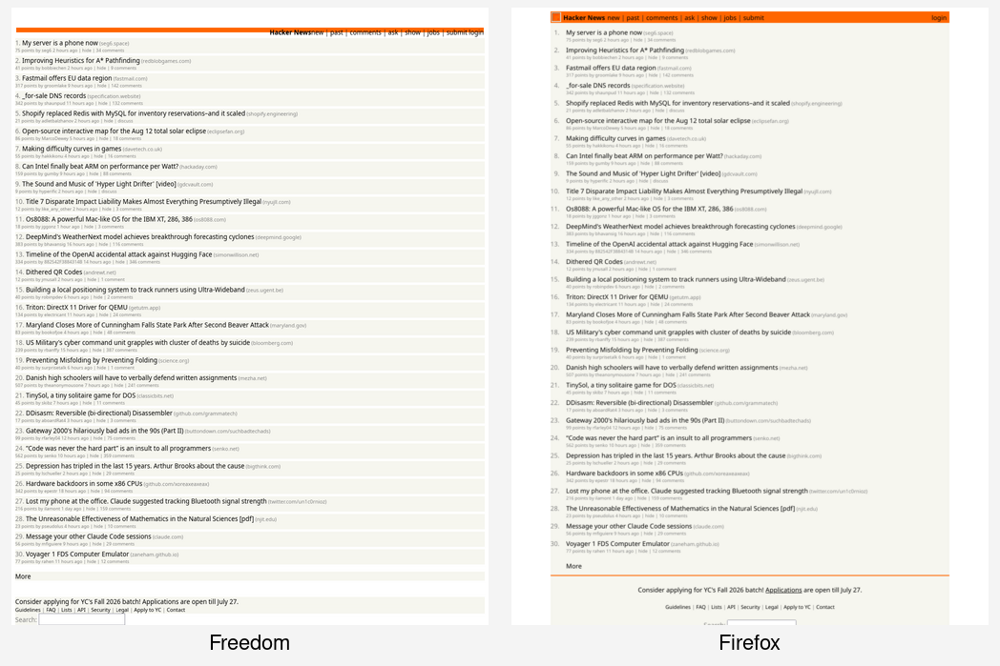
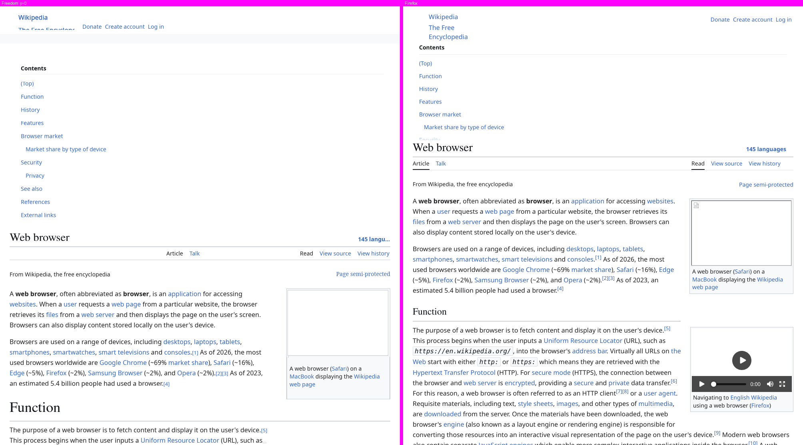
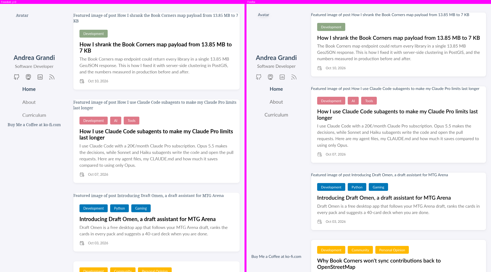
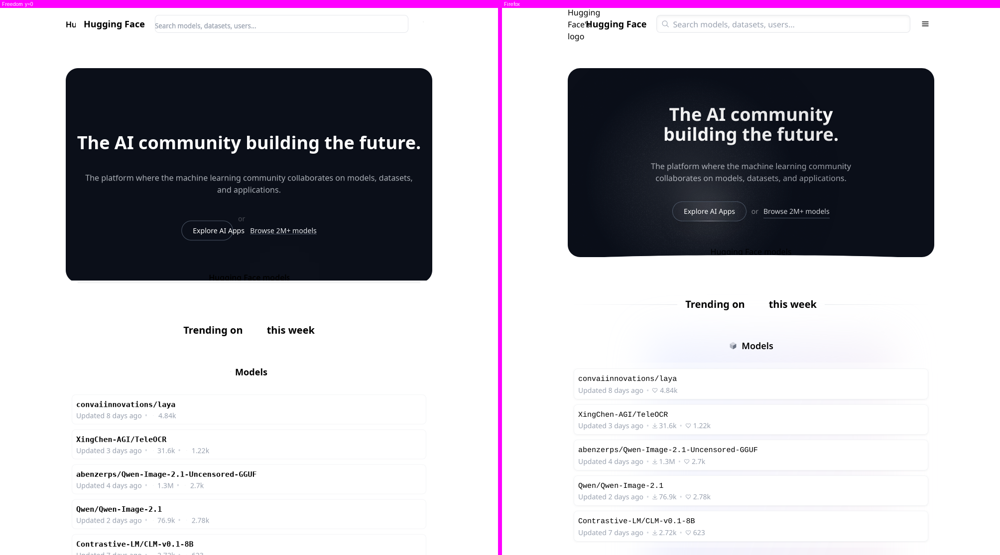
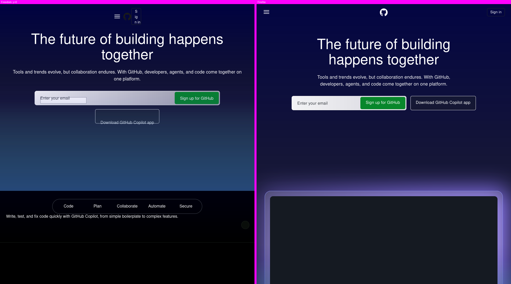
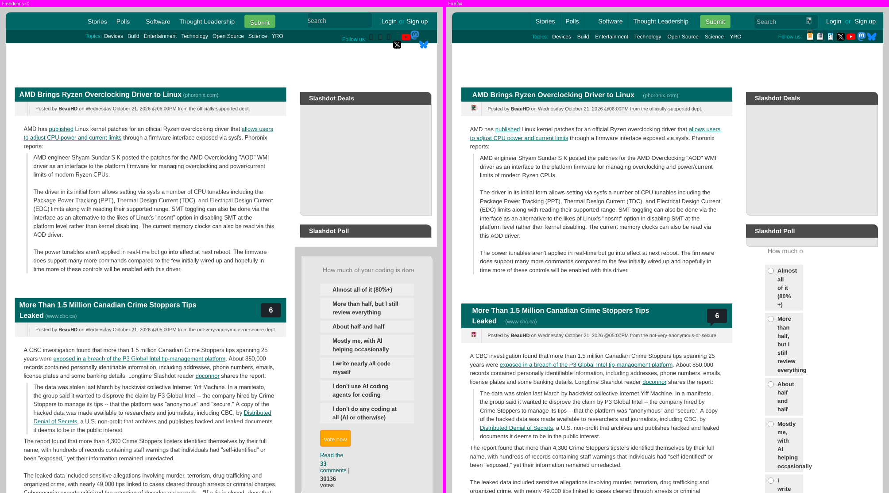
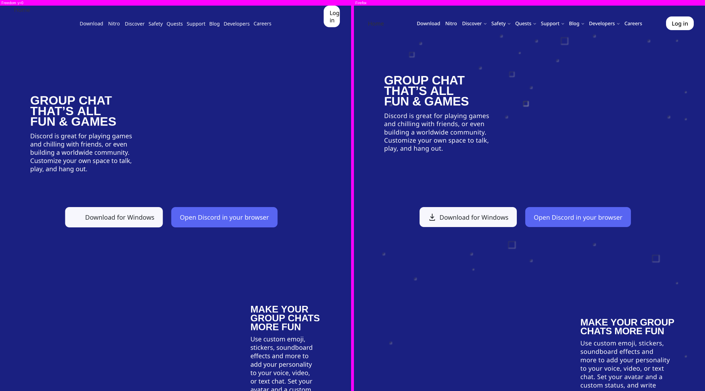
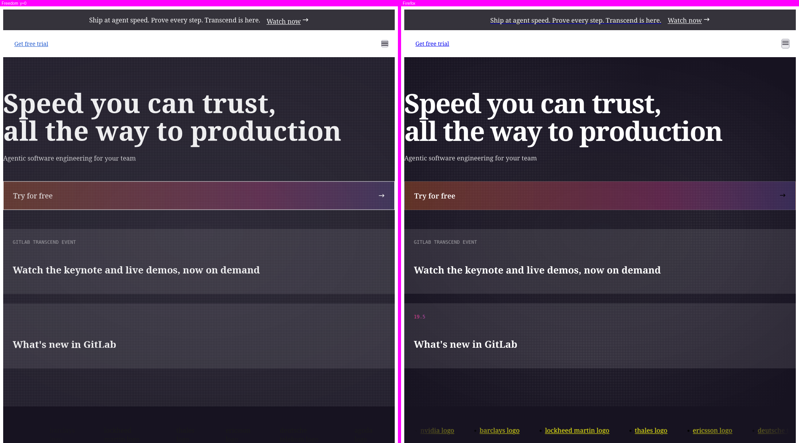

# Freedom


From the creators of the LazyOwn Redteam Framework: a free, open-source web browser
written from scratch in **pure C11**, built on Zero Trust and Zero Knowledge. No
telemetry, no backdoors, no implicit trust. What cannot be audited does not get in.

**Freedom** = *Free* (libre, open source) + *DOM* (and domain-level control).
**Freedom officially bans Google:** its services cannot be implemented without
telemetry, mandatory API keys or hidden solver workers.

## Highlights

- **Sandboxed tabs.** Each tab is a fork+exec worker under seccomp-bpf with W^X,
  Landlock and per-tab namespaces. It is undumpable and **never touches the network**
  (`io_uring` is blocked).
- **Post-quantum TLS by default.** TLS 1.3 with hybrid `X25519MLKEM768` on native
  OpenSSL 3.5+. Downgrades warn; authenticity is never relaxed.
- **Privacy by default.** Third parties are blocked in the network engine. The browser
  has an anti-fingerprinting identity, and JS, images and author CSS are opt-in per host
  (`allow.conf` / `js.conf`). Tor and I2P route at the socket level.
- **Own rendering engine.** It has a CSS cascade with a rule index, plus flex, grid,
  floats, margin collapsing, multicol, `@layer`/`@supports`/media queries, custom
  properties, inline SVG, HarfBuzz shaping with local fonts, and image decoding inside the
  sandbox.
- **Sandboxed JS.** QuickJS-ng with sealed bindings. ES modules and import maps run on
  trusted hosts, and network access is proxied through the parent, which re-applies policy.
- **Agent-safe and agent-friendly.** Deterministic headless mode with `--download-png`,
  `--dump-dom`, `--dump-layout` and `--dump-console`, plus an MCP server.
- **Tested and fuzzed.** 66+ CMocka suites, ASan/UBSan, 20+ libFuzzer targets, and
  measured parity against Firefox (`make parity`, `make wpt`).

## Quick start

```bash
git clone https://github.com/grisuno/FreeDom.git && cd FreeDom
sudo apt install libavformat-dev libavcodec-dev libavutil-dev libswscale-dev   # plus the Dockerfile deps
make
./build/freedom                                           # GUI (Wayland)
./build/freedom --download-png=page.png https://lobste.rs  # headless render
```

Docker + noVNC (recommended for a first try):

```bash
sudo docker build -t freedom-browser .
sudo docker run -it --name freedom-test -p 8080:8080 --cap-drop=ALL \
  --security-opt no-new-privileges:true --memory="2g" freedom-browser
# then open http://localhost:8080/vnc.html
```

Full instructions are in **[docs/USAGE.md](docs/USAGE.md)**.

## Freedom vs Firefox

Each pair below was rendered headless at 1000 px wide from the same frozen snapshot of
the page. Both engines ran under the same rules: author CSS on, JavaScript off, no
third-party network. Each pair shows the top of the page; the number is the
`make parity` divergence (lower is better, 0 = identical geometry).

| Hacker News (3.04) | Wikipedia (3.53) |
| :-: | :-: |
|  |  |
| **andreagrandi.it (3.01)** | **Hugging Face (5.67)** |
|  |  |
| **GitHub (2.93)** | **Slashdot (3.25): still the hardest page** |
|  |  |
| **Discord (2.96)** | **GitLab (13.38)** |
|  |  |

These images and scores are regenerated automatically by `make fbench` (`tools/fbench.py`) from `build/parity/*.{fd,ff}.png`. The
measurement method is in [spec/parity.md](spec/parity.md).

## Documentation

| Document | Contents |
| :-- | :-- |
| [docs/USAGE.md](docs/USAGE.md) | Building, headless tools (`--dump-*`), Freebug console, shortcuts, JS allowlist, Tor/I2P, host filtering, video debugging, Docker, MCP server |
| [docs/FEATURES.md](docs/FEATURES.md) | Full feature list and the rendering-engine milestones in detail |
| [docs/DEVELOPMENT.md](docs/DEVELOPMENT.md) | Fuzzing, project structure, CI/CD, security, `make` targets |
| [CLAUDE.md](CLAUDE.md) | Working contract: principles, methodology (SDD + TDD), status and roadmap |
| [spec/](spec/) | One specification per module (inputs, errors, security guarantees) |
| [spec/threat-model.md](spec/threat-model.md) | Assets, adversaries, trust boundaries and mitigations |
| [SECURITY.md](SECURITY.md) · [CONTRIBUTING.md](CONTRIBUTING.md) · [CHANGELOG.md](CHANGELOG.md) | Reporting, contributing, history |
| [KNOWLEDGE_BASE.md](KNOWLEDGE_BASE.md) | Generated architecture reference (see below) |

## License

**AGPL-3.0**. See [LICENSE](LICENSE).


---

For more information, visit the [GitHub repository](https://github.com/grisuno/FreeDom).

  [](https://www.gnu.org/licenses/agpl-3.0)

[](https://ko-fi.com/Y8Y2Z73AV)
---
### Ecosystem

- [ReadMenator](https://github.com/grisuno/ReadMenator): Offline codebase analysis.
- [Deploynator](https://github.com/grisuno/deploynator): Offline codebase deployer.


<!-- readmenator-kb-link -->
## Knowledge Base

This project has been analyzed by [ReadMenator](https://github.com/grisuno/ReadMenator),
a zero-token polyglot static analysis tool. Regenerate with
`pip install readmenator && readmenator . --rebuild`. Analysis outputs:

- **[KNOWLEDGE_BASE.md](./KNOWLEDGE_BASE.md)** -- Full architecture reference with all
  classes, functions, imports, dependency graphs, UML class diagrams, security
  audit findings, community analysis, taint paths, hotspots, cycles, and more.
- **[readmenator-agent/](./readmenator-agent/)** -- Agent-friendly, grep-optimized index.
  - `INDEX.md` -- Quick reference: what each file does
  - `SYMBOLS.md` -- Every symbol with file:line
  - `ARCHITECTURE.md` -- Internal dependency pairs + external imports
  - `API.md` -- Public function contracts
  - `GOTCHAS.md` -- Change warnings (blast radius, cycles, hotspots)
  - `SECURITY.md` -- Findings by severity with fix hints
  - `MEMORY.md` -- Rules, workflow, style, deliverables, session log
  - `MANIFEST.json` -- Freshness (git_commit + source_fingerprint) + read order
  - `KB_<subsystem>.md` -- Per-subsystem context
  - `recipes/*.md` -- Grounded task guides (add-function, fix-cycle, ...)
- **[readmenator-wiki/](./readmenator-wiki/)** -- Navigable wiki (start here for the big picture).
  - `index.md` -- Entry point: overview, reading order, god nodes, connections
  - `community_*.md` -- One synthesis page per code community
  - `connections.json` -- Typed bridges between communities
  - `queries.md` -- Suggested questions + answer log
  - `REPORT.md` -- Honest audit: coverage, confidence, limits
- **[readmenator-graphrag/](./readmenator-graphrag/)** -- Zero-token GraphRAG index.
  - `index.json` + `REPORTS.md` -- Query with `readmenator . ask "<question>"`
- **[readmenator-apidocs/](./readmenator-apidocs/)** -- API reference (Sphinx/Doxygen style).
  - `index.md` + `modules/*.md` -- Signatures, parameters, returns, raises, examples, call graphs
  - `architecture.md` -- Tiered architecture + execution flows (control flow, call tree, sequence)
  - `classes.md`, `genindex.md`, `COVERAGE.md` -- Hierarchy, A-Z index, doc coverage + warnings
  - `index.html` + `api/` -- Offline searchable browser and machine-readable model (`api/index.json`, `api/modules/*.jsonl` one entity per line)
- **[readmenator-maps/](./readmenator-maps/)** -- Interactive gallery (`index.html`).
  - 5 system maps: architecture, workflow, sequence, dataflow, lifecycle
  - `graph-force.html` -- Force-graph explorer (2D/3D, reach, paths, lenses)
  - `graph-bundle.html` -- Edge bundle explorer (circle + sphere)
  - `components.html` -- Component diagrams
- **[docs/](./docs/)** -- Static site (GitHub Pages ready).
  - Gallery copy + `llms.txt` (agent entry point) + `md/` docs + video
- **[readmenator-diagrams/](./readmenator-diagrams/)** -- Component diagrams.
  - `analysis.json` + `graph LR` markdown + per-component pages + `index.html`
- **[readmenator-rules/](./readmenator-rules/)** -- Suggested Semgrep rules (`*.yml`),
  `yara_rules.yar` (YARA-lite) + `exclusions.yaml` (false-positive blocklist)
- **[readmenator.mp4](./readmenator.mp4)** -- Cinematic synthwave overview video
- **[.cursorrules](./.cursorrules)** -- Generated AI assistant rules
- **[readmenator_audit.sarif](./readmenator_audit.sarif)** -- SARIF v2.1.0 audit (when security scan is on)

Cache (`.readmenator_cache/`), packaged agent skills (`.claude/skills/`), and the
GitHub wiki mirror are also produced on `run`/`--rebuild`.

AI agents: Read `readmenator-wiki/index.md` first for the big picture, then `readmenator-agent/INDEX.md` for grep-friendly lookup.
Developers: Read `KNOWLEDGE_BASE.md` for full architecture reference, open `readmenator-maps/index.html` for the visual gallery.
<!-- /readmenator-kb-link -->

<!-- deploynator-footer -->

---

Deployed with [deploynator](https://github.com/grisuno/deploynator)

<!-- /deploynator-footer -->
