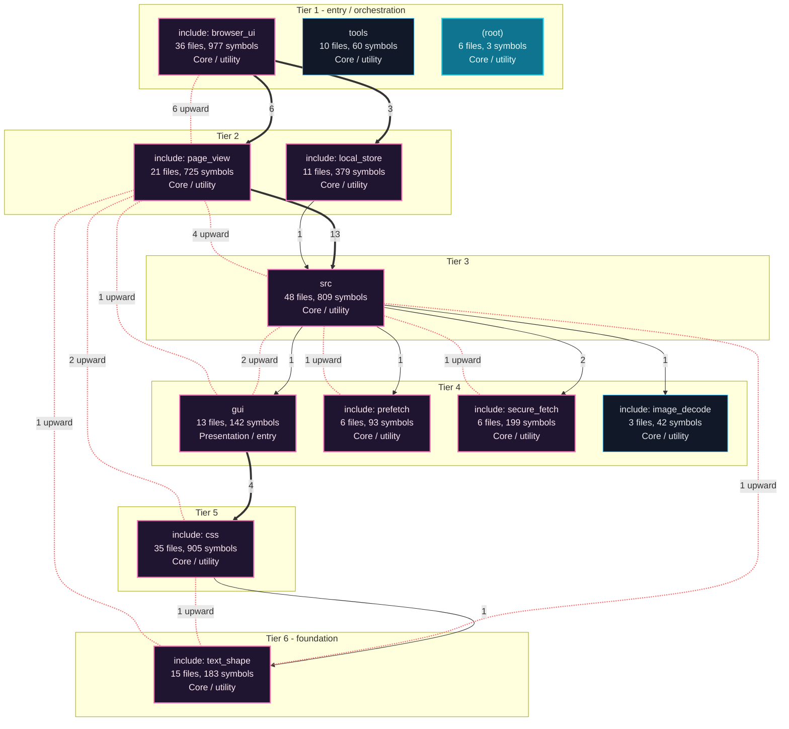
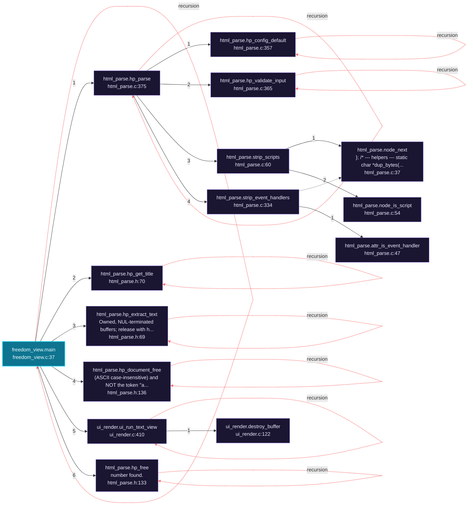
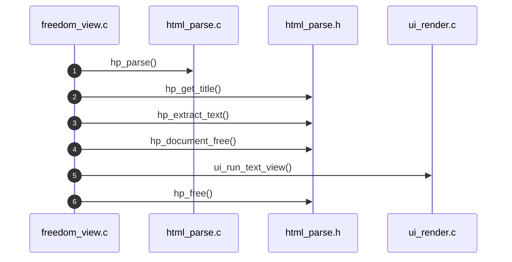
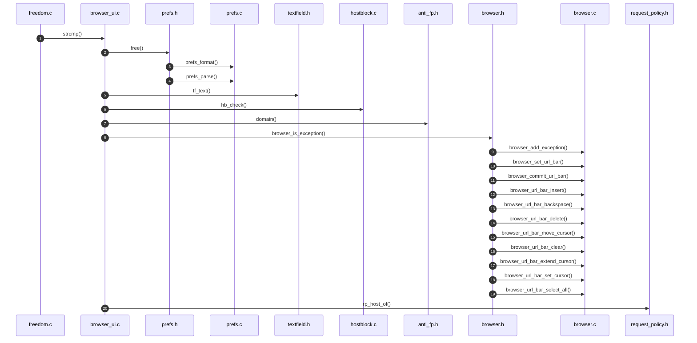
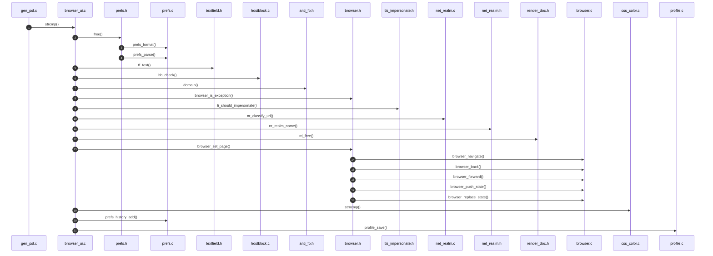

```mermaid
flowchart LR
    classDef entry fill:#0e7490,stroke:#22d3ee,color:#ecfeff,stroke-width:2px;
    classDef external fill:#1a1530,stroke:#a78bfa,color:#ede9fe;
    n_src_freedom_c__main["freedom.main<br/>freedom.c:1181"]:::entry
    n_gui_browser_ui_c__strcmp["browser_ui.strcmp<br/>browser_ui.c:2630"]:::external
    n_include_prefs_h__free["prefs.free<br/>prefs.h:71"]:::external
    n_src_prefs_c__prefs_format["prefs.prefs_format<br/>prefs.c:183"]:::external
    n_src_prefs_c__prefs_parse["prefs.prefs_parse<br/>prefs.c:241"]:::external
    n_src_prefs_c__prefs_free["prefs.prefs_free<br/>prefs.c:74"]:::external
    n_src_prefs_c__prefs_init["prefs.prefs_init<br/>prefs.c:66"]:::external
    n_src_prefs_c__url_valid["prefs.url_valid<br/>A representable URL: 1..PREFS_MAX_URL-1 bytes...<br/>prefs.c:26"]:::external
    n_src_prefs_c__bookmark_push["prefs.bookmark_push<br/>Appends a cleaned bookmark.<br/>prefs.c:91"]:::external
    n_src_prefs_c__history_push_back["prefs.history_push_back<br/>Appends a history entry at the BACK preservin...<br/>prefs.c:109"]:::external
    n_src_prefs_c__apply_kv["prefs.apply_kv<br/>} for (size_t i = 0#59; i #lt; p-#gt;history_len#59; ++i)...<br/>prefs.c:225"]:::external
    n_gui_browser_ui_c__prepare_fetch["browser_ui.prepare_fetch<br/>Builds cfg for url and applies the pre-fetch...<br/>browser_ui.c:1734"]:::external
    n_include_textfield_h__tf_text["textfield.tf_text<br/>/* Deletes the byte before the cursor (no-op...<br/>textfield.h:66"]:::external
    n_gui_browser_ui_c__host_from_url["browser_ui.host_from_url<br/>A plain-http URL whose realm self-authenticat...<br/>browser_ui.c:993"]:::external
    n_gui_browser_ui_c__is_https_url["browser_ui.is_https_url<br/>browser_ui.c:978"]:::external
    n_src_hostblock_c__hb_check["hostblock.hb_check<br/>hostblock.c:193"]:::external
    n_src_hostblock_c__lower["hostblock.lower<br/>hostblock.c:107"]:::external
    n_src_hostblock_c__table_contains["hostblock.table_contains<br/>hostblock.c:92"]:::external
    n_include_anti_fp_h__domain["anti_fp.domain<br/>anti_fp.h:91"]:::external
    n_include_browser_h__browser_is_exception["browser.browser_is_exception<br/>Index of the current entry within its documen...<br/>browser.h:99"]:::external
    n_src_browser_c__browser_add_exception["browser.browser_add_exception<br/>browser.c:472"]:::external
    n_src_browser_c__browser_set_url_bar["browser.browser_set_url_bar<br/>browser.c:178"]:::external
    n_src_browser_c__browser_commit_url_bar["browser.browser_commit_url_bar<br/>browser.c:190"]:::external
    n_src_browser_c__browser_url_bar_insert["browser.browser_url_bar_insert<br/>browser.c:326"]:::external
    n_src_browser_c__browser_url_bar_backspace["browser.browser_url_bar_backspace<br/>browser.c:341"]:::external
    n_src_browser_c__browser_url_bar_delete["browser.browser_url_bar_delete<br/>browser.c:355"]:::external
    n_src_browser_c__browser_url_bar_move_cursor["browser.browser_url_bar_move_cursor<br/>browser.c:366"]:::external
    n_src_browser_c__browser_url_bar_clear["browser.browser_url_bar_clear<br/>browser.c:400"]:::external
    n_src_browser_c__browser_url_bar_extend_cursor["browser.browser_url_bar_extend_cursor<br/>browser.c:376"]:::external
    n_src_browser_c__browser_url_bar_set_cursor["browser.browser_url_bar_set_cursor<br/>browser.c:385"]:::external
    n_src_browser_c__browser_url_bar_select_all["browser.browser_url_bar_select_all<br/>browser.c:393"]:::external
    n_gui_browser_ui_c__hb_is_allowlisted["browser_ui.hb_is_allowlisted<br/>browser_ui.c:1688"]:::external
    n_include_request_policy_h__rp_host_of["request_policy.rp_host_of<br/>Lowercased host of an absolute URL into out.<br/>request_policy.h:30"]:::external
    n_src_freedom_c__main -.->|"recursion"| n_src_freedom_c__main
    n_src_freedom_c__main -->|"1"| n_gui_browser_ui_c__strcmp
    n_gui_browser_ui_c__strcmp -.->|"recursion"| n_gui_browser_ui_c__strcmp
    n_gui_browser_ui_c__strcmp -->|"1"| n_include_prefs_h__free
    n_include_prefs_h__free -->|"1"| n_src_prefs_c__prefs_format
    n_src_prefs_c__prefs_format -.->|"recursion"| n_src_prefs_c__prefs_format
    n_include_prefs_h__free -->|"2"| n_src_prefs_c__prefs_parse
    n_src_prefs_c__prefs_parse -.->|"recursion"| n_src_prefs_c__prefs_parse
    n_src_prefs_c__prefs_parse -->|"1"| n_src_prefs_c__prefs_free
    n_src_prefs_c__prefs_parse -->|"2"| n_src_prefs_c__prefs_init
    n_src_prefs_c__prefs_parse -->|"3"| n_src_prefs_c__url_valid
    n_src_prefs_c__prefs_parse -->|"4"| n_src_prefs_c__bookmark_push
    n_src_prefs_c__prefs_parse -->|"5"| n_src_prefs_c__history_push_back
    n_src_prefs_c__prefs_parse -->|"6"| n_src_prefs_c__apply_kv
    n_gui_browser_ui_c__strcmp -->|"2"| n_gui_browser_ui_c__prepare_fetch
    n_gui_browser_ui_c__prepare_fetch -->|"1"| n_include_textfield_h__tf_text
    n_include_textfield_h__tf_text -.->|"recursion"| n_include_textfield_h__tf_text
    n_gui_browser_ui_c__prepare_fetch -->|"2"| n_gui_browser_ui_c__host_from_url
    n_gui_browser_ui_c__host_from_url -->|"1"| n_gui_browser_ui_c__is_https_url
    n_gui_browser_ui_c__prepare_fetch -->|"3"| n_src_hostblock_c__hb_check
    n_src_hostblock_c__hb_check -.->|"recursion"| n_src_hostblock_c__hb_check
    n_src_hostblock_c__hb_check -->|"1"| n_src_hostblock_c__lower
    n_src_hostblock_c__hb_check -->|"2"| n_src_hostblock_c__table_contains
    n_gui_browser_ui_c__prepare_fetch -->|"4"| n_include_anti_fp_h__domain
    n_gui_browser_ui_c__prepare_fetch -->|"5"| n_include_browser_h__browser_is_exception
    n_include_browser_h__browser_is_exception -.->|"recursion"| n_include_browser_h__browser_is_exception
    n_include_browser_h__browser_is_exception -->|"1"| n_src_browser_c__browser_add_exception
    n_include_browser_h__browser_is_exception -->|"2"| n_src_browser_c__browser_set_url_bar
    n_include_browser_h__browser_is_exception -->|"3"| n_src_browser_c__browser_commit_url_bar
    n_include_browser_h__browser_is_exception -->|"4"| n_src_browser_c__browser_url_bar_insert
    n_include_browser_h__browser_is_exception -->|"5"| n_src_browser_c__browser_url_bar_backspace
    n_include_browser_h__browser_is_exception -->|"6"| n_src_browser_c__browser_url_bar_delete
    n_include_browser_h__browser_is_exception -->|"7"| n_src_browser_c__browser_url_bar_move_cursor
    n_include_browser_h__browser_is_exception -->|"8"| n_src_browser_c__browser_url_bar_clear
    n_include_browser_h__browser_is_exception -->|"9"| n_src_browser_c__browser_url_bar_extend_cursor
    n_include_browser_h__browser_is_exception -->|"10"| n_src_browser_c__browser_url_bar_set_cursor
    n_include_browser_h__browser_is_exception -->|"11"| n_src_browser_c__browser_url_bar_select_all
    n_gui_browser_ui_c__prepare_fetch -->|"6"| n_gui_browser_ui_c__hb_is_allowlisted
    n_gui_browser_ui_c__hb_is_allowlisted -.->|"recursion"| n_gui_browser_ui_c__hb_is_allowlisted
    n_gui_browser_ui_c__hb_is_allowlisted -->|"1"| n_include_request_policy_h__rp_host_of
    linkStyle 0,2,5,7,16,20,25,38 stroke:#f87171,stroke-width:2px;
```

```mermaid
flowchart LR
    classDef default fill:#111827,stroke:#38bdf8,color:#e5e7eb;
    classDef entry fill:#0e7490,stroke:#22d3ee,color:#ecfeff,stroke-width:2px;
    classDef external fill:#1a1530,stroke:#a78bfa,color:#ede9fe;
    n_tools_gen_psl_c__main["gen_psl.main<br/>gen_psl.c:67"]:::entry
    n_tools_gen_psl_c__ascii_lower["gen_psl.ascii_lower<br/>/* Sorts then drops adjacent duplicates in pl...<br/>gen_psl.c:55"]:::default
    n_tools_gen_psl_c__vec_push["gen_psl.vec_push<br/>gen_psl.c:27"]:::default
    n_tools_gen_psl_c__sort_unique["gen_psl.sort_unique<br/>v-#gt;cap = v-#gt;cap ?<br/>gen_psl.c:43"]:::default
    n_gui_browser_ui_c__strcmp["browser_ui.strcmp<br/>browser_ui.c:2630"]:::external
    n_include_prefs_h__free["prefs.free<br/>prefs.h:71"]:::external
    n_src_prefs_c__prefs_format["prefs.prefs_format<br/>prefs.c:183"]:::external
    n_src_prefs_c__prefs_parse["prefs.prefs_parse<br/>prefs.c:241"]:::external
    n_gui_browser_ui_c__prepare_fetch["browser_ui.prepare_fetch<br/>Builds cfg for url and applies the pre-fetch...<br/>browser_ui.c:1734"]:::external
    n_include_textfield_h__tf_text["textfield.tf_text<br/>/* Deletes the byte before the cursor (no-op...<br/>textfield.h:66"]:::external
    n_gui_browser_ui_c__host_from_url["browser_ui.host_from_url<br/>A plain-http URL whose realm self-authenticat...<br/>browser_ui.c:993"]:::external
    n_src_hostblock_c__hb_check["hostblock.hb_check<br/>hostblock.c:193"]:::external
    n_include_anti_fp_h__domain["anti_fp.domain<br/>anti_fp.h:91"]:::external
    n_include_browser_h__browser_is_exception["browser.browser_is_exception<br/>Index of the current entry within its documen...<br/>browser.h:99"]:::external
    n_gui_browser_ui_c__hb_is_allowlisted["browser_ui.hb_is_allowlisted<br/>browser_ui.c:1688"]:::external
    n_include_tls_impersonate_h__ti_should_impersonate["tls_impersonate.ti_should_impersonate<br/>The double opt-in + user-flag gate (pure).<br/>tls_impersonate.h:56"]:::external
    n_src_net_realm_c__nr_classify_url["net_realm.nr_classify_url<br/>net_realm.c:68"]:::external
    n_include_net_realm_h__nr_realm_name["net_realm.nr_realm_name<br/>1 iff plain http:// is acceptable for this re...<br/>net_realm.h:69"]:::external
    n_gui_browser_ui_c__clear_doc["browser_ui.clear_doc<br/>Releases the structured render of the previou...<br/>browser_ui.c:1307"]:::external
    n_gui_browser_ui_c__free_inputs["browser_ui.free_inputs<br/>are not text-editable -- they are tracked via...<br/>browser_ui.c:1052"]:::external
    n_gui_browser_ui_c__free_images["browser_ui.free_images<br/>static int input_is_editable(int input_type)...<br/>browser_ui.c:1060"]:::external
    n_include_render_doc_h__rd_free["render_doc.rd_free<br/>Builds the paint-ready document from an inert...<br/>render_doc.h:312"]:::external
    n_gui_browser_ui_c__set_cache["browser_ui.set_cache<br/>Releases the structured render of the previou...<br/>browser_ui.c:1317"]:::external
    n_include_browser_h__browser_set_page["browser.browser_set_page<br/>browser.h:71"]:::external
    n_src_browser_c__browser_navigate["browser.browser_navigate<br/>browser.c:224"]:::external
    n_src_browser_c__browser_back["browser.browser_back<br/>browser.c:268"]:::external
    n_src_browser_c__browser_forward["browser.browser_forward<br/>browser.c:280"]:::external
    n_src_browser_c__browser_push_state["browser.browser_push_state<br/>browser.c:236"]:::external
    n_src_browser_c__browser_replace_state["browser.browser_replace_state<br/>browser.c:243"]:::external
    n_gui_browser_ui_c__fetch_launch["browser_ui.fetch_launch<br/>Spawns a detached worker to fetch url under c...<br/>browser_ui.c:1930"]:::external
    n_gui_browser_ui_c__fetch_job_free["browser_ui.fetch_job_free<br/>browser_ui.c:1838"]:::external
    n_gui_browser_ui_c__remember_visit["browser_ui.remember_visit<br/>Records a committed navigation in the persist...<br/>browser_ui.c:922"]:::external
    n_src_css_color_c__strncmp["css_color.strncmp<br/>css_color.c:598"]:::external
    n_src_prefs_c__prefs_history_add["prefs.prefs_history_add<br/>prefs.c:152"]:::external
    n_src_profile_c__profile_save["profile.profile_save<br/>profile.c:133"]:::external
    n_gui_browser_ui_c__show_busy["browser_ui.show_busy<br/>Marks a request in flight and paints a frame...<br/>browser_ui.c:2502"]:::external
    n_gui_browser_ui_c__redraw["browser_ui.redraw<br/>browser_ui.c:15678"]:::external
    n_tools_gen_psl_c__emit["gen_psl.emit<br/>gen_psl.c:61"]:::default
    n_tools_gen_psl_c__main -.->|"recursion"| n_tools_gen_psl_c__main
    n_tools_gen_psl_c__main -->|"1"| n_tools_gen_psl_c__ascii_lower
    n_tools_gen_psl_c__main -->|"2"| n_tools_gen_psl_c__vec_push
    n_tools_gen_psl_c__main -->|"3"| n_tools_gen_psl_c__sort_unique
    n_tools_gen_psl_c__sort_unique -->|"1"| n_gui_browser_ui_c__strcmp
    n_gui_browser_ui_c__strcmp -.->|"recursion"| n_gui_browser_ui_c__strcmp
    n_gui_browser_ui_c__strcmp -->|"1"| n_include_prefs_h__free
    n_include_prefs_h__free -->|"1"| n_src_prefs_c__prefs_format
    n_include_prefs_h__free -->|"2"| n_src_prefs_c__prefs_parse
    n_gui_browser_ui_c__strcmp -->|"2"| n_gui_browser_ui_c__prepare_fetch
    n_gui_browser_ui_c__prepare_fetch -->|"1"| n_include_textfield_h__tf_text
    n_gui_browser_ui_c__prepare_fetch -->|"2"| n_gui_browser_ui_c__host_from_url
    n_gui_browser_ui_c__prepare_fetch -->|"3"| n_src_hostblock_c__hb_check
    n_gui_browser_ui_c__prepare_fetch -->|"4"| n_include_anti_fp_h__domain
    n_gui_browser_ui_c__prepare_fetch -->|"5"| n_include_browser_h__browser_is_exception
    n_gui_browser_ui_c__prepare_fetch -->|"6"| n_gui_browser_ui_c__hb_is_allowlisted
    n_gui_browser_ui_c__prepare_fetch -->|"7"| n_include_tls_impersonate_h__ti_should_impersonate
    n_gui_browser_ui_c__prepare_fetch -->|"8"| n_src_net_realm_c__nr_classify_url
    n_gui_browser_ui_c__prepare_fetch -->|"9"| n_include_net_realm_h__nr_realm_name
    n_gui_browser_ui_c__strcmp -->|"3"| n_gui_browser_ui_c__clear_doc
    n_gui_browser_ui_c__clear_doc -->|"1"| n_gui_browser_ui_c__free_inputs
    n_gui_browser_ui_c__clear_doc -->|"2"| n_gui_browser_ui_c__free_images
    n_gui_browser_ui_c__clear_doc -->|"3"| n_include_render_doc_h__rd_free
    n_gui_browser_ui_c__strcmp -->|"4"| n_gui_browser_ui_c__set_cache
    n_gui_browser_ui_c__set_cache -.-> n_include_prefs_h__free
    n_gui_browser_ui_c__strcmp -->|"5"| n_include_browser_h__browser_set_page
    n_include_browser_h__browser_set_page -->|"1"| n_src_browser_c__browser_navigate
    n_include_browser_h__browser_set_page -->|"2"| n_src_browser_c__browser_back
    n_include_browser_h__browser_set_page -->|"3"| n_src_browser_c__browser_forward
    n_include_browser_h__browser_set_page -->|"4"| n_src_browser_c__browser_push_state
    n_include_browser_h__browser_set_page -->|"5"| n_src_browser_c__browser_replace_state
    n_gui_browser_ui_c__strcmp -->|"6"| n_gui_browser_ui_c__fetch_launch
    n_gui_browser_ui_c__fetch_launch -->|"1"| n_gui_browser_ui_c__fetch_job_free
    n_gui_browser_ui_c__strcmp -->|"7"| n_gui_browser_ui_c__remember_visit
    n_gui_browser_ui_c__remember_visit -->|"1"| n_src_css_color_c__strncmp
    n_gui_browser_ui_c__remember_visit -->|"2"| n_src_prefs_c__prefs_history_add
    n_gui_browser_ui_c__remember_visit -->|"3"| n_src_profile_c__profile_save
    n_gui_browser_ui_c__strcmp -->|"8"| n_gui_browser_ui_c__show_busy
    n_gui_browser_ui_c__show_busy -->|"1"| n_gui_browser_ui_c__redraw
    n_tools_gen_psl_c__main -->|"4"| n_tools_gen_psl_c__emit
    linkStyle 0,5 stroke:#f87171,stroke-width:2px;
```

# freedom-0.0.3 Architecture and Execution Flows

[Back to index](index.md)

## Architecture Overview

12 components stacked in 6 dependency tiers (weighted Eades-Lin-Smyth ordering: arrows point from dependent to dependency, top to bottom). Labels are import counts, thick arrows the top quartile; 14 transitively implied edges are omitted. Dashed red arrows are upward dependencies: the smallest set of imports that closes every cycle and breaks the layering. Cyan components hold entry points. Interactive version: `readmenator-apidocs/index.html#/flows`.

Upward dependencies to fix first: `include: page_view` -> `include: browser_ui` (6 imports); `src` -> `include: page_view` (4 imports); `include: css` -> `include: page_view` (2 imports); `gui` -> `src` (2 imports); `include: text_shape` -> `src` (1 imports); `include: text_shape` -> `include: css` (1 imports); `include: text_shape` -> `include: page_view` (1 imports); `gui` -> `include: page_view` (1 imports); `include: secure_fetch` -> `src` (1 imports); `include: prefetch` -> `src` (1 imports)

---

## Execution Flows

Entry points are scored from `__main__` guards, `main` functions, entry-style names and files, and call-graph sources. Each flow walks resolved calls in call-site order (depth <= 4, <= 40 steps); numbers give the call order, dashed arrows revisit an already expanded callee, red arrows are recursion. Interactive version with zoom and per-node docs: `readmenator-apidocs/index.html#/flows`.

### `freedom_view.main`

`gui/freedom_view.c:37`, score 11: `main` in a compiled-language file; entry-style name `main`.

Call tree:

Cross-file sequence:

### `freedom.main`

`src/freedom.c:1181`, score 11: `main` in a compiled-language file; entry-style name `main`.

Call tree:

Cross-file sequence:

### `gen_psl.main`

`tools/gen_psl.c:67`, score 11: `main` in a compiled-language file; entry-style name `main`.

Call tree:

Cross-file sequence:

---
