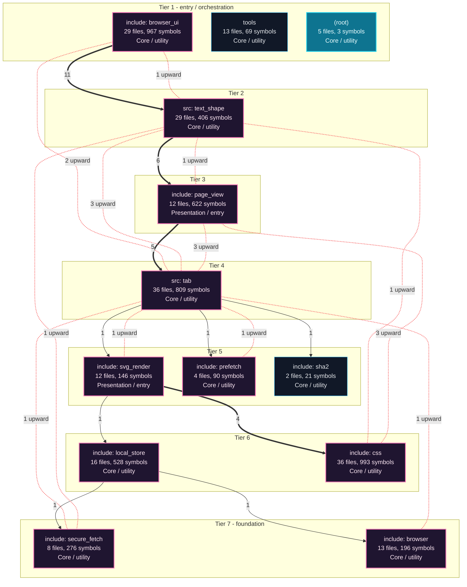
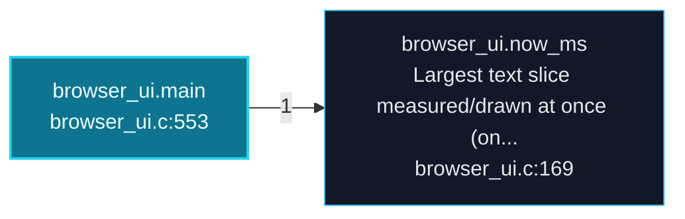
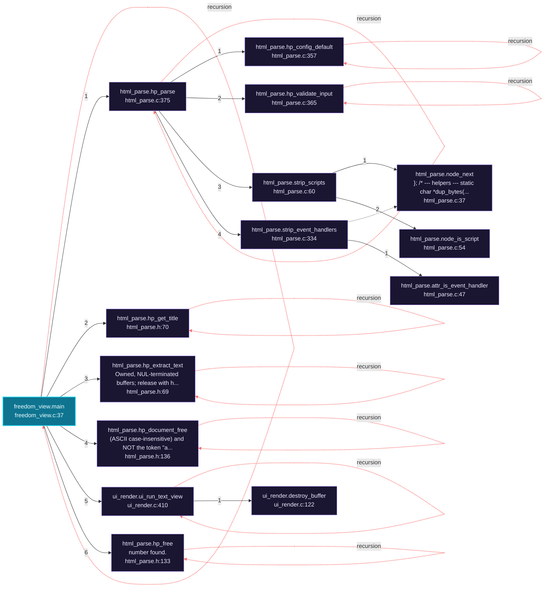
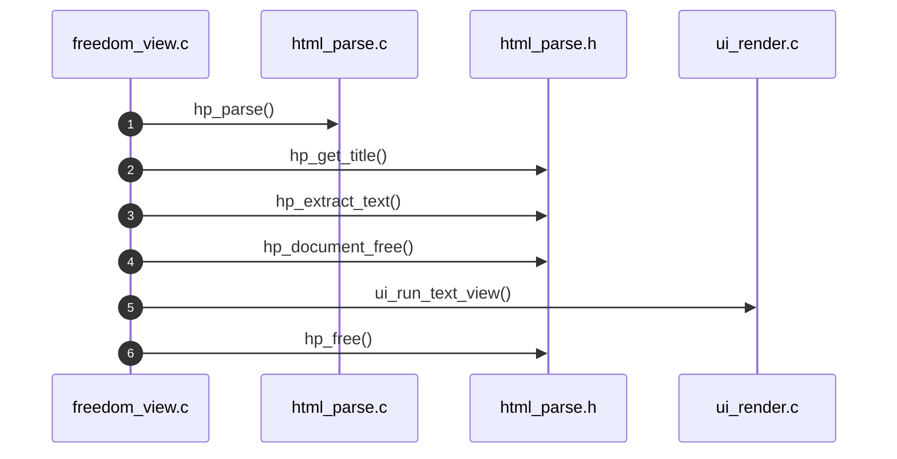
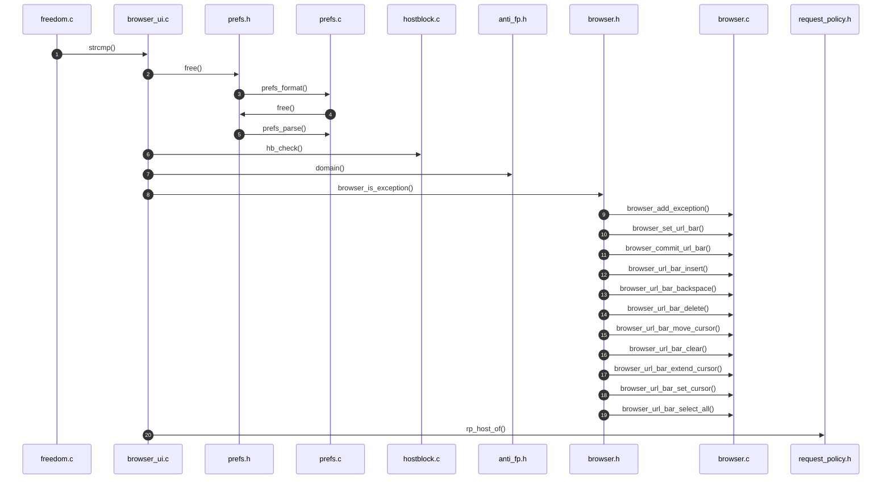

```mermaid
flowchart LR
    classDef entry fill:#0e7490,stroke:#22d3ee,color:#ecfeff,stroke-width:2px;
    classDef external fill:#1a1530,stroke:#a78bfa,color:#ede9fe;
    n_src_freedom_c__main["freedom.main<br/>freedom.c:1263"]:::entry
    n_gui_browser_ui_c__strcmp["browser_ui.strcmp<br/>browser_ui.c:2782"]:::external
    n_include_prefs_h__free["prefs.free<br/>prefs.h:72"]:::external
    n_src_prefs_c__prefs_format["prefs.prefs_format<br/>prefs.c:183"]:::external
    n_src_prefs_c__prefs_parse["prefs.prefs_parse<br/>prefs.c:247"]:::external
    n_src_prefs_c__prefs_free["prefs.prefs_free<br/>prefs.c:74"]:::external
    n_src_prefs_c__prefs_init["prefs.prefs_init<br/>prefs.c:66"]:::external
    n_src_prefs_c__url_valid["prefs.url_valid<br/>A representable URL: 1..PREFS_MAX_URL-1 bytes...<br/>prefs.c:26"]:::external
    n_src_prefs_c__bookmark_push["prefs.bookmark_push<br/>Appends a cleaned bookmark.<br/>prefs.c:91"]:::external
    n_src_prefs_c__history_push_back["prefs.history_push_back<br/>Appends a history entry at the BACK preservin...<br/>prefs.c:109"]:::external
    n_src_prefs_c__apply_kv["prefs.apply_kv<br/>} for (size_t i = 0#59; i #lt; p-#gt;history_len#59; ++i)...<br/>prefs.c:231"]:::external
    n_gui_browser_ui_c__prepare_fetch["browser_ui.prepare_fetch<br/>Builds cfg for url and applies the pre-fetch...<br/>browser_ui.c:1805"]:::external
    n_gui_browser_ui_c__host_from_url["browser_ui.host_from_url<br/>A plain-http URL whose realm self-authenticat...<br/>browser_ui.c:1068"]:::external
    n_gui_browser_ui_c__is_https_url["browser_ui.is_https_url<br/>browser_ui.c:1053"]:::external
    n_src_hostblock_c__hb_check["hostblock.hb_check<br/>hostblock.c:193"]:::external
    n_src_hostblock_c__lower["hostblock.lower<br/>hostblock.c:107"]:::external
    n_src_hostblock_c__table_contains["hostblock.table_contains<br/>hostblock.c:92"]:::external
    n_include_anti_fp_h__domain["anti_fp.domain<br/>anti_fp.h:91"]:::external
    n_include_browser_h__browser_is_exception["browser.browser_is_exception<br/>Index of the current entry within its documen...<br/>browser.h:99"]:::external
    n_src_browser_c__browser_add_exception["browser.browser_add_exception<br/>browser.c:472"]:::external
    n_src_browser_c__browser_set_url_bar["browser.browser_set_url_bar<br/>browser.c:178"]:::external
    n_src_browser_c__browser_commit_url_bar["browser.browser_commit_url_bar<br/>browser.c:190"]:::external
    n_src_browser_c__browser_url_bar_insert["browser.browser_url_bar_insert<br/>browser.c:326"]:::external
    n_src_browser_c__browser_url_bar_backspace["browser.browser_url_bar_backspace<br/>browser.c:341"]:::external
    n_src_browser_c__browser_url_bar_delete["browser.browser_url_bar_delete<br/>browser.c:355"]:::external
    n_src_browser_c__browser_url_bar_move_cursor["browser.browser_url_bar_move_cursor<br/>browser.c:366"]:::external
    n_src_browser_c__browser_url_bar_clear["browser.browser_url_bar_clear<br/>browser.c:400"]:::external
    n_src_browser_c__browser_url_bar_extend_cursor["browser.browser_url_bar_extend_cursor<br/>browser.c:376"]:::external
    n_src_browser_c__browser_url_bar_set_cursor["browser.browser_url_bar_set_cursor<br/>browser.c:385"]:::external
    n_src_browser_c__browser_url_bar_select_all["browser.browser_url_bar_select_all<br/>browser.c:393"]:::external
    n_gui_browser_ui_c__apply_operator_override["browser_ui.apply_operator_override<br/>browser_ui.c:1517"]:::external
    n_gui_browser_ui_c__hb_is_allowlisted["browser_ui.hb_is_allowlisted<br/>browser_ui.c:1756"]:::external
    n_include_request_policy_h__rp_host_of["request_policy.rp_host_of<br/>Lowercased host of an absolute URL into out.<br/>request_policy.h:30"]:::external
    n_src_freedom_c__main -.->|"recursion"| n_src_freedom_c__main
    n_src_freedom_c__main -->|"1"| n_gui_browser_ui_c__strcmp
    n_gui_browser_ui_c__strcmp -.->|"recursion"| n_gui_browser_ui_c__strcmp
    n_gui_browser_ui_c__strcmp -->|"1"| n_include_prefs_h__free
    n_include_prefs_h__free -->|"1"| n_src_prefs_c__prefs_format
    n_src_prefs_c__prefs_format -.->|"recursion"| n_src_prefs_c__prefs_format
    n_src_prefs_c__prefs_format -.->|"recursion"| n_include_prefs_h__free
    n_include_prefs_h__free -->|"2"| n_src_prefs_c__prefs_parse
    n_src_prefs_c__prefs_parse -.->|"recursion"| n_src_prefs_c__prefs_parse
    n_src_prefs_c__prefs_parse -->|"1"| n_src_prefs_c__prefs_free
    n_src_prefs_c__prefs_parse -->|"2"| n_src_prefs_c__prefs_init
    n_src_prefs_c__prefs_parse -->|"3"| n_src_prefs_c__url_valid
    n_src_prefs_c__prefs_parse -->|"4"| n_src_prefs_c__bookmark_push
    n_src_prefs_c__prefs_parse -->|"5"| n_src_prefs_c__history_push_back
    n_src_prefs_c__prefs_parse -->|"6"| n_src_prefs_c__apply_kv
    n_gui_browser_ui_c__strcmp -->|"2"| n_gui_browser_ui_c__prepare_fetch
    n_gui_browser_ui_c__prepare_fetch -->|"1"| n_gui_browser_ui_c__host_from_url
    n_gui_browser_ui_c__host_from_url -->|"1"| n_gui_browser_ui_c__is_https_url
    n_gui_browser_ui_c__prepare_fetch -->|"2"| n_src_hostblock_c__hb_check
    n_src_hostblock_c__hb_check -.->|"recursion"| n_src_hostblock_c__hb_check
    n_src_hostblock_c__hb_check -->|"1"| n_src_hostblock_c__lower
    n_src_hostblock_c__hb_check -->|"2"| n_src_hostblock_c__table_contains
    n_gui_browser_ui_c__prepare_fetch -->|"3"| n_include_anti_fp_h__domain
    n_gui_browser_ui_c__prepare_fetch -->|"4"| n_include_browser_h__browser_is_exception
    n_include_browser_h__browser_is_exception -.->|"recursion"| n_include_browser_h__browser_is_exception
    n_include_browser_h__browser_is_exception -->|"1"| n_src_browser_c__browser_add_exception
    n_include_browser_h__browser_is_exception -->|"2"| n_src_browser_c__browser_set_url_bar
    n_include_browser_h__browser_is_exception -->|"3"| n_src_browser_c__browser_commit_url_bar
    n_include_browser_h__browser_is_exception -->|"4"| n_src_browser_c__browser_url_bar_insert
    n_include_browser_h__browser_is_exception -->|"5"| n_src_browser_c__browser_url_bar_backspace
    n_include_browser_h__browser_is_exception -->|"6"| n_src_browser_c__browser_url_bar_delete
    n_include_browser_h__browser_is_exception -->|"7"| n_src_browser_c__browser_url_bar_move_cursor
    n_include_browser_h__browser_is_exception -->|"8"| n_src_browser_c__browser_url_bar_clear
    n_include_browser_h__browser_is_exception -->|"9"| n_src_browser_c__browser_url_bar_extend_cursor
    n_include_browser_h__browser_is_exception -->|"10"| n_src_browser_c__browser_url_bar_set_cursor
    n_include_browser_h__browser_is_exception -->|"11"| n_src_browser_c__browser_url_bar_select_all
    n_gui_browser_ui_c__prepare_fetch -->|"5"| n_gui_browser_ui_c__apply_operator_override
    n_gui_browser_ui_c__prepare_fetch -->|"6"| n_gui_browser_ui_c__hb_is_allowlisted
    n_gui_browser_ui_c__hb_is_allowlisted -.->|"recursion"| n_gui_browser_ui_c__hb_is_allowlisted
    n_gui_browser_ui_c__hb_is_allowlisted -->|"1"| n_include_request_policy_h__rp_host_of
    linkStyle 0,2,5,6,8,19,24,38 stroke:#f87171,stroke-width:2px;
```

# freedom-0.0.3 Architecture and Execution Flows

[Back to index](index.md)

## Architecture Overview

13 components stacked in 7 dependency tiers (weighted Eades-Lin-Smyth ordering: arrows point from dependent to dependency, top to bottom). Labels are import counts, thick arrows the top quartile; 20 transitively implied edges are omitted. Dashed red arrows are upward dependencies: the smallest set of imports that closes every cycle and breaks the layering. Cyan components hold entry points. Interactive version: `readmenator-apidocs/index.html#/flows`.

Upward dependencies to fix first: `include: css` -> `include: page_view` (3 imports); `src: tab` -> `src: text_shape` (3 imports); `src: tab` -> `include: page_view` (3 imports); `src: tab` -> `include: browser_ui` (2 imports); `include: css` -> `src: text_shape` (1 imports); `src: text_shape` -> `include: browser_ui` (1 imports); `include: page_view` -> `src: text_shape` (1 imports); `include: browser` -> `src: tab` (1 imports); `include: svg_render` -> `src: tab` (1 imports); `include: secure_fetch` -> `src: tab` (1 imports); `include: secure_fetch` -> `src: text_shape` (1 imports); `include: prefetch` -> `src: tab` (1 imports)

---

## Execution Flows

Entry points are scored from `__main__` guards, `main` functions, entry-style names and files, and call-graph sources. Each flow walks resolved calls in call-site order (depth <= 4, <= 40 steps); numbers give the call order, dashed arrows revisit an already expanded callee, red arrows are recursion. Interactive version with zoom and per-node docs: `readmenator-apidocs/index.html#/flows`.

### `browser_ui.main`

`gui/browser_ui.c:553`, score 11: `main` in a compiled-language file; entry-style name `main`.

Call tree:

### `freedom_view.main`

`gui/freedom_view.c:37`, score 11: `main` in a compiled-language file; entry-style name `main`.

Call tree:

Cross-file sequence:

### `freedom.main`

`src/freedom.c:1263`, score 11: `main` in a compiled-language file; entry-style name `main`.

Call tree:

Cross-file sequence:

---
