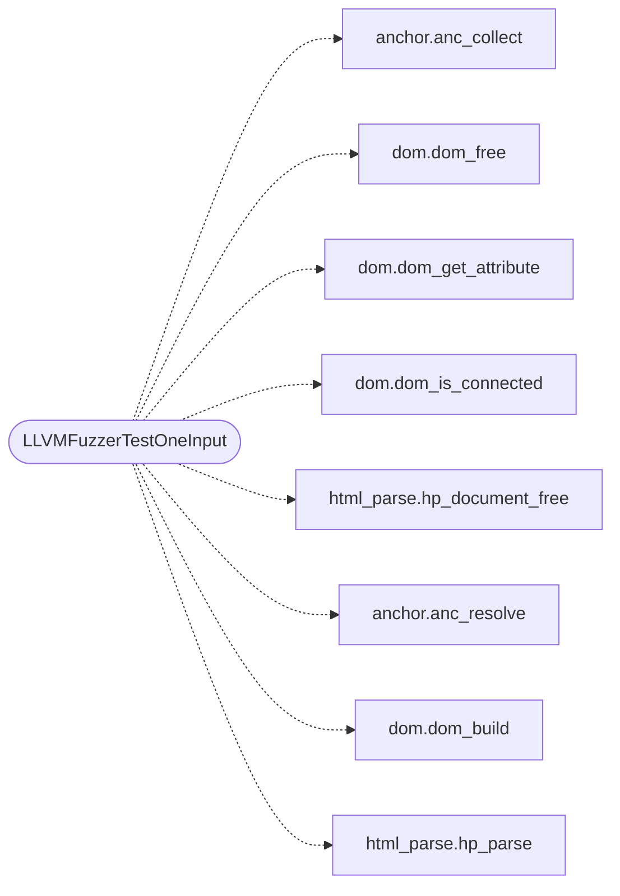

# `fuzz/fuzz_anchor.c`

> Source: [fuzz/fuzz_anchor.c:1](../../fuzz/fuzz_anchor.c#L1) | language `c` | coverage 50.0% | [API index](../index.md)

Fuzzer for anchor (spec/anchor.md) and url_split_location: a hostile document x a

## Contents

- **Functions:** [`LLVMFuzzerTestOneInput`](#llvmfuzzertestoneinput)

## Call Graph

Solid arrows stay in this module, dashed arrows leave it.



## Functions

<a id="llvmfuzzertestoneinput"></a>

### `LLVMFuzzerTestOneInput`

`function` | [fuzz/fuzz_anchor.c:37](../../fuzz/fuzz_anchor.c#L37)

```c
int LLVMFuzzerTestOneInput(const uint8_t *data, size_t size)
```

**Parameters**

| Name | Type | Default | Description |
|---|---|---|---|
| `data` | `uint8_t *` |  |  |
| `size` | `size_t` |  |  |

**Returns:** `int`

*Calls:* [`anc_collect`](include.anchor.h.md#anc_collect), [`dom_free`](include.dom.h.md#dom_free), [`dom_get_attribute`](include.dom.h.md#dom_get_attribute), [`dom_is_connected`](include.dom.h.md#dom_is_connected), [`hp_document_free`](include.html_parse.h.md#hp_document_free), [`anc_resolve`](src.anchor.c.md#anc_resolve), [`dom_build`](src.dom.c.md#dom_build), [`hp_parse`](src.html_parse.c.md#hp_parse)

---
