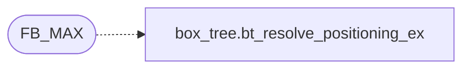

# `fuzz/fuzz_box_tree.c`

> Source: [fuzz/fuzz_box_tree.c:1](../../fuzz/fuzz_box_tree.c#L1) | language `c` | coverage 50.0% | [API index](../index.md)

Hostile box trees (any parent graph, cycles included) through the positioned paint

## Contents

- **Macros:** [`FB_MAX`](#fb_max)

## Call Graph

Solid arrows stay in this module, dashed arrows leave it.



## Macros

<a id="fb_max"></a>

### `FB_MAX`

`macro` | [fuzz/fuzz_box_tree.c:8](../../fuzz/fuzz_box_tree.c#L8)

```c
#define FB_MAX
```

*Calls:* [`bt_resolve_positioning_ex`](src.box_tree.c.md#bt_resolve_positioning_ex)

---
