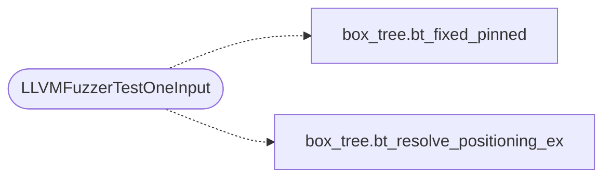

# `fuzz/fuzz_box_tree.c`

> Source: [fuzz/fuzz_box_tree.c:1](../../fuzz/fuzz_box_tree.c#L1) | language `c` | coverage 50.0% | [API index](../index.md)

Hostile box trees (any parent graph, cycles included) through the positioned paint

## Contents

- **Functions:** [`order`](#order), [`LLVMFuzzerTestOneInput`](#llvmfuzzertestoneinput)
- **Macros:** [`FB_MAX`](#fb_max)

## Call Graph

Solid arrows stay in this module, dashed arrows leave it.



## Functions

<a id="order"></a>

### `order`

`function` | [fuzz/fuzz_box_tree.c:11](../../fuzz/fuzz_box_tree.c#L11)

```c
* order (spec/compositor.md "Anidado"): the output is a permutation of the positioned * boxes, and a non-negative box always follows its out-of-flow stacking-context ancestors * when no cycle hides th
```

**Parameters**

| Name | Type | Default | Description |
|---|---|---|---|
| `Anidado` | `spec/compositor.md " "` |  |  |

**Returns:** `the output is a permutation of the positioned * boxes, and a non-negative box always follows its out-of-flow stacking-context ancestors * when no cycle hides th`

---

<a id="llvmfuzzertestoneinput"></a>

### `LLVMFuzzerTestOneInput`

`function` | [fuzz/fuzz_box_tree.c:16](../../fuzz/fuzz_box_tree.c#L16)

```c
int LLVMFuzzerTestOneInput(const uint8_t *data, size_t size)
```

Hostile box trees (any parent graph, cycles included) through the positioned paint order (spec/compositor.md "Anidado"): the output is a permutation of the positioned boxes, and a non-negative box always follows its out-of-flow stacking-context ancestors when no cycle hides them. bt_fixed_pinned is checked against a reference: on an acyclic chain a box is pinned iff some fixed box on its chain has no capturing ancestor (a transform or a filter); a cycle or a dangling link is never pinned.

**Parameters**

| Name | Type | Default | Description |
|---|---|---|---|
| `data` | `uint8_t *` |  |  |
| `size` | `size_t` |  |  |

**Returns:** `int`

*Calls:* [`bt_fixed_pinned`](include.box_tree.h.md#bt_fixed_pinned), [`bt_resolve_positioning_ex`](src.box_tree.c.md#bt_resolve_positioning_ex)

---

## Macros

<a id="fb_max"></a>

### `FB_MAX`

`macro` | [fuzz/fuzz_box_tree.c:8](../../fuzz/fuzz_box_tree.c#L8)

```c
#define FB_MAX
```

---
