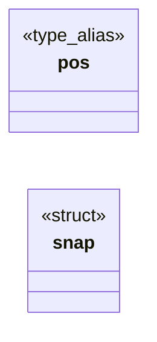
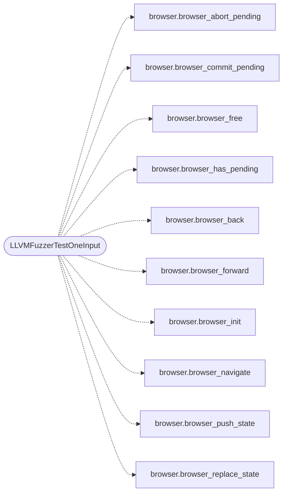

# `fuzz/fuzz_browser.c`

> Source: [fuzz/fuzz_browser.c:1](../../fuzz/fuzz_browser.c#L1) | language `c` | coverage 33.3% | [API index](../index.md)

## Contents

- **Structs:** [`snap`](#snap)
- **Type Aliases:** [`pos`](#pos)
- **Functions:** [`LLVMFuzzerTestOneInput`](#llvmfuzzertestoneinput)
- **Macros:** [`_POSIX_C_SOURCE`](#_posix_c_source), [`SNAP_MAX`](#snap_max)

## Type Diagram



## Call Graph

Solid arrows stay in this module, dashed arrows leave it.



## Structs

<a id="snap"></a>

### `snap`

`struct` | [fuzz/fuzz_browser.c:19](../../fuzz/fuzz_browser.c#L19)

```c
typedef struct snap
```

---

## Type Aliases

<a id="pos"></a>

### `pos`

`type_alias` | [fuzz/fuzz_browser.c:18](../../fuzz/fuzz_browser.c#L18)

```c
typedef struct snap { size_t n, pos;
```

define SNAP_MAX 512

---

## Functions

<a id="llvmfuzzertestoneinput"></a>

### `LLVMFuzzerTestOneInput`

`function` | [fuzz/fuzz_browser.c:53](../../fuzz/fuzz_browser.c#L53)

```c
int LLVMFuzzerTestOneInput(const uint8_t *data, size_t size)
```

**Parameters**

| Name | Type | Default | Description |
|---|---|---|---|
| `data` | `uint8_t *` |  |  |
| `size` | `size_t` |  |  |

**Returns:** `int`

*Calls:* [`browser_abort_pending`](include.browser.h.md#browser_abort_pending), [`browser_commit_pending`](include.browser.h.md#browser_commit_pending), [`browser_free`](include.browser.h.md#browser_free), [`browser_has_pending`](include.browser.h.md#browser_has_pending), [`browser_back`](src.browser.c.md#browser_back), [`browser_forward`](src.browser.c.md#browser_forward), [`browser_init`](src.browser.c.md#browser_init), [`browser_navigate`](src.browser.c.md#browser_navigate), [`browser_push_state`](src.browser.c.md#browser_push_state), [`browser_replace_state`](src.browser.c.md#browser_replace_state)

---

## Macros

<a id="_posix_c_source"></a>

### `_POSIX_C_SOURCE`

`macro` | [fuzz/fuzz_browser.c:8](../../fuzz/fuzz_browser.c#L8)

```c
#define _POSIX_C_SOURCE
```

Fuzz target for browser history (spec/browser.md 3b/3c): a hostile sequence of navigate / back / forward / pushState / replaceState / commit / abort.

URLs come from the input (pushState URLs are page-controlled). Oracle: Stop restores EXACTLY the history that was committed before the pending navigation, and the structural invariants (pos < len, URL bar terminated) hold after every step.

---

<a id="snap_max"></a>

### `SNAP_MAX`

`macro` | [fuzz/fuzz_browser.c:17](../../fuzz/fuzz_browser.c#L17)

```c
#define SNAP_MAX
```

---
