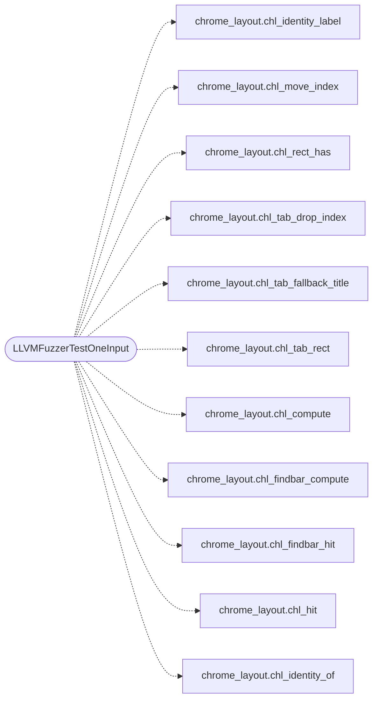

# `fuzz/fuzz_chrome_layout.c`

> Source: [fuzz/fuzz_chrome_layout.c:1](../../fuzz/fuzz_chrome_layout.c#L1) | language `c` | coverage 50.0% | [API index](../index.md)

libFuzzer harness for chrome_layout (spec/chrome_layout.md): a hostile URL (a page

## Contents

- **Functions:** [`LLVMFuzzerTestOneInput`](#llvmfuzzertestoneinput)

## Call Graph

Solid arrows stay in this module, dashed arrows leave it.



## Functions

<a id="llvmfuzzertestoneinput"></a>

### `LLVMFuzzerTestOneInput`

`function` | [fuzz/fuzz_chrome_layout.c:30](../../fuzz/fuzz_chrome_layout.c#L30)

```c
int LLVMFuzzerTestOneInput(const uint8_t *data, size_t size)
```

**Parameters**

| Name | Type | Default | Description |
|---|---|---|---|
| `data` | `uint8_t *` |  |  |
| `size` | `size_t` |  |  |

**Returns:** `int`

*Calls:* [`chl_identity_label`](include.chrome_layout.h.md#chl_identity_label), [`chl_move_index`](include.chrome_layout.h.md#chl_move_index), [`chl_rect_has`](include.chrome_layout.h.md#chl_rect_has), [`chl_tab_drop_index`](include.chrome_layout.h.md#chl_tab_drop_index), [`chl_tab_fallback_title`](include.chrome_layout.h.md#chl_tab_fallback_title), [`chl_tab_rect`](include.chrome_layout.h.md#chl_tab_rect), [`chl_compute`](src.chrome_layout.c.md#chl_compute), [`chl_findbar_compute`](src.chrome_layout.c.md#chl_findbar_compute), [`chl_findbar_hit`](src.chrome_layout.c.md#chl_findbar_hit), [`chl_hit`](src.chrome_layout.c.md#chl_hit), [`chl_identity_of`](src.chrome_layout.c.md#chl_identity_of)

---
