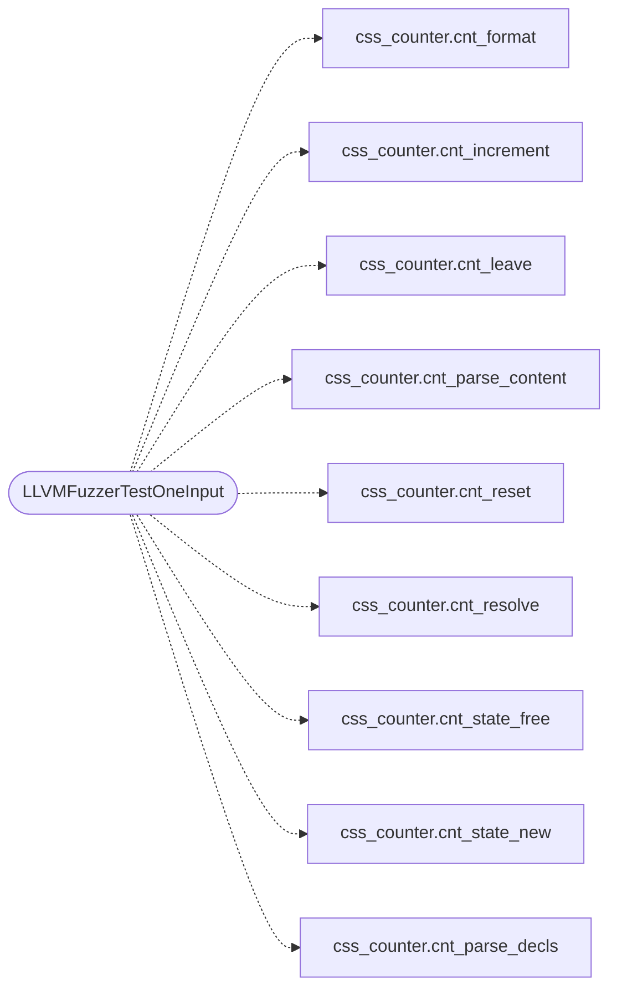

# `fuzz/fuzz_css_counter.c`

> Source: [fuzz/fuzz_css_counter.c:1](../../fuzz/fuzz_css_counter.c#L1) | language `c` | coverage 50.0% | [API index](../index.md)

libFuzzer harness for css_counter (spec/css_counter.md): hostile `content` and counter

## Contents

- **Functions:** [`LLVMFuzzerTestOneInput`](#llvmfuzzertestoneinput)

## Call Graph

Solid arrows stay in this module, dashed arrows leave it.



## Functions

<a id="llvmfuzzertestoneinput"></a>

### `LLVMFuzzerTestOneInput`

`function` | [fuzz/fuzz_css_counter.c:11](../../fuzz/fuzz_css_counter.c#L11)

```c
int LLVMFuzzerTestOneInput(const uint8_t *data, size_t size)
```

**Parameters**

| Name | Type | Default | Description |
|---|---|---|---|
| `data` | `uint8_t *` |  |  |
| `size` | `size_t` |  |  |

**Returns:** `int`

*Calls:* [`cnt_format`](include.css_counter.h.md#cnt_format), [`cnt_increment`](include.css_counter.h.md#cnt_increment), [`cnt_leave`](include.css_counter.h.md#cnt_leave), [`cnt_parse_content`](include.css_counter.h.md#cnt_parse_content), [`cnt_reset`](include.css_counter.h.md#cnt_reset), [`cnt_resolve`](include.css_counter.h.md#cnt_resolve), [`cnt_state_free`](include.css_counter.h.md#cnt_state_free), [`cnt_state_new`](include.css_counter.h.md#cnt_state_new), [`cnt_parse_decls`](src.css_counter.c.md#cnt_parse_decls)

---
