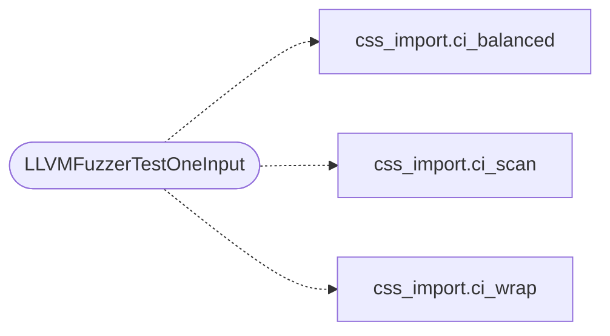

# `fuzz/fuzz_css_import.c`

> Source: [fuzz/fuzz_css_import.c:1](../../fuzz/fuzz_css_import.c#L1) | language `c` | coverage 33.3% | [API index](../index.md)

fuzz_css_import -- hostile stylesheet text through the @import prelude reader

## Contents

- **Structs:** [`fz_out`](#fz_out)
- **Functions:** [`LLVMFuzzerTestOneInput`](#llvmfuzzertestoneinput)

## Call Graph

Solid arrows stay in this module, dashed arrows leave it.



## Structs

<a id="fz_out"></a>

### `fz_out`

`struct` | [fuzz/fuzz_css_import.c:13](../../fuzz/fuzz_css_import.c#L13)

```c
typedef struct { uint8_t *p; size_t n, cap; } fz_out;
```

---

## Functions

<a id="llvmfuzzertestoneinput"></a>

### `LLVMFuzzerTestOneInput`

`function` | [fuzz/fuzz_css_import.c:50](../../fuzz/fuzz_css_import.c#L50)

```c
int LLVMFuzzerTestOneInput(const uint8_t *data, size_t size)
```

**Parameters**

| Name | Type | Default | Description |
|---|---|---|---|
| `data` | `uint8_t *` |  |  |
| `size` | `size_t` |  |  |

**Returns:** `int`

*Calls:* [`ci_balanced`](include.css_import.h.md#ci_balanced), [`ci_scan`](include.css_import.h.md#ci_scan), [`ci_wrap`](include.css_import.h.md#ci_wrap)

---
