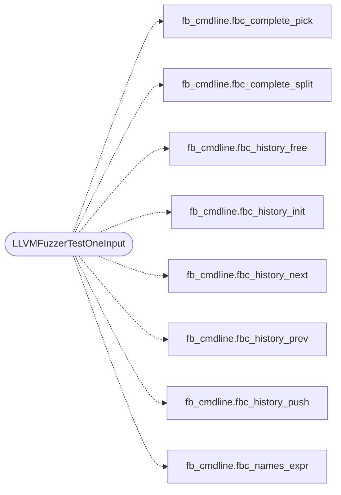

# `fuzz/fuzz_fb_cmdline.c`

> Source: [fuzz/fuzz_fb_cmdline.c:1](../../fuzz/fuzz_fb_cmdline.c#L1) | language `c` | coverage 50.0% | [API index](../index.md)

## Contents

- **Functions:** [`LLVMFuzzerTestOneInput`](#llvmfuzzertestoneinput)

## Call Graph

Solid arrows stay in this module, dashed arrows leave it.



## Functions

<a id="llvmfuzzertestoneinput"></a>

### `LLVMFuzzerTestOneInput`

`function` | [fuzz/fuzz_fb_cmdline.c:5](../../fuzz/fuzz_fb_cmdline.c#L5)

```c
int LLVMFuzzerTestOneInput(const uint8_t *d, size_t n)
```

include <stdint.h> include <stdlib.h> include <string.h> include "fb_cmdline.h"

**Parameters**

| Name | Type | Default | Description |
|---|---|---|---|
| `d` | `uint8_t *` |  |  |
| `n` | `size_t` |  |  |

**Returns:** `int`

*Calls:* [`fbc_complete_pick`](include.fb_cmdline.h.md#fbc_complete_pick), [`fbc_complete_split`](include.fb_cmdline.h.md#fbc_complete_split), [`fbc_history_free`](include.fb_cmdline.h.md#fbc_history_free), [`fbc_history_init`](include.fb_cmdline.h.md#fbc_history_init), [`fbc_history_next`](include.fb_cmdline.h.md#fbc_history_next), [`fbc_history_prev`](include.fb_cmdline.h.md#fbc_history_prev), [`fbc_history_push`](include.fb_cmdline.h.md#fbc_history_push), [`fbc_names_expr`](include.fb_cmdline.h.md#fbc_names_expr)

---
