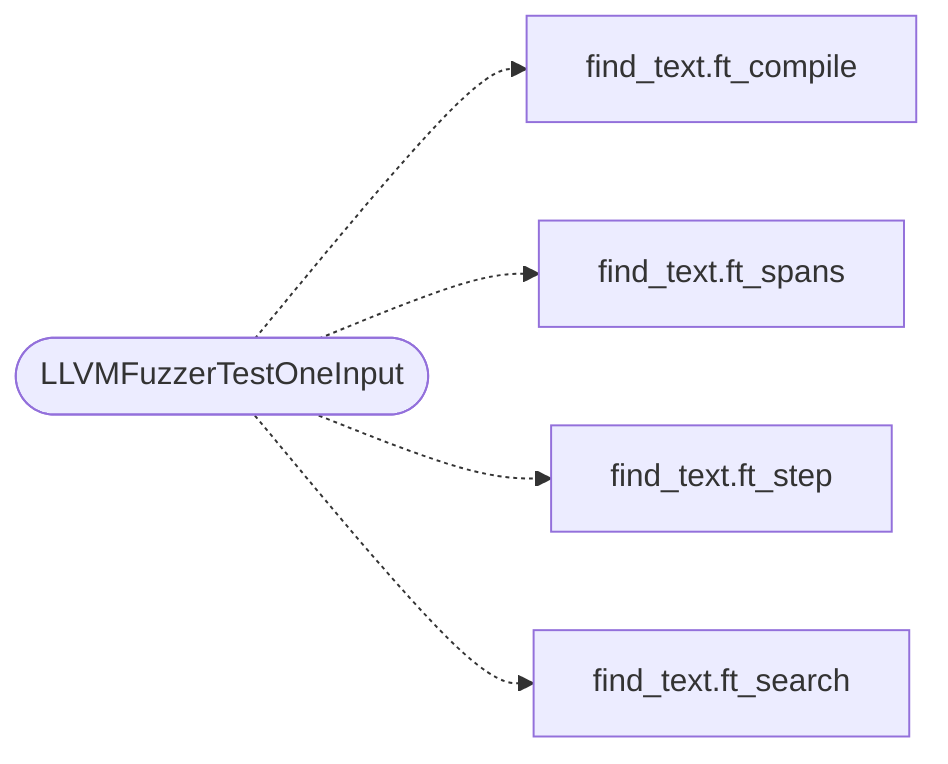

# `fuzz/fuzz_find_text.c`

> Source: [fuzz/fuzz_find_text.c:1](../../fuzz/fuzz_find_text.c#L1) | language `c` | coverage 33.3% | [API index](../index.md)

libFuzzer harness for find_text (spec/find_text.md).

Input: [qlen][query][pieces...],

## Contents

- **Functions:** [`LLVMFuzzerTestOneInput`](#llvmfuzzertestoneinput)
- **Macros:** [`MAXP`](#maxp)

## Call Graph

Solid arrows stay in this module, dashed arrows leave it.



## Functions

<a id="llvmfuzzertestoneinput"></a>

### `LLVMFuzzerTestOneInput`

`function` | [fuzz/fuzz_find_text.c:11](../../fuzz/fuzz_find_text.c#L11)

```c
int LLVMFuzzerTestOneInput(const uint8_t *data, size_t size)
```

**Parameters**

| Name | Type | Default | Description |
|---|---|---|---|
| `data` | `uint8_t *` |  |  |
| `size` | `size_t` |  |  |

**Returns:** `int`

*Calls:* [`ft_compile`](include.find_text.h.md#ft_compile), [`ft_spans`](include.find_text.h.md#ft_spans), [`ft_step`](include.find_text.h.md#ft_step), [`ft_search`](src.find_text.c.md#ft_search)

---

## Macros

<a id="maxp"></a>

### `MAXP`

`macro` | [fuzz/fuzz_find_text.c:9](../../fuzz/fuzz_find_text.c#L9)

```c
#define MAXP
```

---
