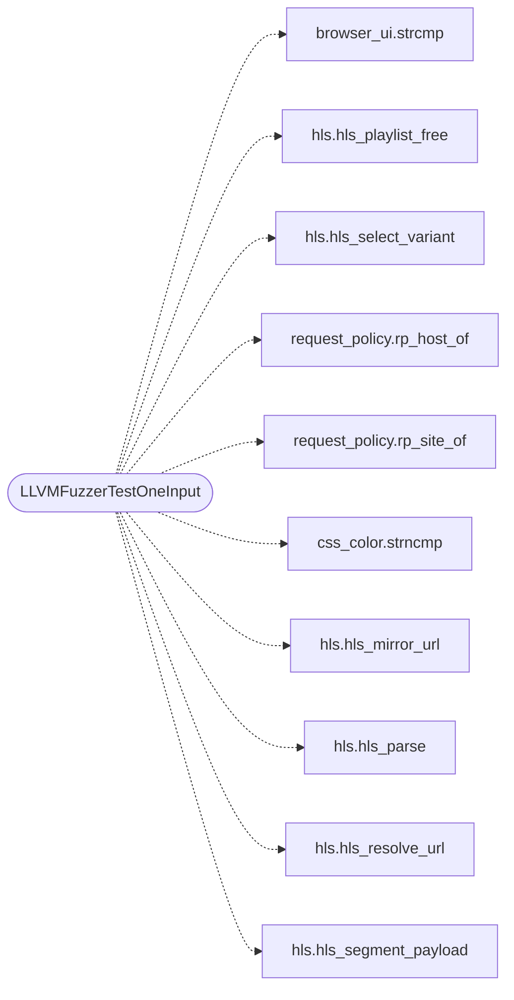

# `fuzz/fuzz_hls.c`

> Source: [fuzz/fuzz_hls.c:1](../../fuzz/fuzz_hls.c#L1) | language `c` | coverage 50.0% | [API index](../index.md)

libFuzzer harness for hls (spec/hls.md): hostile playlist text, hostile

## Contents

- **Functions:** [`LLVMFuzzerTestOneInput`](#llvmfuzzertestoneinput)

## Call Graph

Solid arrows stay in this module, dashed arrows leave it.



## Functions

<a id="llvmfuzzertestoneinput"></a>

### `LLVMFuzzerTestOneInput`

`function` | [fuzz/fuzz_hls.c:13](../../fuzz/fuzz_hls.c#L13)

```c
int LLVMFuzzerTestOneInput(const uint8_t *data, size_t size)
```

**Parameters**

| Name | Type | Default | Description |
|---|---|---|---|
| `data` | `uint8_t *` |  |  |
| `size` | `size_t` |  |  |

**Returns:** `int`

*Calls:* [`strcmp`](gui.browser_ui.c.md#strcmp), [`hls_playlist_free`](include.hls.h.md#hls_playlist_free), [`hls_select_variant`](include.hls.h.md#hls_select_variant), [`rp_host_of`](include.request_policy.h.md#rp_host_of), [`rp_site_of`](include.request_policy.h.md#rp_site_of), [`strncmp`](src.css_color.c.md#strncmp), [`hls_mirror_url`](src.hls.c.md#hls_mirror_url), [`hls_parse`](src.hls.c.md#hls_parse), [`hls_resolve_url`](src.hls.c.md#hls_resolve_url), [`hls_segment_payload`](src.hls.c.md#hls_segment_payload)

---
