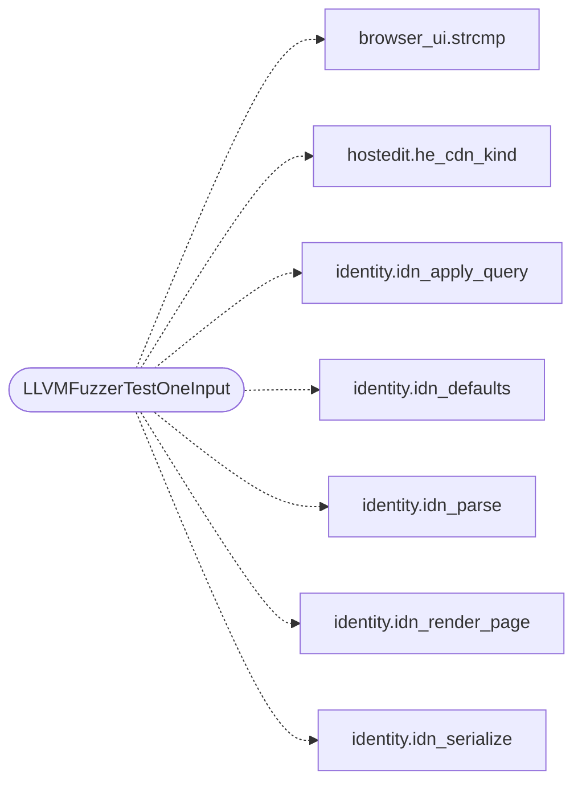

# `fuzz/fuzz_identity.c`

> Source: [fuzz/fuzz_identity.c:1](../../fuzz/fuzz_identity.c#L1) | language `c` | coverage 50.0% | [API index](../index.md)

libFuzzer harness for identity (spec/identity.md) and he_cdn_kind (spec/hostedit.md):

## Contents

- **Functions:** [`LLVMFuzzerTestOneInput`](#llvmfuzzertestoneinput)

## Call Graph

Solid arrows stay in this module, dashed arrows leave it.



## Functions

<a id="llvmfuzzertestoneinput"></a>

### `LLVMFuzzerTestOneInput`

`function` | [fuzz/fuzz_identity.c:13](../../fuzz/fuzz_identity.c#L13)

```c
int LLVMFuzzerTestOneInput(const uint8_t *data, size_t size)
```

**Parameters**

| Name | Type | Default | Description |
|---|---|---|---|
| `data` | `uint8_t *` |  |  |
| `size` | `size_t` |  |  |

**Returns:** `int`

*Calls:* [`strcmp`](gui.browser_ui.c.md#strcmp), [`he_cdn_kind`](include.hostedit.h.md#he_cdn_kind), [`idn_apply_query`](include.identity.h.md#idn_apply_query), [`idn_defaults`](include.identity.h.md#idn_defaults), [`idn_parse`](include.identity.h.md#idn_parse), [`idn_render_page`](include.identity.h.md#idn_render_page), [`idn_serialize`](include.identity.h.md#idn_serialize)

---
