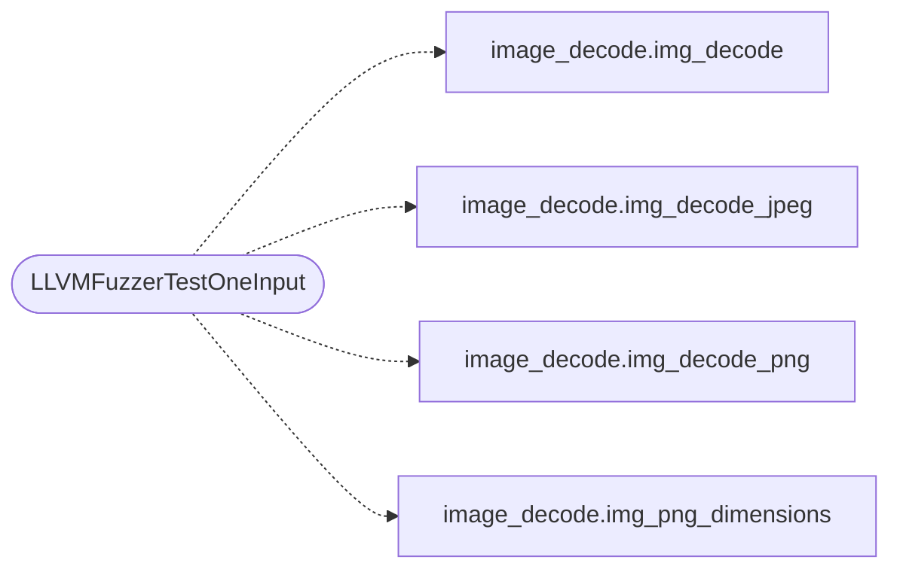

# `fuzz/fuzz_image_decode.c`

> Source: [fuzz/fuzz_image_decode.c:1](../../fuzz/fuzz_image_decode.c#L1) | language `c` | coverage 0.0% | [API index](../index.md)

## Contents

- **Functions:** [`LLVMFuzzerTestOneInput`](#llvmfuzzertestoneinput)

## Call Graph

Solid arrows stay in this module, dashed arrows leave it.



## Functions

<a id="llvmfuzzertestoneinput"></a>

### `LLVMFuzzerTestOneInput`

`function` | [fuzz/fuzz_image_decode.c:32](../../fuzz/fuzz_image_decode.c#L32)

```c
int LLVMFuzzerTestOneInput(const uint8_t *data, size_t size)
```

**Parameters**

| Name | Type | Default | Description |
|---|---|---|---|
| `data` | `uint8_t *` |  |  |
| `size` | `size_t` |  |  |

**Returns:** `int`

*Calls:* [`img_decode`](src.image_decode.c.md#img_decode), [`img_decode_jpeg`](src.image_decode.c.md#img_decode_jpeg), [`img_decode_png`](src.image_decode.c.md#img_decode_png), [`img_png_dimensions`](src.image_decode.c.md#img_png_dimensions)

---
