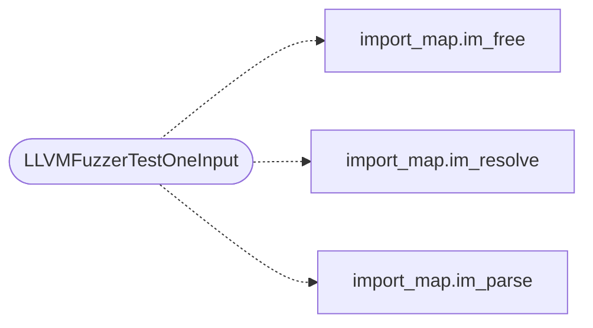

# `fuzz/fuzz_import_map.c`

> Source: [fuzz/fuzz_import_map.c:1](../../fuzz/fuzz_import_map.c#L1) | language `c` | coverage 0.0% | [API index](../index.md)

## Contents

- **Functions:** [`LLVMFuzzerTestOneInput`](#llvmfuzzertestoneinput)

## Call Graph

Solid arrows stay in this module, dashed arrows leave it.



## Functions

<a id="llvmfuzzertestoneinput"></a>

### `LLVMFuzzerTestOneInput`

`function` | [fuzz/fuzz_import_map.c:24](../../fuzz/fuzz_import_map.c#L24)

```c
int LLVMFuzzerTestOneInput(const uint8_t *data, size_t size)
```

**Parameters**

| Name | Type | Default | Description |
|---|---|---|---|
| `data` | `uint8_t *` |  |  |
| `size` | `size_t` |  |  |

**Returns:** `int`

*Calls:* [`im_free`](include.import_map.h.md#im_free), [`im_resolve`](include.import_map.h.md#im_resolve), [`im_parse`](src.import_map.c.md#im_parse)

---
