# `fuzz/fuzz_js_dom.c`

> Source: [fuzz/fuzz_js_dom.c:1](../../fuzz/fuzz_js_dom.c#L1) | language `c` | coverage 33.3% | [API index](../index.md)

## Contents

- **Functions:** [`LLVMFuzzerTestOneInput`](#llvmfuzzertestoneinput)
- **Macros:** [`FUZZ_JSDOM_MAX_NODES`](#fuzz_jsdom_max_nodes)

## Call Graph

Solid arrows stay in this module, dashed arrows leave it.

```mermaid
flowchart LR
    n_fuzz_fuzz_js_dom_c__LLVMFuzzerTestOneInput(["LLVMFuzzerTestOneInput"])
    n_include_dom_h__dom_free["dom.dom_free"]
    n_include_dom_h__dom_node_count["dom.dom_node_count"]
    n_include_html_parse_h__hp_document_free["html_parse.hp_document_free"]
    n_include_js_geom_h__jg_add["js_geom.jg_add"]
    n_include_js_geom_h__jg_aggregate["js_geom.jg_aggregate"]
    n_include_js_geom_h__jg_free["js_geom.jg_free"]
    n_include_js_geom_h__jg_init["js_geom.jg_init"]
    n_include_js_sandbox_h__js_context_free["js_sandbox.js_context_free"]
    n_include_js_sandbox_h__js_pump_jobs["js_sandbox.js_pump_jobs"]
    n_include_js_sandbox_h__js_result_free["js_sandbox.js_result_free"]
    n_include_js_trusted_h__jt_take_opens["js_trusted.jt_take_opens"]
    n_include_js_trusted_h__jt_take_storage["js_trusted.jt_take_storage"]
    n_include_js_trusted_h__jt_take_ws["js_trusted.jt_take_ws"]
    n_include_js_trusted_h__jt_ws_event["js_trusted.jt_ws_event"]
    n_include_js_trusted_h__jt_ws_ops_free["js_trusted.jt_ws_ops_free"]
    n_include_web_storage_h__wst_decode_check["web_storage.wst_decode_check"]
    n_src_dom_c__dom_build["dom.dom_build"]
    n_src_html_parse_c__hp_parse["html_parse.hp_parse"]
    n_src_js_dom_c__jd_install["js_dom.jd_install"]
    n_src_js_dom_c__jd_set_geometry["js_dom.jd_set_geometry"]
    n_src_js_events_c__jd_fire_click["js_events.jd_fire_click"]
    n_src_js_events_c__jd_fire_mouse_event["js_events.jd_fire_mouse_event"]
    n_src_js_events_c__jd_fire_submit["js_events.jd_fire_submit"]
    n_src_js_location_c__jd_set_location["js_location.jd_set_location"]
    n_fuzz_fuzz_js_dom_c__LLVMFuzzerTestOneInput -.-> n_include_dom_h__dom_free
    n_fuzz_fuzz_js_dom_c__LLVMFuzzerTestOneInput -.-> n_include_dom_h__dom_node_count
    n_fuzz_fuzz_js_dom_c__LLVMFuzzerTestOneInput -.-> n_include_html_parse_h__hp_document_free
    n_fuzz_fuzz_js_dom_c__LLVMFuzzerTestOneInput -.-> n_include_js_geom_h__jg_add
    n_fuzz_fuzz_js_dom_c__LLVMFuzzerTestOneInput -.-> n_include_js_geom_h__jg_aggregate
    n_fuzz_fuzz_js_dom_c__LLVMFuzzerTestOneInput -.-> n_include_js_geom_h__jg_free
    n_fuzz_fuzz_js_dom_c__LLVMFuzzerTestOneInput -.-> n_include_js_geom_h__jg_init
    n_fuzz_fuzz_js_dom_c__LLVMFuzzerTestOneInput -.-> n_include_js_sandbox_h__js_context_free
    n_fuzz_fuzz_js_dom_c__LLVMFuzzerTestOneInput -.-> n_include_js_sandbox_h__js_pump_jobs
    n_fuzz_fuzz_js_dom_c__LLVMFuzzerTestOneInput -.-> n_include_js_sandbox_h__js_result_free
    n_fuzz_fuzz_js_dom_c__LLVMFuzzerTestOneInput -.-> n_include_js_trusted_h__jt_take_opens
    n_fuzz_fuzz_js_dom_c__LLVMFuzzerTestOneInput -.-> n_include_js_trusted_h__jt_take_storage
    n_fuzz_fuzz_js_dom_c__LLVMFuzzerTestOneInput -.-> n_include_js_trusted_h__jt_take_ws
    n_fuzz_fuzz_js_dom_c__LLVMFuzzerTestOneInput -.-> n_include_js_trusted_h__jt_ws_event
    n_fuzz_fuzz_js_dom_c__LLVMFuzzerTestOneInput -.-> n_include_js_trusted_h__jt_ws_ops_free
    n_fuzz_fuzz_js_dom_c__LLVMFuzzerTestOneInput -.-> n_include_web_storage_h__wst_decode_check
    n_fuzz_fuzz_js_dom_c__LLVMFuzzerTestOneInput -.-> n_src_dom_c__dom_build
    n_fuzz_fuzz_js_dom_c__LLVMFuzzerTestOneInput -.-> n_src_html_parse_c__hp_parse
    n_fuzz_fuzz_js_dom_c__LLVMFuzzerTestOneInput -.-> n_src_js_dom_c__jd_install
    n_fuzz_fuzz_js_dom_c__LLVMFuzzerTestOneInput -.-> n_src_js_dom_c__jd_set_geometry
    n_fuzz_fuzz_js_dom_c__LLVMFuzzerTestOneInput -.-> n_src_js_events_c__jd_fire_click
    n_fuzz_fuzz_js_dom_c__LLVMFuzzerTestOneInput -.-> n_src_js_events_c__jd_fire_mouse_event
    n_fuzz_fuzz_js_dom_c__LLVMFuzzerTestOneInput -.-> n_src_js_events_c__jd_fire_submit
    n_fuzz_fuzz_js_dom_c__LLVMFuzzerTestOneInput -.-> n_src_js_location_c__jd_set_location
```



## Functions

<a id="llvmfuzzertestoneinput"></a>

### `LLVMFuzzerTestOneInput`

`function` | [fuzz/fuzz_js_dom.c:40](../../fuzz/fuzz_js_dom.c#L40)

```c
int LLVMFuzzerTestOneInput(const uint8_t *data, size_t size)
```

**Parameters**

| Name | Type | Default | Description |
|---|---|---|---|
| `data` | `uint8_t *` |  |  |
| `size` | `size_t` |  |  |

**Returns:** `int`

*Calls:* [`dom_free`](include.dom.h.md#dom_free), [`dom_node_count`](include.dom.h.md#dom_node_count), [`hp_document_free`](include.html_parse.h.md#hp_document_free), [`jg_add`](include.js_geom.h.md#jg_add), [`jg_aggregate`](include.js_geom.h.md#jg_aggregate), [`jg_free`](include.js_geom.h.md#jg_free), [`jg_init`](include.js_geom.h.md#jg_init), [`js_context_free`](include.js_sandbox.h.md#js_context_free), [`js_pump_jobs`](include.js_sandbox.h.md#js_pump_jobs), [`js_result_free`](include.js_sandbox.h.md#js_result_free), [`jt_take_opens`](include.js_trusted.h.md#jt_take_opens), [`jt_take_storage`](include.js_trusted.h.md#jt_take_storage) and 21 more

---

## Macros

<a id="fuzz_jsdom_max_nodes"></a>

### `FUZZ_JSDOM_MAX_NODES`

`macro` | [fuzz/fuzz_js_dom.c:38](../../fuzz/fuzz_js_dom.c#L38)

```c
#define FUZZ_JSDOM_MAX_NODES
```

Bounds the per-input cost: engine events fired per node kind.

---
