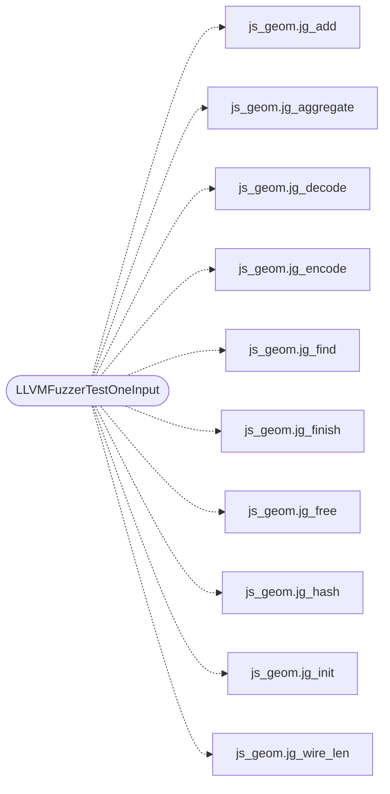

# `fuzz/fuzz_js_geom.c`

> Source: [fuzz/fuzz_js_geom.c:1](../../fuzz/fuzz_js_geom.c#L1) | language `c` | coverage 0.0% | [API index](../index.md)

## Contents

- **Structs:** [`fz_parent`](#fz_parent)
- **Functions:** [`LLVMFuzzerTestOneInput`](#llvmfuzzertestoneinput)

## Call Graph

Solid arrows stay in this module, dashed arrows leave it.



## Structs

<a id="fz_parent"></a>

### `fz_parent`

`struct` `const` | [fuzz/fuzz_js_geom.c:17](../../fuzz/fuzz_js_geom.c#L17)

```c
typedef struct fz_parent { const uint8_t *data; size_t size; } fz_parent;
```

---

## Functions

<a id="llvmfuzzertestoneinput"></a>

### `LLVMFuzzerTestOneInput`

`function` | [fuzz/fuzz_js_geom.c:27](../../fuzz/fuzz_js_geom.c#L27)

```c
int LLVMFuzzerTestOneInput(const uint8_t *data, size_t size)
```

**Parameters**

| Name | Type | Default | Description |
|---|---|---|---|
| `data` | `uint8_t *` |  |  |
| `size` | `size_t` |  |  |

**Returns:** `int`

*Calls:* [`jg_add`](include.js_geom.h.md#jg_add), [`jg_aggregate`](include.js_geom.h.md#jg_aggregate), [`jg_decode`](include.js_geom.h.md#jg_decode), [`jg_encode`](include.js_geom.h.md#jg_encode), [`jg_find`](include.js_geom.h.md#jg_find), [`jg_finish`](include.js_geom.h.md#jg_finish), [`jg_free`](include.js_geom.h.md#jg_free), [`jg_hash`](include.js_geom.h.md#jg_hash), [`jg_init`](include.js_geom.h.md#jg_init), [`jg_wire_len`](include.js_geom.h.md#jg_wire_len)

---
