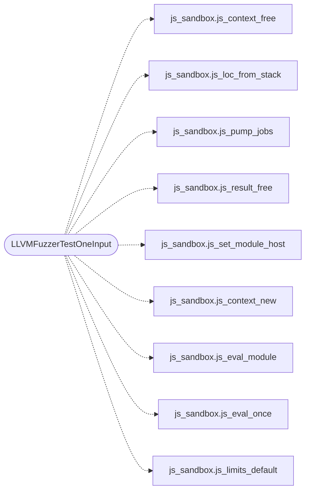

# `fuzz/fuzz_js_sandbox.c`

> Source: [fuzz/fuzz_js_sandbox.c:1](../../fuzz/fuzz_js_sandbox.c#L1) | language `c` | coverage 25.0% | [API index](../index.md)

## Contents

- **Structs:** [`fz_mod`](#fz_mod)
- **Functions:** [`js_sandbox`](#js_sandbox), [`LLVMFuzzerTestOneInput`](#llvmfuzzertestoneinput)

## Call Graph

Solid arrows stay in this module, dashed arrows leave it.



## Structs

<a id="fz_mod"></a>

### `fz_mod`

`struct` `const` | [fuzz/fuzz_js_sandbox.c:21](../../fuzz/fuzz_js_sandbox.c#L21)

```c
typedef struct fz_mod { const uint8_t *data; size_t size; } fz_mod;
```

Module host for the fuzzer: every "./" specifier resolves, and "./self.js" loads the input itself (so hostile code imports hostile code, cycles included); anything else loads a small fixed module or fails.

---

## Functions

<a id="js_sandbox"></a>

### `js_sandbox`

`function` | [fuzz/fuzz_js_sandbox.c:2](../../fuzz/fuzz_js_sandbox.c#L2)

```c
* libFuzzer harness for js_sandbox (Hito 3). * * Goal: arbitrary bytes treated as untrusted script through the full * eval + result + free pipeline must never crash, leak, or trigger UB on the * host.
```

**Parameters**

| Name | Type | Default | Description |
|---|---|---|---|
| `Hito` |  |  |  |

**Returns:** `* libFuzzer harness for`

---

<a id="llvmfuzzertestoneinput"></a>

### `LLVMFuzzerTestOneInput`

`function` | [fuzz/fuzz_js_sandbox.c:48](../../fuzz/fuzz_js_sandbox.c#L48)

```c
int LLVMFuzzerTestOneInput(const uint8_t *data, size_t size)
```

**Parameters**

| Name | Type | Default | Description |
|---|---|---|---|
| `data` | `uint8_t *` |  |  |
| `size` | `size_t` |  |  |

**Returns:** `int`

*Calls:* [`js_context_free`](include.js_sandbox.h.md#js_context_free), [`js_loc_from_stack`](include.js_sandbox.h.md#js_loc_from_stack), [`js_pump_jobs`](include.js_sandbox.h.md#js_pump_jobs), [`js_result_free`](include.js_sandbox.h.md#js_result_free), [`js_set_module_host`](include.js_sandbox.h.md#js_set_module_host), [`js_context_new`](src.js_sandbox.c.md#js_context_new), [`js_eval_module`](src.js_sandbox.c.md#js_eval_module), [`js_eval_once`](src.js_sandbox.c.md#js_eval_once), [`js_limits_default`](src.js_sandbox.c.md#js_limits_default)

---
