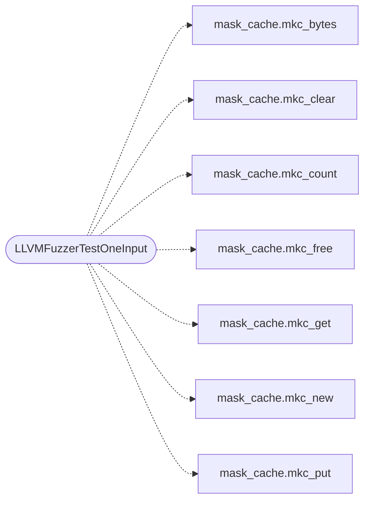

# `fuzz/fuzz_mask_cache.c`

> Source: [fuzz/fuzz_mask_cache.c:1](../../fuzz/fuzz_mask_cache.c#L1) | language `c` | coverage 33.3% | [API index](../index.md)

libFuzzer harness for mask_cache (spec/mask_cache.md).

The input is a script of put/get

## Contents

- **Functions:** [`LLVMFuzzerTestOneInput`](#llvmfuzzertestoneinput)
- **Macros:** [`KEYS`](#keys)

## Call Graph

Solid arrows stay in this module, dashed arrows leave it.



## Functions

<a id="llvmfuzzertestoneinput"></a>

### `LLVMFuzzerTestOneInput`

`function` | [fuzz/fuzz_mask_cache.c:21](../../fuzz/fuzz_mask_cache.c#L21)

```c
int LLVMFuzzerTestOneInput(const uint8_t *data, size_t size)
```

**Parameters**

| Name | Type | Default | Description |
|---|---|---|---|
| `data` | `uint8_t *` |  |  |
| `size` | `size_t` |  |  |

**Returns:** `int`

*Calls:* [`mkc_bytes`](include.mask_cache.h.md#mkc_bytes), [`mkc_clear`](include.mask_cache.h.md#mkc_clear), [`mkc_count`](include.mask_cache.h.md#mkc_count), [`mkc_free`](include.mask_cache.h.md#mkc_free), [`mkc_get`](include.mask_cache.h.md#mkc_get), [`mkc_new`](include.mask_cache.h.md#mkc_new), [`mkc_put`](include.mask_cache.h.md#mkc_put)

---

## Macros

<a id="keys"></a>

### `KEYS`

`macro` | [fuzz/fuzz_mask_cache.c:13](../../fuzz/fuzz_mask_cache.c#L13)

```c
#define KEYS
```

---
