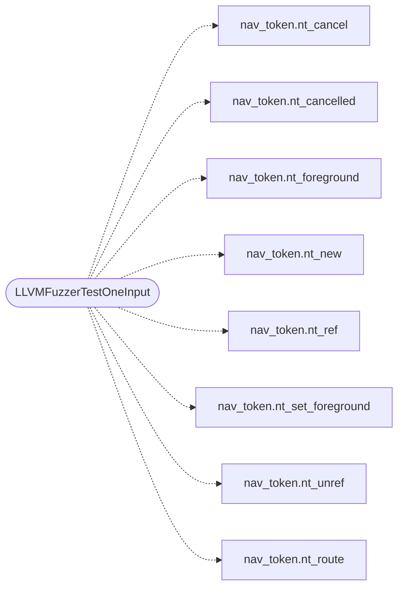

# `fuzz/fuzz_nav_token.c`

> Source: [fuzz/fuzz_nav_token.c:1](../../fuzz/fuzz_nav_token.c#L1) | language `c` | coverage 33.3% | [API index](../index.md)

libFuzzer harness for nav_token (spec/nav_token.md): a byte program of new / ref

## Contents

- **Functions:** [`LLVMFuzzerTestOneInput`](#llvmfuzzertestoneinput)
- **Macros:** [`POOL`](#pool)

## Call Graph

Solid arrows stay in this module, dashed arrows leave it.



## Functions

<a id="llvmfuzzertestoneinput"></a>

### `LLVMFuzzerTestOneInput`

`function` | [fuzz/fuzz_nav_token.c:13](../../fuzz/fuzz_nav_token.c#L13)

```c
int LLVMFuzzerTestOneInput(const uint8_t *data, size_t size)
```

**Parameters**

| Name | Type | Default | Description |
|---|---|---|---|
| `data` | `uint8_t *` |  |  |
| `size` | `size_t` |  |  |

**Returns:** `int`

*Calls:* [`nt_cancel`](include.nav_token.h.md#nt_cancel), [`nt_cancelled`](include.nav_token.h.md#nt_cancelled), [`nt_foreground`](include.nav_token.h.md#nt_foreground), [`nt_new`](include.nav_token.h.md#nt_new), [`nt_ref`](include.nav_token.h.md#nt_ref), [`nt_set_foreground`](include.nav_token.h.md#nt_set_foreground), [`nt_unref`](include.nav_token.h.md#nt_unref), [`nt_route`](src.nav_token.c.md#nt_route)

---

## Macros

<a id="pool"></a>

### `POOL`

`macro` | [fuzz/fuzz_nav_token.c:11](../../fuzz/fuzz_nav_token.c#L11)

```c
#define POOL
```

---
