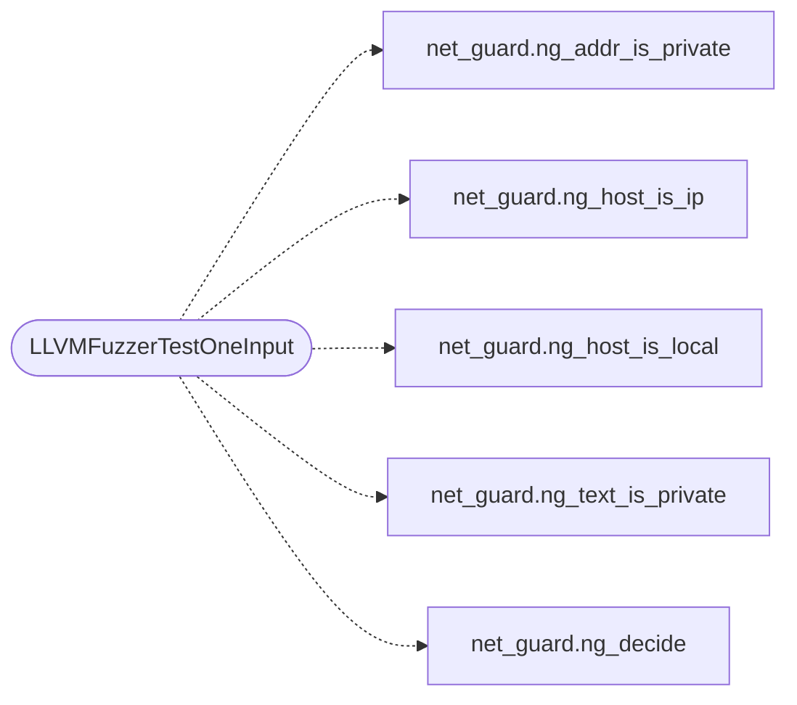

# `fuzz/fuzz_net_guard.c`

> Source: [fuzz/fuzz_net_guard.c:1](../../fuzz/fuzz_net_guard.c#L1) | language `c` | coverage 50.0% | [API index](../index.md)

libFuzzer harness for net_guard (spec/net_guard.md): hostile host and address text.

## Contents

- **Functions:** [`LLVMFuzzerTestOneInput`](#llvmfuzzertestoneinput)

## Call Graph

Solid arrows stay in this module, dashed arrows leave it.



## Functions

<a id="llvmfuzzertestoneinput"></a>

### `LLVMFuzzerTestOneInput`

`function` | [fuzz/fuzz_net_guard.c:15](../../fuzz/fuzz_net_guard.c#L15)

```c
int LLVMFuzzerTestOneInput(const uint8_t *data, size_t size)
```

**Parameters**

| Name | Type | Default | Description |
|---|---|---|---|
| `data` | `uint8_t *` |  |  |
| `size` | `size_t` |  |  |

**Returns:** `int`

*Calls:* [`ng_addr_is_private`](include.net_guard.h.md#ng_addr_is_private), [`ng_host_is_ip`](include.net_guard.h.md#ng_host_is_ip), [`ng_host_is_local`](include.net_guard.h.md#ng_host_is_local), [`ng_text_is_private`](include.net_guard.h.md#ng_text_is_private), [`ng_decide`](src.net_guard.c.md#ng_decide)

---
