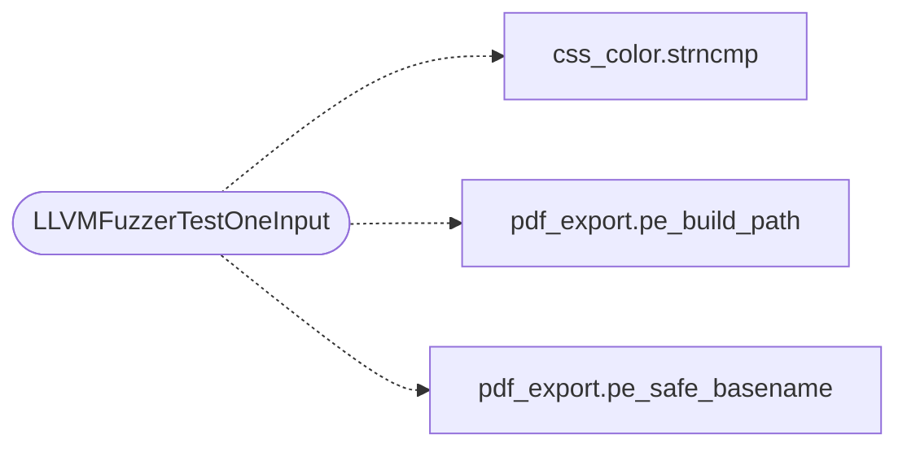

# `fuzz/fuzz_pdf_export.c`

> Source: [fuzz/fuzz_pdf_export.c:1](../../fuzz/fuzz_pdf_export.c#L1) | language `c` | coverage 0.0% | [API index](../index.md)

## Contents

- **Functions:** [`LLVMFuzzerTestOneInput`](#llvmfuzzertestoneinput)

## Call Graph

Solid arrows stay in this module, dashed arrows leave it.



## Functions

<a id="llvmfuzzertestoneinput"></a>

### `LLVMFuzzerTestOneInput`

`function` | [fuzz/fuzz_pdf_export.c:30](../../fuzz/fuzz_pdf_export.c#L30)

```c
int LLVMFuzzerTestOneInput(const uint8_t *data, size_t size)
```

**Parameters**

| Name | Type | Default | Description |
|---|---|---|---|
| `data` | `uint8_t *` |  |  |
| `size` | `size_t` |  |  |

**Returns:** `int`

*Calls:* [`strncmp`](src.css_color.c.md#strncmp), [`pe_build_path`](src.pdf_export.c.md#pe_build_path), [`pe_safe_basename`](src.pdf_export.c.md#pe_safe_basename)

---
