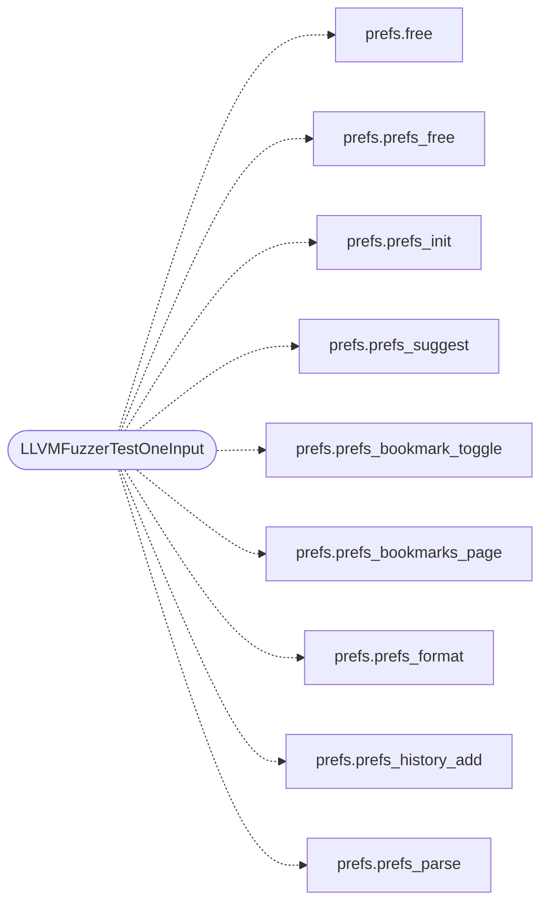

# `fuzz/fuzz_prefs.c`

> Source: [fuzz/fuzz_prefs.c:1](../../fuzz/fuzz_prefs.c#L1) | language `c` | coverage 0.0% | [API index](../index.md)

## Contents

- **Functions:** [`LLVMFuzzerTestOneInput`](#llvmfuzzertestoneinput)

## Call Graph

Solid arrows stay in this module, dashed arrows leave it.



## Functions

<a id="llvmfuzzertestoneinput"></a>

### `LLVMFuzzerTestOneInput`

`function` | [fuzz/fuzz_prefs.c:21](../../fuzz/fuzz_prefs.c#L21)

```c
int LLVMFuzzerTestOneInput(const uint8_t *data, size_t size)
```

**Parameters**

| Name | Type | Default | Description |
|---|---|---|---|
| `data` | `uint8_t *` |  |  |
| `size` | `size_t` |  |  |

**Returns:** `int`

*Calls:* [`free`](include.prefs.h.md#free), [`prefs_free`](include.prefs.h.md#prefs_free), [`prefs_init`](include.prefs.h.md#prefs_init), [`prefs_suggest`](include.prefs.h.md#prefs_suggest), [`prefs_bookmark_toggle`](src.prefs.c.md#prefs_bookmark_toggle), [`prefs_bookmarks_page`](src.prefs.c.md#prefs_bookmarks_page), [`prefs_format`](src.prefs.c.md#prefs_format), [`prefs_history_add`](src.prefs.c.md#prefs_history_add), [`prefs_parse`](src.prefs.c.md#prefs_parse)

---
