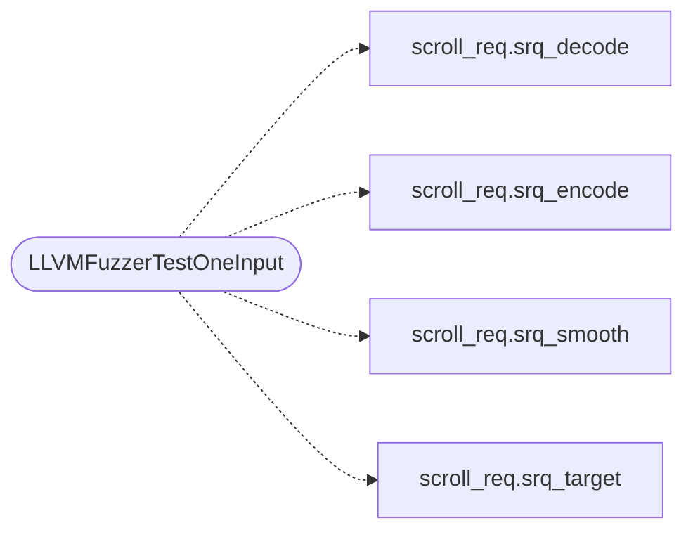

# `fuzz/fuzz_scroll_req.c`

> Source: [fuzz/fuzz_scroll_req.c:1](../../fuzz/fuzz_scroll_req.c#L1) | language `c` | coverage 50.0% | [API index](../index.md)

fuzz_scroll_req -- spec/scroll_req.md: a hostile wire record either decodes to an

## Contents

- **Functions:** [`LLVMFuzzerTestOneInput`](#llvmfuzzertestoneinput)

## Call Graph

Solid arrows stay in this module, dashed arrows leave it.



## Functions

<a id="llvmfuzzertestoneinput"></a>

### `LLVMFuzzerTestOneInput`

`function` | [fuzz/fuzz_scroll_req.c:11](../../fuzz/fuzz_scroll_req.c#L11)

```c
int LLVMFuzzerTestOneInput(const uint8_t *data, size_t size)
```

**Parameters**

| Name | Type | Default | Description |
|---|---|---|---|
| `data` | `uint8_t *` |  |  |
| `size` | `size_t` |  |  |

**Returns:** `int`

*Calls:* [`srq_decode`](include.scroll_req.h.md#srq_decode), [`srq_encode`](include.scroll_req.h.md#srq_encode), [`srq_smooth`](include.scroll_req.h.md#srq_smooth), [`srq_target`](include.scroll_req.h.md#srq_target)

---
