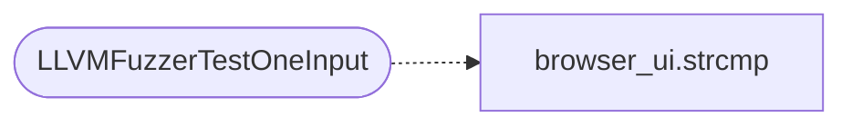

# `fuzz/fuzz_site_panel.c`

> Source: [fuzz/fuzz_site_panel.c:1](../../fuzz/fuzz_site_panel.c#L1) | language `c` | coverage 50.0% | [API index](../index.md)

libFuzzer harness for site_panel (spec/site_panel.md): a hostile URL and KE-group text

## Contents

- **Functions:** [`LLVMFuzzerTestOneInput`](#llvmfuzzertestoneinput)

## Call Graph

Solid arrows stay in this module, dashed arrows leave it.



## Functions

<a id="llvmfuzzertestoneinput"></a>

### `LLVMFuzzerTestOneInput`

`function` | [fuzz/fuzz_site_panel.c:33](../../fuzz/fuzz_site_panel.c#L33)

```c
int LLVMFuzzerTestOneInput(const uint8_t *data, size_t size)
```

**Parameters**

| Name | Type | Default | Description |
|---|---|---|---|
| `data` | `uint8_t *` |  |  |
| `size` | `size_t` |  |  |

**Returns:** `int`

*Calls:* [`strcmp`](gui.browser_ui.c.md#strcmp)

---
