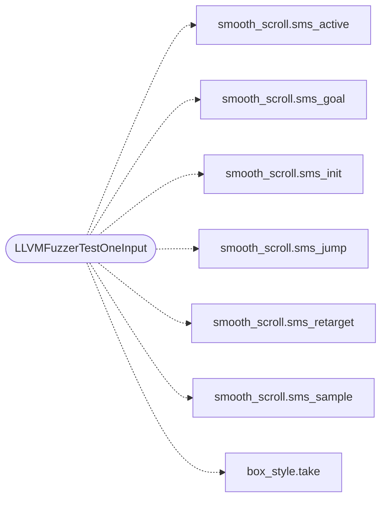

# `fuzz/fuzz_smooth_scroll.c`

> Source: [fuzz/fuzz_smooth_scroll.c:1](../../fuzz/fuzz_smooth_scroll.c#L1) | language `c` | coverage 50.0% | [API index](../index.md)

libFuzzer harness for smooth_scroll (spec/smooth_scroll.md): drives random sequences of

## Contents

- **Functions:** [`LLVMFuzzerTestOneInput`](#llvmfuzzertestoneinput)

## Call Graph

Solid arrows stay in this module, dashed arrows leave it.



## Functions

<a id="llvmfuzzertestoneinput"></a>

### `LLVMFuzzerTestOneInput`

`function` | [fuzz/fuzz_smooth_scroll.c:18](../../fuzz/fuzz_smooth_scroll.c#L18)

```c
int LLVMFuzzerTestOneInput(const uint8_t *data, size_t size)
```

**Parameters**

| Name | Type | Default | Description |
|---|---|---|---|
| `data` | `uint8_t *` |  |  |
| `size` | `size_t` |  |  |

**Returns:** `int`

*Calls:* [`sms_active`](include.smooth_scroll.h.md#sms_active), [`sms_goal`](include.smooth_scroll.h.md#sms_goal), [`sms_init`](include.smooth_scroll.h.md#sms_init), [`sms_jump`](include.smooth_scroll.h.md#sms_jump), [`sms_retarget`](include.smooth_scroll.h.md#sms_retarget), [`sms_sample`](include.smooth_scroll.h.md#sms_sample), [`take`](src.box_style.c.md#take)

---
