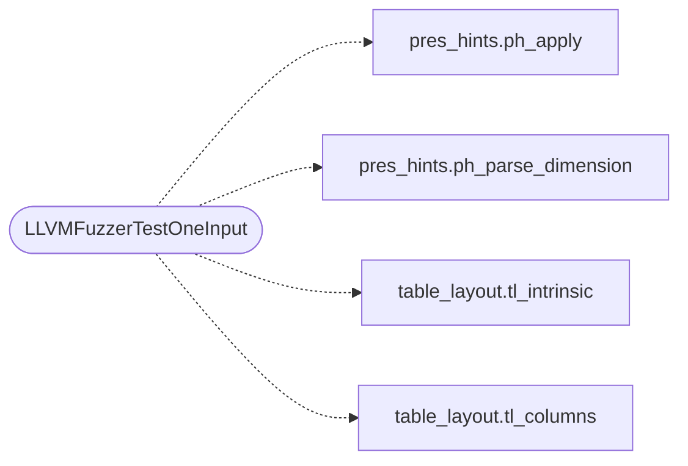

# `fuzz/fuzz_table_layout.c`

> Source: [fuzz/fuzz_table_layout.c:1](../../fuzz/fuzz_table_layout.c#L1) | language `c` | coverage 33.3% | [API index](../index.md)

libFuzzer harness for table_layout and pres_hints (spec/table_layout.md, spec/pres_hints.md).

## Contents

- **Structs:** [`attr_src`](#attr_src)
- **Functions:** [`LLVMFuzzerTestOneInput`](#llvmfuzzertestoneinput)

## Call Graph

Solid arrows stay in this module, dashed arrows leave it.



## Structs

<a id="attr_src"></a>

### `attr_src`

`struct` `const` | [fuzz/fuzz_table_layout.c:15](../../fuzz/fuzz_table_layout.c#L15)

```c
typedef struct { const uint8_t *p; size_t n; } attr_src;
```

---

## Functions

<a id="llvmfuzzertestoneinput"></a>

### `LLVMFuzzerTestOneInput`

`function` | [fuzz/fuzz_table_layout.c:24](../../fuzz/fuzz_table_layout.c#L24)

```c
int LLVMFuzzerTestOneInput(const uint8_t *data, size_t size)
```

**Parameters**

| Name | Type | Default | Description |
|---|---|---|---|
| `data` | `uint8_t *` |  |  |
| `size` | `size_t` |  |  |

**Returns:** `int`

*Calls:* [`ph_apply`](include.pres_hints.h.md#ph_apply), [`ph_parse_dimension`](include.pres_hints.h.md#ph_parse_dimension), [`tl_intrinsic`](include.table_layout.h.md#tl_intrinsic), [`tl_columns`](src.table_layout.c.md#tl_columns)

---
