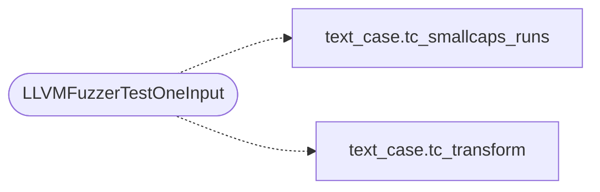

# `fuzz/fuzz_text_case.c`

> Source: [fuzz/fuzz_text_case.c:1](../../fuzz/fuzz_text_case.c#L1) | language `c` | coverage 50.0% | [API index](../index.md)

libFuzzer harness for text_case (spec/text_case.md): case mapping and the

## Contents

- **Functions:** [`LLVMFuzzerTestOneInput`](#llvmfuzzertestoneinput)

## Call Graph

Solid arrows stay in this module, dashed arrows leave it.



## Functions

<a id="llvmfuzzertestoneinput"></a>

### `LLVMFuzzerTestOneInput`

`function` | [fuzz/fuzz_text_case.c:13](../../fuzz/fuzz_text_case.c#L13)

```c
int LLVMFuzzerTestOneInput(const uint8_t *data, size_t size)
```

**Parameters**

| Name | Type | Default | Description |
|---|---|---|---|
| `data` | `uint8_t *` |  |  |
| `size` | `size_t` |  |  |

**Returns:** `int`

*Calls:* [`tc_smallcaps_runs`](include.text_case.h.md#tc_smallcaps_runs), [`tc_transform`](include.text_case.h.md#tc_transform)

---
