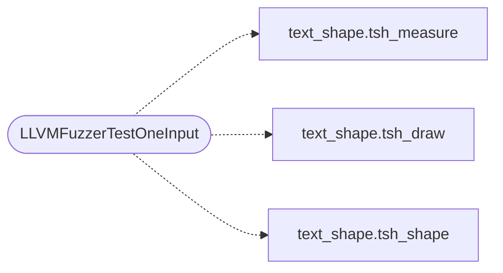

# `fuzz/fuzz_text_shape.c`

> Source: [fuzz/fuzz_text_shape.c:1](../../fuzz/fuzz_text_shape.c#L1) | language `c` | coverage 0.0% | [API index](../index.md)

## Contents

- **Functions:** [`LLVMFuzzerTestOneInput`](#llvmfuzzertestoneinput)
- **Macros:** [`FZ_CAP`](#fz_cap)

## Call Graph

Solid arrows stay in this module, dashed arrows leave it.



## Functions

<a id="llvmfuzzertestoneinput"></a>

### `LLVMFuzzerTestOneInput`

`function` | [fuzz/fuzz_text_shape.c:25](../../fuzz/fuzz_text_shape.c#L25)

```c
int LLVMFuzzerTestOneInput(const uint8_t *data, size_t size)
```

**Parameters**

| Name | Type | Default | Description |
|---|---|---|---|
| `data` | `uint8_t *` |  |  |
| `size` | `size_t` |  |  |

**Returns:** `int`

*Calls:* [`tsh_measure`](include.text_shape.h.md#tsh_measure), [`tsh_draw`](src.text_shape.c.md#tsh_draw), [`tsh_shape`](src.text_shape.c.md#tsh_shape)

---

## Macros

<a id="fz_cap"></a>

### `FZ_CAP`

`macro` | [fuzz/fuzz_text_shape.c:23](../../fuzz/fuzz_text_shape.c#L23)

```c
#define FZ_CAP
```

---
