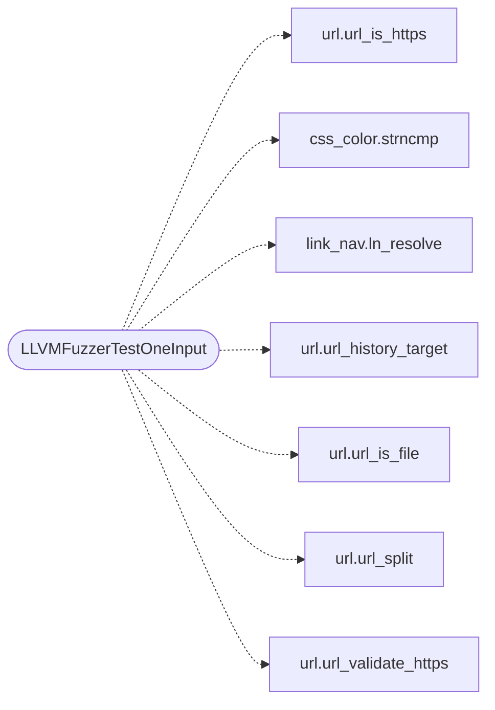

# `fuzz/fuzz_url.c`

> Source: [fuzz/fuzz_url.c:1](../../fuzz/fuzz_url.c#L1) | language `c` | coverage 0.0% | [API index](../index.md)

## Contents

- **Functions:** [`LLVMFuzzerTestOneInput`](#llvmfuzzertestoneinput)

## Call Graph

Solid arrows stay in this module, dashed arrows leave it.



## Functions

<a id="llvmfuzzertestoneinput"></a>

### `LLVMFuzzerTestOneInput`

`function` | [fuzz/fuzz_url.c:59](../../fuzz/fuzz_url.c#L59)

```c
int LLVMFuzzerTestOneInput(const uint8_t *data, size_t size)
```

**Parameters**

| Name | Type | Default | Description |
|---|---|---|---|
| `data` | `uint8_t *` |  |  |
| `size` | `size_t` |  |  |

**Returns:** `int`

*Calls:* [`url_is_https`](include.url.h.md#url_is_https), [`strncmp`](src.css_color.c.md#strncmp), [`ln_resolve`](src.link_nav.c.md#ln_resolve), [`url_history_target`](src.url.c.md#url_history_target), [`url_is_file`](src.url.c.md#url_is_file), [`url_split`](src.url.c.md#url_split), [`url_validate_https`](src.url.c.md#url_validate_https)

---
