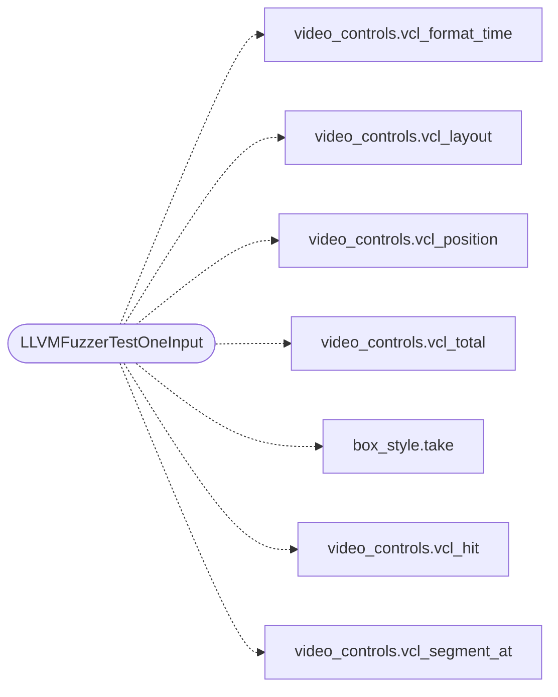

# `fuzz/fuzz_video_controls.c`

> Source: [fuzz/fuzz_video_controls.c:1](../../fuzz/fuzz_video_controls.c#L1) | language `c` | coverage 0.0% | [API index](../index.md)

## Contents

- **Functions:** [`LLVMFuzzerTestOneInput`](#llvmfuzzertestoneinput)

## Call Graph

Solid arrows stay in this module, dashed arrows leave it.



## Functions

<a id="llvmfuzzertestoneinput"></a>

### `LLVMFuzzerTestOneInput`

`function` | [fuzz/fuzz_video_controls.c:14](../../fuzz/fuzz_video_controls.c#L14)

```c
int LLVMFuzzerTestOneInput(const uint8_t *data, size_t size)
```

**Parameters**

| Name | Type | Default | Description |
|---|---|---|---|
| `data` | `uint8_t *` |  |  |
| `size` | `size_t` |  |  |

**Returns:** `int`

*Calls:* [`vcl_format_time`](include.video_controls.h.md#vcl_format_time), [`vcl_layout`](include.video_controls.h.md#vcl_layout), [`vcl_position`](include.video_controls.h.md#vcl_position), [`vcl_total`](include.video_controls.h.md#vcl_total), [`take`](src.box_style.c.md#take), [`vcl_hit`](src.video_controls.c.md#vcl_hit), [`vcl_segment_at`](src.video_controls.c.md#vcl_segment_at)

---
