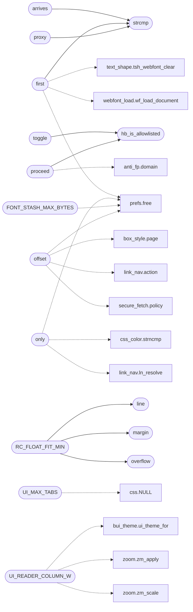

# `gui/browser_ui.c`

> Source: [gui/browser_ui.c:1](../../gui/browser_ui.c#L1) | language `c` | coverage 32.9% | [API index](../index.md)

## Contents

- **Structs:** [`ui_menu_item`](#ui_menu_item), [`ui_input_state`](#ui_input_state), [`ui_image`](#ui_image), [`ui_bg_image`](#ui_bg_image), [`tab_ctx`](#tab_ctx), [`browser_window`](#browser_window), [`repl_edges`](#repl_edges), [`fetch_prep`](#fetch_prep), [`fetch_job`](#fetch_job), [`rc_frag`](#rc_frag), [`rc_row`](#rc_row), [`rc_box`](#rc_box), [`rc_oof_sub`](#rc_oof_sub), [`rc_layout`](#rc_layout), [`rc_oof_sub`](#rc_oof_sub), [`rc_open_box`](#rc_open_box), [`rc_ibox`](#rc_ibox), [`rc_state`](#rc_state), [`rc_ext`](#rc_ext), [`item_sides`](#item_sides), [`rc_defer_col`](#rc_defer_col), [`rc_defer`](#rc_defer), [`bui_mask_ctx`](#bui_mask_ctx), [`screen_flow_ctx`](#screen_flow_ctx), [`png_flow_ctx`](#png_flow_ctx), [`freebug_window`](#freebug_window)
- **Enums:** [`ui_menu_action`](#ui_menu_action), [`ui_hot`](#ui_hot), [`rc_rowkind`](#rc_rowkind)
- **Type Aliases:** [`bs`](#bs), [`freebug_window`](#freebug_window), [`pl`](#pl), [`allowlisted`](#allowlisted), [`font_size`](#font_size), [`kind`](#kind), [`h`](#h), [`block_id`](#block_id), [`col_founder_box`](#col_founder_box), [`family`](#family), [`key`](#key), [`col`](#col)
- **Functions:** [`offset`](#offset), [`fields`](#fields), [`gutter`](#gutter), [`proxy`](#proxy), [`ui_set_operator_insecure`](#ui_set_operator_insecure), [`only`](#only), [`first`](#first), [`hb_is_allowlisted`](#hb_is_allowlisted), [`proceed`](#proceed), [`secure_fetch`](#secure_fetch), [`string`](#string), [`toggle`](#toggle), [`stylesheets`](#stylesheets), [`body`](#body), [`ALIVE`](#alive), [`arrives`](#arrives), [`strcmp`](#strcmp), [`resolve`](#resolve), [`HarfBuzz`](#harfbuzz), [`sites`](#sites), [`area`](#area), [`run`](#run), [`produced`](#produced), [`line`](#line), [`inlines`](#inlines), [`them`](#them), [`itself`](#itself), [`table`](#table), [`container`](#container), [`row`](#row), [`way`](#way), [`layout`](#layout), [`TABLE`](#table), [`axis`](#axis), [`slot`](#slot), [`struct`](#struct), [`descriptor`](#descriptor), [`path`](#path), [`builds`](#builds), [`it`](#it), [`flow`](#flow), [`own`](#own), [`items`](#items), [`wins`](#wins), [`children`](#children), [`behind`](#behind), [`column`](#column), [`columns`](#columns), [`treatment`](#treatment), [`rule`](#rule), [`context`](#context), [`width`](#width), [`x`](#x), [`yet`](#yet), [`chain`](#chain), [`anchor`](#anchor), [`key`](#key), [`have`](#have), [`standalone`](#standalone), [`count`](#count), [`approximation`](#approximation), [`margin`](#margin), [`rd_build`](#rd_build), [`dies`](#dies), [`descriptors`](#descriptors), [`again`](#again), [`blocking`](#blocking), [`video_stop`](#video_stop), [`upstream`](#upstream), [`rect`](#rect), [`text`](#text), [`spaced`](#spaced), [`layer`](#layer), [`widths`](#widths), [`cairo_set_dash`](#cairo_set_dash), [`cairo_set_dash`](#cairo_set_dash), [`cairo_set_dash`](#cairo_set_dash), [`cairo_set_dash`](#cairo_set_dash), [`convention`](#convention), [`set_rgb`](#set_rgb), [`cairo_set_dash`](#cairo_set_dash), [`cairo_set_dash`](#cairo_set_dash), [`cairo_set_dash`](#cairo_set_dash), [`cairo_set_dash`](#cairo_set_dash), [`exactly`](#exactly), [`bg`](#bg), [`rows`](#rows), [`fragment`](#fragment), [`made`](#made), [`the`](#the), [`limits`](#limits), [`fill`](#fill), [`overflow`](#overflow), [`bui_pop_group_composite`](#bui_pop_group_composite), [`compositing`](#compositing), [`box`](#box), [`bui_pop_group_composite`](#bui_pop_group_composite), [`bui_pop_group_composite`](#bui_pop_group_composite), [`once`](#once), [`ui_render_viewport_w`](#ui_render_viewport_w), [`caller`](#caller), [`ui_render_png`](#ui_render_png), [`origin`](#origin), [`ui_render_png_images`](#ui_render_png_images), [`ui_render_png_frames`](#ui_render_png_frames), [`ui_render_pdf_images`](#ui_render_pdf_images), [`ui_dump_layout`](#ui_dump_layout), [`in`](#in), [`Firefox`](#firefox), [`reference`](#reference), [`sf_ws_url_check`](#sf_ws_url_check), [`wc_render_caps`](#wc_render_caps), [`memory`](#memory), [`GET`](#get), [`presentation`](#presentation), [`resizes`](#resizes), [`wl_array_for_each`](#wl_array_for_each), [`element`](#element), [`down`](#down), [`loop`](#loop), [`ui_run_browser`](#ui_run_browser), [`saving`](#saving), [`redraws`](#redraws), [`moves`](#moves), [`cost`](#cost)
- **Macros:** [`_GNU_SOURCE`](#_gnu_source), [`UI_TAB_MIN_W`](#ui_tab_min_w), [`UI_TAB_MAX_W`](#ui_tab_max_w), [`UI_TAB_NEW_W`](#ui_tab_new_w), [`UI_TAB_CLOSE_W`](#ui_tab_close_w), [`UI_BTN_W`](#ui_btn_w), [`UI_WIN_BTN_W`](#ui_win_btn_w), [`UI_MARGIN`](#ui_margin), [`UI_BTN_LEFT`](#ui_btn_left), [`UI_LIST_INDENT`](#ui_list_indent), [`UI_SCROLLBAR_W`](#ui_scrollbar_w), [`UI_SCROLLBAR_MIN`](#ui_scrollbar_min), [`UI_SCROLLBAR_PAD`](#ui_scrollbar_pad), [`UI_RESIZE_MARGIN`](#ui_resize_margin), [`UI_MENU_W`](#ui_menu_w), [`UI_MENU_PAD`](#ui_menu_pad), [`UI_CHECK_SZ`](#ui_check_sz), [`UI_HAMBURGER_W`](#ui_hamburger_w), [`UI_HAMBURGER_GAP`](#ui_hamburger_gap), [`UI_CURSOR_SIZE`](#ui_cursor_size), [`UI_TOAST_PAD`](#ui_toast_pad), [`OMNI_MAX_SUGG`](#omni_max_sugg), [`UI_TWO_PI`](#ui_two_pi), [`UI_INPUT_PAD`](#ui_input_pad), [`UI_CONTROL_FONT`](#ui_control_font), [`UI_INPUT_MEASURE_W`](#ui_input_measure_w), [`UI_INPUT_WIDTH`](#ui_input_width), [`UI_BUTTON_HPAD`](#ui_button_hpad), [`UI_FORM_FIELDS_MAX`](#ui_form_fields_max), [`UI_UNDERLINE_OFFSET`](#ui_underline_offset), [`UI_UNDERLINE_THICK`](#ui_underline_thick), [`UI_STRIKE_OFFSET`](#ui_strike_offset), [`UI_OVERLINE_OFFSET`](#ui_overline_offset), [`UI_SLICE_MAX`](#ui_slice_max), [`UI_MENU_COUNT`](#ui_menu_count), [`UI_IMAGE_MAX_BODY`](#ui_image_max_body), [`UI_MAX_TABS`](#ui_max_tabs), [`UI_READER_COLUMN_W`](#ui_reader_column_w), [`FONT_STASH_MAX_SHEETS`](#font_stash_max_sheets), [`FONT_STASH_MAX_BYTES`](#font_stash_max_bytes), [`JS_NAV_MAX`](#js_nav_max), [`HIST_STEP_DEPTH_MAX`](#hist_step_depth_max), [`JS_TICKS_PER_LOAD`](#js_ticks_per_load), [`UI_RELOAD_X`](#ui_reload_x), [`RC_IBOX_MAX`](#rc_ibox_max), [`RC_BOX_STACK_MAX`](#rc_box_stack_max), [`RC_FLOAT_MAX`](#rc_float_max), [`RC_FLOAT_FIT_MIN`](#rc_float_fit_min), [`FLEX_MEASURE_W`](#flex_measure_w), [`FLEX_MIN_MEASURE_W`](#flex_min_measure_w), [`BALANCE_MAX_LINES`](#balance_max_lines), [`RC_COL_FREE_MAX`](#rc_col_free_max), [`RC_MAX_OUT_OF_FLOW`](#rc_max_out_of_flow), [`RC_DEFER_COLS`](#rc_defer_cols), [`RC_DEFER_RANGES`](#rc_defer_ranges), [`RC_DEFER_BAND_RUNS`](#rc_defer_band_runs), [`BUI_CONIC_SLICES`](#bui_conic_slices), [`ROW_PAINT_ALL`](#row_paint_all), [`ROW_PAINT_BAND`](#row_paint_band), [`ROW_PAINT_CONTENT`](#row_paint_content), [`OV_MAX_DEPTH`](#ov_max_depth), [`H2R`](#h2r), [`UI_LAZY_PER_PASS`](#ui_lazy_per_pass), [`UI_LAZY_PASSES`](#ui_lazy_passes), [`PDF_PAGE_W`](#pdf_page_w), [`PDF_MARGIN`](#pdf_margin), [`PNG_PAGE_W`](#png_page_w), [`PNG_MARGIN`](#png_margin), [`FRAME_BOX_MAX`](#frame_box_max), [`FBW_W`](#fbw_w), [`FBW_HEADER`](#fbw_header), [`FBW_TABBAR`](#fbw_tabbar), [`FBW_TOP`](#fbw_top), [`FBW_TAB_PAD`](#fbw_tab_pad), [`FBW_PAD`](#fbw_pad), [`FBW_LINE`](#fbw_line), [`FBW_GUTTER`](#fbw_gutter), [`FBW_MIN_SPLIT`](#fbw_min_split), [`FBW_MAX_SPLIT`](#fbw_max_split), [`FBW_COPY_BTN_W`](#fbw_copy_btn_w), [`TIMING_QUIET_MS`](#timing_quiet_ms)

## Type Diagram

```mermaid
classDiagram
    direction LR
    class ui_menu_action
    <<enum>> ui_menu_action
    class ui_menu_item
    <<struct>> ui_menu_item
    class ui_hot
    <<enum>> ui_hot
    class ui_input_state
    <<struct>> ui_input_state
    class ui_image
    <<struct>> ui_image
    class ui_bg_image
    <<struct>> ui_bg_image
    class bs
    <<type_alias>> bs
    class tab_ctx
    <<struct>> tab_ctx
    class browser_window
    <<struct>> browser_window
    browser_window : delay()
    browser_window : main()
    class freebug_window
    <<type_alias>> freebug_window
    class pl
    <<type_alias>> pl
    class repl_edges
    <<struct>> repl_edges
    class allowlisted
    <<type_alias>> allowlisted
    class fetch_prep
    <<struct>> fetch_prep
    class fetch_job
    <<struct>> fetch_job
    class font_size
    <<type_alias>> font_size
    class rc_frag
    <<struct>> rc_frag
    class rc_rowkind
    <<enum>> rc_rowkind
    class kind
    <<type_alias>> kind
    class rc_row
    <<struct>> rc_row
    class h
    <<type_alias>> h
    class rc_box
    <<struct>> rc_box
    rc_box : smaller()
    class rc_oof_sub
    <<struct>> rc_oof_sub
    class rc_layout
    <<struct>> rc_layout
```



## Call Graph

Solid arrows stay in this module, dashed arrows leave it.



## Structs

<a id="ui_menu_item"></a>

### `ui_menu_item`

`struct` | [gui/browser_ui.c:199](../../gui/browser_ui.c#L199)

```c
typedef struct ui_menu_item
```

---

<a id="ui_input_state"></a>

### `ui_input_state`

`struct` | [gui/browser_ui.c:238](../../gui/browser_ui.c#L238)

```c
typedef struct ui_input_state
```

Live editable state for one form text control, aliasing a block of the current rd_doc (not owned; valid until the doc is replaced).

The field carries the value the user is editing; submission reads it back.

---

<a id="ui_image"></a>

### `ui_image`

`struct` | [gui/browser_ui.c:262](../../gui/browser_ui.c#L262)

```c
typedef struct ui_image
```

href is an OWNED copy of the image's URL, not a pointer into w->doc (fixed 2026-07-16): a worker result applied outside a fresh navigation (a click, or a JS timer firing via OP_TICK -- see apply_click_result) rebuilds w->doc WHOLESALE from scratch without re-running load_images, so any rd_block* recorded here would immediately dangle and, worse, silently stop matching ANY block in the new doc (find_image compared pointer identity) -- every already-decoded image would revert to its placeholder on the very next repaint even though nothing about the image actually changed.

Matching by URL content instead is stable across a doc rebuild with no re-fetch needed (the decoded surface is reused as-is): a JS timer firing seconds into a page like an ad-heavy anime-streaming site is exactly the case this fixes.

---

<a id="ui_bg_image"></a>

### `ui_bg_image`

`struct` | [gui/browser_ui.c:276](../../gui/browser_ui.c#L276)

```c
typedef struct ui_bg_image
```

A decoded CSS background-image for one box of the current doc (2026-07-16).

Same shape as ui_image and the same reasoning applies: url is an OWNED copy (not a pv_box_def* into w->doc), so it survives a doc rebuild that does not re-run load_bg_images. surface NULL means blocked/unset/failed (paint as if there were no background-image at all, no placeholder: it is decoration, not content with alt text, matching real-browser behaviour for a failed background).

---

<a id="tab_ctx"></a>

### `tab_ctx`

`struct` | [gui/browser_ui.c:295](../../gui/browser_ui.c#L295)

```c
typedef struct tab_ctx
```

One tab's complete per-page state: everything that must persist when the tab is not the foreground one.

The browser_window keeps the ACTIVE tab's copy in its own fields (so the 200+ render/event call sites stay unchanged); tab_save/tab_restore move this set in and out of the slot array on a switch. All owned pointers are transferred by value (no deep copy, no free): exactly one of {live window field, inactive slot} owns each allocation at any time.

---

<a id="browser_window"></a>

### `browser_window`

`struct` | [gui/browser_ui.c:311](../../gui/browser_ui.c#L311)

```c
typedef struct browser_window
```

**Members**

| Member | Kind | Summary |
|---|---|---|
| [`delay`](#browser_window-delay) | method |  |
| [`main`](#browser_window-main) | method |  |

<a id="browser_window-delay"></a>

#### `browser_window.delay`

`method` | [gui/browser_ui.c:407](../../gui/browser_ui.c#L407)

```c
* timer delay (tab_page.next_timer_ms);
```

**Parameters**

| Name | Type | Default | Description |
|---|---|---|---|
| `next_timer_ms` | `tab_page.` |  |  |

**Returns:** `* timer`

<a id="browser_window-main"></a>

#### `browser_window.main`

`method` | [gui/browser_ui.c:553](../../gui/browser_ui.c#L553)

```c
* * Feeder thread: downloads TS segments and writes them to the decoder pipe * so the main (Wayland) thread never blocks on HTTP. The thread is spawned by * video_play() and joined by video_stop();
```

**Returns:** `* * Feeder thread: downloads TS segments and writes them to the decoder pipe * so the`

---

<a id="repl_edges"></a>

### `repl_edges`

`struct` | [gui/browser_ui.c:1195](../../gui/browser_ui.c#L1195)

```c
typedef struct repl_edges
```

A replaced element's own box edges, px per side (spec/box_engine.md "Bordes del reemplazado"): its margin, border and padding from own_box_id -- what `img{border:1px solid;margin:3px}` adds around the picture in every browser (the wikipedia thumbnail frame).

All zero without an own box.

---

<a id="fetch_prep"></a>

### `fetch_prep`

`struct` | [gui/browser_ui.c:1797](../../gui/browser_ui.c#L1797)

```c
typedef struct fetch_prep
```

Outcome of the pre-fetch gates shared by GET (do_load) and POST (do_submit_post).

Both MUST pass through the SAME host filter, per-host exception, allowlist override and Tor/I2P realm route before any socket opens -- otherwise a POST could reach the network under laxer rules than a GET, or leak a .onion lookup over clearnet.

---

<a id="fetch_job"></a>

### `fetch_job`

`struct` | [gui/browser_ui.c:1878](../../gui/browser_ui.c#L1878)

```c
typedef struct fetch_job
```

A network request handed to the fetch thread.

It owns deep copies of every input string (the window's buffers may change while the fetch runs), and is filled with the result before being posted back to the main thread, which owns it from then on. The thread ONLY accesses the browser_window's stream_* fields (under stream_lock) and the fetch_pipe/stream_evfd for I/O -- never any other field.

---

<a id="rc_frag"></a>

### `rc_frag`

`struct` | [gui/browser_ui.c:3315](../../gui/browser_ui.c#L3315)

```c
typedef struct rc_frag
```

---

<a id="rc_row"></a>

### `rc_row`

`struct` | [gui/browser_ui.c:3380](../../gui/browser_ui.c#L3380)

```c
typedef struct rc_row
```

---

<a id="rc_box"></a>

### `rc_box`

`struct` | [gui/browser_ui.c:3403](../../gui/browser_ui.c#L3403)

```c
typedef struct rc_box
```

One painted block box (Hito 23b-8 Step C): a border-box rectangle in layout space with its author decoration, painted behind the rows it encloses.

Built from a maximal run of rd_blocks sharing one block_id. block_id is stamped at open_box time so position_doc can map an in-flow rc_box back to its pv_box_def (and the resolved out-of-flow rect to the right ancestor).

**Members**

| Member | Kind | Summary |
|---|---|---|
| [`smaller`](#rc_box-smaller) | method |  |

<a id="rc_box-smaller"></a>

#### `rc_box.smaller`

`method` | [gui/browser_ui.c:3429](../../gui/browser_ui.c#L3429)

```c
* size when the content is smaller (height) or wider (min-width);
```

**Returns:** `* size when the content is`

---

<a id="rc_oof_sub"></a>

### `rc_oof_sub`

`struct` | [gui/browser_ui.c:3464](../../gui/browser_ui.c#L3464)

```c
struct rc_oof_sub;
```

---

<a id="rc_layout"></a>

### `rc_layout`

`struct` | [gui/browser_ui.c:3466](../../gui/browser_ui.c#L3466)

```c
typedef struct rc_layout
```

---

<a id="rc_oof_sub"></a>

### `rc_oof_sub`

`struct` | [gui/browser_ui.c:3512](../../gui/browser_ui.c#L3512)

```c
typedef struct rc_oof_sub
```

One out-of-flow subtree's own layout and where it lands on the page.

---

<a id="rc_open_box"></a>

### `rc_open_box`

`struct` | [gui/browser_ui.c:3522](../../gui/browser_ui.c#L3522)

```c
typedef struct rc_open_box
```

Box engine (Hito 23b-8 Step D): one entry of the open-box stack.

A box's content rect (inner_left/inner_w) is the coordinate context its children (text or nested boxes) are placed in; bl/br/pb/bb are its borders/bottom-padding reserved geometry; box_idx points at the rc_box rect being measured.

---

<a id="rc_ibox"></a>

### `rc_ibox`

`struct` | [gui/browser_ui.c:3575](../../gui/browser_ui.c#L3575)

```c
typedef struct rc_ibox
```

One inline-level box of the open line (see rc_state.ibx).

---

<a id="rc_state"></a>

### `rc_state`

`struct` | [gui/browser_ui.c:3611](../../gui/browser_ui.c#L3611)

```c
typedef struct rc_state
```

---

<a id="rc_ext"></a>

### `rc_ext`

`struct` | [gui/browser_ui.c:4254](../../gui/browser_ui.c#L4254)

```c
typedef struct rc_ext
```

Author text-presentation extensions for a block, derived from its rd_block (already gated by caps.css upstream) and handed to flow_text.

---

<a id="item_sides"></a>

### `item_sides`

`struct` | [gui/browser_ui.c:5364](../../gui/browser_ui.c#L5364)

```c
typedef struct item_sides
```

Padding + border edges (px) of a flex/grid item's ROOT box, plus that box's index (-1 when the item carries none: table cells, author CSS off).

Extracted so the auto-basis measuring pre-pass and the flow loop below cannot drift on what an item's content inset is.

**Members**

| Member | Kind | Summary |
|---|---|---|
| [`mr`](#item_sides-mr) | type_alias | Padding + border edges (px) of a flex/grid item's ROOT box, plus that box's index (-1 when the item carries none: table cells, author CSS off). |

<a id="item_sides-mr"></a>

#### `item_sides.mr`

`type_alias` | [gui/browser_ui.c:5364](../../gui/browser_ui.c#L5364)

```c
typedef struct item_sides { double ml, mr;
```

Padding + border edges (px) of a flex/grid item's ROOT box, plus that box's index (-1 when the item carries none: table cells, author CSS off).

Extracted so the auto-basis measuring pre-pass and the flow loop below cannot drift on what an item's content inset is.

---

<a id="rc_defer_col"></a>

### `rc_defer_col`

`struct` | [gui/browser_ui.c:8282](../../gui/browser_ui.c#L8282)

```c
typedef struct rc_defer_col
```

---

<a id="rc_defer"></a>

### `rc_defer`

`struct` | [gui/browser_ui.c:8289](../../gui/browser_ui.c#L8289)

```c
typedef struct rc_defer
```

---

<a id="bui_mask_ctx"></a>

### `bui_mask_ctx`

`struct` | [gui/browser_ui.c:13032](../../gui/browser_ui.c#L13032)

```c
typedef struct bui_mask_ctx
```

What the mask builder may need besides the box itself: the layout (to find the box that DECLARED an inherited mask) and the document (its box defs).

Either may be NULL.

---

<a id="screen_flow_ctx"></a>

### `screen_flow_ctx`

`struct` | [gui/browser_ui.c:14130](../../gui/browser_ui.c#L14130)

```c
typedef struct screen_flow_ctx
```

The interactive painter's in-flow context: everything paint_structured has resolved that the in-flow pass needs, so the normal pass and each deferred subtree pass (see paint_positioned_layer) run the SAME code.

---

<a id="png_flow_ctx"></a>

### `png_flow_ctx`

`struct` | [gui/browser_ui.c:14691](../../gui/browser_ui.c#L14691)

```c
typedef struct png_flow_ctx
```

The headless PNG painter's in-flow context, shared by the normal pass and the deferred-subtree passes.

---

<a id="freebug_window"></a>

### `freebug_window`

`struct` | [gui/browser_ui.c:16993](../../gui/browser_ui.c#L16993)

```c
struct freebug_window
```

---

## Enums

<a id="ui_menu_action"></a>

### `ui_menu_action`

`enum` | [gui/browser_ui.c:181](../../gui/browser_ui.c#L181)

```c
typedef enum ui_menu_action
```

The options-menu items.

A capability item toggles a bool in rdp_caps by field offset (labels and the flag live in one place, no magic indices); a theme item selects a palette; the force item ignores author colours.

---

<a id="ui_hot"></a>

### `ui_hot`

`enum` | [gui/browser_ui.c:231](../../gui/browser_ui.c#L231)

```c
typedef enum ui_hot
```

Toolbar control under the pointer, for the hover highlight (the same affordance links already get).

---

<a id="rc_rowkind"></a>

### `rc_rowkind`

`enum` | [gui/browser_ui.c:3378](../../gui/browser_ui.c#L3378)

```c
typedef enum rc_rowkind { RC_TEXT = 0, RC_IMAGE, RC_INPUT, RC_VIDEO, RC_SVG } rc_rowkind;
```

---

## Type Aliases

<a id="bs"></a>

### `bs`

`type_alias` | [gui/browser_ui.c:295](../../gui/browser_ui.c#L295)

```c
typedef struct tab_ctx { browser_state bs;
```

One tab's complete per-page state: everything that must persist when the tab is not the foreground one.

The browser_window keeps the ACTIVE tab's copy in its own fields (so the 200+ render/event call sites stay unchanged); tab_save/tab_restore move this set in and out of the slot array on a switch. All owned pointers are transferred by value (no deep copy, no free): exactly one of {live window field, inactive slot} owns each allocation at any time.

---

<a id="freebug_window"></a>

### `freebug_window`

`type_alias` | [gui/browser_ui.c:618](../../gui/browser_ui.c#L618)

```c
typedef struct freebug_window freebug_window;
```

Freebug second-window forward declarations (defined further down, but referenced by render_current_ex, the menu and the input listeners above their definition).

---

<a id="pl"></a>

### `pl`

`type_alias` | [gui/browser_ui.c:1195](../../gui/browser_ui.c#L1195)

```c
typedef struct repl_edges { double mt, mr, mb, ml, bt, br, bb, bl, pt, pr, pb, pl;
```

A replaced element's own box edges, px per side (spec/box_engine.md "Bordes del reemplazado"): its margin, border and padding from own_box_id -- what `img{border:1px solid;margin:3px}` adds around the picture in every browser (the wikipedia thumbnail frame).

All zero without an own box.

---

<a id="allowlisted"></a>

### `allowlisted`

`type_alias` | [gui/browser_ui.c:1797](../../gui/browser_ui.c#L1797)

```c
typedef struct fetch_prep { int allowlisted;
```

Outcome of the pre-fetch gates shared by GET (do_load) and POST (do_submit_post).

Both MUST pass through the SAME host filter, per-host exception, allowlist override and Tor/I2P realm route before any socket opens -- otherwise a POST could reach the network under laxer rules than a GET, or leak a .onion lookup over clearnet.

---

<a id="font_size"></a>

### `font_size`

`type_alias` | [gui/browser_ui.c:3314](../../gui/browser_ui.c#L3314)

```c
typedef struct rc_frag { double x, width, font_size;
```

The content area paints an rd_doc (the same structured document the headless mode prints): headings, paragraphs and inline links flow word-by-word into lines, the image-tracking warning is a banner, and each image is a bordered placeholder showing its render_policy decision.

Layout runs once per frame into transient arrays so vertical scrolling can be a smooth pixel offset over the real total height. This is visual-only (no headless test) but compiles under the same hardened flags.

---

<a id="kind"></a>

### `kind`

`type_alias` | [gui/browser_ui.c:3379](../../gui/browser_ui.c#L3379)

```c
typedef struct rc_row { rc_rowkind kind;
```

---

<a id="h"></a>

### `h`

`type_alias` | [gui/browser_ui.c:3403](../../gui/browser_ui.c#L3403)

```c
typedef struct rc_box { double x, top, w, h;
```

One painted block box (Hito 23b-8 Step C): a border-box rectangle in layout space with its author decoration, painted behind the rows it encloses.

Built from a maximal run of rd_blocks sharing one block_id. block_id is stamped at open_box time so position_doc can map an in-flow rc_box back to its pv_box_def (and the resolved out-of-flow rect to the right ancestor).

---

<a id="block_id"></a>

### `block_id`

`type_alias` | [gui/browser_ui.c:3522](../../gui/browser_ui.c#L3522)

```c
typedef struct rc_open_box { int block_id;
```

Box engine (Hito 23b-8 Step D): one entry of the open-box stack.

A box's content rect (inner_left/inner_w) is the coordinate context its children (text or nested boxes) are placed in; bl/br/pb/bb are its borders/bottom-padding reserved geometry; box_idx points at the rc_box rect being measured.

---

<a id="col_founder_box"></a>

### `col_founder_box`

`type_alias` | [gui/browser_ui.c:3610](../../gui/browser_ui.c#L3610)

```c
typedef struct rc_state { /* Inside a float band column whose width was SHRUNK TO FIT: the float * founder's own box (col_founder_set). The column already IS that box's * border box, so open_box must not apply the box's width/max-width again * -- against the column they resolve to a fraction of themselves. */ int col_founder_set, col_founder_box;
```

Narrowest strip beside a float that still counts as room for a line box.

Below it the line is shifted under the float instead (CSS 2.1 9.5). It is a width in px, not a heuristic about content: a strip narrower than one average word cannot hold a line box, and pretending it can is what makes text paint * on top of the float. define RC_FLOAT_FIT_MIN 32.0

---

<a id="family"></a>

### `family`

`type_alias` | [gui/browser_ui.c:4254](../../gui/browser_ui.c#L4254)

```c
typedef struct rc_ext { int family;
```

Author text-presentation extensions for a block, derived from its rd_block (already gated by caps.css upstream) and handed to flow_text.

---

<a id="key"></a>

### `key`

`type_alias` | [gui/browser_ui.c:8282](../../gui/browser_ui.c#L8282)

```c
typedef struct rc_defer_col { int key;
```

---

<a id="col"></a>

### `col`

`type_alias` | [gui/browser_ui.c:8289](../../gui/browser_ui.c#L8289)

```c
typedef struct rc_defer { rc_defer_col col[RC_DEFER_COLS];
```

---

## Functions

<a id="offset"></a>

### `offset`

`function` | [gui/browser_ui.c:179](../../gui/browser_ui.c#L179)

```c
* offset (labels and the flag live in one place, no magic indices);
```

**Parameters**

| Name | Type | Default | Description |
|---|---|---|---|
| `place` | `labels and the flag live in one` |  |  |
| `indices` | `no magic` |  |  |

**Returns:** `*`

*Calls:* [`page`](include.box_style.h.md#page), [`action`](include.link_nav.h.md#action), [`free`](include.prefs.h.md#free), [`policy`](include.secure_fetch.h.md#policy)

---

<a id="fields"></a>

### `fields`

`function` | [gui/browser_ui.c:291](../../gui/browser_ui.c#L291)

```c
* fields (so the 200+ render/event call sites stay unchanged);
```

**Parameters**

| Name | Type | Default | Description |
|---|---|---|---|
| `unchanged` | `so the 200+ render/event call sites stay` |  |  |

**Returns:** `*`

---

<a id="gutter"></a>

### `gutter`

`function` | [gui/browser_ui.c:639](../../gui/browser_ui.c#L639)

```c
* gutter (content_margin) is intentionally left unzoomed, like a browser's text * zoom. The PDF ...
```

**Returns:** `*`

---

<a id="proxy"></a>

### `proxy`

`function` | [gui/browser_ui.c:1041](../../gui/browser_ui.c#L1041)

```c
* and enable each proxy ("1" => the default port);
```

**Parameters**

| Name | Type | Default | Description |
|---|---|---|---|
| `port` | `"1" => the default` |  |  |

**Returns:** `* and enable each`

*Calls:* [`strcmp`](#strcmp)

*Called by:* [`EXIT_USAGE`](src.freedom.c.md#exit_usage)

---

<a id="ui_set_operator_insecure"></a>

### `ui_set_operator_insecure`

`function` | [gui/browser_ui.c:1517](../../gui/browser_ui.c#L1517)

```c
void ui_set_operator_insecure(int on)
```

**Parameters**

| Name | Type | Default | Description |
|---|---|---|---|
| `on` | `int` |  |  |

*Called by:* [`main`](src.freedom.c.md#main)

---

<a id="only"></a>

### `only`

`function` | [gui/browser_ui.c:1620](../../gui/browser_ui.c#L1620)

```c
* Trusted pages only (untrusted CSS is still applied by the worker, but its * fonts never reach the parent registry). The raw worker URL is resolved to an * absolute https sheet URL here (the loader's
```

**Parameters**

| Name | Type | Default | Description |
|---|---|---|---|
| `worker` | `untrusted CSS is still applied by the` |  |  |
| `registry` | `but its * fonts never reach the parent` |  |  |

**Returns:** `* Trusted pages`

*Calls:* [`free`](include.prefs.h.md#free), [`strncmp`](src.css_color.c.md#strncmp), [`ln_resolve`](src.link_nav.c.md#ln_resolve)

---

<a id="first"></a>

### `first`

`function` | [gui/browser_ui.c:1693](../../gui/browser_ui.c#L1693)

```c
* Navigation: clear the registry first (faces are per document). Untrusted: * no-op (fetch NULL)...
```

**Parameters**

| Name | Type | Default | Description |
|---|---|---|---|
| `document` | `faces are per` |  |  |

**Returns:** `* Navigation: clear the registry`

*Calls:* [`strcmp`](#strcmp), [`free`](include.prefs.h.md#free), [`tsh_webfont_clear`](include.text_shape.h.md#tsh_webfont_clear), [`wf_load_document`](src.webfont_load.c.md#wf_load_document)

---

<a id="hb_is_allowlisted"></a>

### `hb_is_allowlisted`

`function` | [gui/browser_ui.c:1757](../../gui/browser_ui.c#L1757)

```c
&& hb_is_allowlisted(w->hosts, ihost);
```

1 iff a domain suffix of host is explicitly on the allowlist (covers subdomains), else 0.

Distinct from hb_check: this reports an EXPLICIT allowlist entry, not the "allowed because nothing blocks it" default. The orchestrator uses it as the user's sovereign per-host override -- e.g. to navigate a site below Freedom's TLS standard. s/host NULL, empty, or longer than 253 chars => 0.

**Parameters**

| Name | Type | Default | Description |
|---|---|---|---|
| `hosts` | `w->` |  |  |

**Returns:** `&&`

> **Inherited:** Documentation from [`hb_is_allowlisted`](#hb_is_allowlisted) (include/hostblock.h:75).

*Called by:* [`proceed`](#proceed), [`toggle`](#toggle)

---

<a id="proceed"></a>

### `proceed`

`function` | [gui/browser_ui.c:1803](../../gui/browser_ui.c#L1803)

```c
* may proceed (cfg and pr->allowlisted are then set);
```

**Parameters**

| Name | Type | Default | Description |
|---|---|---|---|
| `set` | `cfg and pr->allowlisted are then` |  |  |

**Returns:** `* may`

*Calls:* [`hb_is_allowlisted`](#hb_is_allowlisted), [`domain`](include.anti_fp.h.md#domain), [`browser_is_exception`](include.browser.h.md#browser_is_exception), [`nr_realm_name`](include.net_realm.h.md#nr_realm_name), [`ti_should_impersonate`](include.tls_impersonate.h.md#ti_should_impersonate), [`hb_check`](src.hostblock.c.md#hb_check), [`nr_classify_url`](src.net_realm.c.md#nr_classify_url)

---

<a id="secure_fetch"></a>

### `secure_fetch`

`function` | [gui/browser_ui.c:2057](../../gui/browser_ui.c#L2057)

```c
* through secure_fetch (Zero Trust);
```

**Parameters**

| Name | Type | Default | Description |
|---|---|---|---|
| `Trust` | `Zero` |  |  |

**Returns:** `* through`

---

<a id="string"></a>

### `string`

`function` | [gui/browser_ui.c:2225](../../gui/browser_ui.c#L2225)

```c
* or an empty string (unset, blocked, or off by caps.images), so there is no * decision to re-check, unlike load_images which still reads b->img_decision (a * box def carries no decision field, only t
```

**Parameters**

| Name | Type | Default | Description |
|---|---|---|---|
| `images` | `or off by caps.` |  |  |

**Returns:** `* or an empty`

*Calls:* [`du_is_data_url`](include.data_url.h.md#du_is_data_url), [`rd_box_at`](include.render_doc.h.md#rd_box_at), [`rd_box_count`](include.render_doc.h.md#rd_box_count)

---

<a id="toggle"></a>

### `toggle`

`function` | [gui/browser_ui.c:2280](../../gui/browser_ui.c#L2280)

```c
* No network: a capability toggle (images/CSS) re-renders from cache. Does nothing * when there is no cached source (start/error pages stay in plain-text mode). * * allow_js_nav: on a FRESH load (not
```

**Parameters**

| Name | Type | Default | Description |
|---|---|---|---|
| `CSS` | `images/` |  |  |

**Returns:** `* No network: a capability`

*Calls:* [`hb_is_allowlisted`](#hb_is_allowlisted)

---

<a id="stylesheets"></a>

### `stylesheets`

`function` | [gui/browser_ui.c:2436](../../gui/browser_ui.c#L2436)

```c
* External stylesheets (Hito 27) follow the author-styles opt-in -- or the * trusted-host doctrine (Hito 28) -- (GET-only at the parent gate);
```

**Parameters**

| Name | Type | Default | Description |
|---|---|---|---|
| `Hito` |  |  |  |

**Returns:** `* External`

*Calls:* [`wc_derive`](src.webcaps.c.md#wc_derive)

---

<a id="body"></a>

### `body`

`function` | [gui/browser_ui.c:2469](../../gui/browser_ui.c#L2469)

```c
* every served CSS body (serial and pool paths alike). */ font_stash_reset(w);
```

**Parameters**

| Name | Type | Default | Description |
|---|---|---|---|
| `alike` | `serial and pool paths` |  |  |

**Returns:** `* every served CSS`

---

<a id="alive"></a>

### `ALIVE`

`function` | [gui/browser_ui.c:2576](../../gui/browser_ui.c#L2576)

```c
* keep the worker ALIVE (tab_worker) so the console REPL can tab_eval against this * live page. The next render (or a tab switch) closes it. */ fb_buffer_free(&w->console);
```

**Returns:** `* keep the worker`

---

<a id="arrives"></a>

### `arrives`

`function` | [gui/browser_ui.c:2689](../../gui/browser_ui.c#L2689)

```c
* on screen until the result arrives (deliver_fetch_result renders it). about:blank * and local ...
```

**Parameters**

| Name | Type | Default | Description |
|---|---|---|---|
| `it` | `deliver_fetch_result renders` |  |  |

**Returns:** `* on screen until the result`

*Calls:* [`strcmp`](#strcmp), [`browser_set_page`](include.browser.h.md#browser_set_page), [`idn_apply_query`](include.identity.h.md#idn_apply_query), [`idn_render_page`](include.identity.h.md#idn_render_page), [`free`](include.prefs.h.md#free), [`rp_host_of`](include.request_policy.h.md#rp_host_of), [`url_file_path`](include.url.h.md#url_file_path), [`browser_set_status`](src.browser.c.md#browser_set_status), [`browser_set_url_bar`](src.browser.c.md#browser_set_url_bar), [`strncmp`](src.css_color.c.md#strncmp), [`prefs_bookmarks_page`](src.prefs.c.md#prefs_bookmarks_page), [`url_extract_userinfo`](src.url.c.md#url_extract_userinfo) and 2 more

---

<a id="strcmp"></a>

### `strcmp`

`function` | [gui/browser_ui.c:2792](../../gui/browser_ui.c#L2792)

```c
&& strcmp(auth_host_buf, w->auth_host) != 0)
```

**Parameters**

| Name | Type | Default | Description |
|---|---|---|---|
| `auth_host` | `w->` |  |  |

**Returns:** `&&`

*Calls:* [`free`](include.prefs.h.md#free)

*Called by:* [`arrives`](#arrives), [`first`](#first), [`proxy`](#proxy), [`bx_ua_of_tag`](src.box_style.c.md#bx_ua_of_tag), [`shorthand`](src.css.c.md#shorthand), [`cc_parse`](src.css_color.c.md#cc_parse), [`strncmp`](src.css_color.c.md#strncmp), [`ccm_get`](src.css_computed.c.md#ccm_get), [`gradient`](src.css_gradient.c.md#gradient), [`cm_expand`](src.css_mask.c.md#cm_expand), [`cm_is_mask_prop`](src.css_mask.c.md#cm_is_mask_prop), [`csel_ident_eq`](src.css_select.c.md#csel_ident_eq) and 22 more

---

<a id="resolve"></a>

### `resolve`

`function` | [gui/browser_ui.c:2826](../../gui/browser_ui.c#L2826)

```c
* origin so its relative references and local images resolve (confined to the * document's directory) -- a local page "acts like https" for resolution. */ clear_doc(w);
```

**Parameters**

| Name | Type | Default | Description |
|---|---|---|---|
| `directory` | `confined to the * document's` |  |  |

**Returns:** `* origin so its relative references and images`

*Called by:* [`im_parse`](src.import_map.c.md#im_parse), [`im_resolve`](src.import_map.c.md#im_resolve), [`tsh_pick_from_list`](src.text_shape.c.md#tsh_pick_from_list)

---

<a id="harfbuzz"></a>

### `HarfBuzz`

`function` | [gui/browser_ui.c:3872](../../gui/browser_ui.c#L3872)

```c
* descriptor via HarfBuzz (text_shape);
```

**Returns:** `* descriptor via`

---

<a id="sites"></a>

### `sites`

`function` | [gui/browser_ui.c:3896](../../gui/browser_ui.c#L3896)

```c
* sites (wfh 0, local 0) get the bucket face, which is the toy face's twin. */ if (wfh != 0u ...
```

**Parameters**

| Name | Type | Default | Description |
|---|---|---|---|
| `wfh` |  |  |  |
| `local` |  |  |  |

**Returns:** `*`

*Calls:* [`tsh_face`](include.text_shape.h.md#tsh_face)

---

<a id="area"></a>

### `area`

`function` | [gui/browser_ui.c:4084](../../gui/browser_ui.c#L4084)

```c
* box spans its CONTENT area (the font's ascent + descent plus its vertical padding * and border), centred on the baseline, as in CSS 2.1 10.6.1. A box that survived a * line wrap simply ends at the wrap -- multi-line inline boxes are out of scope. */ static void close_inline_boxes(rc_layout *L, rc_state *s, double row_top, double row_h, double baseline)
```

**Parameters**

| Name | Type | Default | Description |
|---|---|---|---|
| `border` | `the font's ascent + descent plus its vertical padding * and` |  |  |

**Returns:** `* box spans its CONTENT`

---

<a id="run"></a>

### `run`

`function` | [gui/browser_ui.c:4137](../../gui/browser_ui.c#L4137)

```c
* continuation run (block_id < 0 with no block break) deliberately skips reconcile * to stay on ...
```

**Parameters**

| Name | Type | Default | Description |
|---|---|---|---|
| `break` | `block_id < 0 with no block` |  |  |

**Returns:** `* continuation`

---

<a id="produced"></a>

### `produced`

`function` | [gui/browser_ui.c:4381](../../gui/browser_ui.c#L4381)

```c
* href tags every fragment produced (NULL for non-link runs) so a later hit-test * can recover the click target without re-walking the document. node_id tags the * originating element for JS click dis
```

**Parameters**

| Name | Type | Default | Description |
|---|---|---|---|
| `runs` | `NULL for non-link` |  |  |

**Returns:** `* href tags every fragment`

---

<a id="line"></a>

### `line`

`function` | [gui/browser_ui.c:4480](../../gui/browser_ui.c#L4480)

```c
* its neighbours on the line (spec/page_view.md "Colapso de espacio en el borde * entre runs"). Read from src, the same buffer the loop scans, so a tab-expanded * <pre> agrees with itself. */ int star
```

**Parameters**

| Name | Type | Default | Description |
|---|---|---|---|
| `runs` | `spec/page_view.md "Colapso de espacio en el borde * entre "` |  |  |

**Returns:** `* its neighbours on the`

*Called by:* [`RC_FLOAT_FIT_MIN`](#rc_float_fit_min)

---

<a id="inlines"></a>

### `inlines`

`function` | [gui/browser_ui.c:4770](../../gui/browser_ui.c#L4770)

```c
* atomic inlines (``, collapsing blanks skipped) share one line * and wrap like words (CSS 2.1 9.2.2) instead of stacking one row each. Returns * that next run's index, or 0 when the element is not followed by inline flow. */ static size_t replaced_opens_inline_line(const rd_doc *doc, size_t i, size_t end)
```

**Parameters**

| Name | Type | Default | Description |
|---|---|---|---|
| `img` | `` `< >` `` |  |  |
| `skipped` | `collapsing blanks` |  |  |

**Returns:** `* atomic`

*Calls:* [`rd_at`](include.render_doc.h.md#rd_at), [`rd_count`](include.render_doc.h.md#rd_count)

---

<a id="them"></a>

### `them`

`function` | [gui/browser_ui.c:5244](../../gui/browser_ui.c#L5244)

```c
* to them (jkanime's badge-only tiles keep their box). */ static int item_root_box_in(const rd_do...
```

**Parameters**

| Name | Type | Default | Description |
|---|---|---|---|
| `box` | `jkanime's badge-only tiles keep their` |  |  |

**Returns:** `* to`

*Calls:* [`rd_at`](include.render_doc.h.md#rd_at)

---

<a id="itself"></a>

### `itself`

`function` | [gui/browser_ui.c:5273](../../gui/browser_ui.c#L5273)

```c
* STRETCH itself (box_tree fills the line with it). */ static int css_align_to_bt(int align_kw)
```

**Parameters**

| Name | Type | Default | Description |
|---|---|---|---|
| `it` | `box_tree fills the line with` |  |  |

**Returns:** `* STRETCH`

---

<a id="table"></a>

### `table`

`function` | [gui/browser_ui.c:5508](../../gui/browser_ui.c#L5508)

```c
* synthesised table (no descriptors to disagree) keeps the stamp. */ if (cd != NULL && !c...
```

**Parameters**

| Name | Type | Default | Description |
|---|---|---|---|
| `disagree` | `no descriptors to` |  |  |

**Returns:** `* synthesised`

*Calls:* [`rd_at`](include.render_doc.h.md#rd_at), [`rd_box_at`](include.render_doc.h.md#rd_box_at)

---

<a id="container"></a>

### `container`

`function` | [gui/browser_ui.c:5518](../../gui/browser_ui.c#L5518)

```c
* were the container (github's tab pill). */ int item = item_at_level(doc, rd_at(doc, k), cid);
```

**Parameters**

| Name | Type | Default | Description |
|---|---|---|---|
| `pill` | `github's tab` |  |  |

**Returns:** `* were the`

---

<a id="row"></a>

### `row`

`function` | [gui/browser_ui.c:5573](../../gui/browser_ui.c#L5573)

```c
* label beside them shrank to one word per row (spec/page_view.md, jkanime/slashdot). */ static d...
```

**Parameters**

| Name | Type | Default | Description |
|---|---|---|---|
| `md` | `spec/page_view.` |  |  |
| `slashdot` | `jkanime/` |  |  |

**Returns:** `* label beside them shrank to one word per`

---

<a id="way"></a>

### `way`

`function` | [gui/browser_ui.c:5618](../../gui/browser_ui.c#L5618)

```c
* intrinsic box either way (it does not wrap below its own size). */ static int block_leaves_flow(const rd_doc *doc, const rd_block *bk);
```

**Parameters**

| Name | Type | Default | Description |
|---|---|---|---|
| `size` | `it does not wrap below its own` |  |  |

**Returns:** `* intrinsic box either`

---

<a id="layout"></a>

### `layout`

`function` | [gui/browser_ui.c:5859](../../gui/browser_ui.c#L5859)

```c
* hypothetical size in the real layout (Flexbox 9.2.3). */ if (ibd != NULL && ibd->box_min_w > 0) base = bx_flex_min_clamp(base, (double)ibd->box_min_w, ibd->box_sizing == CSS_BOXS_BORDER, isd.pl + is
```

**Parameters**

| Name | Type | Default | Description |
|---|---|---|---|
| `Flexbox` |  |  |  |

**Returns:** `* hypothetical size in the real`

---

<a id="table"></a>

### `TABLE`

`function` | [gui/browser_ui.c:6094](../../gui/browser_ui.c#L6094)

```c
* container TABLE (rd_cont_at) rather than from the head run, because a container * whose children are all containers has no run of its own to read them from -- that * is the whole reason the table ex
```

**Returns:** `* container`

---

<a id="axis"></a>

### `axis`

`function` | [gui/browser_ui.c:6349](../../gui/browser_ui.c#L6349)

```c
* differs: items stack on the vertical main axis (fx_column_place) and align on * the horizontal cross axis (fx_cross_offset). spec/flex_layout.md, tanda 40. */ int is_col = !is_grid && (cdv.direction
```

**Returns:** `* differs: items stack on the vertical main`

---

<a id="slot"></a>

### `slot`

`function` | [gui/browser_ui.c:6402](../../gui/browser_ui.c#L6402)

```c
* layout slot (item 0 → rightmost, last item → leftmost). */ if (use_flex && cdv.direction ==...
```

**Parameters**

| Name | Type | Default | Description |
|---|---|---|---|
| `rightmost` | `item 0 →` |  |  |
| `leftmost` | `last item →` |  |  |

**Returns:** `* layout`

---

<a id="struct"></a>

### `struct`

`function` | [gui/browser_ui.c:6548](../../gui/browser_ui.c#L6548)

```c
* struct (0 = auto);
```

**Parameters**

| Name | Type | Default | Description |
|---|---|---|---|
| `0` |  | `auto` |  |

**Returns:** `*`

---

<a id="descriptor"></a>

### `descriptor`

`function` | [gui/browser_ui.c:6556](../../gui/browser_ui.c#L6556)

```c
* placement rides the nested descriptor (spec/grid_areas.md 6). */ int nbc = child_cont_at_level(doc, bk, cid);
```

**Parameters**

| Name | Type | Default | Description |
|---|---|---|---|
| `md` | `spec/grid_areas. 6` |  |  |

**Returns:** `* placement rides the nested`

---

<a id="path"></a>

### `path`

`function` | [gui/browser_ui.c:6601](../../gui/browser_ui.c#L6601)

```c
* * Only a SYNTHESISED table grid takes this path (cdv.is_table), and only when ...
```

**Parameters**

| Name | Type | Default | Description |
|---|---|---|---|
| `is_table` | `cdv.` |  |  |

**Returns:** `* * Only a SYNTHESISED table grid takes this`

---

<a id="builds"></a>

### `builds`

`function` | [gui/browser_ui.c:6838](../../gui/browser_ui.c#L6838)

```c
* wraps beside it: the same band the top level builds (spec/float.md). */ const rd_block *fk = rd_at(doc, k);
```

**Parameters**

| Name | Type | Default | Description |
|---|---|---|---|
| `md` | `spec/float.` |  |  |

**Returns:** `* wraps beside it: the same band the top level`

---

<a id="it"></a>

### `it`

`function` | [gui/browser_ui.c:6900](../../gui/browser_ui.c#L6900)

```c
* with anything: that margin is the gap before it (a heading's * `margin-bottom` above a `display:grid` list). */ int seg_box_open = (scd == NULL || scd->box_id < 0 || scd->box_id == rb);
```

**Parameters**

| Name | Type | Default | Description |
|---|---|---|---|
| `list` | `` a heading's * `margin-bottom` above a `display:grid` `` |  |  |

**Returns:** `* w`

---

<a id="flow"></a>

### `flow`

`function` | [gui/browser_ui.c:6925](../../gui/browser_ui.c#L6925)

```c
* it collapse their vertical margins with each other exactly as in * the main flow (CSS 2.1 8.3.1), and none escapes the item. A run of * the item's own boxed block carries the item's margins, which *
```

**Parameters**

| Name | Type | Default | Description |
|---|---|---|---|
| `CSS` |  |  |  |

**Returns:** `* it collapse their vertical margins with each other exactly as in * the main`

---

<a id="own"></a>

### `own`

`function` | [gui/browser_ui.c:6957](../../gui/browser_ui.c#L6957)

```c
* root box of its own (rb < 0) the walk must still stop at the * container's box, or it re-opens the container (and its ancestors) * INSIDE the item -- which is what painted a nested nav's own backdro
```

**Parameters**

| Name | Type | Default | Description |
|---|---|---|---|
| `rb` |  |  |  |

**Returns:** `* root box of its`

---

<a id="items"></a>

### `items`

`function` | [gui/browser_ui.c:7038](../../gui/browser_ui.c#L7038)

```c
* items (Flexbox 4.2);
```

**Parameters**

| Name | Type | Default | Description |
|---|---|---|---|
| `Flexbox` |  |  |  |

**Returns:** `*`

---

<a id="wins"></a>

### `wins`

`function` | [gui/browser_ui.c:7350](../../gui/browser_ui.c#L7350)

```c
* content taller than the ratio still wins (min-height:auto). */ if (bx->aspect_num > 0 &...
```

**Parameters**

| Name | Type | Default | Description |
|---|---|---|---|
| `auto` | `min-height:` |  |  |

**Returns:** `* content taller than the ratio still`

---

<a id="children"></a>

### `children`

`function` | [gui/browser_ui.c:7501](../../gui/browser_ui.c#L7501)

```c
* own content rect onto the stack so its children (text or nested boxes) place inside * it. At t...
```

**Parameters**

| Name | Type | Default | Description |
|---|---|---|---|
| `boxes` | `text or nested` |  |  |

**Returns:** `* own content rect onto the stack so its`

*Called by:* [`BT_MAUTO_RIGHT`](include.box_tree.h.md#bt_mauto_right)

---

<a id="behind"></a>

### `behind`

`function` | [gui/browser_ui.c:7510](../../gui/browser_ui.c#L7510)

```c
* previous block left behind (CSS 2.1 8.3.1) -- read from the element's cascade, * never a theme constant. The old code used th->paragraph_gap as a floor here, * which gave a <div> the vertical rhythm
```

**Parameters**

| Name | Type | Default | Description |
|---|---|---|---|
| `CSS` |  |  |  |

**Returns:** `* previous block left`

---

<a id="column"></a>

### `column`

`function` | [gui/browser_ui.c:7728](../../gui/browser_ui.c#L7728)

```c
* * Returns the height of the tallest column (0 when there is nothing to fragment). */ static do...
```

**Parameters**

| Name | Type | Default | Description |
|---|---|---|---|
| `fragment` | `0 when there is nothing to` |  |  |

**Returns:** `* * Returns the height of the tallest`

---

<a id="columns"></a>

### `columns`

`function` | [gui/browser_ui.c:7836](../../gui/browser_ui.c#L7836)

```c
* each card made 1080px columns (huggingface, github). */ static int deepest_open_on_path(const r...
```

**Returns:** `* each card made 1080px`

*Called by:* [`BT_MAUTO_RIGHT`](include.box_tree.h.md#bt_mauto_right)

---

<a id="treatment"></a>

### `treatment`

`function` | [gui/browser_ui.c:8011](../../gui/browser_ui.c#L8011)

```c
* block treatment (shrink-wrapped and placed by text-align), which is what a * standalone centred call-to-action button needs. A display:inline element * is inline-level wherever it sits: it never ope
```

**Parameters**

| Name | Type | Default | Description |
|---|---|---|---|
| `align` | `shrink-wrapped and placed by text-` |  |  |

**Returns:** `* block`

---

<a id="rule"></a>

### `rule`

`function` | [gui/browser_ui.c:8220](../../gui/browser_ui.c#L8220)

```c
* wrapper keeps the old rule (opened with the float's own column). */ const pv_box_def *wd = rd_box_at(doc, (size_t)common[i - 1]);
```

**Parameters**

| Name | Type | Default | Description |
|---|---|---|---|
| `column` | `opened with the float's own` |  |  |

**Returns:** `* wrapper keeps the old`

---

<a id="context"></a>

### `context`

`function` | [gui/browser_ui.c:8235](../../gui/browser_ui.c#L8235)

```c
* side by side inside the current box context (spec/float.md). Blocks are grouped by * float_id into items (document order);
```

**Parameters**

| Name | Type | Default | Description |
|---|---|---|---|
| `md` | `spec/float.` |  |  |

**Returns:** `* side by side inside the current box`

---

<a id="width"></a>

### `width`

`function` | [gui/browser_ui.c:8596](../../gui/browser_ui.c#L8596)

```c
* box width (an inline-block icon `width:12px` inside the float) is * not the float's. */ double t = bx_width_cap(bb->float_w, bb->float_w_pct, ctx_w);
```

**Parameters**

| Name | Type | Default | Description |
|---|---|---|---|
| `float` | `` an inline-block icon `width:12px` inside the `` |  |  |

**Returns:** `* box`

---

<a id="x"></a>

### `x`

`function` | [gui/browser_ui.c:8645](../../gui/browser_ui.c#L8645)

```c
* reported x is already the BORDER x (the §7c.2 rule);
```

**Parameters**

| Name | Type | Default | Description |
|---|---|---|---|
| `rule` | `the §7c.2` |  |  |

**Returns:** `* reported`

---

<a id="yet"></a>

### `yet`

`function` | [gui/browser_ui.c:9326](../../gui/browser_ui.c#L9326)

```c
* does not carry yet (WPT flex-abspos-staticpos-*). */ static int runs_share_float(const rd_doc *...
```

**Parameters**

| Name | Type | Default | Description |
|---|---|---|---|
| `staticpos` | `WPT flex-abspos- -*` |  |  |

**Returns:** `* does not carry`

---

<a id="chain"></a>

### `chain`

`function` | [gui/browser_ui.c:9392](../../gui/browser_ui.c#L9392)

```c
* chain (the box that left the normal flow at this pen position);
```

**Parameters**

| Name | Type | Default | Description |
|---|---|---|---|
| `position` | `the box that left the normal flow at this pen` |  |  |

**Returns:** `*`

---

<a id="anchor"></a>

### `anchor`

`function` | [gui/browser_ui.c:9507](../../gui/browser_ui.c#L9507)

```c
* anchor (spec/float.md §7d.3) exactly like a text block. An * empty/hidden one leaves cur_top untouched, so this is a no-op * for it. Without this a flex header never anchored and pulled * columns te
```

**Parameters**

| Name | Type | Default | Description |
|---|---|---|---|
| `d` | `spec/float.md §7 .3` |  |  |

**Returns:** `*`

---

<a id="key"></a>

### `key`

`function` | [gui/browser_ui.c:9576](../../gui/browser_ui.c#L9576)

```c
* founders splits by key (stories, rail, footer nav each take * their column);
```

**Parameters**

| Name | Type | Default | Description |
|---|---|---|---|
| `column` | `footer nav each take * their` |  |  |

**Returns:** `* founders splits by`

---

<a id="have"></a>

### `have`

`function` | [gui/browser_ui.c:9604](../../gui/browser_ui.c#L9604)

```c
* as they always have (spec/float.md §6b.3). The line still open beside * the previous float is committed first, at its own top. */ flush_line(L, &s, th);
```

**Parameters**

| Name | Type | Default | Description |
|---|---|---|---|
| `b` | `spec/float.md §6 .3` |  |  |

**Returns:** `* as they always`

---

<a id="standalone"></a>

### `standalone`

`function` | [gui/browser_ui.c:9625](../../gui/browser_ui.c#L9625)

```c
* must not be treated as standalone (which would flush that line and give * the element a row of its own -- R7). */ size_t line_mate = replaced_opens_inline_line(doc, i, rd_count(doc));
```

**Parameters**

| Name | Type | Default | Description |
|---|---|---|---|
| `R7` | `which would flush that line and give * the element a row of its own --` |  |  |

**Returns:** `* must not be treated as`

---

<a id="count"></a>

### `count`

`function` | [gui/browser_ui.c:9840](../../gui/browser_ui.c#L9840)

```c
* the box count (a hostile parent cycle terminates). */ static int oof_depth(const rd_doc *doc, s...
```

**Parameters**

| Name | Type | Default | Description |
|---|---|---|---|
| `terminates` | `a hostile parent cycle` |  |  |

**Returns:** `* the box`

---

<a id="approximation"></a>

### `approximation`

`function` | [gui/browser_ui.c:9859](../../gui/browser_ui.c#L9859)

```c
* anchors on the Stage 2d approximation (fail-open: content never vanishes). */ static void oof_s...
```

**Parameters**

| Name | Type | Default | Description |
|---|---|---|---|
| `vanishes` | `fail-open: content never` |  |  |

**Returns:** `* anchors on the Stage 2d`

---

<a id="margin"></a>

### `margin`

`function` | [gui/browser_ui.c:10019](../../gui/browser_ui.c#L10019)

```c
* own left margin (the margin box starts at the anchor point), a right- * anchored one ends at it. Same for the vertical axis. */ int right_anchored = (bd->inset_left == PV_LEN_UNSET || bd->inset_left
```

**Parameters**

| Name | Type | Default | Description |
|---|---|---|---|
| `point` | `the margin box starts at the anchor` |  |  |

**Returns:** `* own left`

*Called by:* [`RC_FLOAT_FIT_MIN`](#rc_float_fit_min)

---

<a id="rd_build"></a>

### `rd_build`

`function` | [gui/browser_ui.c:10706](../../gui/browser_ui.c#L10706)

```c
* rd_build (-1 = auto/off -> theme caret). */ if (b->caret_color >= 0 && !w->force_theme) set_rgb(cr, rgb_from_packed(b->caret_color));
```

**Parameters**

| Name | Type | Default | Description |
|---|---|---|---|
| `-1` |  | `auto/off -> theme caret` |  |

**Returns:** `*`

---

<a id="dies"></a>

### `dies`

`function` | [gui/browser_ui.c:10940](../../gui/browser_ui.c#L10940)

```c
* child dies (exec failed, device busy, daemon absent) is detected on the * next PCM write (EPIP...
```

**Parameters**

| Name | Type | Default | Description |
|---|---|---|---|
| `failed` | `exec` |  |  |
| `busy` | `device` |  |  |
| `absent` | `daemon` |  |  |

**Returns:** `* child`

---

<a id="descriptors"></a>

### `descriptors`

`function` | [gui/browser_ui.c:10963](../../gui/browser_ui.c#L10963)

```c
* descriptors (especially the Wayland display fd) so the sink does * not corrupt the Wayland protocol connection — the most common * cause of the "page flashes white and render loops" bug. */ close(p[
```

**Parameters**

| Name | Type | Default | Description |
|---|---|---|---|
| `fd` | `especially the Wayland display` |  |  |

**Returns:** `*`

---

<a id="again"></a>

### `again`

`function` | [gui/browser_ui.c:11044](../../gui/browser_ui.c#L11044)

```c
* before a respawn opens it again (the WNOHANG reap left the old * process alive long enough to make the new one fail with "Device * or resource busy"). Death is immediate, so the wait is too. */ kill
```

**Parameters**

| Name | Type | Default | Description |
|---|---|---|---|
| `busy` | `the WNOHANG reap left the old * process alive long enough to make the new one fail with "Device * or resource "` |  |  |

**Returns:** `* before a respawn opens it`

---

<a id="blocking"></a>

### `blocking`

`function` | [gui/browser_ui.c:11332](../../gui/browser_ui.c#L11332)

```c
* are blocking (POLLIN guaranteed data is available). */ int flags = fcntl(out_fd, F_GETFL, 0);
```

**Parameters**

| Name | Type | Default | Description |
|---|---|---|---|
| `available` | `POLLIN guaranteed data is` |  |  |

**Returns:** `* are`

---

<a id="video_stop"></a>

### `video_stop`

`function` | [gui/browser_ui.c:11353](../../gui/browser_ui.c#L11353)

```c
* each segment loop so a video_stop() in the main thread (which sets it to 0 * then calls pthrea...
```

**Returns:** `* each segment loop so a`

---

<a id="upstream"></a>

### `upstream`

`function` | [gui/browser_ui.c:11559](../../gui/browser_ui.c#L11559)

```c
* upstream (see spec/css.md). */ static void box_path4(cairo_t *cr, double x, double y, double w,...
```

**Parameters**

| Name | Type | Default | Description |
|---|---|---|---|
| `md` | `see spec/css.` |  |  |

**Returns:** `*`

---

<a id="rect"></a>

### `rect`

`function` | [gui/browser_ui.c:11685](../../gui/browser_ui.c#L11685)

```c
* across rect (x,y,w,h): the gradient line runs through the rect center, long * enough that the first/last stops land on the corners. Stops at explicit * 0-1000 positions (pos1000, -1 or NULL = evenly
```

**Returns:** `the gradient line runs through the rect center, long * enough that the first/last stops land on the corners. Stops at explicit * 0-1000 positions (pos1000, -1 or NULL`

*Called by:* [`property`](src.css.c.md#property)

---

<a id="text"></a>

### `text`

`function` | [gui/browser_ui.c:11689](../../gui/browser_ui.c#L11689)

```c
* fill and gradient text (2026-07-19). */ static cairo_pattern_t *bui_linear_grad(double x, doubl...
```

**Parameters**

| Name | Type | Default | Description |
|---|---|---|---|
| `2026-07-19` |  |  |  |

**Returns:** `* fill and gradient`

---

<a id="spaced"></a>

### `spaced`

`function` | [gui/browser_ui.c:11764](../../gui/browser_ui.c#L11764)

```c
* or evenly spaced (bui_grad_color_at). */ static void bui_paint_conic(cairo_t *cr, double x, dou...
```

**Returns:** `* or evenly`

---

<a id="layer"></a>

### `layer`

`function` | [gui/browser_ui.c:11994](../../gui/browser_ui.c#L11994)

```c
* first layer (CSS multi-background: the first declared URL is the topmost) * and OVER bg_rgb/gradient, UNDER the border. Same sizing/repeat/position * as the first layer, using the SAME rc_box fields
```

**Parameters**

| Name | Type | Default | Description |
|---|---|---|---|
| `topmost` | `CSS multi-background: the first declared URL is the` |  |  |

**Returns:** `* first`

---

<a id="widths"></a>

### `widths`

`function` | [gui/browser_ui.c:12042](../../gui/browser_ui.c#L12042)

```c
* the outer minus the adjacent border widths (CSS Backgrounds 3 5.2). The straight * per-sid...
```

**Parameters**

| Name | Type | Default | Description |
|---|---|---|---|
| `Backgrounds` | `CSS 3 5.2` |  |  |

**Returns:** `* the outer minus the adjacent border`

---

<a id="cairo_set_dash"></a>

### `cairo_set_dash`

`function` | [gui/browser_ui.c:12078](../../gui/browser_ui.c#L12078)

```c
cairo_set_dash(cr, (double[])
```

**Parameters**

| Name | Type | Default | Description |
|---|---|---|---|
| `double` |  |  |  |

---

<a id="cairo_set_dash"></a>

### `cairo_set_dash`

`function` | [gui/browser_ui.c:12081](../../gui/browser_ui.c#L12081)

```c
cairo_set_dash(cr, (double[])
```

**Parameters**

| Name | Type | Default | Description |
|---|---|---|---|
| `double` |  |  |  |

---

<a id="cairo_set_dash"></a>

### `cairo_set_dash`

`function` | [gui/browser_ui.c:12127](../../gui/browser_ui.c#L12127)

```c
cairo_set_dash(cr, (double[])
```

**Parameters**

| Name | Type | Default | Description |
|---|---|---|---|
| `double` |  |  |  |

---

<a id="cairo_set_dash"></a>

### `cairo_set_dash`

`function` | [gui/browser_ui.c:12130](../../gui/browser_ui.c#L12130)

```c
cairo_set_dash(cr, (double[])
```

**Parameters**

| Name | Type | Default | Description |
|---|---|---|---|
| `double` |  |  |  |

---

<a id="convention"></a>

### `convention`

`function` | [gui/browser_ui.c:12150](../../gui/browser_ui.c#L12150)

```c
* on the 3D bevel convention (light top/left, dark right/bottom). */ int is_3d = (style == CSS_BST_GROOVE || style == CSS_BST_RIDGE || style == CSS_BST_INSET || style == CSS_BST_OUTSET);
```

**Parameters**

| Name | Type | Default | Description |
|---|---|---|---|
| `left` | `light top/` |  |  |
| `bottom` | `dark right/` |  |  |

**Returns:** `* on the 3D bevel`

---

<a id="set_rgb"></a>

### `set_rgb`

`function` | [gui/browser_ui.c:12164](../../gui/browser_ui.c#L12164)

```c
set_rgb(cr, (ui_rgb)
```

0xRRGGBB author colour -> theme RGB

**Parameters**

| Name | Type | Default | Description |
|---|---|---|---|
| `ui_rgb` |  |  |  |

> **Inherited:** Documentation from [`set_rgb`](#set_rgb) (gui/browser_ui_internal.h:105).

---

<a id="cairo_set_dash"></a>

### `cairo_set_dash`

`function` | [gui/browser_ui.c:12188](../../gui/browser_ui.c#L12188)

```c
cairo_set_dash(cr, (double[])
```

**Parameters**

| Name | Type | Default | Description |
|---|---|---|---|
| `double` |  |  |  |

---

<a id="cairo_set_dash"></a>

### `cairo_set_dash`

`function` | [gui/browser_ui.c:12191](../../gui/browser_ui.c#L12191)

```c
cairo_set_dash(cr, (double[])
```

**Parameters**

| Name | Type | Default | Description |
|---|---|---|---|
| `double` |  |  |  |

---

<a id="cairo_set_dash"></a>

### `cairo_set_dash`

`function` | [gui/browser_ui.c:12283](../../gui/browser_ui.c#L12283)

```c
cairo_set_dash(cr, (double[])
```

**Parameters**

| Name | Type | Default | Description |
|---|---|---|---|
| `double` |  |  |  |

---

<a id="cairo_set_dash"></a>

### `cairo_set_dash`

`function` | [gui/browser_ui.c:12285](../../gui/browser_ui.c#L12285)

```c
cairo_set_dash(cr, (double[])
```

**Parameters**

| Name | Type | Default | Description |
|---|---|---|---|
| `double` |  |  |  |

---

<a id="exactly"></a>

### `exactly`

`function` | [gui/browser_ui.c:12346](../../gui/browser_ui.c#L12346)

```c
* the resolved size exactly (like the SVG path above): routing through * paint_image_row would re-resolve a % width and compound it (tanda 42). */ repl_edges ed = replaced_edges(w->doc, blk, 0.0);
```

**Parameters**

| Name | Type | Default | Description |
|---|---|---|---|
| `above` | `like the SVG path` |  |  |

**Returns:** `routing through * paint_image_row would re-resolve a % width and compound it (tanda 42). */ repl_edges ed`

---

<a id="bg"></a>

### `bg`

`function` | [gui/browser_ui.c:12444](../../gui/browser_ui.c#L12444)

```c
* its own DISTINCT bg (an inline span highlight) still paints. */ int own_bid = row_owner_block_id(L, r);
```

**Parameters**

| Name | Type | Default | Description |
|---|---|---|---|
| `highlight` | `an inline span` |  |  |

**Returns:** `* its own DISTINCT`

---

<a id="rows"></a>

### `rows`

`function` | [gui/browser_ui.c:12666](../../gui/browser_ui.c#L12666)

```c
* RC_IMAGE rows (see its declaration);
```

**Parameters**

| Name | Type | Default | Description |
|---|---|---|---|
| `declaration` | `see its` |  |  |

**Returns:** `* RC_IMAGE`

---

<a id="fragment"></a>

### `fragment`

`function` | [gui/browser_ui.c:12667](../../gui/browser_ui.c#L12667)

```c
* first fragment (rc_frag.block_id, stamped at flow_emit_frag time) -- using * blk->block_id alo...
```

**Parameters**

| Name | Type | Default | Description |
|---|---|---|---|
| `block_id` | `rc_frag.` |  |  |
| `time` | `stamped at flow_emit_frag` |  |  |

**Returns:** `* first`

*Called by:* [`LN_MAX_FRAGMENT`](include.link_nav.h.md#ln_max_fragment)

---

<a id="made"></a>

### `made`

`function` | [gui/browser_ui.c:13224](../../gui/browser_ui.c#L13224)

```c
* its zero channels made (255,255,255,alpha 0) -- an invalid * premultiplied value Cairo composites as ADDITIVE white over * everything behind the group. Filter the straight colour of * the pixels tha
```

**Parameters**

| Name | Type | Default | Description |
|---|---|---|---|
| `255` |  |  |  |
| `255` |  |  |  |
| `255` |  |  |  |
| `alpha` |  |  |  |

**Returns:** `* its zero channels`

---

<a id="the"></a>

### `the`

`function` | [gui/browser_ui.c:13328](../../gui/browser_ui.c#L13328)

```c
* the (already filtered) group with the shadow color, blur it, and * paint it under the group at the declared offset -- the shadow * follows the real content shape (PNG transparency, glyphs), not * th
```

**Parameters**

| Name | Type | Default | Description |
|---|---|---|---|
| `filtered` | `already` |  |  |

**Returns:** `*`

---

<a id="limits"></a>

### `limits`

`function` | [gui/browser_ui.c:13413](../../gui/browser_ui.c#L13413)

```c
* documents narrower v1 limits (no overflow:hidden, no negative z-index). A box * grouped this w...
```

**Parameters**

| Name | Type | Default | Description |
|---|---|---|---|
| `hidden` | `no overflow:` |  |  |
| `index` | `no negative z-` |  |  |

**Returns:** `* documents narrower v1`

---

<a id="fill"></a>

### `fill`

`function` | [gui/browser_ui.c:13512](../../gui/browser_ui.c#L13512)

```c
* fill (paint_content_row's r->bg_rgb branch) cascades the SAME author * background-color as the box, but paints in the caller's separate row pass -- * left ungrouped, it shows as a solid, un-faded re
```

**Parameters**

| Name | Type | Default | Description |
|---|---|---|---|
| `branch` | `paint_content_row's r->bg_rgb` |  |  |

**Returns:** `*`

---

<a id="overflow"></a>

### `overflow`

`function` | [gui/browser_ui.c:13572](../../gui/browser_ui.c#L13572)

```c
* adding two of them in int was signed overflow (UB, found by UBSan). */ double ox = left + bx->x + box_edge_px(bx->bord_lw);
```

**Parameters**

| Name | Type | Default | Description |
|---|---|---|---|
| `UBSan` | `found by` |  |  |

**Returns:** `* adding two of them in int was signed`

*Called by:* [`RC_FLOAT_FIT_MIN`](#rc_float_fit_min), [`form`](include.render_doc.h.md#form)

---

<a id="bui_pop_group_composite"></a>

### `bui_pop_group_composite`

`function` | [gui/browser_ui.c:13599](../../gui/browser_ui.c#L13599)

```c
bui_pop_group_composite(cr, def, now_ms() - w->page_load_mono_ms, bx, left, origin, ...
```

**Parameters**

| Name | Type | Default | Description |
|---|---|---|---|
| `page_load_mono_ms` | `now_ms() - w->` |  |  |
| `...` |  |  |  |

---

<a id="compositing"></a>

### `compositing`

`function` | [gui/browser_ui.c:13615](../../gui/browser_ui.c#L13615)

```c
* * Group compositing (M1.1 increments 3-4): a box that forms a CSS stacking context * (box_forms_stacking_context: opacity<1, mix-blend != normal, isolation:isolate, * transform != none, or the posit
```

**Parameters**

| Name | Type | Default | Description |
|---|---|---|---|
| `increments` | `M1.1 3-4` |  |  |

**Returns:** `a box that forms a CSS stacking context * (box_forms_stacking_context: opacity<1, mix-blend !`

---

<a id="box"></a>

### `box`

`function` | [gui/browser_ui.c:13812](../../gui/browser_ui.c#L13812)

```c
* content belongs to that box (painted by its own positioned entry). */ if (sub == NULL)
```

**Parameters**

| Name | Type | Default | Description |
|---|---|---|---|
| `entry` | `painted by its own positioned` |  |  |

**Returns:** `* content belongs to that`

---

<a id="bui_pop_group_composite"></a>

### `bui_pop_group_composite`

`function` | [gui/browser_ui.c:13956](../../gui/browser_ui.c#L13956)

```c
bui_pop_group_composite(cr, cdef, now_ms() - w->page_load_mono_ms, &L->boxes[j], left, origin, ...
```

**Parameters**

| Name | Type | Default | Description |
|---|---|---|---|
| `page_load_mono_ms` | `now_ms() - w->` |  |  |
| `j` | `&L->boxes[ ]` |  |  |
| `...` |  |  |  |

---

<a id="bui_pop_group_composite"></a>

### `bui_pop_group_composite`

`function` | [gui/browser_ui.c:14208](../../gui/browser_ui.c#L14208)

```c
bui_pop_group_composite(cr, def, now_ms() - w->page_load_mono_ms, bx, left, origin, ...
```

**Parameters**

| Name | Type | Default | Description |
|---|---|---|---|
| `page_load_mono_ms` | `now_ms() - w->` |  |  |
| `...` |  |  |  |

---

<a id="once"></a>

### `once`

`function` | [gui/browser_ui.c:14328](../../gui/browser_ui.c#L14328)

```c
* box the layout never placed loads at once (fail open);
```

**Parameters**

| Name | Type | Default | Description |
|---|---|---|---|
| `open` | `fail` |  |  |

**Returns:** `* box the layout never placed loads at`

---

<a id="ui_render_viewport_w"></a>

### `ui_render_viewport_w`

`function` | [gui/browser_ui.c:14675](../../gui/browser_ui.c#L14675)

```c
int ui_render_viewport_w(void)
```

The fixed canvas width (px) every headless render (ui_render_png/pdf, ui_dump_layout) lays out at.

The headless driver feeds it to tab_set_viewport_w so @media width queries match the width the page is actually painted at.

**Returns:** `int`

> **Inherited:** Documentation from [`ui_render_viewport_w`](#ui_render_viewport_w) (include/ui.h:156).

---

<a id="caller"></a>

### `caller`

`function` | [gui/browser_ui.c:15016](../../gui/browser_ui.c#L15016)

```c
* caller (freedom.c --download-pdf) owns the fetch/parse pipeline and supplies the * out_path ve...
```

**Parameters**

| Name | Type | Default | Description |
|---|---|---|---|
| `pdf` | `freedom.c --download-` |  |  |

**Returns:** `*`

---

<a id="ui_render_png"></a>

### `ui_render_png`

`function` | [gui/browser_ui.c:15039](../../gui/browser_ui.c#L15039)

```c
ui_status ui_render_png(const rd_doc *doc, const char *out_path, long *out_h)
```

Headless PNG export (no Wayland; see include/ui.h).

One full-height bitmap of the whole page, the cheapest artifact for visual review (no PDF rasterise step). Same zeroed-window setup as ui_render_pdf.

**Parameters**

| Name | Type | Default | Description |
|---|---|---|---|
| `doc` | `rd_doc *` |  |  |
| `out_path` | `char *` |  |  |
| `out_h` | `long *` |  |  |

**Returns:** `ui_status`

---

<a id="origin"></a>

### `origin`

`function` | [gui/browser_ui.c:15095](../../gui/browser_ui.c#L15095)

```c
* top_url is the page origin (https or file://);
```

**Parameters**

| Name | Type | Default | Description |
|---|---|---|---|
| `file` | `https or ://` |  |  |

**Returns:** `* top_url is the page`

---

<a id="ui_render_png_images"></a>

### `ui_render_png_images`

`function` | [gui/browser_ui.c:15132](../../gui/browser_ui.c#L15132)

```c
ui_status ui_render_png_images(const rd_doc *doc, tab *t, const char *top_url, tab_fetch_fn img_fetch, void *fetch_ctx, const char *out_path, long *out_h)
```

**Parameters**

| Name | Type | Default | Description |
|---|---|---|---|
| `doc` | `rd_doc *` |  |  |
| `t` | `tab *` |  |  |
| `top_url` | `char *` |  |  |
| `img_fetch` | `tab_fetch_fn` |  |  |
| `fetch_ctx` | `void *` |  |  |
| `out_path` | `char *` |  |  |
| `out_h` | `long *` |  |  |

**Returns:** `ui_status`

---

<a id="ui_render_png_frames"></a>

### `ui_render_png_frames`

`function` | [gui/browser_ui.c:15138](../../gui/browser_ui.c#L15138)

```c
ui_status ui_render_png_frames(const rd_doc *doc, tab *t, const char *top_url, tab_fetch_fn img_fetch, void *fetch_ctx, struct fh_host *frames, const char *out_path, long *out_h)
```

**Parameters**

| Name | Type | Default | Description |
|---|---|---|---|
| `doc` | `rd_doc *` |  |  |
| `t` | `tab *` |  |  |
| `top_url` | `char *` |  |  |
| `img_fetch` | `tab_fetch_fn` |  |  |
| `fetch_ctx` | `void *` |  |  |
| `frames` | `struct fh_host *` |  |  |
| `out_path` | `char *` |  |  |
| `out_h` | `long *` |  |  |

**Returns:** `ui_status`

---

<a id="ui_render_pdf_images"></a>

### `ui_render_pdf_images`

`function` | [gui/browser_ui.c:15144](../../gui/browser_ui.c#L15144)

```c
ui_status ui_render_pdf_images(const rd_doc *doc, tab *t, const char *top_url, tab_fetch_fn img_fetch, void *fetch_ctx, const char *out_path, long *out_pages)
```

**Parameters**

| Name | Type | Default | Description |
|---|---|---|---|
| `doc` | `rd_doc *` |  |  |
| `t` | `tab *` |  |  |
| `top_url` | `char *` |  |  |
| `img_fetch` | `tab_fetch_fn` |  |  |
| `fetch_ctx` | `void *` |  |  |
| `out_path` | `char *` |  |  |
| `out_pages` | `long *` |  |  |

**Returns:** `ui_status`

---

<a id="ui_dump_layout"></a>

### `ui_dump_layout`

`function` | [gui/browser_ui.c:15159](../../gui/browser_ui.c#L15159)

```c
ui_status ui_dump_layout(const rd_doc *doc)
```

Headless layout dump: runs the same layout_doc + position_doc pass as the on-screen/PNG renderer and prints the resolved box geometry (in-flow boxes and out-of-flow positioned boxes) to stdout as agent-readable text.

This is the layout-side counterpart to --dump-dom (which prints the pre-layout render tree): it makes the EFFECT of the layout engine verifiable without a display or a rasterised image (CI, an AI agent) — the Stacking/positioning bugs that a PNG would reveal are inspectable as plain numbers. See `--dump-layout` in spec/freedom.md. Pure I/O on already-resolved, already-fuzzed data; no socket, no file, no mutation of the doc.

**Parameters**

| Name | Type | Default | Description |
|---|---|---|---|
| `doc` | `rd_doc *` |  |  |

**Returns:** `ui_status`

---

<a id="in"></a>

### `in`

`function` | [gui/browser_ui.c:15181](../../gui/browser_ui.c#L15181)

```c
* a line landed in (Stage 3), which no other dump shows. Text stays out (it is * --dump-dom's job);
```

**Parameters**

| Name | Type | Default | Description |
|---|---|---|---|
| `Stage` |  |  |  |

**Returns:** `* a l`

---

<a id="firefox"></a>

### `Firefox`

`function` | [gui/browser_ui.c:15425](../../gui/browser_ui.c#L15425)

```c
* on its face does in Firefox (spec/page_view.md, tanda 40). */ static const rd_block *submit_pro...
```

**Parameters**

| Name | Type | Default | Description |
|---|---|---|---|
| `md` | `spec/page_view.` |  |  |
| `tanda` |  |  |  |

**Returns:** `* on its face does in`

---

<a id="reference"></a>

### `reference`

`function` | [gui/browser_ui.c:15498](../../gui/browser_ui.c#L15498)

```c
* reference (downgrade, foreign scheme, no resolvable base) navigates nowhere: * hostile content...
```

**Parameters**

| Name | Type | Default | Description |
|---|---|---|---|
| `scheme` | `foreign` |  |  |
| `base` | `no resolvable` |  |  |

**Returns:** `*`

---

<a id="sf_ws_url_check"></a>

### `sf_ws_url_check`

`function` | [gui/browser_ui.c:15600](../../gui/browser_ui.c#L15600)

```c
&& sf_ws_url_check(op->data) == SF_OK && rp_host_of(op->data, host, sizeof host) == 0 && hb_check_subresource(w->hosts, host, 1) != HB_BLOCK);
```

**Parameters**

| Name | Type | Default | Description |
|---|---|---|---|
| `data` | `op->` |  |  |

**Returns:** `&&`

---

<a id="wc_render_caps"></a>

### `wc_render_caps`

`function` | [gui/browser_ui.c:15667](../../gui/browser_ui.c#L15667)

```c
return wc_render_caps(wc_derive((wc_input)
```

**Parameters**

| Name | Type | Default | Description |
|---|---|---|---|
| `wc_input` | `wc_derive(( )` |  |  |

**Returns:** `return`

---

<a id="memory"></a>

### `memory`

`function` | [gui/browser_ui.c:15754](../../gui/browser_ui.c#L15754)

```c
* memory (the href pointer, not its contents, was all the old code preserved). */ static void dis...
```

**Parameters**

| Name | Type | Default | Description |
|---|---|---|---|
| `pointer` | `the href` |  |  |
| `contents` | `not its` |  |  |
| `preserved` | `was all the old code` |  |  |

**Returns:** `*`

---

<a id="get"></a>

### `GET`

`function` | [gui/browser_ui.c:15848](../../gui/browser_ui.c#L15848)

```c
* the network under weaker rules than a GET (Zero Trust). */ static void do_submit_post(browser_w...
```

**Parameters**

| Name | Type | Default | Description |
|---|---|---|---|
| `Trust` | `Zero` |  |  |

**Returns:** `* the network under weaker rules than a`

---

<a id="presentation"></a>

### `presentation`

`function` | [gui/browser_ui.c:16152](../../gui/browser_ui.c#L16152)

```c
* affect presentation (a repaint, which re-runs layout, suffices);
```

**Parameters**

| Name | Type | Default | Description |
|---|---|---|---|
| `repaint` | `a` |  |  |
| `layout` | `which re-runs` |  |  |

**Returns:** `* affect`

---

<a id="resizes"></a>

### `resizes`

`function` | [gui/browser_ui.c:16878](../../gui/browser_ui.c#L16878)

```c
* when the window resizes (a no-op for the other modes). */ if (w->reader) apply_theme(w);
```

**Parameters**

| Name | Type | Default | Description |
|---|---|---|---|
| `modes` | `a no-op for the other` |  |  |

**Returns:** `* when the window`

---

<a id="wl_array_for_each"></a>

### `wl_array_for_each`

`function` | [gui/browser_ui.c:16886](../../gui/browser_ui.c#L16886)

```c
wl_array_for_each(st, states)
```

---

<a id="element"></a>

### `element`

`function` | [gui/browser_ui.c:16943](../../gui/browser_ui.c#L16943)

```c
* cursor:pointer element (a JS-driven button/div, not just an <a>) shows the hand * even without...
```

**Parameters**

| Name | Type | Default | Description |
|---|---|---|---|
| `div` | `a JS-driven button/` |  |  |
| `a` | `not just an < >` |  |  |

**Returns:** `* cursor:pointer`

---

<a id="down"></a>

### `down`

`function` | [gui/browser_ui.c:17796](../../gui/browser_ui.c#L17796)

```c
* defined further down (after dispatch_js_event) but called from ptr_enter/leave * /motion too. */ static void dispatch_mouse_event(browser_window *w, dom_node_id node_id, const char *event_type, int
```

**Parameters**

| Name | Type | Default | Description |
|---|---|---|---|
| `dispatch_js_event` | `after` |  |  |

**Returns:** `* defined further`

---

<a id="loop"></a>

### `loop`

`function` | [gui/browser_ui.c:18384](../../gui/browser_ui.c#L18384)

```c
* we return to the event loop (without this, the clipboard offer stays queued * and a paste that follows immediately might miss it). */ wl_display_roundtrip(w->display);
```

**Parameters**

| Name | Type | Default | Description |
|---|---|---|---|
| `this` | `without` |  |  |
| `it` | `the clipboard offer stays queued * and a paste that follows immediately might miss` |  |  |

**Returns:** `* we return to the event`

---

<a id="ui_run_browser"></a>

### `ui_run_browser`

`function` | [gui/browser_ui.c:19196](../../gui/browser_ui.c#L19196)

```c
ui_status ui_run_browser(const char *start_url)
```

**Parameters**

| Name | Type | Default | Description |
|---|---|---|---|
| `start_url` | `char *` |  |  |

**Returns:** `ui_status`

*Called by:* [`main`](src.freedom.c.md#main)

---

<a id="saving"></a>

### `saving`

`function` | [gui/browser_ui.c:19218](../../gui/browser_ui.c#L19218)

```c
* disables saving (never clobber);
```

**Parameters**

| Name | Type | Default | Description |
|---|---|---|---|
| `clobber` | `never` |  |  |

**Returns:** `* disables`

---

<a id="redraws"></a>

### `redraws`

`function` | [gui/browser_ui.c:19311](../../gui/browser_ui.c#L19311)

```c
* so a large page with frequent redraws (spinner, JS ticks, video frames) * never hits "Data too big for buffer". A 4 KiB buffer overflows when * accumulated messages exceed that, since manual flushes
```

**Parameters**

| Name | Type | Default | Description |
|---|---|---|---|
| `ticks` | `JS` |  |  |
| `frames` | `video` |  |  |

**Returns:** `* so a large page with frequent`

---

<a id="moves"></a>

### `moves`

`function` | [gui/browser_ui.c:19324](../../gui/browser_ui.c#L19324)

```c
* client that stops reading its socket while the pointer moves (spec/wl_guard.md). */ if (getenv("FREEDOM_NO_WL_GUARD") == NULL) w.wl_guard = wlg_start(w.display);
```

**Parameters**

| Name | Type | Default | Description |
|---|---|---|---|
| `md` | `spec/wl_guard.` |  |  |

**Returns:** `* client that stops reading its socket while the pointer`

---

<a id="cost"></a>

### `cost`

`function` | [gui/browser_ui.c:19663](../../gui/browser_ui.c#L19663)

```c
* measured cost (floor 33 ms = the existing ~30 fps ceiling): * cheap pages paint at...
```

**Parameters**

| Name | Type | Default | Description |
|---|---|---|---|
| `ms` | `floor 33` | `the existing ~30 fps ceiling` |  |

**Returns:** `* cheap pages paint at...`

---

## Macros

<a id="_gnu_source"></a>

### `_GNU_SOURCE`

`macro` | [gui/browser_ui.c:12](../../gui/browser_ui.c#L12)

```c
#define _GNU_SOURCE
```

---

<a id="ui_tab_min_w"></a>

### `UI_TAB_MIN_W`

`macro` | [gui/browser_ui.c:99](../../gui/browser_ui.c#L99)

```c
#define UI_TAB_MIN_W
```

height of the tab strip (between titlebar and toolbar)

---

<a id="ui_tab_max_w"></a>

### `UI_TAB_MAX_W`

`macro` | [gui/browser_ui.c:100](../../gui/browser_ui.c#L100)

```c
#define UI_TAB_MAX_W
```

minimum drawn width of a tab before it shrinks further

---

<a id="ui_tab_new_w"></a>

### `UI_TAB_NEW_W`

`macro` | [gui/browser_ui.c:101](../../gui/browser_ui.c#L101)

```c
#define UI_TAB_NEW_W
```

preferred width of a tab when there is room

---

<a id="ui_tab_close_w"></a>

### `UI_TAB_CLOSE_W`

`macro` | [gui/browser_ui.c:102](../../gui/browser_ui.c#L102)

```c
#define UI_TAB_CLOSE_W
```

width of the trailing "new tab" (+) button

---

<a id="ui_btn_w"></a>

### `UI_BTN_W`

`macro` | [gui/browser_ui.c:103](../../gui/browser_ui.c#L103)

```c
#define UI_BTN_W
```

width of a tab's close (x) hot zone at its right edge

---

<a id="ui_win_btn_w"></a>

### `UI_WIN_BTN_W`

`macro` | [gui/browser_ui.c:104](../../gui/browser_ui.c#L104)

```c
#define UI_WIN_BTN_W
```

---

<a id="ui_margin"></a>

### `UI_MARGIN`

`macro` | [gui/browser_ui.c:105](../../gui/browser_ui.c#L105)

```c
#define UI_MARGIN
```

---

<a id="ui_btn_left"></a>

### `UI_BTN_LEFT`

`macro` | [gui/browser_ui.c:106](../../gui/browser_ui.c#L106)

```c
#define UI_BTN_LEFT
```

---

<a id="ui_list_indent"></a>

### `UI_LIST_INDENT`

`macro` | [gui/browser_ui.c:110](../../gui/browser_ui.c#L110)

```c
#define UI_LIST_INDENT
```

Left indent (px) per UA-padded list level: the HTML UA sheet gives ul/ol `padding-inline-start: 40px` (HTML rendering 15.3.7).

A level whose padding the author declared does not count (page_view), its padding goes through the box model.

---

<a id="ui_scrollbar_w"></a>

### `UI_SCROLLBAR_W`

`macro` | [gui/browser_ui.c:115](../../gui/browser_ui.c#L115)

```c
#define UI_SCROLLBAR_W
```

Vertical scrollbar in the content area's right gutter.

The gutter width is always reserved (subtracted from the content width) so the scroll affordance and the click hit-test share one geometry and never overlap the text.

---

<a id="ui_scrollbar_min"></a>

### `UI_SCROLLBAR_MIN`

`macro` | [gui/browser_ui.c:116](../../gui/browser_ui.c#L116)

```c
#define UI_SCROLLBAR_MIN
```

reserved gutter width on the content's right edge

---

<a id="ui_scrollbar_pad"></a>

### `UI_SCROLLBAR_PAD`

`macro` | [gui/browser_ui.c:117](../../gui/browser_ui.c#L117)

```c
#define UI_SCROLLBAR_PAD
```

minimum thumb height so it stays grabbable

---

<a id="ui_resize_margin"></a>

### `UI_RESIZE_MARGIN`

`macro` | [gui/browser_ui.c:121](../../gui/browser_ui.c#L121)

```c
#define UI_RESIZE_MARGIN
```

Border band (px) that starts an interactive window resize when dragged, used only with client-side decorations (the compositor handles edges under SSD).

---

<a id="ui_menu_w"></a>

### `UI_MENU_W`

`macro` | [gui/browser_ui.c:126](../../gui/browser_ui.c#L126)

```c
#define UI_MENU_W
```

Options menu (gear) panel geometry and the pointer cursor size, gathered with the other chrome constants so no value is hardcoded at a call site.

The panel is wide enough to edit a User-Agent string.

---

<a id="ui_menu_pad"></a>

### `UI_MENU_PAD`

`macro` | [gui/browser_ui.c:128](../../gui/browser_ui.c#L128)

```c
#define UI_MENU_PAD
```

---

<a id="ui_check_sz"></a>

### `UI_CHECK_SZ`

`macro` | [gui/browser_ui.c:129](../../gui/browser_ui.c#L129)

```c
#define UI_CHECK_SZ
```

---

<a id="ui_hamburger_w"></a>

### `UI_HAMBURGER_W`

`macro` | [gui/browser_ui.c:132](../../gui/browser_ui.c#L132)

```c
#define UI_HAMBURGER_W
```

height of the editable User-Agent box

---

<a id="ui_hamburger_gap"></a>

### `UI_HAMBURGER_GAP`

`macro` | [gui/browser_ui.c:133](../../gui/browser_ui.c#L133)

```c
#define UI_HAMBURGER_GAP
```

width of the drawn menu-button icon

---

<a id="ui_cursor_size"></a>

### `UI_CURSOR_SIZE`

`macro` | [gui/browser_ui.c:134](../../gui/browser_ui.c#L134)

```c
#define UI_CURSOR_SIZE
```

vertical gap between the three icon bars

---

<a id="ui_toast_pad"></a>

### `UI_TOAST_PAD`

`macro` | [gui/browser_ui.c:135](../../gui/browser_ui.c#L135)

```c
#define UI_TOAST_PAD
```

themed cursor size in px (XCURSOR_SIZE default)

---

<a id="omni_max_sugg"></a>

### `OMNI_MAX_SUGG`

`macro` | [gui/browser_ui.c:136](../../gui/browser_ui.c#L136)

```c
#define OMNI_MAX_SUGG
```

padding inside the toast banner

---

<a id="ui_two_pi"></a>

### `UI_TWO_PI`

`macro` | [gui/browser_ui.c:138](../../gui/browser_ui.c#L138)

```c
#define UI_TWO_PI
```

height of one omnibox suggestion row

---

<a id="ui_input_pad"></a>

### `UI_INPUT_PAD`

`macro` | [gui/browser_ui.c:142](../../gui/browser_ui.c#L142)

```c
#define UI_INPUT_PAD
```

Form control geometry: inner padding of a text box, the preferred text-box width (clamped to the content width), and the horizontal padding of a button.

---

<a id="ui_control_font"></a>

### `UI_CONTROL_FONT`

`macro` | [gui/browser_ui.c:145](../../gui/browser_ui.c#L145)

```c
#define UI_CONTROL_FONT
```

The form-control font: Firefox's `font: -moz-field` is 13.333px whatever the page's body size (HTML Rendering 15.5.x via the UA sheet).

---

<a id="ui_input_measure_w"></a>

### `UI_INPUT_MEASURE_W`

`macro` | [gui/browser_ui.c:151](../../gui/browser_ui.c#L151)

```c
#define UI_INPUT_MEASURE_W
```

The default width of a text field: Firefox's `size=20` field at its 13.33px control font, measured border box (180px).

ONE value for both the width a flex item reserves and the width the field paints -- they were 175 and 360, so a measured item overflowed its own slot. A real intrinsic-width model (size, font) is roadmap R11.

---

<a id="ui_input_width"></a>

### `UI_INPUT_WIDTH`

`macro` | [gui/browser_ui.c:152](../../gui/browser_ui.c#L152)

```c
#define UI_INPUT_WIDTH
```

---

<a id="ui_button_hpad"></a>

### `UI_BUTTON_HPAD`

`macro` | [gui/browser_ui.c:153](../../gui/browser_ui.c#L153)

```c
#define UI_BUTTON_HPAD
```

---

<a id="ui_form_fields_max"></a>

### `UI_FORM_FIELDS_MAX`

`macro` | [gui/browser_ui.c:154](../../gui/browser_ui.c#L154)

```c
#define UI_FORM_FIELDS_MAX
```

Firefox button: 6px padding + 1px border

---

<a id="ui_underline_offset"></a>

### `UI_UNDERLINE_OFFSET`

`macro` | [gui/browser_ui.c:159](../../gui/browser_ui.c#L159)

```c
#define UI_UNDERLINE_OFFSET
```

Link/author text-decoration geometry, expressed relative to the run's font so it scales with heading-sized text.

Underline offset is below the baseline; the line-through sits over the x-height and the overline above the ascent.

---

<a id="ui_underline_thick"></a>

### `UI_UNDERLINE_THICK`

`macro` | [gui/browser_ui.c:160](../../gui/browser_ui.c#L160)

```c
#define UI_UNDERLINE_THICK
```

---

<a id="ui_strike_offset"></a>

### `UI_STRIKE_OFFSET`

`macro` | [gui/browser_ui.c:161](../../gui/browser_ui.c#L161)

```c
#define UI_STRIKE_OFFSET
```

---

<a id="ui_overline_offset"></a>

### `UI_OVERLINE_OFFSET`

`macro` | [gui/browser_ui.c:162](../../gui/browser_ui.c#L162)

```c
#define UI_OVERLINE_OFFSET
```

above the baseline (≈ through the x-height)

---

<a id="ui_slice_max"></a>

### `UI_SLICE_MAX`

`macro` | [gui/browser_ui.c:166](../../gui/browser_ui.c#L166)

```c
#define UI_SLICE_MAX
```

Largest text slice measured/drawn at once (one word, or one clipped label).

Words longer than this are still placed, just measured up to the cap.

---

<a id="ui_menu_count"></a>

### `UI_MENU_COUNT`

`macro` | [gui/browser_ui.c:227](../../gui/browser_ui.c#L227)

```c
#define UI_MENU_COUNT
```

---

<a id="ui_image_max_body"></a>

### `UI_IMAGE_MAX_BODY`

`macro` | [gui/browser_ui.c:245](../../gui/browser_ui.c#L245)

```c
#define UI_IMAGE_MAX_BODY
```

Hard cap on the response body of an image subresource (a PNG/JPEG; the decoder bounds the decoded pixels further).

Keeps a hostile server from streaming forever.

---

<a id="ui_max_tabs"></a>

### `UI_MAX_TABS`

`macro` | [gui/browser_ui.c:287](../../gui/browser_ui.c#L287)

```c
#define UI_MAX_TABS
```

Maximum concurrent tabs.

Bounded so the per-tab snapshot array is a fixed, auditable size (no unbounded growth from a hostile page opening tabs; this browser never opens a tab on a page's behalf anyway).

*Calls:* [`NULL`](src.css.c.md#null)

---

<a id="ui_reader_column_w"></a>

### `UI_READER_COLUMN_W`

`macro` | [gui/browser_ui.c:643](../../gui/browser_ui.c#L643)

```c
#define UI_READER_COLUMN_W
```

Comfortable reading-column width (px) used by distraction-free mode: the text is centered in a column no wider than this, so long lines do not sprawl edge to edge.

*Calls:* [`ui_theme_for`](gui.bui_theme.c.md#ui_theme_for), [`zm_apply`](include.zoom.h.md#zm_apply), [`zm_scale`](include.zoom.h.md#zm_scale)

---

<a id="font_stash_max_sheets"></a>

### `FONT_STASH_MAX_SHEETS`

`macro` | [gui/browser_ui.c:1597](../../gui/browser_ui.c#L1597)

```c
#define FONT_STASH_MAX_SHEETS
```

@font-face stash bounds (spec/webfont.md b3b, anti-DoS): at most 16 served sheets and 2 MiB retained per load.

Real pages name a handful of stylesheets; beyond the caps the pass still runs on what fit (fail-visible, never the page).

---

<a id="font_stash_max_bytes"></a>

### `FONT_STASH_MAX_BYTES`

`macro` | [gui/browser_ui.c:1598](../../gui/browser_ui.c#L1598)

```c
#define FONT_STASH_MAX_BYTES
```

*Calls:* [`free`](include.prefs.h.md#free)

---

<a id="js_nav_max"></a>

### `JS_NAV_MAX`

`macro` | [gui/browser_ui.c:2275](../../gui/browser_ui.c#L2275)

```c
#define JS_NAV_MAX
```

Cap on consecutive JS-driven navigations (location.href=) without a settling page, so a hostile redirect loop cannot pin the browser.

Reset when a page settles.

---

<a id="hist_step_depth_max"></a>

### `HIST_STEP_DEPTH_MAX`

`macro` | [gui/browser_ui.c:2277](../../gui/browser_ui.c#L2277)

```c
#define HIST_STEP_DEPTH_MAX
```

Nested history steps a page can chain (a popstate handler that calls back()).

---

<a id="js_ticks_per_load"></a>

### `JS_TICKS_PER_LOAD`

`macro` | [gui/browser_ui.c:2401](../../gui/browser_ui.c#L2401)

```c
#define JS_TICKS_PER_LOAD
```

Cap on OP_TICKs per page load (anti battery-drain; the shared per-page JS budget already bounds the total script time). ~240 ticks at the 16 ms floor is a few seconds of animation, plenty for progressive-render patterns.

---

<a id="ui_reload_x"></a>

### `UI_RELOAD_X`

`macro` | [gui/browser_ui.c:3225](../../gui/browser_ui.c#L3225)

```c
#define UI_RELOAD_X
```

The reload button sits as the third left chrome button (after back/forward), at a fixed x; callers that need it derive it here so the layout stays single-sourced.

---

<a id="rc_ibox_max"></a>

### `RC_IBOX_MAX`

`macro` | [gui/browser_ui.c:3596](../../gui/browser_ui.c#L3596)

```c
#define RC_IBOX_MAX
```

---

<a id="rc_box_stack_max"></a>

### `RC_BOX_STACK_MAX`

`macro` | [gui/browser_ui.c:3598](../../gui/browser_ui.c#L3598)

```c
#define RC_BOX_STACK_MAX
```

---

<a id="rc_float_max"></a>

### `RC_FLOAT_MAX`

`macro` | [gui/browser_ui.c:3602](../../gui/browser_ui.c#L3602)

```c
#define RC_FLOAT_MAX
```

Live float exclusions one layout state tracks (anti-DoS).

A ninth float is dropped, so a pathological page overlaps a float instead of losing content.

---

<a id="rc_float_fit_min"></a>

### `RC_FLOAT_FIT_MIN`

`macro` | [gui/browser_ui.c:3609](../../gui/browser_ui.c#L3609)

```c
#define RC_FLOAT_FIT_MIN
```

Narrowest strip beside a float that still counts as room for a line box.

Below it the line is shifted under the float instead (CSS 2.1 9.5). It is a width in px, not a heuristic about content: a strip narrower than one average word cannot hold a line box, and pretending it can is what makes text paint on top of the float.

*Calls:* [`line`](#line), [`margin`](#margin), [`overflow`](#overflow), [`block`](include.box_style.h.md#block)

---

<a id="flex_measure_w"></a>

### `FLEX_MEASURE_W`

`macro` | [gui/browser_ui.c:5560](../../gui/browser_ui.c#L5560)

```c
#define FLEX_MEASURE_W
```

Wrap threshold used when measuring an item's MAX-CONTENT width: wide enough that no realistic line wraps, small enough to stay far from any overflow in the accumulating pen arithmetic.

---

<a id="flex_min_measure_w"></a>

### `FLEX_MIN_MEASURE_W`

`macro` | [gui/browser_ui.c:5565](../../gui/browser_ui.c#L5565)

```c
#define FLEX_MIN_MEASURE_W
```

The other end of the same measuring stick: flowed this narrow, every legal break is taken, so the widest resulting line IS the item's MIN-CONTENT width (CSS Sizing 3 5.1).

Like FLEX_MEASURE_W it is a measurement device, not a layout value -- no rendered geometry is ever placed at this width.

---

<a id="balance_max_lines"></a>

### `BALANCE_MAX_LINES`

`macro` | [gui/browser_ui.c:5688](../../gui/browser_ui.c#L5688)

```c
#define BALANCE_MAX_LINES
```

text-wrap: balance: the narrowest width (to 1px) that keeps the line count the block has at W, for 2..BALANCE_MAX_LINES lines (Gecko balances up to 10).

0 = leave the block alone.

---

<a id="rc_col_free_max"></a>

### `RC_COL_FREE_MAX`

`macro` | [gui/browser_ui.c:7236](../../gui/browser_ui.c#L7236)

```c
#define RC_COL_FREE_MAX
```

The free space of a flex column that flows as block (spec/flex_layout.md, tanda 44), spent when its box closes: the children that claim a share (rc_box.col_grow / col_mauto, only ever set under such a column) grow or are pushed down, and everything after each one moves with it.

Every claim inside this box is consumed here, so a grandchild's claim (its own column already closed) is never spent twice. Rows and boxes carry absolute tops; fragments ride their row.

---

<a id="rc_max_out_of_flow"></a>

### `RC_MAX_OUT_OF_FLOW`

`macro` | [gui/browser_ui.c:8100](../../gui/browser_ui.c#L8100)

```c
#define RC_MAX_OUT_OF_FLOW
```

Stage 2: positioned blocks (absolute/fixed) that were skipped from the in-flow pass are recorded here for position_doc to lay out afterwards.

The cap mirrors PV's per-page container cap; a hostile page cannot exceed it.

---

<a id="rc_defer_cols"></a>

### `RC_DEFER_COLS`

`macro` | [gui/browser_ui.c:8270](../../gui/browser_ui.c#L8270)

```c
#define RC_DEFER_COLS
```

Deferred pull-up float columns (spec/float.md §7d.2-7d.3).

A float band whose groups live inside an OUTER float founder (the rail's
inner poll section, the stories inside .main-wrap) cannot be placed by the
sequential band loop: its outer column never shares a band with the earlier
content it must sit beside. Such bands defer: their block ranges collect
into a column keyed by the outermost founder id, and the column is placed
(beside earlier content, at the tracked anchor) at the next in-flow,
non-deferred block or EOF. Everything is bounded static storage; every
overflow degrades to the old inline path (fail-open: content overlaps or
stacks instead of vanishing). With no nested float in the document the map
stays empty and every band lays out exactly as before.

---

<a id="rc_defer_ranges"></a>

### `RC_DEFER_RANGES`

`macro` | [gui/browser_ui.c:8271](../../gui/browser_ui.c#L8271)

```c
#define RC_DEFER_RANGES
```

---

<a id="rc_defer_band_runs"></a>

### `RC_DEFER_BAND_RUNS`

`macro` | [gui/browser_ui.c:8353](../../gui/browser_ui.c#L8353)

```c
#define RC_DEFER_BAND_RUNS
```

Partition band [start, end) by defer key (spec/float.md §7d.2): a real band carries several outer founders (stories under 6, the aside under 67, footer nav under 75/89, plus single-level floats like the fortune quote under their own id).

Appends each key's maximal runs to its deferred column and returns the number of distinct keys. Returns -1 (lay the whole band inline, today's path, fail-open) when the band has no nesting at all (no oid and no id naming an outer founder: the byte-identical fast path for ordinary float pages) or any bound would overflow. OOF blocks ride the run they sit in (grouping and flow skip them with the same predicate, so they break nothing).

---

<a id="bui_conic_slices"></a>

### `BUI_CONIC_SLICES`

`macro` | [gui/browser_ui.c:11758](../../gui/browser_ui.c#L11758)

```c
#define BUI_CONIC_SLICES
```

---

<a id="row_paint_all"></a>

### `ROW_PAINT_ALL`

`macro` | [gui/browser_ui.c:12370](../../gui/browser_ui.c#L12370)

```c
#define ROW_PAINT_ALL
```

Row painting modes: the block-level BAND (a banner or the row's background) and the row's CONTENT.

Painting every band first, then every content, keeps the in-flow block backgrounds BELOW the floats beside them (CSS 2.1 Appendix E: block backgrounds, then floats, then inline content).

---

<a id="row_paint_band"></a>

### `ROW_PAINT_BAND`

`macro` | [gui/browser_ui.c:12371](../../gui/browser_ui.c#L12371)

```c
#define ROW_PAINT_BAND
```

---

<a id="row_paint_content"></a>

### `ROW_PAINT_CONTENT`

`macro` | [gui/browser_ui.c:12372](../../gui/browser_ui.c#L12372)

```c
#define ROW_PAINT_CONTENT
```

---

<a id="ov_max_depth"></a>

### `OV_MAX_DEPTH`

`macro` | [gui/browser_ui.c:12593](../../gui/browser_ui.c#L12593)

```c
#define OV_MAX_DEPTH
```

Max overflow:hidden nesting depth (anti-DoS).

---

<a id="h2r"></a>

### `H2R`

`macro` | [gui/browser_ui.c:13280](../../gui/browser_ui.c#L13280)

```c
#define H2R(p,q,t)
```

---

<a id="ui_lazy_per_pass"></a>

### `UI_LAZY_PER_PASS`

`macro` | [gui/browser_ui.c:14259](../../gui/browser_ui.c#L14259)

```c
#define UI_LAZY_PER_PASS
```

Bounds per layout pass and number of re-layout passes (a loaded image changes the flow).

---

<a id="ui_lazy_passes"></a>

### `UI_LAZY_PASSES`

`macro` | [gui/browser_ui.c:14260](../../gui/browser_ui.c#L14260)

```c
#define UI_LAZY_PASSES
```

---

<a id="pdf_page_w"></a>

### `PDF_PAGE_W`

`macro` | [gui/browser_ui.c:14495](../../gui/browser_ui.c#L14495)

```c
#define PDF_PAGE_W
```

PDF page geometry: US Letter at 72 dpi (Cairo's PDF user-space unit is 1 point = 1/72 inch), with a uniform margin.

---

<a id="pdf_margin"></a>

### `PDF_MARGIN`

`macro` | [gui/browser_ui.c:14497](../../gui/browser_ui.c#L14497)

```c
#define PDF_MARGIN
```

---

<a id="png_page_w"></a>

### `PNG_PAGE_W`

`macro` | [gui/browser_ui.c:14662](../../gui/browser_ui.c#L14662)

```c
#define PNG_PAGE_W
```

PNG raster geometry: a single continuous bitmap (not paginated) of the whole page, sized to the laid-out content.

The width fixes the wrap column; the height follows the content but is capped so a hostile page cannot force an unbounded allocation (a taller page is clipped at PNG_MAX_H).

---

<a id="png_margin"></a>

### `PNG_MARGIN`

`macro` | [gui/browser_ui.c:14686](../../gui/browser_ui.c#L14686)

```c
#define PNG_MARGIN
```

Headless image padding.

0 by default: the PNG canvas IS the 1000px viewport, laid out edge to edge exactly like the reference renderer's headless screenshot (no scrollbar gutter, no window margins in either), so the two bitmaps share canvas AND content width 1:1 (spec/parity.md §4). A page can still opt into top whitespace via html_margin_top. Before, 24px here laid every headless page out 48px narrower than the reference at the same nominal width, and the absolute gap propagated down every inset chain (slashdot text 50px too narrow at every level once float columns started honouring boxes). Only the headless PNG/dump paths read this; the interactive window keeps its own margins + scrollbar gutter (content_width).

---

<a id="frame_box_max"></a>

### `FRAME_BOX_MAX`

`macro` | [gui/browser_ui.c:14904](../../gui/browser_ui.c#L14904)

```c
#define FRAME_BOX_MAX
```

---

<a id="fbw_w"></a>

### `FBW_W`

`macro` | [gui/browser_ui.c:16979](../../gui/browser_ui.c#L16979)

```c
#define FBW_W
```

---

<a id="fbw_header"></a>

### `FBW_HEADER`

`macro` | [gui/browser_ui.c:16981](../../gui/browser_ui.c#L16981)

```c
#define FBW_HEADER
```

---

<a id="fbw_tabbar"></a>

### `FBW_TABBAR`

`macro` | [gui/browser_ui.c:16982](../../gui/browser_ui.c#L16982)

```c
#define FBW_TABBAR
```

---

<a id="fbw_top"></a>

### `FBW_TOP`

`macro` | [gui/browser_ui.c:16983](../../gui/browser_ui.c#L16983)

```c
#define FBW_TOP
```

---

<a id="fbw_tab_pad"></a>

### `FBW_TAB_PAD`

`macro` | [gui/browser_ui.c:16984](../../gui/browser_ui.c#L16984)

```c
#define FBW_TAB_PAD
```

y where the body starts, below the tab bar

---

<a id="fbw_pad"></a>

### `FBW_PAD`

`macro` | [gui/browser_ui.c:16985](../../gui/browser_ui.c#L16985)

```c
#define FBW_PAD
```

cells of padding each side of a tab label

---

<a id="fbw_line"></a>

### `FBW_LINE`

`macro` | [gui/browser_ui.c:16986](../../gui/browser_ui.c#L16986)

```c
#define FBW_LINE
```

---

<a id="fbw_gutter"></a>

### `FBW_GUTTER`

`macro` | [gui/browser_ui.c:16987](../../gui/browser_ui.c#L16987)

```c
#define FBW_GUTTER
```

---

<a id="fbw_min_split"></a>

### `FBW_MIN_SPLIT`

`macro` | [gui/browser_ui.c:16988](../../gui/browser_ui.c#L16988)

```c
#define FBW_MIN_SPLIT
```

---

<a id="fbw_max_split"></a>

### `FBW_MAX_SPLIT`

`macro` | [gui/browser_ui.c:16989](../../gui/browser_ui.c#L16989)

```c
#define FBW_MAX_SPLIT
```

---

<a id="fbw_copy_btn_w"></a>

### `FBW_COPY_BTN_W`

`macro` | [gui/browser_ui.c:16990](../../gui/browser_ui.c#L16990)

```c
#define FBW_COPY_BTN_W
```

---

<a id="timing_quiet_ms"></a>

### `TIMING_QUIET_MS`

`macro` | [gui/browser_ui.c:19169](../../gui/browser_ui.c#L19169)

```c
#define TIMING_QUIET_MS
```

Called every loop turn while FREEDOM_GUI_TIMING is set.

The page must stay idle with no new paint for TIMING_QUIET_MS before it counts; the reported time is the LAST PAINT, not the moment the quiet period ended. Returns the wake-up (ms) the poll must respect, or -1.

---
