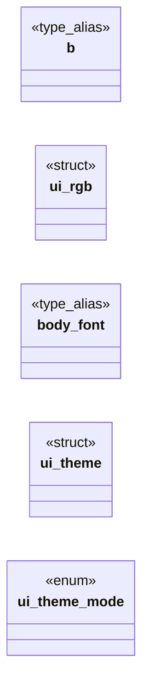

# `gui/browser_ui_internal.h`

> Source: [gui/browser_ui_internal.h:1](../../gui/browser_ui_internal.h#L1) | language `h` | coverage 50.0% | [API index](../index.md)

## Contents

- **Structs:** [`ui_rgb`](#ui_rgb), [`ui_theme`](#ui_theme)
- **Enums:** [`ui_theme_mode`](#ui_theme_mode)
- **Type Aliases:** [`b`](#b), [`body_font`](#body_font)
- **Functions:** [`set_rgb`](#set_rgb)
- **Macros:** [`UI_FONT_SIZE`](#ui_font_size), [`UI_TEXT_MARGIN`](#ui_text_margin), [`UI_HEADING_LEVELS`](#ui_heading_levels)

## Type Diagram



## Structs

<a id="ui_rgb"></a>

### `ui_rgb`

`struct` | [gui/browser_ui_internal.h:41](../../gui/browser_ui_internal.h#L41)

```c
typedef struct ui_rgb { double r, g, b; } ui_rgb;
```

---

<a id="ui_theme"></a>

### `ui_theme`

`struct` | [gui/browser_ui_internal.h:43](../../gui/browser_ui_internal.h#L43)

```c
typedef struct ui_theme
```

---

## Enums

<a id="ui_theme_mode"></a>

### `ui_theme_mode`

`enum` | [gui/browser_ui_internal.h:93](../../gui/browser_ui_internal.h#L93)

```c
typedef enum ui_theme_mode
```

Selectable palettes for the options menu.

---

## Type Aliases

<a id="b"></a>

### `b`

`type_alias` | [gui/browser_ui_internal.h:40](../../gui/browser_ui_internal.h#L40)

```c
typedef struct ui_rgb { double r, g, b;
```

--- presentation theme ---

Every font size, spacing and colour the renderer uses, gathered in one place so
no value is hardcoded at a call site. An RGB colour is three components in
[0,1]. The structured-content painter and the window chrome both read from a
single theme instance (see ui_theme_default).

---

<a id="body_font"></a>

### `body_font`

`type_alias` | [gui/browser_ui_internal.h:42](../../gui/browser_ui_internal.h#L42)

```c
typedef struct ui_theme { double body_font;
```

---

## Functions

<a id="set_rgb"></a>

### `set_rgb`

`function` | [gui/browser_ui_internal.h:106](../../gui/browser_ui_internal.h#L106)

```c
void set_rgb(cairo_t *cr, ui_rgb c);
```

0xRRGGBB author colour -> theme RGB

**Parameters**

| Name | Type | Default | Description |
|---|---|---|---|
| `cr` | `cairo_t *` |  |  |
| `c` | `ui_rgb` |  |  |

---

## Macros

<a id="ui_font_size"></a>

### `UI_FONT_SIZE`

`macro` | [gui/browser_ui_internal.h:30](../../gui/browser_ui_internal.h#L30)

```c
#define UI_FONT_SIZE
```

The web's base font size AND the root css.c resolves px/rem against.

One number governs both or the two drift: at 14 every page rendered ~12% small and an absolute `font-size:40px` landed at 250% x 14 = 35px. spec/box_style.md "Metricas UA del tema".

---

<a id="ui_text_margin"></a>

### `UI_TEXT_MARGIN`

`macro` | [gui/browser_ui_internal.h:31](../../gui/browser_ui_internal.h#L31)

```c
#define UI_TEXT_MARGIN
```

---

<a id="ui_heading_levels"></a>

### `UI_HEADING_LEVELS`

`macro` | [gui/browser_ui_internal.h:32](../../gui/browser_ui_internal.h#L32)

```c
#define UI_HEADING_LEVELS
```

left/right/top breathing room around page content

---
