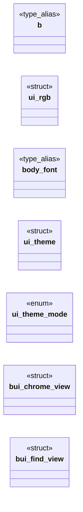

# `gui/browser_ui_internal.h`

> Source: [gui/browser_ui_internal.h:1](../../gui/browser_ui_internal.h#L1) | language `h` | coverage 57.7% | [API index](../index.md)

## Contents

- **Structs:** [`ui_rgb`](#ui_rgb), [`ui_theme`](#ui_theme), [`bui_chrome_view`](#bui_chrome_view), [`bui_find_view`](#bui_find_view)
- **Enums:** [`ui_theme_mode`](#ui_theme_mode)
- **Type Aliases:** [`b`](#b), [`body_font`](#body_font)
- **Functions:** [`set_rgb`](#set_rgb), [`bui_paint_findbar`](#bui_paint_findbar), [`bui_chrome_font`](#bui_chrome_font), [`bui_paint_chrome`](#bui_paint_chrome), [`bui_url_text_x`](#bui_url_text_x), [`bui_url_index_at`](#bui_url_index_at), [`bui_round_rect`](#bui_round_rect), [`bui_paint_video_bar`](#bui_paint_video_bar), [`bui_paint_site_panel`](#bui_paint_site_panel), [`bui_paint_link_status`](#bui_paint_link_status), [`bui_link_status_flips`](#bui_link_status_flips), [`area`](#area)
- **Macros:** [`UI_FONT_SIZE`](#ui_font_size), [`UI_TEXT_MARGIN`](#ui_text_margin), [`UI_HEADING_LEVELS`](#ui_heading_levels), [`BUI_CHROME_FONT`](#bui_chrome_font), [`BUI_CHROME_FONT_SIZE`](#bui_chrome_font_size), [`BUI_URL_FONT_SIZE`](#bui_url_font_size)

## Type Diagram



## Structs

<a id="ui_rgb"></a>

### `ui_rgb`

`struct` | [gui/browser_ui_internal.h:41](../../gui/browser_ui_internal.h#L41)

```c
typedef struct ui_rgb { double r, g, b; } ui_rgb;
```

---

<a id="ui_theme"></a>

### `ui_theme`

`struct` | [gui/browser_ui_internal.h:43](../../gui/browser_ui_internal.h#L43)

```c
typedef struct ui_theme
```

---

<a id="bui_chrome_view"></a>

### `bui_chrome_view`

`struct` | [gui/browser_ui_internal.h:132](../../gui/browser_ui_internal.h#L132)

```c
typedef struct bui_chrome_view
```

Everything the chrome painter shows, gathered by the orchestrator.

Borrowed.

---

<a id="bui_find_view"></a>

### `bui_find_view`

`struct` | [gui/browser_ui_internal.h:151](../../gui/browser_ui_internal.h#L151)

```c
typedef struct bui_find_view
```

The find bar (spec/find_text.md).

---

## Enums

<a id="ui_theme_mode"></a>

### `ui_theme_mode`

`enum` | [gui/browser_ui_internal.h:107](../../gui/browser_ui_internal.h#L107)

```c
typedef enum ui_theme_mode
```

Selectable palettes for the options menu.

---

## Type Aliases

<a id="b"></a>

### `b`

`type_alias` | [gui/browser_ui_internal.h:40](../../gui/browser_ui_internal.h#L40)

```c
typedef struct ui_rgb { double r, g, b;
```

--- presentation theme ---

Every font size, spacing and colour the renderer uses, gathered in one place so
no value is hardcoded at a call site. An RGB colour is three components in
[0,1]. The structured-content painter and the window chrome both read from a
single theme instance (see ui_theme_default).

---

<a id="body_font"></a>

### `body_font`

`type_alias` | [gui/browser_ui_internal.h:42](../../gui/browser_ui_internal.h#L42)

```c
typedef struct ui_theme { double body_font;
```

---

## Functions

<a id="set_rgb"></a>

### `set_rgb`

`function` | [gui/browser_ui_internal.h:120](../../gui/browser_ui_internal.h#L120)

```c
void set_rgb(cairo_t *cr, ui_rgb c);
```

0xRRGGBB author colour -> theme RGB

**Parameters**

| Name | Type | Default | Description |
|---|---|---|---|
| `cr` | `cairo_t *` |  |  |
| `c` | `ui_rgb` |  |  |

*Called by:* [`bui_paint_findbar`](gui.bui_chrome.c.md#bui_paint_findbar), [`bui_paint_link_status`](gui.bui_chrome.c.md#bui_paint_link_status), [`bui_paint_site_panel`](gui.bui_chrome.c.md#bui_paint_site_panel)

---

<a id="bui_paint_findbar"></a>

### `bui_paint_findbar`

`function` | [gui/browser_ui_internal.h:164](../../gui/browser_ui_internal.h#L164)

```c
void bui_paint_findbar(cairo_t *cr, const bui_find_view *v);
```

**Parameters**

| Name | Type | Default | Description |
|---|---|---|---|
| `cr` | `cairo_t *` |  |  |
| `v` | `bui_find_view *` |  |  |

---

<a id="bui_chrome_font"></a>

### `bui_chrome_font`

`function` | [gui/browser_ui_internal.h:166](../../gui/browser_ui_internal.h#L166)

```c
void bui_chrome_font(cairo_t *cr, double size);
```

**Parameters**

| Name | Type | Default | Description |
|---|---|---|---|
| `cr` | `cairo_t *` |  |  |
| `size` | `double` |  |  |

---

<a id="bui_paint_chrome"></a>

### `bui_paint_chrome`

`function` | [gui/browser_ui_internal.h:168](../../gui/browser_ui_internal.h#L168)

```c
void bui_paint_chrome(cairo_t *cr, const bui_chrome_view *v);
```

Paints both chrome rows.

**Parameters**

| Name | Type | Default | Description |
|---|---|---|---|
| `cr` | `cairo_t *` |  |  |
| `v` | `bui_chrome_view *` |  |  |

---

<a id="bui_url_text_x"></a>

### `bui_url_text_x`

`function` | [gui/browser_ui_internal.h:171](../../gui/browser_ui_internal.h#L171)

```c
double bui_url_text_x(const bui_chrome_view *v, cairo_t *cr, double *shift);
```

X where URL text starts and the horizontal shift keeping the caret visible: the single geometry the painter and the click-to-caret mapping share.

**Parameters**

| Name | Type | Default | Description |
|---|---|---|---|
| `v` | `bui_chrome_view *` |  |  |
| `cr` | `cairo_t *` |  |  |
| `shift` | `double *` |  |  |

**Returns:** `double`

---

<a id="bui_url_index_at"></a>

### `bui_url_index_at`

`function` | [gui/browser_ui_internal.h:173](../../gui/browser_ui_internal.h#L173)

```c
size_t bui_url_index_at(cairo_t *cr, const bui_chrome_view *v, double x);
```

Byte index of the URL caret for a click at surface x (UTF-8 boundary).

**Parameters**

| Name | Type | Default | Description |
|---|---|---|---|
| `cr` | `cairo_t *` |  |  |
| `v` | `bui_chrome_view *` |  |  |
| `x` | `double` |  |  |

**Returns:** `size_t`

---

<a id="bui_round_rect"></a>

### `bui_round_rect`

`function` | [gui/browser_ui_internal.h:175](../../gui/browser_ui_internal.h#L175)

```c
void bui_round_rect(cairo_t *cr, double x, double y, double w, double h, double r);
```

Rounded rectangle path.

**Parameters**

| Name | Type | Default | Description |
|---|---|---|---|
| `cr` | `cairo_t *` |  |  |
| `x` | `double` |  |  |
| `y` | `double` |  |  |
| `w` | `double` |  |  |
| `h` | `double` |  |  |
| `r` | `double` |  |  |

---

<a id="bui_paint_video_bar"></a>

### `bui_paint_video_bar`

`function` | [gui/browser_ui_internal.h:180](../../gui/browser_ui_internal.h#L180)

```c
void bui_paint_video_bar(cairo_t *cr, const vcl_geom *g, int paused, double pos, double total);
```

The browser's player bar over a playing video (spec/video_controls.md), drawn in the geometry g the pointer hit-tests; pos/total in seconds (total 0 = no seek track fill).

**Parameters**

| Name | Type | Default | Description |
|---|---|---|---|
| `cr` | `cairo_t *` |  |  |
| `g` | `vcl_geom *` |  |  |
| `paused` | `int` |  |  |
| `pos` | `double` |  |  |
| `total` | `double` |  |  |

---

<a id="bui_paint_site_panel"></a>

### `bui_paint_site_panel`

`function` | [gui/browser_ui_internal.h:184](../../gui/browser_ui_internal.h#L184)

```c
void bui_paint_site_panel(cairo_t *cr, const ui_theme *th, const sp_panel *p, const sp_geom *g, int hot_action);
```

The site identity panel (spec/site_panel.md); hot_action = action under the pointer or -1.

**Parameters**

| Name | Type | Default | Description |
|---|---|---|---|
| `cr` | `cairo_t *` |  |  |
| `th` | `ui_theme *` |  |  |
| `p` | `sp_panel *` |  |  |
| `g` | `sp_geom *` |  |  |
| `hot_action` | `int` |  |  |

---

<a id="bui_paint_link_status"></a>

### `bui_paint_link_status`

`function` | [gui/browser_ui_internal.h:191](../../gui/browser_ui_internal.h#L191)

```c
double bui_paint_link_status(cairo_t *cr, const ui_theme *th, const lp_preview *p, double left, double right, double bottom, double ptr_x, double ptr_y, double zone[3]);
```

The status strip for the link under the pointer (spec/link_preview.md): bottom-left of the content area [left, right) ending at [`bottom`](include.flex_layout.h.md#bottom), flipped right when the pointer is over it.

The host is emphasised; a blocked link is in the "bad" tone. Returns the strip height.

**Parameters**

| Name | Type | Default | Description |
|---|---|---|---|
| `cr` | `cairo_t *` |  |  |
| `th` | `ui_theme *` |  |  |
| `p` | `lp_preview *` |  |  |
| `left` | `double` |  |  |
| `right` | `double` |  |  |
| `bottom` | `double` |  |  |
| `ptr_x` | `double` |  |  |
| `ptr_y` | `double` |  |  |
| `zone` | `double [3]` |  |  |

**Returns:** `double`

---

<a id="bui_link_status_flips"></a>

### `bui_link_status_flips`

`function` | [gui/browser_ui_internal.h:196](../../gui/browser_ui_internal.h#L196)

```c
int bui_link_status_flips(const double zone[3], double ptr_x, double ptr_y);
```

Whether the pointer sits over the strip's left placement `zone` (left, top, right) that the last paint reported: the strip then paints on the right.

**Parameters**

| Name | Type | Default | Description |
|---|---|---|---|
| `zone` | `double [3]` |  |  |
| `ptr_x` | `double` |  |  |
| `ptr_y` | `double` |  |  |

**Returns:** `int`

---

<a id="area"></a>

### `area`

`function` | [gui/browser_ui_internal.h:201](../../gui/browser_ui_internal.h#L201)

```c
* tiled over the mask area (ax, ay, aw, ah) by the layer geometry `geo` (css.h CSS_MG_*, * resolved by bx_background_layer). 1 = painted, 0 = nothing usable. */ int bui_paint_mask_image(cairo_t *c, ca
```

**Returns:** `* tiled over the mask`

---

## Macros

<a id="ui_font_size"></a>

### `UI_FONT_SIZE`

`macro` | [gui/browser_ui_internal.h:30](../../gui/browser_ui_internal.h#L30)

```c
#define UI_FONT_SIZE
```

The web's base font size AND the root css.c resolves px/rem against.

One number governs both or the two drift: at 14 every page rendered ~12% small and an absolute `font-size:40px` landed at 250% x 14 = 35px. spec/box_style.md "Metricas UA del tema".

---

<a id="ui_text_margin"></a>

### `UI_TEXT_MARGIN`

`macro` | [gui/browser_ui_internal.h:31](../../gui/browser_ui_internal.h#L31)

```c
#define UI_TEXT_MARGIN
```

---

<a id="ui_heading_levels"></a>

### `UI_HEADING_LEVELS`

`macro` | [gui/browser_ui_internal.h:32](../../gui/browser_ui_internal.h#L32)

```c
#define UI_HEADING_LEVELS
```

left/right/top breathing room around page content

---

<a id="bui_chrome_font"></a>

### `BUI_CHROME_FONT`

`macro` | [gui/browser_ui_internal.h:127](../../gui/browser_ui_internal.h#L127)

```c
#define BUI_CHROME_FONT
```

---

<a id="bui_chrome_font_size"></a>

### `BUI_CHROME_FONT_SIZE`

`macro` | [gui/browser_ui_internal.h:128](../../gui/browser_ui_internal.h#L128)

```c
#define BUI_CHROME_FONT_SIZE
```

---

<a id="bui_url_font_size"></a>

### `BUI_URL_FONT_SIZE`

`macro` | [gui/browser_ui_internal.h:129](../../gui/browser_ui_internal.h#L129)

```c
#define BUI_URL_FONT_SIZE
```

---
