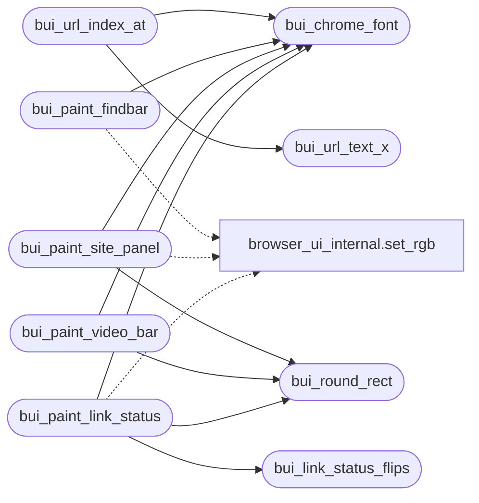

# `gui/bui_chrome.c`

> Source: [gui/bui_chrome.c:1](../../gui/bui_chrome.c#L1) | language `c` | coverage 52.8% | [API index](../index.md)

## Contents

- **Functions:** [`bui_round_rect`](#bui_round_rect), [`bui_chrome_font`](#bui_chrome_font), [`bui_url_text_x`](#bui_url_text_x), [`bui_url_index_at`](#bui_url_index_at), [`bui_paint_chrome`](#bui_paint_chrome), [`bui_paint_findbar`](#bui_paint_findbar), [`bui_paint_site_panel`](#bui_paint_site_panel), [`bui_paint_video_bar`](#bui_paint_video_bar), [`bui_link_status_flips`](#bui_link_status_flips), [`bui_paint_link_status`](#bui_paint_link_status)
- **Macros:** [`BUI_TWO_PI`](#bui_two_pi), [`BUI_ICON_LINE`](#bui_icon_line), [`BUI_TAB_RADIUS`](#bui_tab_radius), [`BUI_PILL_RADIUS`](#bui_pill_radius), [`BUI_TAB_PAD`](#bui_tab_pad), [`BUI_TAB_FADE`](#bui_tab_fade), [`BUI_SPINNER_R`](#bui_spinner_r), [`BUI_STOP_HALF`](#bui_stop_half), [`BUI_URL_TEXT_PAD`](#bui_url_text_pad), [`BUI_URL_END_PAD`](#bui_url_end_pad), [`BUI_FOCUS_RING`](#bui_focus_ring), [`BUI_INACTIVE_TEXT`](#bui_inactive_text), [`BUI_DISABLED`](#bui_disabled), [`BUI_URL_MEASURE`](#bui_url_measure), [`BUI_SP_RADIUS`](#bui_sp_radius), [`BUI_SP_LABEL_W`](#bui_sp_label_w), [`BUI_VBAR_ALPHA`](#bui_vbar_alpha), [`BUI_VTRACK_ALPHA`](#bui_vtrack_alpha), [`BUI_VKNOB_R`](#bui_vknob_r), [`BUI_VTEXT_SIZE`](#bui_vtext_size), [`BUI_LS_PAD_X`](#bui_ls_pad_x), [`BUI_LS_PAD_Y`](#bui_ls_pad_y), [`BUI_LS_RADIUS`](#bui_ls_radius), [`BUI_LS_MAX_FRAC`](#bui_ls_max_frac), [`BUI_LS_FONT`](#bui_ls_font)

## Call Graph

Solid arrows stay in this module, dashed arrows leave it.



## Functions

<a id="bui_round_rect"></a>

### `bui_round_rect`

`function` | [gui/bui_chrome.c:35](../../gui/bui_chrome.c#L35)

```c
void bui_round_rect(cairo_t *cr, double x, double y, double w, double h, double r)
```

Rounded rectangle path.

**Parameters**

| Name | Type | Default | Description |
|---|---|---|---|
| `cr` | `cairo_t *` |  |  |
| `x` | `double` |  |  |
| `y` | `double` |  |  |
| `w` | `double` |  |  |
| `h` | `double` |  |  |
| `r` | `double` |  |  |

> **Inherited:** Documentation from [`bui_round_rect`](#bui_round_rect) (gui/browser_ui_internal.h:175).

*Called by:* [`bui_paint_link_status`](#bui_paint_link_status), [`bui_paint_site_panel`](#bui_paint_site_panel), [`bui_paint_video_bar`](#bui_paint_video_bar)

---

<a id="bui_chrome_font"></a>

### `bui_chrome_font`

`function` | [gui/bui_chrome.c:61](../../gui/bui_chrome.c#L61)

```c
void bui_chrome_font(cairo_t *cr, double size)
```

**Parameters**

| Name | Type | Default | Description |
|---|---|---|---|
| `cr` | `cairo_t *` |  |  |
| `size` | `double` |  |  |

*Called by:* [`bui_paint_findbar`](#bui_paint_findbar), [`bui_paint_link_status`](#bui_paint_link_status), [`bui_paint_site_panel`](#bui_paint_site_panel), [`bui_paint_video_bar`](#bui_paint_video_bar), [`bui_url_index_at`](#bui_url_index_at)

---

<a id="bui_url_text_x"></a>

### `bui_url_text_x`

`function` | [gui/bui_chrome.c:335](../../gui/bui_chrome.c#L335)

```c
double bui_url_text_x(const bui_chrome_view *v, cairo_t *cr, double *shift)
```

X where URL text starts and the horizontal shift keeping the caret visible: the single geometry the painter and the click-to-caret mapping share.

**Parameters**

| Name | Type | Default | Description |
|---|---|---|---|
| `v` | `bui_chrome_view *` |  |  |
| `cr` | `cairo_t *` |  |  |
| `shift` | `double *` |  |  |

**Returns:** `double`

> **Inherited:** Documentation from [`bui_url_text_x`](#bui_url_text_x) (gui/browser_ui_internal.h:171).

*Called by:* [`bui_url_index_at`](#bui_url_index_at)

---

<a id="bui_url_index_at"></a>

### `bui_url_index_at`

`function` | [gui/bui_chrome.c:349](../../gui/bui_chrome.c#L349)

```c
size_t bui_url_index_at(cairo_t *cr, const bui_chrome_view *v, double x)
```

Byte index of the URL caret for a click at surface x (UTF-8 boundary).

**Parameters**

| Name | Type | Default | Description |
|---|---|---|---|
| `cr` | `cairo_t *` |  |  |
| `v` | `bui_chrome_view *` |  |  |
| `x` | `double` |  |  |

**Returns:** `size_t`

> **Inherited:** Documentation from [`bui_url_index_at`](#bui_url_index_at) (gui/browser_ui_internal.h:173).

*Calls:* [`bui_chrome_font`](#bui_chrome_font), [`bui_url_text_x`](#bui_url_text_x)

---

<a id="bui_paint_chrome"></a>

### `bui_paint_chrome`

`function` | [gui/bui_chrome.c:648](../../gui/bui_chrome.c#L648)

```c
void bui_paint_chrome(cairo_t *cr, const bui_chrome_view *v)
```

Paints both chrome rows.

**Parameters**

| Name | Type | Default | Description |
|---|---|---|---|
| `cr` | `cairo_t *` |  |  |
| `v` | `bui_chrome_view *` |  |  |

> **Inherited:** Documentation from [`bui_paint_chrome`](#bui_paint_chrome) (gui/browser_ui_internal.h:168).

---

<a id="bui_paint_findbar"></a>

### `bui_paint_findbar`

`function` | [gui/bui_chrome.c:734](../../gui/bui_chrome.c#L734)

```c
void bui_paint_findbar(cairo_t *cr, const bui_find_view *v)
```

**Parameters**

| Name | Type | Default | Description |
|---|---|---|---|
| `cr` | `cairo_t *` |  |  |
| `v` | `bui_find_view *` |  |  |

*Calls:* [`set_rgb`](gui.browser_ui_internal.h.md#set_rgb), [`bui_chrome_font`](#bui_chrome_font)

---

<a id="bui_paint_site_panel"></a>

### `bui_paint_site_panel`

`function` | [gui/bui_chrome.c:817](../../gui/bui_chrome.c#L817)

```c
void bui_paint_site_panel(cairo_t *cr, const ui_theme *th, const sp_panel *p, const sp_geom *g, int hot_action)
```

The site identity panel (spec/site_panel.md); hot_action = action under the pointer or -1.

**Parameters**

| Name | Type | Default | Description |
|---|---|---|---|
| `cr` | `cairo_t *` |  |  |
| `th` | `ui_theme *` |  |  |
| `p` | `sp_panel *` |  |  |
| `g` | `sp_geom *` |  |  |
| `hot_action` | `int` |  |  |

> **Inherited:** Documentation from [`bui_paint_site_panel`](#bui_paint_site_panel) (gui/browser_ui_internal.h:184).

*Calls:* [`set_rgb`](gui.browser_ui_internal.h.md#set_rgb), [`bui_chrome_font`](#bui_chrome_font), [`bui_round_rect`](#bui_round_rect)

---

<a id="bui_paint_video_bar"></a>

### `bui_paint_video_bar`

`function` | [gui/bui_chrome.c:905](../../gui/bui_chrome.c#L905)

```c
void bui_paint_video_bar(cairo_t *cr, const vcl_geom *g, int paused, double pos, double total)
```

The browser's player bar over a playing video (spec/video_controls.md), drawn in the geometry g the pointer hit-tests; pos/total in seconds (total 0 = no seek track fill).

**Parameters**

| Name | Type | Default | Description |
|---|---|---|---|
| `cr` | `cairo_t *` |  |  |
| `g` | `vcl_geom *` |  |  |
| `paused` | `int` |  |  |
| `pos` | `double` |  |  |
| `total` | `double` |  |  |

> **Inherited:** Documentation from [`bui_paint_video_bar`](#bui_paint_video_bar) (gui/browser_ui_internal.h:180).

*Calls:* [`bui_chrome_font`](#bui_chrome_font), [`bui_round_rect`](#bui_round_rect)

---

<a id="bui_link_status_flips"></a>

### `bui_link_status_flips`

`function` | [gui/bui_chrome.c:964](../../gui/bui_chrome.c#L964)

```c
int bui_link_status_flips(const double zone[3], double ptr_x, double ptr_y)
```

Whether the pointer sits over the strip's left placement `zone` (left, top, right) that the last paint reported: the strip then paints on the right.

**Parameters**

| Name | Type | Default | Description |
|---|---|---|---|
| `zone` | `double [3]` |  |  |
| `ptr_x` | `double` |  |  |
| `ptr_y` | `double` |  |  |

**Returns:** `int`

> **Inherited:** Documentation from [`bui_link_status_flips`](#bui_link_status_flips) (gui/browser_ui_internal.h:196).

*Called by:* [`bui_paint_link_status`](#bui_paint_link_status)

---

<a id="bui_paint_link_status"></a>

### `bui_paint_link_status`

`function` | [gui/bui_chrome.c:968](../../gui/bui_chrome.c#L968)

```c
double bui_paint_link_status(cairo_t *cr, const ui_theme *th, const lp_preview *p, double left, double right, double bottom, double ptr_x, double ptr_y, double zone[3])
```

The status strip for the link under the pointer (spec/link_preview.md): bottom-left of the content area [left, right) ending at [`bottom`](include.flex_layout.h.md#bottom), flipped right when the pointer is over it.

The host is emphasised; a blocked link is in the "bad" tone. Returns the strip height.

**Parameters**

| Name | Type | Default | Description |
|---|---|---|---|
| `cr` | `cairo_t *` |  |  |
| `th` | `ui_theme *` |  |  |
| `p` | `lp_preview *` |  |  |
| `left` | `double` |  |  |
| `right` | `double` |  |  |
| `bottom` | `double` |  |  |
| `ptr_x` | `double` |  |  |
| `ptr_y` | `double` |  |  |
| `zone` | `double [3]` |  |  |

**Returns:** `double`

> **Inherited:** Documentation from [`bui_paint_link_status`](#bui_paint_link_status) (gui/browser_ui_internal.h:191).

*Calls:* [`set_rgb`](gui.browser_ui_internal.h.md#set_rgb), [`bui_chrome_font`](#bui_chrome_font), [`bui_link_status_flips`](#bui_link_status_flips), [`bui_round_rect`](#bui_round_rect)

---

## Macros

<a id="bui_two_pi"></a>

### `BUI_TWO_PI`

`macro` | [gui/bui_chrome.c:18](../../gui/bui_chrome.c#L18)

```c
#define BUI_TWO_PI
```

---

<a id="bui_icon_line"></a>

### `BUI_ICON_LINE`

`macro` | [gui/bui_chrome.c:19](../../gui/bui_chrome.c#L19)

```c
#define BUI_ICON_LINE
```

---

<a id="bui_tab_radius"></a>

### `BUI_TAB_RADIUS`

`macro` | [gui/bui_chrome.c:20](../../gui/bui_chrome.c#L20)

```c
#define BUI_TAB_RADIUS
```

stroke width of every chrome icon

---

<a id="bui_pill_radius"></a>

### `BUI_PILL_RADIUS`

`macro` | [gui/bui_chrome.c:21](../../gui/bui_chrome.c#L21)

```c
#define BUI_PILL_RADIUS
```

---

<a id="bui_tab_pad"></a>

### `BUI_TAB_PAD`

`macro` | [gui/bui_chrome.c:22](../../gui/bui_chrome.c#L22)

```c
#define BUI_TAB_PAD
```

---

<a id="bui_tab_fade"></a>

### `BUI_TAB_FADE`

`macro` | [gui/bui_chrome.c:23](../../gui/bui_chrome.c#L23)

```c
#define BUI_TAB_FADE
```

tab title inset from the tab's left edge

---

<a id="bui_spinner_r"></a>

### `BUI_SPINNER_R`

`macro` | [gui/bui_chrome.c:24](../../gui/bui_chrome.c#L24)

```c
#define BUI_SPINNER_R
```

width of the fade-out at the end of a long title

---

<a id="bui_stop_half"></a>

### `BUI_STOP_HALF`

`macro` | [gui/bui_chrome.c:25](../../gui/bui_chrome.c#L25)

```c
#define BUI_STOP_HALF
```

---

<a id="bui_url_text_pad"></a>

### `BUI_URL_TEXT_PAD`

`macro` | [gui/bui_chrome.c:26](../../gui/bui_chrome.c#L26)

```c
#define BUI_URL_TEXT_PAD
```

half-size of the Stop cross that replaces reload

---

<a id="bui_url_end_pad"></a>

### `BUI_URL_END_PAD`

`macro` | [gui/bui_chrome.c:27](../../gui/bui_chrome.c#L27)

```c
#define BUI_URL_END_PAD
```

gap between the identity badge and the URL text

---

<a id="bui_focus_ring"></a>

### `BUI_FOCUS_RING`

`macro` | [gui/bui_chrome.c:28](../../gui/bui_chrome.c#L28)

```c
#define BUI_FOCUS_RING
```

free space kept after the caret at the pill's end

---

<a id="bui_inactive_text"></a>

### `BUI_INACTIVE_TEXT`

`macro` | [gui/bui_chrome.c:29](../../gui/bui_chrome.c#L29)

```c
#define BUI_INACTIVE_TEXT
```

---

<a id="bui_disabled"></a>

### `BUI_DISABLED`

`macro` | [gui/bui_chrome.c:30](../../gui/bui_chrome.c#L30)

```c
#define BUI_DISABLED
```

alpha of an inactive tab's title

---

<a id="bui_url_measure"></a>

### `BUI_URL_MEASURE`

`macro` | [gui/bui_chrome.c:31](../../gui/bui_chrome.c#L31)

```c
#define BUI_URL_MEASURE
```

alpha of a disabled button's icon

---

<a id="bui_sp_radius"></a>

### `BUI_SP_RADIUS`

`macro` | [gui/bui_chrome.c:783](../../gui/bui_chrome.c#L783)

```c
#define BUI_SP_RADIUS
```

---

<a id="bui_sp_label_w"></a>

### `BUI_SP_LABEL_W`

`macro` | [gui/bui_chrome.c:784](../../gui/bui_chrome.c#L784)

```c
#define BUI_SP_LABEL_W
```

---

<a id="bui_vbar_alpha"></a>

### `BUI_VBAR_ALPHA`

`macro` | [gui/bui_chrome.c:900](../../gui/bui_chrome.c#L900)

```c
#define BUI_VBAR_ALPHA
```

---

<a id="bui_vtrack_alpha"></a>

### `BUI_VTRACK_ALPHA`

`macro` | [gui/bui_chrome.c:901](../../gui/bui_chrome.c#L901)

```c
#define BUI_VTRACK_ALPHA
```

bar background over the picture

---

<a id="bui_vknob_r"></a>

### `BUI_VKNOB_R`

`macro` | [gui/bui_chrome.c:902](../../gui/bui_chrome.c#L902)

```c
#define BUI_VKNOB_R
```

unplayed part of the track

---

<a id="bui_vtext_size"></a>

### `BUI_VTEXT_SIZE`

`macro` | [gui/bui_chrome.c:903](../../gui/bui_chrome.c#L903)

```c
#define BUI_VTEXT_SIZE
```

---

<a id="bui_ls_pad_x"></a>

### `BUI_LS_PAD_X`

`macro` | [gui/bui_chrome.c:958](../../gui/bui_chrome.c#L958)

```c
#define BUI_LS_PAD_X
```

---

<a id="bui_ls_pad_y"></a>

### `BUI_LS_PAD_Y`

`macro` | [gui/bui_chrome.c:959](../../gui/bui_chrome.c#L959)

```c
#define BUI_LS_PAD_Y
```

---

<a id="bui_ls_radius"></a>

### `BUI_LS_RADIUS`

`macro` | [gui/bui_chrome.c:960](../../gui/bui_chrome.c#L960)

```c
#define BUI_LS_RADIUS
```

---

<a id="bui_ls_max_frac"></a>

### `BUI_LS_MAX_FRAC`

`macro` | [gui/bui_chrome.c:961](../../gui/bui_chrome.c#L961)

```c
#define BUI_LS_MAX_FRAC
```

---

<a id="bui_ls_font"></a>

### `BUI_LS_FONT`

`macro` | [gui/bui_chrome.c:962](../../gui/bui_chrome.c#L962)

```c
#define BUI_LS_FONT
```

of the content width, like Firefox's status panel

---
