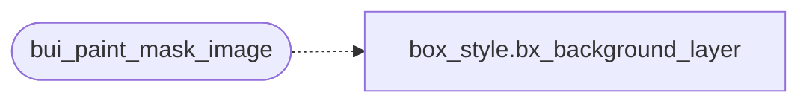

# `gui/bui_mask_img.c`

> Source: [gui/bui_mask_img.c:1](../../gui/bui_mask_img.c#L1) | language `c` | coverage 50.0% | [API index](../index.md)

bui_mask_img -- paints a mask-image: url() layer into a mask surface.

## Contents

- **Functions:** [`bui_paint_mask_image`](#bui_paint_mask_image)

## Call Graph

Solid arrows stay in this module, dashed arrows leave it.



## Functions

<a id="bui_paint_mask_image"></a>

### `bui_paint_mask_image`

`function` | [gui/bui_mask_img.c:17](../../gui/bui_mask_img.c#L17)

```c
int bui_paint_mask_image(cairo_t *c, cairo_surface_t *img, int nat_w, int nat_h, const int geo[CSS_MASK_GEO_N], double ax, double ay, double aw, double ah)
```

**Parameters**

| Name | Type | Default | Description |
|---|---|---|---|
| `c` | `cairo_t *` |  |  |
| `img` | `cairo_surface_t *` |  |  |
| `nat_w` | `int` |  |  |
| `nat_h` | `int` |  |  |
| `CSS_MASK_GEO_N` | `int geo[ ]` |  |  |
| `ax` | `double` |  |  |
| `ay` | `double` |  |  |
| `aw` | `double` |  |  |
| `ah` | `double` |  |  |

**Returns:** `int`

*Calls:* [`bx_background_layer`](include.box_style.h.md#bx_background_layer)

---
