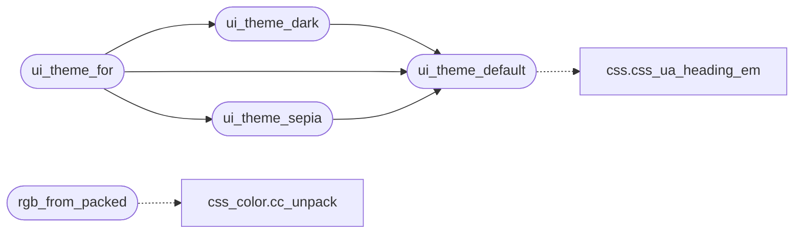

# `gui/bui_theme.c`

> Source: [gui/bui_theme.c:1](../../gui/bui_theme.c#L1) | language `c` | coverage 85.7% | [API index](../index.md)

## Contents

- **Functions:** [`ui_theme_default`](#ui_theme_default), [`ui_theme_dark`](#ui_theme_dark), [`ui_theme_sepia`](#ui_theme_sepia), [`ui_theme_for`](#ui_theme_for), [`rgb_from_packed`](#rgb_from_packed), [`set_rgb`](#set_rgb)

## Call Graph

Solid arrows stay in this module, dashed arrows leave it.



## Functions

<a id="ui_theme_default"></a>

### `ui_theme_default`

`function` | [gui/bui_theme.c:15](../../gui/bui_theme.c#L15)

```c
ui_theme ui_theme_default(void)
```

The single source of truth for the look of the browser.

**Returns:** `ui_theme`

*Calls:* [`css_ua_heading_em`](include.css.h.md#css_ua_heading_em)

*Called by:* [`ui_theme_dark`](#ui_theme_dark), [`ui_theme_for`](#ui_theme_for), [`ui_theme_sepia`](#ui_theme_sepia)

---

<a id="ui_theme_dark"></a>

### `ui_theme_dark`

`function` | [gui/bui_theme.c:78](../../gui/bui_theme.c#L78)

```c
ui_theme ui_theme_dark(void)
```

Dark reading palette.

Shares all the metrics (font sizes, spacing) with the default theme; only the colours change, so the box model stays in one place.

**Returns:** `ui_theme`

*Calls:* [`ui_theme_default`](#ui_theme_default)

*Called by:* [`ui_theme_for`](#ui_theme_for)

---

<a id="ui_theme_sepia"></a>

### `ui_theme_sepia`

`function` | [gui/bui_theme.c:123](../../gui/bui_theme.c#L123)

```c
ui_theme ui_theme_sepia(void)
```

Sepia reading palette: warm paper background and dark-brown ink, easier on the eyes for long-form text.

Shares all the metrics with the default theme; only the colours change.

**Returns:** `ui_theme`

*Calls:* [`ui_theme_default`](#ui_theme_default)

*Called by:* [`ui_theme_for`](#ui_theme_for)

---

<a id="ui_theme_for"></a>

### `ui_theme_for`

`function` | [gui/bui_theme.c:165](../../gui/bui_theme.c#L165)

```c
ui_theme ui_theme_for(int mode)
```

The single place that maps the theme mode to a palette.

**Parameters**

| Name | Type | Default | Description |
|---|---|---|---|
| `mode` | `int` |  |  |

**Returns:** `ui_theme`

*Calls:* [`ui_theme_dark`](#ui_theme_dark), [`ui_theme_default`](#ui_theme_default), [`ui_theme_sepia`](#ui_theme_sepia)

*Called by:* [`UI_READER_COLUMN_W`](gui.browser_ui.c.md#ui_reader_column_w)

---

<a id="rgb_from_packed"></a>

### `rgb_from_packed`

`function` | [gui/bui_theme.c:174](../../gui/bui_theme.c#L174)

```c
ui_rgb rgb_from_packed(int packed)
```

Converts a packed 0xRRGGBB author color into a theme RGB triple.

**Parameters**

| Name | Type | Default | Description |
|---|---|---|---|
| `packed` | `int` |  |  |

**Returns:** `ui_rgb`

*Calls:* [`cc_unpack`](src.css_color.c.md#cc_unpack)

---

<a id="set_rgb"></a>

### `set_rgb`

`function` | [gui/bui_theme.c:179](../../gui/bui_theme.c#L179)

```c
void set_rgb(cairo_t *cr, ui_rgb c)
```

0xRRGGBB author colour -> theme RGB

**Parameters**

| Name | Type | Default | Description |
|---|---|---|---|
| `cr` | `cairo_t *` |  |  |
| `c` | `ui_rgb` |  |  |

> **Inherited:** Documentation from [`set_rgb`](#set_rgb) (gui/browser_ui_internal.h:105).

---
