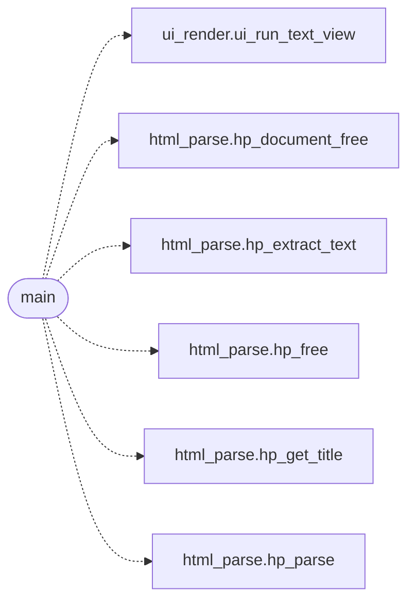

# `gui/freedom_view.c`

> Source: [gui/freedom_view.c:1](../../gui/freedom_view.c#L1) | language `c` | coverage 0.0% | [API index](../index.md)

## Contents

- **Functions:** [`main`](#main)
- **Macros:** [`_POSIX_C_SOURCE`](#_posix_c_source)

## Call Graph

Solid arrows stay in this module, dashed arrows leave it.



## Functions

<a id="main"></a>

### `main`

`function` | [gui/freedom_view.c:37](../../gui/freedom_view.c#L37)

```c
int main(int argc, char **argv)
```

**Parameters**

| Name | Type | Default | Description |
|---|---|---|---|
| `argc` | `int` |  |  |
| `argv` | `char **` |  |  |

**Returns:** `int`

*Calls:* [`ui_run_text_view`](gui.ui_render.c.md#ui_run_text_view), [`hp_document_free`](include.html_parse.h.md#hp_document_free), [`hp_extract_text`](include.html_parse.h.md#hp_extract_text), [`hp_free`](include.html_parse.h.md#hp_free), [`hp_get_title`](include.html_parse.h.md#hp_get_title), [`hp_parse`](src.html_parse.c.md#hp_parse)

---

## Macros

<a id="_posix_c_source"></a>

### `_POSIX_C_SOURCE`

`macro` | [gui/freedom_view.c:10](../../gui/freedom_view.c#L10)

```c
#define _POSIX_C_SOURCE
```

---
