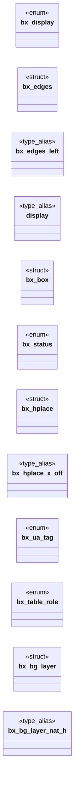
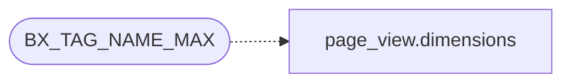

# `include/box_style.h`

> Source: [include/box_style.h:1](../../include/box_style.h#L1) | language `h` | coverage 64.0% | [API index](../index.md)

## Contents

- **Structs:** [`bx_edges`](#bx_edges), [`bx_box`](#bx_box), [`bx_hplace`](#bx_hplace), [`bx_bg_layer`](#bx_bg_layer)
- **Enums:** [`bx_display`](#bx_display), [`bx_status`](#bx_status), [`bx_ua_tag`](#bx_ua_tag), [`bx_table_role`](#bx_table_role)
- **Type Aliases:** [`display`](#display)
- **Functions:** [`box`](#box), [`BX_TROLE_NONE`](#bx_trole_none), [`bx_display_name`](#bx_display_name), [`bx_width_cap`](#bx_width_cap), [`bx_width_cap2`](#bx_width_cap2), [`bx_replaced_box`](#bx_replaced_box), [`bx_border_box_h`](#bx_border_box_h), [`page`](#page), [`bx_lp_px`](#bx_lp_px), [`bx_content_cap`](#bx_content_cap), [`bx_background_layer`](#bx_background_layer)
- **Macros:** [`BX_TAG_NAME_MAX`](#bx_tag_name_max)

## Type Diagram



## Call Graph

Solid arrows stay in this module, dashed arrows leave it.



## Structs

<a id="bx_edges"></a>

### `bx_edges`

`struct` | [include/box_style.h:46](../../include/box_style.h#L46)

```c
typedef struct bx_edges
```

Box edges in em (multiples of the element's own font size).

**Members**

| Member | Kind | Summary |
|---|---|---|
| [`left`](#bx_edges-left) | type_alias | Box edges in em (multiples of the element's own font size). |

<a id="bx_edges-left"></a>

#### `bx_edges.left`

`type_alias` | [include/box_style.h:46](../../include/box_style.h#L46)

```c
typedef struct bx_edges { double top, right, bottom, left;
```

Box edges in em (multiples of the element's own font size).

---

<a id="bx_box"></a>

### `bx_box`

`struct` | [include/box_style.h:50](../../include/box_style.h#L50)

```c
typedef struct bx_box
```

---

<a id="bx_hplace"></a>

### `bx_hplace`

`struct` | [include/box_style.h:63](../../include/box_style.h#L63)

```c
typedef struct bx_hplace
```

Horizontal placement of an author box inside an available width (px).

**Members**

| Member | Kind | Summary |
|---|---|---|
| [`x_off`](#bx_hplace-x_off) | type_alias | Horizontal placement of an author box inside an available width (px). |

<a id="bx_hplace-x_off"></a>

#### `bx_hplace.x_off`

`type_alias` | [include/box_style.h:63](../../include/box_style.h#L63)

```c
typedef struct bx_hplace { double x_off;
```

Horizontal placement of an author box inside an available width (px).

---

<a id="bx_bg_layer"></a>

### `bx_bg_layer`

`struct` | [include/box_style.h:267](../../include/box_style.h#L267)

```c
typedef struct bx_bg_layer
```

One background-image layer's geometry (CSS Backgrounds 3 sections 3.6 + 3.9), as a pure function of the layer's declared values and the two sizes involved.

The painter does the drawing; deciding WHERE and HOW BIG is arithmetic and belongs where it can be tested.

Sizing (3.9). `size_kw` is CSS_BGS_COVER / CSS_BGS_CONTAIN / anything else. For
the explicit form, each component is a px value (CSS_LEN_AUTO = auto,
CSS_LEN_UNSET = not declared, which is auto) plus a per-mille percentage of the
positioning area. Both auto is the natural size; ONE auto preserves the
intrinsic ratio, which is what makes `background-size: 44px` a scaled icon
rather than a squashed one.

Positioning (3.6). A percentage aligns that fraction of the IMAGE with the same
fraction of the AREA, so the offset is (area - image) * pct + px. That single
rule also expresses left/center/right, which the caller passes as 0/500/1000.

Writes the used image size to out_w and out_h, and its offset from the area's
top-left corner to out_x and out_y. Returns 0 (writing nothing) when a size is not
usable -- a zero or negative natural size, area, or computed size -- so the
caller skips the layer instead of dividing by it. Pure.

**Members**

| Member | Kind | Summary |
|---|---|---|
| [`nat_h`](#bx_bg_layer-nat_h) | type_alias | One background-image layer's geometry (CSS Backgrounds 3 sections 3.6 + 3.9), as a pure function of the layer's declared values and the two sizes involved. |

<a id="bx_bg_layer-nat_h"></a>

#### `bx_bg_layer.nat_h`

`type_alias` | [include/box_style.h:267](../../include/box_style.h#L267)

```c
typedef struct bx_bg_layer { double nat_w, nat_h;
```

One background-image layer's geometry (CSS Backgrounds 3 sections 3.6 + 3.9), as a pure function of the layer's declared values and the two sizes involved.

The painter does the drawing; deciding WHERE and HOW BIG is arithmetic and belongs where it can be tested.

Sizing (3.9). `size_kw` is CSS_BGS_COVER / CSS_BGS_CONTAIN / anything else. For
the explicit form, each component is a px value (CSS_LEN_AUTO = auto,
CSS_LEN_UNSET = not declared, which is auto) plus a per-mille percentage of the
positioning area. Both auto is the natural size; ONE auto preserves the
intrinsic ratio, which is what makes `background-size: 44px` a scaled icon
rather than a squashed one.

Positioning (3.6). A percentage aligns that fraction of the IMAGE with the same
fraction of the AREA, so the offset is (area - image) * pct + px. That single
rule also expresses left/center/right, which the caller passes as 0/500/1000.

Writes the used image size to out_w and out_h, and its offset from the area's
top-left corner to out_x and out_y. Returns 0 (writing nothing) when a size is not
usable -- a zero or negative natural size, area, or computed size -- so the
caller skips the layer instead of dividing by it. Pure.

---

## Enums

<a id="bx_display"></a>

### `bx_display`

`enum` | [include/box_style.h:35](../../include/box_style.h#L35)

```c
typedef enum bx_display
```

---

<a id="bx_status"></a>

### `bx_status`

`enum` | [include/box_style.h:56](../../include/box_style.h#L56)

```c
typedef enum bx_status
```

---

<a id="bx_ua_tag"></a>

### `bx_ua_tag`

`enum` | [include/box_style.h:84](../../include/box_style.h#L84)

```c
typedef enum bx_ua_tag
```

Compact, stable identity of a block's SOURCE element, just wide enough to recover its user-agent box on the far side of the render IPC without shipping a tag string per block.

Only the tags the HTML user-agent sheet gives a non-zero vertical margin need a code: everything else (div, section, header, article, footer, nav, main, table, tr, td, form, ...) shares BX_UA_NONE, whose UA margin is zero -- which is both the correct answer and the fail-closed one (an unrecognised element invents no spacing). spec/box_style.md 4d.

The codes are an ABI between page_view, the IPC codec and the painter; APPEND
only, never renumber.

---

<a id="bx_table_role"></a>

### `bx_table_role`

`enum` | [include/box_style.h:127](../../include/box_style.h#L127)

```c
typedef enum bx_table_role
```

The role an element plays in a table (CSS 2.1 17.2).

BX_TROLE_COLUMN generates no box of its own; the rest are the boxes the table layout is built from.

---

## Type Aliases

<a id="display"></a>

### `display`

`type_alias` | [include/box_style.h:49](../../include/box_style.h#L49)

```c
typedef struct bx_box { bx_display display;
```

---

## Functions

<a id="box"></a>

### `box`

`function` | [include/box_style.h:115](../../include/box_style.h#L115)

```c
* in_list nonzero when the block sits inside a list item: it then takes * the <li> box (zero margin), keeping items tight. A heading * escapes this, per 4d. * ua identity of the nearest BLOCK-LEVEL an
```

**Parameters**

| Name | Type | Default | Description |
|---|---|---|---|
| `margin` | `zero` |  |  |

**Returns:** `* in_list nonzero when the block sits inside a list item: it then takes * the <li>`

---

<a id="bx_trole_none"></a>

### `BX_TROLE_NONE`

`function` | [include/box_style.h:144](../../include/box_style.h#L144)

```c
* BX_TROLE_NONE (an unrecognised element joins no table -- fail closed). */ bx_table_role bx_table_role_of(const char *tag, css_display display);
```

**Parameters**

| Name | Type | Default | Description |
|---|---|---|---|
| `closed` | `an unrecognised element joins no table -- fail` |  |  |

**Returns:** `*`

---

<a id="bx_display_name"></a>

### `bx_display_name`

`function` `const` | [include/box_style.h:156](../../include/box_style.h#L156)

```c
const char *bx_display_name(bx_display d);
```

Stable, short English name of a display type for structured/agent output.

Never NULL; an unknown enum value yields "inline".

**Parameters**

| Name | Type | Default | Description |
|---|---|---|---|
| `d` | `bx_display` |  |  |

**Returns:** `char *`

---

<a id="bx_width_cap"></a>

### `bx_width_cap`

`function` | [include/box_style.h:172](../../include/box_style.h#L172)

```c
double bx_width_cap(int w_px, int w_pct, double avail_w);
```

Effective width cap combining the px cap (w_px, 0 = none) with a symbolic per-mille cap (w_pct, 0 = none; Hito 32) resolved against the real available width: both set => the tighter wins; neither (or avail_w <= 0 for the pct) => 0 (no cap).

Never negative. Pure.

**Parameters**

| Name | Type | Default | Description |
|---|---|---|---|
| `w_px` | `int` |  |  |
| `w_pct` | `int` |  |  |
| `avail_w` | `double` |  |  |

**Returns:** `double`

---

<a id="bx_width_cap2"></a>

### `bx_width_cap2`

`function` | [include/box_style.h:177](../../include/box_style.h#L177)

```c
double bx_width_cap2(int w_px, int w_pct, int mw_px, int mw_pct, double avail_w);
```

The used width cap of an element: the tighter of its `width` (w_px, w_pct) and its `max-width` (mw_px, mw_pct), each one <length-percentage> resolved on its own by bx_width_cap; 0 = neither declared.

Pure.

**Parameters**

| Name | Type | Default | Description |
|---|---|---|---|
| `w_px` | `int` |  |  |
| `w_pct` | `int` |  |  |
| `mw_px` | `int` |  |  |
| `mw_pct` | `int` |  |  |
| `avail_w` | `double` |  |  |

**Returns:** `double`

---

<a id="bx_replaced_box"></a>

### `bx_replaced_box`

`function` | [include/box_style.h:196](../../include/box_style.h#L196)

```c
int bx_replaced_box(int w_px, int w_pct, int aspect_num, int aspect_den, double avail_w, double *out_w, double *out_h);
```

The used BOX of a replaced element (image/video) that has no intrinsic pixel size of its own -- because it did not load, or was never allowed to.

CSS Sizing 4 section 4: when one axis is definite and an aspect-ratio is present,
the ratio supplies the other. That is what makes a blocked thumbnail keep the
shape the author reserved for it instead of collapsing to a text-height bar and
letting its `alt` reflow the page. Freedom renders this case by default (images
off; third-party images blocked even when on), so it is the common path, not an
edge case.

w_px / w_pct are the declared width's two halves (CSS_LEN_UNSET / 0 for absent),
resolved against avail_w exactly like every other <length-percentage>.
aspect_num / aspect_den are the ratio x1000 (0 = none).

Returns 1 and writes *out_w / *out_h only when BOTH a positive used width and a
usable ratio are available; otherwise returns 0 and touches nothing, leaving the
caller's own fallback in place rather than inventing a height. Pure.

**Parameters**

| Name | Type | Default | Description |
|---|---|---|---|
| `w_px` | `int` |  |  |
| `w_pct` | `int` |  |  |
| `aspect_num` | `int` |  |  |
| `aspect_den` | `int` |  |  |
| `avail_w` | `double` |  |  |
| `out_w` | `double *` |  |  |
| `out_h` | `double *` |  |  |

**Returns:** `int`

---

<a id="bx_border_box_h"></a>

### `bx_border_box_h`

`function` | [include/box_style.h:210](../../include/box_style.h#L210)

```c
double bx_border_box_h(double declared_h, int border_box, double pad_t, double pad_b, double bord_t, double bord_b);
```

Border-box height for a DECLARED height under box-sizing (CSS 2.1 10.6.3, CSS Box Sizing 3 section 4).

With content-box -- the CSS default, so the common case -- `height` sizes the CONTENT, and the vertical padding and border sit OUTSIDE it: a `height:60px; padding:2%` box is taller than 60px. With border-box the declared height already includes them and this is the identity. Negative edges are treated as 0; the result is never negative.

The horizontal twin is bx_content_cap, which converts the other way (a
declared border-box WIDTH into the content width cap) because widths are
capped and heights are set. Pure.

**Parameters**

| Name | Type | Default | Description |
|---|---|---|---|
| `declared_h` | `double` |  |  |
| `border_box` | `int` |  |  |
| `pad_t` | `double` |  |  |
| `pad_b` | `double` |  |  |
| `bord_t` | `double` |  |  |
| `bord_b` | `double` |  |  |

**Returns:** `double`

---

<a id="page"></a>

### `page`

`function` | [include/box_style.h:214](../../include/box_style.h#L214)

```c
* instead of letting it extend the page (CSS 2.1 section 10.7 + 11.1.1). That * is the case unless BOTH overflow axes are visible-or-unset: one non-visible * axis computes the other to auto (CSS Overf
```

**Parameters**

| Name | Type | Default | Description |
|---|---|---|---|
| `section` | `CSS 2.1 10.7 + 11.1.1` |  |  |

**Returns:** `* instead of letting it extend the`

*Called by:* [`offset`](gui.browser_ui.c.md#offset)

---

<a id="bx_lp_px"></a>

### `bx_lp_px`

`function` | [include/box_style.h:236](../../include/box_style.h#L236)

```c
double bx_lp_px(int px_val, int pct_pm, double basis);
```

Used px value of a <length-percentage> (CSS Values 4 section 5.3): the px half plus pct_pm per-mille of [`basis`](include.flex_layout.h.md#basis).

This is the ONLY place the engine turns a percentage into pixels, and the rule is the whole of it -- there is no clamping, no minimum and no special case here, because none of those are properties of the value type.

[`basis`](include.flex_layout.h.md#basis) is the containing-block dimension the property resolves against.
Which dimension that is belongs to the caller and is NOT symmetric: CSS 2.1
sections 8.3/8.4 resolve ALL FOUR margin and padding percentages against the
containing block WIDTH, padding-top and padding-bottom included. The full
property -> basis table is spec/css_length.md section 7.3.

px_val may carry a CSS_LEN_UNSET/CSS_LEN_AUTO sentinel, which contributes 0
(a percentage-only value states no absolute length). A basis that is not a
usable length contributes nothing while the absolute half survives. Pure.

**Parameters**

| Name | Type | Default | Description |
|---|---|---|---|
| `px_val` | `int` |  |  |
| `pct_pm` | `int` |  |  |
| `basis` | `double` |  |  |

**Returns:** `double`

---

<a id="bx_content_cap"></a>

### `bx_content_cap`

`function` | [include/box_style.h:244](../../include/box_style.h#L244)

```c
double bx_content_cap(double width_cap, int border_box, double pad_l, double pad_r, double bord_l, double bord_r);
```

Content-width cap adjusted for box-sizing (2026-07-11).

With border_box set, the declared width includes the horizontal padding and border, so the cap on the CONTENT is width_cap minus those edges, clamped >= 1 (a border-box narrower than its own edges never yields a negative width). border_box == 0 (content-box or unset) or width_cap <= 0 (no cap) are the identity. Negative edges are treated as 0. Pure.

**Parameters**

| Name | Type | Default | Description |
|---|---|---|---|
| `width_cap` | `double` |  |  |
| `border_box` | `int` |  |  |
| `pad_l` | `double` |  |  |
| `pad_r` | `double` |  |  |
| `bord_l` | `double` |  |  |
| `bord_r` | `double` |  |  |

**Returns:** `double`

---

<a id="bx_background_layer"></a>

### `bx_background_layer`

`function` | [include/box_style.h:277](../../include/box_style.h#L277)

```c
int bx_background_layer(const bx_bg_layer *in, double *out_w, double *out_h, double *out_x, double *out_y);
```

**Parameters**

| Name | Type | Default | Description |
|---|---|---|---|
| `in` | `bx_bg_layer *` |  |  |
| `out_w` | `double *` |  |  |
| `out_h` | `double *` |  |  |
| `out_x` | `double *` |  |  |
| `out_y` | `double *` |  |  |

**Returns:** `int`

---

## Macros

<a id="bx_tag_name_max"></a>

### `BX_TAG_NAME_MAX`

`macro` | [include/box_style.h:33](../../include/box_style.h#L33)

```c
#define BX_TAG_NAME_MAX
```

Buffer size a caller needs to hand a tag name to this module.

Generous: the longest recognised tag is "blockquote" (10), so a real tag always fits and anything longer fails closed instead of truncating into a wrong match.

*Calls:* [`dimensions`](src.page_view.c.md#dimensions)

---
