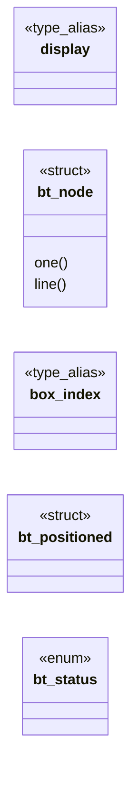
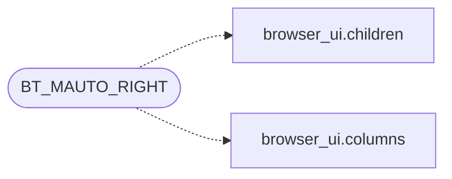

# `include/box_tree.h`

> Source: [include/box_tree.h:1](../../include/box_tree.h#L1) | language `h` | coverage 38.2% | [API index](../index.md)

## Contents

- **Structs:** [`bt_node`](#bt_node), [`bt_positioned`](#bt_positioned)
- **Enums:** [`bt_status`](#bt_status)
- **Type Aliases:** [`display`](#display), [`box_index`](#box_index)
- **Functions:** [`closed`](#closed), [`node`](#node), [`flow`](#flow), [`bottom`](#bottom), [`placed`](#placed), [`bt_box_hidden`](#bt_box_hidden), [`bt_in_subtree`](#bt_in_subtree), [`bt_oof_anchor`](#bt_oof_anchor), [`bt_oof_root`](#bt_oof_root), [`insets`](#insets), [`bt_containing_block`](#bt_containing_block), [`bt_defer_roots`](#bt_defer_roots)
- **Macros:** [`BT_MAX_DEPTH`](#bt_max_depth), [`BT_MAX_CHILDREN`](#bt_max_children), [`BT_MAX_POSITIONED`](#bt_max_positioned), [`BT_POS_STATIC`](#bt_pos_static), [`BT_POS_RELATIVE`](#bt_pos_relative), [`BT_POS_ABSOLUTE`](#bt_pos_absolute), [`BT_POS_FIXED`](#bt_pos_fixed), [`BT_POS_STICKY`](#bt_pos_sticky), [`BT_ALIGN_START`](#bt_align_start), [`BT_ALIGN_CENTER`](#bt_align_center), [`BT_ALIGN_END`](#bt_align_end), [`BT_ALIGN_STRETCH`](#bt_align_stretch), [`BT_MAUTO_LEFT`](#bt_mauto_left), [`BT_MAUTO_RIGHT`](#bt_mauto_right)

## Type Diagram



## Call Graph

Solid arrows stay in this module, dashed arrows leave it.



## Structs

<a id="bt_node"></a>

### `bt_node`

`struct` | [include/box_tree.h:67](../../include/box_tree.h#L67)

```c
typedef struct bt_node
```

**Members**

| Member | Kind | Summary |
|---|---|---|
| [`one`](#bt_node-one) | method |  |
| [`line`](#bt_node-line) | method |  |

<a id="bt_node-one"></a>

#### `bt_node.one`

`method` | [include/box_tree.h:99](../../include/box_tree.h#L99)

```c
* of forcing them all onto one (flex-wrap);
```

**Parameters**

| Name | Type | Default | Description |
|---|---|---|---|
| `wrap` | `flex-` |  |  |

**Returns:** `* of forcing them all onto`

<a id="bt_node-line"></a>

#### `bt_node.line`

`method` | [include/box_tree.h:115](../../include/box_tree.h#L115)

```c
* its line (already resolved from align-self / the * container's align-items by the caller). */ /* this node as a grid item of its GRID parent (2026-07-11): columns it spans * (grid-column: span N);
```

**Parameters**

| Name | Type | Default | Description |
|---|---|---|---|
| `caller` | `already resolved from align-self / the * container's align-items by the` |  |  |

**Returns:** `* its`

---

<a id="bt_positioned"></a>

### `bt_positioned`

`struct` | [include/box_tree.h:146](../../include/box_tree.h#L146)

```c
typedef struct bt_positioned
```

Stage 2: one positioned box in the final paint order.

The GUI paints the in-flow rc_layout.rows first, then the bt_positioned list in this order (on top of in-flow content). Negative z_index entries are skipped by the GUI in v1 (a two-pass painter would be needed to paint them behind in-flow).

---

## Enums

<a id="bt_status"></a>

### `bt_status`

`enum` | [include/box_tree.h:153](../../include/box_tree.h#L153)

```c
typedef enum bt_status
```

---

## Type Aliases

<a id="display"></a>

### `display`

`type_alias` | [include/box_tree.h:66](../../include/box_tree.h#L66)

```c
typedef struct bt_node { bx_display display;
```

Cross-axis alignment of a node as a flex item of its FLEX parent (bt_node.align).

0 (the zero-init default) is START, matching the layout's behaviour before this field existed: every existing caller that never sets it keeps its exact geometry. STRETCH is v1-approximated as START (the engine has no mechanism to force a leaf's * content to grow to fill the line -- see spec/box_engine.md). #define BT_ALIGN_START   0 #define BT_ALIGN_CENTER  1 #define BT_ALIGN_END     2 #define BT_ALIGN_STRETCH 3 /* bt_node.mauto bits (same values as page_view's PV_MAUTO_*). define BT_MAUTO_LEFT  1 define BT_MAUTO_RIGHT 2

---

<a id="box_index"></a>

### `box_index`

`type_alias` | [include/box_tree.h:146](../../include/box_tree.h#L146)

```c
typedef struct bt_positioned { size_t box_index;
```

Stage 2: one positioned box in the final paint order.

The GUI paints the in-flow rc_layout.rows first, then the bt_positioned list in this order (on top of in-flow content). Negative z_index entries are skipped by the GUI in v1 (a two-pass painter would be needed to paint them behind in-flow).

---

## Functions

<a id="closed"></a>

### `closed`

`function` | [include/box_tree.h:34](../../include/box_tree.h#L34)

```c
* fails closed (BT_ERR_RANGE) instead of overflowing the stack. */ #define BT_MAX_DEPTH 64u #define BT_MAX_CHILDREN 128u /* Stage 2: the out-of-flow solver's arrays are indexed BY BOX ID, so this boun
```

**Returns:** `* fails`

---

<a id="node"></a>

### `node`

`function` | [include/box_tree.h:162](../../include/box_tree.h#L162)

```c
* node (x/y parent-relative, w/h border-box). display:none nodes get a zero rect and * take no space. The caller composes absolute coordinates by accumulating parent * origins. */ bt_status bt_layout(
```

**Parameters**

| Name | Type | Default | Description |
|---|---|---|---|
| `relative` | `x/y parent-` |  |  |
| `box` | `w/h border-` |  |  |

**Returns:** `*`

---

<a id="flow"></a>

### `flow`

`function` | [include/box_tree.h:201](../../include/box_tree.h#L201)

```c
* position is where the box would have started in flow (CSS 2.2 §10.3.7/§10.6.4);
```

**Parameters**

| Name | Type | Default | Description |
|---|---|---|---|
| `CSS` |  |  |  |

**Returns:** `* position is where the box would have started in`

---

<a id="bottom"></a>

### `bottom`

`function` | [include/box_tree.h:208](../../include/box_tree.h#L208)

```c
* bottom with auto top still anchors bottom (R8). * `placed` (may be NULL) marks which boxes have an in-flow rect in box_x/y/w/h: * an absolutely positioned box whose containing block was never placed
```

**Returns:** `*`

---

<a id="placed"></a>

### `placed`

`function` | [include/box_tree.h:215](../../include/box_tree.h#L215)

```c
* box counts as placed (legacy behaviour). * bt_resolve_positioning delegates with NULL arrays (legacy behaviour). */ bt_status bt_resolve_positioning_ex(const pv_box_def *boxes, size_t nbox, const do
```

**Parameters**

| Name | Type | Default | Description |
|---|---|---|---|
| `behaviour` | `legacy` |  |  |

**Returns:** `* box counts as`

---

<a id="bt_box_hidden"></a>

### `bt_box_hidden`

`function` | [include/box_tree.h:233](../../include/box_tree.h#L233)

```c
int bt_box_hidden(const pv_box_def *boxes, size_t nbox, size_t bid);
```

Stage 2b visibility gate: 1 when the box at `bid` or any ancestor on the parent_id chain has visibility HIDDEN/COLLAPSE (the same simplification the in-flow path makes -- a visible re-entry under a hidden ancestor stays hidden).

The walk is bounded by nbox links and fails closed (returns 1, hidden) on NULL boxes, an out-of-range bid, a dangling parent link or a parent cycle -- a hostile box tree can never make it loop or read out of bounds. Pure; no allocation.

**Parameters**

| Name | Type | Default | Description |
|---|---|---|---|
| `boxes` | `pv_box_def *` |  |  |
| `nbox` | `size_t` |  |  |
| `bid` | `size_t` |  |  |

**Returns:** `int`

---

<a id="bt_in_subtree"></a>

### `bt_in_subtree`

`function` | [include/box_tree.h:239](../../include/box_tree.h#L239)

```c
int bt_in_subtree(const pv_box_def *boxes, size_t nbox, size_t root, size_t bid);
```

1 when box `bid` is `root` or a descendant of it on the parent_id chain, else 0 (ancestors, siblings, out-of-range ids, NULL, a parent cycle).

The walk is bounded by nbox links. An out-of-flow sub-layout owns its anchor's subtree only: any other box a run's container membership dragged in is not the subtree's to paint.

**Parameters**

| Name | Type | Default | Description |
|---|---|---|---|
| `boxes` | `pv_box_def *` |  |  |
| `nbox` | `size_t` |  |  |
| `root` | `size_t` |  |  |
| `bid` | `size_t` |  |  |

**Returns:** `int`

---

<a id="bt_oof_anchor"></a>

### `bt_oof_anchor`

`function` | [include/box_tree.h:253](../../include/box_tree.h#L253)

```c
int bt_oof_anchor(const pv_box_def *boxes, size_t nbox, int bid);
```

Stage 2d out-of-flow subtree classification (spec/box_engine.md).

Both walk the parent_id chain from `bid` (self first) looking for a box whose position is ABSOLUTE or FIXED: - bt_oof_anchor returns the NEAREST such box: the box a block's content belongs to for out-of-flow measurement and painting (a nested absolute box owns its own content). - bt_oof_root returns the OUTERMOST such box: the box whose static position the flow records when it skips the subtree. Both return -1 (in flow) when the chain has none, and FAIL OPEN to -1 on NULL boxes, out-of-range/negative bid, a dangling link or a parent cycle -- a misclassified hostile chain renders in flow (visible) rather than vanishing. Pure; bounded by nbox links; no allocation.

**Parameters**

| Name | Type | Default | Description |
|---|---|---|---|
| `boxes` | `pv_box_def *` |  |  |
| `nbox` | `size_t` |  |  |
| `bid` | `int` |  |  |

**Returns:** `int`

---

<a id="bt_oof_root"></a>

### `bt_oof_root`

`function` | [include/box_tree.h:254](../../include/box_tree.h#L254)

```c
int bt_oof_root(const pv_box_def *boxes, size_t nbox, int bid);
```

**Parameters**

| Name | Type | Default | Description |
|---|---|---|---|
| `boxes` | `pv_box_def *` |  |  |
| `nbox` | `size_t` |  |  |
| `bid` | `int` |  |  |

**Returns:** `int`

---

<a id="insets"></a>

### `insets`

`function` | [include/box_tree.h:258](../../include/box_tree.h#L258)

```c
* minus the two insets (px half + per-mille half of cb), an auto/unset inset * counting 0, never below 0. *both (may be NULL) is 1 iff both insets were * declared -- the box then stretches between the
```

**Parameters**

| Name | Type | Default | Description |
|---|---|---|---|
| `cb` | `px half + per-mille half of` |  |  |

**Returns:** `* minus the two`

---

<a id="bt_containing_block"></a>

### `bt_containing_block`

`function` | [include/box_tree.h:268](../../include/box_tree.h#L268)

```c
void bt_containing_block(const pv_box_def *boxes, size_t nbox, size_t i, const double *box_x, const double *box_y, const double *box_w, const double *box_h, const char *placed, double viewport_w, double viewport_h, double *cb_x, double *cb_y, double *cb_w, double *cb_h)
```

The containing block of box i as the positioning solver resolves it: the viewport for FIXED (and for ABSOLUTE with no positioned ancestor), else the geometry of the nearest positioned ancestor -- climbing to the nearest PLACED ancestor when [`placed`](#placed) (may be NULL) says it never got a rect.

Any non-absolute box answers the viewport. Pure; out pointers must be non-NULL.

**Parameters**

| Name | Type | Default | Description |
|---|---|---|---|
| `boxes` | `pv_box_def *` |  |  |
| `nbox` | `size_t` |  |  |
| `i` | `size_t` |  |  |
| `box_x` | `double *` |  |  |
| `box_y` | `double *` |  |  |
| `box_w` | `double *` |  |  |
| `box_h` | `double *` |  |  |
| `placed` | `char *` |  |  |
| `viewport_w` | `double` |  |  |
| `viewport_h` | `double` |  |  |
| `cb_x` | `double *` |  |  |
| `cb_y` | `double *` |  |  |
| `cb_w` | `double *` |  |  |
| `cb_h` | `double *` |  |  |

---

<a id="bt_defer_roots"></a>

### `bt_defer_roots`

`function` | [include/box_tree.h:291](../../include/box_tree.h#L291)

```c
size_t bt_defer_roots(const pv_box_def *boxes, size_t nbox, const bt_positioned *pos, size_t npos, const char *in_flow, int *root_of, size_t *order_of);
```

CSS 2.1 Appendix E steps 8-9 (spec/box_engine.md, tanda 47): an in-flow position:relative|sticky box S paints its whole subtree in the POSITIONED layer, in tree order with the absolute/fixed boxes of z-index auto/0.

When one of those (an absolute backdrop, say) comes EARLIER in the tree than S, S must paint above it -- but the painter draws all in-flow content first. This names the subtrees the painter has to defer.

[`pos`](include.flex_layout.h.md#fx_result-pos) is the positioned list (out-of-flow boxes), `in_flow[i]` nonzero when box i
was laid out in flow. S is deferred iff it is RELATIVE/STICKY, in flow, and some
non-negative-z out-of-flow P with no out-of-flow ancestor has box_index < S and
z(P) <= z(S) (an unset z counts 0), "earlier" meaning TREE order (a depth-first
walk of the parent links: a child box can hold a lower id than its parent).
order_of (nbox entries, may be NULL) receives that tree order so the painter can
merge roots with the positioned list. root_of[i] (nbox entries, always written) gets
the OUTERMOST deferred root that contains box i (self included) or -1. Returns
the number of distinct roots. Pure; bounded by nbox links per box; NULL or
malformed input fails OPEN: every entry -1, nothing deferred (normal paint).

**Parameters**

| Name | Type | Default | Description |
|---|---|---|---|
| `boxes` | `pv_box_def *` |  |  |
| `nbox` | `size_t` |  |  |
| `pos` | `bt_positioned *` |  |  |
| `npos` | `size_t` |  |  |
| `in_flow` | `char *` |  |  |
| `root_of` | `int *` |  |  |
| `order_of` | `size_t *` |  |  |

**Returns:** `size_t`

---

## Macros

<a id="bt_max_depth"></a>

### `BT_MAX_DEPTH`

`macro` | [include/box_tree.h:35](../../include/box_tree.h#L35)

```c
#define BT_MAX_DEPTH
```

Anti-DoS caps: recursion depth and children per container.

Exceeding either fails closed (BT_ERR_RANGE) instead of overflowing the stack.

---

<a id="bt_max_children"></a>

### `BT_MAX_CHILDREN`

`macro` | [include/box_tree.h:36](../../include/box_tree.h#L36)

```c
#define BT_MAX_CHILDREN
```

---

<a id="bt_max_positioned"></a>

### `BT_MAX_POSITIONED`

`macro` | [include/box_tree.h:42](../../include/box_tree.h#L42)

```c
#define BT_MAX_POSITIONED
```

Stage 2: the out-of-flow solver's arrays are indexed BY BOX ID, so this bounds the box count of a whole page, not the number of positioned elements on it.

It must therefore stay >= page_view's PV_MAX_BOXES, or a page with more boxes than this makes position_doc bail wholesale and NOTHING out of flow is placed. At 256 that cliff was reached by ordinary news front pages.

---

<a id="bt_pos_static"></a>

### `BT_POS_STATIC`

`macro` | [include/box_tree.h:47](../../include/box_tree.h#L47)

```c
#define BT_POS_STATIC
```

Stage 2: position values for bt_node.position and pv_box_def.position.

0 covers both unset and CSS_POS_STATIC (in-flow); the 1 gap is intentional, mirroring css_position.

---

<a id="bt_pos_relative"></a>

### `BT_POS_RELATIVE`

`macro` | [include/box_tree.h:48](../../include/box_tree.h#L48)

```c
#define BT_POS_RELATIVE
```

---

<a id="bt_pos_absolute"></a>

### `BT_POS_ABSOLUTE`

`macro` | [include/box_tree.h:49](../../include/box_tree.h#L49)

```c
#define BT_POS_ABSOLUTE
```

---

<a id="bt_pos_fixed"></a>

### `BT_POS_FIXED`

`macro` | [include/box_tree.h:50](../../include/box_tree.h#L50)

```c
#define BT_POS_FIXED
```

---

<a id="bt_pos_sticky"></a>

### `BT_POS_STICKY`

`macro` | [include/box_tree.h:51](../../include/box_tree.h#L51)

```c
#define BT_POS_STICKY
```

---

<a id="bt_align_start"></a>

### `BT_ALIGN_START`

`macro` | [include/box_tree.h:58](../../include/box_tree.h#L58)

```c
#define BT_ALIGN_START
```

Cross-axis alignment of a node as a flex item of its FLEX parent (bt_node.align).

0 (the zero-init default) is START, matching the layout's behaviour before this field existed: every existing caller that never sets it keeps its exact geometry. STRETCH is v1-approximated as START (the engine has no mechanism to force a leaf's content to grow to fill the line -- see spec/box_engine.md).

---

<a id="bt_align_center"></a>

### `BT_ALIGN_CENTER`

`macro` | [include/box_tree.h:59](../../include/box_tree.h#L59)

```c
#define BT_ALIGN_CENTER
```

---

<a id="bt_align_end"></a>

### `BT_ALIGN_END`

`macro` | [include/box_tree.h:60](../../include/box_tree.h#L60)

```c
#define BT_ALIGN_END
```

---

<a id="bt_align_stretch"></a>

### `BT_ALIGN_STRETCH`

`macro` | [include/box_tree.h:61](../../include/box_tree.h#L61)

```c
#define BT_ALIGN_STRETCH
```

---

<a id="bt_mauto_left"></a>

### `BT_MAUTO_LEFT`

`macro` | [include/box_tree.h:64](../../include/box_tree.h#L64)

```c
#define BT_MAUTO_LEFT
```

bt_node.mauto bits (same values as page_view's PV_MAUTO_*).

---

<a id="bt_mauto_right"></a>

### `BT_MAUTO_RIGHT`

`macro` | [include/box_tree.h:65](../../include/box_tree.h#L65)

```c
#define BT_MAUTO_RIGHT
```

*Calls:* [`children`](gui.browser_ui.c.md#children), [`columns`](gui.browser_ui.c.md#columns)

---
