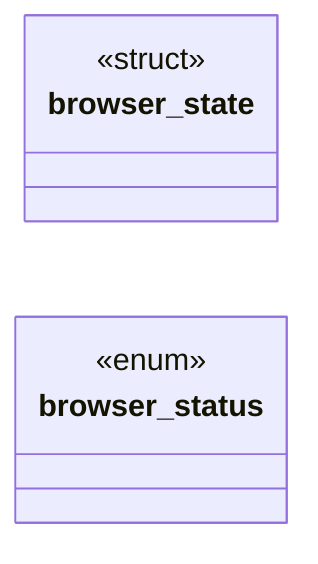

# `include/browser.h`

> Source: [include/browser.h:1](../../include/browser.h#L1) | language `h` | coverage 47.4% | [API index](../index.md)

## Contents

- **Structs:** [`browser_state`](#browser_state)
- **Enums:** [`browser_status`](#browser_status)
- **Functions:** [`state`](#state), [`browser_free`](#browser_free), [`browser_set_page`](#browser_set_page), [`browser_entry_doc`](#browser_entry_doc), [`browser_doc_index`](#browser_doc_index), [`browser_can_back`](#browser_can_back), [`browser_can_forward`](#browser_can_forward), [`browser_current_url`](#browser_current_url), [`browser_is_exception`](#browser_is_exception), [`browser_url_bar_selection`](#browser_url_bar_selection), [`browser_url_bar_delete_selection`](#browser_url_bar_delete_selection), [`copied`](#copied), [`browser_status_text`](#browser_status_text)
- **Macros:** [`BROWSER_URL_MAX`](#browser_url_max), [`BROWSER_STATUS_MAX`](#browser_status_max), [`BROWSER_STATUS_DURATION_MS`](#browser_status_duration_ms)

## Type Diagram



## Structs

<a id="browser_state"></a>

### `browser_state`

`struct` | [include/browser.h:27](../../include/browser.h#L27)

```c
typedef struct browser_state
```

---

## Enums

<a id="browser_status"></a>

### `browser_status`

`enum` | [include/browser.h:52](../../include/browser.h#L52)

```c
typedef enum browser_status
```

---

## Functions

<a id="state"></a>

### `state`

`function` | [include/browser.h:62](../../include/browser.h#L62)

```c
* state (frees old history and page buffers). */ browser_status browser_init(browser_state *bs);
```

**Parameters**

| Name | Type | Default | Description |
|---|---|---|---|
| `buffers` | `frees old history and page` |  |  |

**Returns:** `*`

---

<a id="browser_free"></a>

### `browser_free`

`function` | [include/browser.h:66](../../include/browser.h#L66)

```c
void browser_free(browser_state *bs);
```

Release all owned memory.

Safe on NULL and zero-initialised.

**Parameters**

| Name | Type | Default | Description |
|---|---|---|---|
| `bs` | `browser_state *` |  |  |

---

<a id="browser_set_page"></a>

### `browser_set_page`

`function` | [include/browser.h:71](../../include/browser.h#L71)

```c
* browser_set_page() with the result. */ browser_status browser_navigate(browser_state *bs, const char *url);
```

**Returns:** `*`

*Called by:* [`arrives`](gui.browser_ui.c.md#arrives)

---

<a id="browser_entry_doc"></a>

### `browser_entry_doc`

`function` | [include/browser.h:87](../../include/browser.h#L87)

```c
int browser_entry_doc(const browser_state *bs, size_t pos);
```

Document id of entry pos, or -1 when out of range / NULL.

**Parameters**

| Name | Type | Default | Description |
|---|---|---|---|
| `bs` | `browser_state *` |  |  |
| `pos` | `size_t` |  |  |

**Returns:** `int`

---

<a id="browser_doc_index"></a>

### `browser_doc_index`

`function` | [include/browser.h:91](../../include/browser.h#L91)

```c
int browser_doc_index(const browser_state *bs);
```

Index of the current entry within its document's contiguous run of entries (0 for the entry the document was loaded at) -- the worker's own history index.

**Parameters**

| Name | Type | Default | Description |
|---|---|---|---|
| `bs` | `browser_state *` |  |  |

**Returns:** `int`

---

<a id="browser_can_back"></a>

### `browser_can_back`

`function` | [include/browser.h:94](../../include/browser.h#L94)

```c
int browser_can_back(const browser_state *bs);
```

Query helpers.

**Parameters**

| Name | Type | Default | Description |
|---|---|---|---|
| `bs` | `browser_state *` |  |  |

**Returns:** `int`

---

<a id="browser_can_forward"></a>

### `browser_can_forward`

`function` | [include/browser.h:95](../../include/browser.h#L95)

```c
int browser_can_forward(const browser_state *bs);
```

**Parameters**

| Name | Type | Default | Description |
|---|---|---|---|
| `bs` | `browser_state *` |  |  |

**Returns:** `int`

---

<a id="browser_current_url"></a>

### `browser_current_url`

`function` `const` | [include/browser.h:96](../../include/browser.h#L96)

```c
const char *browser_current_url(const browser_state *bs);
```

**Parameters**

| Name | Type | Default | Description |
|---|---|---|---|
| `bs` | `browser_state *` |  |  |

**Returns:** `char *`

---

<a id="browser_is_exception"></a>

### `browser_is_exception`

`function` | [include/browser.h:99](../../include/browser.h#L99)

```c
int browser_is_exception(const browser_state *bs, const char *host);
```

Exception list: hosts explicitly allowed to use weak TLS.

**Parameters**

| Name | Type | Default | Description |
|---|---|---|---|
| `bs` | `browser_state *` |  |  |
| `host` | `char *` |  |  |

**Returns:** `int`

*Called by:* [`proceed`](gui.browser_ui.c.md#proceed)

---

<a id="browser_url_bar_selection"></a>

### `browser_url_bar_selection`

`function` | [include/browser.h:131](../../include/browser.h#L131)

```c
int browser_url_bar_selection(const browser_state *bs, size_t *start, size_t *len);
```

If a selection exists, writes its start offset and length and returns 1; else 0.

Lets the GUI copy/cut the selected text and paint the highlight. NULL-safe.

**Parameters**

| Name | Type | Default | Description |
|---|---|---|---|
| `bs` | `browser_state *` |  |  |
| `start` | `size_t *` |  |  |
| `len` | `size_t *` |  |  |

**Returns:** `int`

---

<a id="browser_url_bar_delete_selection"></a>

### `browser_url_bar_delete_selection`

`function` | [include/browser.h:135](../../include/browser.h#L135)

```c
int browser_url_bar_delete_selection(browser_state *bs);
```

Removes the selected range (if any), placing the cursor at its start; returns 1 if something was removed, else 0.

Used by cut and by an edit over a selection.

**Parameters**

| Name | Type | Default | Description |
|---|---|---|---|
| `bs` | `browser_state *` |  |  |

**Returns:** `int`

---

<a id="copied"></a>

### `copied`

`function` | [include/browser.h:143](../../include/browser.h#L143)

```c
* copied (truncated to fit) and shown until now_ms reaches the expiry * (now_ms + BROWSER_STATUS_DURATION_MS). A NULL or empty msg clears it. now_ms is a * caller-supplied monotonic millisecond clock,
```

**Parameters**

| Name | Type | Default | Description |
|---|---|---|---|
| `fit` | `truncated to` |  |  |

**Returns:** `*`

---

<a id="browser_status_text"></a>

### `browser_status_text`

`function` `const` | [include/browser.h:150](../../include/browser.h#L150)

```c
const char *browser_status_text(const browser_state *bs, uint64_t now_ms);
```

The active status text, or NULL when there is none or it has expired at now_ms.

**Parameters**

| Name | Type | Default | Description |
|---|---|---|---|
| `bs` | `browser_state *` |  |  |
| `now_ms` | `uint64_t` |  |  |

**Returns:** `char *`

---

## Macros

<a id="browser_url_max"></a>

### `BROWSER_URL_MAX`

`macro` | [include/browser.h:21](../../include/browser.h#L21)

```c
#define BROWSER_URL_MAX
```

---

<a id="browser_status_max"></a>

### `BROWSER_STATUS_MAX`

`macro` | [include/browser.h:24](../../include/browser.h#L24)

```c
#define BROWSER_STATUS_MAX
```

Transient status line (toast): capacity and how long it stays visible.

---

<a id="browser_status_duration_ms"></a>

### `BROWSER_STATUS_DURATION_MS`

`macro` | [include/browser.h:25](../../include/browser.h#L25)

```c
#define BROWSER_STATUS_DURATION_MS
```

---
