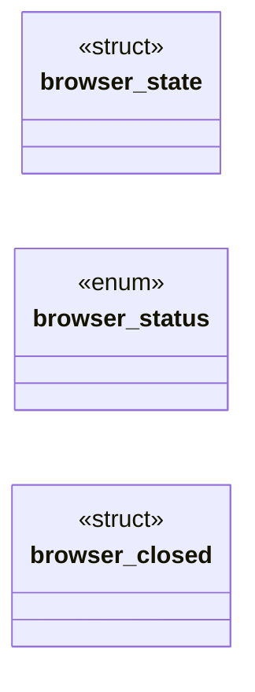

# `include/browser.h`

> Source: [include/browser.h:1](../../include/browser.h#L1) | language `h` | coverage 50.0% | [API index](../index.md)

## Contents

- **Structs:** [`browser_state`](#browser_state), [`browser_closed`](#browser_closed)
- **Enums:** [`browser_status`](#browser_status)
- **Functions:** [`state`](#state), [`browser_free`](#browser_free), [`browser_set_page`](#browser_set_page), [`one`](#one), [`browser_commit_pending`](#browser_commit_pending), [`browser_abort_pending`](#browser_abort_pending), [`browser_has_pending`](#browser_has_pending), [`browser_entry_doc`](#browser_entry_doc), [`browser_doc_index`](#browser_doc_index), [`browser_can_back`](#browser_can_back), [`browser_can_forward`](#browser_can_forward), [`browser_current_url`](#browser_current_url), [`browser_is_exception`](#browser_is_exception), [`browser_url_bar_selection`](#browser_url_bar_selection), [`browser_url_bar_delete_selection`](#browser_url_bar_delete_selection), [`copied`](#copied), [`browser_status_text`](#browser_status_text), [`browser_closed_pop`](#browser_closed_pop)
- **Macros:** [`BROWSER_URL_MAX`](#browser_url_max), [`BROWSER_STATUS_MAX`](#browser_status_max), [`BROWSER_STATUS_DURATION_MS`](#browser_status_duration_ms), [`BROWSER_CLOSED_MAX`](#browser_closed_max)

## Type Diagram



## Structs

<a id="browser_state"></a>

### `browser_state`

`struct` | [include/browser.h:27](../../include/browser.h#L27)

```c
typedef struct browser_state
```

---

<a id="browser_closed"></a>

### `browser_closed`

`struct` | [include/browser.h:177](../../include/browser.h#L177)

```c
typedef struct browser_closed
```

Transient status line (a toast, e.g.

"blocked: insecure http link"). msg is copied (truncated to fit) and shown until now_ms reaches the expiry (now_ms + BROWSER_STATUS_DURATION_MS). A NULL or empty msg clears it. now_ms is a caller-supplied monotonic millisecond clock, so this stays pure (no time syscall * here, fully testable). browser_status browser_set_status(browser_state *bs, const char *msg, uint64_t now_ms); /* The active status text, or NULL when there is none or it has expired at now_ms. const char *browser_status_text(const browser_state *bs, uint64_t now_ms); /* Recently closed tabs (Ctrl+Shift+T), newest last. In RAM only, never persisted. define BROWSER_CLOSED_MAX 10

---

## Enums

<a id="browser_status"></a>

### `browser_status`

`enum` | [include/browser.h:63](../../include/browser.h#L63)

```c
typedef enum browser_status
```

---

## Functions

<a id="state"></a>

### `state`

`function` | [include/browser.h:74](../../include/browser.h#L74)

```c
* state (frees old history and page buffers). */ browser_status browser_init(browser_state *bs);
```

**Parameters**

| Name | Type | Default | Description |
|---|---|---|---|
| `buffers` | `frees old history and page` |  |  |

**Returns:** `*`

---

<a id="browser_free"></a>

### `browser_free`

`function` | [include/browser.h:78](../../include/browser.h#L78)

```c
void browser_free(browser_state *bs);
```

Release all owned memory.

Safe on NULL and zero-initialised.

**Parameters**

| Name | Type | Default | Description |
|---|---|---|---|
| `bs` | `browser_state *` |  |  |

---

<a id="browser_set_page"></a>

### `browser_set_page`

`function` | [include/browser.h:83](../../include/browser.h#L83)

```c
* browser_set_page() with the result. */ browser_status browser_navigate(browser_state *bs, const char *url);
```

**Returns:** `*`

*Called by:* [`arrives`](gui.browser_ui.c.md#arrives)

---

<a id="one"></a>

### `one`

`function` | [include/browser.h:102](../../include/browser.h#L102)

```c
* A navigate while pending first aborts the pending one (the new one replaces it);
```

**Parameters**

| Name | Type | Default | Description |
|---|---|---|---|
| `it` | `the new one replaces` |  |  |

**Returns:** `* A navigate while pending first aborts the pending`

---

<a id="browser_commit_pending"></a>

### `browser_commit_pending`

`function` | [include/browser.h:105](../../include/browser.h#L105)

```c
void browser_commit_pending(browser_state *bs);
```

Provisional navigation (spec/browser.md 3c). commit: the document (or its error page) landed -- the entry stays and the stashed forward entries are freed. abort: Stop -- the history returns to exactly what it was before the pending navigation and the URL bar shows the current entry; 1 if something was reverted, else 0.

A navigate while pending first aborts the pending one (the new one replaces it); several back/forward steps are ONE pending navigation. push/replace_state while pending return BROWSER_ERR_PENDING. All NULL-safe.

**Parameters**

| Name | Type | Default | Description |
|---|---|---|---|
| `bs` | `browser_state *` |  |  |

*Called by:* [`arrives`](gui.browser_ui.c.md#arrives)

---

<a id="browser_abort_pending"></a>

### `browser_abort_pending`

`function` | [include/browser.h:106](../../include/browser.h#L106)

```c
int browser_abort_pending(browser_state *bs);
```

**Parameters**

| Name | Type | Default | Description |
|---|---|---|---|
| `bs` | `browser_state *` |  |  |

**Returns:** `int`

---

<a id="browser_has_pending"></a>

### `browser_has_pending`

`function` | [include/browser.h:107](../../include/browser.h#L107)

```c
int browser_has_pending(const browser_state *bs);
```

**Parameters**

| Name | Type | Default | Description |
|---|---|---|---|
| `bs` | `browser_state *` |  |  |

**Returns:** `int`

---

<a id="browser_entry_doc"></a>

### `browser_entry_doc`

`function` | [include/browser.h:110](../../include/browser.h#L110)

```c
int browser_entry_doc(const browser_state *bs, size_t pos);
```

Document id of entry pos, or -1 when out of range / NULL.

**Parameters**

| Name | Type | Default | Description |
|---|---|---|---|
| `bs` | `browser_state *` |  |  |
| `pos` | `size_t` |  |  |

**Returns:** `int`

---

<a id="browser_doc_index"></a>

### `browser_doc_index`

`function` | [include/browser.h:114](../../include/browser.h#L114)

```c
int browser_doc_index(const browser_state *bs);
```

Index of the current entry within its document's contiguous run of entries (0 for the entry the document was loaded at) -- the worker's own history index.

**Parameters**

| Name | Type | Default | Description |
|---|---|---|---|
| `bs` | `browser_state *` |  |  |

**Returns:** `int`

---

<a id="browser_can_back"></a>

### `browser_can_back`

`function` | [include/browser.h:117](../../include/browser.h#L117)

```c
int browser_can_back(const browser_state *bs);
```

Query helpers.

**Parameters**

| Name | Type | Default | Description |
|---|---|---|---|
| `bs` | `browser_state *` |  |  |

**Returns:** `int`

---

<a id="browser_can_forward"></a>

### `browser_can_forward`

`function` | [include/browser.h:118](../../include/browser.h#L118)

```c
int browser_can_forward(const browser_state *bs);
```

**Parameters**

| Name | Type | Default | Description |
|---|---|---|---|
| `bs` | `browser_state *` |  |  |

**Returns:** `int`

---

<a id="browser_current_url"></a>

### `browser_current_url`

`function` `const` | [include/browser.h:119](../../include/browser.h#L119)

```c
const char *browser_current_url(const browser_state *bs);
```

**Parameters**

| Name | Type | Default | Description |
|---|---|---|---|
| `bs` | `browser_state *` |  |  |

**Returns:** `char *`

---

<a id="browser_is_exception"></a>

### `browser_is_exception`

`function` | [include/browser.h:122](../../include/browser.h#L122)

```c
int browser_is_exception(const browser_state *bs, const char *host);
```

Exception list: hosts explicitly allowed to use weak TLS.

**Parameters**

| Name | Type | Default | Description |
|---|---|---|---|
| `bs` | `browser_state *` |  |  |
| `host` | `char *` |  |  |

**Returns:** `int`

*Called by:* [`proceed`](gui.browser_ui.c.md#proceed)

---

<a id="browser_url_bar_selection"></a>

### `browser_url_bar_selection`

`function` | [include/browser.h:154](../../include/browser.h#L154)

```c
int browser_url_bar_selection(const browser_state *bs, size_t *start, size_t *len);
```

If a selection exists, writes its start offset and length and returns 1; else 0.

Lets the GUI copy/cut the selected text and paint the highlight. NULL-safe.

**Parameters**

| Name | Type | Default | Description |
|---|---|---|---|
| `bs` | `browser_state *` |  |  |
| `start` | `size_t *` |  |  |
| `len` | `size_t *` |  |  |

**Returns:** `int`

---

<a id="browser_url_bar_delete_selection"></a>

### `browser_url_bar_delete_selection`

`function` | [include/browser.h:158](../../include/browser.h#L158)

```c
int browser_url_bar_delete_selection(browser_state *bs);
```

Removes the selected range (if any), placing the cursor at its start; returns 1 if something was removed, else 0.

Used by cut and by an edit over a selection.

**Parameters**

| Name | Type | Default | Description |
|---|---|---|---|
| `bs` | `browser_state *` |  |  |

**Returns:** `int`

---

<a id="copied"></a>

### `copied`

`function` | [include/browser.h:166](../../include/browser.h#L166)

```c
* copied (truncated to fit) and shown until now_ms reaches the expiry * (now_ms + BROWSER_STATUS_DURATION_MS). A NULL or empty msg clears it. now_ms is a * caller-supplied monotonic millisecond clock,
```

**Parameters**

| Name | Type | Default | Description |
|---|---|---|---|
| `fit` | `truncated to` |  |  |

**Returns:** `*`

---

<a id="browser_status_text"></a>

### `browser_status_text`

`function` `const` | [include/browser.h:173](../../include/browser.h#L173)

```c
const char *browser_status_text(const browser_state *bs, uint64_t now_ms);
```

The active status text, or NULL when there is none or it has expired at now_ms.

**Parameters**

| Name | Type | Default | Description |
|---|---|---|---|
| `bs` | `browser_state *` |  |  |
| `now_ms` | `uint64_t` |  |  |

**Returns:** `char *`

---

<a id="browser_closed_pop"></a>

### `browser_closed_pop`

`function` | [include/browser.h:188](../../include/browser.h#L188)

```c
int browser_closed_pop(browser_closed *c, char *out, size_t cap);
```

Takes the most recently closed URL into out[cap].

1 = taken, 0 = none (or it does not fit, in which case it stays).

**Parameters**

| Name | Type | Default | Description |
|---|---|---|---|
| `c` | `browser_closed *` |  |  |
| `out` | `char *` |  |  |
| `cap` | `size_t` |  |  |

**Returns:** `int`

---

## Macros

<a id="browser_url_max"></a>

### `BROWSER_URL_MAX`

`macro` | [include/browser.h:21](../../include/browser.h#L21)

```c
#define BROWSER_URL_MAX
```

---

<a id="browser_status_max"></a>

### `BROWSER_STATUS_MAX`

`macro` | [include/browser.h:24](../../include/browser.h#L24)

```c
#define BROWSER_STATUS_MAX
```

Transient status line (toast): capacity and how long it stays visible.

---

<a id="browser_status_duration_ms"></a>

### `BROWSER_STATUS_DURATION_MS`

`macro` | [include/browser.h:25](../../include/browser.h#L25)

```c
#define BROWSER_STATUS_DURATION_MS
```

---

<a id="browser_closed_max"></a>

### `BROWSER_CLOSED_MAX`

`macro` | [include/browser.h:176](../../include/browser.h#L176)

```c
#define BROWSER_CLOSED_MAX
```

Recently closed tabs (Ctrl+Shift+T), newest last.

In RAM only, never persisted.

---
