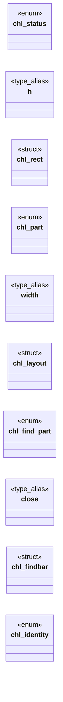

# `include/chrome_layout.h`

> Source: [include/chrome_layout.h:1](../../include/chrome_layout.h#L1) | language `h` | coverage 41.9% | [API index](../index.md)

## Contents

- **Structs:** [`chl_rect`](#chl_rect), [`chl_layout`](#chl_layout), [`chl_findbar`](#chl_findbar)
- **Enums:** [`chl_status`](#chl_status), [`chl_part`](#chl_part), [`chl_find_part`](#chl_find_part), [`chl_identity`](#chl_identity)
- **Type Aliases:** [`h`](#h), [`width`](#width), [`close`](#close)
- **Functions:** [`chl_tab_rect`](#chl_tab_rect), [`chl_tab_close_rect`](#chl_tab_close_rect), [`chl_rect_has`](#chl_rect_has), [`chl_identity_label`](#chl_identity_label)
- **Macros:** [`CHL_PAD`](#chl_pad), [`CHL_TAB_TOP_GAP`](#chl_tab_top_gap), [`CHL_TAB_MIN_W`](#chl_tab_min_w), [`CHL_TAB_MAX_W`](#chl_tab_max_w), [`CHL_TAB_GAP`](#chl_tab_gap), [`CHL_TAB_CLOSE`](#chl_tab_close), [`CHL_TAB_CLOSE_MIN_W`](#chl_tab_close_min_w), [`CHL_NEWTAB_W`](#chl_newtab_w), [`CHL_WIN_BTN_W`](#chl_win_btn_w), [`CHL_DRAG_MIN`](#chl_drag_min), [`CHL_BTN`](#chl_btn), [`CHL_BTN_GAP`](#chl_btn_gap), [`CHL_ID_W`](#chl_id_w), [`CHL_FIND_FIELD_W`](#chl_find_field_w), [`CHL_FIND_BTN`](#chl_find_btn), [`CHL_FIND_COUNT_W`](#chl_find_count_w)

## Type Diagram



## Structs

<a id="chl_rect"></a>

### `chl_rect`

`struct` | [include/chrome_layout.h:34](../../include/chrome_layout.h#L34)

```c
typedef struct chl_rect { double x, y, w, h; } chl_rect;
```

---

<a id="chl_layout"></a>

### `chl_layout`

`struct` | [include/chrome_layout.h:54](../../include/chrome_layout.h#L54)

```c
typedef struct chl_layout
```

---

<a id="chl_findbar"></a>

### `chl_findbar`

`struct` | [include/chrome_layout.h:101](../../include/chrome_layout.h#L101)

```c
typedef struct chl_findbar
```

---

## Enums

<a id="chl_status"></a>

### `chl_status`

`enum` | [include/chrome_layout.h:32](../../include/chrome_layout.h#L32)

```c
typedef enum chl_status { CHL_OK = 0, CHL_EINVAL = -1 } chl_status;
```

---

<a id="chl_part"></a>

### `chl_part`

`enum` | [include/chrome_layout.h:36](../../include/chrome_layout.h#L36)

```c
typedef enum chl_part
```

---

<a id="chl_find_part"></a>

### `chl_find_part`

`enum` | [include/chrome_layout.h:92](../../include/chrome_layout.h#L92)

```c
typedef enum chl_find_part
```

---

<a id="chl_identity"></a>

### `chl_identity`

`enum` | [include/chrome_layout.h:114](../../include/chrome_layout.h#L114)

```c
typedef enum chl_identity
```

---

## Type Aliases

<a id="h"></a>

### `h`

`type_alias` | [include/chrome_layout.h:33](../../include/chrome_layout.h#L33)

```c
typedef struct chl_rect { double x, y, w, h;
```

---

<a id="width"></a>

### `width`

`type_alias` | [include/chrome_layout.h:53](../../include/chrome_layout.h#L53)

```c
typedef struct chl_layout { double width;
```

---

<a id="close"></a>

### `close`

`type_alias` | [include/chrome_layout.h:100](../../include/chrome_layout.h#L100)

```c
typedef struct chl_findbar { chl_rect bar, field, prev, next, count, close;
```

---

## Functions

<a id="chl_tab_rect"></a>

### `chl_tab_rect`

`function` | [include/chrome_layout.h:74](../../include/chrome_layout.h#L74)

```c
int chl_tab_rect(const chl_layout *l, int i, chl_rect *r);
```

Tab i's rectangle / its close button.

1 if it exists (visible), else 0.

**Parameters**

| Name | Type | Default | Description |
|---|---|---|---|
| `l` | `chl_layout *` |  |  |
| `i` | `int` |  |  |
| `r` | `chl_rect *` |  |  |

**Returns:** `int`

---

<a id="chl_tab_close_rect"></a>

### `chl_tab_close_rect`

`function` | [include/chrome_layout.h:75](../../include/chrome_layout.h#L75)

```c
int chl_tab_close_rect(const chl_layout *l, int i, chl_rect *r);
```

**Parameters**

| Name | Type | Default | Description |
|---|---|---|---|
| `l` | `chl_layout *` |  |  |
| `i` | `int` |  |  |
| `r` | `chl_rect *` |  |  |

**Returns:** `int`

---

<a id="chl_rect_has"></a>

### `chl_rect_has`

`function` | [include/chrome_layout.h:78](../../include/chrome_layout.h#L78)

```c
int chl_rect_has(chl_rect r, double x, double y);
```

1 if (x, y) lies inside r (half-open on the right and bottom).

**Parameters**

| Name | Type | Default | Description |
|---|---|---|---|
| `r` | `chl_rect` |  |  |
| `x` | `double` |  |  |
| `y` | `double` |  |  |

**Returns:** `int`

---

<a id="chl_identity_label"></a>

### `chl_identity_label`

`function` `const` | [include/chrome_layout.h:133](../../include/chrome_layout.h#L133)

```c
const char *chl_identity_label(chl_identity id);
```

Short English label for the badge (static, never NULL).

**Parameters**

| Name | Type | Default | Description |
|---|---|---|---|
| `id` | `chl_identity` |  |  |

**Returns:** `char *`

---

## Macros

<a id="chl_pad"></a>

### `CHL_PAD`

`macro` | [include/chrome_layout.h:17](../../include/chrome_layout.h#L17)

```c
#define CHL_PAD
```

row 2: navigation buttons, URL pill, menu

---

<a id="chl_tab_top_gap"></a>

### `CHL_TAB_TOP_GAP`

`macro` | [include/chrome_layout.h:18](../../include/chrome_layout.h#L18)

```c
#define CHL_TAB_TOP_GAP
```

outer horizontal padding of both rows

---

<a id="chl_tab_min_w"></a>

### `CHL_TAB_MIN_W`

`macro` | [include/chrome_layout.h:19](../../include/chrome_layout.h#L19)

```c
#define CHL_TAB_MIN_W
```

space above a tab inside row 1

---

<a id="chl_tab_max_w"></a>

### `CHL_TAB_MAX_W`

`macro` | [include/chrome_layout.h:20](../../include/chrome_layout.h#L20)

```c
#define CHL_TAB_MAX_W
```

---

<a id="chl_tab_gap"></a>

### `CHL_TAB_GAP`

`macro` | [include/chrome_layout.h:21](../../include/chrome_layout.h#L21)

```c
#define CHL_TAB_GAP
```

---

<a id="chl_tab_close"></a>

### `CHL_TAB_CLOSE`

`macro` | [include/chrome_layout.h:22](../../include/chrome_layout.h#L22)

```c
#define CHL_TAB_CLOSE
```

space between two tabs

---

<a id="chl_tab_close_min_w"></a>

### `CHL_TAB_CLOSE_MIN_W`

`macro` | [include/chrome_layout.h:23](../../include/chrome_layout.h#L23)

```c
#define CHL_TAB_CLOSE_MIN_W
```

square close button inside a tab

---

<a id="chl_newtab_w"></a>

### `CHL_NEWTAB_W`

`macro` | [include/chrome_layout.h:24](../../include/chrome_layout.h#L24)

```c
#define CHL_NEWTAB_W
```

narrower inactive tabs hide their close button

---

<a id="chl_win_btn_w"></a>

### `CHL_WIN_BTN_W`

`macro` | [include/chrome_layout.h:25](../../include/chrome_layout.h#L25)

```c
#define CHL_WIN_BTN_W
```

---

<a id="chl_drag_min"></a>

### `CHL_DRAG_MIN`

`macro` | [include/chrome_layout.h:26](../../include/chrome_layout.h#L26)

```c
#define CHL_DRAG_MIN
```

---

<a id="chl_btn"></a>

### `CHL_BTN`

`macro` | [include/chrome_layout.h:27](../../include/chrome_layout.h#L27)

```c
#define CHL_BTN
```

CSD: drag area always kept free in row 1

---

<a id="chl_btn_gap"></a>

### `CHL_BTN_GAP`

`macro` | [include/chrome_layout.h:28](../../include/chrome_layout.h#L28)

```c
#define CHL_BTN_GAP
```

round toolbar button diameter

---

<a id="chl_id_w"></a>

### `CHL_ID_W`

`macro` | [include/chrome_layout.h:30](../../include/chrome_layout.h#L30)

```c
#define CHL_ID_W
```

---

<a id="chl_find_field_w"></a>

### `CHL_FIND_FIELD_W`

`macro` | [include/chrome_layout.h:87](../../include/chrome_layout.h#L87)

```c
#define CHL_FIND_FIELD_W
```

bar height

---

<a id="chl_find_btn"></a>

### `CHL_FIND_BTN`

`macro` | [include/chrome_layout.h:89](../../include/chrome_layout.h#L89)

```c
#define CHL_FIND_BTN
```

---

<a id="chl_find_count_w"></a>

### `CHL_FIND_COUNT_W`

`macro` | [include/chrome_layout.h:90](../../include/chrome_layout.h#L90)

```c
#define CHL_FIND_COUNT_W
```

prev / next / close square buttons

---
