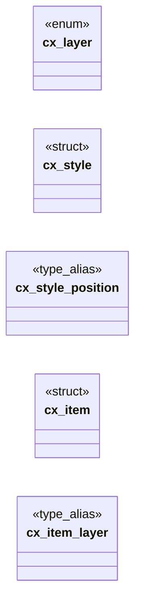

# `include/compositor.h`

> Source: [include/compositor.h:1](../../include/compositor.h#L1) | language `h` | coverage 88.9% | [API index](../index.md)

## Contents

- **Structs:** [`cx_style`](#cx_style), [`cx_item`](#cx_item)
- **Enums:** [`cx_layer`](#cx_layer)
- **Functions:** [`cx_forms_stacking_context`](#cx_forms_stacking_context), [`cx_item_compare`](#cx_item_compare), [`cx_sort`](#cx_sort)

## Type Diagram



## Structs

<a id="cx_style"></a>

### `cx_style`

`struct` | [include/compositor.h:46](../../include/compositor.h#L46)

```c
typedef struct cx_style
```

A box's resolved style, in the SAME value-spaces as css.h: position uses css_position (CSS_POS_STATIC/RELATIVE/ABSOLUTE/FIXED/STICKY), mix_blend uses css_mix_blend (0 unset, CSS_MB_NORMAL, or a real blend), isolation uses css_isolation (0 unset, CSS_ISO_AUTO, CSS_ISO_ISOLATE). z_auto == 1 means the z-index is auto/unset (z_index is then ignored). opacity is a percent 0..100, or -1 for unset (opaque). is_float / is_inline classify the box's in-flow role. has_transform (M1.2): 1 iff the box has an author `transform` other than none (today: translate()/translateX()/translateY() only) -- a transformed element establishes a stacking context per spec regardless of the actual offset.

**Members**

| Member | Kind | Summary |
|---|---|---|
| [`position`](#cx_style-position) | type_alias | A box's resolved style, in the SAME value-spaces as css.h: position uses css_position (CSS_POS_STATIC/RELATIVE/ABSOLUTE/FIXED/STICKY), mix_blend uses... |

<a id="cx_style-position"></a>

#### `cx_style.position`

`type_alias` | [include/compositor.h:46](../../include/compositor.h#L46)

```c
typedef struct cx_style { int position;
```

A box's resolved style, in the SAME value-spaces as css.h: position uses css_position (CSS_POS_STATIC/RELATIVE/ABSOLUTE/FIXED/STICKY), mix_blend uses css_mix_blend (0 unset, CSS_MB_NORMAL, or a real blend), isolation uses css_isolation (0 unset, CSS_ISO_AUTO, CSS_ISO_ISOLATE). z_auto == 1 means the z-index is auto/unset (z_index is then ignored). opacity is a percent 0..100, or -1 for unset (opaque). is_float / is_inline classify the box's in-flow role. has_transform (M1.2): 1 iff the box has an author `transform` other than none (today: translate()/translateX()/translateY() only) -- a transformed element establishes a stacking context per spec regardless of the actual offset.

---

<a id="cx_item"></a>

### `cx_item`

`struct` | [include/compositor.h:69](../../include/compositor.h#L69)

```c
typedef struct cx_item
```

One box to order for painting: its layer, z-index (z_auto treated as 0 within the ZERO_Z layer), document order (stable tie-break), and an opaque caller handle (e.g. a box index) that this module never interprets.

**Members**

| Member | Kind | Summary |
|---|---|---|
| [`layer`](#cx_item-layer) | type_alias | One box to order for painting: its layer, z-index (z_auto treated as 0 within the ZERO_Z layer), document order (stable tie-break), and an opaque caller handle... |

<a id="cx_item-layer"></a>

#### `cx_item.layer`

`type_alias` | [include/compositor.h:69](../../include/compositor.h#L69)

```c
typedef struct cx_item { cx_layer layer;
```

One box to order for painting: its layer, z-index (z_auto treated as 0 within the ZERO_Z layer), document order (stable tie-break), and an opaque caller handle (e.g. a box index) that this module never interprets.

---

## Enums

<a id="cx_layer"></a>

### `cx_layer`

`enum` | [include/compositor.h:27](../../include/compositor.h#L27)

```c
typedef enum cx_layer
```

Paint-order layers within one stacking context, back to front (CSS 2.1 App E).

---

## Functions

<a id="cx_forms_stacking_context"></a>

### `cx_forms_stacking_context`

`function` | [include/compositor.h:60](../../include/compositor.h#L60)

```c
int cx_forms_stacking_context(const cx_style *s);
```

Does this box establish a stacking context?

(The root context is the caller's.) NULL-safe: returns 0. See spec/compositor.md section 2 for the rule set.

**Parameters**

| Name | Type | Default | Description |
|---|---|---|---|
| `s` | `cx_style *` |  |  |

**Returns:** `int`

---

<a id="cx_item_compare"></a>

### `cx_item_compare`

`function` | [include/compositor.h:80](../../include/compositor.h#L80)

```c
int cx_item_compare(const cx_item *a, const cx_item *b);
```

Total paint order: layer ascending, then z-index ascending (auto == 0), then document order ascending.

Returns <0, 0 or >0 like a qsort comparator. NULL-safe (a NULL operand sorts first, defensively).

**Parameters**

| Name | Type | Default | Description |
|---|---|---|---|
| `a` | `cx_item *` |  |  |
| `b` | `cx_item *` |  |  |

**Returns:** `int`

---

<a id="cx_sort"></a>

### `cx_sort`

`function` | [include/compositor.h:84](../../include/compositor.h#L84)

```c
void cx_sort(cx_item *items, size_t n);
```

Stable in-place sort of [`items`](gui.browser_ui.c.md#items) into paint order (uses cx_item_compare).

Stable: equal keys keep their original relative order. NULL or n == 0 is a no-op.

**Parameters**

| Name | Type | Default | Description |
|---|---|---|---|
| `items` | `cx_item *` |  |  |
| `n` | `size_t` |  |  |

*Called by:* [`bt_resolve_positioning_ex`](src.box_tree.c.md#bt_resolve_positioning_ex)

---
