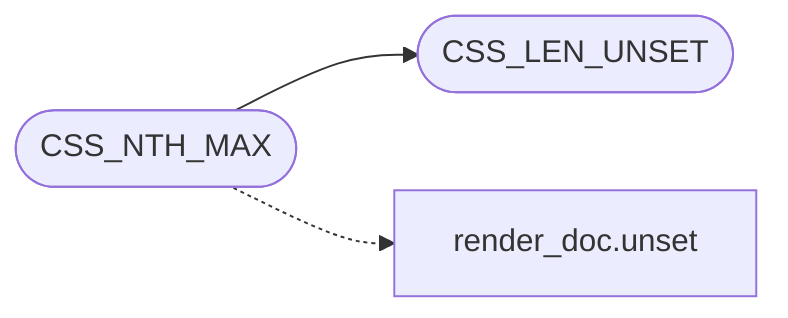

# `include/css.h`

> Source: [include/css.h:1](../../include/css.h#L1) | language `h` | coverage 73.2% | [API index](../index.md)

## Contents

- **Structs:** [`css_style`](#css_style), [`css_sel`](#css_sel), [`css_drop`](#css_drop), [`css_drop_log`](#css_drop_log), [`css_attr`](#css_attr), [`css_element`](#css_element), [`cvr_table`](#cvr_table)
- **Enums:** [`css_status`](#css_status), [`css_align`](#css_align), [`css_display`](#css_display), [`css_justify`](#css_justify), [`css_font_family`](#css_font_family), [`css_text_transform`](#css_text_transform), [`css_valign`](#css_valign), [`css_white_space`](#css_white_space), [`css_list_style`](#css_list_style), [`css_position`](#css_position), [`css_box_sizing`](#css_box_sizing), [`css_border_style`](#css_border_style), [`css_flex_direction`](#css_flex_direction), [`css_flex_wrap`](#css_flex_wrap), [`css_align_kw`](#css_align_kw), [`css_grid_flow`](#css_grid_flow), [`css_float`](#css_float), [`css_clear`](#css_clear), [`css_visibility`](#css_visibility), [`css_overflow`](#css_overflow), [`css_cursor`](#css_cursor), [`css_text_overflow`](#css_text_overflow), [`css_word_break`](#css_word_break), [`css_text_decoration_style`](#css_text_decoration_style), [`css_direction`](#css_direction), [`css_border_collapse`](#css_border_collapse), [`css_empty_cells`](#css_empty_cells), [`css_caption_side`](#css_caption_side), [`css_table_layout`](#css_table_layout), [`css_font_variant`](#css_font_variant), [`css_hyphens`](#css_hyphens), [`css_user_select`](#css_user_select), [`css_appearance`](#css_appearance), [`css_pointer_events`](#css_pointer_events), [`css_bg_repeat`](#css_bg_repeat), [`css_bg_size`](#css_bg_size), [`css_bg_clip`](#css_bg_clip), [`css_bg_origin`](#css_bg_origin), [`css_bg_attachment`](#css_bg_attachment), [`css_isolation`](#css_isolation), [`css_content_visibility`](#css_content_visibility), [`css_image_rendering`](#css_image_rendering), [`css_color_scheme`](#css_color_scheme), [`css_print_color_adjust`](#css_print_color_adjust), [`css_forced_color_adjust`](#css_forced_color_adjust), [`css_mix_blend`](#css_mix_blend), [`css_object_fit`](#css_object_fit), [`css_list_pos`](#css_list_pos), [`css_font_kerning`](#css_font_kerning), [`css_text_rendering`](#css_text_rendering), [`css_font_stretch`](#css_font_stretch), [`css_resize`](#css_resize), [`css_scroll_behavior`](#css_scroll_behavior), [`css_touch_action`](#css_touch_action), [`css_overscroll`](#css_overscroll), [`css_column_fill`](#css_column_fill), [`css_column_span`](#css_column_span), [`css_backface`](#css_backface), [`css_pct_slot`](#css_pct_slot), [`css_drop_cause`](#css_drop_cause)
- **Type Aliases:** [`color`](#color), [`css_sheet`](#css_sheet)
- **Functions:** [`verbatim`](#verbatim), [`POINTER`](#pointer), [`palette`](#palette), [`css_free`](#css_free), [`order`](#order), [`inherited_px`](#inherited_px), [`css_font_face_count`](#css_font_face_count), [`css_font_face_at`](#css_font_face_at), [`css_resolve_anim_keyframes`](#css_resolve_anim_keyframes)
- **Macros:** [`CSS_GAP_MAX`](#css_gap_max), [`CSS_GRID_COLS_MAX`](#css_grid_cols_max), [`CSS_GRID_TRACKS_MAX`](#css_grid_tracks_max), [`CSS_GRID_AREAS_MAX`](#css_grid_areas_max), [`CSS_GRAD_STOPS_MAX`](#css_grad_stops_max), [`CSS_LINE_MIN`](#css_line_min), [`CSS_LINE_MAX`](#css_line_max), [`CSS_LINE_ABS_BASE`](#css_line_abs_base), [`CSS_LINE_ABS_MAX_PX`](#css_line_abs_max_px), [`CSS_SVG_PAINT_NONE`](#css_svg_paint_none), [`CSS_FONT_LIST_MAX`](#css_font_list_max), [`CSS_URL_MAX`](#css_url_max), [`CSS_DECO_UNDERLINE`](#css_deco_underline), [`CSS_DECO_LINE_THROUGH`](#css_deco_line_through), [`CSS_DECO_OVERLINE`](#css_deco_overline), [`CSS_CONTAIN_SIZE`](#css_contain_size), [`CSS_CONTAIN_LAYOUT`](#css_contain_layout), [`CSS_CONTAIN_STYLE`](#css_contain_style), [`CSS_CONTAIN_PAINT`](#css_contain_paint), [`CSS_BORDER_W_MAX`](#css_border_w_max), [`CSS_BORDER_SPACING_MAX`](#css_border_spacing_max), [`CSS_FLEX_FACTOR_MAX`](#css_flex_factor_max), [`CSS_GRID_SPAN_MAX`](#css_grid_span_max), [`CSS_SPACING_MAX`](#css_spacing_max), [`CSS_SHADOW_MAX`](#css_shadow_max), [`CSS_BSHADOW_LAYERS`](#css_bshadow_layers), [`CSS_LEN_MAX`](#css_len_max), [`CSS_LEN_UNSET`](#css_len_unset), [`CSS_LEN_AUTO`](#css_len_auto), [`CSS_LEN_END`](#css_len_end), [`CSS_LEN_MIN_CONTENT`](#css_len_min_content), [`CSS_LEN_MAX_CONTENT`](#css_len_max_content), [`CSS_LEN_FIT_CONTENT`](#css_len_fit_content), [`CSS_LEN_IS_INTRINSIC`](#css_len_is_intrinsic), [`CSS_PCT_MAX`](#css_pct_max), [`CSS_EM_MILLI_MAX`](#css_em_milli_max), [`CSS_FONT_SIZE_MAX`](#css_font_size_max), [`CSS_COLUMN_COUNT_MAX`](#css_column_count_max), [`CSS_MAX_COMPOUNDS`](#css_max_compounds), [`CSS_MAX_ATTR_SEL`](#css_max_attr_sel), [`CSS_MAX_PSEUDO_SEL`](#css_max_pseudo_sel), [`CSS_NTH_MAX`](#css_nth_max), [`CSS_MEDIA_DEFAULT_WIDTH`](#css_media_default_width), [`CSS_MEDIA_DEFAULT_HEIGHT`](#css_media_default_height), [`CSS_DROP_PROP_MAX`](#css_drop_prop_max), [`CSS_DROP_VAL_MAX`](#css_drop_val_max), [`CSS_PSEUDO_BEFORE`](#css_pseudo_before), [`CSS_PSEUDO_AFTER`](#css_pseudo_after), [`CSS_PSEUDO_PLACEHOLDER`](#css_pseudo_placeholder)

## Type Diagram

```mermaid
classDiagram
    direction LR
    class css_status
    <<enum>> css_status
    class css_align
    <<enum>> css_align
    class css_display
    <<enum>> css_display
    class css_justify
    <<enum>> css_justify
    class css_font_family
    <<enum>> css_font_family
    class css_text_transform
    <<enum>> css_text_transform
    class css_valign
    <<enum>> css_valign
    class css_white_space
    <<enum>> css_white_space
    class css_list_style
    <<enum>> css_list_style
    class css_position
    <<enum>> css_position
    class css_box_sizing
    <<enum>> css_box_sizing
    class css_border_style
    <<enum>> css_border_style
    class css_flex_direction
    <<enum>> css_flex_direction
    class css_flex_wrap
    <<enum>> css_flex_wrap
    class css_align_kw
    <<enum>> css_align_kw
    class css_grid_flow
    <<enum>> css_grid_flow
    class css_float
    <<enum>> css_float
    class css_clear
    <<enum>> css_clear
    class css_visibility
    <<enum>> css_visibility
    class css_overflow
    <<enum>> css_overflow
    class css_cursor
    <<enum>> css_cursor
    class css_text_overflow
    <<enum>> css_text_overflow
    class css_word_break
    <<enum>> css_word_break
    class css_text_decoration_style
    <<enum>> css_text_decoration_style
```



## Call Graph

Solid arrows stay in this module, dashed arrows leave it.



## Structs

<a id="css_style"></a>

### `css_style`

`struct` | [include/css.h:578](../../include/css.h#L578)

```c
typedef struct css_style
```

A resolved presentation.

Each field uses a sentinel for "unset" so the caller can layer inheritance (take the first ancestor that sets each inheriting one). The flex/grid container fields (gap/justify/grid_cols) are NOT inherited: they describe the container element itself, so the caller reads them from that element's resolved style, not up the ancestor chain.

**Members**

| Member | Kind | Summary |
|---|---|---|
| [`family`](#css_style-family) | method |  |
| [`translate`](#css_style-translate) | method |  |
| [`scaleY`](#css_style-scaley) | method |  |
| [`declared`](#css_style-declared) | method |  |
| [`element`](#css_style-element) | method |  |
| [`slots`](#css_style-slots) | method |  |
| [`CSS_MAX_KF_STOPS`](#css_style-css_max_kf_stops) | macro | Resolved @keyframes data (Phase R1c): the keyframe stops from the matching @keyframes rule, resolved after cascade. anim_nkf=0 means no keyframes (use default... |

<a id="css_style-family"></a>

#### `css_style.family`

`method` | [include/css.h:676](../../include/css.h#L676)

```c
* LOCAL family (spec/text_shape.md section 7);
```

**Parameters**

| Name | Type | Default | Description |
|---|---|---|---|
| `section` | `spec/text_shape.md 7` |  |  |

**Returns:** `* LOCAL`

<a id="css_style-translate"></a>

#### `css_style.translate`

`method` | [include/css.h:842](../../include/css.h#L842)

```c
* translate()/translateX()/translateY();
```

**Returns:** `*`

*Called by:* [`function`](src.css.c.md#function)

<a id="css_style-scaley"></a>

#### `css_style.scaleY`

`method` | [include/css.h:843](../../include/css.h#L843)

```c
* scaleY() as a PERCENT of identity (100 = scale(1), matching font_scale's * convention);
```

**Returns:** `*`

<a id="css_style-declared"></a>

#### `css_style.declared`

`method` | [include/css.h:847](../../include/css.h#L847)

```c
* function was not declared (identity: 0 offset / 100% scale / 0deg). * Percentage translate arguments are not supported (the whole declaration * fails closed to unset -- see expand_transform in css.c
```

**Parameters**

| Name | Type | Default | Description |
|---|---|---|---|
| `deg` | `identity: 0 offset / 100% scale / 0` |  |  |

**Returns:** `* was not`

<a id="css_style-element"></a>

#### `css_style.element`

`method` | [include/css.h:852](../../include/css.h#L852)

```c
* so two different rules matching the same element (e.g. one setting * translate, a more specific one setting rotate) can still combine -- see * expand_transform's comment. A box with any field set (e
```

**Parameters**

| Name | Type | Default | Description |
|---|---|---|---|
| `translate` | `e.g. one setting *` |  |  |
| `rotate` | `a more specific one setting` |  |  |

**Returns:** `* so two different rules matching the same`

*Called by:* [`pv_build_styled`](src.page_view.c.md#pv_build_styled)

<a id="css_style-slots"></a>

#### `css_style.slots`

`method` | [include/css.h:859](../../include/css.h#L859)

```c
* parse time into ALL seven slots (singular matrices fail closed);
```

**Parameters**

| Name | Type | Default | Description |
|---|---|---|---|
| `closed` | `singular matrices fail` |  |  |

**Returns:** `* parse time into ALL seven`

<a id="css_style-css_max_kf_stops"></a>

#### `css_style.CSS_MAX_KF_STOPS`

`macro` | [include/css.h:882](../../include/css.h#L882)

```c
#define CSS_MAX_KF_STOPS
```

Resolved @keyframes data (Phase R1c): the keyframe stops from the matching @keyframes rule, resolved after cascade. anim_nkf=0 means no keyframes (use default 0→100 opacity).

---

<a id="css_sel"></a>

### `css_sel`

`struct` | [include/css.h:971](../../include/css.h#L971)

```c
struct css_sel; /* css_select.h */
```

Render-time media context for evaluating @media at parse time. width_px is a fixed, normalized desktop width, so a (min/max-width) query leaks no real viewport size (anti-fingerprinting).

**Members**

| Member | Kind | Summary |
|---|---|---|
| [`prefers_dark`](#css_sel-prefers_dark) | type_alias | css_select.h |
| [`css_media`](#css_sel-css_media) | struct |  |

<a id="css_sel-prefers_dark"></a>

#### `css_sel.prefers_dark`

`type_alias` | [include/css.h:972](../../include/css.h#L972)

```c
typedef struct css_media { int prefers_dark;
```

css_select.h

<a id="css_sel-css_media"></a>

#### `css_sel.css_media`

`struct` | [include/css.h:973](../../include/css.h#L973)

```c
typedef struct css_media
```

---

<a id="css_drop"></a>

### `css_drop`

`struct` | [include/css.h:1037](../../include/css.h#L1037)

```c
typedef struct css_drop
```

One coalesced drop: every occurrence of the same (property, cause) pair folds into a single entry, because a real sheet repeats one unsupported property hundreds of times and an un-grouped listing is unreadable.

`val` samples the FIRST occurrence, bounded and sanitised (control bytes -> '.'), because it is hostile remote text headed for a terminal.

**Members**

| Member | Kind | Summary |
|---|---|---|
| [`prop`](#css_drop-prop) | type_alias | One coalesced drop: every occurrence of the same (property, cause) pair folds into a single entry, because a real sheet repeats one unsupported property... |

<a id="css_drop-prop"></a>

#### `css_drop.prop`

`type_alias` | [include/css.h:1037](../../include/css.h#L1037)

```c
typedef struct css_drop { char prop[CSS_DROP_PROP_MAX];
```

One coalesced drop: every occurrence of the same (property, cause) pair folds into a single entry, because a real sheet repeats one unsupported property hundreds of times and an un-grouped listing is unreadable.

`val` samples the FIRST occurrence, bounded and sanitised (control bytes -> '.'), because it is hostile remote text headed for a terminal.

---

<a id="css_drop_log"></a>

### `css_drop_log`

`struct` | [include/css.h:1049](../../include/css.h#L1049)

```c
typedef struct css_drop_log
```

Optional write-only sink the parser fills while parsing.

[`items`](gui.browser_ui.c.md#items) is CALLER-OWNED (the parser allocates nothing, so the log adds no OOM path); items == NULL or cap == 0 disables the listing but NOT the counting, so a report can always state the true magnitude ("N dropped, first M listed") instead of silently understating it. Nothing recorded here feeds back into the cascade.

---

<a id="css_attr"></a>

### `css_attr`

`struct` | [include/css.h:1078](../../include/css.h#L1078)

```c
typedef struct css_attr
```

One element attribute, for attribute selectors ([attr], [attr=v], [attr~=v], ...). name is the lowercased local name; value is the attribute text ("" if empty).

Both alias caller storage (nothing is copied/owned).

---

<a id="css_element"></a>

### `css_element`

`struct` | [include/css.h:1088](../../include/css.h#L1088)

```c
typedef struct css_element
```

An element plus its ancestor chain, for combinator matching.

Each field aliases caller storage (nothing is copied/owned). parent walks toward the root (NULL at the top). A bounded/partial chain is fine: a descendant compound that would have matched a missing deeper ancestor simply does not match (fail closed). attrs/nattrs may be empty (NULL/0): an attribute selector then simply does not match.

---

<a id="cvr_table"></a>

### `cvr_table`

`struct` | [include/css.h:1149](../../include/css.h#L1149)

```c
struct cvr_table;
```

---

## Enums

<a id="css_status"></a>

### `css_status`

`enum` | [include/css.h:28](../../include/css.h#L28)

```c
typedef enum css_status
```

---

<a id="css_align"></a>

### `css_align`

`enum` | [include/css.h:34](../../include/css.h#L34)

```c
typedef enum css_align
```

---

<a id="css_display"></a>

### `css_display`

`enum` | [include/css.h:42](../../include/css.h#L42)

```c
typedef enum css_display
```

---

<a id="css_justify"></a>

### `css_justify`

`enum` | [include/css.h:64](../../include/css.h#L64)

```c
typedef enum css_justify { /* justify-content (flex/grid main axis) */
```

---

<a id="css_font_family"></a>

### `css_font_family`

`enum` | [include/css.h:106](../../include/css.h#L106)

```c
typedef enum css_font_family
```

Generic font family bucket (font-family).

A specific family name is mapped to its generic group; an unrecognised name leaves the field unset (UA sans-serif).

---

<a id="css_text_transform"></a>

### `css_text_transform`

`enum` | [include/css.h:112](../../include/css.h#L112)

```c
typedef enum css_text_transform
```

text-transform.

0 is unset; CSS_TT_NONE is an explicit `none`.

---

<a id="css_valign"></a>

### `css_valign`

`enum` | [include/css.h:117](../../include/css.h#L117)

```c
typedef enum css_valign
```

vertical-align (subset: only the inline shifts).

0 unset.

---

<a id="css_white_space"></a>

### `css_white_space`

`enum` | [include/css.h:123](../../include/css.h#L123)

```c
typedef enum css_white_space
```

white-space (subset: only the wrap/keep distinction is consumed).

0 unset.

---

<a id="css_list_style"></a>

### `css_list_style`

`enum` | [include/css.h:129](../../include/css.h#L129)

```c
typedef enum css_list_style
```

list-style-type (and the type token of the list-style shorthand).

0 unset.

---

<a id="css_position"></a>

### `css_position`

`enum` | [include/css.h:141](../../include/css.h#L141)

```c
typedef enum css_position
```

position.

0 unset; STATIC is the explicit in-flow default. RELATIVE offsets the box from its in-flow spot; ABSOLUTE/FIXED take it out of flow; STICKY is the scroll-pinned hybrid. The engine resolves the keyword here; how far each is honoured at paint time is the presentation layer's call (a later milestone).

---

<a id="css_box_sizing"></a>

### `css_box_sizing`

`enum` | [include/css.h:148](../../include/css.h#L148)

```c
typedef enum css_box_sizing
```

box-sizing.

0 unset; CONTENT is content-box (width excludes padding/border), BORDER is border-box (width includes them).

---

<a id="css_border_style"></a>

### `css_border_style`

`enum` | [include/css.h:155](../../include/css.h#L155)

```c
typedef enum css_border_style
```

border-style / outline-style (subset).

0 unset; NONE/HIDDEN paint nothing. The decorative variants are recognised so the cascade keeps them; the painter may collapse the fancier ones (groove/ridge/inset/outset) to solid.

---

<a id="css_flex_direction"></a>

### `css_flex_direction`

`enum` | [include/css.h:162](../../include/css.h#L162)

```c
typedef enum css_flex_direction
```

flex-direction.

0 unset.

---

<a id="css_flex_wrap"></a>

### `css_flex_wrap`

`enum` | [include/css.h:168](../../include/css.h#L168)

```c
typedef enum css_flex_wrap
```

flex-wrap.

0 unset.

---

<a id="css_align_kw"></a>

### `css_align_kw`

`enum` | [include/css.h:174](../../include/css.h#L174)

```c
typedef enum css_align_kw
```

align-items / align-self / align-content / justify-items (cross-axis alignment).

0 unset. AUTO only applies to align-self (it inherits the parent's align-items).

---

<a id="css_grid_flow"></a>

### `css_grid_flow`

`enum` | [include/css.h:181](../../include/css.h#L181)

```c
typedef enum css_grid_flow
```

grid-auto-flow (subset: the row/column axis only; `dense` is ignored).

0 unset.

---

<a id="css_float"></a>

### `css_float`

`enum` | [include/css.h:187](../../include/css.h#L187)

```c
typedef enum css_float
```

float.

0 unset; NONE is the explicit in-flow default. LEFT/RIGHT take the box out of normal flow into a side-by-side float band (see spec/float.md).

---

<a id="css_clear"></a>

### `css_clear`

`enum` | [include/css.h:193](../../include/css.h#L193)

```c
typedef enum css_clear
```

clear.

0 unset; NONE is the default. LEFT/RIGHT/BOTH drop the box below preceding floats (v1 collapses the three to "end the float band").

---

<a id="css_visibility"></a>

### `css_visibility`

`enum` | [include/css.h:201](../../include/css.h#L201)

```c
typedef enum css_visibility
```

visibility.

0 unset; VISIBLE is the explicit default. HIDDEN paints nothing for the box and its content but keeps its layout space (unlike display:none, which removes it). COLLAPSE (meant for table rows/columns) has no real table-row model here, so it collapses to the same HIDDEN behaviour -- a documented simplification.

---

<a id="css_overflow"></a>

### `css_overflow`

`enum` | [include/css.h:210](../../include/css.h#L210)

```c
typedef enum css_overflow
```

overflow / overflow-x / overflow-y.

0 unset; VISIBLE is the explicit default. This static, non-interactive renderer has no scrollbar machinery, so SCROLL/AUTO/HIDDEN are resolved distinctly (for debug_dom / a future scrolling milestone) but the v1 presentation layer only distinguishes "clips" (HIDDEN/SCROLL/AUTO) from VISIBLE -- see spec/css.md for the exact staged scope.

---

<a id="css_cursor"></a>

### `css_cursor`

`enum` | [include/css.h:220](../../include/css.h#L220)

```c
typedef enum css_cursor
```

cursor (subset of the CSS keyword list).

0 unset. v1 paint only distinguishes POINTER (shows the hand cursor already used for links) from every other value (shows the default arrow); the rest are resolved for completeness/debug_dom and a future milestone that loads more cursor theme shapes -- see spec/css.md. APPEND only: the codes ride the render IPC as ints (pv_box_def), so existing codes never renumber.

---

<a id="css_text_overflow"></a>

### `css_text_overflow`

`enum` | [include/css.h:233](../../include/css.h#L233)

```c
typedef enum css_text_overflow
```

text-overflow.

0 unset; CLIP is the explicit default. ELLIPSIS only has a visible effect where a line cannot wrap (white-space:nowrap) and would otherwise overflow its box -- see spec/css.md.

---

<a id="css_word_break"></a>

### `css_word_break`

`enum` | [include/css.h:247](../../include/css.h#L247)

```c
typedef enum css_word_break
```

word-break / overflow-wrap / word-wrap.

0 unset; NORMAL is the explicit UA default (no mid-word break). The two breaking modes carry the distinct CSS semantics: BREAK      -- `word-break: break-all`: break greedily between any two clusters to fill each line, even when the whole word would fit on the next line. BREAK_WORD -- `overflow-wrap: break-word`/`anywhere` and the deprecated aliases `word-wrap: break-word`/`word-break: break-word`: break a word ONLY as a last resort, i.e. when it cannot fit on a line by itself. A word that would fit on the next line wraps whole (never mid-cluster). Collapsing these two into one value made every `word-wrap:break-word` page (a near universal defensive rule) chop its last word on every line -- see spec/css.md.

---

<a id="css_text_decoration_style"></a>

### `css_text_decoration_style`

`enum` | [include/css.h:254](../../include/css.h#L254)

```c
typedef enum css_text_decoration_style
```

text-decoration-style (Hito 23b-6 extension).

0 unset; the line drawing style for underline/overline/line-through. The painter may collapse the fancier ones to solid (v1 fallback).

---

<a id="css_direction"></a>

### `css_direction`

`enum` | [include/css.h:261](../../include/css.h#L261)

```c
typedef enum css_direction
```

direction (Hito 23b-6 extension).

0 unset; LTR is the explicit default. RTL flips the inline flow direction.

---

<a id="css_border_collapse"></a>

### `css_border_collapse`

`enum` | [include/css.h:267](../../include/css.h#L267)

```c
typedef enum css_border_collapse
```

border-collapse.

0 unset; SEPARATE is the explicit default (separate cell borders); COLLAPSE merges adjacent borders into one.

---

<a id="css_empty_cells"></a>

### `css_empty_cells`

`enum` | [include/css.h:273](../../include/css.h#L273)

```c
typedef enum css_empty_cells
```

empty-cells.

0 unset; SHOW draws cell background/border for empty <td>/<th>; HIDE suppresses them (only when border-collapse is separate).

---

<a id="css_caption_side"></a>

### `css_caption_side`

`enum` | [include/css.h:279](../../include/css.h#L279)

```c
typedef enum css_caption_side
```

caption-side.

0 unset; TOP is the explicit default; BOTTOM places the <caption> below the table.

---

<a id="css_table_layout"></a>

### `css_table_layout`

`enum` | [include/css.h:285](../../include/css.h#L285)

```c
typedef enum css_table_layout
```

table-layout.

0 unset; AUTO is the explicit default (automatic table layout); FIXED uses the declared column widths first.

---

<a id="css_font_variant"></a>

### `css_font_variant`

`enum` | [include/css.h:291](../../include/css.h#L291)

```c
typedef enum css_font_variant
```

font-variant (subset: only small-caps).

0 unset; NONE is the explicit default; SMALL_CAPS renders lowercase as small capitals.

---

<a id="css_hyphens"></a>

### `css_hyphens`

`enum` | [include/css.h:297](../../include/css.h#L297)

```c
typedef enum css_hyphens
```

hyphens.

0 unset; MANUAL is the explicit default (hyphen only at &shy;); AUTO allows the UA to hyphenate; NONE disables hyphenation.

---

<a id="css_user_select"></a>

### `css_user_select`

`enum` | [include/css.h:303](../../include/css.h#L303)

```c
typedef enum css_user_select
```

user-select.

0 unset; AUTO is the explicit default; NONE prevents selection; TEXT allows; ALL selects all on one click.

---

<a id="css_appearance"></a>

### `css_appearance`

`enum` | [include/css.h:309](../../include/css.h#L309)

```c
typedef enum css_appearance
```

appearance.

0 unset; AUTO is the explicit default (native-looking); NONE removes native styling (common CSS reset).

---

<a id="css_pointer_events"></a>

### `css_pointer_events`

`enum` | [include/css.h:315](../../include/css.h#L315)

```c
typedef enum css_pointer_events
```

pointer-events.

0 unset; AUTO is the explicit default; NONE makes the element not a hit-test target.

---

<a id="css_bg_repeat"></a>

### `css_bg_repeat`

`enum` | [include/css.h:320](../../include/css.h#L320)

```c
typedef enum css_bg_repeat
```

background-repeat.

0 unset.

---

<a id="css_bg_size"></a>

### `css_bg_size`

`enum` | [include/css.h:325](../../include/css.h#L325)

```c
typedef enum css_bg_size
```

background-size.

0 unset.

---

<a id="css_bg_clip"></a>

### `css_bg_clip`

`enum` | [include/css.h:329](../../include/css.h#L329)

```c
typedef enum css_bg_clip
```

background-clip.

0 unset.

---

<a id="css_bg_origin"></a>

### `css_bg_origin`

`enum` | [include/css.h:334](../../include/css.h#L334)

```c
typedef enum css_bg_origin
```

background-origin.

0 unset.

---

<a id="css_bg_attachment"></a>

### `css_bg_attachment`

`enum` | [include/css.h:338](../../include/css.h#L338)

```c
typedef enum css_bg_attachment
```

background-attachment.

0 unset.

---

<a id="css_isolation"></a>

### `css_isolation`

`enum` | [include/css.h:342](../../include/css.h#L342)

```c
typedef enum css_isolation
```

isolation.

0 unset.

---

<a id="css_content_visibility"></a>

### `css_content_visibility`

`enum` | [include/css.h:351](../../include/css.h#L351)

```c
typedef enum css_content_visibility
```

content-visibility.

0 unset.

---

<a id="css_image_rendering"></a>

### `css_image_rendering`

`enum` | [include/css.h:355](../../include/css.h#L355)

```c
typedef enum css_image_rendering
```

image-rendering.

0 unset.

---

<a id="css_color_scheme"></a>

### `css_color_scheme`

`enum` | [include/css.h:359](../../include/css.h#L359)

```c
typedef enum css_color_scheme
```

color-scheme.

0 unset.

---

<a id="css_print_color_adjust"></a>

### `css_print_color_adjust`

`enum` | [include/css.h:363](../../include/css.h#L363)

```c
typedef enum css_print_color_adjust
```

print-color-adjust.

0 unset.

---

<a id="css_forced_color_adjust"></a>

### `css_forced_color_adjust`

`enum` | [include/css.h:367](../../include/css.h#L367)

```c
typedef enum css_forced_color_adjust
```

forced-color-adjust.

0 unset.

---

<a id="css_mix_blend"></a>

### `css_mix_blend`

`enum` | [include/css.h:372](../../include/css.h#L372)

```c
typedef enum css_mix_blend
```

mix-blend-mode.

0 unset.

---

<a id="css_object_fit"></a>

### `css_object_fit`

`enum` | [include/css.h:379](../../include/css.h#L379)

```c
typedef enum css_object_fit
```

object-fit.

0 unset.

---

<a id="css_list_pos"></a>

### `css_list_pos`

`enum` | [include/css.h:384](../../include/css.h#L384)

```c
typedef enum css_list_pos
```

list-style-position.

0 unset.

---

<a id="css_font_kerning"></a>

### `css_font_kerning`

`enum` | [include/css.h:388](../../include/css.h#L388)

```c
typedef enum css_font_kerning
```

font-kerning.

0 unset.

---

<a id="css_text_rendering"></a>

### `css_text_rendering`

`enum` | [include/css.h:392](../../include/css.h#L392)

```c
typedef enum css_text_rendering
```

text-rendering.

0 unset.

---

<a id="css_font_stretch"></a>

### `css_font_stretch`

`enum` | [include/css.h:397](../../include/css.h#L397)

```c
typedef enum css_font_stretch
```

font-stretch.

0 unset. Maps keyword to a percentage value.

---

<a id="css_resize"></a>

### `css_resize`

`enum` | [include/css.h:403](../../include/css.h#L403)

```c
typedef enum css_resize
```

resize.

0 unset.

---

<a id="css_scroll_behavior"></a>

### `css_scroll_behavior`

`enum` | [include/css.h:407](../../include/css.h#L407)

```c
typedef enum css_scroll_behavior
```

scroll-behavior.

0 unset.

---

<a id="css_touch_action"></a>

### `css_touch_action`

`enum` | [include/css.h:411](../../include/css.h#L411)

```c
typedef enum css_touch_action
```

touch-action.

0 unset.

---

<a id="css_overscroll"></a>

### `css_overscroll`

`enum` | [include/css.h:415](../../include/css.h#L415)

```c
typedef enum css_overscroll
```

overscroll-behavior.

0 unset.

---

<a id="css_column_fill"></a>

### `css_column_fill`

`enum` | [include/css.h:420](../../include/css.h#L420)

```c
typedef enum css_column_fill
```

column-fill.

0 unset; BALANCE is the CSS initial value (columns come out as even as possible); AUTO fills each column to the container height in turn.

---

<a id="css_column_span"></a>

### `css_column_span`

`enum` | [include/css.h:425](../../include/css.h#L425)

```c
typedef enum css_column_span
```

column-span.

0 unset; NONE is the initial value; ALL makes the element span every column, splitting the multi-column flow around it.

---

<a id="css_backface"></a>

### `css_backface`

`enum` | [include/css.h:429](../../include/css.h#L429)

```c
typedef enum css_backface
```

backface-visibility.

0 unset.

---

<a id="css_pct_slot"></a>

### `css_pct_slot`

`enum` | [include/css.h:506](../../include/css.h#L506)

```c
typedef enum css_pct_slot
```

---

<a id="css_drop_cause"></a>

### `css_drop_cause`

`enum` | [include/css.h:1024](../../include/css.h#L1024)

```c
typedef enum css_drop_cause
```

Why a declaration was discarded.

The distinction is the point of the log: the two causes need different fixes, and BAD_VALUE is the dangerous one because the property IS implemented -- it shows up in every name-based inventory while the declaration is lost anyway (a leading-dot number, a percentage inside a shorthand, a `pt` length have each cost a whole parity batch). See spec/css_drops.md.

---

## Type Aliases

<a id="color"></a>

### `color`

`type_alias` | [include/css.h:578](../../include/css.h#L578)

```c
typedef struct css_style { int color;
```

A resolved presentation.

Each field uses a sentinel for "unset" so the caller can layer inheritance (take the first ancestor that sets each inheriting one). The flex/grid container fields (gap/justify/grid_cols) are NOT inherited: they describe the container element itself, so the caller reads them from that element's resolved style, not up the ancestor chain.

---

<a id="css_sheet"></a>

### `css_sheet`

`type_alias` | [include/css.h:965](../../include/css.h#L965)

```c
typedef struct css_sheet css_sheet;
```

---

## Functions

<a id="verbatim"></a>

### `verbatim`

`function` | [include/css.h:79](../../include/css.h#L79)

```c
* the quoted row strings verbatim (flex_layout parses them);
```

**Parameters**

| Name | Type | Default | Description |
|---|---|---|---|
| `them` | `flex_layout parses` |  |  |

**Returns:** `* the quoted row strings`

---

<a id="pointer"></a>

### `POINTER`

`function` | [include/css.h:215](../../include/css.h#L215)

```c
* POINTER (shows the hand cursor already used for links) from every other value * (shows the default arrow);
```

**Parameters**

| Name | Type | Default | Description |
|---|---|---|---|
| `links` | `shows the hand cursor already used for` |  |  |

**Returns:** `*`

---

<a id="palette"></a>

### `palette`

`function` | [include/css.h:1014](../../include/css.h#L1014)

```c
* so an inactive theme * palette (a dark palette in a light render) can never clobber the active one. * css_parse/css_parse_media delegate here with root_scope == NULL. */ css_status css_parse_scoped(
```

**Parameters**

| Name | Type | Default | Description |
|---|---|---|---|
| `render` | `a dark palette in a light` |  |  |

**Returns:** `* so an inactive theme *`

---

<a id="css_free"></a>

### `css_free`

`function` | [include/css.h:1064](../../include/css.h#L1064)

```c
void css_free(css_sheet *s);
```

Idempotent; NULL-safe.

**Parameters**

| Name | Type | Default | Description |
|---|---|---|---|
| `s` | `css_sheet *` |  |  |

*Called by:* [`LLVMFuzzerTestOneInput`](fuzz.fuzz_css.c.md#llvmfuzzertestoneinput)

---

<a id="order"></a>

### `order`

`function` | [include/css.h:1067](../../include/css.h#L1067)

```c
* cascade order (specificity, then document order), then the element's own * inline_style (which wins). sheet/tag/classes/inline_style may be NULL. Pure, * allocates nothing, reentrant. Inheritance is
```

**Parameters**

| Name | Type | Default | Description |
|---|---|---|---|
| `order` | `then document` |  |  |

**Returns:** `* cascade`

---

<a id="inherited_px"></a>

### `inherited_px`

`function` | [include/css.h:1173](../../include/css.h#L1173)

```c
* whose PARENT computes to inherited_px (<= 0 = unknown -> the CSS initial). * * Exported because the caller that walks the DOM is the one that can supply the * inherited value, and it needs the same
```

**Parameters**

| Name | Type | Default | Description |
|---|---|---|---|
| `<` |  | `0 = unknown -> the CSS initial` |  |

**Returns:** `* whose PARENT computes to`

---

<a id="css_font_face_count"></a>

### `css_font_face_count`

`function` | [include/css.h:1189](../../include/css.h#L1189)

```c
size_t css_font_face_count(const css_sheet *sheet);
```

Web font access: returns the number of @font-face declarations parsed into the sheet, and copies the i-th declaration's family and src URL into the caller's buffers (both sized CSS_TOK_MAX / CSS_URL_MAX).

Returns 0 on success, -1 if i is out of range.

**Parameters**

| Name | Type | Default | Description |
|---|---|---|---|
| `sheet` | `css_sheet *` |  |  |

**Returns:** `size_t`

---

<a id="css_font_face_at"></a>

### `css_font_face_at`

`function` | [include/css.h:1190](../../include/css.h#L1190)

```c
int css_font_face_at(const css_sheet *sheet, size_t i, char *family, size_t fam_cap, char *src_url, size_t url_cap);
```

**Parameters**

| Name | Type | Default | Description |
|---|---|---|---|
| `sheet` | `css_sheet *` |  |  |
| `i` | `size_t` |  |  |
| `family` | `char *` |  |  |
| `fam_cap` | `size_t` |  |  |
| `src_url` | `char *` |  |  |
| `url_cap` | `size_t` |  |  |

**Returns:** `int`

---

<a id="css_resolve_anim_keyframes"></a>

### `css_resolve_anim_keyframes`

`function` | [include/css.h:1198](../../include/css.h#L1198)

```c
void css_resolve_anim_keyframes(css_style *s, const css_sheet *sheet);
```

Resolve @keyframes: scans sheet->keyframes[] for a name matching s->anim_name (first-char match).

If found, copies the stops into s->anim_kf_* fields and updates s->anim_name with the full name. NULL-safe on both parameters.

**Parameters**

| Name | Type | Default | Description |
|---|---|---|---|
| `s` | `css_style *` |  |  |
| `sheet` | `css_sheet *` |  |  |

---

## Macros

<a id="css_gap_max"></a>

### `CSS_GAP_MAX`

`macro` | [include/css.h:75](../../include/css.h#L75)

```c
#define CSS_GAP_MAX
```

Anti-DoS bounds for the flex/grid container params.

---

<a id="css_grid_cols_max"></a>

### `CSS_GRID_COLS_MAX`

`macro` | [include/css.h:76](../../include/css.h#L76)

```c
#define CSS_GRID_COLS_MAX
```

px cap on gap

---

<a id="css_grid_tracks_max"></a>

### `CSS_GRID_TRACKS_MAX`

`macro` | [include/css.h:77](../../include/css.h#L77)

```c
#define CSS_GRID_TRACKS_MAX
```

cap on grid-template-columns track count

---

<a id="css_grid_areas_max"></a>

### `CSS_GRID_AREAS_MAX`

`macro` | [include/css.h:83](../../include/css.h#L83)

```c
#define CSS_GRID_AREAS_MAX
```

Cap on the raw `grid-template-areas` text kept on a resolved style.

It holds the quoted row strings verbatim (flex_layout parses them); a template longer than this is DROPPED, never truncated -- half a template would place items against a grid the author never wrote. Sized for the real thing: the largest in the measured corpus (Wikipedia's Vector page container) is 66 bytes.

---

<a id="css_grad_stops_max"></a>

### `CSS_GRAD_STOPS_MAX`

`macro` | [include/css.h:84](../../include/css.h#L84)

```c
#define CSS_GRAD_STOPS_MAX
```

---

<a id="css_line_min"></a>

### `CSS_LINE_MIN`

`macro` | [include/css.h:85](../../include/css.h#L85)

```c
#define CSS_LINE_MIN
```

cap on linear-gradient color stops (extra kept out)

---

<a id="css_line_max"></a>

### `CSS_LINE_MAX`

`macro` | [include/css.h:86](../../include/css.h#L86)

```c
#define CSS_LINE_MAX
```

line-height clamp floor (percent)

---

<a id="css_line_abs_base"></a>

### `CSS_LINE_ABS_BASE`

`macro` | [include/css.h:91](../../include/css.h#L91)

```c
#define CSS_LINE_ABS_BASE
```

A line-height that is an absolute <length> (px, pt, rem, ...) is NOT a multiple of the font-size (CSS 2.1 10.8.1) and inherits as that length: it travels as CSS_LINE_ABS_BASE + tenths of px, up to CSS_LINE_ABS_MAX_PX. bx_line_height_px is the one place that reads either encoding.

---

<a id="css_line_abs_max_px"></a>

### `CSS_LINE_ABS_MAX_PX`

`macro` | [include/css.h:92](../../include/css.h#L92)

```c
#define CSS_LINE_ABS_MAX_PX
```

---

<a id="css_svg_paint_none"></a>

### `CSS_SVG_PAINT_NONE`

`macro` | [include/css.h:93](../../include/css.h#L93)

```c
#define CSS_SVG_PAINT_NONE
```

---

<a id="css_font_list_max"></a>

### `CSS_FONT_LIST_MAX`

`macro` | [include/css.h:94](../../include/css.h#L94)

```c
#define CSS_FONT_LIST_MAX
```

fill/stroke: none (distinct from every CC_COLOR_* sentinel)

---

<a id="css_url_max"></a>

### `CSS_URL_MAX`

`macro` | [include/css.h:95](../../include/css.h#L95)

```c
#define CSS_URL_MAX
```

bytes of a normalized font-family list (truncated at a name boundary)

---

<a id="css_deco_underline"></a>

### `CSS_DECO_UNDERLINE`

`macro` | [include/css.h:100](../../include/css.h#L100)

```c
#define CSS_DECO_UNDERLINE
```

text-decoration line bits, OR-combined into css_style.text_decoration.

The field is -1 when unset and 0 for an explicit `none` (so `a { text-decoration: none }` can drop the default link underline).

---

<a id="css_deco_line_through"></a>

### `CSS_DECO_LINE_THROUGH`

`macro` | [include/css.h:101](../../include/css.h#L101)

```c
#define CSS_DECO_LINE_THROUGH
```

---

<a id="css_deco_overline"></a>

### `CSS_DECO_OVERLINE`

`macro` | [include/css.h:102](../../include/css.h#L102)

```c
#define CSS_DECO_OVERLINE
```

---

<a id="css_contain_size"></a>

### `CSS_CONTAIN_SIZE`

`macro` | [include/css.h:346](../../include/css.h#L346)

```c
#define CSS_CONTAIN_SIZE
```

contain bitmask values.

0 = none/unset.

---

<a id="css_contain_layout"></a>

### `CSS_CONTAIN_LAYOUT`

`macro` | [include/css.h:347](../../include/css.h#L347)

```c
#define CSS_CONTAIN_LAYOUT
```

---

<a id="css_contain_style"></a>

### `CSS_CONTAIN_STYLE`

`macro` | [include/css.h:348](../../include/css.h#L348)

```c
#define CSS_CONTAIN_STYLE
```

---

<a id="css_contain_paint"></a>

### `CSS_CONTAIN_PAINT`

`macro` | [include/css.h:349](../../include/css.h#L349)

```c
#define CSS_CONTAIN_PAINT
```

---

<a id="css_border_w_max"></a>

### `CSS_BORDER_W_MAX`

`macro` | [include/css.h:436](../../include/css.h#L436)

```c
#define CSS_BORDER_W_MAX
```

Anti-DoS clamps for the layout properties.

Insets/z-index/order reuse CSS_LEN_*. Border/outline widths and radius are non-negative px clamped to CSS_LEN_MAX. border-spacing is clamped to [0, CSS_SPACING_MAX] like letter-spacing (a table with 200+ px cell spacing is layout-poison, not a legitimate value).

---

<a id="css_border_spacing_max"></a>

### `CSS_BORDER_SPACING_MAX`

`macro` | [include/css.h:437](../../include/css.h#L437)

```c
#define CSS_BORDER_SPACING_MAX
```

---

<a id="css_flex_factor_max"></a>

### `CSS_FLEX_FACTOR_MAX`

`macro` | [include/css.h:438](../../include/css.h#L438)

```c
#define CSS_FLEX_FACTOR_MAX
```

---

<a id="css_grid_span_max"></a>

### `CSS_GRID_SPAN_MAX`

`macro` | [include/css.h:439](../../include/css.h#L439)

```c
#define CSS_GRID_SPAN_MAX
```

flex-grow/-shrink stored x100; ~1000.0 cap

---

<a id="css_spacing_max"></a>

### `CSS_SPACING_MAX`

`macro` | [include/css.h:443](../../include/css.h#L443)

```c
#define CSS_SPACING_MAX
```

Anti-DoS clamps for the new metric properties (px, absolute value). text-indent reuses the box-model CSS_LEN_MAX clamp (below).

---

<a id="css_shadow_max"></a>

### `CSS_SHADOW_MAX`

`macro` | [include/css.h:444](../../include/css.h#L444)

```c
#define CSS_SHADOW_MAX
```

letter-spacing / word-spacing

---

<a id="css_bshadow_layers"></a>

### `CSS_BSHADOW_LAYERS`

`macro` | [include/css.h:445](../../include/css.h#L445)

```c
#define CSS_BSHADOW_LAYERS
```

text-shadow offsets

---

<a id="css_len_max"></a>

### `CSS_LEN_MAX`

`macro` | [include/css.h:450](../../include/css.h#L450)

```c
#define CSS_LEN_MAX
```

Box-model lengths (margin/padding/width/max-width), in px.

Two out-of-band sentinels distinguish "not declared" and the 'auto' keyword from a real length; a real length is clamped to [-CSS_LEN_MAX, CSS_LEN_MAX] (anti-DoS).

---

<a id="css_len_unset"></a>

### `CSS_LEN_UNSET`

`macro` | [include/css.h:451](../../include/css.h#L451)

```c
#define CSS_LEN_UNSET
```

*Called by:* [`CSS_NTH_MAX`](#css_nth_max)

---

<a id="css_len_auto"></a>

### `CSS_LEN_AUTO`

`macro` | [include/css.h:452](../../include/css.h#L452)

```c
#define CSS_LEN_AUTO
```

INT_MIN: property not set

---

<a id="css_len_end"></a>

### `CSS_LEN_END`

`macro` | [include/css.h:453](../../include/css.h#L453)

```c
#define CSS_LEN_END
```

INT_MIN+1: the 'auto' keyword

---

<a id="css_len_min_content"></a>

### `CSS_LEN_MIN_CONTENT`

`macro` | [include/css.h:460](../../include/css.h#L460)

```c
#define CSS_LEN_MIN_CONTENT
```

Intrinsic sizing keywords (CSS Sizing 3 5.1).

Like `auto` these are not lengths -- they name a measurement only layout can take -- so they ride the same out-of-band sentinel channel rather than a parallel per-property flag. A consumer that does not know them must treat them as `auto`, which is what the spec's fallback behaviour already is for a box that cannot measure itself.

---

<a id="css_len_max_content"></a>

### `CSS_LEN_MAX_CONTENT`

`macro` | [include/css.h:461](../../include/css.h#L461)

```c
#define CSS_LEN_MAX_CONTENT
```

INT_MIN+3

---

<a id="css_len_fit_content"></a>

### `CSS_LEN_FIT_CONTENT`

`macro` | [include/css.h:462](../../include/css.h#L462)

```c
#define CSS_LEN_FIT_CONTENT
```

INT_MIN+4

---

<a id="css_len_is_intrinsic"></a>

### `CSS_LEN_IS_INTRINSIC`

`macro` | [include/css.h:465](../../include/css.h#L465)

```c
#define CSS_LEN_IS_INTRINSIC(v)
```

True when `v` is one of the intrinsic keywords above.

*Called by:* [`bx_width_cap`](src.box_style.c.md#bx_width_cap)

---

<a id="css_pct_max"></a>

### `CSS_PCT_MAX`

`macro` | [include/css.h:488](../../include/css.h#L488)

```c
#define CSS_PCT_MAX
```

--- <length-percentage>: the percentage channel (spec/css_length.md 7) -----

A percentage cannot be resolved by the parser: it needs the containing block,
which only layout knows. So it travels SYMBOLICALLY, in per-mille of that
block's relevant dimension (50% -> 500, 33.333% -> 333), beside the px value
of the same property, and the two are combined exactly once, at layout, by
cl_lp_used / bx_lp_px.

Per-mille integers rather than a double because the whole render IPC is
integer; a tenth of a percent is finer than any real stylesheet asks for.

0 means "no percentage component", which is not a lie: contributing 0% of a
containing block contributes nothing. What makes that safe is that EVERY
emitter of a <length-percentage> writes both slots, so a more specific
`width: 200px` clears a less specific `width: 50%` in the cascade instead of
silently combining with it.

This replaces the ad-hoc width_pct/max_width_pct pair: a percentage is a
property of the VALUE TYPE, not of `width`.

---

<a id="css_em_milli_max"></a>

### `CSS_EM_MILLI_MAX`

`macro` | [include/css.h:494](../../include/css.h#L494)

```c
#define CSS_EM_MILLI_MAX
```

Anti-DoS cap on the font-relative component of a length, in thousandths of an em (+-1000em).

Saturating like CSS_PCT_MAX and for the same reason: the value is an author-supplied multiplier of the font-size, and a page asking for 1e9em must be clamped rather than allowed to overflow the fold.

---

<a id="css_font_size_max"></a>

### `CSS_FONT_SIZE_MAX`

`macro` | [include/css.h:500](../../include/css.h#L500)

```c
#define CSS_FONT_SIZE_MAX
```

Anti-DoS ceiling on a computed font-size, in px.

Bounds the value every font-relative length is multiplied by, so a page nesting `font-size:2em` hundreds deep saturates instead of running the geometry away. Generous: no real stylesheet asks for text taller than this.

---

<a id="css_column_count_max"></a>

### `CSS_COLUMN_COUNT_MAX`

`macro` | [include/css.h:504](../../include/css.h#L504)

```c
#define CSS_COLUMN_COUNT_MAX
```

Anti-DoS cap on `column-count`.

Real stylesheets ask for two to four; a page demanding thousands of columns is layout poison, not a legitimate value.

---

<a id="css_max_compounds"></a>

### `CSS_MAX_COMPOUNDS`

`macro` | [include/css.h:559](../../include/css.h#L559)

```c
#define CSS_MAX_COMPOUNDS
```

Max compounds in one complex selector (subject + ancestor/parent constraints), i.e. the number of space/`>`/`+`/`~`-separated parts.

A deeper chain is dropped (fail closed). Real sites nest well past four: a bound of 4 silently dropped slashdot's `#firehose article header h2 a` (5) so its story titles rendered black-on-teal instead of white, and its layout rules on `article header ...` never applied. Eight covers the overwhelming majority of author selectors (measured against slashdot's ~3400-selector sheet: depth<=6 is 99 percent; depth 7-9 are a handful of comment-moderation rules) while staying bounded against a CSS DoS. Cost is O(CSS_MAX_COMPOUNDS) per compiled selector (sizeof(css_sel) ~= 1.4 KiB per compound), so keep this modest.

---

<a id="css_max_attr_sel"></a>

### `CSS_MAX_ATTR_SEL`

`macro` | [include/css.h:563](../../include/css.h#L563)

```c
#define CSS_MAX_ATTR_SEL
```

Max attribute selectors ([attr], [attr=v], ...) in one compound.

More are dropped (the whole selector fails closed).

---

<a id="css_max_pseudo_sel"></a>

### `CSS_MAX_PSEUDO_SEL`

`macro` | [include/css.h:567](../../include/css.h#L567)

```c
#define CSS_MAX_PSEUDO_SEL
```

Max pseudo-classes (:link, :nth-child(...), ...) in one compound.

More are dropped (the whole selector fails closed).

---

<a id="css_nth_max"></a>

### `CSS_NTH_MAX`

`macro` | [include/css.h:571](../../include/css.h#L571)

```c
#define CSS_NTH_MAX
```

Bound on the A/B coefficients of :nth-child(An+B) (anti-DoS; larger drops the selector, fail closed).

*Calls:* [`CSS_LEN_UNSET`](#css_len_unset), [`unset`](src.render_doc.c.md#unset)

---

<a id="css_media_default_width"></a>

### `CSS_MEDIA_DEFAULT_WIDTH`

`macro` | [include/css.h:985](../../include/css.h#L985)

```c
#define CSS_MEDIA_DEFAULT_WIDTH
```

---

<a id="css_media_default_height"></a>

### `CSS_MEDIA_DEFAULT_HEIGHT`

`macro` | [include/css.h:990](../../include/css.h#L990)

```c
#define CSS_MEDIA_DEFAULT_HEIGHT
```

Normalized viewport height paired with CSS_MEDIA_DEFAULT_WIDTH (16:9 desktop, the top fp_bucket_screen bucket). vw/vh/vmin/vmax lengths resolve against this fixed 1920x1080 viewport at parse time, so a hostile stylesheet never learns real window geometry (anti-fingerprinting; see spec/css.md "Viewport units").

---

<a id="css_drop_prop_max"></a>

### `CSS_DROP_PROP_MAX`

`macro` | [include/css.h:1029](../../include/css.h#L1029)

```c
#define CSS_DROP_PROP_MAX
```

---

<a id="css_drop_val_max"></a>

### `CSS_DROP_VAL_MAX`

`macro` | [include/css.h:1030](../../include/css.h#L1030)

```c
#define CSS_DROP_VAL_MAX
```

---

<a id="css_pseudo_before"></a>

### `CSS_PSEUDO_BEFORE`

`macro` | [include/css.h:1159](../../include/css.h#L1159)

```c
#define CSS_PSEUDO_BEFORE
```

Which generated box css_resolve_pseudo resolves (CSS 2.1 12.1).

---

<a id="css_pseudo_after"></a>

### `CSS_PSEUDO_AFTER`

`macro` | [include/css.h:1160](../../include/css.h#L1160)

```c
#define CSS_PSEUDO_AFTER
```

---

<a id="css_pseudo_placeholder"></a>

### `CSS_PSEUDO_PLACEHOLDER`

`macro` | [include/css.h:1161](../../include/css.h#L1161)

```c
#define CSS_PSEUDO_PLACEHOLDER
```

---
