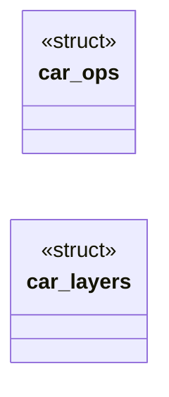

# `include/css_atrule.h`

> Source: [include/css_atrule.h:1](../../include/css_atrule.h#L1) | language `h` | coverage 70.0% | [API index](../index.md)

## Contents

- **Structs:** [`car_ops`](#car_ops), [`car_layers`](#car_layers)
- **Functions:** [`car_supports`](#car_supports), [`car_layer_rank`](#car_layer_rank), [`car_effective_spec`](#car_effective_spec)
- **Macros:** [`CAR_MAX_DEPTH`](#car_max_depth), [`CAR_MAX_LAYERS`](#car_max_layers), [`CAR_LAYER_NAME_MAX`](#car_layer_name_max), [`CAR_INLINE_SPEC`](#car_inline_spec)

## Type Diagram



## Structs

<a id="car_ops"></a>

### `car_ops`

`struct` | [include/css_atrule.h:22](../../include/css_atrule.h#L22)

```c
typedef struct car_ops
```

The questions @supports asks the caller's own engine. prop is lowercased and both strings are trimmed and NUL-terminated.

Nonzero = supported.

---

<a id="car_layers"></a>

### `car_layers`

`struct` | [include/css_atrule.h:31](../../include/css_atrule.h#L31)

```c
typedef struct car_layers
```

---

## Functions

<a id="car_supports"></a>

### `car_supports`

`function` | [include/css_atrule.h:29](../../include/css_atrule.h#L29)

```c
int car_supports(const char *s, size_t a, size_t b, const car_ops *ops);
```

Evaluates the @supports prelude s[a,b).

1 = true, 0 = false or malformed.

**Parameters**

| Name | Type | Default | Description |
|---|---|---|---|
| `s` | `char *` |  |  |
| `a` | `size_t` |  |  |
| `b` | `size_t` |  |  |
| `ops` | `car_ops *` |  |  |

**Returns:** `int`

---

<a id="car_layer_rank"></a>

### `car_layer_rank`

`function` | [include/css_atrule.h:40](../../include/css_atrule.h#L40)

```c
int car_layer_rank(car_layers *L, const char *name, size_t len);
```

Rank (1..CAR_MAX_LAYERS) of the layer whose full dotted name is name[0,len), registering it on first sight. len == 0 registers a fresh anonymous layer.

A name at/over CAR_LAYER_NAME_MAX, or a full registry, maps to CAR_MAX_LAYERS.

**Parameters**

| Name | Type | Default | Description |
|---|---|---|---|
| `L` | `car_layers *` |  |  |
| `name` | `char *` |  |  |
| `len` | `size_t` |  |  |

**Returns:** `int`

---

<a id="car_effective_spec"></a>

### `car_effective_spec`

`function` | [include/css_atrule.h:44](../../include/css_atrule.h#L44)

```c
int car_effective_spec(int spec, int layer, int important);
```

Folds layer rank and specificity into one comparable value (layer first). layer 0 = unlayered.

Important declarations reverse the layer order.

**Parameters**

| Name | Type | Default | Description |
|---|---|---|---|
| `spec` | `int` |  |  |
| `layer` | `int` |  |  |
| `important` | `int` |  |  |

**Returns:** `int`

---

## Macros

<a id="car_max_depth"></a>

### `CAR_MAX_DEPTH`

`macro` | [include/css_atrule.h:15](../../include/css_atrule.h#L15)

```c
#define CAR_MAX_DEPTH
```

---

<a id="car_max_layers"></a>

### `CAR_MAX_LAYERS`

`macro` | [include/css_atrule.h:16](../../include/css_atrule.h#L16)

```c
#define CAR_MAX_LAYERS
```

nested parens in one @supports condition

---

<a id="car_layer_name_max"></a>

### `CAR_LAYER_NAME_MAX`

`macro` | [include/css_atrule.h:17](../../include/css_atrule.h#L17)

```c
#define CAR_LAYER_NAME_MAX
```

distinct named/anonymous layers per sheet

---

<a id="car_inline_spec"></a>

### `CAR_INLINE_SPEC`

`macro` | [include/css_atrule.h:18](../../include/css_atrule.h#L18)

```c
#define CAR_INLINE_SPEC
```

bytes of a full dotted layer name, exclusive

---
