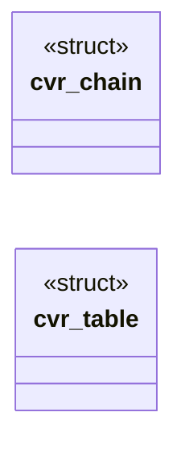

# `include/css_chain.h`

> Source: [include/css_chain.h:1](../../include/css_chain.h#L1) | language `h` | coverage 22.2% | [API index](../index.md)

## Contents

- **Structs:** [`cvr_chain`](#cvr_chain), [`cvr_table`](#cvr_table)
- **Functions:** [`cch_element_matches`](#cch_element_matches), [`lacks`](#lacks), [`box`](#box)
- **Macros:** [`CCH_CHAIN_MAX`](#cch_chain_max), [`CCH_SIB_MAX`](#cch_sib_max), [`CCH_NTH_MAX`](#cch_nth_max)

## Type Diagram



## Structs

<a id="cvr_chain"></a>

### `cvr_chain`

`struct` | [include/css_chain.h:51](../../include/css_chain.h#L51)

```c
struct cvr_chain;
```

---

<a id="cvr_table"></a>

### `cvr_table`

`struct` | [include/css_chain.h:52](../../include/css_chain.h#L52)

```c
struct cvr_table;
```

---

## Functions

<a id="cch_element_matches"></a>

### `cch_element_matches`

`function` | [include/css_chain.h:69](../../include/css_chain.h#L69)

```c
int cch_element_matches(lxb_dom_element_t *el, const css_sel *sel);
```

Nonzero iff the parsed selector *sel matches element `el`, built against the same bounded ancestor/sibling/attribute context as cch_element_style.

This is the single source of truth for selector matching: the DOM's querySelector and the author-CSS cascade agree by construction. `sel` is a pre-parsed css_sel (see csel_parse); NULL args return 0 (fail closed).

**Parameters**

| Name | Type | Default | Description |
|---|---|---|---|
| `el` | `lxb_dom_element_t *` |  |  |
| `sel` | `css_sel *` |  |  |

**Returns:** `int`

*Called by:* [`attributes`](src.page_view.c.md#attributes)

---

<a id="lacks"></a>

### `lacks`

`function` | [include/css_chain.h:73](../../include/css_chain.h#L73)

```c
* the element lacks (csel's subj_req) is rejected before the ancestor chain is built: on a * query that scans a whole document nearly every candidate dies there, so the scan no longer * pays O(depth)
```

**Parameters**

| Name | Type | Default | Description |
|---|---|---|---|
| `subj_req` | `csel's` |  |  |

**Returns:** `* the element`

---

<a id="box"></a>

### `box`

`function` | [include/css_chain.h:79](../../include/css_chain.h#L79)

```c
* generated box (css_resolve_pseudo) against the same element context. * font_size is el's own COMPUTED font-size (the pseudo inherits it) and * inherited el's own custom-property chain (NULL = none).
```

**Returns:** `* generated`

---

## Macros

<a id="cch_chain_max"></a>

### `CCH_CHAIN_MAX`

`macro` | [include/css_chain.h:26](../../include/css_chain.h#L26)

```c
#define CCH_CHAIN_MAX
```

Bounds (anti-DoS; beyond each the context reads unknown/absent, fail closed): ancestors carried for combinator matching, preceding siblings carried for the subject's `+`/`~`, and the sibling-position walk cap.

---

<a id="cch_sib_max"></a>

### `CCH_SIB_MAX`

`macro` | [include/css_chain.h:27](../../include/css_chain.h#L27)

```c
#define CCH_SIB_MAX
```

---

<a id="cch_nth_max"></a>

### `CCH_NTH_MAX`

`macro` | [include/css_chain.h:28](../../include/css_chain.h#L28)

```c
#define CCH_NTH_MAX
```

---
