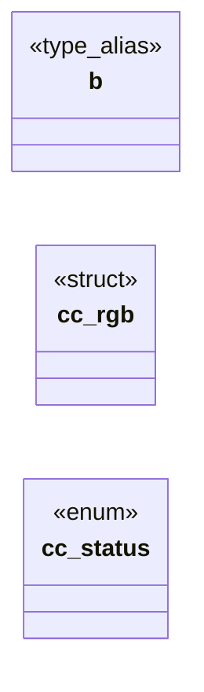

# `include/css_color.h`

> Source: [include/css_color.h:1](../../include/css_color.h#L1) | language `h` | coverage 42.9% | [API index](../index.md)

## Contents

- **Structs:** [`cc_rgb`](#cc_rgb)
- **Enums:** [`cc_status`](#cc_status)
- **Type Aliases:** [`b`](#b)
- **Functions:** [`cc_pack`](#cc_pack)
- **Macros:** [`CC_COLOR_CURRENT`](#cc_color_current), [`CC_COLOR_TRANSPARENT`](#cc_color_transparent)

## Type Diagram



## Structs

<a id="cc_rgb"></a>

### `cc_rgb`

`struct` | [include/css_color.h:27](../../include/css_color.h#L27)

```c
typedef struct cc_rgb
```

---

## Enums

<a id="cc_status"></a>

### `cc_status`

`enum` | [include/css_color.h:31](../../include/css_color.h#L31)

```c
typedef enum cc_status
```

---

## Type Aliases

<a id="b"></a>

### `b`

`type_alias` | [include/css_color.h:26](../../include/css_color.h#L26)

```c
typedef struct cc_rgb { unsigned char r, g, b;
```

css_color — pure CSS color token parser.

No I/O, no global state, no allocation. Decodes a single CSS color token
(hostile data with provenance) into an opaque 8-bit-per-channel RGB, or fails
closed. It paints nothing; it only decodes, so the rule lives in exactly one
auditable, tested place (page_view consults it when extracting an author color;
the rest of the pipeline carries the validated result).

Supports #rgb / #rgba / #rrggbb / #rrggbbaa hex (alpha validated then dropped),
rgb()/rgba() with integer or percentage components, hsl()/hsla() with integer
H and percentage S/L, the extended set of CSS named colors,
transparent (stores as rbga(0,0,0,0)), and currentColor (resolved at render
time to the element's [`color`](include.css.h.md#color) property). Anything else (var(), color-mix(),
unknown names, junk) is CC_ERR_SYNTAX so the caller can fall back to the theme.

See spec/css_color.md for the full contract.

---

## Functions

<a id="cc_pack"></a>

### `cc_pack`

`function` | [include/css_color.h:49](../../include/css_color.h#L49)

```c
int cc_pack(cc_rgb c);
```

Packs a color into a non-negative 0x00RRGGBB integer (suitable for transport and for the pipeline's "no color" sentinel of -1).

**Parameters**

| Name | Type | Default | Description |
|---|---|---|---|
| `c` | `cc_rgb` |  |  |

**Returns:** `int`

*Called by:* [`cv_parse_color`](src.css_values.c.md#cv_parse_color), [`PV_COLOR_TOKEN_MAX`](src.page_view.c.md#pv_color_token_max)

---

## Macros

<a id="cc_color_current"></a>

### `CC_COLOR_CURRENT`

`macro` | [include/css_color.h:59](../../include/css_color.h#L59)

```c
#define CC_COLOR_CURRENT
```

Sentinel values used by the cascade to represent special CSS color keywords. -1  = unset / not specified (inherits or defaults to theme) -2  = CC_COLOR_CURRENT   ("currentColor": use the element's [`color`](include.css.h.md#color) value) -3  = CC_COLOR_TRANSPARENT ("transparent": fully transparent)

---

<a id="cc_color_transparent"></a>

### `CC_COLOR_TRANSPARENT`

`macro` | [include/css_color.h:60](../../include/css_color.h#L60)

```c
#define CC_COLOR_TRANSPARENT
```

---
